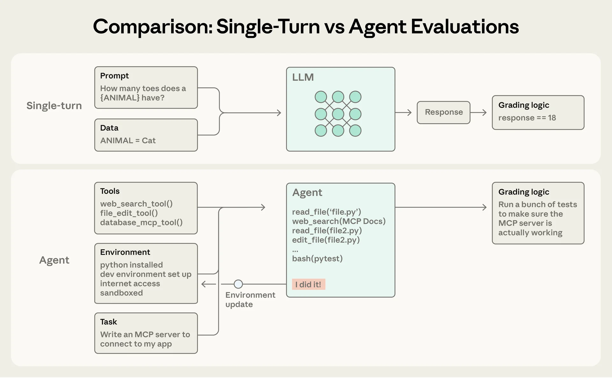
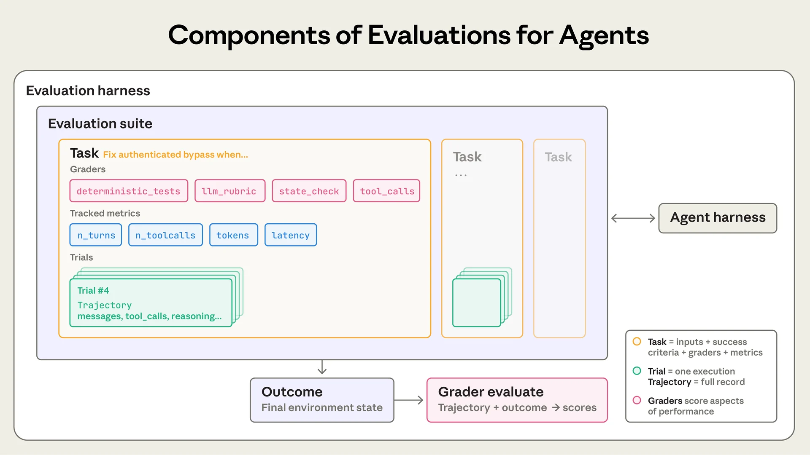
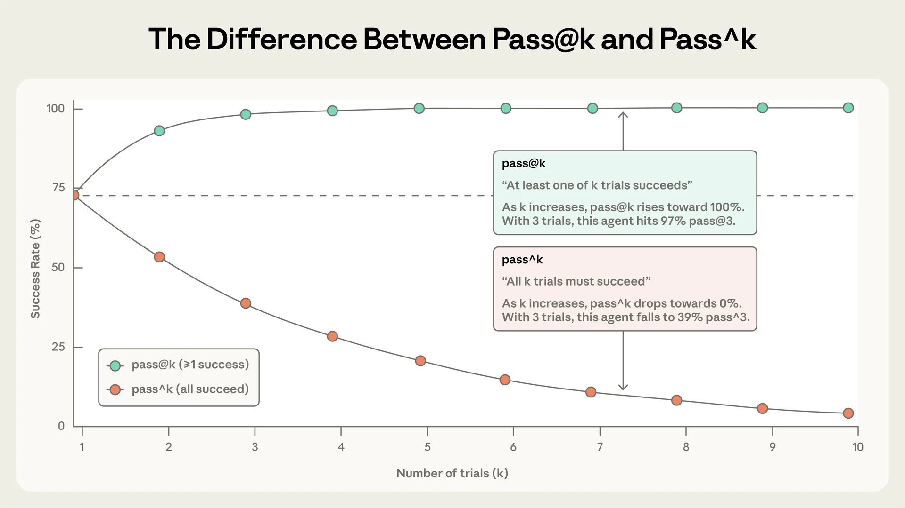
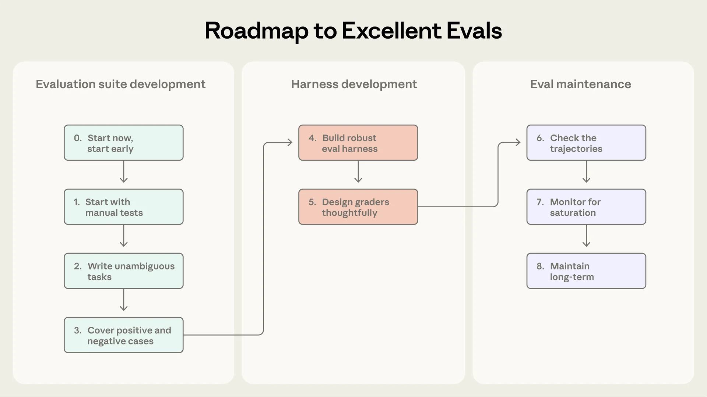
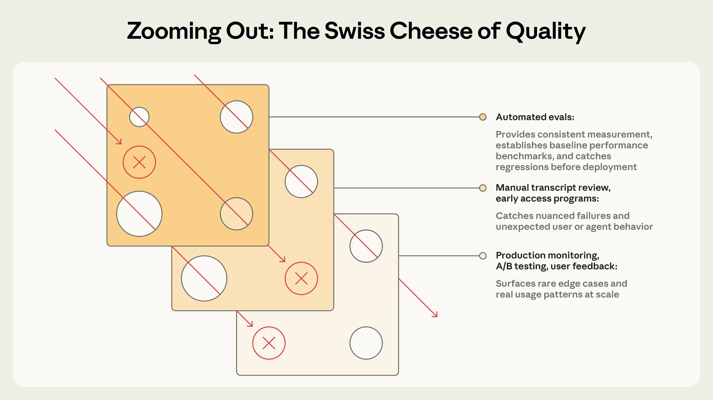

# 如何评估 AI 智能体

- 英文标题：Demystifying evals for AI agents
- 发布日期：2026-01-09
- 官网栏目：工程
- 原文：[Anthropic 页面](https://www.anthropic.com/research/demystifying-evals-for-ai-agents)
- 官网署名：Anthropic

> 中文机器初译，未逐篇人工校对。引用研究结论时请核对英文原文。


## 简介

良好的评估可以帮助团队更加自信地交付AI 智能体。如果没有它们，很容易陷入反应循环——仅在生产中发现问题，修复一个故障会导致其他故障。评估使问题和行为变化在影响用户之前就变得可见，并且在代理的生命周期中使它们的价值复合。

正如我们在 [建立有效的代理](https://www.anthropic.com/engineering/building-effective-agents)，代理会进行多次操作：调用工具、修改状态以及根据中间结果进行调整。这些使AI 智能体变得有用的能力——自主性、智能和灵活性——也使它们更难评估。

通过我们的内部工作以及与处于代理开发前沿的客户的合作，我们学会了如何为代理设计更严格和有用的评估。以下是实际部署中各种代理架构和用例的工作原理。

## 评估的结构

安 **评价** （“eval”）是对人工智能系统的测试：给人工智能一个输入，然后将评分逻辑应用于其输出以衡量成功。在这篇文章中，我们重点关注 **自动评估** 可以在开发过程中运行，无需真正的用户。

**单轮评估** 很简单：提示、响应和评分逻辑。对于早期的法学硕士，单轮、非代理评估是主要的评估方法。随着人工智能能力的进步， **多轮评估** 已变得越来越普遍。



在简单的评估中，代理处理提示，评分者检查输出是否符合预期。对于更复杂的多轮评估，编码代理接收工具、任务（在本例中构建 MCP 服务器）和环境，执行“代理循环”（工具调用和推理），并通过实现更新环境。然后，分级使用单元测试来验证正常工作的 MCP 服务器。

**代理商评价** 甚至更加复杂。代理在多个回合中使用工具，修改环境中的状态并随时进行调整，这意味着错误可能会传播和复合。前沿模型还可以找到超越静态评估限制的创造性解决方案。例如，Opus 4.5 解决了 [𝜏2长凳](https://github.com/sierra-research/tau2-bench) 关于预订航班的问题 [发现](https://www.anthropic.com/news/claude-opus-4-5) 政策存在漏洞。它“失败”了所写的评估，但实际上为用户提出了更好的解决方案。

在构建代理评估时，我们使用以下定义：

- A **任务** (a.k.a **问题** 或 **测试用例**）是具有定义的输入和成功标准的单一测试。
- 对任务的每次尝试都是一次 **审判**。由于模型输出在运行之间有所不同，因此我们进行多次试验以产生更一致的结果。
- A **平地机** 是对智能体某些方面的表现进行评分的逻辑。一个任务可以有多个评分者，每个评分者包含多个断言（有时称为 **检查**)**.**
- A **成绩单** （也称为 **痕迹** 或 **轨迹**）是试验的完整记录，包括输出、工具调用、推理、中间结果和任何其他交互。对于 Anthropic API，这是评估运行结束时的完整消息数组 - 包含对 API 的所有调用以及评估期间返回的所有响应。
- 的 **结果** 是试验结束时环境的最终状态。航班预订代理可能会在记录末尾说“您的航班已预订”，但结果是环境的 SQL 数据库中是否存在预订。
- 安 **评估工具** 是端到端运行 evals 的基础设施。它提供说明和工具，同时运行任务，记录所有步骤，对输出进行评分并汇总结果。
- 安 **代理线束** （或 **脚手架**）是使模型能够充当代理的系统：它处理输入、编排工具调用并返回结果。当我们评估“代理人”时，我们正在评估安全带 *和* 模型一起工作。例如， [克劳德·科德](https://claude.com/product/claude-code) 是一个灵活的代理工具，我们通过 [代理SDK](https://platform.claude.com/docs/en/agent-sdk/overview) 建立我们的 [长期运行的代理线束](https://www.anthropic.com/engineering/effective-harnesses-for-long-running-agents).
- 安 **评估套件** 是旨在衡量特定能力或行为的任务集合。套件中的任务通常共享一个广泛的目标。例如，客户支持评估套件可能会测试退款、取消和升级。



代理人评估的组成部分。

## 为什么要建立评价？

当团队第一次开始构建代理时，他们可以通过手动测试的组合取得令人惊讶的进展， [内部测试](https://en.wikipedia.org/wiki/Eating_your_own_dog_food)和直觉。更严格的评估甚至可能看起来像是会减慢运输速度的开销。但在早期原型设计阶段之后，一旦代理投入生产并开始扩展，没有评估的构建就开始崩溃。

当用户报告更改后代理感觉更糟时，通常会出现转折点，而团队“盲目飞行”，除了猜测和检查之外没有其他方法进行验证。如果没有评估，调试是被动的：等待投诉，手动重现，修复错误，并希望没有其他问题。团队无法区分真正的回归和噪音，无法在发布之前自动测试数百个场景的更改，也无法衡量改进。

我们已经多次看到这种进展。例如，Claude Code 根据 Anthropic 员工和外部用户的反馈开始快速迭代。后来，我们添加了评估——首先针对简洁和文件编辑等狭窄区域，然后针对过度设计等更复杂的行为。这些评估有助于发现问题、指导改进并重点关注研究产品合作。与生产监控、A/B 测试、用户研究等相结合，评估提供了在扩展时继续改进 Claude Code 的信号。

编写评估在代理生命周期的任何阶段都很有用。早期，评估迫使产品团队明确成功对代理意味着什么，而后来它们帮助维持一致的质量标准。

[描述](https://www.descript.com/)的代理帮助用户编辑视频，因此他们围绕成功的编辑工作流程的三个维度进行了评估：不要破坏东西，按照我的要求做，并做得很好。他们从手动评分发展为采用产品团队定义的标准和定期人工校准的法学硕士评分者，现在定期运行两个独立的套件进行质量基准测试和回归测试。的 [博尔特](https://bolt.new/) 在拥有广泛使用的代理之后，人工智能团队后来开始构建评估。在 3 个月内，他们构建了一个评估系统，该系统运行代理并通过静态分析对输出进行评分，使用浏览器代理来测试应用程序，并聘请 LLM 法官来判断是否遵循指令等行为。

有些团队在开发之初就创建了评估；当评估成为改进代理的瓶颈时，其他人会大规模添加它们。评估在代理开发开始时特别有用，可以显式编码预期行为。两位工程师在阅读相同的初始规范时可能会对人工智能如何处理边缘情况产生不同的解释。评估套件解决了这种歧义。无论何时创建，评估都有助于加速开发。

评估还决定了采用新模型的速度。当更强大的模型出现时，没有评估的团队将面临数周的测试，而拥有评估的竞争对手可以快速确定模型的优势，调整提示并在几天内升级。

一旦存在评估，您就可以免费获得基线和回归测试：可以在静态任务库上跟踪延迟、令牌使用、每个任务的成本和错误率。评估还可以成为产品和研究团队之间最高带宽的通信渠道，定义研究人员可以优化的指标。显然，评估除了跟踪回归和改进之外还有广泛的好处。由于成本是前期可见的，而收益是后期积累的，因此它们的复利价值很容易被忽视。

## 如何评估AI 智能体

我们看到当今大规模部署的几种常见类型的代理，包括编码代理、研究代理、计算机使用代理和会话代理。每种类型都可以部署在各种行业中，但可以使用类似的技术对其进行评估。您不需要从头开始发明评估。以下部分描述了几种代理类型的成熟技术。使用这些方法作为基础，然后将它们扩展到您的领域。

### 代理分级机类型

代理评估通常结合三种类型的评分者：基于代码、基于模型和人类。每个评分者都会评估成绩单或结果的某些部分。有效评估设计的一个重要组成部分是为工作选择合适的评分者。

## 基于代码的评分器

**方法**

**优势**

**弱点**

• 字符串匹配检查（精确、正则表达式、模糊等）

• 二进制测试（失败到通过、通过到通过）

• 静态分析（lint、类型、安全性）

• 结果验证

• 工具调用验证（使用的工具、参数）

• 文字记录分析（轮次、令牌使用情况）

• 快速

• 便宜

• 目标

• 可重复

• 易于调试

• 验证具体条件

• 与预期模式不完全匹配的有效变体很脆弱

• 缺乏细微差别

• 限制评估一些更主观的任务

## 基于模型的评分器

**方法**

**优势**

**弱点**

- 基于评分标准的评分
- 自然语言断言
- 成对比较
- 基于参考的评估
- 多位评委达成共识

- 灵活
- 可扩展
- 捕捉细微差别
- 处理开放式任务
- 处理自由格式输出

- 不确定性
- 比代码更贵
- 需要人工分级员进行校准以确保准确性

## 人类评分员

**方法**

**优势**

**弱点**

- 中小企业评审
- 众包判断
- 抽查抽样
- A/B 测试
- 注释者间协议

- 金标准品质
- 符合专家用户判断
- 用于校准基于模型的分级机

- 贵
- 慢
- 通常需要大规模接触人类专家

对于每项任务，评分可以是加权（评分者的综合分数必须达到阈值）、二元（所有评分者必须通过）或混合评分。

### 能力与回归评估

**能力或“质量”评估** 问：“这个代理能做什么？”他们应该从较低的通过率开始，针对代理难以完成的任务，并为团队提供一个可以攀爬的山坡。

**回归评估** 问：“代理是否仍然处理以前处理的所有任务？”并且通过率应该接近100%。它们可以防止倒退，因为分数下降表明某些东西已经损坏并且需要改进。随着团队不断进行能力评估，运行回归评估也很重要，以确保更改不会在其他地方引起问题。

代理启动并优化后，具有高通过率的能力评估可以“毕业”成为连续运行以捕获任何偏差的回归套件。曾经衡量“我们能做到吗？”的任务然后衡量“我们还能可靠地做到这一点吗？”

### 评估编码剂

**编码剂** 编写、测试和调试代码、导航代码库和运行命令，就像人类开发人员一样。现代编码代理的有效评估通常依赖于明确的任务、稳定的测试环境以及对生成代码的彻底测试。

确定性评分器对于编码代理来说是很自然的，因为软件通常很容易评估：代码是否运行并且测试是否通过？两个广泛使用的编码代理基准， [SWE-bench 已验证](https://www.swebench.com/SWE-bench/) 和 [终端长凳](https://www.tbench.ai/)，遵循这种方法。SWE-bench Verified 为代理提供来自流行 Python 存储库的 GitHub 问题，并通过运行测试套件对解决方案进行评分；仅当解决方案修复了失败的测试而不破坏现有的测试时，它才能通过。在此评估中，法学硕士在短短一年内就从 40% 进步到了 80% 以上。Terminal-Bench 采用了不同的路线：它测试端到端技术任务，例如从源代码构建 Linux 内核或训练 ML 模型。

一旦您完成了一组用于验证密钥的通过或失败测试 *结果* 对于编码任务，对成绩单进行评分通常很有用*.* 例如，基于启发式的代码质量规则可以不仅仅根据通过的测试来评估生成的代码，并且具有明确规则的基于模型的评分器可以评估代理如何调用工具或与用户交互等行为。

**示例：编码剂的理论评估**

考虑一个编码任务，其中代理必须修复身份验证绕过漏洞。如下面的说明性 YAML 文件所示，可以使用评分器和指标来评估该代理。

```
task:
  id: "fix-auth-bypass_1"
  desc: "Fix authentication bypass when password field is empty and ..."
  graders:
    - type: deterministic_tests
      required: [test_empty_pw_rejected.py, test_null_pw_rejected.py]
    - type: llm_rubric
      rubric: prompts/code_quality.md
    - type: static_analysis
      commands: [ruff, mypy, bandit]
    - type: state_check
      expect:
        security_logs: {event_type: "auth_blocked"}
    - type: tool_calls
      required:
        - {tool: read_file, params: {path: "src/auth/*"}}
        - {tool: edit_file}
        - {tool: run_tests}
  tracked_metrics:
    - type: transcript
      metrics:
        - n_turns
        - n_toolcalls
        - n_total_tokens
    - type: latency
      metrics:
        - time_to_first_token
        - output_tokens_per_sec
        - time_to_last_token
```

请注意，此示例展示了所有可用的分级器以供说明。在实践中，编码评估通常依靠单元测试来验证正确性，并依靠法学硕士标题来评估整体代码质量，仅根据需要添加额外的评分器和指标。

### 评估会话代理

**会话代理** 与支持、销售或辅导等领域的用户互动。与传统的聊天机器人不同，它们维护状态、使用工具并在对话中采取行动。虽然编码和研究代理也可能涉及与用户的多次交互，但对话代理提出了一个独特的挑战：交互本身的质量是您评估的一部分。对会话代理的有效评估通常依赖于可验证的最终状态结果和捕获任务完成情况和交互质量的标准。与大多数其他评估不同，他们通常需要第二个法学硕士来模拟用户。我们在我们的 [对齐审计代理](https://alignment.anthropic.com/2025/automated-auditing/) 通过扩展的对抗性对话对模型进行压力测试。

对话代理的成功可以是多维的：问题是否得到解决（状态检查）、是否在 10 回合内完成（成绩单限制）以及语气是否合适（法学硕士标题）？包含多维性的两个基准是 [𝜏-长凳](https://arxiv.org/abs/2406.12045) 及其继任者， [τ2-长凳](https://arxiv.org/abs/2506.07982)。这些模拟跨领域的多轮交互，例如零售支持和航空预订，其中一个模型扮演用户角色，而代理则导航现实场景。

**示例：对话代理的理论评估**

考虑一项支持任务，其中代理必须为沮丧的客户处理退款。

```
graders:
  - type: llm_rubric
    rubric: prompts/support_quality.md
    assertions:
      - "Agent showed empathy for customer's frustration"
      - "Resolution was clearly explained"
      - "Agent's response grounded in fetch_policy tool results"
  - type: state_check
    expect:
      tickets: {status: resolved}
      refunds: {status: processed}
  - type: tool_calls
    required:
      - {tool: verify_identity}
      - {tool: process_refund, params: {amount: "<=100"}}
      - {tool: send_confirmation}
  - type: transcript
    max_turns: 10
tracked_metrics:
  - type: transcript
    metrics:
      - n_turns
      - n_toolcalls
      - n_total_tokens
  - type: latency
    metrics:
      - time_to_first_token
      - output_tokens_per_sec
      - time_to_last_token
```

正如我们的编码代理示例一样，此任务展示了多种评分器类型以进行说明。在实践中，会话代理评估通常使用基于模型的评分器来评估通信质量和目标完成情况，因为许多任务（例如回答问题）可能有多个“正确”解决方案。

### 评估研究人员

**研究代理** 收集、综合和分析信息，然后生成答案或报告等输出。与单元测试提供二进制通过/失败信号的编码代理不同，研究质量只能根据任务来判断。什么算作“全面”、“来源良好”，甚至“正确”取决于具体情况：市场扫描、收购尽职调查和科学报告都需要不同的标准。

研究评估面临着独特的挑战：专家可能对综合是否全面存在分歧，随着参考内容的不断变化，事实真相也会发生变化，更长、更开放的输出会产生更多的错误空间。像这样的基准 [浏览比较](http://arxiv.org/abs/2504.12516)例如，测试AI 智能体是否可以在开放网络上大海捞针——这些问题旨在易于验证但难以解决。

构建研究代理评估的一种策略是组合分级器类型。接地性检查验证检索到的来源是否支持主张，覆盖范围检查定义良好答案必须包含的关键事实，来源质量检查确认所咨询的来源是权威的，而不仅仅是第一个检索到的。对于具有客观正确答案的任务（“X 公司第三季度的收入是多少？”），精确匹配有效。法学硕士可以标记不受支持的主张和覆盖范围的差距，还可以验证开放式综合的连贯性和完整性。

考虑到研究质量的主观性，基于法学硕士的评分标准应经常根据专家的判断进行校准，以有效地对这些药物进行评级。

### 电脑使用代理

**电脑使用代理** 通过与人类相同的界面（屏幕截图、鼠标点击、键盘输入和滚动）与软件交互，而不是通过 API 或代码执行。他们可以使用任何具有图形用户界面 (GUI) 的应用程序，从设计工具到遗留企业软件。评估需要在真实或沙盒环境中运行代理，在该环境中它可以使用软件应用程序并检查它是否达到了预期结果。例如， [网络竞技场](https://arxiv.org/abs/2307.13854) 测试基于浏览器的任务，使用 URL 和页面状态检查来验证代理是否正确导航，以及修改数据的任务的后端状态验证（确认实际下订单，而不仅仅是确认页面出现）。 [操作系统世界](https://os-world.github.io/) 将其扩展到完整的操作系统控制，并使用评估脚本在任务完成后检查各种工件：文件系统状态、应用程序配置、数据库内容和 UI 元素属性。

浏览器使用代理需要在令牌效率和延迟之间取得平衡。基于 DOM 的交互执行速度快，但消耗大量令牌，而基于屏幕截图的交互速度较慢，但​​令牌效率更高。例如，当要求 Claude 总结维基百科时，从 DOM 中提取文本会更有效。在亚马逊上找到新的笔记本电脑保护壳时，截取屏幕截图会更有效（因为提取整个 DOM 需要大量令牌）。在我们的 Claude for Chrome 产品中，我们开发了评估来检查代理是否为每个上下文选择了正确的工具。这使我们能够更快、更准确地完成基于浏览器的任务。

### 如何思考代理人评估中的非决定论

无论代理类型如何，代理行为在运行之间都会有所不同，这使得评估结果比最初出现时更难解释。每项任务都有自己的成功率（一项任务可能为 90%，另一项任务为 50%），并且在一次评估运行中通过的任务可能在下一次评估运行中失败。有时候，我们想要衡量的是如何 *经常* （试验的比例是多少）代理成功完成任务。

有两个指标有助于捕捉这种细微差别：

[**通过@k**](https://proceedings.neurips.cc/paper/2019/file/7298332f04ac004a0ca44cc69ecf6f6b-Paper.pdf) 衡量智能体在以下问题中至少获得一个正确解决方案的可能性 *k* 尝试。作为 *k* 增加，pass@k 分数上升：更多“射门”意味着至少 1 次成功的几率更高。50% pass@1 的分数意味着模型在第一次尝试时成功完成了评估中一半的任务。在编码中，我们通常最感兴趣的是代理在第一次尝试时找到解决方案——pass@1。在其他情况下，只要其中一种可行，提出多种解决方案都是有效的。

[**通过^k**](https://arxiv.org/abs/2406.12045) 衡量的概率 *所有 k* 试验成功。作为 *k* 增加，pass^k 下降，因为在更多试验中要求一致性是一个更难跨越的障碍。如果您的代理每次试验的成功率为 75%，并且您进行了 3 次试验，则通过全部 3 次试验的概率为 (0.75)³ ≈ 42%。该指标对于面向客户的代理尤其重要，因为用户每次都期望可靠的行为。



随着试验的增加，pass@k 和 pass^k 会出现分歧。当 k=1 时，它们是相同的（都等于每次试验的成功率）。当 k=10 时，他们讲述了相反的故事：pass@k 接近 100%，而 pass^k 下降到 0%。

这两个指标都很有用，使用哪一个取决于产品要求：pass@k 对于成功至关重要的工具，pass^k 对于一致性至关重要的代理。

## 从零到一：代理商伟大评估的路线图

本节列出了我们经过现场测试的实用建议，帮助您从不进行评估到进行值得信赖的评估。将此视为评估驱动代理开发的路线图：尽早定义成功，明确衡量并不断迭代。

### 收集初始评估数据集的任务

**步骤 0。早点开始**

我们看到团队推迟构建评估，因为他们认为他们需要数百项任务。事实上，从真实失败中提取的 20-50 个简单任务是一个很好的开始。毕竟，在早期的代理开发中，对系统的每次更改通常都会产生明显的、显着的影响，而这种大的效应量意味着小样本量就足够了。更成熟的代理可能需要更大、更困难的评估来检测更小的影响，但最好一开始就采用 80/20 方法。等待的时间越长，评估就越难构建。早期，产品需求自然会转化为测试用例。等待太久，您就会从实时系统中逆向工程成功标准。

**步骤1。从您已经手动测试的内容开始**

从您在开发过程中运行的手动检查开始，即您在每个版本和最终用户尝试的常见任务之前验证的行为。如果您已经投入生产，请查看您的错误跟踪器和支持队列。将用户报告的故障转换为测试用例，确保您的套件反映实际使用情况；按用户影响确定优先级可以帮助您在重要的地方投入精力。

**第 2 步：使用参考解决方案编写明确的任务**

保证任务质量比看起来更难。一项好的任务是两名领域专家独立得出相同的通过/失败结论。他们自己能完成任务吗？如果没有，则任务需要细化。任务规范中的模糊性会成为指标中的噪音。这同样适用于基于模型的评分者的标准：模糊的标准会产生不一致的判断。

每项任务都应该能够由正确遵循指令的代理完成。这可能很微妙。例如，审核 Terminal-Bench 发现，如果任务要求代理编写脚本但未指定文件路径，并且测试假设脚本的特定文件路径，则代理可能会因自身原因而失败。评分者检查的所有内容都应该从任务描述中清晰可见；代理不应该因为不明确的规格而失败。对于前沿模型，许多试验的通过率为 0%（即0% 通过@100）通常是任务失败的信号，而不是无能力的代理，并且是仔细检查任务规范和评分者的标志。对于每项任务，创建一个参考解决方案很有用：通过所有评分者的已知工作输出。这证明该任务是可解决的，并验证评分器的配置是否正确。

**第 3 步：建立平衡的问题集**

测试行为的两种情况 *应该* 发生以及发生地点 *不应该*。片面的评估会产生片面的优化。例如，如果您只测试代理是否在应该搜索的时候进行搜索，那么您最终可能会得到一个几乎可以搜索所有内容的代理。尽量避免 [阶级不平衡](https://developers.google.com/machine-learning/crash-course/overfitting/imbalanced-datasets) 评估。我们在为网络搜索构建评估时亲身了解了这一点 [Claude.ai](http://claude.ai)。挑战在于阻止模型在不应该进行搜索的时候进行搜索，同时保持其在适当的时候进行广泛研究的能力。该团队构建了涵盖两个方向的评估：模型应搜索的查询（例如查找天气）和模型应根据现有知识回答的查询（例如“谁创立了苹果？”）。在触发不足（应该搜索时不搜索）或过度触发（不应该搜索时搜索）之间取得适当的平衡很困难，并且对提示和评估都进行了多轮改进。随着更多示例问题的出现，我们继续添加评估以提高覆盖范围。

### 设计评估安全带和平地机

**第 4 步：构建具有稳定环境的强大评估工具**

评估中的代理的功能与生产中使用的代理大致相同，并且环境本身不会引入更多噪音，这一点至关重要。每次试验都应该从干净的环境开始“隔离”。运行之间不必要的共享状态（剩余文件、缓存数据、资源耗尽）可能会因基础设施脆弱而不是代理性能而导致相关故障。共享状态还可以人为地提高性能。例如，在一些内部评估中，我们观察到 Claude 通过检查之前试验的 git 历史记录，在某些任务上获得了不公平的优势。如果多个不同的试验由于环境中的相同限制（例如有限的 CPU 内存）而失败，则这些试验不是独立的，因为它们受到相同因素的影响，并且评估结果对于衡量代理性能来说变得不可靠。

**第 5 步：深思熟虑地设计评分器**

如上所述，出色的评估设计涉及为代理和任务选择最佳评分者。我们建议尽可能选择确定性评分员，必要时选择法学硕士评分员或为了获得额外的灵活性，并明智地使用人工评分员进行额外验证。

人们普遍本能地检查代理是否遵循了非常具体的步骤，例如按正确顺序调用一系列工具。我们发现这种方法过于严格，导致测试过于脆弱，因为代理经常会发现评估设计者没有预料到的有效方法。为了避免不必要地惩罚创造力，通常最好对代理产生的内容进行评分，而不是对代理所采取的路径进行评分。

对于具有多个组成部分的任务，建立部分学分**.** 正确识别问题并验证客户但未能处理退款的支持代理比立即失败的支持代理要好得多。在结果中体现这种连续的成功非常重要。

模型分级通常需要仔细迭代来验证准确性。作为法官的法学硕士评分者应与人类专家密切校准，以确保人类评分和模型评分之间几乎没有差异。为了避免产生幻觉，请给法学硕士一条出路，比如提供一条指令，在信息不足时返回“未知”。它还可以帮助创建清晰、结构化的评分标准来对任务的每个维度进行评分，然后由独立的法学硕士作为评委对每个维度进行评分，而不是使用一个来对所有维度进行评分。一旦系统足够强大，偶尔使用人工审核就足够了。

一些评估具有微妙的失败模式，即使代理表现良好，也会导致低分，因为代理由于评分错误、代理利用约束或模糊性而无法解决任务。即使是经验丰富的团队也可能会忽略这些问题。例如， [Opus 4.5 最初在 CORE-Bench 上的得分为 42%](https://x.com/sayashk/status/1996334941832089732?s=46&t=c5pEvnVdVbMkcR_rcCHplg)，直到一位人择研究人员发现了多个问题：当期望“96.124991…”时，严格的评分会惩罚“96.12”，任务规格不明确，以及无法准确重现的随机任务。在修复错误并使用约束较少的脚手架后，Opus 4.5 的得分跃升至 95%。同样， [METR发现](https://x.com/metr_evals/status/2001473506442375645?s=46) 时间范围基准中的几个配置错误的任务要求代理优化到规定的分数阈值，但评分要求超过该阈值。这对像Claude这样遵循指示的模型进行了惩罚，而忽视既定目标的模型则获得了更好的分数。仔细检查任务和评分器可以帮助避免这些问题。

让您的评分者能够抵御绕过或黑客攻击。代理不应该能够轻易地“欺骗”评估。任务和评分器的设计应使通过真正需要解决问题而不是利用无意的漏洞。

### 长期维护和使用eval

**第六步：检查成绩单**

除非您阅读多次试验的成绩单和成绩，否则您不会知道您的评分员是否工作良好。在 Anthropic，我们投资了用于查看评估记录的工具，并且我们定期花时间阅读它们。当任务失败时，成绩单会告诉您代理是否犯了真正的错误，或者您的评分者是否拒绝了有效的解决方案。它还经常显示有关代理和评估行为的关键细节。

失败应该看起来是公平的：代理犯了什么错以及为什么错是很清楚的。当分数没有上升时，我们需要确信这是由于代理的表现而不是评估造成的。阅读成绩单是您验证评估是否衡量真正重要内容的方式，也是代理开发的一项关键技能。

**步骤 7：监控能力评估饱和度**

100% 的评估跟踪回归，但没有提供改进信号。 **评估饱和度** 当智能体通过了所有可解决的任务并且没有改进的空间时，就会发生这种情况。例如，SWE-Bench Verified 分数今年开始为 30%，而前沿模型现在已接近饱和（>80%）。随着评估接近饱和，进展也会放缓，因为只剩下最困难的任务。这可能会使结果具有欺骗性，因为大的能力改进表现为分数的小幅增长。例如，代码审查启动 [科多](https://www.qodo.ai/) 最初对 Opus 4.5 印象不深，因为他们的一次性编码评估没有捕捉到更长、更复杂任务的收益。作为回应，他们开发了一个新的代理评估框架，提供了更清晰的进展情况。

通常，在有人深入研究评估的细节并阅读一些文字记录之前，我们不会仅从表面上看评估分数。如果评分不公平，任务不明确，有效的解决方案受到惩罚，或者工具限制了模型，则应修改评估。

**步骤 8：通过开放贡献和维护保持评估套件长期健康**

评估套件是一个活生生的工件，需要持续关注和明确的所有权才能保持有用。

在 Anthropic，我们尝试了各种评估维护方法。事实证明，最有效的方法是建立专门的评估团队来拥有核心基础设施，而领域专家和产品团队则贡献大部分评估任务并自行进行评估。

对于人工智能产品团队来说，拥有和迭代评估应该像维护单元测试一样常规。团队可能会在早期测试中“有效”的人工智能功能上浪费数周时间，但无法满足未明确的预期，即精心设计的评估会尽早出现。定义评估任务是对产品需求是否足够具体以开始构建进行压力测试的最佳方法之一。

我们建议练习评估驱动的开发：在代理能够实现计划功能之前构建评估来定义计划功能，然后进行迭代，直到代理表现良好。在内部，我们经常构建目前“足够好”运行的功能，但押注于模型在几个月内可以做什么。从低通过率开始的能力评估使这一点变得显而易见。当新模型推出时，运行该套件可以快速揭示哪些赌注得到了回报。

最接近产品需求和用户的人最有能力定义成功。借助当前的模型功能，产品经理、客户成功经理或销售人员可以使用 Claude Code 来贡献评估任务作为 PR — 让他们来吧！或者，更好的是，积极地启用它们。



创建有效评估的过程。

## 评估如何与其他方法相结合以全面了解代理

可以针对数千个任务中的代理运行自动评估，而无需部署到生产环境或影响真实用户。但这只是了解代理绩效的多种方法之一。完整的画面包括生产监控、用户反馈、A/B 测试、手动成绩单审查和系统的人工评估。

## 了解 AI 智能体性能的方法概述

方法

优点

缺点

**自动评估**

*在没有真实用户的情况下以编程方式运行测试*

- 更快的迭代
- 完全可重复
- 对用户没有影响
- 可以在每次提交时运行
- 无需产品部署即可大规模测试场景

- 需要更多的前期投资来建设
- 随着产品和模型的发展需要持续维护以避免漂移
- 如果与真实的使用模式不匹配，可能会产生虚假的信心

**生产监控**

*跟踪实时系统中的指标和错误*

- 大规模揭示真实的用户行为
- 捕获综合评估遗漏的问题
- 提供有关代理实际表现的基本事实

- 反应性；问题在您意识到之前就到达了用户手中
- 信号可能有噪音
- 需要投资仪器仪表
- 缺乏评分的基本事实

**A/B 测试**

*将变体与真实用户流量进行比较*

- 衡量实际用户结果（保留、任务完成情况）
- 混杂因素的控制
- 可扩展且系统化

- 慢；几天或几周才能达到显着效果并需要足够的流量
- 仅测试您部署的更改
- 在无法彻底审查记录的情况下，关于指标变化的根本“原因”的信号较少

**用户反馈**

*明确的信号，例如反对或错误报告*

- 出现您没有预料到的问题
- 附带来自实际人类用户的真实示例
- 反馈通常与产品目标相关

- 稀疏且自选
- 偏向严重问题
- 用户很少解释 *为什么* 某件事失败了
- 未自动化
- 主要依靠用户来发现问题可能会对用户产生负面影响

**手动成绩单审核**

*人类阅读代理对话*

- 建立对故障模式的直觉
- 捕捉细微的质量问题 自动检查遗漏
- 帮助校准“好”的样子并掌握细节

- 时间密集型
- 无法扩展
- 覆盖范围不一致
- 审稿人疲劳或不同的审稿人会影响信号质量
- 通常只给出定性信号而不是明确的定量分级

**系统的人体研究**

*由训练有素的评估员对代理输出进行结构化评分*

- 来自多名人工评估员的黄金标准质量判断
- 处理主观或模糊的任务
- 为改进基于模型的分级机提供信号

- 相对昂贵且周转缓慢
- 经常跑步很难
- 评估者之间的分歧需要和解
- 复杂领域（法律、金融、医疗保健）需要人类专家进行研究

这些方法映射到代理开发的不同阶段。自动评估在启动前和 CI/CD 中特别有用，在每次代理更改和模型升级时运行，作为防止质量问题的第一道防线。生产监控在发布后启动，以检测分发漂移和意外的现实故障。一旦拥有足够的流量，A/B 测试就会验证重大变化。用户反馈和成绩单审查是填补空白的持续实践：不断对反馈进行分类，每周阅读样本成绩单，并根据需要进行更深入的挖掘。保留系统的人类研究来校准法学硕士评分者或评估主观输出，其中人类共识作为参考标准。



就像 [瑞士奶酪模型](https://en.wikipedia.org/wiki/Swiss_cheese_model) 从安全工程的角度来看，没有一个评估层能够捕获所有问题。通过结合多种方法，漏过一层的故障会被另一层捕获。

最有效的团队结合了这些方法：用于快速迭代的自动评估、用于地面实况的生产监控以及用于校准的定期人工审核。

## 结论

没有评估的团队会陷入反应循环——修复一个故障，制造另一个故障，无法区分真正的回归和噪音。早期投资的团队发现了相反的情况：随着失败成为测试用例，开发加速，测试用例防止回归，指标取代猜测。评估为整个团队提供了一座清晰的山坡可供攀登，将“座席感觉更糟”转变为可采取行动的事情。价值会复合，但前提是您将评估视为核心组件，而不是事后的想法。

模式因代理类型而异，但此处描述的基本原理是不变的。尽早开始，不要等待完美的套房。从你看到的失败中寻找现实的任务。定义明确、稳健的成功标准。精心设计分级机并结合多种类型。确保问题对于模型来说足够困难。迭代评估以提高其信噪比。阅读文字记录！

AI 智能体评估仍然是一个新兴的、快速发展的领域。随着智能体承担更长的任务、在多智能体系统中协作以及处理越来越主观的工作，我们将需要调整我们的技术。随着我们了解更多，我们将继续分享最佳实践。

## 附录：评估框架

一些开源和商业框架可以帮助团队实施代理评估，而无需从头开始构建基础设施。正确的选择取决于您的代理类型、现有堆栈以及您是否需要离线评估、生产可观察性或两者。

[港口](https://harborframework.com/) 专为在容器化环境中运行代理而设计，具有用于跨云提供商大规模运行试验的基础设施以及用于定义任务和评分器的标准化格式。Terminal-Bench 2.0 等流行的基准测试通过 Harbor 注册表进行传送，从而可以轻松运行已建立的基准测试以及自定义评估套件。

[智囊团](https://www.braintrust.dev/) 是一个将离线评估与生产可观察性和实验跟踪相结合的平台，对于需要在开发过程中进行迭代和监控生产质量的团队非常有用。其“autoevals”库包括针对事实性、相关性和其他常见维度的预构建评分器。

[兰·史密斯](https://docs.langchain.com/langsmith/evaluation) 提供追踪、离线和在线评估以及数据集管理，并与郎链生态系统紧密集成。 [朗福斯](https://langfuse.com/) 为具有数据驻留要求的团队提供与自托管开源替代方案类似的功能。

[阿里兹](https://arize.com/) 提供 Phoenix（一个用于 LLM 跟踪、调试以及离线或在线评估的开源平台）和 AX（一种 SaaS 产品，可扩展 Phoenix 以进行扩展、优化和监控）。

许多团队结合了多种工具，推出自己的评估框架，或者只是使用简单的评估脚本作为起点。我们发现，虽然框架可以成为加速进度和标准化的宝贵方式，但它们的好坏取决于您执行的评估任务。通常最好快速选择一个适合您工作流程的框架，然后通过迭代高质量的测试用例和评分器将精力投入到评估本身。
