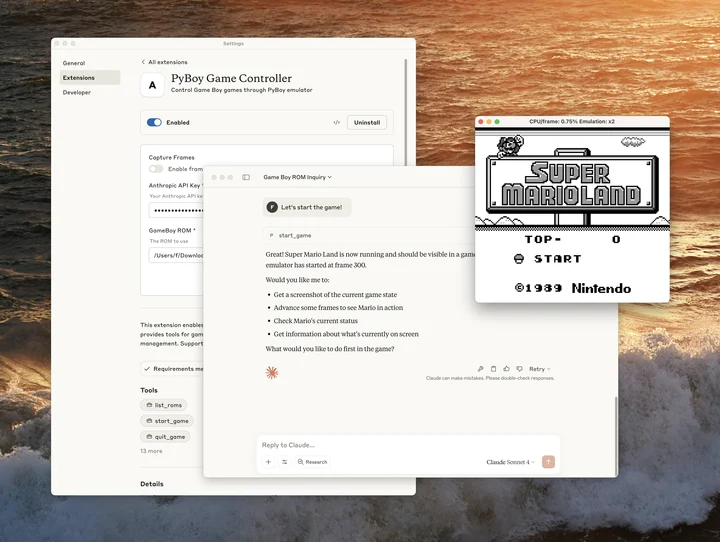

# 桌面扩展：为 Claude Desktop 一键安装 MCP 服务器

- 英文标题：Desktop Extensions: One-click MCP server installation for Claude Desktop
- 发布日期：2025-06-26
- 官网栏目：工程
- 原文：[Anthropic 页面](https://www.anthropic.com/research/desktop-extensions)
- 官网署名：Anthropic

> 中文机器初译，未逐篇人工校对。引用研究结论时请核对英文原文。

- 2025 年 9 月 11 日

  ### 文件扩展名更新

  Claude Desktop Extensions 现在使用 .mcpb（MCP 捆绑包）文件扩展名而不是 .dxt。现有的 .dxt 扩展名将继续有效，但我们建议开发人员使用 .mcpb 来扩展新的扩展名。所有功能保持不变 - 这纯粹是命名约定更新。

---

当我们去年发布模型上下文协议 (MCP) 时，我们看到开发人员构建了令人惊叹的本地服务器，使 Claude 能够访问从文件系统到数据库的所有内容。但我们不断听到同样的反馈：安装太复杂。用户需要开发工具，必须手动编辑配置文件，并且经常陷入依赖问题。

今天，我们将推出桌面扩展——一种新的打包格式，使安装 MCP 服务器变得像单击按钮一样简单。

## 解决 MCP 安装问题

本地 MCP 服务器为 Claude Desktop 用户释放强大的功能。它们可以与本地应用程序交互、访问私有数据并与开发工具集成，同时将数据保留在用户的计算机上。然而，当前的安装过程存在很大的障碍：

- **所需的开发工具**：用户需要安装 Node.js、Python 或其他运行时
- **手动配置**：每个服务器都需要编辑JSON配置文件
- **依赖管理**：用户必须解决包冲突和版本不匹配的问题
- **无发现机制**：找到有用的MCP服务器需要搜索GitHub
- **更新复杂度**：保持服务器最新意味着手动重新安装

这些摩擦点意味着 MCP 服务器尽管功能强大，但对于非技术用户来说仍然基本上无法访问。

## 桌面扩展简介

桌面扩展（`.mcpb` 文件）通过将整个 MCP 服务器（包括所有依赖项）捆绑到单个可安装包中来解决这些问题。以下是对用户的更改：

**之前：**

```
# Install Node.js first 
npm install -g @example/mcp-server 
# Edit ~/.claude/claude_desktop_config.json manually 
# Restart Claude Desktop 
# Hope it works
```

**之后：**

1. 下载一个 `.mcpb` 文件
2. 双击用Claude Desktop打开
3. 点击“安装”

就是这样。没有终端，没有配置文件，没有依赖冲突。

## 架构概述

桌面扩展是一个 zip 存档，其中包含本地 MCP 服务器以及 `manifest.json`，它描述了 Claude Desktop 和其他支持桌面扩展的应用程序需要了解的所有内容。

```
extension.mcpb (ZIP archive)
├── manifest.json         # Extension metadata and configuration
├── server/               # MCP server implementation
│   └── [server files]    
├── dependencies/         # All required packages/libraries
└── icon.png             # Optional: Extension icon

# Example: Node.js Extension
extension.mcpb
├── manifest.json         # Required: Extension metadata and configuration
├── server/               # Server files
│   └── index.js          # Main entry point
├── node_modules/         # Bundled dependencies
├── package.json          # Optional: NPM package definition
└── icon.png              # Optional: Extension icon

# Example: Python Extension
extension.mcpb (ZIP file)
├── manifest.json         # Required: Extension metadata and configuration
├── server/               # Server files
│   ├── main.py           # Main entry point
│   └── utils.py          # Additional modules
├── lib/                  # Bundled Python packages
├── requirements.txt      # Optional: Python dependencies list
└── icon.png              # Optional: Extension icon
```

桌面扩展中唯一需要的文件是manifest.json。Claude Desktop 可以处理所有的复杂性：

- **内置运行时**：我们将 Node.js 与 Claude Desktop 一起提供，消除了外部依赖
- **自动更新**：当有新版本可用时，扩展会自动更新
- **保密**：API 密钥等敏感配置存储在操作系统钥匙串中

清单包含人类可读的信息（如名称、描述或作者）、功能声明（工具、提示）、用户配置和运行时要求。大多数字段都是可选的，因此最小版本非常短，尽管在实践中，我们期望所有三种受支持的扩展类型（Node.js、Python 和经典二进制文件/可执行文件）都包含文件：

```
{
  "mcpb_version": "0.1",                    // MCPB spec version this manifest conforms to
  "name": "my-extension",                   // Machine-readable name (used for CLI, APIs)
  "version": "1.0.0",                       // Semantic version of your extension
  "description": "A simple MCP extension",  // Brief description of what the extension does
  "author": {                               // Author information (required)
    "name": "Extension Author"              // Author's name (required field)
  },
  "server": {                               // Server configuration (required)
    "type": "node",                         // Server type: "node", "python", or "binary"
    "entry_point": "server/index.js",       // Path to the main server file
    "mcp_config": {                         // MCP server configuration
      "command": "node",                    // Command to run the server
      "args": [                             // Arguments passed to the command
        "${__dirname}/server/index.js"      // ${__dirname} is replaced with the extension's directory
      ]                              
    }
  }
}
```

有多种便利选择 [在清单规范中可用](https://github.com/anthropics/dxt/blob/main/MANIFEST.md) 旨在使本地 MCP 服务器的安装和配置更加容易。服务器配置对象的定义方式可以为模板文字形式的用户定义配置以及特定于平台的覆盖留出空间。扩展开发人员可以详细定义他们想要从用户收集什么样的配置。

让我们看一下清单如何帮助配置的具体示例。在下面的清单中，开发人员声明用户需要提供 `api_key`。在用户提供该值之前，Claude不会启用扩展，将其自动保存在操作系统的秘密保险库中，并透明地替换 `${user_config.api_key}` 使用启动服务器时用户提供的值。同样， `${__dirname}` 将替换为扩展的解压目录的完整路径。

```
{
  "mcpb_version": "0.1",
  "name": "my-extension",
  "version": "1.0.0",
  "description": "A simple MCP extension",
  "author": {
    "name": "Extension Author"
  },
  "server": {
    "type": "node",
    "entry_point": "server/index.js",
    "mcp_config": {
      "command": "node",
      "args": ["${__dirname}/server/index.js"],
      "env": {
        "API_KEY": "${user_config.api_key}"
      }
    }
  },
  "user_config": {
    "api_key": {
      "type": "string",
      "title": "API Key",
      "description": "Your API key for authentication",
      "sensitive": true,
      "required": true
    }
  }
}
```

一个完整的 `manifest.json` 大多数可选字段可能如下所示：

```
{
  "mcpb_version": "0.1",
  "name": "My MCP Extension",
  "display_name": "My Awesome MCP Extension",
  "version": "1.0.0",
  "description": "A brief description of what this extension does",
  "long_description": "A detailed description that can include multiple paragraphs explaining the extension's functionality, use cases, and features. It supports basic markdown.",
  "author": {
    "name": "Your Name",
    "email": "yourname@example.com",
    "url": "https://your-website.com"
  },
  "repository": {
    "type": "git",
    "url": "https://github.com/your-username/my-mcp-extension"
  },
  "homepage": "https://example.com/my-extension",
  "documentation": "https://docs.example.com/my-extension",
  "support": "https://github.com/your-username/my-extension/issues",
  "icon": "icon.png",
  "screenshots": [
    "assets/screenshots/screenshot1.png",
    "assets/screenshots/screenshot2.png"
  ],
  "server": {
    "type": "node",
    "entry_point": "server/index.js",
    "mcp_config": {
      "command": "node",
      "args": ["${__dirname}/server/index.js"],
      "env": {
        "ALLOWED_DIRECTORIES": "${user_config.allowed_directories}"
      }
    }
  },
  "tools": [
    {
      "name": "search_files",
      "description": "Search for files in a directory"
    }
  ],
  "prompts": [
    {
      "name": "poetry",
      "description": "Have the LLM write poetry",
      "arguments": ["topic"],
      "text": "Write a creative poem about the following topic: ${arguments.topic}"
    }
  ],
  "tools_generated": true,
  "keywords": ["api", "automation", "productivity"],
  "license": "MIT",
  "compatibility": {
    "claude_desktop": ">=1.0.0",
    "platforms": ["darwin", "win32", "linux"],
    "runtimes": {
      "node": ">=16.0.0"
    }
  },
  "user_config": {
    "allowed_directories": {
      "type": "directory",
      "title": "Allowed Directories",
      "description": "Directories the server can access",
      "multiple": true,
      "required": true,
      "default": ["${HOME}/Desktop"]
    },
    "api_key": {
      "type": "string",
      "title": "API Key",
      "description": "Your API key for authentication",
      "sensitive": true,
      "required": false
    },
    "max_file_size": {
      "type": "number",
      "title": "Maximum File Size (MB)",
      "description": "Maximum file size to process",
      "default": 10,
      "min": 1,
      "max": 100
    }
  }
}
```

要查看扩展和清单，请参阅 [MCPB 存储库中的示例](https://github.com/anthropics/dxt/tree/main/examples).

中所有必填和可选字段的完整规范 `manifest.json` 可以作为我们的一部分找到 [开源工具链](https://github.com/anthropics/dxt/blob/main/MANIFEST.md).

## 构建您的第一个扩展

让我们逐步了解如何将现有 MCP 服务器打包为桌面扩展。我们将使用一个简单的文件系统服务器作为示例。

### 第 1 步：创建清单

首先，初始化服务器的清单：

```
npx @anthropic-ai/mcpb init
```

该交互式工具会询问您的服务器并生成完整的manifest.json。如果您想快速运行到最基本的 manifest.json，您可以使用 --yes 参数运行该命令。

### 第 2 步：处理用户配置

如果您的服务器需要用户输入（例如 API 密钥或允许的目录），请在清单中声明：

```
"user_config": {
  "allowed_directories": {
    "type": "directory",
    "title": "Allowed Directories",
    "description": "Directories the server can access",
    "multiple": true,
    "required": true,
    "default": ["${HOME}/Documents"]
  }
}
```

Claude桌面将：

- 显示用户友好的配置 UI
- 在启用扩展之前验证输入
- 安全存储敏感值
- 根据开发人员配置，将配置作为参数或环境变量传递到服务器

在下面的示例中，我们将用户配置作为环境变量传递，但它也可以是参数。

```
"server": {
   "type": "node",
   "entry_point": "server/index.js",
   "mcp_config": {
   "command": "node",
   "args": ["${__dirname}/server/index.js"],
   "env": {
      "ALLOWED_DIRECTORIES": "${user_config.allowed_directories}"
   }
   }
}
```

### 第三步：打包扩展

将所有内容打包成一个 `.mcpb` 文件：

```
npx @anthropic-ai/mcpb pack
```

这个命令：

1. 验证您的清单
2. 生成 `.mcpb` 存档

### 第四步：本地测试

拖动你的 `.mcpb` 文件进入 Claude Desktop 的设置窗口。你会看到：

- 有关您的扩展程序的人类可读信息
- 所需权限和配置
- 一个简单的“安装”按钮

## 高级功能

### 跨平台支持

扩展可以适应不同的操作系统：

```
"server": {
  "type": "node",
  "entry_point": "server/index.js",
  "mcp_config": {
    "command": "node",
    "args": ["${__dirname}/server/index.js"],
    "platforms": {
      "win32": {
        "command": "node.exe",
        "env": {
          "TEMP_DIR": "${TEMP}"
        }
      },
      "darwin": {
        "env": {
          "TEMP_DIR": "${TMPDIR}"
        }
      }
    }
  }
}
```

### 动态配置

使用模板文字作为运行时值：

- `${__dirname}`：扩展的安装目录
- `${user_config.key}`：用户提供的配置
- `${HOME}, ${TEMP}`：系统环境变量

### 特性声明

帮助用户预先了解功能：

```
"tools": [
  {
    "name": "read_file",
    "description": "Read contents of a file"
  }
],
"prompts": [
  {
    "name": "code_review",
    "description": "Review code for best practices",
    "arguments": ["file_path"]
  }
]
```

## 扩展目录

我们将推出内置于 Claude Desktop 中的精选扩展目录。用户可以一键浏览、搜索和安装，无需搜索 GitHub 或审查代码。

虽然我们预计桌面扩展规范以及 Claude 在 macOS 和 Windows 中的实现会随着时间的推移而不断发展，但我们期待看到可以使用扩展以创造性的方式扩展 Claude 功能的多种方式。

要提交您的扩展：

1. 确保遵循提交表格中的指南
2. 跨 Windows 和 macOS 进行测试
3. [提交您的扩展](https://docs.google.com/forms/d/14_Dmcig4z8NeRMB_e7TOyrKzuZ88-BLYdLvS6LPhiZU/edit)
4. 我们的团队审查质量和安全性

## 构建开放生态系统

我们致力于围绕 MCP 服务器的开放生态系统，并相信其被多种应用程序和服务普遍采用的能力使社区受益。根据这一承诺，我们开源了桌面扩展规范、工具链以及 Claude 在 macOS 和 Windows 上使用的架构和关键函数，以实现自己对桌面扩展的支持。我们希望 MCPB 格式不仅能让本地 MCP 服务器对 Claude 来说更加便携，还能让其他 AI 桌面应用程序变得更加便携。

我们正在开源：

- 完整的 MCPB 规范
- 打包和验证工具
- 参考实现代码
- TypeScript 类型和架构

这意味着：

- **对于 MCP 服务器开发人员**：打包一次，在任何支持MCPB的地方运行
- **对于应用程序开发人员**：添加扩展支持，无需从头开始构建
- **对于用户**：在所有支持 MCP 的应用程序中获得一致的体验

该规范和工具链特意将版本定为 0.1，因为我们期待与更大的社区合作来发展和更改格式。我们期待您的来信。

## 安全和企业考虑因素

我们知道扩展会带来新的安全考虑，特别是对于企业而言。我们在桌面扩展预览版中内置了多项保护措施：

### 对于用户

- 敏感数据保留在操作系统钥匙串中
- 自动更新
- 能够审核安装了哪些扩展

### 对于企业

- 组策略 (Windows) 和 MDM (macOS) 支持
- 能够预安装批准的扩展
- 将特定扩展程序或发布者列入黑名单
- 完全禁用扩展目录
- 部署私有扩展目录

有关如何管理组织内的扩展的更多信息，请参阅我们的 [文档](https://support.anthropic.com/en/articles/10949351-getting-started-with-model-context-protocol-mcp-on-claude-for-desktop).

## 开始使用

准备好构建您自己的扩展了吗？开始方法如下：

**对于 MCP 服务器开发人员**：回顾我们的 [开发者文档](https://github.com/anthropics/dxt) – 或者直接在本地 MCP 服务器目录中运行以下命令来深入了解：

```
npm install -g @anthropic-ai/mcpb
mcpb init
mcpb pack
```

**对于Claude桌面用户**：更新到最新版本并在“设置”中查找“扩展”部分

**对于企业**：查看我们的企业文档以了解部署选项

## 使用Claude代码构建

在 Anthropic 内部，我们发现 Claude 非常擅长以最少的干预来构建扩展。如果您也想使用 Claude Code，我们建议您简要解释一下您希望扩展执行的操作，然后将以下上下文添加到提示中：

```
I want to build this as a Desktop Extension, abbreviated as "MCPB". Please follow these steps:

1. **Read the specifications thoroughly:**
   - https://github.com/anthropics/mcpb/blob/main/README.md - MCPB architecture overview, capabilities, and integration patterns
   - https://github.com/anthropics/mcpb/blob/main/MANIFEST.md - Complete extension manifest structure and field definitions
   - https://github.com/anthropics/mcpb/tree/main/examples - Reference implementations including a "Hello World" example

2. **Create a proper extension structure:**
   - Generate a valid manifest.json following the MANIFEST.md spec
   - Implement an MCP server using @modelcontextprotocol/sdk with proper tool definitions
   - Include proper error handling and timeout management

3. **Follow best development practices:**
   - Implement proper MCP protocol communication via stdio transport
   - Structure tools with clear schemas, validation, and consistent JSON responses
   - Make use of the fact that this extension will be running locally
   - Add appropriate logging and debugging capabilities
   - Include proper documentation and setup instructions

4. **Test considerations:**
   - Validate that all tool calls return properly structured responses
   - Verify manifest loads correctly and host integration works

Generate complete, production-ready code that can be immediately tested. Focus on defensive programming, clear error messages, and following the exact
MCPB specifications to ensure compatibility with the ecosystem.
```

## 结论

桌面扩展代表了用户与本地人工智能工具交互方式的根本转变。通过消除安装障碍，我们使每个人（而不仅仅是开发人员）都可以访问强大的 MCP 服务器。

在内部，我们使用桌面扩展来共享高度实验性的 MCP 服务器 - 一些有趣，一些有用......一个团队进行了实验，看看我们的模型在直接连接到 GameBoy 时能走多远，类似于我们的模型 [“Claude玩神奇宝贝”研究](https://www.anthropic.com/news/visible-extended-thinking)。我们使用Desktop Extensions打包了一个单一的扩展，打开了流行的 [皮男孩](https://github.com/Baekalfen/PyBoy) GameBoy 模拟器并让 Claude 进行控制。我们相信，存在无数机会将模型的功能与用户本地计算机上已有的工具、数据和应用程序连接起来。



我们迫不及待地想看看您构建了什么。同样的创造力为我们带来了数千台 MCP 服务器，现在只需一键点击即可覆盖数百万用户。准备好分享您的 MCP 服务器了吗？ [提交您的扩展以供审核](https://forms.gle/tyiAZvch1kDADKoP9).


### 想要了解更多信息？

[探索课程](https://anthropic.skilljar.com/)
