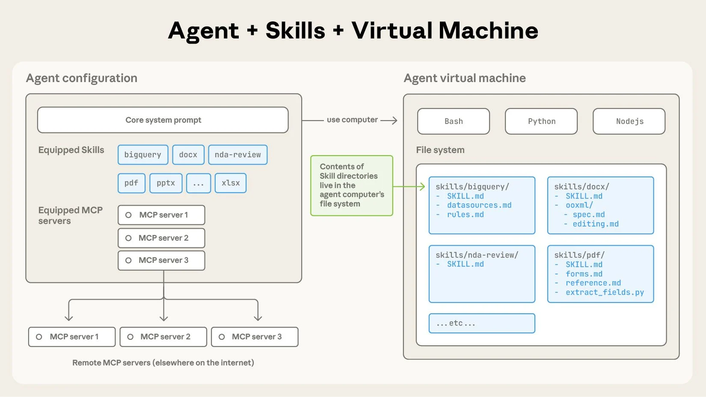
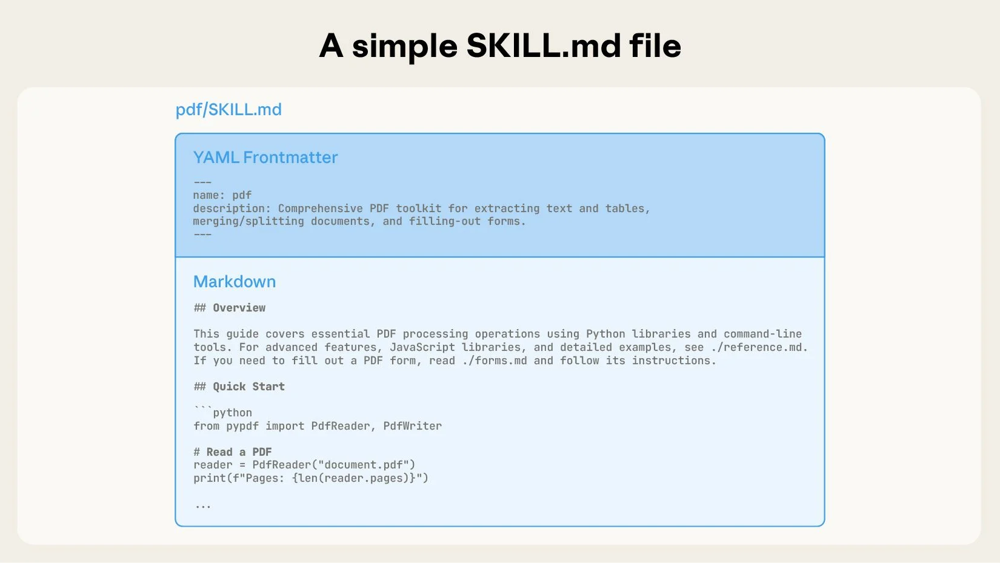
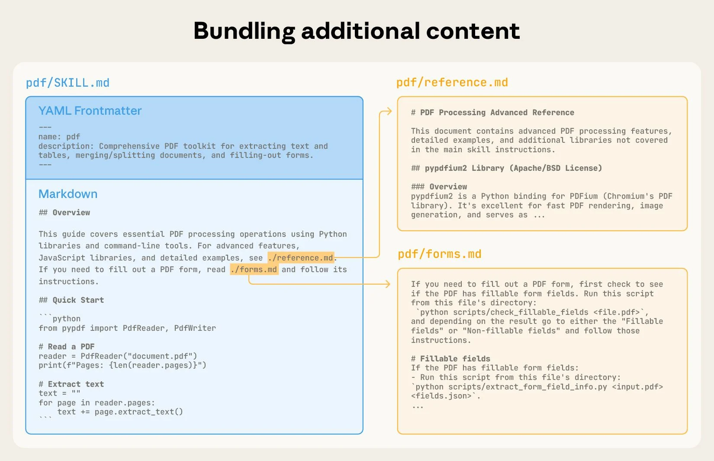
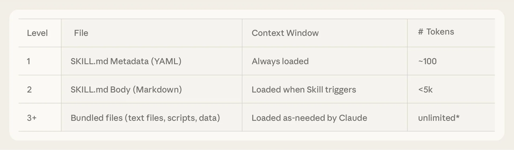
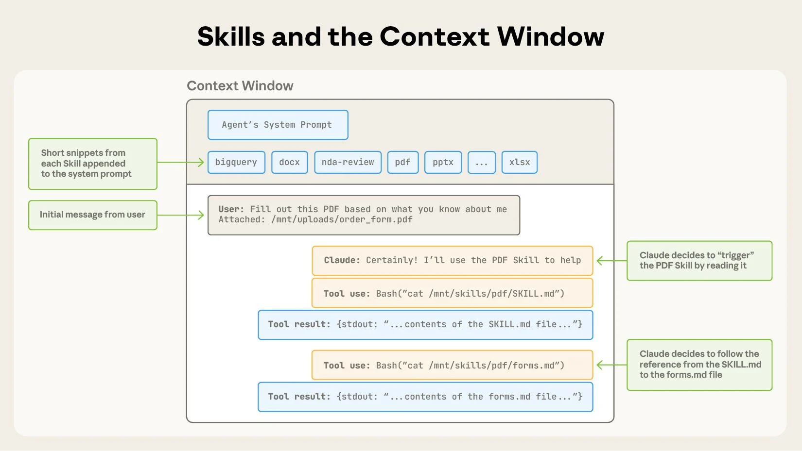
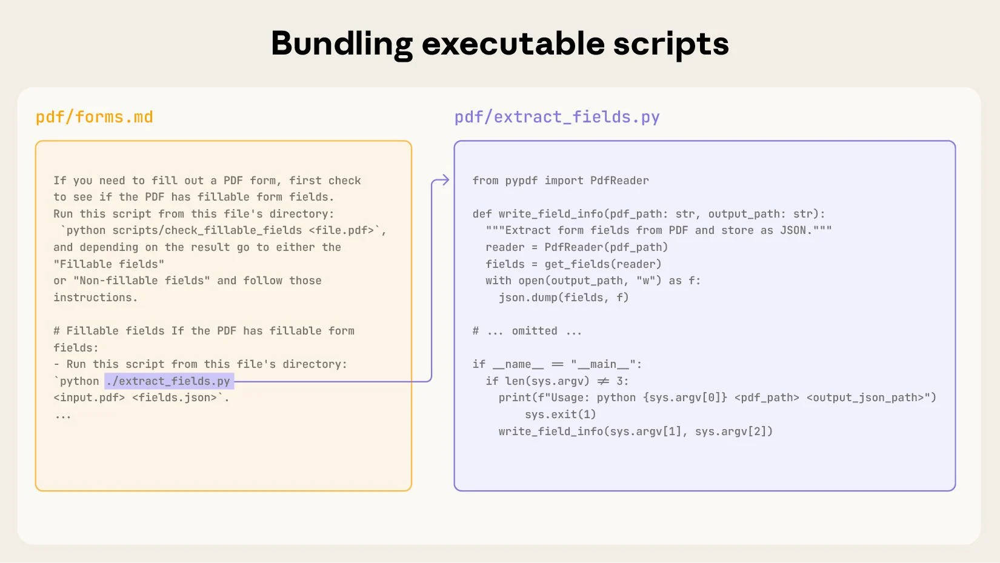

# 用 Agent Skills 让智能体胜任现实任务

- 英文标题：Equipping agents for the real world with Agent Skills
- 发布日期：2025-10-16
- 官网栏目：工程
- 原文：[Anthropic 页面](https://www.anthropic.com/research/equipping-agents-for-the-real-world-with-agent-skills)
- 官网署名：Anthropic

> 中文机器初译，未逐篇人工校对。引用研究结论时请核对英文原文。

- 2025 年 12 月 18 日

  ### 更新

  我们已发布代理技能作为跨平台可移植性的开放标准。

  [查看更多](https://agentskills.io/)

---

随着模型功能的改进，我们现在可以构建与成熟的计算环境交互的通用代理。 [克劳德·科德](https://claude.com/product/claude-code)例如，可以使用本地代码执行和文件系统完成跨域的复杂任务。但随着这些代理变得更加强大，我们需要更多可组合、可扩展和可移植的方式来为它们配备特定领域的专业知识。

这导致我们创建 [**代理技巧**](https://www.anthropic.com/news/skills)：有组织的指令、脚本和资源文件夹，代理可以动态发现和加载这些文件夹，以更好地执行特定任务。技能通过将您的专业知识打包成 Claude 的可组合资源，将通用代理转变为适合您需求的专业代理，从而扩展了 Claude 的能力。

培养代理人的技能就像为新员工编写入职指南一样。现在，任何人都可以通过捕获和共享程序知识来专门化具有可组合功能的代理，而不是为每个用例构建分散的、定制设计的代理。在本文中，我们将解释什么是技能、展示它们的工作原理，并分享构建您自己的技能的最佳实践。

技能是一个包含 SKILL.md 文件的目录，该文件包含有组织的指令、脚本和资源文件夹，这些文件夹为代理提供了附加功能。

## 技能的剖析

要了解技能的实际应用，让我们看一个真实的例子：其中一项技能 [Claude最近推出的文档编辑功能](https://www.anthropic.com/news/create-files)。Claude 已经了解很多关于理解 PDF 的知识，但直接操作 PDF 的能力有限（例如填写表格）。这个 [PDF技巧](https://github.com/anthropics/skills/tree/main/document-skills/pdf) 让我们赋予Claude这些新能力。

最简单地说，技能是一个包含以下内容的目录 `SKILL.md file`。该文件必须以包含一些必需元数据的 YAML frontmatter 开头： `name` 和 `description`。启动时，代理会预加载 `name` 和 `description` 将每个已安装的技能添加到其系统提示中。

该元数据是 **第一级** 的 *渐进式披露*：它为Claude提供了足够的信息，让他知道何时应该使用每种技能，而无需将所有技能加载到上下文中。该文件的实际主体是 **第二级** 的细节。如果Claude认为该技能与当前任务相关，它将通过读取其完整内容来加载该技能 `SKILL.md` 进入上下文。

SKILL.md 文件必须以包含文件名和描述的 YAML Frontmatter 开头，该文件在启动时加载到其系统提示符中。

随着技能变得越来越复杂，它们可能包含太多背景而无法融入单一技能中。 `SKILL.md`，或仅与特定场景相关的上下文。在这些情况下，技能可以将其他文件捆绑在技能目录中，并按名称引用它们 `SKILL.md`。这些额外的链接文件是 **第三级** （以及更多）细节，Claude可以选择仅根据需要进行导航和发现。

在下面显示的 PDF 技能中， `SKILL.md` 指两个附加文件（`reference.md` 和 `forms.md`）技能作者选择与核心捆绑在一起 `SKILL.md`。通过将表单填写说明移至单独的文件（`forms.md`），技能作者能够保持技能的核心精益，相信 Claude 会阅读 `forms.md` 仅在填写表格时。

您可以将更多上下文（通过附加文件）合并到您的技能中，然后Claude可以根据系统提示触发这些上下文。

渐进式披露是使代理技能灵活且可扩展的核心设计原则。就像一本组织良好的手册一样，首先是目录，然后是具体章节，最后是详细的附录，技能让 Claude 仅根据需要加载信息：

具有文件系统和代码执行工具的代理在处理特定任务时不需要将全部技能读取到上下文窗口中。这意味着可以捆绑到技能中的上下文数量实际上是无限的。

### 技能和上下文窗口

下图显示了当用户消息触发技能时上下文窗口如何变化。

技能是通过系统提示在上下文窗口中触发的。

所示操作顺序：

1. 首先，上下文窗口包含核心系统提示和每个已安装技能的元数据，以及用户的初始消息；
2. Claude 通过调用 Bash 工具来读取 PDF 的内容来触发 PDF 技能 `pdf/SKILL.md`;
3. Claude选择阅读 `forms.md` 与技能捆绑在一起的文件；
4. 最后，Claude 继续执行用户的任务，因为它已经从 PDF 技能加载了相关说明。

### 技能和代码执行

技能还可以包括供Claude自行决定作为工具执行的代码。

大型语言模型擅长执行许多任务，但某些操作更适合传统代码执行。例如，通过令牌生成对列表进行排序比简单地运行排序算法要昂贵得多。除了效率问题之外，许多应用程序还需要只有代码才能提供的确定性可靠性。

在我们的示例中，PDF 技能包括一个预先编写的 Python 脚本，用于读取 PDF 并提取所有表单字段。Claude 可以运行此脚本，而无需将脚本或 PDF 加载到上下文中。由于代码是确定性的，因此该工作流程是一致且可重复的。

技能还可以包括Claude根据任务性质自行决定作为工具执行的代码。

## 发展和评估技能

以下是一些有关编写和测试技能入门的有用指南：

- **从评估开始：** 通过让代理执行代表性任务并观察他们在哪些方面遇到困难或需要额外的背景信息，来识别代理能力中的具体差距。然后逐步培养技能来解决这些缺点。
- **规模结构：** 当 `SKILL.md` 文件变得难以处理，将其内容拆分为单独的文件并引用它们。如果某些上下文是互斥的或很少一起使用，则保持路径分离将减少令牌的使用。最后，代码既可以充当可执行工具，也可以充当文档。应该清楚Claude是否应该直接运行脚本或将它们读入上下文作为参考。
- **从Claude的角度思考：** 监控 Claude 如何在真实场景中使用您的技能，并根据观察进行迭代：注意意外的轨迹或对某些上下文的过度依赖。请特别注意 `name` 和 `description` 你的技能。Claude在决定是否触发技能以响应当前任务时将使用这些。
- **与Claude一起迭代：** 当您与 Claude 一起执行任务时，请 Claude 将其成功方法和常见错误捕获到技能中的可重用上下文和代码中。如果它在使用技能完成任务时偏离了轨道，请它自我反思哪里出了问题。此过程将帮助您发现 Claude 实际需要的上下文，而不是试图预先预测它。

### 使用技能时的安全注意事项

技能通过指令和代码为Claude提供新的能力。虽然这使它们变得强大，但也意味着恶意技能可能会在使用它们的环境中引入漏洞，或者引导 Claude 窃取数据并采取意想不到的操作。

我们建议仅从可信来源安装技能。从不太受信任的来源安装技能时，请在使用前对其进行彻底审核。首先阅读技能中捆绑的文件内容以了解其用途，特别注意代码依赖性和捆绑资源（例如图像或脚本）。同样，请注意技能中指示 Claude 连接到潜在不受信任的外部网络源的指令或代码。

## 技能的未来

代理技能有 [今天支持](https://www.anthropic.com/news/skills) 跨越 [Claude.ai](http://claude.ai)、Claude 代码、Claude Agent SDK 和 Claude 开发者平台。

在接下来的几周内，我们将继续添加支持创建、编辑、发现、共享和使用技能的整个生命周期的功能。我们对技能有机会帮助组织和个人与 Claude 分享他们的背景和工作流程感到特别兴奋。我们还将探讨技能如何补充 [模型上下文协议](https://modelcontextprotocol.io/) (MCP) 服务器，通过教导代理更复杂的工作流程（涉及外部工具和软件）。

展望未来，我们希望使代理能够自行创建、编辑和评估技能，让他们将自己的行为模式编码为可重用的功能。

技能是一个简单的概念，具有相应简单的格式。这种简单性使组织、开发人员和最终用户可以更轻松地构建定制代理并为其提供新功能。

我们很高兴看到人们利用技能构建了什么。今天就开始查看我们的技能 [文档](https://docs.claude.com/en/docs/agents-and-tools/agent-skills/overview) 和 [食谱](https://github.com/anthropics/claude-cookbooks/tree/main/skills).
