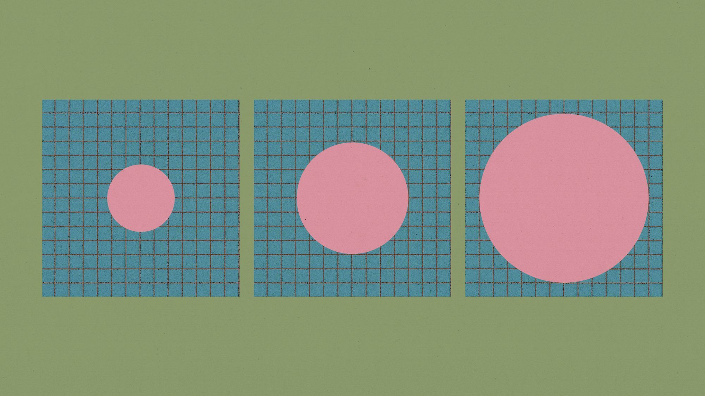
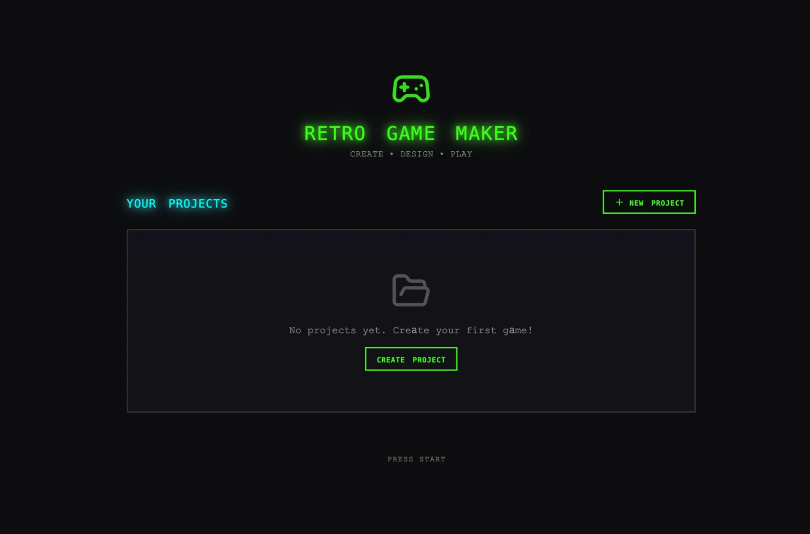
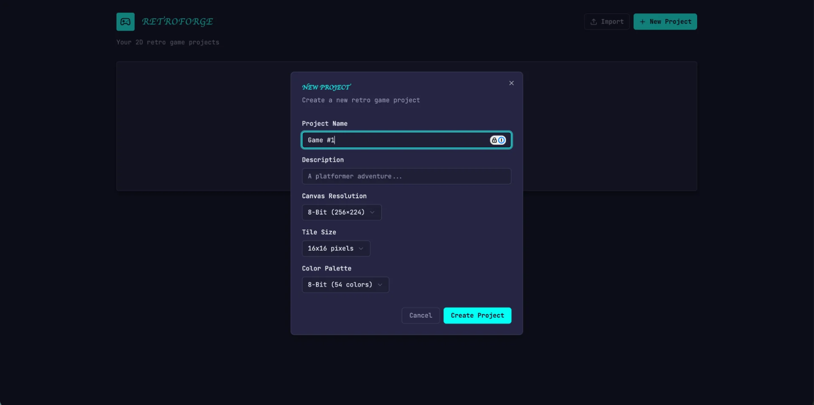

# 面向长时间应用开发的运行框架设计

- 英文标题：Harness design for long-running application development
- 发布日期：2026-03-24
- 官网栏目：工程
- 原文：[Anthropic 页面](https://www.anthropic.com/research/harness-design-long-running-apps)
- 官网署名：Anthropic

> 中文机器初译，未逐篇人工校对。引用研究结论时请核对英文原文。



*由我们的成员 Prithvi Rajasekaran 撰写 [实验室](https://www.anthropic.com/news/introducing-anthropic-labs) 团队。*

在过去的几个月里，我一直在研究两个相互关联的问题：让 Claude 生成高质量的前端设计，并让它在没有人工干预的情况下构建完整的应用程序。这项工作源于我们早期的努力 [前端设计技巧](https://github.com/anthropics/claude-code/blob/main/plugins/frontend-design/skills/frontend-design/SKILL.md) 和 [长期运行的编码代理线束](https://www.anthropic.com/engineering/effective-harnesses-for-long-running-agents)，我和我的同事能够通过及时的工程和线束设计将Claude的表现提高到远远高于基线的水平，但最终都达到了上限。

为了实现突破，我寻找了新颖的人工智能工程方法，这些方法涵盖两个截然不同的领域，一个由主观品味定义，另一个由可验证的正确性和可用性定义。从中汲取灵感 [生成对抗网络](https://en.wikipedia.org/wiki/Generative_adversarial_network) （GAN），我设计了一个多代理结构 **发电机** 和 **评估者** 代理。建立一个能够对输出进行可靠且符合品味的评估器，意味着首先要制定一套标准，可以转变诸如“这个设计好吗？”之类的主观判断。转化为具体的、可分级的术语。

然后，我将这些技术应用于长期运行的自主编码，继承了我们早期的利用工作中的两个教训：将构建分解为易于处理的块，并使用结构化工件在会话之间传递上下文。最终结果是一个三代理架构（规划器、生成器和评估器），可在数小时的自主编码会话中生成丰富的全栈应用程序。

## 为什么简单的实现会失败

我们之前已经表明，线束设计对长期运行的代理编码的有效性有重大影响。在较早的 [实验](https://www.anthropic.com/engineering/effective-harnesses-for-long-running-agents)中，我们使用初始化程序代理将产品规范分解为任务列表，并使用编码代理在传递工件以跨会话携带上下文之前一次实现一个功能的任务。更广泛的开发者社区已经通过诸如“[拉尔夫·威格姆](https://ghuntley.com/ralph/)“使用钩子或脚本使代理保持连续迭代周期的方法。

但一些问题仍然存在。对于更复杂的任务，代理仍然会随着时间的推移而偏离轨道。在分解这个问题时，我们观察到代理执行此类任务的两种常见故障模式。

首先，随着上下文窗口的填充，模型往往会在冗长的任务上失去连贯性（请参阅我们的文章 [情境工程](https://www.anthropic.com/engineering/effective-context-engineering-for-ai-agents)）。一些模型还表现出“情境焦虑”，当他们接近他们认为的情境限制时，他们开始过早地结束工作。上下文重置——完全清除上下文窗口并启动一个新的代理，结合承载前一个代理的状态和后续步骤的结构化切换——解决了这两个问题。

这与压缩不同，在压缩中，对话的早期部分被就地总结，以便同一个代理可以继续使用缩短的历史记录。虽然压缩保持了连续性，但它并没有给代理一个干净的记录，这意味着上下文焦虑仍然会持续存在。重置提供了一个干净的状态，但代价是切换工件具有足够的状态供下一个代理干净地接手工作。在我们早期的测试中，我们发现 Claude Sonnet 4.5 表现出足够强烈的上下文焦虑，仅靠压缩不足以实现强大的长期任务性能，因此上下文重置对于安全带设计至关重要。这解决了核心问题，但增加了编排复杂性、令牌开销和每个线束运行的延迟。

我们之前没有讨论过的第二个问题是自我评价。当被要求评估他们所做的工作时，代理人往往会自信地赞扬工作，即使在人类观察者看来，工作质量显然很平庸。这个问题对于诸如设计之类的主观任务尤其明显，其中不存在相当于可验证软件测试的二进制检查。布局是否感觉精美或通用是一个判断因素，代理在对自己的工作进行评分时可靠地倾向于积极。

然而，即使在确实有可验证结果的任务上，代理有时仍然会表现出糟糕的判断力，从而妨碍他们在完成任务时的表现。事实证明，将执行工作的代理与判断工作的代理分开是解决此问题的有力手段。分居本身并不会立即消除这种宽大处理；评估者仍然是一名法学硕士，倾向于对法学硕士生成的输出慷慨。但事实证明，将独立的评估器调整为持怀疑态度，比让生成器对其自身工作进行批评要容易得多，而且一旦存在外部反馈，生成器就有了具体的迭代对象。

## 前端设计：使主观质量可分级

我首先尝试前端设计，其中自我评估问题最为明显。在没有任何干预的情况下，Claude通常倾向于安全、可预测的布局，这些布局在技术上实用，但在视觉上并不引人注目。

两个见解塑造了我为前端设计构建的工具。首先，虽然审美不能完全归结为一个分数——而且个人品味总是会有所不同——但可以通过编码设计原则和偏好的评分标准来改进它们。“这个设计漂亮吗？”很难一致地回答，但是“这符合我们良好设计的原则吗？”给Claude一些具体的评分依据。其次，通过将前端生成与前端分级分开，我们可以创建一个反馈循环，驱动生成器产生更强的输出。

考虑到这一点，我写了四个评分标准，并在提示中提供给生成器和评估器代理：

- **设计品质：** 设计是否感觉像是一个连贯的整体而不是零件的集合？这里的出色工作意味着颜色、排版、布局、图像和其他细节的结合，创造出独特的情绪和身份。
- **原创性：** 是否有自定义决策的证据，或者是模板布局、库默认值和人工智能生成的模式？人类设计师应该认识到深思熟虑的创意选择。未经修改的库存组件——或者人工智能生成的明显迹象，比如白卡上的紫色渐变——在这里失败了。
- **工艺：** 技术执行：排版层次、间距一致性、色彩和谐、对比度。这是能力检查而不是创造力检查。默认情况下，大多数合理的实现都可以很好地实现；失败意味着基本面被打破。
- **功能：** 可用性独立于美观。用户能否理解界面的功能、找到主要操作并在不猜测的情况下完成任务？

我强调设计质量和原创性，而不是工艺和功能。默认情况下，Claude在工艺和功能上已经取得了很好的成绩，因为所需的技术能力往往是模型自然而然的。但在设计和原创性方面，Claude的作品充其量只是平淡无奇。该标准明确惩罚了高度通用的“AI slop”模式，并通过更重视设计和原创性，将模型推向更具审美风险的方向。

我使用带有详细分数细分的少量示例来校准评估器。这确保了评估者的判断与我的偏好一致，并减少了迭代中的分数漂移。

我在上面构建了循环 [Claude代理SDK](https://platform.claude.com/docs/en/agent-sdk/overview)，这使编排变得简单。生成器代理首先根据用户提示创建 HTML/CSS/JS 前端。我为评估者提供了 Playwright MCP，让它在对每个标准进行评分并撰写详细评论之前直接与实时页面进行交互。在实践中，评估者将自行浏览页面，在进行评估之前截取屏幕截图并仔细研究实施情况。该反馈流回生成器作为下一次迭代的输入。我每代运行 5 到 15 次迭代，每次迭代通常都会将生成器推向更独特的方向，因为它响应了评估者的批评。由于评估者主动浏览页面而不是对静态屏幕截图进行评分，因此每个周期都需要实际的挂钟时间。完整运行长达四个小时。我还指示生成器在每次评估后做出战略决策：如果分数趋势良好，则完善当前方向；如果方法不起作用，则转向完全不同的美学。

在整个运行过程中，评估者的评估在达到稳定状态之前的迭代中得到了改善，并且仍然存在净空。有些世代逐渐完善。其他人在迭代之间发生了急剧的审美转变。

标准的措辞以我没有完全预料到的方式引导生成器。包括“最好的设计是博物馆品质”这样的短语将设计推向特定的视觉融合，这表明与标准相关的提示直接塑造了输出的特征。

虽然分数通常会随着迭代而提高，但该模式并不总是完全线性的。后来的实现总体上往往更好，但我经常看到我更喜欢中间迭代而不是最后一次迭代的情况。随着生成器根据评估者的反馈寻求更雄心勃勃的解决方案，实施复杂性也往往会随着轮次的增加而增加。即使在第一次迭代中，输出也明显优于没有任何提示的基线，这表明在任何评估者反馈导致进一步细化之前，标准和相关语言本身就引导模型远离通用默认值。

在一个著名的例子中，我提示模型为荷兰艺术博物馆创建一个网站。到第九次迭代时，它为一个虚构的博物馆制作了一个干净的、黑暗主题的登陆页面。该页面在视觉上经过了优化，但基本上符合我的期望。然后，在第十个周期中，它完全放弃了这种方法，并将该网站重新想象为一种空间体验：一个 3D 房间，带有以 CSS 透视渲染的格子地板，艺术品以自由形式挂在墙上，画廊房间之间基于门口的导航，而不是滚动或点击。这是我以前在单通道一代中从未见过的创造性飞跃。

[原文媒体](https://assets.claude.com/9877febd34432f7f582aecd0023b951223605c6a.mp4)

## 扩展到全栈编码

有了这些发现，我将这种受 GAN 启发的模式应用于全栈开发。生成器-评估器循环自然地映射到软件开发生命周期，其中代码审查和 QA 充当与设计评估器相同的结构角色。

### 架构

在我们之前的 [长时间运行的安全带](https://www.anthropic.com/engineering/effective-harnesses-for-long-running-agents)，我们已经通过初始化代理解决了连贯的多会话编码问题，该编码代理一次只处理一个功能，并且在会话之间重置上下文。语境重置是一个关键：该安全带使用了 Sonnet 4.5，它表现出了前面提到的“语境焦虑”倾向。创建一个在上下文重置中运行良好的工具是保持模型执行任务的关键。Opus 4.5 本身很大程度上消除了这种行为，因此我能够完全从此工具中删除上下文重置。代理在整个构建过程中作为一个连续会话运行， [Claude代理SDK](https://platform.claude.com/docs/en/agent-sdk/overview)的自动压缩处理一路上的上下文增长。

在这项工作中，我在原始工具的基础上构建了一个三代理系统，每个代理都解决了我在之前运行中观察到的特定差距。该系统包含以下代理角色：

**策划师：** 我们之前长期运行的线束要求用户预先提供详细的规格。我想自动化该步骤，因此我创建了一个规划代理，它采用简单的 1-4 句话提示并将其扩展为完整的产品规范。我促使它对范围雄心勃勃，并专注于产品背景和高级技术设计，而不是详细的技术实现。这种强调是因为担心如果规划者试图预先指定详细的技术细节并出现错误，那么规范中的错误将级联到下游实现中。似乎更明智的做法是，将代理限制在要生成的可交付成果上，并让他们在工作时找出路径。我还要求规划人员寻找机会将人工智能功能融入到产品规格中。 （请参阅底部附录中的示例。）

**发电机：** 早期工具中的一次一个功能的方法对于范围管理非常有效。我在这里应用了一个类似的模型，指示生成器在冲刺中工作，一次从规范中选取一个功能。每个冲刺都使用 React、Vite、FastAPI 和 SQLite（后来的 PostgreSQL）堆栈来实现应用程序，并且指示生成器在每个冲刺结束时自我评估其工作，然后再交给 QA。它还具有用于版本控制的 git。

**评估人：** 早期工具中的应用程序通常看起来令人印象深刻，但当您实际尝试使用它们时仍然存在真正的错误。为了捕获这些，评估人员使用 Playwright MCP 以用户的方式单击正在运行的应用程序，测试 UI 功能、API 端点和数据库状态。然后，它根据发现的错误和一组基于前端实验的标准对每个冲刺进行评分，这些标准在此进行了调整，以涵盖产品深度、功能、视觉设计和代码质量。每个标准都有一个严格的阈值，如果任何一个低于它，冲刺就会失败，生成器会得到有关问题所在的详细反馈。

在每次冲刺之前，生成器和评估器都会协商一份冲刺合同：在编写任何代码之前就该工作块的“完成”情况达成一致。之所以存在这种情况，是因为产品规范故意是高级别的，并且我希望采取措施来弥合用户故事和可测试实施之间的差距。生成器提出了它将构建什么以及如何验证成功，评估者审查了该提案以确保生成器正在构建正确的东西。两人反复讨论，直到达成一致。

通信是通过文件处理的：一个代理将写入一个文件，另一个代理将读取该文件并在该文件内或使用前一个代理依次读取的新文件进行响应。然后，生成器根据商定的合同进行构建，然后将工作交给 QA。这使得工作忠实于规范，而不会过早过度指定实现。

### 运行线束

对于该工具的第一个版本，我使用了 Claude Opus 4.5，针对完整工具和单代理系统运行用户提示以进行比较。我使用 Opus 4.5，因为这是我开始这些实验时最好的编码模型。

我编写了以下提示来生成复古视频游戏制作器：

> *创建一个 2D 复古游戏制作器，其功能包括关卡编辑器、精灵编辑器、实体行为和可玩测试模式。*

下表显示了安全带类型、运行长度以及总成本。

**安全带**

**持续时间**

**成本**

独奏

20分钟

$9

全线束

6小时

$200

该线束的价格贵了 20 倍以上，但输出质量的差异是显而易见的。

我期待一个界面，我可以在其中构建一个关卡及其组成部分（精灵、实体、图块布局），然后点击播放来实际玩该关卡。我首先打开单独运行的输出，最初的应用程序似乎符合这些预期。

然而，当我点击进入时，问题开始出现。这种布局浪费了空间，固定高度的面板使大部分视口为空。工作流程很严格。尝试填充关卡促使我首先创建精灵和实体，但 UI 中没有任何内容引导我执行该顺序。更重要的是，实际的游戏被破坏了。我的实体出现在屏幕上，但对输入没有任何响应。深入研究代码发现实体定义和游戏运行时之间的连接被破坏了，但没有表面迹象表明哪里被破坏了。



打开由单独线束创建的应用程序时的初始屏幕。

在评估了单人跑步后，我将注意力转向了安全带跑步。这次运行从相同的一句话提示开始，但计划者步骤将该提示扩展为分布在 10 个冲刺中的 16 个功能规范。它远远超出了单人运行的尝试。除了核心编辑器和游戏模式之外，该规范还要求精灵动画系统、行为模板、音效和音乐、人工智能辅助精灵生成器和关卡设计器以及带有可共享链接的游戏导出。我让规划者可以访问我们的 [前端设计技巧](https://github.com/anthropics/claude-code/blob/main/plugins/frontend-design/skills/frontend-design/SKILL.md)，它会读取并使用它来为应用程序创建视觉设计语言，作为规范的一部分。对于每个冲刺，生成器和评估者协商一份合同，定义冲刺的具体实现细节，以及将进行测试以验证完成情况的可测试行为。

该应用程序立即显示出比单独运行更加精致和流畅的效果。画布使用完整视口，面板大小合理，界面具有一致的视觉标识，可以跟踪规范的设计方向。我在单人运行中看到的一些笨拙确实仍然存在 - 工作流程仍然没有明确表明您应该在尝试填充关卡之前构建精灵和实体，我必须通过四处探索来弄清楚这一点。这被解读为基础模型的产品直觉中的差距，而不是线束旨在解决的问题，尽管它确实表明线束内部的目标迭代可以帮助进一步提高输出质量。

通过编辑的努力，新的运行相对于独奏的优势变得更加明显。精灵编辑器更丰富、功能更齐全，具有更干净的工具调色板、更好的颜色选择器和更可用的缩放控件。

因为我要求规划者将人工智能功能融入其规格中，所以该应用程序还内置了Claude集成，让我可以通过提示生成游戏的不同部分。这显着加快了工作流程。



初始屏幕：在使用完整工具构建的应用程序中创建一个新游戏

最大的区别在于播放模式。我实际上能够移动我的实体并玩游戏。物理原理有一些粗糙的边缘——我的角色跳到一个平台上，但最终与它重叠，这在直觉上感觉是错误的——但核心的东西是有效的，单人运行并没有做到这一点。经过一番探索后，我确实遇到了人工智能游戏关卡构建的一些限制。有一堵大墙我无法跳过，所以我被困住了。这表明该工具可以处理一些常识性改进和边缘情况，以进一步完善应用程序。

通过阅读日志，很明显评估者使实施符合规范。每次冲刺，它都会通过冲刺合同的测试标准，并通过 Playwright 测试正在运行的应用程序，针对任何偏离预期行为的错误提交错误。这些合同非常细化——仅 Sprint 3 就有 27 项涵盖关卡编辑器的标准——评估者的发现足够具体，无需额​​外调查即可采取行动。下表显示了我们的评估人员发现的问题的几个示例：

**合同准则**

**评估者发现**

矩形填充工具允许单击并拖动以使用选定的图块填充矩形区域

**失败** — 工具仅将图块放置在拖动起点/终点处，而不是填充该区域。 `fillRectangle` 函数存在，但在 mouseUp 上未正确触发。

用户可以选择和删除放置的实体生成点

**失败** — 删除密钥处理程序 `LevelEditor.tsx:892` 两者都需要 `selection` 和 `selectedEntityId` 要设置，但单击实体只会设置 `selectedEntityId`。条件应该是 `selection || (selectedEntityId && activeLayer === 'entity')`.

用户可以通过API重新排序动画帧

**失败** — `PUT /frames/reorder` 之后定义的路线 `/{frame_id}` 路线。FastAPI 匹配 'r`eorder`'作为frame_id整数并返回422：“无法将字符串解析为整数。”

让评估者达到这个水平需要付出努力。从本质上讲，Claude是一个糟糕的 QA 代理。在早期的运行中，我看到它识别出合法的问题，然后说服自己认为这些问题不是什么大问题，并无论如何都批准了这项工作。它还倾向于进行表面测试，而不是探究边缘情况，因此更微妙的错误经常会被忽视。调整循环是读取评估者的日志，查找其判断与我的判断不同的示例，并更新 QA 提示以解决这些问题。在评估者以我认为合理的方式进行评分之前，这个开发循环进行了几轮。即便如此，线束输出也显示了模型 QA 功能的局限性：小的布局问题、某些地方感觉不直观的交互，以及评估者尚未彻底运用的更深层嵌套功能中未发现的错误。显然，通过进一步调整可以捕获更多的验证空间。但与单独运行相比，应用程序的核心功能根本不起作用，提升是显而易见的。

### 迭代线束

第一组利用结果令人鼓舞，但它也笨重、缓慢且昂贵。合乎逻辑的下一步是找到简化线束而不降低其性能的方法。这部分是常识，部分是更普遍原则的函数：线束中的每个组件都编码了关于模型本身无法做什么的假设，这些假设值得进行压力测试，既因为它们可能不正确，也因为随着模型的改进它们很快就会过时。我们的博客文章 [建立有效的代理](https://www.anthropic.com/research/building-effective-agents) 其基本思想是“找到尽可能简单的解决方案，并且仅在需要时增加复杂性”，并且对于任何维护代理工具的人来说，这种模式始终如一。

在我第一次尝试简化时，我从根本上削减了线束并尝试了一些创造性的新想法，但我无法复制原始的性能。也很难判断安全带设计的哪些部分实际上是承重的，以及以什么方式承重的。基于这一经验，我转向了一种更有条理的方法，一次删除一个组件，并审查它对最终结果的影响。

当我经历这些迭代周期时，我们还发布了 Opus 4.6，它为降低线束复杂性提供了进一步的动力。有充分的理由预期 4.6 需要的脚手架比 4.5 少。来自我们的 [启动博客：](https://www.anthropic.com/news/claude-opus-4-6) “[Opus 4.6] 计划更仔细，可以更长时间地维持代理任务，可以在更大的代码库中更可靠地运行，并且具有更好的代码审查和调试技能来发现自己的错误。”它还在长上下文检索方面得到了显着改进。这些都是安全带旨在补充的功能。

### 删除冲刺构造

我首先完全删除了冲刺构造。冲刺结构有助于将工作分解为多个块，以便模型能够连贯地工作。鉴于 Opus 4.6 中的改进，我们有充分的理由相信该模型无需进行此类分解即可原生处理该工作。

我保留了计划员和评估员，因为每个人都继续增加明显的价值。如果没有规划器，生成器的范围就会缩小：给定原始提示，它将在没有首先指定其工作的情况下开始构建，并最终创建一个功能不如规划器丰富的应用程序。

删除冲刺构造后，我将评估器移至运行结束时的单次传递，而不是对每个冲刺进行评分。由于模型的能力更强，它改变了评估器在某些运行中的承载方式，其有用性取决于任务相对于模型本身可以可靠完成的任务的位置。在 4.5 中，这个边界很接近：我们的构建处于生成器可以单独完成的边缘，并且评估器在整个构建中发现了有意义的问题。在 4.6 中，模型的原始能力增加，因此边界向外移动。过去需要评估器检查才能连贯地实现的任务现在通常在生成器自己可以很好处理的范围内，并且对于该边界内的任务，评估器成为不必要的开销。但对于仍处于生成器能力边缘的构建部分，评估器继续提供真正的提升。

实际含义是评估者并不是一个固定的是或否的决定。当任务超出当前模型单独可靠执行的范围时，这是值得的。

除了结构简化之外，我还添加了提示，以改进工具如何将 AI 功能构建到每个应用程序中，特别是让生成器构建一个适当的代理，该代理可以通过工具驱动应用程序自身的功能。这需要真正的迭代，因为相关知识足够新，Claude的训练数据很少涵盖它。但通过足够的调整，生成器可以正确构建代理。

### 更新后的线束结果

为了测试更新后的工具，我使用以下提示生成数字音频工作站（DAW），这是一个用于创作、录制和混合歌曲的音乐制作程序：

> *使用 Web Audio API 在浏览器中构建功能齐全的 DAW。*

这次运行仍然漫长且昂贵，大约需要 4 个小时，代币成本为 124 美元。

大部分时间都花在了构建器上，它连续运行了两个多小时，没有 Opus 4.5 所需的冲刺分解。

**代理与阶段**

**持续时间**

**成本**

规划师

4.7 分钟

$0.46

构建（第一轮）

2小时7分钟

$71.08

质量检查（第一轮）

8.8 分钟

$3.24

构建（第二轮）

1小时2分钟

$36.89

质量检查（第二轮）

6.8 分钟

$3.09

构建（第三轮）

10.9 分钟

$5.88

质量检查（第三轮）

9.6 分钟

$4.06

**总 V2 线束**

**3小时50分钟**

**$124.70**

与之前的线束一样，规划人员将单行提示扩展为完整的规范。从日志中，我可以看到生成器模型在规划应用程序和代理设计、连接代理以及在移交给 QA 之前对其进行测试方面做得很好。

话虽如此，QA 代理仍然发现了真正的差距。在第一轮反馈中，它指出：

> 这是一款功能强大的应用程序，具有出色的设计保真度、可靠的AI 智能体和良好的后端。主要的失败点是功能完整性——虽然该应用程序看起来令人印象深刻并且人工智能集成运行良好，但几个核心 DAW 功能仅显示，没有交互深度：剪辑无法在时间轴上拖动/移动，没有乐器 UI 面板（合成器旋钮、鼓垫），也没有视觉效果编辑器（EQ 曲线、压缩器表）。这些不是边缘情况 - 它们是使 DAW 可用的核心交互，并且规范明确要求它们。

在第二轮反馈中，它再次发现了几个功能缺陷：

> 剩余差距：  
> - 音频录制仍然仅存根（按钮切换但没有麦克风捕获）  
> - 未实现通过边缘拖动和剪辑分割来调整剪辑大小  
> - 效果可视化是数字滑块，而不是图形（无均衡器曲线）

当生成器留给自己的设备时，它仍然容易错过细节或存根功能，并且质量检查仍然在捕获生成器修复的最后一英里问题方面增加了价值。

根据提示，我期待一个程序，我可以在其中创建旋律、和声和鼓模式，将它们编入歌曲中，并在此过程中获得集成代理的帮助。下面的视频显示了结果。

[原文媒体](https://assets.claude.com/555910f9adb3938734940224e7a6f4c7cbbbd8f2.mp4)

该应用程序远非专业的音乐制作程序，经纪人的歌曲创作技巧显然需要大量工作。此外，Claude实际上听不到声音，这使得 QA 反馈循环在音乐品味方面的效果较差。

但最终的应用程序具有功能性音乐制作程序的所有核心部分：工作安排视图、混音器和在浏览器中运行的传输。除此之外，我能够完全通过提示组合出一首简短的歌曲片段：代理设置节奏和调，制定旋律，构建鼓轨道，调整混音器级别并添加混响。歌曲创作的核心原语已经存在，代理可以自主驱动它们，使用工具从头到尾创建简单的作品。你可能会说它还不是完美的——但它已经接近完美了。

## 接下来会发生什么

随着模型的不断改进，我们可以粗略地期望它们能够工作更长时间、处理更复杂的任务。在某些情况下，这意味着随着时间的推移，模​​型周围的脚手架变得不那么重要，开发人员可以等待下一个模型并看到某些问题自行解决。另一方面，模型越好，开发工具的空间就越大，可以完成超出模型基线所能完成的复杂任务。

考虑到这一点，这项工作中有一些值得发扬光大的教训。尝试您正在构建的模型，读取其对实际问题的跟踪，并调整其性能以实现您想要的结果始终是一种很好的做法。当处理更复杂的任务时，有时分解任务并将专门代理应用于问题的每个方面都有空间。当新车型问世时，重新检查线束通常是一种很好的做法，拆除不再承载性能的部件，并添加新部件以实现以前不可能实现的更大功能。

从这项工作中，我确信有趣的安全带组合的空间不会随着模型的改进而缩小。相反，它会移动，而人工智能工程师的有趣工作就是不断寻找下一个新颖的组合。

## 附录

由规划代理生成的示例计划。

```
RetroForge - 2D Retro Game Maker

Overview
RetroForge is a web-based creative studio for designing and building 2D retro-style video games. It combines the nostalgic charm of classic 8-bit and 16-bit game aesthetics with modern, intuitive editing tools—enabling anyone from hobbyist creators to indie developers to bring their game ideas to life without writing traditional code.

The platform provides four integrated creative modules: a tile-based Level Editor for designing game worlds, a pixel-art Sprite Editor for crafting visual assets, a visual Entity Behavior system for defining game logic, and an instant Playable Test Mode for real-time gameplay testing. By weaving AI assistance throughout (powered by Claude), RetroForge accelerates the creative process—helping users generate sprites, design levels, and configure behaviors through natural language interaction.

RetroForge targets creators who love retro gaming aesthetics but want modern conveniences. Whether recreating the platformers, RPGs, or action games of their childhood, or inventing entirely new experiences within retro constraints, users can prototype rapidly, iterate visually, and share their creations with others.

Features
1. Project Dashboard & Management
The Project Dashboard is the home base for all creative work in RetroForge. Users need a clear, organized way to manage their game projects—creating new ones, returning to works-in-progress, and understanding what each project contains at a glance.

User Stories: As a user, I want to:

- Create a new game project with a name and description, so that I can begin designing my game
- See all my existing projects displayed as visual cards showing the project name, last modified date, and a thumbnail preview, so that I can quickly find and continue my work
- Open any project to enter the full game editor workspace, so that I can work on my game
- Delete projects I no longer need, with a confirmation dialog to prevent accidents, so that I can keep my workspace organized
- Duplicate an existing project as a starting point for a new game, so that I can reuse my previous work

Project Data Model: Each project contains:

Project metadata (name, description, created/modified timestamps)
Canvas settings (resolution: e.g., 256x224, 320x240, or 160x144)
Tile size configuration (8x8, 16x16, or 32x32 pixels)
Color palette selection 
All associated sprites, tilesets, levels, and entity definitions

...
```
