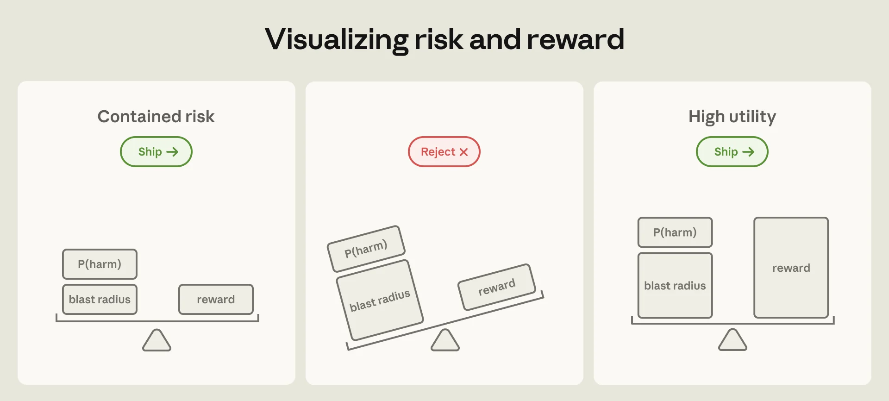
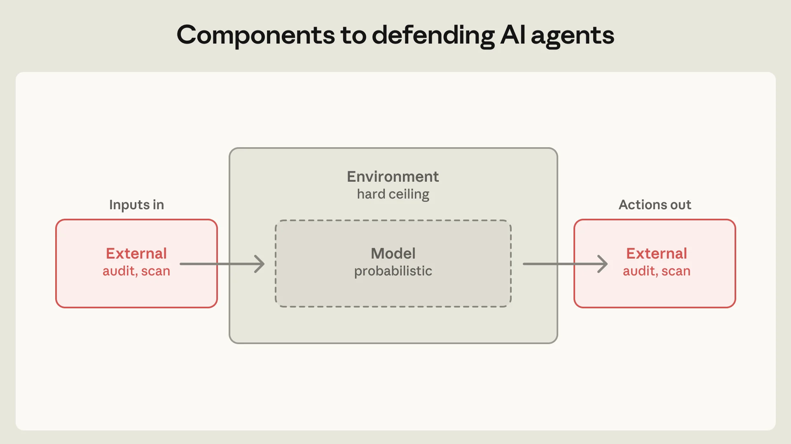
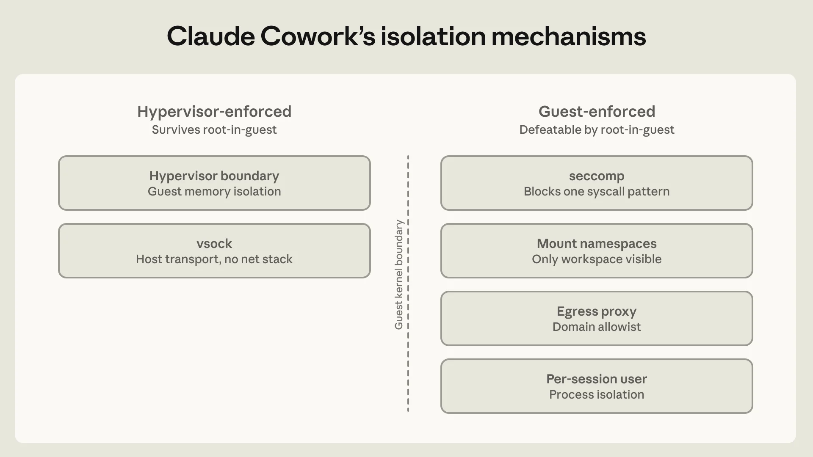
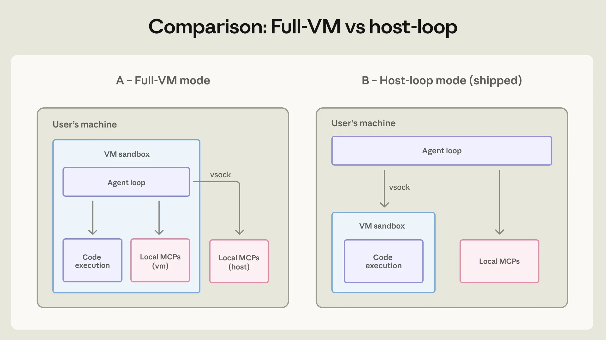
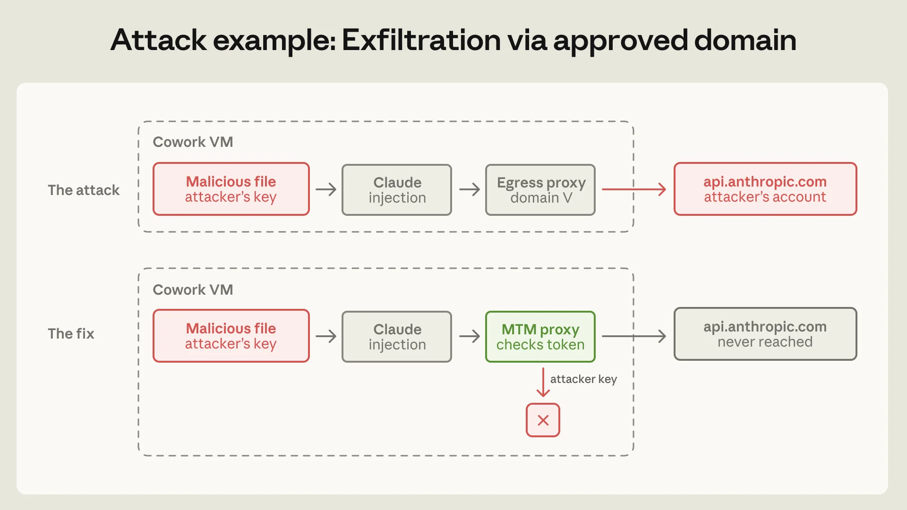

# 我们如何在各产品中限制 Claude 的行动范围

- 英文标题：How we contain Claude across products
- 发布日期：2026-05-25
- 官网栏目：工程
- 原文：[Anthropic 页面](https://www.anthropic.com/research/how-we-contain-claude)
- 官网署名：Anthropic

> 中文机器初译，未逐篇人工校对。引用研究结论时请核对英文原文。

十二个月前，我们会立即拒绝授予Claude足够的访问权限来摧毁内部人类服务的想法。如今，这种访问级别已成为常规，并且人类开发人员的工作效率更高。这些部署的风险有两个组成部分：失败的可能性有多大，以及可能造成多大的损害。保障措施和模型培训方面的进展已稳步压低第一个；第二个——理论爆炸半径——只会随着能力和访问范围的扩大而增加。然而，随着代理人变得有能力完成曾经需要一个人甚至一个团队的工作， *不* 只要产品能够保证安全，部署的规模就足够大，风险回报计算会严重倾向于采用。工程问题变成了如何限制爆炸半径。

当可以对自主代理的相对损害进行限制时（例如通过对其环境的控制），高实用性功能可以激励部署。Claude Mythos Preview 是一个模型的示例，其爆炸半径被认为太高，无法在 2026 年 4 月发货。然而，我们预计，随着防御者强化关键系统和保障措施的成熟，具有类似能力水平的模型将更广泛地发布，尽管一些风险始终存在。模型能力是代理部署总风险的重要因素。

大致有两种方法可以做到这一点。

第一个是通过人机交互来监督智能体的行为。克劳德·代码 (Claude Code) 此前通过每次询问用户许可来防止代理采取意外操作。理论上这是可行的，但我们发现这种方法容易出错。我们的遥测显示用户批准了大约 93% 的权限提示。用户看到的批准越多，他们对每个批准的关注就越少，随着时间的推移，他们的监督就会变得不那么勤奋。我们最近构建了 Claude Code 自动模式， [自动化更安全的批准](https://www.anthropic.com/engineering/claude-code-auto-mode) 以减少这种审批疲劳。尽管如此，漏洞仍然存在——任何概率防御都有非零的失误率。[1](https://www.anthropic.com/research/how-we-contain-claude#footnote-1)

限制爆炸半径的第二种方法（也是本文大部分内容的重点）是遏制。我们不是监督代理做什么，而是监督它是什么 *能够* 通过沙箱、虚拟机和出口控制等强制访问边界来实现。这是人择工程投入最多精力的地方，也是许多最令人惊讶的安全故障发生的地方。

过去两年，我们主要代理了三款产品： [Claude.ai](http://claude.ai)、克劳德·代码和克劳德·科沃克。每个服务于不同的受众，需要不同的遏制架构。本文分享了哪些内容被阻止、哪些内容被破坏，以及我们在此过程中对代理安全性的了解。

## 三种风险，三种防御措施

代理的安全风险分为以下三类之一：

**用户滥用：** 用户——无论是恶意的还是粗心的——指示代理去做一些有害的事情。这包括从要求代理绕过他们认为烦人的检查，到运行他们不理解的破坏性命令，到指定故意伤害等一切。

**模型不当行为：** 特工采取了无人要求的有害行动。随着我们的模型不断改进，它们在大多数行为评估上变得更加一致，但这并不意味着风险一定会缩小。能力较差的模型更有可能误读情况并犯下明显的错误。能力更强的模型犯的错误更少，但它们也更擅长找到实现目标的意想不到的路径，通常是绕过没人想到写下来的限制。

在 Anthropic，我们看到了Claude模型 [“帮助”逃离沙箱](https://red.anthropic.com/2026/mythos-preview/) 为了完成任务，请检查 git 历史记录 [查找编码测试的答案](https://assets.anthropic.com/m/64823ba7485345a7/Claude-Opus-4-5-System-Card.pdf)，并自发地确定它正在运行的基准，以便 [解密其答案密钥](https://www.anthropic.com/engineering/eval-awareness-browsecomp)。每个模型都带来了一组新的功能，这些功能有时会以意想不到的方式发挥作用。

**外部攻击者：** 代理通过工具、文件或网络访问等外部媒介受到攻击。此类别包括对代理运行时、编排层或代理的即时注入和常规攻击。

在构建遏制和防御系统时，我们将防御应用于三个主要组件：

**代理运行的环境。** 我们通过进程沙箱、虚拟机、文件系统边界和出口控制来限制代理的操作位置和方式。目标是为代理可以达到的范围设定一个严格的界限。例如，如果凭据从未进入沙箱，则无论原因是用户、发现“创造性”路径的模型还是攻击者，它们都无法被泄露。

严格的边界也意味着您可以放松监管。克劳德·科德 [参考开发容器](https://code.claude.com/docs/en/devcontainer) 精确存在，以便代理可以在无人值守的情况下运行，无需每个操作的批准。

**代理商咨询的型号。** 这里的机制包括系统提示、分类器、探测和训练修改。因为模型是概率性的，所以这些模型仅塑造代理的内容 *趋于* 去做，而不是理论上能够做的事情。

这些防御很强大。在 Gray Swan 的 Agent Red Teaming 基准测试中，该基准测试了对提示注入的敏感性， [Claude作品 4.7](https://assets.claude.com/037f06850df7fbe871e206dad004c3db5fd50340.pdf) 单次尝试的攻击成功率约为 0.1%，100 次自适应尝试后攻击成功率约为 5-6%。Claude Code 自动模式可捕获大约 83% 的过度渴望行为 [在他们执行之前](https://www.anthropic.com/engineering/claude-code-auto-mode)。然而，即使拥有一流的防御，模型层的保护也永远不会 100% 有效，这就是它不能独立存在的原因。

**代理可以到达的外部内容。** MCP 服务器、第三方插件和网络搜索工具都会从您无法控制的来源将内容馈送到代理的上下文中。经过审核的连接器与经过审核的数据不同 - 例如，GitHub 连接器可以将有毒的自述文件直接加载到模型的上下文中，尽管通过了恶意软件检查。精细地限制工具权限可以帮助限制爆炸半径。例如，具有只读数据库访问权限的代理可以比写入产品的代理更广泛地部署。

防御措施应该重叠并相互补充。当环境防御不可用时，模型层必须弥补这一不足（这正是 Claude Code 的内容） [自动模式](https://claude.com/blog/auto-mode) 是专为）。在本地，环境和模型防御可以防范恶意工具输出，但可以通过限制工具的功能和访问来在链的更高位置添加防御。

需要防御的三个组件：模型、运行环境以及代理可以访问的外部内容。

## 包含代理的模式

重点关注环境层，我们描述了三种隔离模式以及如何针对每个 Claude 平台定制它们 -[Claude.ai](http://claude.ai)、Claude代码和 Cowork。在找到代理所需的功能与用户所需的干预程度之间的平衡后，我们逐渐实现了每个设计。

### 模式 1：临时容器（claude.ai 代码执行）

尽管 claude.ai 最出名的是聊天界面，但它还编写和运行代码、生成文件以及调用连接器。当 Claude 在 claude.ai 中运行代码时，它会在 [g遮阳板](https://en.wikipedia.org/wiki/GVisor) 隔离基础设施上的容器。代理完全是服务器端的；本地计算机上没有运行任何代码，并且文件系统是短暂的（每个会话）。爆炸半径很小，但Claude能做的事情也有上限——没有持久的工作空间，也无法访问用户的文件系统。

这也使得 [Claude.ai](http://claude.ai) 受到更传统的威胁模型的影响。我们不是保护用户计算机免受代理的侵害；而是保护用户计算机免受代理的侵害。我们正在保护我们自己的基础设施和每个租户免受彼此的影响。我们的启动前工作 [Claude.ai](http://claude.ai) 主要是传统的安全工作，如网络配置、内部服务身份验证和编排。

这项工作强化了安全方面最古老的教训：最薄弱的层是您自己构建的层。 g遮阳板和 [安全计算](https://en.wikipedia.org/wiki/Seccomp) 对抗资源丰富的对手的时间比代理人工智能存在的时间要长得多，因此审查工作进入了我们围绕它们构建的新部分。我们稍后会再讨论这个问题，因为我们的自定义代理也是造成我们最严重事件的原因。

### 模式 2：人机交互沙箱（Claude 代码）

Claude Code 在用户的计算机上运行，可以访问他们的文件系统、shell 和网络。如果没有这一点，编码代理的用处就会受到限制，因此必须找到一种安全授予访问权限的方法。

一种方法是依靠“人在回路”。对于 Claude Code 来说，这只是一个易于处理的解决方案，因为普通用户是熟悉编码环境的开发人员：他们可以阅读 bash，他们了解 rm -rf 的作用，并且他们已经每周从不受信任的来源运行 npm install 几次。所有这一切都意味着，当弹出“允许此”对话框时，他们很可能拥有专业知识来准确评估代理试图做什么以及所涉及的风险。鉴于此，Claude Code 推出了最简单的防御措施：允许读取，需要批准写入、bash 和网络访问。

然而，正如前面提到的，批准疲劳表明 [数周内上涨。](https://www.reddit.com/r/ClaudeAI/comments/1rru8zw/just_picked_up_a_new_keyboard_cant_wait_to_write/) 讽刺的是，这意味着最初设计用于提供监督的功能可能会产生相反的效果——一些用户可能会停止关注。作为缓解不谨慎批准的第一步，我们提供了一个操作系统级沙箱（macOS 上的 Seatbelt，Linux 上的 bubblewrap）来强化边界：允许在工作区内部读取、写入，但默认情况下拒绝网络。在沙箱内，代理运行基本上不会中断。结果是权限提示减少了 84%，我们 [开源运行时](https://github.com/anthropic-experimental/sandbox-runtime)，因此边界是可审计的。

我们的 [匿名使用数据](https://www.anthropic.com/news/measuring-agent-autonomy) 还表明，有经验的用户自动批准的频率大约是新用户的两倍，但他们也更频繁地中断代理的执行。有经验的用户更有可能仅在代理偏离轨道时对其进行监督，而不是限制各个步骤。虽然这可能是人们更喜欢与代理合作的自然演变，但这也是容易犯错的，需要用户具备足够的技术和足够的注意力才能首先注意到偏差。随着模型功能的改进和智能体开始编写越来越雄心勃勃的 bash，注意到任何此类漂移变得越来越困难。随着用户转向多代理系统，这种方法也不太可能成为有效的监督策略。

#### 我们错过的风险：信任对话之前的一切

2025 年中至 2026 年 1 月期间，我们通过负责任的披露计划收到了有关 Claude Code 漏洞的报告。其中三个漏洞针对执行的代码 *之前* 用户已同意任何事情。要了解这是如何实现的，请考虑最直接的情况：开发人员克隆存储库以查看拉取请求，并且该存储库包含定义钩子的 .claude/settings.json。因为 Claude Code 在启动期间读取项目设置，然后再呈现标准的“您信任此文件夹吗？”提示——攻击者编写并提交的钩子将自动执行。其余案例在结构上看起来相似，其中来自尚未受信任的目录的输入在建立信任边界之前被解析。

每种情况下的修复都具有相同的形式：推迟项目本地配置的解析和执行，直到用户接受信任提示之后。如果您正在构建类似的东西，请像对待来自互联网的任何入站请求一样对待项目打开、配置加载和本地主机侦听器。它们不应该仅仅因为它们感觉是本地的并且在用户同意之前就到达而被隐式信任。

#### 我们忽略的风险：用户作为注入向量

2026 年 2 月，在一次受控的内部红队演习中，一名研究人员成功诱骗一名员工通过恶意提示启动 Claude Code。这次网络钓鱼看起来就像普通的协作——“你能为我运行这个吗？”附有准备粘贴提示的电子邮件，提示本身读起来就像常规任务说明。但在设置步骤中的某个地方，它轻轻地要求 Claude 读取 ~/.aws/credentials，对内容进行编码，并将其 POST 到外部端点。在该提示的 25 次重试中，Claude完成了 24 次渗透。

这是一个 *直接* 提示注入——攻击者的指令通过用户到达，而不是通过工具输出或获取的内容。我们的模型层防御以用户意图为基础——当用户是输入指令的人时，分类器就不会捕获任何异常情况。人类承包商递出相同的脚本也会做同样的事情。

在这种情况下，唯一的防御措施是环境，特别是阻止 POST 的出口控制，无论意图如何，文件系统边界首先使 ~/.aws 无法访问。

（当我们在内部Slack中分享工作提示进行讨论时，有人指出一些内部代理 *读* 松弛。有效载荷现在处于环境状态。我们添加了一个 [金丝雀字符串](https://www.fortinet.com/resources/cyberglossary/what-is-canary-in-cybersecurity) 到线程，这样我们就会注意到是否有任何东西拾取它。在代理阅读所有内容的世界中，调查工具也是一个攻击面。）

### 模式 3：本地 VM (Claude Cowork)

Claude Cowork 在用户桌面上运行，可以访问用户选择的工作区文件夹。由于该平台是为一般知识工作而不是软件工程而构建的，因此普通用户不太可能熟练使用 bash。

因此，人机交互沙箱策略可能无法迁移；不应期望非技术知识工作者能够判断诸如 find 之类的 bash 咒语。 -name "*.tmp" -exec rm {} \;。当批准例外需要典型用户不具备的专业知识时，管理员应该设置一个绝对且始终有效的边界。

为了实现这一点，我们的 Claude Cowork 的第一个版本使用该平台的供应商虚拟机管理程序（macOS 上的 Apple 虚拟化框架，Windows 上的 HCS）在完整的虚拟机中运行。VM 有自己的 Linux 内核、自己的文件系统和自己的进程表。用户选择的工作空间和.claude文件夹被挂载；主机上没有其他内容可见。凭据保留在主机的钥匙串中，并且永远不会进入访客计算机。这种设计可以防止Claude在某些时候表现失常的可能性。受到攻击的 Claude 仍然可能会损坏工作区文件夹内的内容，因此该架构的设计旨在确保这是 *仅* 它可以到达的东西（直到用户添加连接器），并且用户控制安装在那里的东西。

在原始架构（我们称之为全虚拟机模式）中，代理循环本身在来宾内部运行，因此 Claude 作为普通 Linux 用户执行，并不知道它已被沙箱化。将此与Claude代码进行比较，其中特权进程位于沙箱外部，决定每个命令是否强制执行；有说服力的注入提示或疲惫的批准点击可以让该流程运行非沙盒的东西。在这里，没有外部进程持有逃生口密钥，因此没有有权授予异常的组件。

Claude Cowork的VM的六种主要隔离机制。其中两个是在来宾内核外部强制执行的，因此在代理在虚拟机内实现根级访问时仍然存在。其他四个是由客人强制执行的，并故意保持最小，因为外层承载其余的。

然而，我们很快意识到，在全虚拟机模式下运行整个代理会带来实际问题：虚拟机启动过程中的任何故障都会导致 Cowork 无法使用。移动代理循环 *外面* 在将代码执行保留在虚拟机内部的同时，Claude仍然可以响应用户并帮助调试问题，而不是冻结在错误上。此更改对安全性的影响很小，因为虚拟机仍然对代理执行的代码强制执行文件系统和网络控制。

另外，我们还将本地 MCP 服务器移至虚拟机之外。在虚拟机内运行它们会使审计变得更加困难，在虚拟机更新时会产生脆弱的依赖性问题，并且不支持需要与本地进程（例如数据库）交互的 MCP——无论如何，此类服务器都必须在主机上运行。这一变化使 Claude Cowork 与 Claude Desktop 中本地 MCP 服务器的工作方式保持一致：将它们视为用户可能选择安装的任何软件，并委托管理员决定启用哪些本地 MCP（如果有）。远程 MCP 服务器不受影响，因为它们不在用户的计算机上运行。

在虚拟机内部设置代理循环意味着虚拟机中的任何故障都会导致 Cowork 无法使用。主机模式更可靠，因为如果虚拟机崩溃，代理仍然可以响应，并且它仍然通过隔离代码执行来提供重要的安全保证。

文件系统控制是另一个重要的架构选择。Claude需要能够访问 *一些* 主机上的文件以便有用，但我们希望最小化影响范围并向用户提供有关本地文件访问的透明度。我们发现提供不同的文件挂载模式有助于精细控制风险； Claude Cowork 提供只读、读写和读写不可删除的功能。这里一个潜在的问题是必须进行符号链接解析 *之前* 路径验证（而不是之后）或授权文件夹内的符号链接可以指向外部并转义。对于企业客户，我们允许管理员通过 MDM 设置中的挂载路径允许列表来控制这一点。

#### 我们错过的风险：通过批准的域进行渗漏

通过批准的域进行渗透的一个明显例子来自第三方披露。Claude Cowork 的出口允许列表正确地将流量传递到 api.anthropic.com — 如果不调用我们自己的 API，该产品就无法运行。在这种情况下，放置在用户安装的工作区中的恶意文件携带隐藏指令以及由攻击者控制的 API 密钥。Claude 按照说明读取工作区中的其他文件，并使用攻击者的密钥调用 Anthropic 的 Files API。出口代理检查了目的地，看到了 api.anthropic.com，并让它通过。这些文件已上传到攻击者的 Anthropic 帐户。沙箱运行良好，但数据却被泄露。

此前，我们将白名单概念化为目标过滤器，这告诉 Claude *这些域是可以交谈的。* 但它可能更好地被概念化为能力授予。通过白名单上的任何域可访问的每个功能现在都是攻击面。允许 api.anthropic.com 意味着允许将文件上传到任意 Anthropic 帐户。

我们使用虚拟机内的防御性中间人代理来修复该问题，该代理拦截流向我们 API 的流量。它只传递携带VM自己配置的会话令牌的请求；攻击者嵌入的密钥被代理拒绝。它还会阻止启用服务器端获取的标头。代理位于虚拟机内部而不是我们的服务器上，因为只有虚拟机知道来源——从服务器的角度来看，Cowork 请求与任何其他 API 客户端没有区别。

顶部：允许流向 api.anthropic.com 的流量通过，从而产生出口。底部：使用中间人代理拦截我们 API 的流量进行修复。

这也是“你自己构建的软件往往是最弱的”这一原则的第二个例子。我们产品中的虚拟机管理程序、seccomp 和 gVisor 非常可靠。我们的自定义白名单代理是失败的部分。

#### 我们忽略的风险：虚拟机隔离也将端点检测软件排除在外

在评估 Claude Cowork 时，企业安全团队问道：“为什么我们的 EDR 看不到内部？”答案是，将Claude封闭起来的同样的隔离也将基于主机的端点检测和响应排除在外。从 EDR 的角度来看，Claude Cowork 是一个不透明的虚拟机管理程序进程。它无法检查客人。

隔离会降低可见性，而对于合规性依赖于端点可见性的团队来说，不透明会带来问题。我们当前的缓解措施是使用基于拉动的 [OTLP](https://opentelemetry.io/docs/specs/otel/protocol/) 导出允许管理员在事后检索事件日志，但这与实时监控不同。如果您正在构建类似的东西，请尽早为此对话做好预算。

**环境**

临时容器（[Claude.ai](http://claude.ai))

HITL沙箱（Claude代码）

密封虚拟机（Claude Cowork）

**成本：隔离开销**

容器启动

低延迟原生沙箱

虚拟机完全启动

**成本：用户依赖**

N/A

必须解释 bash

N/A

**风险：爆炸半径**

服务器端容器（由 gVisor + 主机基础设施边界保护）

本地工作区

已安装的工作区（由 vsock + 虚拟机管理程序边界保护）

## 相信代理所读到的内容

企业经常询问我们如何保护MCP连接。这是一个很好的问题，但正确的问题比 MCP 更广泛。提供给代理的任何外部资源同时代表两种风险：传统供应链意义上的代码执行风险和提示注入向量。传统的依赖性审计（固定版本、验证签名、审查源代码）解决了第一个问题，但忽略了第二个问题。

**远程与本地比看起来更重要。** 本地安装的工具是可审核的。您可以阅读代码，固定版本，并知道它不会在您的控制下发生变化。远程工具（托管 MCP 服务器、云连接器）可以在您批准后随时更改行为；您的安装时信任决定可能不再适用。我们的 [连接器目录](https://claude.com/connectors) 通过持续的审查来解决这个问题，但除此之外的任何内容都应被视为不可信。首先在包含恶意工具爆炸半径的环境中针对虚假数据运行它。

**即使该工具是可信的，工具输出也是一个攻击面。** 前面提到的 GitHub README 例子正是这种情况；应用于网页的任何输入扫描都需要以同样严格的方式应用于支持网络的工具结果。尽管这会增加延迟并且不是完美的防御，但我们在进行实时检查时还是犯了错误：一旦中毒工具返回引导代理窃取数据，日志只会显示成功的授权 API 调用。没有事后信号可供查找。

在 Claude Code 和 Claude Cowork 中，工具调用通过代理进行路由，这些代理强制执行网络和文件策略，并可以在返回值进入模型上下文之前检查它们。进行检查的分类器可以是小型、快速的模型；它不需要是进行推理的人。

## 展望未来

模型和产品正在快速发展。随着风险的变化和发展，我们的缓解措施必须跟上它们的步伐。

**持续性记忆中毒。** 跨会话持续存在的代理上下文份额不断增长，其中包括产品内存、CLAUDE.md 文件、已安装的工作区以及计划的和长期运行的代理的状态目录。每次代理启动时，都会重新加载落在其中任何一个中的注入。随着更多的代理状态在会话中幸存下来，我们受到经典后利用意义上的新持久性机制的威胁。会话启动时的良好分类器需要变得更加普遍。

**多代理信任升级。** 一方面，子代理可以隔离不受信任的内容，将结构化事实而不是原始文本返回给主代理。另一方面，这可能会被滥用：如果子代理的输出被视为比原始工具结果更高的信任度，因为此类输出来自“我们”，则引入用于提示注入的新向量。在多代理系统中，需要在分配不同的信任级别和易于信任升级之间进行权衡。

**代理人身份。** Claude Cowork 对代理身份的回答是具体的：凭证保留在主机钥匙串中，虚拟机获得每个会话范围缩小的令牌，并且该令牌可以独立于用户的撤销。然而，我们开始解决跨平台代理身份这一更广泛的问题。代理应该拥有自己的主体身份，还是应该充当用户的扩展并继承用户的权限？最终，答案可能是两者的混合。

随着特工能力的增强，攻击面也在不断变化。我们所看到的失败类型可能会在各个行业和实验室中重复出现。我们需要对特定于代理的安全态势进行集体投资，从共享基准和披露规范到通用身份标准和跨供应商红队。我们在这篇文章中重点关注遏制，但这只是特工安全图景的一部分。有关治理、可观察性和堆栈的其余部分，请参阅 [NIST 关于AI 智能体身份和授权的项目](https://www.nccoe.nist.gov/projects/software-and-ai-agent-identity-and-authorization), 的 [关于采用代理人工智能的六机构指南](https://media.defense.gov/2026/Apr/30/2003922823/-1/-1/0/CAREFUL%20ADOPTION%20OF%20AGENTIC%20AI%20SERVICES_FINAL.PDF) 由澳大利亚 ACSC 与 CISA 和英国 NCSC 牵头，以及 [ISO/IEC 42001](https://www.iso.org/standard/42001)，AI管理标准。我们的 Glasswing 计划是一项贡献，但我们期待与合作伙伴和竞争对手就这一关键问题进行合作。

## 总结

简而言之，我们不断回归以下几个原则：

**首先在环境层进行遏制设计，然后在模型层引导行为。** 让我们受益匪浅的两个事件——员工网络钓鱼和第三方白名单披露——都是出口案例，即数据通过允许的路径离开。在每一个中，模型层都无能为力；它没有发现任何异常现象。确定性边界是当所有概率都失败时所达到的边界。

**将隔离强度与用户的监督能力相匹配。** 能够阅读 bash 的开发人员和不能阅读 bash 的知识工作者运行的威胁模型不同。用户是否可以评估代理将要做什么的问题应该有助于确定遏制策略，而在任何一个方向上回答错误（对专家来说太多摩擦，对非专家来说太多信任）都是它自己的失败。

**警惕自定义组件。** 经过实战考验的虚拟机管理程序、系统调用过滤器和容器运行时比您将构建的任何东西都经受住了更多的对手关注。在此处描述的每个部署中，标准原语都保持不变，而我们自己的工作却暴露了缺陷。

最终，虽然代理可能是一种新的软件类别，但它们的系统级交互却不是。它们仍然读取文件、打开套接字并生成进程；这使得使用成熟工具进行遏制成为一种至关重要的可行防御措施。随着人工智能的发展，部署的风险回报平衡将不断变化，但对爆炸半径施加硬性限制通常会迫使平衡向正确的方向发展。

## 脚注

01Claude Code 自动模式将命令批准委托给基于模型的分类器；它最大限度地减少了摩擦（大约 0.4% 的良性命令被阻止），但代价是错过了一小部分有风险的命令（约 17% 的过于急切的操作得以通过），因此它是沙箱内的一层纵深防御，而不是一层纵深防御的替代品。
