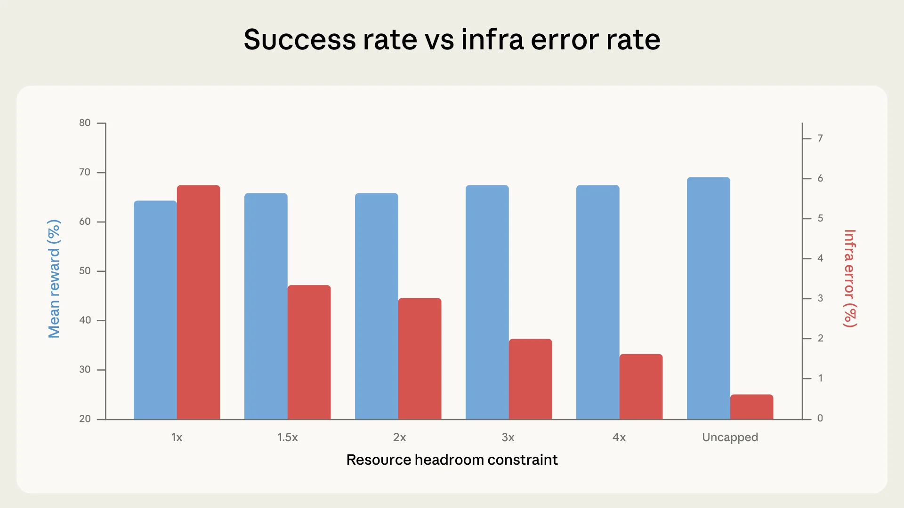

# 量化智能体编程评估中的基础设施噪声

- 英文标题：Quantifying infrastructure noise in agentic coding evals
- 发布日期：2026-02-05
- 官网栏目：工程
- 原文：[Anthropic 页面](https://www.anthropic.com/research/infrastructure-noise)
- 官网署名：Anthropic

> 中文机器初译，未逐篇人工校对。引用研究结论时请核对英文原文。

像 SWE-bench 和 Terminal-Bench 这样的代理编码基准通常用于比较前沿模型的软件工程能力——排行榜上的领先者之间的差距通常只有几个百分点。这些分数通常被视为相对模型能力的精确测量，并越来越多地为有关部署哪些模型的决策提供信息。然而，我们发现仅基础设施配置就可以产生超出这些利润的差异。在内部实验中，Terminal-Bench 2.0 上资源最多和最少的设置之间的差距为 6 个百分点 (p < 0.01)。

静态基准测试直接对模型的输出进行评分——运行时环境不会影响结果。代理编码评估是不同的：模型被赋予一个完整的环境，可以在其中编写程序、运行测试、安装依赖项并迭代多个轮次。运行时不再是一个被动的容器，而是解决问题过程中不可或缺的组成部分。具有不同资源预算和时间限制的两个代理没有进行相同的测试。

Eval 开发人员已经开始考虑这一点。例如，Terminal-Bench 2.0 在最新的 2.0 版本中针对每个任务指定了推荐的 CPU 和 RAM。然而，指定资源并不等同于一致地强制执行它们。此外，我们发现执行方法可以改变基准最终实际测量的内容。

## 我们是如何到达这里的

我们在 Google Kubernetes Engine 集群上运行 Terminal-Bench 2.0。在校准设置时，我们注意到我们的分数与基准测试的官方排行榜不符，并且基础设施错误率出奇地高：多达 6% 的任务因 Pod 错误而失败，其中大多数与模型解决任务的能力无关。

分数的差异归结于执行情况。我们的 Kubernetes 实现将每个任务的资源规格视为下限和硬上限：每个容器都保证拥有指定的资源，但在超出资源时就会被杀死。容器运行时通过两个单独的参数强制使用资源：有保证的分配（预先保留的资源）和容器被终止的硬限制。当它们设置为相同的值时，瞬态峰值的余量为零：瞬时内存波动可能会 OOM 杀死原本会成功的容器。考虑到这一点，Terminal-Bench 的排行榜使用了不同的沙箱提供商，其实施更加宽松，允许临时过度分配而不终止容器，以有利于基础设施的稳定性。

这一发现提出了一个更大的问题：资源配置对评估分数有多大影响？

为了量化脚手架的效果，我们在六种资源配置上运行 Terminal-Bench 2.0，从严格执行每个任务规范 (1x)、让它们同时充当地板和天花板，到完全不受限制。其他一切都保持不变：相同的Claude模型，相同的安全带，相同的任务集。

在我们的实验中，成功率随着资源空间的增加而增加。这主要是由于基础设施错误率在每个步骤中单调下降，从严格执行时的 5.8% 下降到无上限时的 0.5%。严格执行与 3 倍净空（5.8% 至 2.1%）之间的下降非常显着，p < 0.001。有了更多的净空，就会有更少的容器因为超出其分配而被杀死。

从 1 倍到 3 倍，成功分数在噪声范围内波动 (p=0.40)。无论如何，大多数以 1 倍速度崩溃的任务都会失败——这是我们在数据中观察到的。代理进行探索、遇到资源墙并被抢占，但它从未走上正确解决方案的道路。

然而，从大约 3 倍开始，这种趋势发生了变化：成功率的上升速度快于基础错误的下降速度。

在 3 倍到无上限之间，基础错误额外下降 1.6 个百分点，而成功率则跃升近 4 个百分点。额外的资源使代理能够尝试仅适用于大量分配的方法，例如引入大量依赖项、生成昂贵的子进程以及运行内存密集型测试套件。在不限制资源的情况下，超过 1 倍的总提升为 +6 个百分点 (p < 0.01)。在边缘，任务如 `rstan-to-pystan` 和 `compile-compcert` 当获得内存空间时，他们的成功率显着提高。

## 这如何影响测量

额外资源高达大约 3 倍 Terminal-Bench 规格，可解决基础设施可靠性问题，即瞬时资源峰值。Terminal-Bench 维护者使用的沙箱提供程序正在幕后隐式执行此操作；评估变得更加稳定而不变得更容易。

然而，超过 3 倍标记后，额外的资源开始积极帮助代理解决以前无法解决的问题，这表明限制实际上可以改变评估测量的内容。严格的限制会无意中奖励非常有效的策略，而宽松的限制则更加宽容，奖励能够更好地利用所有可用资源的代理。

能够非常快速地编写精益、高效代码的代理将在严格的约束下表现良好。使用重量级工具强力解决方案的代理将在慷慨的工具下表现良好。两者都是值得测试的合法事物，但在不指定资源配置的情况下将它们折叠成一个分数会使差异和现实世界的普遍性难以解释。

开 `bn-fit-modify`，一个需要贝叶斯网络拟合的 Terminal-Bench 任务，一些模型的第一步是安装标准的 Python 数据科学堆栈： `pandas`, `networkx`, `scikit-learn,` 以及他们所有的工具链。在慷慨的限制下，这是可行的。在严格的情况下，在代理编写一行解决方案代码之前，pod 在安装过程中就会耗尽内存。存在更精简的策略（仅使用标准库从头开始实现数学），并且某些模型默认使用它。其他人则不然。不同的模型有不同的默认方法，资源配置决定了哪些方法会成功。我们在不同的人择模型中复制了核心发现。影响的方向是一致的，但幅度有所不同。同样的趋势似乎也适用于Claude以外的模特，但我们还没有对它们进行严格的测试。

我们还通过在 SWE-bench 上运行交叉实验来测试这种模式是否适用于 Terminal-Bench 之外的评估。我们针对 227 个问题（每个问题 10 个样本）将可用 RAM 总量更改为基线的 5 倍。同样的效果仍然存在，尽管幅度较小：随着 RAM 的增加，得分再次单调增加，但在 5 倍时仅比 1 倍高 1.54 个百分点。SWE 基准任务的资源密集度较低，因此预计影响较小，但它表明资源分配也不是中性的。

## 其他差异来源

资源分配并不是唯一的隐藏变量。在某些配置中，时间限制也开始发挥作用。

原则上，评估设置的每个元素都会影响最终分数，从集群运行状况到硬件规格，从并发级别到出口带宽。代理评估是通过构建进行的端到端系统测试，该系统的任何组件都可以充当混杂因素。例如，我们观察到，通过率随一天中的时间而波动，这可能是因为 API 延迟随流量模式和事件而变化。我们尚未正式量化这种影响，但它说明了一个更大的观点：“模型能力”和“基础设施行为”之间的界限比单个基准分数所暗示的更模糊。模型提供商可以通过专用硬件来保护其评估基础设施免受此影响，但外部评估者却无法轻易做到这一点。

公共基准通常旨在衡量纯模型功能，但实际上它们存在将其与基础设施怪癖混为一谈的风险。有时这可能是可取的，因为它可以实现整个堆栈的端到端测试，但更常见的是并非如此。对于要公开共享的编码评估，在多天内多次运行将有助于消除噪音。

## 我们推荐什么

理想的情况是在完全相同的硬件条件下运行每个评估（运行评估的脚手架和推理堆栈），因为这将确保全面的完美再现性。然而，这可能并不总是可行。

考虑到容器运行时如何实际强制执行资源（通过有保证的分配和单独的硬终止阈值），我们建议 evals 为每个任务指定两个参数，而不是单个固定值。单个精确规范将保证分配设置为等于终止阈值，留出零余量：我们记录的 1x 瞬时内存峰值足以破坏评估的稳定性。将这两个参数分开可以让您为容器提供足够的喘息空间，以避免虚假的 OOM 杀死，同时仍然强制执行硬上限以防止分数膨胀。

应校准它们之间的频带，以便地板和天花板上的分数落在彼此的噪音范围内。例如，在 Terminal-Bench 2.0 中，每任务规格的 3 倍上限将基础错误率降低了大约三分之二（5.8% 至 2.1%，p < 0.001），同时保持分数提升适度且完全在噪声范围内（p = 0.40）。这是一个合理的权衡：基础设施的混乱因素在很大程度上被消除，而没有消除有意义的资源压力。确切的乘数会因基准和任务分布而异，因此应该报告，但经验校准原则是通用的。

## 为什么我们关心

这些发现的实际影响超出了评估基础设施的范围。基准分数越来越多地被用作决策输入，但这种关注（和依赖）的增加并不总是伴随着其运行或报告方式的相应严格性。就目前情况而言，排行榜上的 2 分领先可能反映了真正的能力差异，也可能反映了一项评估在更强大的硬件上运行，甚至是在一天中更幸运的时间运行，或者两者兼而有之。如果没有发布的（或标准化的）设置配置，很难从外部判断，除非感兴趣的各方付出额外的努力在相同的条件下重现客观结果。

对于像 Anthropic 这样的实验室来说，这意味着代理评估的资源配置应被视为一流的实验变量，并以与提示格式或采样温度相同的严格性进行记录和控制。对于基准维护者来说，发布推荐的资源规范（如 Terminal-Bench 2.0 所做的那样）可以大有帮助，而指定执行方法将缩小我们发现的差距。对于任何使用基准测试结果的人来说，核心要点是，代理评估的微小分数差异所带来的不确定性比报告数据的精确度所暗示的更大，尤其是因为一些混杂因素实在难以控制。

在资源方法标准化之前，我们的数据表明，低于 3 个百分点的排行榜差异值得怀疑，直到评估配置被记录和匹配。在 Terminal-Bench 中观察到的中等范围资源配置的分布略低于 2 个百分点。朴素二项式置信区间已经跨越 1-2 个百分点；我们在这里记录的基础设施混淆因素堆叠在其之上，而不是在其中。在分配范围的极端情况下，价差达到 6。

领先几分可能表明存在真正的能力差距，或者可能只是虚拟机更大。
