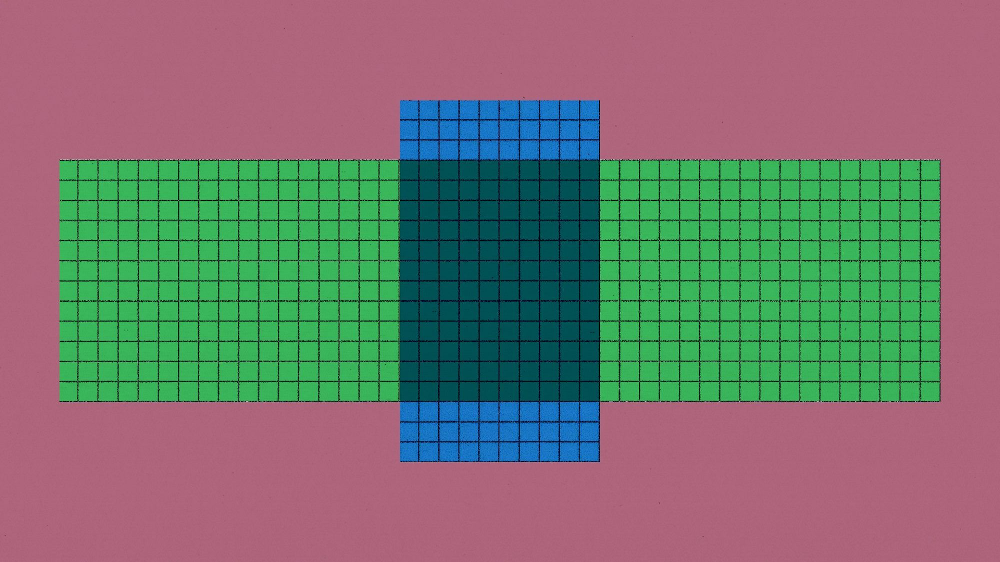
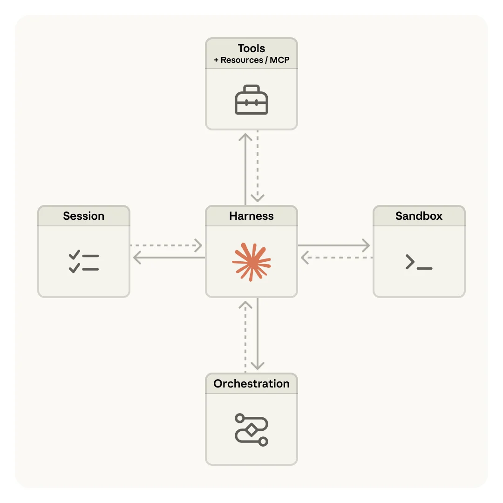
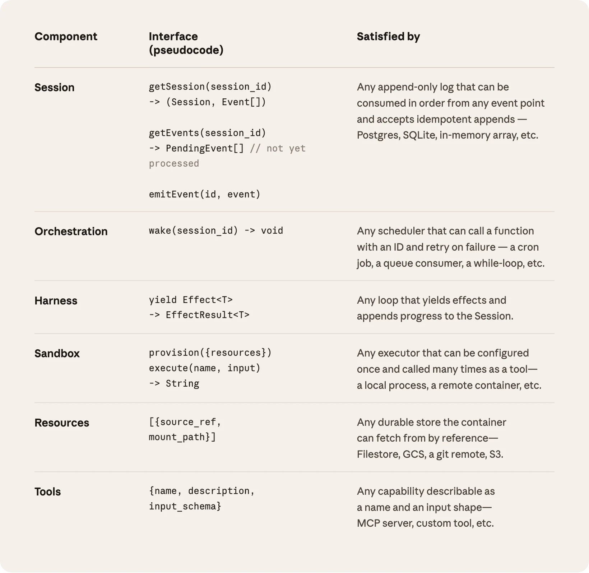
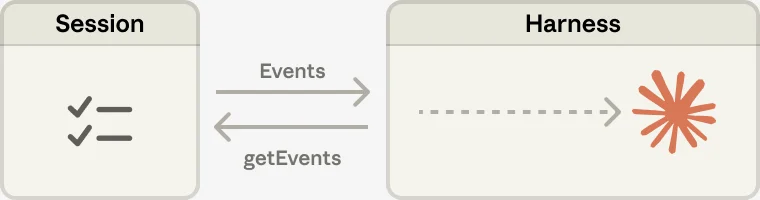
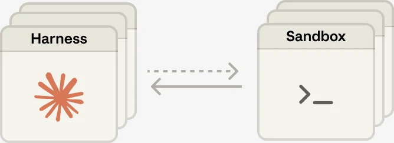

# 扩展托管智能体：将决策与执行分离

- 英文标题：Scaling Managed Agents: Decoupling the brain from the hands
- 发布日期：2026-04-08
- 官网栏目：工程
- 原文：[Anthropic 页面](https://www.anthropic.com/research/managed-agents)
- 官网署名：Anthropic

> 中文机器初译，未逐篇人工校对。引用研究结论时请核对英文原文。

*按照我们的说明开始使用 Claude Managed Agents [文档](https://platform.claude.com/docs/en/managed-agents/overview).*  

工程博客上的一个正在运行的主题是如何 [建立有效的代理人](https://www.anthropic.com/engineering/building-effective-agents) 和 [设计线束](https://www.anthropic.com/engineering/effective-harnesses-for-long-running-agents) 为了 [长时间运行的工作](https://www.anthropic.com/engineering/harness-design-long-running-apps)。这项工作的一个共同点是利用关于Claude无法独自完成的事情的编码假设。然而，这些假设需要经常受到质疑，因为它们可以 [变得陈旧](http://www.incompleteideas.net/IncIdeas/BitterLesson.html) 随着模型的改进。

仅举一个例子，在之前的工作中 [我们发现](https://www.anthropic.com/engineering/harness-design-long-running-apps) 当 Claude Sonnet 4.5 感觉到其上下文限制即将到来时，它会过早地结束任务——这种行为有时被称为“上下文焦虑”。我们通过向线束添加上下文重置来解决这个问题。但当我们在 Claude Opus 4.5 上使用相同的线束时，我们发现该行为消失了。重置已经成为沉重的负担。

我们预计安全带将继续发展。因此，我们构建了托管代理：Claude 平台中的一项托管服务，它通过一小组接口代表您运行长期代理，这些接口旨在比任何特定实现（包括我们今天运行的实现）更持久。

构建托管代理意味着解决计算中的一个老问题：如何设计一个系统来“[尚未想到的计划](http://www.catb.org/esr/writings/taoup/html/ch03s01.html)”。几十年前，操作系统通过将硬件虚拟化为抽象来解决这个问题——*进程、文件*——对于尚不存在的程序来说足够通用了。抽象比硬件更持久。的 `read()` 命令不知道它正在访问 20 世纪 70 年代的磁盘包还是现代 SSD。顶层的抽象保持稳定，而底层的实现则自由变化。

托管代理遵循相同的模式。我们虚拟化了代理的组件：会话（发生的所有事情的仅附加日志）、工具（调用 Claude 并将 Claude 的工具调用路由到相关基础设施的循环）和沙箱（Claude 可以在其中运行代码和编辑文件的执行环境）。这允许交换每个的实现而不干扰其他的实现。我们对这些界面的形状有自己的看法，而不是它们背后运行的内容。

## 不要领养宠物

我们首先将所有代理组件放入一个容器中，这意味着会话、代理工具和沙箱都共享一个环境。这种方法有很多好处，包括文件编辑是直接的系统调用，并且没有需要设计的服务边界。

但是，通过将所有内容耦合到一个容器中，我们遇到了一个旧的基础设施问题：我们采用了一种 [*宠物*](https://cloudscaling.com/blog/cloud-computing/the-history-of-pets-vs-cattle/)。在宠物与牛的类比中，宠物是一个有名字的、手工照料的个体，你不能失去它，而牛是可以互换的。在我们的例子中，服务器变成了那个宠物；如果容器发生故障，会话就会丢失。如果容器没有响应，我们必须将其恢复到正常状态。

护理容器意味着调试无响应的卡住会话。我们唯一的窗口是 WebSocket 事件流，但这无法告诉我们 *哪里* 出现故障，这意味着线束中的错误、事件流中的数据包丢失或容器离线都呈现相同的情况。为了找出问题所在，工程师必须在容器内打开一个 shell，但由于该容器通常还保存用户数据，这种方法本质上意味着我们缺乏调试能力。

第二个问题是，该安全带假设Claude所做的任何事情都与它一起存在于容器中。当客户要求我们将 Claude 连接到他们的虚拟私有云时，他们必须将他们的网络与我们的网络对等，或者在他们自己的环境中运行我们的工具。当我们想要将其连接到不同的基础设施时，嵌入到线束中的假设就成为了一个问题。

## 将大脑与双手分离

我们得出的解决方案是将我们所认为的“大脑”（Claude 及其工具）与“手”（执行操作的沙箱和工具）和“会话”（会话事件的日志）分离。每个接口都成为一个对其他接口几乎不做任何假设的接口，并且每个接口都可能失败或被独立替换。

**安全带离开容器。** 将大脑与双手分离意味着安全带不再位于容器内。它调用容器的方式与调用任何其他工具的方式相同： `execute(name, input) → string`。容器变成了牛。如果容器失效，线束会将故障捕获为工具调用错误，并将其传递回 Claude。如果Claude决定重试，则可以使用标准配方重新初始化新容器： `provision({resources})`。我们不再需要护理失效的容器使其恢复健康。

**从线束故障中恢复。** 马具也变成了牛。由于会话日志位于线束外部，因此线束中的任何内容都不需要在崩溃时幸存下来。当一个失败时，可以重新启动一个新的 `wake(sessionId)`, 使用 `getSession(id)` 取回事件日志，并从上一个事件恢复。在代理循环期间，线束将写入会话 `emitEvent(id, event)` 以保存事件的持久记录。

**安全边界。** 在耦合设计中，Claude 生成的任何不受信任的代码都与凭据在同一个容器中运行，因此提示注入只需说服 Claude 读取其自己的环境即可。一旦攻击者拥有这些令牌，他们就可以产生新的、不受限制的会话并将工作委托给他们。缩小范围是一种明显的缓解措施，但这编码了一个假设，即Claude不能用有限的代币做什么——而且Claude变得越来越聪明。结构修复是为了确保永远无法从Claude生成的代码运行的沙箱中访问令牌。

我们使用两种模式来确保这一点。身份验证可以与资源捆绑在一起，也可以保存在沙箱外部的保管库中。对于 Git，我们使用每个存储库的访问令牌在沙箱初始化期间克隆存储库并将其连接到本地 git 远程。git `push` 和 `pull` 从沙箱内部工作，代理无需处理令牌本身。对于自定义工具，我们支持 MCP 并将 OAuth 令牌存储在安全保管库中。Claude 通过专用代理调用 MCP 工具；该代理接收与会话关联的令牌。然后，代理可以从保管库中获取相应的凭据并调用外部服务。安全带永远不会知道任何凭证。

## 该会话不是 Claude 的上下文窗口

长期任务通常超出Claude上下文窗口的长度，解决这个问题的标准方法都涉及关于保留什么的不可逆转的决定。我们已经探索了这些技术 [之前的工作](https://www.anthropic.com/engineering/effective-context-engineering-for-ai-agents) 关于情境工程。例如，压缩让 Claude 保存其上下文窗口的摘要，而内存工具让 Claude 将上下文写入文件，从而实现跨会话学习。这可以与上下文修剪配合使用，后者有选择地删除旧工具结果或思维块等标记。

但有选择地保留或丢弃上下文的不可逆转的决定可能会导致失败。很难知道未来的轮次需要哪些代币。如果消息通过压缩步骤进行转换，则该工具会从 Claude 的上下文窗口中删除压缩消息，并且只有在存储这些消息时才能恢复这些消息。之前的工作 [已经探索过](https://arxiv.org/pdf/2512.24601) 通过将上下文存储为存在的对象来解决此问题的方法 *外面* 上下文窗口。例如，上下文可以是 REPL 中的一个对象，LLM 通过编写代码来过滤或切片它以编程方式访问。

在托管代理中，会话提供了同样的好处，充当位于 Claude 上下文窗口之外的上下文对象。但上下文不是存储在沙箱或 REPL 中，而是持久存储在会话日志中。界面， `getEvents(),` 允许大脑通过选择事件流的位置片段来询问上下文。该界面可以灵活使用，允许大脑从上次停止阅读的地方继续阅读，倒回特定时刻之前的一些事件以查看线索，或者在特定动作之前重新阅读上下文。

任何获取的事件也可以在传递到 Claude 的上下文窗口之前在线束中进行转换。这些转换可以是工具编码的任何内容，包括上下文组织以实现高提示缓存命中率和上下文工程。我们将会话中可恢复上下文存储的关注点和工具中任意上下文管理的关注点分开，因为我们无法预测未来模型中需要哪些特定的上下文工程。这些接口将上下文管理推入工具中，并且仅保证会话持久且可用于询问。

## 多动脑子，多动手

**许多大脑。** 将大脑与双手分离解决了我们最早的客户投诉之一。当团队希望 Claude 处理他们自己的 VPC 中的资源时，唯一的途径是将他们的网络与我们的网络对等，因为持有线束的容器假定所有资源都位于它旁边。一旦安全带不再位于容器中，这种假设就消失了。同样的改变也带来了性能回报。当我们最初将大脑放入容器中时，这意味着许多大脑需要同样多的容器。对于每个大脑来说，在配置该容器之前不会进行任何推理。每个会话都预先支付了全部容器设置费用。每个会话，即使是那些永远不会接触沙箱的会话，都必须克隆存储库，启动进程，从我们的服务器获取挂起的事件。

该停滞时间以首次令牌时间 (TTFT) 表示，它测量会话在接受工作和生成第一个响应令牌之间等待的时间。TTFT是用户最严重的延迟 *感觉*.

将大脑与双手分离意味着容器由大脑通过工具调用来配置 `(execute(name, input) → string)` 仅当需要时。因此，不需要立即使用容器的会话不会等待容器。一旦编排层从会话日志中提取待处理事件，推理就可以开始。使用这种架构，我们的 p50 TTFT 下降了大约 60%，p95 下降了超过 90%。扩展到许多大脑只意味着启动许多无状态的安全带，并仅在需要时将它们连接到手。

**很多手。** 我们还希望能够将每个大脑与许多双手连接起来。实际上，这意味着Claude必须推理许多执行环境并决定将工作发送到哪里——这是一项比在单个 shell 中操作更困难的认知任务。我们从单个容器中的大脑开始，因为早期的模型无法做到这一点。随着智力的扩展，单个容器反而成为了限制：当该容器发生故障时，我们就会失去大脑所触及的每只手的状态。

将大脑与双手脱钩，使每只手都成为工具， `execute(name, input) → string`：输入名称和输入，返回一个字符串。该界面支持任何自定义工具、任何 MCP 服务器以及我们自己的工具。线束不知道沙箱是容器、手机还是神奇宝贝模拟器。而且由于没有一只手与任何大脑相连，因此大脑可以将手相互传递。

## 结论

我们面临的挑战是一个老问题：如何为“尚未想到的程序”设计一个系统。操作系统通过将硬件虚拟化为对于尚不存在的程序来说足够通用的抽象，已经存在了数十年。通过托管代理，我们的目标是设计一个系统，以适应未来的安全带、沙箱或Claude周围的其他组件。

托管代理是本着同样精神的元线束，对 *具体的* Claude将来需要的安全带。相反，它是一个具有通用接口的系统，允许许多不同的线束。例如，Claude Code 是一个出色的工具，我们在各种任务中广泛使用。我们还表明，特定于任务的代理利用在狭窄的领域中表现出色。托管代理可以适应其中任何一个，随着时间的推移，与Claude的智力相匹配。

元框架设计意味着对 Claude 周围的接口有自己的看法：我们期望 Claude 需要具有操纵状态（会话）和执行计算（沙箱）的能力。我们还预计Claude需要具备扩展到多个大脑和多个双手的能力。我们设计的接口是为了使它们能够长期可靠、安全地运行。但我们对Claude需要的大脑或手的数量或位置没有做出任何假设。
