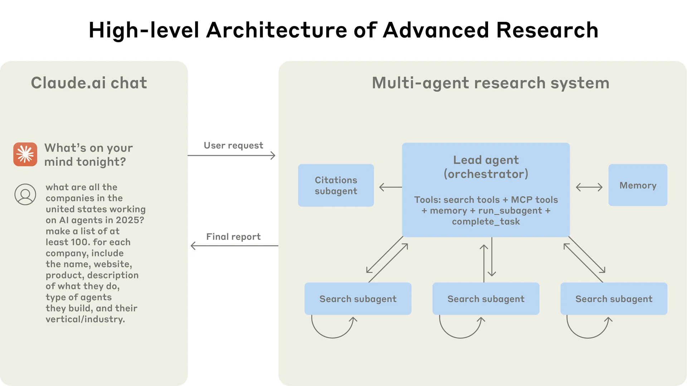
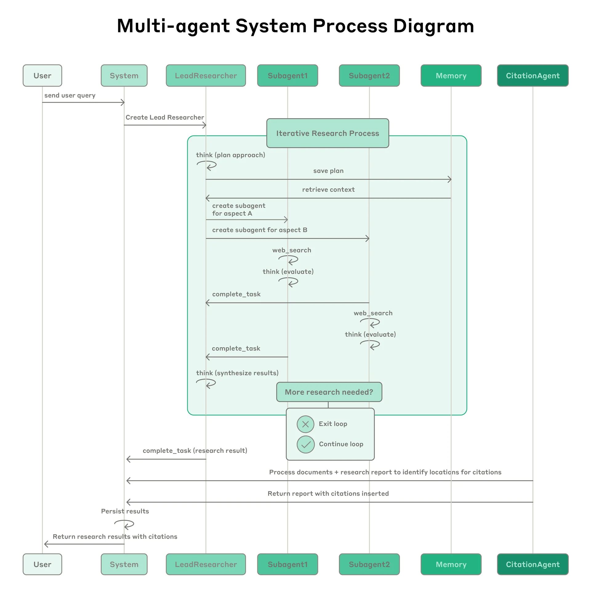
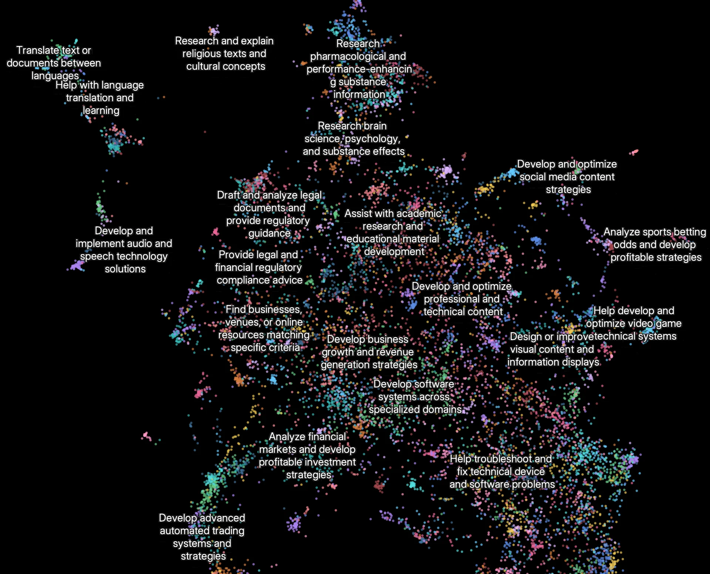

# 我们如何构建多智能体研究系统

- 英文标题：How we built our multi-agent research system
- 发布日期：2025-06-13
- 官网栏目：工程
- 原文：[Anthropic 页面](https://www.anthropic.com/research/multi-agent-research-system)
- 官网署名：Anthropic

> 中文机器初译，未逐篇人工校对。引用研究结论时请核对英文原文。

Claude现在有 [研究能力](https://www.anthropic.com/news/research) 允许它在网络、Google Workspace 和任何集成中进行搜索以完成复杂的任务。

这个多智能体系统从原型到生产的历程给我们带来了有关系统架构、工具设计和即时工程的重要教训。多代理系统由多个代理（LLM 在循环中自主使用工具）组成，这些代理一起工作。我们的研究功能涉及一个代理，该代理根据用户查询规划研究过程，然后使用工具创建同时搜索信息的并行代理。具有多个代理的系统在代理协调、评估和可靠性方面带来了新的挑战。

这篇文章详细介绍了对我们有用的原则——我们希望您会发现它们在构建您自己的多代理系统时很有用。

## 多代理系统的好处

研究工作涉及开放式问题，很难提前预测所需的步骤。您无法硬编码固定路径来探索复杂的主题，因为该过程本质上是动态的且依赖于路径。当人们进行研究时，他们倾向于根据发现、遵循调查过程中出现的线索不断更新他们的方法。

这种不可预测性使得AI 智能体特别适合研究任务。研究需要随着调查的展开而灵活地调整或探索切线联系。该模型必须自主运行多次，根据中间结果决定要追求的方向。线性的一次性管道无法处理这些任务。

搜索的本质是压缩：从庞大的语料库中提取见解。子代理通过与自己的上下文窗口并行操作来促进压缩，在为主要研究代理压缩最重要的标记之前同时探索问题的不同方面。每个子代理还提供关注点分离（不同的工具、提示和探索轨迹），从而减少路径依赖性并实现彻底、独立的调查。

一旦智能达到阈值，多代理系统就成为扩展性能的重要方式。例如，尽管在过去 10 万年里，人类个体变得更加聪明，但人类社会却变得更加聪明。 *指数地* 因为我们在信息时代更有能力 *集体的* 智力和协调能力。即使是具有一般智力的特工在作为个体运作时也会面临限制。代理组可以完成更多的事情。

我们的内部评估表明，多智能体研究系统尤其适合涉及同时追求多个独立方向的广度优先查询。在我们的内部研究评估中，我们发现以 Claude Opus 4 作为主要智能体和 Claude Sonnet 4 子智能体的多智能体系统比单智能体 Claude Opus 4 的性能高出 90.2%。例如，当被要求识别信息技术标准普尔 500 强公司的所有董事会成员时，多代理系统通过将其分解为子代理的任务来找到正确的答案，而单代理系统则无法通过缓慢的顺序搜索找到答案。

多代理系统之所以有效，主要是因为它们有助于花费足够的代币来解决问题。在我们的分析中，三个因素解释了 95% 的性能差异 [浏览比较](https://openai.com/index/browsecomp/) 评估（测试浏览代理定位难以查找的信息的能力）。我们发现代币使用本身就解释了 80% 的差异，工具调用次数和模型选择是另外两个解释因素。这一发现验证了我们的架构，该架构可以在具有单独上下文窗口的代理之间分配工作，以增加并行推理的更多能力。最新的 Claude 模型极大地提高了代币使用的效率，因为升级到 Claude Sonnet 4 比 Claude Sonnet 3.7 上代币预算加倍的性能提升更大。多代理架构可以有效地扩展超出单个代理限制的任务的令牌使用量。

有一个缺点：在实践中，这些架构会快速消耗代币。在我们的数据中，代理通常使用比聊天交互多约 4 倍的令牌，多代理系统使用比聊天多约 15 倍的令牌。为了经济可行性，多智能体系统需要任务价值足够高的任务来支付提高的性能。此外，一些要求所有代理共享相同上下文或涉及代理之间许多依赖关系的领域不太适合当今的多代理系统。例如，大多数编码任务涉及的真正可并行任务比研究要少，而且 LLM 代理尚不擅长实时协调和委托给其他代理。我们发现多代理系统擅长执行涉及大量并行化、超出单个上下文窗口的信息以及与众多复杂工具交互的有价值的任务。

## 研究架构概述

我们的研究系统使用具有协调者-工作者模式的多代理架构，其中领导代理协调流程，同时委托给并行操作的专门子代理。

实际的多代理架构：用户查询流经一个主导代理，该主导代理创建专门的子代理来并行搜索不同方面。

当用户提交查询时，主导代理会对其进行分析，制定策略，并生成子代理以同时探索不同的方面。如上图所示，子代理充当智能过滤器，通过迭代地使用搜索工具来收集信息（在本例中是 2025 年的AI 智能体公司），然后将公司列表返回给首席代理，以便它可以编制最终答案。

使用检索增强生成 (RAG) 的传统方法使用静态检索。也就是说，它们获取与输入查询最相似的一组块，并使用这些块来生成响应。相比之下，我们的架构使用多步骤搜索，动态查找相关信息，适应新的发现，并分析结果以制定高质量的答案。

显示我们的多代理研究系统的完整工作流程的流程图。当用户提交查询时，系统会创建一个进入迭代研究过程的 LeadResearcher 代理。LeadResearcher 首先思考该方法并将其计划保存到内存中以保留上下文，因为如果上下文窗口超过 200,000 个标记，它将被截断，因此保留该计划非常重要。然后，它创建具有特定研究任务的专门子代理（此处显示了两个，但可以是任意数量）。每个子代理独立执行网络搜索，使用评估工具结果 [交错思维](https://docs.anthropic.com/en/docs/build-with-claude/extended-thinking#interleaved-thinking)，并将结果返回给 LeadResearcher。LeadResearcher 综合这些结果并决定是否需要更多研究 - 如果需要，它可以创建额外的子代理或完善其策略。一旦收集到足够的信息，系统就会退出研究循环，并将所有发现传递给 CitationAgent，CitationAgent 会处理文档和研究报告，以确定引用的具体位置。这确保所有声明都正确归因于其来源。最终的研究结果（附有引文）将返回给用户。

## 为研究人员提供及时的工程设计和评估

多智能体系统与单智能体系统有重大区别，包括协调复杂性的快速增长。早期的代理犯了一些错误，例如为简单查询生成 50 个子代理、无休止地在网络上搜索不存在的源以及通过过多的更新分散彼此的注意力。由于每个代理都受到提示的引导，因此提示工程是我们改善这些行为的主要杠杆。以下是我们学到的一些提示代理的原则：

1. **像您的代理人一样思考。** 要迭代提示，您必须了解它们的效果。为了帮助我们做到这一点，我们使用我们的 [控制台](https://console.anthropic.com/) 根据我们系统中的确切提示和工具，然后观看代理逐步工作。这立即揭示了失败模式：代理在已经获得足够结果时继续运行、使用过于冗长的搜索查询或选择不正确的工具。有效的提示依赖于为座席建立准确的心理模型，这可以使最有影响力的变化变得显而易见。
2. **教协调者如何委派。** 在我们的系统中，主导代理将查询分解为子任务并将其描述给子代理。每个子代理都需要一个目标、一个输出格式、有关要使用的工具和来源的指南以及明确的任务边界。如果没有详细的任务描述，代理就会重复工作、留下空白或无法找到必要的信息。我们首先允许首席代理给出简单、简短的指令，例如“研究半导体短缺”，但发现这些指令通常非常模糊，以至于子代理会误解任务或执行与其他代理完全相同的搜索。例如，一个子代理研究了 2021 年的汽车芯片危机，而另外 2 个子代理重复了调查当前 2025 年供应链的工作，没有进行有效的分工。
3. **扩展查询复杂性的工作量。** 代理很难判断不同任务的适当努力，因此我们在提示中嵌入了缩放规则。简单的事实调查仅需要 1 个代理进行 3-10 次工具调用，直接比较可能需要 2-4 个子代理，每个子代理进行 10-15 次调用，而复杂的研究可能需要 10 个以上的子代理，并且职责划分明确。这些明确的指导方针可以帮助首席代理有效地分配资源并防止在简单查询上的过度投资，这是我们早期版本中常见的失败模式。
4. **工具的设计和选择至关重要。** 代理工具接口与人机接口一样重要。使用正确的工具是高效的——通常，这是绝对必要的。例如，代理在网络上搜索仅存在于 Slack 中的上下文从一开始就注定要失败。与 [MCP服务器](https://modelcontextprotocol.io/introduction) 使模型能够访问外部工具，这个问题变得更加复杂，因为智能体会遇到质量差异很大的描述的看不见的工具。我们为代理提供了明确的启发：例如，首先检查所有可用的工具，将工具的使用与用户意图相匹配，在网络上搜索广泛的外部探索，或者更喜欢专用工具而不是通用工具。错误的工具描述可能会让代理走上完全错误的道路，因此每个工具都需要有明确的目的和清晰的描述。
5. **让代理商提升自我**。我们发现Claude 4模型可以成为优秀的提示工程师。当给出提示和故障模式时，他们能够诊断代理失败的原因并提出改进建议。我们甚至创建了一个工具测试代理——当给出有缺陷的 MCP 工具时，它会尝试使用该工具，然后重写工具描述以避免失败。通过对该工具进行数十次测试，该代理发现了关键的细微差别和错误。这种改进工具人体工程学的过程使使用新描述的未来代理的任务完成时间减少了 40%，因为他们能够避免大多数错误。
6. **从宽范围开始，然后缩小范围。** 搜索策略应该反映专家的人类研究：在深入研究细节之前探索景观。代理通常默认使用过长的特定查询，但返回的结果很少。我们通过提示代理从简短、广泛的查询开始，评估可用的内容，然后逐渐缩小焦点来抵消这种趋势。
7. **指导思维过程。** [扩展思维模式](https://docs.anthropic.com/en/docs/build-with-claude/extended-thinking)，导致Claude在可见的思维过程中输出额外的代币，可以作为一个可控的便签本。首席代理使用思维来规划其方法，评估哪些工具适合任务，确定查询复杂性和子代理数量，并定义每个子代理的角色。我们的测试表明，扩展思维可以改善指令遵循、推理和效率。子代理也计划，然后使用 [交错思维](https://docs.anthropic.com/en/docs/build-with-claude/extended-thinking#interleaved-thinking) 使用工具结果来评估质量、找出差距并完善下一个查询。这使得子代理能够更有效地适应任何任务。
8. **并行工具调用可提高速度和性能。** 复杂的研究任务自然涉及探索许多来源。我们早期的代理执行顺序搜索，速度慢得令人痛苦。为了速度，我们引入了两种并行化：（1）主导智能体并行而不是串行地启动 3-5 个子智能体； (2)子代理并行使用3个以上的工具。这些变化将复杂查询的研究时间缩短了 90%，使研究能够在几分钟而不是几小时内完成更多工作，同时覆盖比其他系统更多的信息。

我们的激励策略侧重于灌输良好的启发式方法，而不是严格的规则。我们研究了熟练的人类如何处理研究任务，并将这些策略编码在我们的提示中——例如将困难的问题分解为更小的任务、仔细评估来源的质量、根据新信息调整搜索方法，以及识别何时关注深度（详细调查一个主题）与广度（并行探索多个主题）。我们还通过设置明确的护栏来主动减轻意外的副作用，以防止代理失控。最后，我们专注于具有可观察性和测试用例的快速迭代循环。

## 代理商有效评价

良好的评估对于构建可靠的人工智能应用程序至关重要，代理也不例外。然而，评估多智能体系统提出了独特的挑战。传统的评估通常假设人工智能每次都遵循相同的步骤：给定输入 X，系统应遵循路径 Y 来产生输出 Z。但多代理系统并不是这样工作的。即使起点相同，代理也可能采取完全不同的有效路径来达到目标​​。一个代理可能会搜索三个来源，而另一个代理可能会搜索十个来源，或者他们可能会使用不同的工具来找到相同的答案。因为我们并不总是知道什么是正确的步骤，所以我们通常不能仅仅检查代理是否遵循了我们事先规定的“正确”步骤。相反，我们需要灵活的评估方法来判断代理人是否取得了正确的结果，同时遵循合理的流程。

**立即开始小样本评估**。在早期的代理开发中，变化往往会产生巨大的影响，因为有大量唾手可得的成果。及时调整可能会将成功率从 30% 提高到 80%。由于效果大小如此之大，您只需几个测试用例即可发现变化。我们从一组大约 20 个代表真实使用模式的查询开始。测试这些查询通常可以让我们清楚地看到更改的影响。我们经常听说人工智能开发团队推迟创建评估，因为他们认为只有包含数百个测试用例的大型评估才有用。然而，最好立即从一些示例开始小规模测试，而不是推迟到可以构建更彻底的评估为止。

**如果做得好的话，法学硕士作为法官的评估规模会很大。** 研究成果很难以编程方式进行评估，因为它们是自由格式的文本，很少有单一的正确答案。法学硕士非常适合对输出进行分级。我们使用法学硕士法官根据标题中的标准评估每个输出：事实准确性（声明是否与来源匹配？）、引用准确性（引用的来源是否与声明匹配？）、完整性（是否涵盖了所有要求的方面？）、来源质量（是否使用了主要来源而不是质量较低的二手来源？）以及工具效率（是否使用了正确的工具合理的次数？）。我们尝试让多名评委来评估每个组件，但发现单个 LLM 调用和单个提示输出 0.0-1.0 的分数以及通过/不及格等级是最一致的，并且与人类判断最一致。当评估测试用例时，这种方法特别有效 *做了* 有一个明确的答案，我们可以使用 LLM 法官来简单地检查答案是否正确（即它是否准确列出了研发预算排名前 3 名的制药公司？）。使用法学硕士作为评判使我们能够大规模评估数百个输出。

**人工评估可以捕捉到自动化所遗漏的内容。** 人员测试代理会发现评估遗漏的边缘情况。其中包括对异常查询、系统故障或微妙的源选择偏差的幻觉答案。在我们的案例中，人类测试人员注意到，我们的早期代理始终选择 SEO 优化的内容农场，而不是学术 PDF 或个人博客等权威但排名较低的来源。在我们的提示中添加源质量启发有助于解决此问题。即使在自动化评估的世界中，手动测试仍然至关重要。

多智能体系统具有突发行为，这些行为无需特定编程即可出现。例如，对首席代理的微小更改可能会不可预测地改变子代理的行为方式。成功需要理解交互模式，而不仅仅是个体代理的行为。因此，对这些代理的最佳提示不仅仅是严格的指示，而是定义分工、解决问题的方法和工作预算的协作框架。做到这一点依赖于仔细的提示和工具设计、可靠的启发式、可观察性和紧密的反馈循环。请参阅 [我们的食谱中的开源提示](https://platform.claude.com/cookbook/patterns-agents-basic-workflows) 例如我们系统的提示。

## 生产可靠性和工程挑战

在传统软件中，错误可能会破坏功能、降低性能或导致中断。在代理系统中，微小的变化会级联成大的行为变化，这使得为必须在长期运行的过程中维护状态的复杂代理编写代码变得非常困难。

**代理是有状态的并且错误是复合的。** 代理可以长时间运行，在许多工具调用中维护状态。这意味着我们需要持久地执行代码并处理错误。如果没有有效的缓解措施，轻微的系统故障对代理来说可能是灾难性的。当错误发生时，我们不能从头开始：重新启动的成本很高，而且会让用户感到沮丧。相反，我们构建了可以从代理发生错误时所在位置恢复的系统。我们还利用模型的智能来优雅地处理问题：例如，让代理知道工具何时出现故障并让它适应，效果出奇地好。我们将基于 Claude 构建的AI 智能体的适应性与重试逻辑和定期检查点等确定性保障措施相结合。

**调试受益于新方法。** 即使提示相同，代理也会做出动态决策，并且在运行之间是不确定的。这使得调试更加困难。例如，用户会报告代理“没有找到明显的信息”，但我们不明白为什么。代理是否使用了错误的搜索查询？选择不良来源？打击工具故障？添加完整的生产跟踪让我们能够诊断代理失败的原因并系统地解决问题。除了标准的可观察性之外，我们还监控代理决策模式和交互结构——所有这些都无需监控个人对话的内容，以维护用户隐私。这种高级可观察性帮助我们诊断根本原因、发现意外行为并修复常见故障。

**部署需要仔细协调。** 代理系统是由提示、工具和执行逻辑组成的高度状态网络，几乎连续运行。这意味着每当我们部署更新时，代理可能位于其流程中的任何位置。因此，我们需要防止善意的代码更改破坏现有代理。我们无法同时将每个代理更新到新版本。相反，我们使用 [彩虹部署](https://brandon.dimcheff.com/2018/02/rainbow-deploys-with-kubernetes/) 通过逐渐将流量从旧版本转移到新版本，同时保持两个版本同时运行，以避免中断正在运行的代理。

**同步执行会产生瓶颈。** 目前，我们的主导代理同步执行子代理，等待每组子代理完成后再继续。这简化了协调，但在代理之间的信息流中造成了瓶颈。例如，主代理无法引导子代理，子代理无法协调，并且在等待单个子代理完成搜索时整个系统可能会被阻塞。异步执行将实现额外的并行性：代理同时工作并在需要时创建新的子代理。但这种异步性增加了子代理之间的结果协调、状态一致性和错误传播方面的挑战。由于模型可以处理更长、更复杂的研究任务，我们预计性能的提升将证明复杂性的合理性。

## 结论

在构建AI 智能体时，最后一英里往往成为旅程的大部分。在开发人员机器上运行的代码库需要大量的工程才能成为可靠​​的生产系统。代理系统中错误的复合性质意味着传统软件的小问题可能会完全使代理脱轨。一步失败可能会导致智能体探索完全不同的轨迹，从而导致不可预测的结果。由于本文中描述的所有原因，原型和生产之间的差距通常比预期的要大。

尽管存在这些挑战，多智能体系统已被证明对于开放式研究任务很有价值。用户表示，Claude帮助他们找到了他们没有考虑过的商机，导航复杂的医疗保健选择，解决棘手的技术错误，并通过发现他们单独无法找到的研究联系来节省长达数天的工作时间。通过仔细的工程、全面的测试、注重细节的提示和工具设计、稳健的操作实践以及对当前代理能力有深入了解的研究、产品和工程团队之间的紧密合作，多代理研究系统可以大规模可靠地运行。我们已经看到这些系统改变了人们解决复杂问题的方式。

A [克里奥](https://www.anthropic.com/research/clio) 嵌入图显示了人们当今使用研究功能的最常见方式。最主要的用例类别是开发跨专业领域的软件系统（10%）、开发和优化专业和技术内容（8%）、制定业务增长和创收策略（8%）、协助学术研究和教育材料开发（7%）以及研究和验证有关人员、地点或组织的信息（5%）。

## 附录

以下是多代理系统的一些其他提示。

**对多次改变状态的代理进行最终状态评估。** 评估在多轮对话中修改持久状态的代理提出了独特的挑战。与只读研究任务不同，每个操作都可以改变后续步骤的环境，从而产生传统评估方法难以处理的依赖关系。我们发现成功的重点在于最终状态评估而不是逐轮分析。不要判断智能体是否遵循特定的过程，而是评估它是否达到了正确的最终状态。这种方法承认代理可以找到实现同一目标的替代路径，同时仍然确保他们提供预期的结果。对于复杂的工作流程，将评估分解为应该发生特定状态更改的离散检查点，而不是尝试验证每个中间步骤。

**长视野对话管理。** 制作代理经常进行数百轮的对话，需要仔细的上下文管理策略。随着对话的扩展，标准上下文窗口变得不足，需要智能压缩和内存机制。我们实现了这样的模式：代理总结已完成的工作阶段，并在继续执行新任务之前将基本信息存储在外部存储器中。当上下文限制接近时，代理可以生成具有干净上下文的新子代理，同时通过仔细的切换保持连续性。此外，他们可以从记忆中检索存储的上下文（例如研究计划），而不是在达到上下文限制时丢失以前的工作。这种分布式方法可以防止上下文溢出，同时保持扩展交互中对话的连贯性。

**子代理输出到文件系统以最小化“电话游戏”。** 直接子代理输出可以绕过主协调器以获得某些类型的结果，从而提高保真度和性能。实现工件系统，其中专门的代理可以创建独立持久的输出，而不是要求子代理通过主导代理传达所有内容。子代理调用工具将其工作存储在外部系统中，然后将轻量级引用传递回协调器。这可以防止多阶段处理期间的信息丢失，并减少通过对话历史记录复制大量输出的令牌开销。该模式特别适用于代码、报告或数据可视化等结构化输出，其中子代理的专门提示比通过通用协调器进行过滤产生更好的结果。

### 想了解更多吗？

[探索课程](https://anthropic.skilljar.com/)
