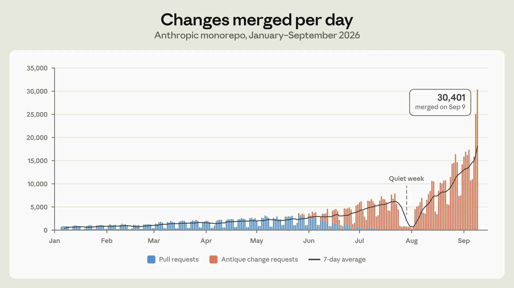
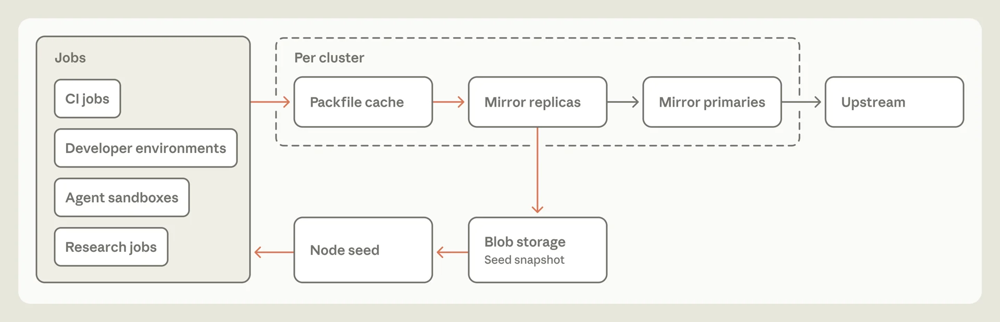
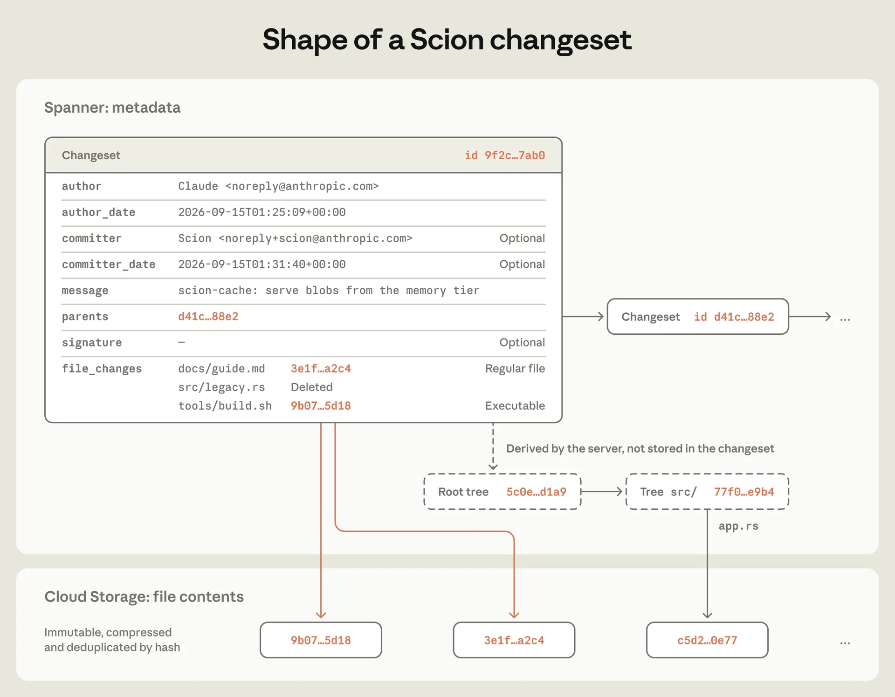
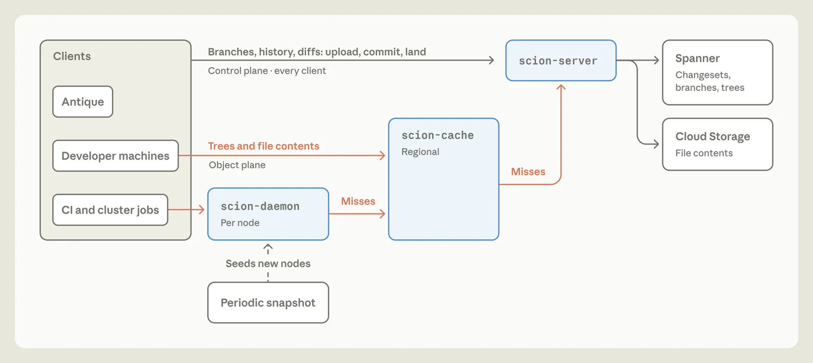
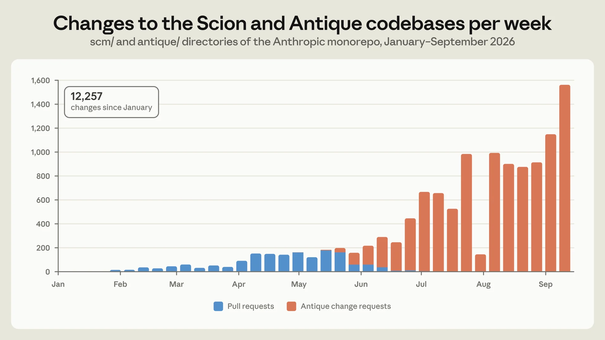
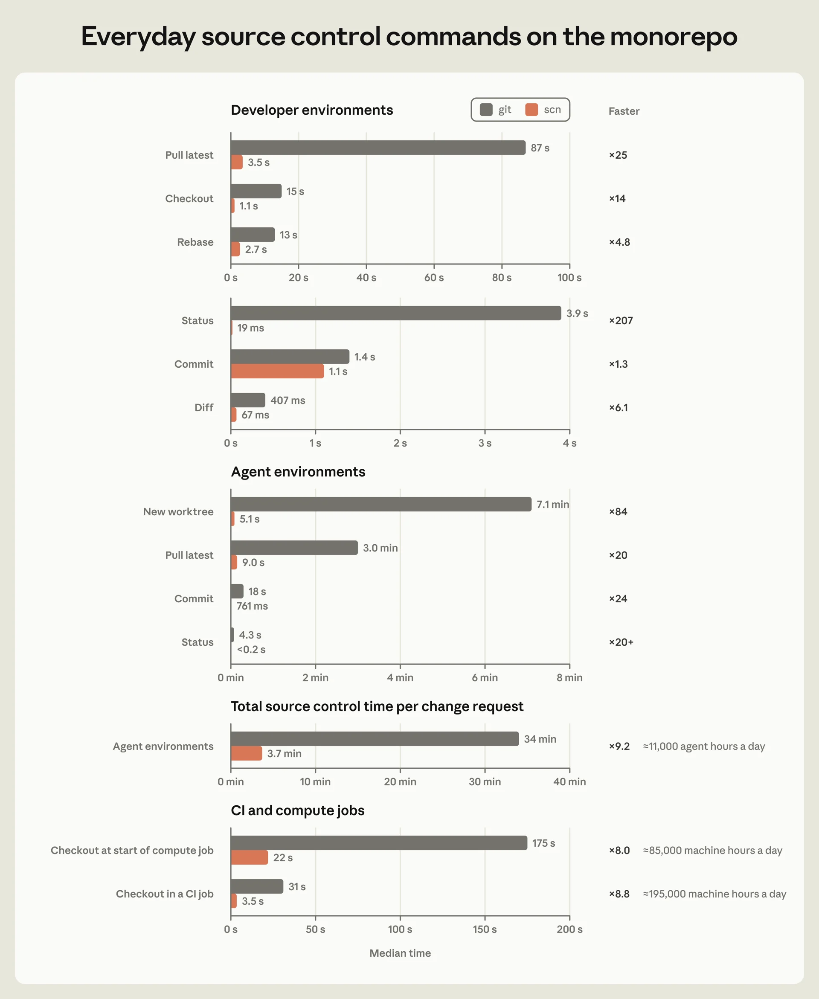

# Anthropic 如何重新设计版本控制系统

- 英文标题：Redesigning source control at Anthropic
- 发布日期：2026-10-13
- 官网栏目：工程
- 原文：[Anthropic 页面](https://www.anthropic.com/research/redesigning-source-control)
- 官网署名：Anthropic

> 已逐段对照英文原文校订。

*10 月 15 日更新，补充介绍了率先采用 Scion 所用多项技术的项目。*

在 Anthropic，编写代码已不再是构建系统或开展研究的瓶颈。Claude 能自主迭代研究流程、对复杂程序做细粒度优化，以及从零构建新服务，速度和规模都是我们此前未曾见过的。现在，瓶颈转移到了按人类开发规模设计的基础设施，也就是版本控制、构建和持续集成（CI）。

2026 年 5 月，Anthropic 平均每天合并约 2,500 项代码变更。到 9 月，这个数字已超过 30,000。我们预计增长短期内不会放缓。合并代码的潜在需求几乎没有上限，每消除一处瓶颈，产出的代码量就会立即进一步增加。

2026 年 1 月至 9 月，每天合并到单体仓库的变更数。

为了支撑这样的增长，我们构建了内部版本控制系统 Scion，并在五个月内将单体仓库从 Git 完全迁移过去。同一时期，我们还交付了名为 Antique 的代码审查界面、代码搜索、功能完善的版本控制身份与访问管理系统，以及管理和合入大量已审查变更的新方法等。本文聚焦 Scion 是怎样构建的。Claude 的编码能力既造成了这个局面，也帮助我们迅速建成一个高质量、可扩展的系统来应对它。

### 单体仓库的增长

我们的工作负载相当特殊。Anthropic 用 Claude 写软件的规模超过了几乎所有公司，因此往往最先发现按人类工作规模设计的工具在哪里开始吃紧。版本控制只是一个例子。我们预计短期内遇到这些问题的组织不会太多，但其他使用 AI 编程工具的团队可能不久也会面临同样的压力，所以我们想分享构建过程和经验。

Git 是分布式系统。每份克隆都是完整、独立的仓库，完全离线时也能计算差异、读取历史、查询逐行修改归属（blame）并检出任意版本。这种设计适合绝大多数仓库，也是 Git 成为行业标准的重要原因。

随着单体仓库不断增长，我们的工作负载越来越偏离这种设计适用的范围。仅主分支的历史就接近 100 GB，工作副本即使*压缩后*也超过 25 GB。CI 每天大约执行 2,500 万次代码检出，这还没算开发环境、智能体沙箱和研究任务。如果每次都直接拉取，每天的 Git 流量会超过 600 PB。

Git 支持只使用仓库的一部分，例如浅克隆、稀疏检出和承诺远端（promisor remote）。大型单体仓库也有一些常见做法，例如内部 Git 镜像，以及存放在对象存储里的仓库快照（种子）。我们都用过。高峰期曾运行数百个内部 Git 镜像来承载负载。这为我们争取了时间，但合并速率越高，运维越困难。种子快照在两次刷新之间越来越落后于主分支最新提交。在部分克隆上维持 diff、blame 等依赖历史的操作，也越来越需要精细处理。

扩展 Git 检出能力的典型架构。

退一步看，我们和多数公司一样，把 Git 当作只有一份权威副本的中心化系统来使用，但几乎所有客户端都是本来就在线的智能体和自动化任务。Git 适合分布式离线工作的特性，反而在仓库增长时妨碍了扩展。于是我们问自己，如果设计之初就考虑到智能体始终在线，版本控制系统会是什么样？

### 面向智能体工作规模的版本控制原则

智能体编程正在改变软件开发中的许多常见假设。构建 Scion 时，我们顺应这些变化，因此在若干关键原则上采用了与 Git 不同的做法。超大型单体仓库已有可借鉴的版本控制系统，尤其是 Google 的 [Piper](https://en.wikipedia.org/wiki/Piper_(source_control_system)) 和 Meta 的 [Sapling](https://sapling-scm.com/)[2](https://www.anthropic.com/research/redesigning-source-control#footnote-2)。Scion 的设计吸收了这些项目积累的经验。

**客户端始终在线。** Git 假定客户端会离线工作，需要仓库的完整副本。我们的客户端几乎都是智能体和自动化任务，所以 Scion 的客户端和协议假定服务器始终可达，由客户端按需拉取数据。

**客户端与服务器职责不对称。** 在 Git 中，每个客户端都具备充当完整服务器的能力。在 Scion 中，服务器查询文件历史和逐行修改归属，创建提交，并执行合并、变基等操作。客户端维护有容量上限的本地对象缓存，在磁盘上布置工作副本，监视文件系统变动，并提供方便的交互方式。客户端本身的计算能力有限，但所需的本地数据也少得多。

**完整的版本控制服务可以支持许多新应用。** 在 Git 中，CI 任务或工具要查询某行最后由谁修改、两个提交之间有什么关系，就得维护仓库副本，或者寄希望于平台专用 API 能回答。Scion 把客户端使用的版本控制查询全部开放为 API，因此许多任务根本无需本地仓库。我们内部的自动二分定位和回滚流水线等工具，都依赖这种低成本的程序化访问才能大规模运行。

**所有组件都必须可以水平扩展。** 我们曾运行数百个 Git 镜像，给容量带来很大压力。仓库大到超过镜像的磁盘或内存上限后，这个办法就无法再扩展。Scion 将仓库数据分布存储，各组件可独立扩展。任何地方都没有一份完整物化的仓库，即使在服务器上也没有。系统也没有 Git 的 packfile（压缩对象包）之类的结构，无需执行相应的仓库维护。

**创建提交必须低成本、增量执行，并且无锁。** Git 在本地创建提交，再通过推送共享变更。Scion 在服务器上完成提交、变基和合并，无需推送，但每项操作都必须够快。创建提交和更新下游数据结构的成本必须随变更大小增长，并与仓库总大小脱钩，否则服务器跟不上。Scion 的开发流程不鼓励创建主引用和发布分支之外的引用（指向提交的指针，如分支和标签）。所有服务器都必须达成一致的*全局*状态容易成为扩展瓶颈。

**工作副本可选，且按稀疏方式设计。** 单体仓库很大，CI 每天又要检出数千万次，因此能不检出就尽量不检出。比如，CI 任务需要知道某次提交与其合并基点的差异时，可以直接询问服务器。许多写入任务也能跳过检出，完全通过 API 完成。Scion 协议围绕稀疏检出和虚拟化检出设计。前者只包含客户端指定的目录，后者按需物化文件。任务确实需要磁盘上的文件时，客户端也只为实际读取的内容付出成本。

### Scion 的工作原理

下面介绍这些原则如何落实到 Scion。相关经验也适用于其他版本控制系统，乃至软件开发生命周期的其他环节。

#### 数据结构

Scion 以“变更集”为工作单元，每个变更集是预写日志的一条记录，包含 Git 提交中大多数常见信息。Git 提交保存指向树对象的指针，Scion 变更集则列出相对于第一个父提交发生变化的文件[1](https://www.anthropic.com/research/redesigning-source-control#footnote-1)，并保存指向对象存储中压缩文件内容的内容寻址指针。变更集由服务器创建，创建后立即可从任意位置访问。

Scion 变更集的结构。

这种结构能以很高的吞吐量接收变更集，因为无需接收对象包、加锁、跨服务器协调或移动引用。Scion 确实支持引用，但创建和拉取提交时都用不到它。移动引用只需在 Spanner 表的一行上进行比较并交换，与创建变更集相互独立。

变更集只记录改了什么，无法凭自己快速回答某行最后由谁编辑或哪些提交影响了某文件。为此，Scion 从变更集构建额外的数据结构，如逐行修改归属、路径历史的专用结构，以及提交图的跳表。我们把变更集之外的这些数据称为“派生数据”，通过一套通用机制计算。每种派生数据都递归定义，某个变更集的值由其父变更集的值计算得出。

这套机制有三个好处。第一，新的数据结构能加速某项操作时，容易增加一种派生数据。第二，可以按类型决定提前计算还是延迟计算，避免物化用不到的数据。第三，客户端不接触这些结构的内部实现，因此可在不改客户端的条件下优化它们。随系统增长，我们已多次新增派生数据类型，包括用于检测文件复制和按路径搜索文件的索引。

#### 扩展 Scion

少量 Scion 服务器通过 API 提供客户端所需的版本控制操作，例如读取变更集、计算差异、查找合并基点和获取 blob 对象。所有版本控制数据都按内容寻址，存储后不会变化，任何服务器都可独立缓存。因此服务器能够水平扩展，几乎不必相互协调。它们本质上是大型缓存，也能按需计算派生数据并写回 Spanner。

Scion 的众多使用方现在不必各自维护本地仓库。以往，CI 任务或工具需要查询提交的祖先关系、逐行修改归属等信息时，拉取和维护仓库有不小的开销。迁移早期，自有客户端、仓库格式和协议尚未建立，Scion 只处理这类元数据查询。获取文件内容和物化工作副本的数据开销大得多，因此需要专门设计。

Scion 的 `scn` 客户端使用的拉取协议在几处与 Git 不同，因而更适合可扩展架构，所需 CPU 也显著少于 Git 服务器。协议协商时，客户端只请求需要的树对象和 blob，无需告诉服务器自己已有的对象。客户端从根树出发，检查本地存储并递归请求缺失的树对象，再对 blob 重复此过程。每次请求都指向某个不可变的对象，任一缓存都可以应答，类似传统分层缓存。由于无需返回单个数 GB 的对象包，拉取高效且支持续传。稀疏检出和虚拟化检出也无需特殊支持，客户端直接跳过不需要的树对象即可。

在运行集群中，客户端通过套接字联系守护进程 `scion-daemon`，由它为整个节点存储对象。多数节点都需要访问单体仓库，同一节点上的任务会复用绝大部分对象。每个守护进程用定期刷新的快照启动，随后只访问本区域缓存树对象和 blob 的 `scion-cache`。缓存服务器以守护进程所需的磁盘格式直接从内存流式传输对象，因此不必计算客户端缺了什么，也不需要做增量压缩。缓存缺少某对象时，会向权威的 `scion-server` 请求，后者按需从 Spanner 或云存储读取。

`scion-daemon`、`scion-cache` 和 `scion-server` 为这一协议响应相同的 RPC，客户端无需了解缓存拓扑。理论上各层都可相互通信，但我们严格执行分层规则来隔离故障域，避免区域缓存故障使上游服务器过载并拖垮整个系统。

Scion 的检出架构。

每层缓存命中率都超过 99%，且无需维护长期状态，因此可以按需扩容。就 CPU 和内存需求而言，Scion 基础设施规模约为原 Git 镜像系统的 1/200。CI 和研究任务检出代码的速度提高了两个数量级，由分钟缩短到秒，在整个集群释放了可观的容量，仅 CI 就获得了 25% 的 CPU 容量收益。客户端和缓存都不用维护仓库，任务生命周期也更容易管理。

### 构建 Scion 的经验

我们开始构建 Scion 时，[Claude Mythos Preview](https://www.anthropic.com/claude/mythos) 和 [Claude Tag](https://www.anthropic.com/news/introducing-claude-tag) 差不多同时开始在内部使用。两者既增加了对 Scion 的需求，也明显加快了建设速度。

一个鲜明的例子发生在当年早些时候。我们主要靠手写代码实现了首版 Git 到 Scion 的导入流水线原型，原本觉得效果不错。后来拿到 Claude Mythos Preview 的早期内部快照后，我们让它重写整条流水线，没有附加说明。结果内存用量降至原先的 1/20，速度达到原先的 4 倍，还保留了导入顺序和数据结构方面所有隐含的不变量。

2026 年 1 月至 9 月，每周合入 Scion 和 Antique 代码库的变更数。

构建和运行 Scion 的经验，提供了一些面向智能体规模开发软件的线索。

**小团队快速开发会更常见。** 七个人构建了 Scion 和代码审查工具 Antique，还做了约六套配套系统，并在五个月内完成迁移。期间，每天合并的代码量增长到原来的十倍。以往这类版本控制系统往往需要更多工程师，花数年逐步开发、部署和迁移。我们认为，这类快速迁移以后会越来越常见。

**工程师依然重要，工作方式正在改变。** 参与项目的工程师都认为，Claude 如今比自己更擅长*写*代码。但工程师仍负责理解跨系统的高层组件和设计取舍，根据待解决的问题及目标规模作出判断。很多时候，他们得对 Claude 说“不”。智能体有时会为了满足一种从一开始就不该允许的使用方式而违反核心约束。迁移时尤其常见。例如，不止一个系统试图线性扫描提交日志，暴力查找变更何时合入主分支，而没有向代码审查工具查询。Anthropic 也广泛采用对抗式审查。这很有效，但也可能只顾眼前，需要工程师制止 Claude 针对假设风险过度设计。一次审查对另一个内部服务的可信度过于防备，结果 Claude 增加了过量校验和复杂度。团队仍审查每个变更请求，现在主要看变更*意图*，而非逐行阅读代码。

**优化和质量可以显著提升。** Claude 编写大量代码比我们自己快得多，使 Scion 成为我们参与过测试最充分、防护最严密的代码库之一。尽管工期紧，我们仍对遇到的每个非平凡基础设施和版本控制交互建立了隔离的模拟，还做了模糊测试和精细限流。Claude 也顺手发现了显著的优化机会，比如有一条祖先关系查询没用到某个索引，Claude 对算法做了优化。专家可能要花数天或数周分析和调优，Claude 第二天又做了一轮这样的工作。

原生 Scion 仓库中观察到的性能改善。

**我们为单体仓库的安全防护打下了基础。** 在超大型单体仓库中，安全、信息安全和合规与规模管理同等重要。Scion 从设计之初就考虑了这些问题，既支持仓库级细粒度访问控制，又能对单独目录授权，在保留单体仓库好处的同时保护最敏感的代码。审查工具还支持为批准设置复杂的语义约束，可以区分只改注释的简单变更和敏感的逻辑修改，让人工审查集中在影响最大的变更上。

**运维可以达到新的水平。** 团队大量使用 Claude Tag 监控各组件。比如，我们建了若干 Slack 频道，让每个 Claude 高度专注于一个组件的健康状况，称它们为“超级粉丝”。我们有专盯 `scion-daemon`、`scion-cache`、Antique 合并队列的 Claude，等等。它们能查看遥测数据和日志，像一个有经验的工程师一直刷新图表、寻找异常。所有系统仍有传统告警，但这些 Claude 能发现让传统告警显得单一的细微、新颖问题。

**我们正在重新审视原有假设。** 这个项目促使我们仔细检查其他为人类工作规模设计的流程。比如，传统合并队列在智能体规模下便不太适用。测试运行时如果能合入几百甚至几千项变更，CI 应如何定义？行业惯例是在合并队列上对整个仓库加锁，但我们无法有效复用这种做法，于是转向合并后、部署前的自动化测试。并发变更确实会发生冲突，但 Claude 通常在人工发现冲突之前就能把它修好。

### 与更广泛的生态合作

随着 AI 智能体能力增强，软件系统面临新的扩展压力。Scion 只是应对这些问题的一部分。我们分享细节，供遇到类似挑战的团队参考，但方案及其设计考量未必适合所有情形。

Scion 并不适合作为通用的 Git 替代方案。本文的思路只有在特别巨大的单体仓库中才有意义，例如数万名工程师或成群的智能体在大量写代码。Anthropic 用于内部工作的 token 预算也远超其他企业现实中愿意投入的规模。这些投入既是为了满足内部软件开发需要，也是为了测试 Claude 的能力。

现实中，很难将 Scion 打包成普遍适用的方案。它与 Git 差别很大，企业需要迁移开发生命周期的各个环节，还要配套代码审查、代码搜索和 CI。我们的内部实现都是高度定制的，其他组织很难直接采用。试图构建一个满足所有人的公开版本，结果也可能不太实用。

我们预计这类问题将在未来 6 至 12 个月变得更普遍。如果每家使用 Git 的公司都独自应对，会浪费工程资源。我们能做的、影响最大的一件事，是分享设计思路，让其他开发者在保留 Git 整体模型的同时采纳 Scion 中较成功的做法。Git 服务器可以采用与客户端不同的实现，新的服务端架构已经可以显著改善扩展能力。托管平台可以像 Scion 一样提供完整的服务端 RPC，甚至可在各平台间制定标准，让 Git 客户端直接调用。拉取协商协议也能演进，让 Git 中不同的稀疏和浅克隆功能更好地组合使用。

最后，Git 社区已花费近二十年，为数以百万计的开发者扩展这个平台。我们所作的贡献更有限，是分享智能体参与的软件开发如何与这些系统交互的初步观察，以便与 GitHub、GitLab 和开源社区合作，满足开发者不断变化的需求。随着软件开发生命周期遇上 AI 能力的指数增长，我们都在共同面对这些变化。

## 脚注

01 以合并提交的第一个父提交为基准存储变更文件是一种设计选择。实践中，在基于主干开发的单体仓库里，人们通常只关心主线提交的历史和逐行修改归属。

02 具体来说，是 Sapling 的服务器组件 [Mononoke](https://github.com/facebook/sapling/blob/main/eden/mononoke/README.md)。它率先使用了 Scion 采用的多项技术，特别是 [Bonsai](https://github.com/facebook/sapling/blob/79071c2a3ea20c36ed71332608535e5801101bba/eden/mononoke/mononoke_types/serialization/bonsai.thrift#L50) 数据模型。
