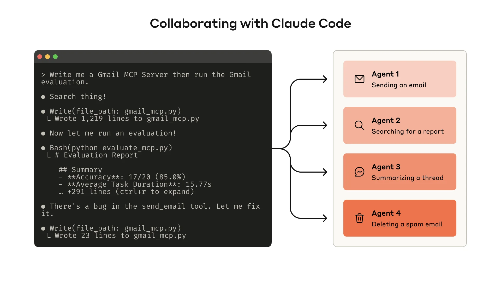
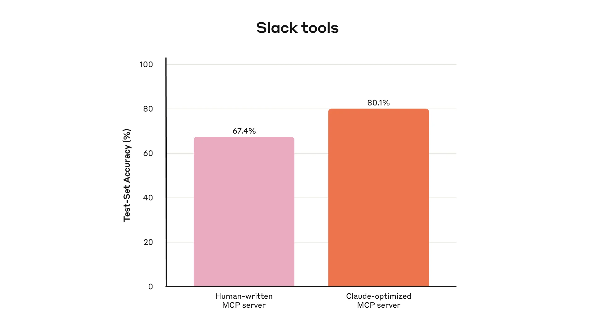
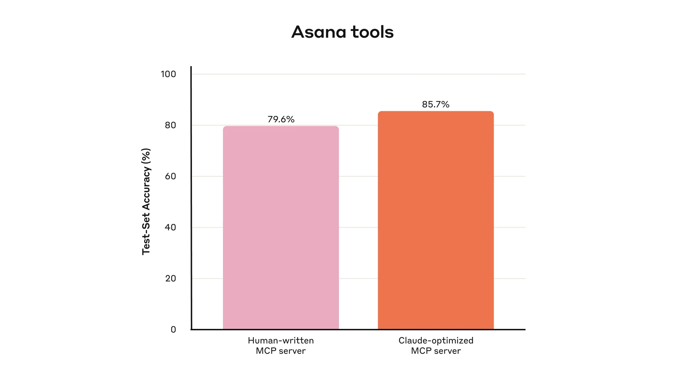
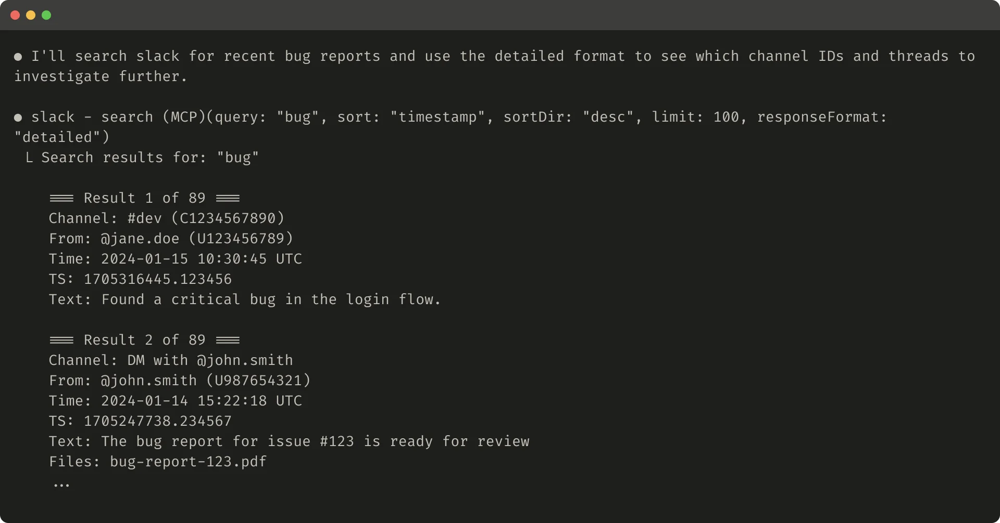
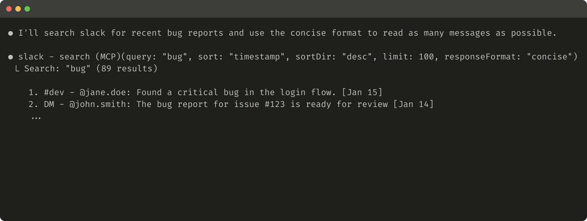
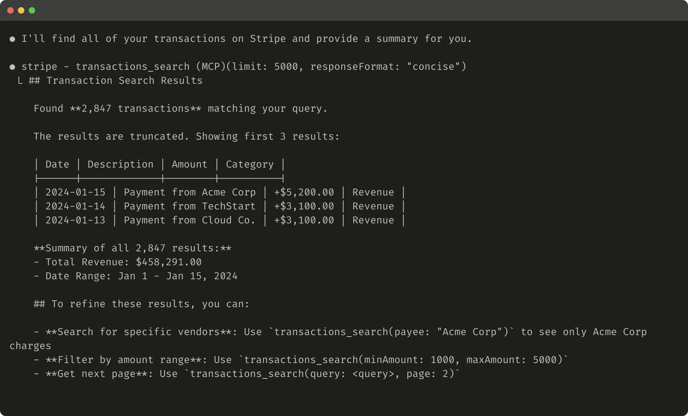
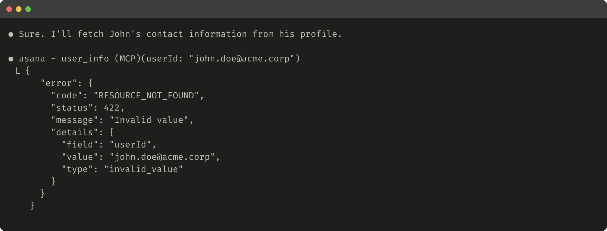
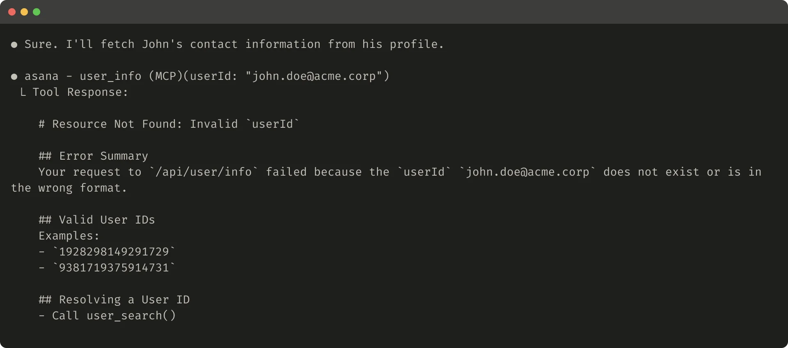

# 与智能体一起编写适合智能体使用的工具

- 英文标题：Writing effective tools for agents — with agents
- 发布日期：2025-09-11
- 官网栏目：工程
- 原文：[Anthropic 页面](https://www.anthropic.com/research/writing-tools-for-agents)
- 官网署名：Anthropic

> 中文机器初译，未逐篇人工校对。引用研究结论时请核对英文原文。

的 [模型上下文协议 (MCP)](https://modelcontextprotocol.io/docs/getting-started/intro) 可以为 LLM 代理人提供数百种工具来解决现实世界的任务。但我们如何使这些工具发挥最大作用呢？

在这篇文章中，我们描述了提高各种代理人工智能系统性能的最有效技术1.

我们首先介绍如何：

- 构建并测试您的工具原型
- 与代理一起创建并运行对您的工具的全面评估
- 与 Claude Code 等代理合作，自动提高工具的性能

最后，我们总结了我们一路上确定的编写高质量工具的关键原则：

- 选择正确的工具来实施（而不是实施）
- 用于定义清晰功能边界的命名空间工具
- 将有意义的上下文从工具返回给代理
- 优化工具响应以提高代币效率
- 快速工程工具描述和规格



建立评估可以让您系统地衡量工具的性能。您可以使用 Claude Code 根据此评估自动优化您的工具。

## 什么是工具？

在计算中，确定性系统每次给定相同的输入时都会产生相同的输出，而 *不确定性* 即使在相同的起始条件下，系统（例如代理）也可以产生不同的响应。

当我们传统地编写软件时，我们是在确定性系统之间建立契约。例如，像这样的函数调用 `getWeather(“NYC”)` 每次调用时都会以完全相同的方式获取纽约市的天气。

工具是一种新型软件，反映了确定性系统和非确定性代理之间的契约。当用户询问“我今天应该带伞吗？”时，客服人员可能会调用天气工具，根据常识进行回答，甚至首先询问有关位置的澄清问题。有时，代理可能会产生幻觉，甚至无法掌握如何使用工具。

这意味着从根本上重新思考我们为代理编写软件时的方法：而不是编写工具和 [MCP服务器](https://modelcontextprotocol.io/) 就像我们为其他开发人员或系统编写函数和 API 的方式一样，我们需要为代理设计它们。

我们的目标是通过使用工具来追求各种成功的策略，增加代理可以有效解决各种任务的表面积。幸运的是，根据我们的经验，对于智能体来说最“符合人体工程学”的工具最终也会像人类一样非常直观地掌握。

## 如何编写工具

在本节中，我们将描述您如何与代理协作来编写和改进您提供给他们的工具。首先建立工具的快速原型并在本地进行测试。接下来，进行综合评估以衡量后续变化。与代理一起工作，您可以重复评估和改进工具的过程，直到您的代理在实际任务中取得出色的表现。

### 构建原型

如果不亲自动手，很难预测代理商会发现哪些工具符合人体工程学，哪些工具不会。首先建立一个工具的快速原型。如果您正在使用 [克劳德·科德](https://www.anthropic.com/claude-code) 编写您的工具（可能一次性），它有助于为 Claude 提供任何软件库、API 或 SDK（包括可能的 [MCP SDK](https://modelcontextprotocol.io/docs/sdk)）您的工具将依赖。LLM 友好的文档通常可以在 flat 中找到 `llms.txt` 官方文档网站上的文件（这是我们的 [API 的](https://docs.anthropic.com/llms.txt)).

将您的工具包裹在 [本地MCP服务器](https://modelcontextprotocol.io/docs/develop/connect-local-servers) 或 [桌面扩展](https://www.anthropic.com/engineering/desktop-extensions) (DXT) 将允许您在 Claude Code 或 Claude Desktop 应用程序中连接和测试您的工具。

要将本地 MCP 服务器连接到 Claude Code，请运行 `claude mcp add <name> <command> [args...]`.

要将本地 MCP 服务器或 DXT 连接到 Claude Desktop 应用程序，请导航到 `Settings > Developer` 或 `Settings > Extensions`，分别。

工具也可以直接传入 [人择API](https://docs.anthropic.com/en/docs/agents-and-tools/tool-use/overview) 需要程序化测试。

亲自测试这些工具以识别任何粗糙的边缘。收集用户的反馈，围绕用例建立直觉，并提示您期望工具启用。

### 运行评估

接下来，您需要通过运行评估来衡量 Claude 使用工具的情况。首先生成大量基于现实世界用途的评估任务。我们建议与代理合作，帮助分析您的结果并确定如何改进您的工具。在我们的中端到端地查看这个过程 [工具评估手册](https://platform.claude.com/cookbook/tool-evaluation-tool-evaluation).



我们内部 Slack 工具的测试集性能

#### 生成评估任务

通过您的早期原型，Claude Code 可以快速探索您的工具并创建数十个提示和响应对。提示应受到现实世界使用的启发，并基于现实的数据源和服务（例如，内部知识库和微服务）。我们建议您避免过于简单或肤浅的“沙箱”环境，因为它们不会对您的工具进行足够复杂的压力测试。强大的评估任务可能需要多次工具调用——可能是几十次。

以下是一些强任务的示例：

- 安排下周与 Jane 会面，讨论我们最新的 Acme Corp 项目。附上我们上次项目规划会议的笔记并预订会议室。
- 客户 ID 9182 报告称，他们在一次购买尝试中被收取了 3 次费用。查找所有相关日志条目并确定是否有任何其他客户受到同一问题的影响。
- 客户 Sarah Chen 刚刚提交了取消请求。准备保留报价。确定：(1) 他们为什么要离开，(2) 什么保留要约最有吸引力，以及 (3) 我们在提出要约之前应该注意的任何风险因素。

以下是一些较弱的任务：

- 安排下周与 jane@acme.corp 会面。
- 搜索付款日志 `purchase_complete` 和 `customer_id=9182`.
- 查找客户 ID 45892 的取消请求。

每个评估提示都应与可验证的响应或结果配对。您的验证器可以像在真实情况和采样响应之间进行精确字符串比较一样简单，也可以像招募 Claude 来判断响应一样先进。避免过于严格的验证程序，因为验证程序会因格式、标点符号或有效的替代措辞等虚假差异而拒绝正确的响应。

对于每个提示-响应对，您还可以选择指定期望代理在解决任务时调用的工具，以衡量代理在评估过程中是否成功掌握每个工具的目的。但是，由于可能有多种有效路径可以正确解决任务，因此请尽量避免过度指定或过度拟合策略。

#### 运行评估

我们建议通过直接 LLM API 调用以编程方式运行您的评估。使用简单的代理循环（`while`-循环包装交替的 LLM API 和工具调用）：每个评估任务一个循环。应为每个评估代理提供一个任务提示和您的工具。

在评估代理的系统提示中，我们建议指示代理不仅输出结构化响应块（用于验证），还输出推理和反馈块。指示代理输出这些 *之前* 工具调用和响应块可以通过触发思维链（CoT）行为来提高法学硕士的有效情报。

如果您正在与 Claude 一起进行评估，您可以打开 [交错思维](https://docs.anthropic.com/en/docs/build-with-claude/extended-thinking#interleaved-thinking) 对于“现成的”类似功能。这将帮助您探究代理为何调用或不调用某些工具，并突出显示工具描述和规格中需要改进的特定领域。

除了顶级准确性之外，我们还建议收集其他指标，例如单个工具调用和任务的总运行时间、工具调用总数、令牌消耗总量和工具错误。跟踪工具调用可以帮助揭示代理所追求的常见工作流程，并为工具提供一些整合的机会。



我们内部 Asana 工具的测试集性能

#### 分析结果

代理是您发现问题并提供反馈的有用合作伙伴，从矛盾的工具描述到低效的工具实现和令人困惑的工具模式。但是，请记住，代理在反馈和响应中省略的内容通常比它们包含的内容更重要。LLM 并不总是 [说出他们的意思](https://www.anthropic.com/research/tracing-thoughts-language-model).

观察您的代理在哪里遇到困难或困惑。仔细阅读评估代理的推理和反馈（或 CoT）以识别粗糙的边缘。查看原始记录（包括工具调用和工具响应）以捕获代理 CoT 中未明确描述的任何行为。阅读字里行间；请记住，您的评估代理不一定知道正确的答案和策略。

分析您的工具调用指标。大量冗余工具调用可能表明需要对分页或令牌限制参数进行一些调整；许多无效参数的工具错误可能表明工具可以使用更清晰的描述或更好的示例。当我们推出Claude的时候 [网络搜索工具](https://www.anthropic.com/news/web-search)，我们发现Claude不必要地附加 `2025` 到工具的 `query` 参数、搜索结果偏差和性能下降（我们通过改进工具描述引导 Claude 走向正确的方向）。

### 与代理商合作

您甚至可以让代理分析您的结果并为您改进工具。只需连接评估代理的成绩单并将其粘贴到 Claude Code 中即可。Claude 是分析记录和同时重构大量工具的专家，例如，确保工具实现和描述在进行新更改时保持一致。

事实上，这篇文章中的大部分建议都来自于使用 Claude Code 反复优化我们的内部工具实现。我们的评估是在内部工作空间之上创建的，反映了我们内部工作流程的复杂性，包括真实的项目、文档和消息。

我们依靠保留的测试集来确保我们不会过度适应我们的“训练”评估。这些测试集表明，我们可以提取额外的性能改进，甚至超出我们通过“专家”工具实现实现的效果 - 无论这些工具是由我们的研究人员手动编写还是由 Claude 自己生成。

在下一节中，我们将分享我们从这个过程中学到的一些东西。

## 编写有效工具的原则

在本节中，我们将我们的知识提炼成一些编写有效工具的指导原则。

### 为代理商选择合适的工具

更多的工具并不总是能带来更好的结果。我们观察到的一个常见错误是仅仅包装现有软件功能或 API 端点的工具——无论这些工具是否适合代理。这是因为代理对传统软件有不同的“可供性”，也就是说，他们有不同的方式来感知他们可以使用这些工具采取的潜在行动

LLM代理的“上下文”有限（也就是说，他们一次可以处理的信息量有限），而计算机内存便宜且丰富。考虑在地址簿中搜索联系人的任务。传统的软件程序可以一次有效地存储和处理一个联系人列表，在继续之前检查每个联系人。

然而，如果 LLM 代理使用返回所有联系人的工具，然后必须逐个读取每个令牌，那么它就会将有限的上下文空间浪费在不相关的信息上（想象一下，通过从上到下读取每一页来搜索地址簿中的联系人，即通过强力搜索）。更好、更自然的方法（对于代理和人类来说）是首先跳到相关页面（也许按字母顺序查找）。

我们建议构建一些针对特定高影响力工作流程的深思熟虑的工具，这些工具与您的评估任务相匹配并从那里扩展。在地址簿的情况下，您可以选择实施 `search_contacts` 或 `message_contact` 工具而不是 `list_contacts` 工具。

工具可以整合功能，处理潜在的问题 *多个* 底层的离散操作（或 API 调用）。例如，工具可以使用相关元数据丰富工具响应，或者在单个工具调用中处理频繁链接的多步骤任务。

以下是一些示例：

- 而不是实施 `list_users`, `list_events`, 和 `create_event` 工具，考虑实施 `schedule_event` 查找可用性并安排活动的工具。
- 而不是实施 `read_logs` 工具，考虑实施 `search_logs` 只返回相关日志行和一些周围上下文的工具。
- 而不是实施 `get_customer_by_id`, `list_transactions`, 和 `list_notes` 工具，实施 `get_customer_context` 一次性编译所有客户最近的相关信息的工具。

确保您构建的每个工具都有明确、独特的目的。工具应该使智能体能够以与人类大致相同的方式细分和解决任务，只要访问相同的底层资源，同时减少中间输出可能消耗的上下文。

太多的工具或重叠的工具也会分散代理追求有效策略的注意力。仔细、有选择性地规划您构建（或不构建）的工具确实会带来回报。

### 给你的工具命名

您的 AI 智能体可能会访问数十个 MCP 服务器和数百个不同的工具，包括其他开发人员提供的工具。当工具功能重叠或用途模糊时，代理可能会对使用哪些工具感到困惑。

命名空间（将相关工具分组在公共前缀下）可以帮助划定许多工具之间的界限； MCP 客户端有时会默认执行此操作。例如，按服务命名空间工具（例如， `asana_search`, `jira_search`）并按资源（例如， `asana_projects_search`, `asana_users_search`），可以帮助代理商在正确的时间选择正确的工具。

我们发现在基于前缀和后缀的命名空间之间进行选择会对我们的工具使用评估产生不小的影响。效果因法学硕士而异，我们鼓励您根据自己的评估选择命名方案。

代理可能会调用错误的工具、使用错误的参数调用正确的工具、调用太少的工具或错误地处理工具响应。通过有选择地实现名称反映任务自然细分的工具，您可以同时减少加载到代理上下文中的工具和工具描述的数量，并将代理计算从代理上下文卸载回工具调用本身。这降低了代理犯错误的总体风险。

### 从您的工具返回有意义的上下文

同样，工具实现应注意仅将高信号信息返回给代理。他们应该优先考虑上下文相关性而不是灵活性，并避免低级技术标识符（例如： `uuid`, `256px_image_url`, `mime_type`）。字段如 `name`, `image_url`, 和 `file_type` 更有可能直接告知代理商的下游行动和响应。

与处理神秘标识符相比，代理还倾向于更成功地处理自然语言名称、术语或标识符。我们发现，仅仅将任意字母数字 UUID 解析为语义上更有意义且可解释的语言（甚至是 0 索引的 ID 方案），就可以通过减少幻觉来显着提高 Claude 在检索任务中的精确度。

在某些情况下，代理可能需要灵活地与自然语言和技术标识符输出进行交互，即使只是为了触发下游工具调用（例如， `search_user(name=’jane’)` → `send_message(id=12345)`）。您可以通过公开一个简单的 `response_format` 工具中的枚举参数，允许代理控制工具是否返回 `“concise”` 或 `“detailed”` 回应（下图）。

您可以添加更多格式以获得更大的灵活性，类似于 GraphQL，您可以在其中准确选择要接收的信息。下面是一个用于控制工具响应详细程度的 ResponseFormat 枚举示例：

```
enum ResponseFormat {
   DETAILED = "detailed",
   CONCISE = "concise"
}
```

以下是详细工具响应的示例（206 个标记）：



以下是简洁的工具响应示例（72 个标记）：



Slack 线程和线程回复由唯一标识 `thread_ts` 这是获取线程回复所必需的。 `thread_ts` 和其他 ID（`channel_id`, `user_id`）可以从 `“detailed”` 工具响应以启用需要这些的进一步工具调用。 `“concise”` 工具响应仅返回线程内容并排除 ID。在此示例中，我们使用 ~⅓ 的令牌 `“concise”` 工具响应。

即使您的工具响应结构（例如 XML、JSON 或 Markdown）也会对评估性能产生影响：不存在一刀切的解决方案。这是因为 LLM 接受过下一个标记预测的训练，并且往往使用与其训练数据匹配的格式表现得更好。最佳响应结构会因任务和代理的不同而有很大差异。我们鼓励您根据自己的评估选择最佳的响应结构。

### 优化工具响应以提高代币效率

优化上下文的质量很重要。但优化也是如此 *数量* 上下文在工具响应中返回给代理。

我们建议对可能占用大量上下文的任何工具响应实施分页、范围选择、过滤和/或截断以及合理的默认参数值的某种组合。对于 Claude Code，我们默认将工具响应限制为 25,000 个令牌。我们预计代理的有效上下文长度会随着时间的推移而增长，但对上下文高效工具的需求仍然存在。

如果您选择截断回复，请务必使用有用的说明来引导客服人员。您可以直接鼓励代理追求更有效的策略，例如对知识检索任务进行许多小型且有针对性的搜索，而不是进行单一的广泛搜索。同样，如果工具调用引发错误（例如，在输入验证期间），您可以提示设计错误响应，以清楚地传达具体且可操作的改进，而不是不透明的错误代码或回溯。

以下是截断工具响应的示例：



这是一个无用的错误响应的示例：



以下是一个有用的错误响应示例：



工具截断和错误响应可以引导代理采取更有效的工具使用行为（使用过滤器或分页）或给出正确格式化的工具输入的示例。

### 快速设计您的工具描述

我们现在讨论改进工具最有效的方法之一：立即设计您的工具描述和规格。由于这些已加载到代理的上下文中，因此它们可以共同引导代理进行有效的工具调用行为。

在编写工具描述和规格时，请考虑如何向团队中的新员工描述您的工具。考虑您可能隐式带来的上下文（专用查询格式、利基术语的定义、基础资源之间的关系）并将其明确化。通过清楚地描述（并使用严格的数据模型执行）预期的输入和输出来避免歧义。特别是，输入参数应明确命名：而不是名为 `user`，尝试一个名为 `user_id`.

通过您的评估，您可以更有信心地衡量您的即时工程的影响。即使对工具描述进行微小的改进也可以带来显着的改进。Claude Sonnet 3.5 在 [SWE-bench 已验证](https://www.anthropic.com/engineering/swe-bench-sonnet) 我们对工具描述进行精确改进后进行评估，大大降低了错误率并提高了任务完成率。

您可以在我们的工具定义中找到其他最佳实践 [开发者指南](https://docs.anthropic.com/en/docs/agents-and-tools/tool-use/implement-tool-use#best-practices-for-tool-definitions)。如果您正在为 Claude 构建工具，我们还建议您阅读有关如何将工具动态加载到 Claude 的工具中的信息。 [系统提示](https://docs.anthropic.com/en/docs/agents-and-tools/tool-use/implement-tool-use#tool-use-system-prompt)。最后，如果您正在为 MCP 服务器编写工具， [工具注释](https://modelcontextprotocol.io/specification/2025-06-18/server/tools) 帮助披露哪些工具需要开放世界访问或进行破坏性更改。

## 展望未来

为了为代理构建有效的工具，我们需要重新定位我们的软件开发实践，从可预测的确定性模式转向非确定性模式。

通过我们在这篇文章中描述的迭代、评估驱动的过程，我们已经确定了工具成功的一致模式：有效的工具是有意且明确定义的，明智地使用代理上下文，可以在不同的工作流程中组合在一起，并使代理能够直观地解决现实世界的任务。

未来，我们期望代理与世界交互的具体机制不断发展——从 MCP 协议的更新到底层 LLM 本身的升级。通过系统化、评估驱动的方法来改进代理工具，我们可以确保随着代理变得更有能力，他们使用的工具也将随之发展。
