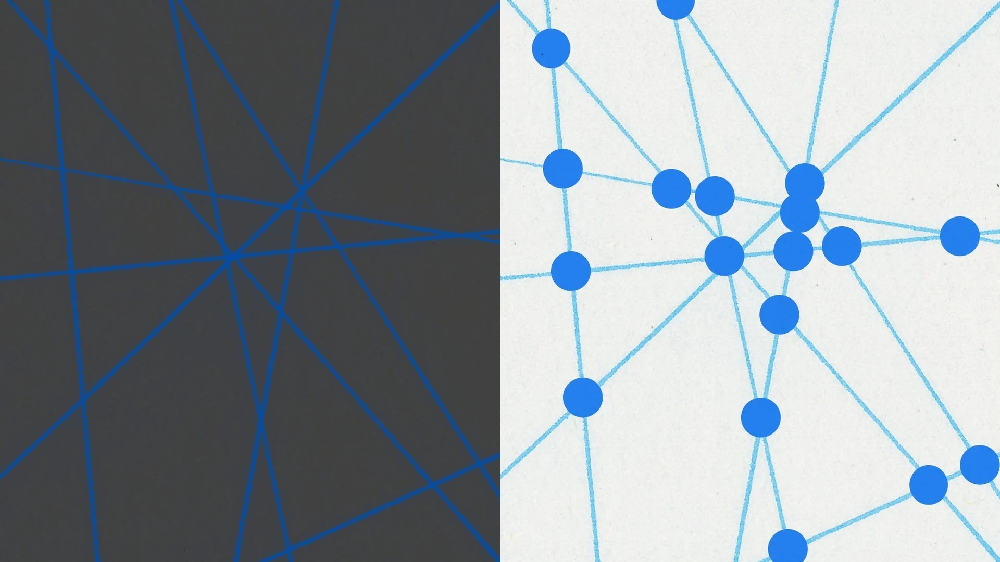
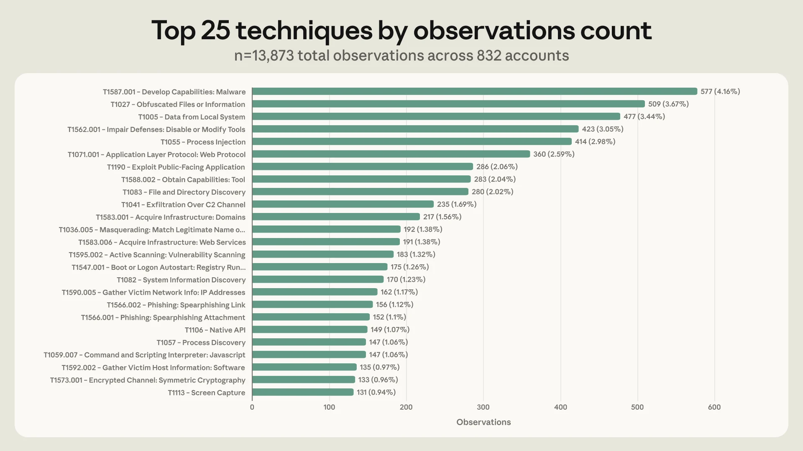
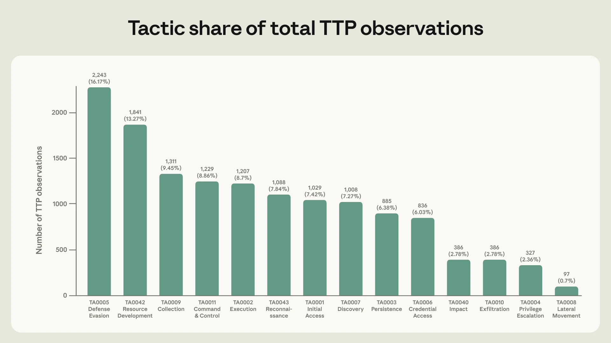
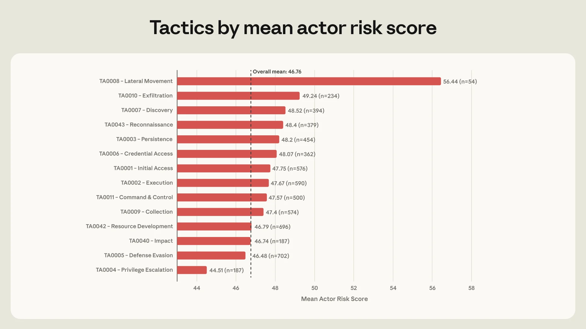
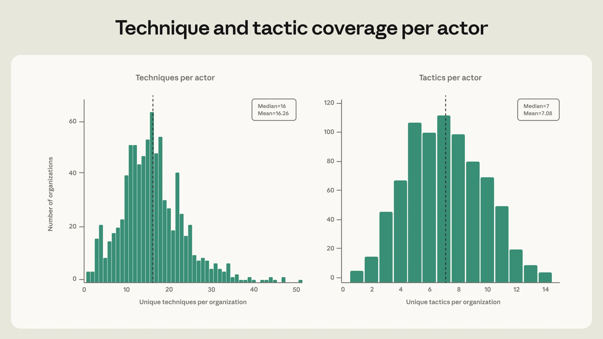
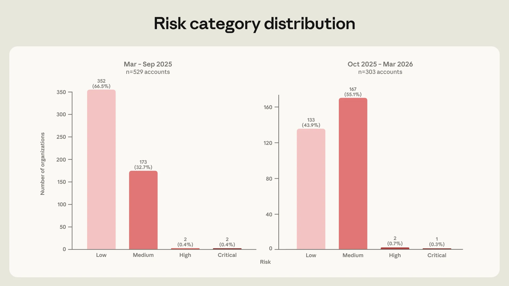

# 梳理 AI 助力的网络威胁：LLM ATT&CK Navigator 的发现

- 英文标题：Mapping AI-enabled cyber threats: Insights from the LLM ATT&CK Navigator
- 发布日期：2026-06-03
- 官网栏目：前沿红队
- 原文：[Anthropic 页面](https://www.anthropic.com/research/attack-navigator)
- 官网署名：Anthropic

> 中文机器初译，未逐篇人工校对。引用研究结论时请核对英文原文。

*凯拉·古鲁、亚历克斯·莫伊克斯和雅各布·克莱因*

*在过去的一年里，我们一直在调查威胁行为者如何利用人工智能来进行网络行动。今天，我们分享一项新的分析，将这些现实世界的攻击映射到* *[MITRE ATT&CK® 框架](https://attack.mitre.org/)，网络攻击者使用的策略和技术的数据库。这样做揭示了挑战网络安全传统假设的模式——例如，可以通过技术复杂程度或技术广度等指标来评估威胁行为者构成的风险水平。我们与 Verizon 合作，将其中一些结果纳入* *[2026 年 Verizon 数据泄露调查报告 (DBIR)](https://www.verizon.com/business/resources/reports/dbir/)，并发布这份报告，对我们在人工智能支持的网络运营中看到的趋势进行更长期的分析。*[1](https://www.anthropic.com/research/attack-navigator#footnote-1)

[原文媒体](https://assets.claude.ai/brand/artifacts/editorial/llm_attack_navigator.html)

打开 [新选项卡中的交互式导航器](https://red.anthropic.com/2026/attack-navigator/navigator.html).

## 主要发现

在本研究中，我们分析了 2025 年 3 月至 2026 年 3 月一年内与恶意网络活动相关的 832 个帐户。Anthropic 禁止这些帐户使用 Claude，因为它们违反了我们的规定 [使用政策](https://www.anthropic.com/legal/aup)。此分析中的帐户只是我们在此期间调查和禁止的帐户的子集；我们选择他们是因为我们有足够的关于他们恶意活动的详细信息，可以将他们的技术映射到 MITRE ATT&CK 框架上。

我们分析中的 832 个账户将 AI 模型用于整个框架中的所有 14 种战术和 482 种独特的子技术，从最初的侦察到最终的影响。[2](https://www.anthropic.com/research/attack-navigator#footnote-2) 我们还开发了一个风险评分框架（本文稍后描述）来评估人工智能帮助这些攻击者计划攻击的程度。最引人注目的是，我们发现，今年上半年和下半年，被标记为中等或更高风险的参与者比例从 33% 跃升至 56%。这表明人工智能正在帮助攻击者更轻松地进行日益复杂的网络操作。

我们的分析得出三个主要结论：

1. **使用人工智能进行网络行动的参与者数量正在不断增加，他们的行为带来了更高的风险。** 如上所述，中高风险行为者的比例在不到一年的时间里增加了约 1.7 倍，从我们研究窗口前半段的 33% 增加到后半段的 56%。这种增长主要集中在使用人工智能进行一些最有害活动的参与者，包括横向移动、凭证倾销和网络外壳——这些活动在我们的评分中具有最高的每参与者风险权重，而不是主导其他人群的商品构建和混淆工作。传统上，只有技术最先进的参与者才能在整个杀伤链或网络攻击的连续阶段进行操作。但我们的分析发现，情况已不再如此。他们访问模型的平台（例如 API 或 Claude Code 等代理编码平台）也与他们的行为风险有多高无关。什么 *确实* 区分最高风险的参与者是他们要求模型使用哪些技术。
2. **代理脚手架将使网络攻击变得更加自主。** 随着人工智能网络技术在这一人群中变得越来越普遍，根据参与者要求模型做什么来区分他们的风险水平将变得更加困难。相反，差异化因素将成为参与者构建的脚手架——使人工智能模型更有能力的周围代码、架构和工具 *周围* 该模型使他们可以自主地将攻击阶段链接在一起。这一点在 [网络间谍活动](https://www.anthropic.com/news/disrupting-AI-espionage) 我们于 2025 年 11 月中断了业务，最高风险评分为 100，但仅使用了一些与中等风险参与者相当的技术。这次攻击之所以与众不同，不是因为它采用了多种技术，而是因为攻击者如何使用AI 智能体来策划攻击。
3. **MITRE ATT&CK 框架尚未涵盖使这些参与者变得如此危险的自主行为。** 自主杀伤链编排、实时枢轴决策以及无需人工干预的人工智能指导执行在 ATT&CK 框架中尚无 ID 号。我们的报告包括 13,873 个恶意活动观察结果，所有这些都映射到框架中列出的类别，但区分最高风险参与者并确定其操作速度和规模的行为尚没有此类 ID。现代威胁情报所依赖的分类法需要不断发展才能捕获它们。

同时 [Claude神话预览](https://red.anthropic.com/2026/mythos-preview/) 该报告展示了前沿人工智能网络能力的发展方向——能够发现和利用漏洞的模型，其水平接近最熟练的人类研究人员——该报告告诉我们威胁行为者如何滥用当今普遍可用的模型。它还可以指导威胁行为者如何在不久的将来滥用功能日益强大的模型，从而使防御者有机会领先于他们。

我们从这个分析和其他分析中学到的东西直接决定了我们如何构建Claude来防止这种滥用。例如，我们更新了 Claude 内置的分类器来检测风险最高的参与者，并扩展了我们的 [探针](https://www.anthropic.com/research/next-generation-constitutional-classifiers) 检测涵盖此分析揭示的高风险行为指标。这些发现表明，低风险和高风险参与者之间的分界线不再是技术技能，而是编排，我们所依赖的防御、检测和共享框架将需要与它们所描述的攻击一样快地发展。

## 关于数据集

本报告中的调查结果来自 Anthropic 在 2025 年 3 月至 2026 年 3 月期间因违反我们使用政策中与网络相关部分而被禁止的 832 个帐户。我们通过威胁情报团队的自动化防护和调查相结合来识别这些帐户。对于每个帐户，我们都生成了观察到的活动的摘要。然后，我们提取了这些摘要中描述的策略、技术和程序（或 TTP），并将它们映射到 [MITRE ATT&CK 框架](https://attack.mitre.org/versions/v18/) 当时正在直播（V18）。总之，我们观察了 482 种独特技术和所有 14 种 ATT&CK 战术中的 13,873 个动作。

我们根据我们开发的称为 AI 风险支持评分 (ARiES) 的新方法，为每个参与者提供从 0 到 100 的风险评分（0 表示最低风险，100 表示最高风险），如下所述。我们对数据进行了匿名处理，以便在接下来的分析中无法识别参与者。

## LLM ATT&CK Navigator 和 ARiES 风险评分

作为此分析的一部分，我们开发了 LLM ATT&CK Navigator：一个交互式框架，它将观察到的人工智能滥用模式映射到 MITRE ATT&CK 框架上，并向参与者分配 ARiES 风险评分。ARiES 是由三个信号构建的综合评分：参与者的威胁概况、模型对所请求伤害的贡献以及观察到的或潜在的影响。它是根据参与者在 Claude.ai、Claude Code 和我们的 API 上的活动计算得出的，并利用我们的安全分类器以及开源和内部威胁情报指标。分数越高，启用人工智能的参与者的风险就越高。

我们的框架从三个维度对个人技术和账户进行评分：

- **威胁（0-35 分）：** 评估攻击者意图的清晰度、技术复杂程度、威胁情报信号以及帐户为逃避检测而采用的策略。Claude根据演员的提示和工具使用情况、衡量所需的专业知识、操作员技能、定制工具与商品工具以及能力深度来对技术复杂程度进行评分。
- **脆弱性（0-35 分）：** 评估模型实现所要求的危害的能力以及所用接口的风险状况。编程接口（即API）和代理编码工具（如 Claude Code）因其自动化操作的潜力而得分最高。
- **影响力（0-30 分）：** 通过我们的安全分类器分配的分数以及调查人员对人工智能参与操作造成的实际或潜在后果的评估，捕获用户行为对现实世界的影响。

这些组件共同产生从 0 到 100 的总风险评分，使我们能够将威胁行为者和技术分为低、中、高和关键风险级别。

### 关于评分公式的说明

传统的网络风险方程将风险表示为威胁×漏洞×影响——一个乘法模型，反映假设的攻击是否有可能成功。在这种模型下，如果任何一个因素为零，那么整体风险就会降至零，因为缺少一个因素意味着攻击不会成功。

我们的模型故意使用加法而不是乘法，以便我们可以回答这个问题：“哪些涉及人工智能的参与者和技术最值得防御者关注？”我们想要一个即使在某个维度不存在或不清楚的情况下仍然有意义的分数，而这是乘法模型所不允许的。考虑以下场景：

高能力和结果，但没有明确的意图。想象一下，一个没有经验的用户通过使用代理编码工具进行实验，无意中产生了功能性攻击能力，例如可蠕虫攻击。意图实际上为零，因此乘法分数会将其记录为没有风险。但实际上，该模型仍然为潜在的攻击提供了实质性的提升，并且交互非常值得浮出水面，以便可以部署额外的防护措施。

意图和能力明确，但没有确定受害者。现在考虑一个具有明显恶意意图的行为者，他滥用 Claude 来开发有效的恶意软件，但我们还没有部署或下游影响的证据。乘法模型将再次将“影响”维度的分数归零，尽管人工智能启用信号（对手能够使用该模型成功开发有害软件的事实）正是我们希望我们的检测系统尽早捕获的信号。

相比之下，我们的附加模型独立地保留来自每个维度的信号，这意味着部分攻击启用模式仍然可见。权衡是我们的分数并不能预测攻击是否会成功；而是可以预测攻击是否会成功。相反，它们是衡量涉及人工智能的滥用案例的关注程度的指标。正如我们将在下面讨论的，我们还可以使用这些分数来查看 ATT&CK 框架中最令人关注的特定部分，并将这些部分与高风险参与者的操作地点相关联。

## 如今网络威胁参与者如何使用人工智能

我们对 13,873 种观察到的技术进行实证分析，揭示了对手在整个攻击生命周期中如何使用 AI 的清晰模式，以及当今模型最常用的技术。

### AI辅助能力建设

我们观察到的最常见的技术系列是 ATT&CK ID T1587（开发能力），在我们的分析中，832 名参与者中有 574 名（即 69%）使用了该技术。大多数此类行为表现为 T1587.001（恶意软件开发），由 560 个参与者使用。在实践中，我们观察到威胁行为者滥用模型来构建和完善要运行的自定义脚本、编写 DLL 注入代码以及如何实施的详细指导，以及画布指纹识别规避和自动帐户管理。

其次最流行的技术是 T1027（混淆文件或信息），64.7% 的威胁行为者采用了该技术； T1005（来自本地系统的数据），55.9% 的威胁行为者使用该技术； T1562（削弱防御），被 54.9% 的威胁行为者所采用。总之，这些顶级技术表明，威胁行为者最常寻求法学硕士的帮助来构建预攻击攻击工具，使这些工具更难以检测，并从受感染的系统中获取数据。

另一方面，一旦参与者进入目标网络，就不太可能使用法学硕士进行实时、自适应决策。例如，832 个威胁参与者中只有 54 个 (6.5%) 使用模型进行横向移动，不到 12 个参与者使用 RDP、SSH 和 SMB 等远程服务模型。只有 22.5% 的参与者使用法学硕士来进行特权升级和影响阶段。

一些作为现实世界网络攻击主要内容的技术系列（例如活动目录利用、Kerberos 票证攻击、云基础设施操纵（AWS、Azure、GCP）和容器逃逸）在数据集中的代表性明显较低。

在我们研究的一年时间内，最重要的技术和演员使用这些技术的频率没有太大变化。在此期间的前半段和后半段，该模型使用的技术数量中位数均为 16。在今年下半年，我们观察到了微妙的方向性转变，威胁行为者较少使用模型来构建独立的恶意软件或混淆脚本，而更多地使用模型来帮助网络攻击的特定操作阶段以及目标发现和收集技术。具体来说，我们观察到 T1087（帐户发现）的发生率增加了 8.9%，T1020（自动渗漏）的发生率增加了 6.2%，同时 T1587（开发能力）的发生率减少了 12%，T1566（网络钓鱼）的发生率减少了 8.6%。

### AI辅助躲避策略

防御规避是数据集中最大的单一策略类别，存在于我们研究的 84.4% 参与者的行为中。MITRE 在“防御规避”下定义了 64 种技术（跨其 [企业](https://attack.mitre.org/tactics/TA0005/)- 和 [手机](https://attack.mitre.org/tactics/TA0030/)-特定框架）；我们在数据集中观察到 32 种此类技术：25 种用于企业，7 种用于移动。

该策略中观察到的最重要的技术包括：

- **T1027（混淆文件或信息）。** 我们的样本中 64.7% 的威胁行为者使用 AI 来实施 XOR/base64 编码、多态变体和反检测包装器等技术来逃避基于签名的检测。
- **T1562（削弱防御）。** 54.8% 的研究威胁参与者使用 AI 来绕过、禁用或篡改端点安全工具。
- **T1055（过程注入）。** 30.3% 的攻击者使用 AI 编写恶意代码，这些代码可以注入到合法进程中，例如进程空洞和 DLL 注入，以从受信任的进程内存中执行有效负载。

不太常用的策略包括影响（2.8%）、渗透（2.8%）、权限升级（2.4%）和横向移动（0.7%）。这些合计仅占所有观察结果的 8.7%，少于单独的防御规避。这些行为都发生在攻击生命周期的后期，这表明威胁行为者在攻击的早期阶段更多地使用模型，但在后期阶段较少使用模型——也就是说，一旦他们渗透到网络并适应实时环境中的条件。在我们研究的一年期间，这种模式保持稳定。

### 高风险参与者及其策略

虽然横向移动等策略在我们的数据集中不太常见，但它们与最高的 ARiES 风险评分高度相关，这意味着风险最高的参与者也是最有可能在网络攻击后期使用模型的人。使用 AI 进行横向移动的演员的风险评分平均比不使用 AI 工具的演员高 10.5 分。这表明，从使用人工智能准备网络攻击到使用它在实时网络操作中采取行动，是人工智能高度启用的关键标志。

总体而言，风险评分最高的参与者将人工智能最广泛地用于后妥协​​、手动键盘技术，例如远程服务、凭证转储、Web shell 部署以及内部网络和帐户发现。横向移动是高风险参与者的最强标志：我们的数据集中使用横向移动的 54 名参与者的平均风险评分为 56.4，比平均值 46.8 高出近 10 分。没有其他技术可以媲美这种预测能力。

在技​​术层面，最高风险参与者最常用的技术是 T1021（远程服务：SSH/SMB）、T1078.003（有效帐户）、T1003（操作系统凭据转储）、T1560（存档收集的数据）和 T1505.003（Web Shell）。与总体人群相比，这些风险在最高风险行为者中的发生率要高出三到五倍。

与此同时，风险最高和最低的参与者使用最普遍的策略（例如防御规避和资源开发）和商品技术（例如撞库和鱼叉式网络钓鱼）的频率大致相同，考虑到这些策略如此常见，这并不奇怪。总而言之，数据表明，大多数威胁行为者在攻击的准备阶段使用人工智能来构建恶意代码等工件，但风险最高的行为者在攻击的准备阶段以及受感染网络内的实际操作过程中都使用模型。

我们还发现，威胁情报团队通常依靠评估威胁行为者的属性（例如评估的技术技能、界面选择或使用的技术数量）来预测人工智能模型可能为给定威胁行为者提供多少提升。一旦从综合评分中删除技术复杂性以避免循环，技术复杂性与其余风险成分的相关性仅为 r = 0.28。事实上，完全删除这一特征后，排名前六的演员将处于相同的排名顺序（在所有 832 名演员中，Spearman ρ = 0.96）。高风险尾部并不是技术复杂度组件的产物。

技术覆盖范围与风险评分之间的相关性也仅为弱正相关 (r = 0.27)。大多数参与者都使用这些模型来实现少量的技术。事实上，我们数据集中的中间参与者部署了 16 种不同的 MITRE ATT&CK 技术——这一广度在五年前可能标志着资源充足、技术成熟的操作。

最后，界面选择讲述了一个类似的故事——本研究中 80% 的参与者滥用了 Claude Code，使代理工具成为默认的访问模式而不是区别模式，而仅限于对话界面、API 或代理编码工具的参与者集中在统计上无法区分的风险概况上。

这告诉我们，从人工智能中获得最大收益的恶意行为者不一定比其他行为者技术更复杂，也不一定使用编码工具或在杀伤链的多个步骤中使用Claude；相反，他们只是让Claude获得更多的实践技巧。

### 现场剥削行为者数量呈上升趋势

正如我们上面所讨论的，在人工智能支持方面得分为中等或更高风险的参与者比例从研究前六个月的约 33.5% 增长到第二个月的约 56.1%，不到一年的时间就增加了 1.7 倍。队列在这两个时期之间变化了约 22.6 个百分点：虽然大多数参与者在前六个月期间的风险评分较低，但大多数参与者在第二个六个月期间的风险评分为中等。

虽然改进的威胁检测技术可能促成了这一增长，但我们也看到越来越多的参与者要求该模型提供更具操作性的网络内工作，而这些工作过去只出现在一小部分高风险参与者中。在研究的第二个六个月期间，我们看到更多专业参与者使用模型来构建漏洞利用工具、C2 基础设施和远程访问木马，但我们也看到更多中低技能参与者不仅使用模型来执行准备任务，还使用模型进行实时操作。我们观察到，从前六个月到第二个月，T1087（帐户发现）技术增加了 8.9%，T1020（自动渗透）技术增加了 6.2%，这与此一致：越来越频繁的技术暗示攻击者已经访问了网络。

这对防御者意味着什么：支持人工智能的参与者的数量不仅在增长，而且还转向我们框架中最危险的活动，而不需要参与者本身变得更加熟练。如果这种趋势继续下去，这些操作技术将不再是一个差异化因素，并将成为明天的基线——我们需要找到一种新的方法来衡量风险最高的参与者。在下一节中，我们将讨论未来如何做到这一点。

## AI 智能体时代的新颖性和复杂性

审视我们风险最高的威胁参与者还强调，根据攻击技术的数量、类型或广度来计算人工智能网络操作的风险是不够的。我们还需要一种方法来理解 *脚手架* 威胁行为者能够将这些技术链接在一起，以便在实时操作中使用，这使得他们能够使用人工智能模型在无需人工干预的情况下自主执行大量网络攻击。

我们分析了精心策划人工智能网络间谍活动的威胁行为者的行为。 [2025 年 11 月报道](https://www.anthropic.com/news/disrupting-AI-espionage)，标记为 GTG-1002，我们看到该攻击者达到了 100 的最大可能风险评分，成功破坏了多个国家的政府和关键基础设施目标，并开发了一个脚手架，以使用 Claude Code 而不是作为顾问，而是作为自主操作员。然而，他们的 MITRE 总体概况（13 种战术中的 30 种技术）可与数十种技术相媲美。 *中等*-此数据集中的风险参与者。中位演员部署了 16 种技术；一些低风险的参与者也超过了30。换句话说，仅靠技术计数或战术类型无法解释是什么使 GTG-1002 成为我们迄今为止观察到的最高风险的演员。

什么 *确实* 解释该参与者的高风险分数是因为他们使用的越来越代理的组件：他们如何能够编排和链接技术以实现其目标采取行动。GTG-1002 武器化的 Claude Code 在 Kali Linux 机器上运行，将开源渗透测试工具集成为 MCP（模型上下文协议）服务器，有效地将 AI 转变为自主攻击平台，而不是代码编写助手。人工智能不只是建议命令或生成攻击脚本；它执行它们并自主推理攻击环境。他们的“代理性”的一些迹象通过我们追踪的技术类型显现出来； GTG-1002 采用了 T1021.004（远程服务：SSH）、T1210（远程服务利用）和 T1560（归档收集的数据）等操作技术。但主要的区别是：

- **阶段内自主执行**：GTG-1002 部署了在 Kali 机器上运行的 Claude Code，以自主协调数十个 MCP 工具操作 - 在侦察期间扫描和映射数十个面向互联网的服务，然后在网络内部发现内部管理门户、数据库、日志服务器和临时工作流系统。人工智能不仅提出命令，而且还提出命令。它执行它们，做出下一步要探测什么的战术决策，而无需等待操作员输入。
- **实时利用和旋转**：在 GTG-1002 的脚手架中运行，AI 利用面向公众的 Web 服务器中的 SSRF 漏洞将命令代理到内部云环境，从内部基础设施获取 SSH 私钥，从云元数据服务和 AWS Secrets Manager 获取服务帐户令牌，并使用这些获取的凭证在受害者的云环境中横向移动。这些是我们的数据集中较为罕见的操作阶段（发现→凭证访问→横向移动）。
- **人类意图，人工智能执行：** GTG-1002 提供战略方向，而 AI 负责战术实施。人工智能在侦察和内部发现过程中自主运行，在遇到容器映像签名工作流程和服务帐户身份等意料之外的基础设施时调整其方法，并暂存和压缩数以万计的专有工作流程记录和内部架构文档以进行渗透。最终的数据提取——通过curl MCP工具调用下载到攻击者的机器——是人为指导的，这表明操作员保留对后续决策的控制权，同时将操作工作委托给人工智能。

GTG-1002 的活动很新颖，它使用AI 智能体将网络攻击生命周期的许多阶段（侦察、利用、横向移动和渗透）自动链接在一起，形成一个连贯的操作，实时决策要做什么和要收集什么数据。这是技术频率表无法捕捉到的人工智能提升的维度，也是我们期望随着代理工具成熟而最重要的维度。

## 我们如何使用导航器告知我们的保障措施

本报告中的调查结果影响了我们检测、调查和破坏人工智能网络滥用的方式。

首先，我们的风险评分显示，风险最高的参与者并不总是声音最大或最多产的——他们在所采用的技术类型和数量方面往往显得很普通，而是通过他们如何协调人工智能来执行整个网络操作而显得与众不同。我们正在相应地更新我们的检测系统，扩大我们的 [分类器和探针](https://www.anthropic.com/research/next-generation-constitutional-classifiers) 捕捉与高 ARiES 分数相关的技术。我们还在开发针对无法完全映射到 MITRE 的代理滥用模式的检测信号，例如多步自主执行、AI 引导的枢轴决策以及通过 MCP 服务器和类似接口进行的工具增强操作。

其次，我们推出了 [实时网络保障](https://support.claude.com/en/articles/14604842-real-time-cyber-safeguards-on-claude) 我们最有能力的模型可以在请求级别自动检测和阻止禁止的活动（例如勒索软件开发或大量数据泄露）。我们现在还通过我们的网络攻击者和防御者都可能进行的高风险双重用途活动 [网络验证计划 (CVP)](https://claude.com/form/cyber-use-case)，这使得防御从业者可以在他们的工作中继续使用我们的模型。

三、通过 [玻璃翼计划](https://www.anthropic.com/glasswing)，我们正在研究我们最强大模型的进攻性网络能力，然后再将其提供给更广泛的公众，以便我们在威胁行为者利用人工智能网络能力之前了解人工智能网络能力的发展方向，并可以在此类滥用发生之前设计防护措施。

最后，继我们与 Verizon 合作发布 2026 年数据泄露调查报告之后，我们现在正在与 MITRE 积极对话，讨论 ATT&CK 框架如何发展以捕获我们在本分析中观察到的 AI 原生操作行为。我们也持续分享技术指标；威胁行为者使用的策略、技术和程序；以及我们与政府和行业合作伙伴持续进行的调查结果。

## MITRE ATT&CK 的新时代

最危险的行为者现在正在使用人工智能来策划攻击，而不是简单地构建支持此类攻击的工具，而威胁调查人员用来跟踪威胁的框架尚未跟上。当低技能参与者能够构建、指挥和操作专家级安全带时，依赖于技术复杂的参与者的传统框架将会失败。

从这一年的活动以及我们与 Verizon 的合作中得到的一个明显教训是，我们必须扩大我们共同的威胁词汇。MITRE ATT&CK 捕获了参与者执行的个人技术，但这种分类法尚未捕获将最高风险参与者与其他参与者区分开来的行为（例如整个杀伤链的代理编排或目标的自主选择）。

我们认为下一步是在 ATT&CK 框架中添加新的跨领域类别，帮助威胁调查人员识别将多种技术链接在一起的代理、自主和决策行为。这将为防御者提供与对手在野外使用人工智能工具的方式保持同步的词汇。

与此同时，很明显，防御者需要像攻击者一样复杂和紧迫地使用人工智能，在组织之间共享威胁情报，并缩短从识别软件漏洞到修补它的时间。作为一个行业，我们必须降低对不安全代码的容忍度。过渡期将会很困难。但是，如果行业、政府和民间社会以紧迫的态度对待当前时刻，我们相信，从长远来看，强大的人工智能系统将比攻击者更有利于防御者：在新代码发布之前发现错误，并使社会所依赖的系统更加安全。其结果可能是基础设施得到更好的保护，以及欺诈和滥用行为大大减少的数字环境。随着威胁形势的发展，我们将继续发布我们了解到的信息。

## 脚注

01对于 DBIR，我们提供了 11 个月威胁行为者数据的分析，并在本报告中将其四舍五入为 12 个月。

02我们从 MITRE 的企业和移动技术矩阵中观察子技术。企业技术占观察结果的 99%。
