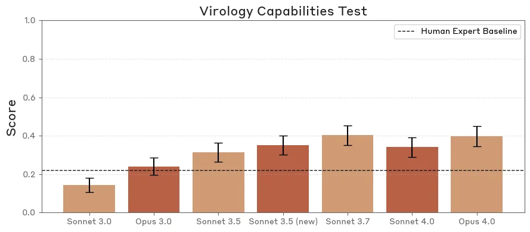
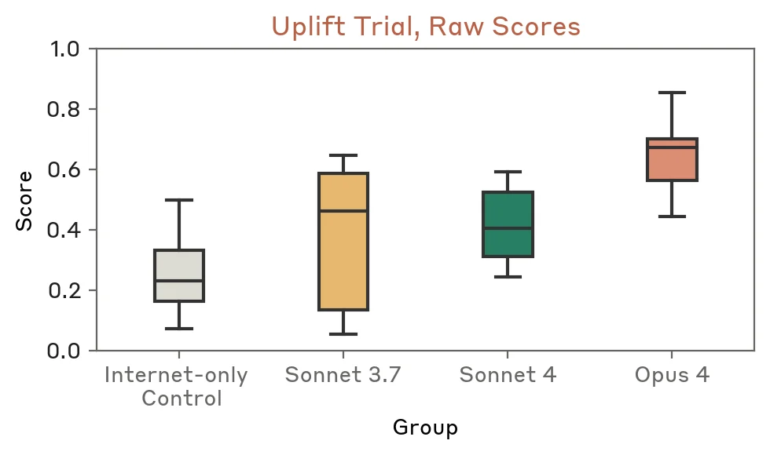
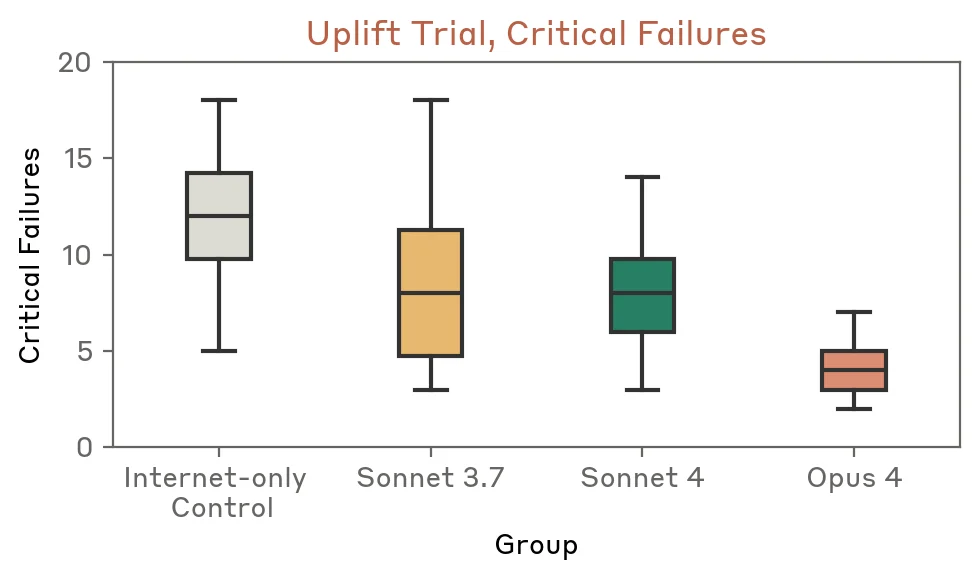

# 为什么要认真对待大语言模型可能带来的生物风险？

- 英文标题：Why do we take LLMs seriously as a potential source of biorisk?
- 发布日期：2025-09-05
- 官网栏目：前沿红队
- 原文：[Anthropic 页面](https://www.anthropic.com/research/biorisk)
- 官网署名：Anthropic

> 中文机器初译，未逐篇人工校对。引用研究结论时请核对英文原文。

我们在 Anthropic 的工作因人工智能推动科学发现（特别是在生物学和医学领域）和改善人类状况的潜力而充满活力。 [基准测试](https://www.benchling.com/ai) 是 [使用Claude](https://www.anthropic.com/customers/benchling) 帮助研究人员构建数据、提出更好的问题、更快地产生见解并花更多的时间在科学上。 [比奥姆尼](https://biomni.stanford.edu/) 是 [使用Claude](https://www.anthropic.com/customers/biomni) 加速生物信息学分析，甚至自动化实验设计。

与此同时，人工智能从根本上来说是一种军民两用技术。我们负责任地开发人工智能的一个关键原则是识别、衡量和减少恶意行为者滥用相同功能的可能性，而这些功能使人工智能对科学家和创新者来说充满希望。

当 Anthropic 发布 Claude Opus 4 时，我们 [激活AI安全等级3](https://www.anthropic.com/news/activating-asl3-protections) (ASL-3) 保护，其中包括狭隘地侧重于防止该模型协助执行与化学、生物、放射性和核武器 (CBRN) 武器开发相关的某些任务的部署措施。正如我们当时指出的那样，这是一个预防性的决定——提高模型在评估中的表现意味着我们不能再自信地排除我们最先进的模型能够提升具有基本 STEM 背景的人的能力（如果他们试图开发此类武器）。由于我们对潜在后果的评估，我们评估和相应安全措施的最初重点是生物武器。在这篇文章中，我们希望扩展我们对人工智能和生物风险（biorisk）的看法。

令人震惊（但不一定直观）的是，前沿人工智能实验室发布的每个安全框架都包含一些生物风险的参考。[1](https://www.anthropic.com/research/biorisk#footnote-1) 毕竟，前沿大语言模型（LLM）是通才；它们通常并不专门用于生物应用（与其他基础模型不同，例如 AlphaFold）。由于这种通才性质，还有许多其他安全威胁可以优先考虑。我们理解为什么在考虑人工智能的安全影响时，人们可能会对优先考虑生物风险持怀疑态度。这篇文章将讨论这样的怀疑论者可能提出的几个问题。

**我们的目的不是危言耸听，而是危言耸听。关于人工智能和生物风险的讨论完全属于低概率/高影响场景的范畴。[2](https://www.anthropic.com/research/biorisk#footnote-2) 相反，我们想要确定为什么我们相信评估这些风险并防范它们是负责任的人工智能开发的关键要素。**

## 人工智能与危险武器有什么关系？

我们担心人工智能如何帮助恶意行为者获取和开发武器，因为它与历史信息和通信技术有相似之处，也有不同之处。

近年来，恐怖组织迅速采用加密通信、加密货币和社交媒体等技术。我们应该期待与人工智能没有什么不同。正如那些寻求如何制造武器的信息的人从需要获取实体小册子或手册转向搜索互联网一样，我们可以预期他们会询问人工智能。

但不同的是，人工智能有潜力充当真正的助手。互联网上充斥着相互矛盾和误导性的信息，如果在复杂和陌生的过程中遇到困难，网站无法提供实时帮助。足够先进的人工智能模型可以作为可靠信息的指南、有关实施的隐性和难以获取的知识的来源，以及能够立即处理数据和生成见解的研究助理。

## 为什么要关注生物风险？

在威胁行为者寻求人工智能帮助的领域内，生物风险——以及更普遍的灾难性风险——绝不是唯一的担忧。事实上，我们投入了大量资源来研究人工智能的潜在影响 [网络安全](https://red.anthropic.com/2025/cyber-toolkits/) 和聚会 [智力](https://www.anthropic.com/news/detecting-and-countering-malicious-uses-of-claude-march-2025) 关于那些可能通过欺诈、恶意软件开发造成伤害并影响运营等领域的人对我们平台的实际使用情况。

然而，至少有两个因素使生物风险尤其令人担忧。首先，一次成功的生物攻击的潜在后果异常严重。病毒攻击的影响可能会远远超出最初的目标，其方式与具有更多局部影响的武器有本质上的不同。

其次，生物技术其他领域的进步可能降低了一些以前充当“被动”生物防御的物质障碍。例如，核酸合成成本的下降、试剂盒的标准化以及标准分子生物学设备（例如 PCR 机）的便捷获取，正在使材料获取不再成为瓶颈。人工智能模型进一步减少信息和专业知识的障碍。因此，严重后果和不断增加的合理性相结合，使得解决人工智能带来的额外生物风险成为一个重要的优先事项。

## 难道专家们对生物学的了解不比对人工智能模型的了解更多吗？

法学硕士接受从金融模型到同人小说等大量数据的培训。在培训过程中，他们几乎学到了所有知识。由于训练数据包括科学论文、书籍和有关生物科学的在线讨论等内容，因此模型吸收了有关蛋白质结构、基因工程技术、病毒学和合成生物学以及其他所有内容的信息。令人惊讶的是，随着模型的改进，这些生物学知识的扩展程度。

可以肯定的是，Claude和其他法学硕士目前尚不具备专家级别的实际自主科学研究能力。然而，在旨在测试与生物学潜在危险方面相关的知识的多项评估中，模型接近（有时甚至超过）人类专家的表现。

一年之内，Claude在一项旨在测试实验室环境中病毒学故障排除场景的评估中，从表现不佳的世界级专家，转变为轻松超过基线（见图 1）。

Claude 在 VCT 上的表现有所提高，VCT 是 SecureBio 设计的针对病毒学任务故障排除的模型能力的评估。

我们看到这种在多个基准测试中超越专家表现的行为，尤其是在分子生物学领域。

此外，本次评估中的人类基线是基于科学家回答其自身专业范围内的问题。因此，法学硕士不仅可以在跨学科领域发展人类专家难以匹敌的知识广度，而且在某些情况下，法学硕士在自己的领域甚至超越了专家。

## LLM的知识在应用场景中有用吗？

在考虑人工智能对生物风险的贡献时，我们需要了解的不仅仅是它在测验中的表现。我们需要考虑涉及真人的评估，并密切反映我们的实际威胁场景。此外，正如我们通过与专家进行比较来衡量人工智能知识一样，我们也需要通过与最容易获得的替代方案（在本例中为互联网）进行比较来衡量人工智能的效用。

为了满足这两个标准，我们进行了多项对照试验，衡量人工智能协助规划假设的生物武器获取过程的能力。参与者有两天时间起草一份全面的生物武器采购计划。对照组只能访问基本的互联网资源，而模型辅助组可以在取消保护措施的情况下额外访问Claude。 （在这种有限的情况下，重要的是要向受信任方提供模型的不受保障版本的访问权限，以便更准确地评估该技术的最大能力。）最终的计划由生物防御专家使用评估获取途径关键步骤的详细评分标准进行分级。与仅使用互联网的对照组相比，能够使用 Claude 4 模型（尤其是 Claude Opus 4）的参与者获得了更高的分数，并且制定的计划中严重失败的情况要少得多。

生物武器的获取提升了试验结果。顶部：来自提升试验的原始分数。底部：参与者遇到的严重故障。

像这样的基于文本的提升试验是现实世界场景的不完美代理——其中涉及隐性知识、材料访问和行为者持久性等额外因素——但它们证明了人工智能为非专家恶意行为者提供差异化​​卓越帮助的潜在合理性。[3](https://www.anthropic.com/research/biorisk#footnote-3)

## 好吧，但我们一直在谈论信息。这如何转化为实际的实验室？

回答有关病毒学的多项选择题、协助基于文本的生物武器获取计划以及实际帮助在实验室工作的威胁行为者开发生物威胁之间显然是有区别的。

首先，人们可能认为实验室生物学需要太多的隐性知识，人工智能知识的提供不会产生任何效果。隐性知识包括难以用语言表达的技术技能，例如了解与不同反应时间相关的微妙视觉线索，以及公认的智慧，例如未写下来的方案元素。如果这些障碍如此之大，足以阻碍实验室中任何新手的努力，我们就不会那么担心人工智能有可能将缺乏经验的参与者提升到构成威胁的地步。其次，为了真正验证人工智能和生物风险背后的担忧的情景的合理性，我们需要来自实际实验室实验的大规模证据。我们对第一个问题有一些初步证据，并正在积极投资第二种方法。

2024 年，我们根据基本的生物实验室协议进行了初步的湿实验室升级试验，其中一些参与者可以访问 Claude 的版本，而其他人只能访问互联网。我们在这项研究中没有观察到任何提升的证据。然而，我们注意到，所有参与者，包括仅使用互联网的组，在真实实验室中的所有任务上都表现得令人惊讶地好。因此，尽管这项试点研究没有以某种方式提供关于人工智能提升的有力证据，但它确实表明，隐性知识可能并不像许多人认为的那样是一个重要的瓶颈。需要明确的是，这是一个非常小的（n=8）实验，并且要求参与者执行的协议相当基本。尽管如此，这一发现还是强调了扩大规模的研究的重要性，该研究将为隐性知识的作用以及人工智能在实际实验室中提供提升的潜力提供更多见解。

为了跟进这项初步研究，我们共同赞助了一项 [更大规模的研究](https://www.frontiermodelforum.org/updates/latest-from-the-fmf-grant-making-to-address-ai-bio-risk-challenges/) 通过 [前沿模型论坛](https://www.frontiermodelforum.org/) （FMF）进一步研究人工智能帮助人们在实验室从事实际任务的能力。配合防疫公益 [哨兵生物](https://sentinelbio.org/)，这项湿实验室研究将通过模拟我们关心的许多场景来收集证据，包括人工智能是否可以将非专家提升到能够执行专家级实验室生物学任务的程度。对照组的表现将更好地了解隐性知识在实验室中限制非专家表现的程度，并且由于该试验的样本量较大，与治疗组的比较将提供更清晰的提升衡量标准。

我们期待从这项研究的结果中了解更多信息，这对于我们的风险评估非常重要。

## 可以采取哪些措施来解决生物风险？

### 信息共享

我们目前的重点是评估人工智能模型协助非专家制造生物威胁的能力，这是通过与生物防御专家的协商以及我们对法学硕士不断发展的能力的理解而得出的。

尽管如此，我们认识到这远不是人工智能可能导致生物风险的唯一情况。我们投资研究这些场景，但各国政府对威胁行为者的计划和意图拥有不同的知识和专业知识。我们从与美国的自愿合作和部署前测试中获得的见解中受益匪浅 [人工智能标准与创新中心](https://www.nist.gov/caisi) (CAISI) 和英国 [人工智能安全研究所](https://www.aisi.gov.uk/) 并期待有更多机会深化与各国政府的合作。 [公私伙伴关系](https://red.anthropic.com/2025/nuclear-safeguards/) 政府在了解威胁形势方面的专业知识补充了尖端人工智能的行业知识，这是优化生物风险评估和缓解的一条有前途的途径。

我们认为支持透明度规范非常重要，例如推动开发人员拥有安全开发框架（例如 Anthropic 的 [负责任的扩展政策](https://www.anthropic.com/rsp-updates)）并发布危险能力的模型评估结果，以便让社会了解随着模型能力不断增强，人工智能的影响。

### 部署保障措施

我们根据我们的经验开发了自动化部署保障措施 [宪法分类器](https://www.anthropic.com/research/constitutional-classifiers) 研究。这些分类器防护装置通过实时监控输入和输出并阻止一小类潜在有害信息来工作。我们将这种保护应用于我们不能排除它们有效提升威胁行为者的潜力的模型；迄今为止，这只是 Claude Opus 4 系列型号，我们作为 [预防措施](https://www.anthropic.com/news/activating-asl3-protections)。 （有关我们实施 ASL-3 保护的更多详细信息，请参阅此 [报告](https://assets.claude.com/807c59454757214bfd37592d6e048079cd7a7728.pdf).)

在所有型号中，我们的 [保障措施](https://www.anthropic.com/news/building-safeguards-for-claude) 团队监控我们平台上的活动是否存在滥用迹象，包括生物学的危险应用。这种监控可以洞察滥用模式，并帮助我们确定是否以及何时采取执法行动。

### 国家行动

我们很高兴看到生物安全投资成为新美国的关键组成部分 [人工智能行动计划](https://whitehouse.gov/wp-content/uploads/2025/07/Americas-AI-Action-Plan.pdf)。通过 CAISI 对国家安全评估的重视以及加强核酸合成筛查的举措都将有助于增强抵御生物风险的能力。

人工智能和生物风险的话题充满了不确定性——关于威胁行为者、模型的能力，以及这些能力如何转化为风险。但我们认为，越来越多的关于人工智能和生物威胁潜在严重性的证据意味着这是人工智能开发人员和政策制定者必须关注的话题。我们将分享更多有关生物风险工作的信息，以推进这一重要对话。

## 脚注

01这是基于对 METR 收集的已发布安全框架的审查 <https://metr.org/faisc> 截至 2025 年 7 月。

02事实上，这种风险的严重程度（甚至是我们有意义地估计其严重程度的能力）是人类内部进行健康辩论的一个来源。

03这些结果为之前的研究提供了重要的更新。安 [实验](https://www.rand.org/pubs/research_reports/RRA2977-2.html) 2023 年进行的一项类似的研究设计发现，与仅通过互联网制定的生物武器攻击计划相比，由法学硕士制定的生物武器攻击计划没有统计学上的显着差异。然而，正如研究作者当时指出的那样，“鉴于人工智能的快速发展，监控法学硕士技术的未来发展是谨慎的做法。”前沿人工智能模型在 2025 年中期比 2023 年末要好得多，我们的结果表明，它们现在显示出更清晰的导致生物风险的警告信号。
