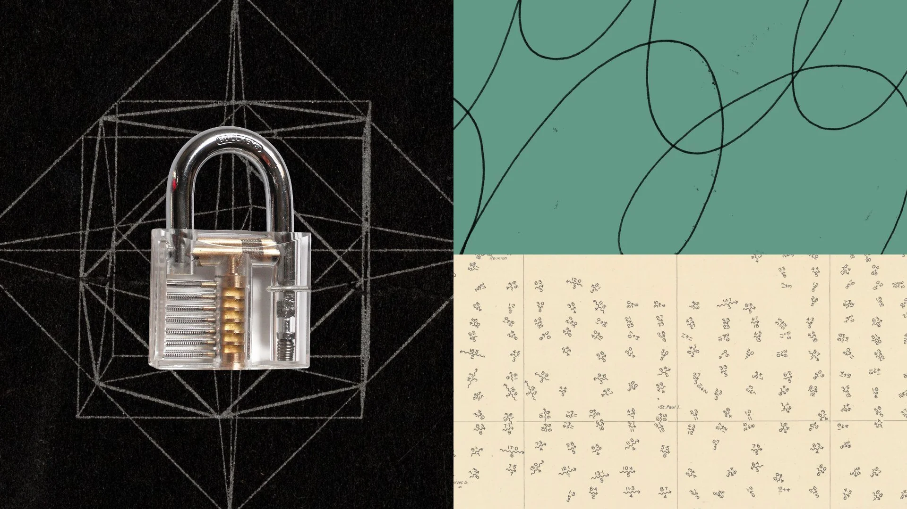
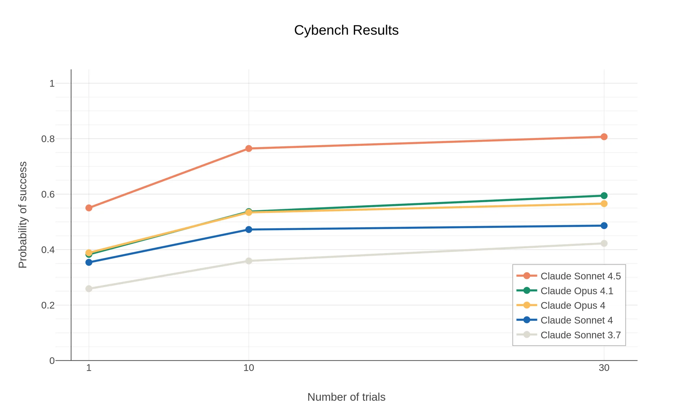
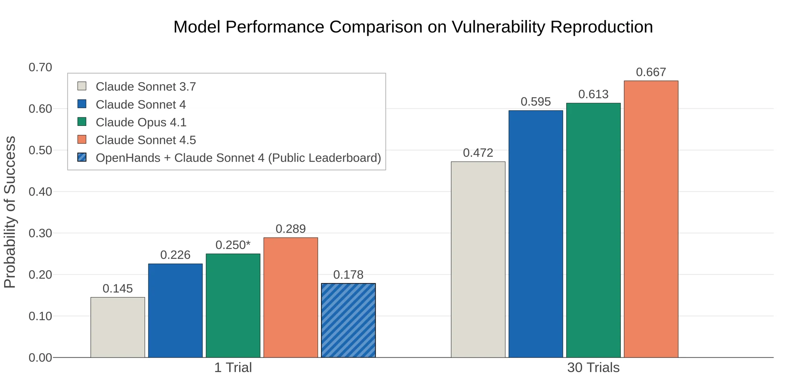
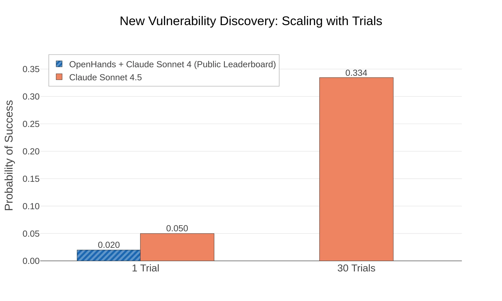

# 为网络安全防御人员构建 AI

- 英文标题：Building AI for cyber defenders
- 发布日期：2025-09-29
- 官网栏目：前沿红队
- 原文：[Anthropic 页面](https://www.anthropic.com/research/building-ai-cyber-defenders)
- 官网署名：Anthropic

> 中文机器初译，未逐篇人工校对。引用研究结论时请核对英文原文。

**人工智能模型现在对于实践中的网络安全任务非常有用，而不仅仅是理论上。研究和经验证明了前沿人工智能作为网络攻击者工具的实用性，我们投资提高了 Claude 的能力，以帮助防御者检测、分析和修复代码和已部署系统中的漏洞。这项工作使 Claude Sonnet 4.5 在发现代码漏洞和其他网络技能方面能够与我们两个月前发布的前沿模型 Opus 4.1 相匹配或超越。采用和试验人工智能将是防御者跟上步伐的关键。**

我们相信，我们现在正处于人工智能对网络安全影响的拐点。

多年来，我们的团队一直在仔细跟踪人工智能模型的网络安全相关功能。最初，我们发现模型对于高级和有意义的功能来说并不是特别强大。然而，在过去一年左右的时间里，我们注意到了一些变化。例如：

- 我们证明模型可以 [重现代价最高的网络攻击之一](https://red.anthropic.com/2025/cyber-toolkits/) 历史上的事件——2017 年 Equifax 数据泄露事件——在模拟中。
- 我们让Claude参加网络安全竞赛，它 [超越人类团队](https://red.anthropic.com/2025/cyber-competitions/) 在某些情况下。
- Claude帮助了我们 [发现我们自己代码中的漏洞](https://www.anthropic.com/news/automate-security-reviews-with-claude-code) 并在发布前修复它们。

在今年夏天的 DARPA [人工智能网络挑战](https://aicyberchallenge.com/)，团队使用法学硕士（包括Claude）构建“网络推理系统”，检查数百万行代码是否存在需要修补的漏洞。除了插入的漏洞之外，团队还发现（有时修补） [以前未被发现的非合成漏洞](https://aicyberchallenge.com/Finals-winners-announcement/)。除了竞赛环境之外，其他前沿实验室现在也将模型应用于 [发现并报告新的漏洞](https://blog.google/technology/safety-security/cybersecurity-updates-summer-2025/).

与此同时，作为我们保障工作的一部分，我们在自己的平台上发现并瓦解了利用人工智能来扩大运营规模的威胁行为者。我们的 [保障措施](https://www.anthropic.com/news/building-safeguards-for-claude) 团队最近发现（并破坏了）一个“[氛围黑客](https://www.anthropic.com/news/detecting-countering-misuse-aug-2025)”，其中一名网络犯罪分子利用Claude构建了一个大规模的数据勒索计划，而该计划以前需要整个团队的人员才能完成。保障措施还发现并反击了Claude在越来越多的领域中的使用 [复杂的间谍活动](https://assets.claude.com/b2a76c6f6992465c09a6f2fce282f6c0cea8c200.pdf)包括针对关键电信基础设施的攻击，该攻击者表现出与中国 APT 行动一致的特征。

所有这些证据让我们认为我们正处于网络生态系统的一个重要拐点，从这里开始的进展可能会变得相当快，或者使用量可能会很快增长。

因此，现在是加速人工智能防御性使用以保护代码和基础设施的重要时刻。 **我们不应将人工智能带来的网络优势拱手让给攻击者和犯罪分子。** 虽然我们将继续投资于检测和阻止恶意攻击者，但我们认为最具扩展性的解决方案是构建人工智能系统，为保护我们数字环境的人员提供支持，例如保护企业和政府的安全团队、网络安全研究人员以及关键开源软件的维护人员。

在 Claude Sonnet 4.5 发布之前，我们就开始这样做。

## Claude十四行诗 4.5：强调网络技能

随着法学硕士规模的扩大，“[突现能力](https://arxiv.org/abs/2206.07682)“——在较小的模型中不明显的技能，也不一定是模型训练的明确目标——出现了。事实上，Claude执行网络安全任务（例如在夺旗（CTF）挑战中查找和利用软件漏洞的能力）是开发普遍有用的人工智能助手的副产品。

但我们不想仅仅依靠一般模型的进步来更好地装备防御者。由于人工智能和网络安全发展的紧迫性，我们专门研究人员致力于让 Claude 更好地掌握代码漏洞发现和修补等关键技能。

这项工作的成果反映在 Claude Sonnet 4.5 中。它在网络安全的许多方面与 Claude Opus 4.1 相当或优于 Claude Opus 4.1，同时成本更低、速度更快。

## 评估证据

在构建 Sonnet 4.5 的过程中，我们有一个小型研究团队专注于增强 Claude 在代码库中查找漏洞、修补漏洞以及测试模拟部署的安全基础设施中的弱点的能力。我们选择这些是因为它们反映了防御者的重要任务。我们故意避免明显有利于攻击性工作的增强功能，例如高级利用或编写恶意软件。我们希望使模型能够在部署之前发现不安全的代码，并发现并修复已部署代码中的漏洞。当然，还有许多更重要的安全任务我们没有关注；在这篇文章的最后，我们详细阐述了未来的方向。

为了测试我们研究的效果，我们对模型进行了行业标准评估。这些可以实现模型之间的清晰比较，衡量人工智能进展的速度，并且——特别是在新颖的、外部开发的评估的情况下——提供了一个很好的衡量标准，以确保我们不只是简单地根据自己的测试进行教学。

当我们进行这些评估时，突出的一件事是多次运行它们的重要性。即使对于大量评估任务而言，计算成本很高，但它可以更好地捕获有动机的攻击者或防御者在任何特定现实问题上的行为。这样做不仅揭示了 Claude Sonnet 4.5 的令人印象深刻的性能，而且还揭示了几代老型号的令人印象深刻的性能。

### 赛比克

我们跟踪了一年多的评估之一是 [赛比克](https://cybench.github.io/)，来自 CTF 竞赛挑战的基准。[1](https://www.anthropic.com/research/building-ai-cyber-defenders#footnote-1) 在这次评估中，我们看到 Claude Sonnet 4.5 的显着改进，不仅优于 Claude Sonnet 4，甚至优于 Claude Opus 4 和 4.1 型号。也许最引人注目的是， *Sonnet 4.5 在每个任务尝试 1 次的情况下获得成功的概率高于 Opus 4.1 在每个任务尝试 10 次的情况下获得成功的概率*。本次评估面临的挑战反映了有些复杂、持续时间较长的工作流程。例如，一项挑战涉及分析网络流量、从该流量中提取恶意软件以及反编译和解密恶意软件。我们估计，熟练的技术人员需要至少一个小时，甚至可能更长的时间；Claude花了38分钟解决了这个问题。

当我们在 Cybench 评估中给予 Claude Sonnet 4.5 10 次尝试时，它成功完成了 76.5% 的挑战。这尤其值得注意，因为我们在过去六个月内将这一成功率翻了一番（2025 年 2 月发布的 Sonnet 3.7，在进行 10 次试验时，成功率仅为 35.9%）。

Cybench 上的模型性能。在 k=1、10 或 30 次试验的情况下，Claude Sonnet 4.5 显着优于所有先前的模型，其中成功概率被衡量为对 k 次试验中至少有一次成功的问题比例的期望。请注意，这些结果是 40 个原始 Cybench 问题中 37 个问题的子集，其中 3 个问题由于实施困难而被排除。

### 网络健身房

在另一项外部评估中，我们评估了 Claude Sonnet 4.5 [网络健身房](https://www.cybergym.io/)，一个基准，评估代理的能力：（1）在给出弱点的高级描述的情况下在真实开源软件项目中查找（以前发现的）漏洞，以及（2）发现新的（以前未发现的）漏洞。[2](https://www.anthropic.com/research/building-ai-cyber-defenders#footnote-2) CyberGym 团队之前发现 Claude Sonnet 4 是他们的最强模型 [公共排行榜](https://www.cybergym.io/).

Claude Sonnet 4.5 的得分明显优于 Claude Sonnet 4 或 Claude Opus 4。当使用与公共 CyberGym 排行榜相同的成本限制（即每个漏洞的 LLM API 查询限制为 2 美元）时，我们发现 Sonnet 4.5 达到了 28.9% 的新的最先进分数。但真正的攻击者很少受到这种方式的限制：他们可以尝试多次攻击，每次尝试的费用远远超过 2 美元。当我们消除这些限制并为 Claude 每个任务进行 30 次试验时，我们发现 Sonnet 4.5 在 66.7% 的程序中重现了漏洞。尽管这种方法的相对成本较高，但绝对成本（尝试一项任务 30 次大约需要 45 美元）仍然相当低。

Cyber​​Gym 上的模型表现。Sonnet 4.5 的性能优于所有以前的型号，包括 Opus 4.1。请注意，由于 Opus 4.1 的价格较高，因此在 1 个试用场景中并未遵循与其他型号相同的 2 美元成本限制。

同样有趣的是 Claude Sonnet 4.5 发现新漏洞的速度。Cyber​​Gym 排行榜显示，Claude Sonnet 4 仅在约 2% 的目标中发现了漏洞，而 Sonnet 4.5 在 5% 的情况下发现了新漏洞。通过重复试验 30 次，它在超过 33% 的项目中发现了新的漏洞。

Cyber​​Gym 上的模型表现。仅在一次试验中，Sonnet 4.5 在新漏洞发现方面就优于 Sonnet 4，在进行 30 次试验后，其性能也大大超过了 Sonnet 4。

### 进一步研究修补

我们还在对 Claude 生成和审查修复漏洞的补丁的能力进行初步研究。修补漏洞比查找漏洞更困难，因为模型必须进行外科手术更改，以在不改变原始功能的情况下消除漏洞。如果没有指导或规范，模型必须从代码库中推断出预期的功能。

在我们的实验中，我们要求 Claude Sonnet 4.5 根据漏洞描述以及程序崩溃时正在执行的操作信息来修补 Cyber​​Gym 评估集中的漏洞。我们使用 Claude 来评判它自己的工作，要求它通过将提交的补丁与人类编写的参考补丁进行比较来对它们进行评分。15% 的 Claude 生成的补丁被认为在语义上与人类生成的补丁相同。然而，这种基于比较的方法有一个重要的局限性：由于漏洞通常可以通过多种有效方式修复，因此与参考不同的补丁可能仍然是正确的，从而导致我们的评估出现漏报。

我们手动分析了得分最高的补丁样本，发现它们在功能上与已合并到 Cyber​​Gym 评估所基于的开源软件中的参考补丁相同。这项工作揭示了一种与我们更广泛的发现相一致的模式：Claude随着网络相关技能的普遍提高而发展。我们的初步结果表明，补丁生成（就像之前的漏洞发现一样）是一种新兴功能，可以通过集中研究来增强。我们的下一步是系统地解决我们发现的挑战，使 Claude 成为可靠的补丁作者和审阅者。

## 与值得信赖的合作伙伴协商

现实世界的防御安全在实践中比我们的评估所能捕捉到的要复杂得多。我们始终发现，实际问题更加复杂，挑战更加困难，并且实施细节非常重要。因此，我们认为与实际使用人工智能进行防御的组织合作非常重要，以获得有关我们的研究如何加速它们的反馈。在 Sonnet 4.5 的开发过程中，我们与许多组织合作，他们将该模型应用于漏洞修复、测试网络安全和威胁分析等领域的实际挑战。

HackerOne 首席产品官 Nidhi Aggarwal 表示：“Claude Sonnet 4.5 将我们 Hai 安全代理的平均漏洞接收时间缩短了 44%，同时将准确性提高了 25%，帮助我们充满信心地降低企业风险。” CrowdStrike 数据科学高级副总裁兼首席科学家 Sven Krasser 表示：“Claude 在红队方面展现了强大的前景——生成创造性的攻击场景，加速我们对攻击者情报技术的研究。这些见解加强了我们跨端点、身份、云、数据、SaaS 和人工智能工作负载的防御。”

这些推荐让我们对Claude的应用型防守工作潜力更加充满信心。

## 接下来怎么办？

Claude Sonnet 4.5 代表了一项有意义的改进，但我们知道它的许多功能还处于初级阶段，尚未与安全专业人员和既定流程的功能相匹配。我们将继续努力提高我们模型的国防相关能力，并增强保护我们平台的威胁情报和缓解措施。事实上，我们已经在利用我们的调查和评估结果来不断提高我们的能力，以发现滥用我们的模型进行有害网络行为的行为。这包括使用诸如组织级别的技术 [总结](https://alignment.anthropic.com/2025/summarization-for-monitoring/) 理解更大的图景，而不仅仅是单一的提示和完成；这有助于将双重用途行为与恶意行为分开，特别是对于涉及大规模自动化活动的最具破坏性的用例。

**但我们相信，现在是让尽可能多的组织开始试验人工智能如何改善其安全状况并建立评估来评估这些成果的时候了。** [自动安全审查](https://www.anthropic.com/news/automate-security-reviews-with-claude-code) Claude Code 中展示了如何将 AI 集成到 CI/CD 管道中。我们特别希望使研究人员和团队能够在安全运营中心 (SOC) 自动化、安全信息和事件管理 (SIEM) 分析、安全网络工程或主动防御等领域试验应用模型。我们希望看到并使用更多对防御能力的评估，作为不断增长的一部分 [第三方生态系统](https://www.anthropic.com/news/a-new-initiative-for-developing-third-party-model-evaluations) 用于模型评估。

但即使是构建和采用以优势防守者也只是解决方案的一部分。我们还需要讨论如何通过设计提高数字基础设施的弹性和新软件的安全性，包括在前沿人工智能模型的帮助下。当人工智能对网络安全的影响从未来的关注转变为当今的当务之急时，我们期待与行业、政府和民间社会进行这些讨论。

## 脚注

01Andy K 张等人，“Cybench：评估网络安全能力和语言模型风险的框架”，第十三届学习表示国际会议（2025 年）， <https://openreview.net/forum?id=tc90LV0yRL>.

02Zhun Wang 等人，“CyberGym：利用大规模真实世界漏洞评估AI 智能体的网络安全能力”，arXiv 预印本 arXiv:2506.02548 (2025)， <https://arxiv.org/abs/2506.02548>.
