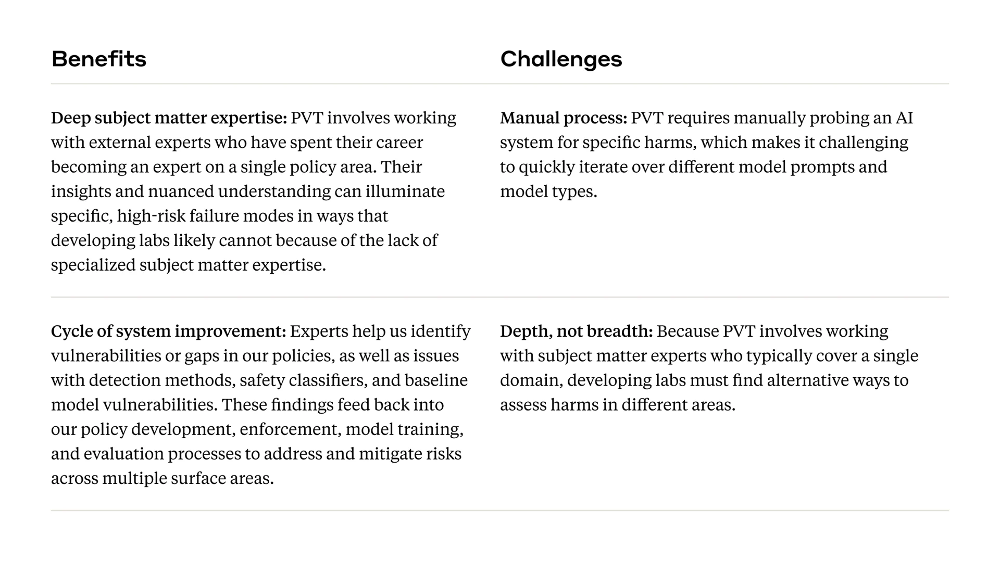
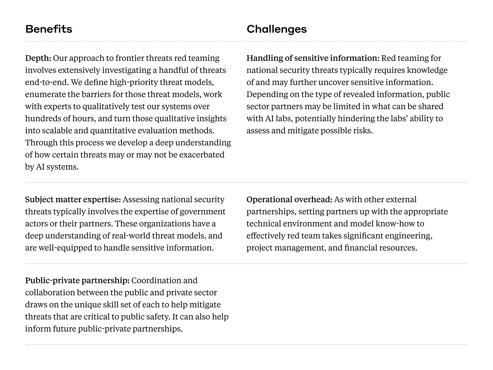
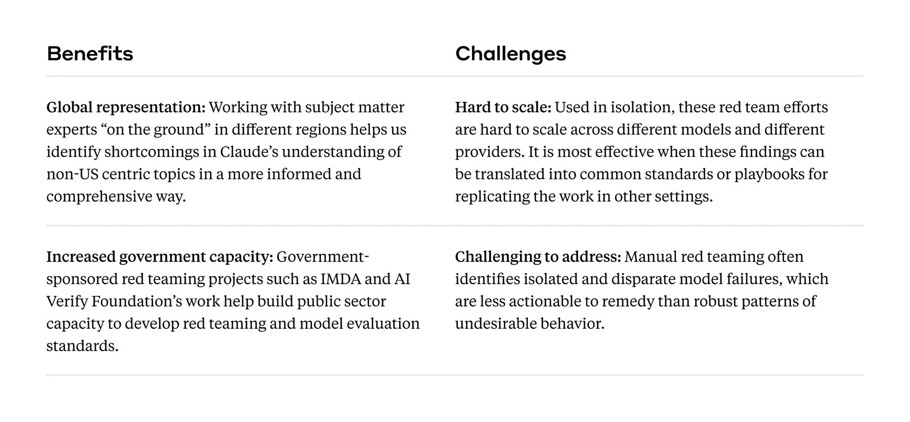
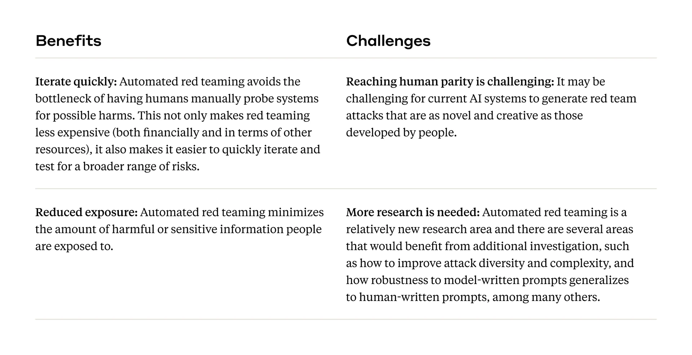
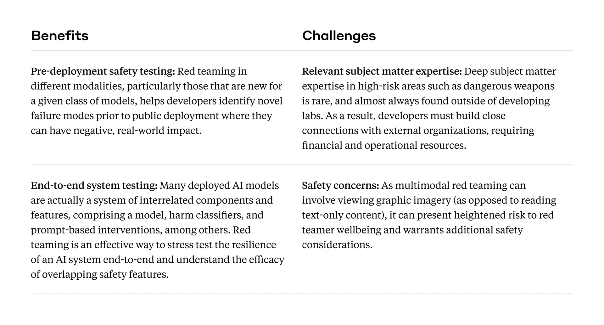
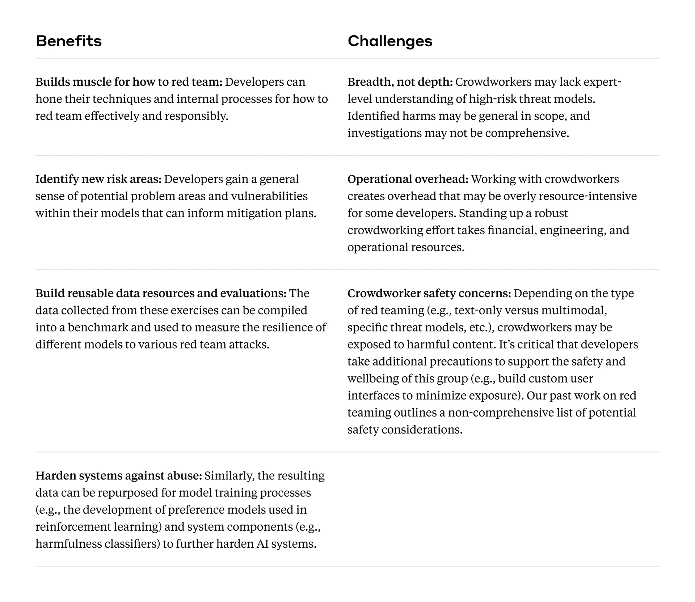
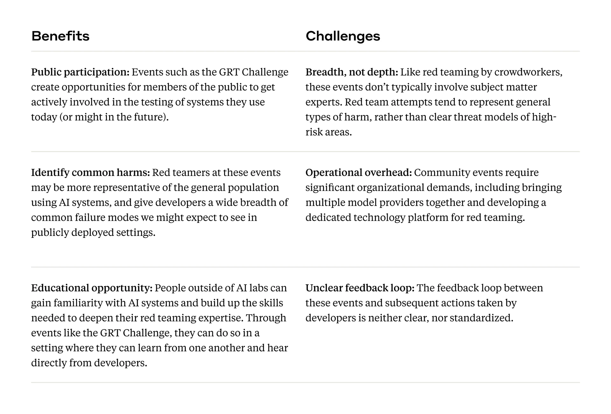

# AI 系统红队测试的挑战

- 英文标题：Challenges in red teaming AI systems
- 发布日期：2024-06-12
- 官网栏目：前沿红队
- 原文：[Anthropic 页面](https://www.anthropic.com/news/challenges-in-red-teaming-ai-systems)
- 官网署名：Anthropic

> 中文机器初译，未逐篇人工校对。引用研究结论时请核对英文原文。

在这篇文章中，我们详细介绍了我们用来测试人工智能系统的红队方法样本的见解。通过这种实践，我们已经开始收集有关在特定情况下使用的适当工具的经验数据，以及每种方法的相关好处和挑战。我们希望这篇文章对其他试图对其人工智能系统进行红队的公司、对红队在实践中如何运作感到好奇的政策制定者以及想要对人工智能技术进行红队的组织有所帮助。

## 什么是红队？

红队是提高人工智能系统安全性的关键工具。它涉及对抗性测试技术系统以识别潜在的漏洞。如今，研究人员和人工智能开发人员采用各种红队技术来测试他们的人工智能系统，每种技术都有自己的优点和缺点。

人工智能红队缺乏标准化实践使情况进一步复杂化。开发人员可能会使用不同的技术来评估同一类型的威胁模型，即使他们使用相同的技术，他们进行红队的方式在实践中也可能看起来截然不同。这种不一致使得客观比较不同人工智能系统的相对安全性变得具有挑战性。

为了解决这个问题，人工智能领域需要建立系统红队的实践和标准。我们认为，现在就开展这项工作非常重要，这样组织就可以在模型显着提高其能力时，做好管理当前风险并减轻未来威胁的准备。为了努力实现这一目标，我们分享了我们探索的一些红队方法的概述，并演示了如何将它们集成到从定性红队到自动化评估开发的迭代过程中。最后，我们提出了政策制定者可以采取的一系列建议行动，以培育强大的人工智能测试生态系统。

## 本文涵盖的红队方法包括：

### 特定领域的专家红队

- 信任与安全：策略漏洞测试
- 国家安全：边境威胁红队
- 特定地区：多语言和多文化红队

### 使用语言模型进行红队

- 自动红队

### 红队新模式

- 多式联运红队

### 开放式、一般红队

- 针对一般危害的众包红队
- 针对一般风险和系统限制的基于社区的红队

在以下部分中，我们将介绍每种红队方法，研究它们的独特优势和挑战（我们概述的一些好处和挑战可能适用于红队方法）。

## 特定领域的专家团队

在高层次上，特定领域的专家团队涉及与主题专家合作，以识别和评估其专业领域内人工智能系统的潜在漏洞或风险。聘请专家有助于更深入地了解复杂的、针对具体情况的问题。

### 信任和安全风险的策略漏洞测试

高风险威胁，例如那些对人们造成严重伤害或对社会产生负面影响的威胁，需要复杂的红队方法以及与外部主题专家的合作。在信任与安全领域，我们采用了一种称为“策略漏洞测试”(PVT) 的红队形式。PVT 是我们与外部主题专家合作对我们的政策涵盖的各种政策主题进行的一种深入的定性测试。 [使用政策](https://console.anthropic.com/legal/aup)。我们与专家合作，例如 [荆棘](https://www.thorn.org/) 在儿童安全问题上， [战略对话研究所](https://www.isdglobal.org/) 上 [选举诚信](https://www.anthropic.com/news/testing-and-mitigating-elections-related-risks), [反对仇恨和极端主义全球项目](https://globalextremism.org/) 激进化等问题。

### 边境威胁红队国家安全风险

自从我们发布了我们的 [博客文章](https://www.anthropic.com/news/frontier-threats-red-teaming-for-ai-safety) 在我们对人工智能系统进行国家安全风险红队的方法中，我们继续开发评估技术来衡量“前沿威胁”（可能对国家安全构成重大风险的领域），以及外部合作伙伴关系，为我们的系统红队带来深厚的主题专业知识。我们的前沿红队工作主要关注化学、生物、放射和核 (CBRN)、网络安全和自主人工智能风险。我们与这些领域的专家合作，测试我们的系统并共同设计新的评估方法。根据威胁模型，外部红队成员可能会使用我们标准部署的 Claude 版本来调查“现实世界”设置中的风险，或者他们可能会使用使用不同风险缓解措施的非商业版本。

### 多语言和多文化红队

我们的大部分红队工作都是用英语进行的，并且通常是从美国人的角度进行的。更好地理解并理想地解决这种缺乏代表性的一种方法是在其他语言和文化背景下进行红队合作。由公共部门主导的能力建设工作可以鼓励当地居民测试人工智能系统的语言技能和与特定社区相关的主题。举个例子，我们很高兴与新加坡的合作 [信息通信媒体发展局](https://www.imda.gov.sg/) （信息通信媒体发展局）和 [AI验证基金会](https://aiverifyfoundation.sg/) 涉及四种语言（英语、泰米尔语、普通话和马来语）的红队项目以及与新加坡受众和用户群相关的主题。我们期待 IMDA 和 AI verify Foundation 发布更多关于这项工作的内容以及更广泛的红队见解。

## 使用语言模型进行红队

在红队中使用语言模型涉及利用人工智能系统的功能自动生成对抗性示例并测试其他人工智能模型的稳健性，这可能会补充手动测试工作并实现更高效、更全面的红队。

### 自动红队

随着模型变得越来越强大，我们对如何使用它们来补充手动测试以及模型本身执行的自动化红队测试很感兴趣。具体来说，我们希望了解红队对于减少有害行为的有效性。为此，我们采用红队/蓝队动态，其中我们使用模型来生成可能引发目标行为的攻击（红队），然后对这些红队输出进行微调模型，以使其对类似类型的攻击（蓝队）更加稳健。我们可以重复运行这个过程来设计新的攻击向量，并且在理想情况下，使我们的系统对一系列对抗性攻击更加稳健。

## 红队新模式

新模式中的红队涉及测试能够处理和响应各种形式的输入（例如图像或音频）的人工智能系统，这有助于在部署系统之前识别与这些扩展功能相关的新风险和故障模式。

### 多式联运红队

的 [Claude 3](https://www.anthropic.com/claude) 模型系列是多模式的——虽然它们不是 *生成* 图像，它们可以获取视觉信息（例如照片、草图、图表）并提供基于文本的响应输出，这种能力会带来潜在的新风险（例如欺诈活动、对儿童安全的威胁、暴力极端主义等）。在部署 Claude 3 之前，我们的信任与安全团队 [红队我们的系统](https://assets.claude.com/de8ba9b01c9ab7cbabf5c33b80b7bbc618857627.pdf) 针对基于图像和文本的风险，还与外部红队成员合作，评估我们的模型拒绝参与有害输入（图像和文本）的程度。部署前的红队对于任何版本都至关重要，尤其是那些包含新模型功能和模式的版本。

## 开放式、一般红队

### 针对一般危害的众包红队

当我们开始我们的 [红队研究](https://www.anthropic.com/news/red-teaming-language-models-to-reduce-harms-methods-scaling-behaviors-and-lessons-learned) 到 2022 年中期，出现了大量关于红队软件系统安全漏洞的文献，但红队语言模型标准的文献相对较少。我们在这里的工作纯粹是出于研究能力（我们还没有发布我们的人工智能助手， [克洛德](https://www.anthropic.com/product)），因此我们选择在严格控制的环境中与众包合作，并要求他们对攻击类型使用自己的判断和风险承受能力，而不是要求他们针对特定威胁加入红队。

### 针对一般风险和系统限制的社区红队

随着红队人工智能模型变得越来越普遍，诸如 [DEF CON 的人工智能村](https://aivillage.org/generative%20red%20team/generative-red-team/) 吸引了更广泛的社会各界人士参与公共部署系统的测试。2023 年， [生成红队 (GRT) 挑战](https://www.humane-intelligence.org/grt) 接待了来自不同年龄和学科的数千名参与者，其中包括许多具有非技术背景的个人，并邀请他们参加由 Anthropic 和其他实验室提供的红队模型。红队队员在挑战中所表现出的热情和创造力给我们留下了深刻的印象，并希望GRT挑战和类似的活动能够激励更多不同的人群参与人工智能安全工作。  

在探索了这些不同的红队方法（每种方法都有自己的优点和挑战）之后，我们现在讨论它们如何为我们在人工智能行业建立更标准化的红队实践的目标做出贡献。

## 我们如何从定性红队到定量评估？

除了阐明潜在风险之外，上述红队实践还可以作为构建自动化定量评估方法的先驱。这是红队领域的一个元挑战：如何将红队的结果转化为可以为系统被红队组成的组织创造复合价值的东西？理想情况下，红队是迭代循环的一部分，其中包括针对各种风险评估人工智能模型（手动和使用自动化技术）、实施相应的缓解措施以及测试这些护栏的有效性。

在此过程的开始，主题专家会对潜在威胁模型进行清晰的描述，然后探索人工智能模型，试图以特殊的方式引发所述威胁。随着红队成员对问题空间有了更深入的认识，他们开始标准化他们的红队实践，修改输入以更有效地引发有害行为。

从那里，我们可以使用语言模型生成这些输入的数百或数千种变体，以覆盖更多的表面积，并且只需很短的时间即可完成。通过这个过程，我们从临时的定性人类测试转向更彻底的定量和自动化测试。我们采用了这种迭代方法，在我们的前沿威胁红队工作中开发可扩展的评估，以进行国家安全风险和政策漏洞测试 [选举诚信](https://www.anthropic.com/news/testing-and-mitigating-elections-related-risks) 风险，我们渴望将其应用到其他威胁模型中。

### 政策建议

为了支持红队的进一步采用和标准化，我们鼓励政策制定者考虑以下建议：

1. [美国国家标准技术研究所等基金组织](https://www.anthropic.com/news/an-ai-policy-tool-for-today-ambitiously-invest-in-nist) (NIST) 制定技术标准和通用实践，以指导如何安全有效地红队人工智能系统。
2. [资助独立政府机构和非营利组织的发展和持续运营](https://www.anthropic.com/news/third-party-testing) 可以与红队系统的开发人员合作，应对各个领域的潜在风险。例如，对于与国家安全相关的风险，所需的大部分专业知识将由政府机构负责。
3. 鼓励专业人工智能红队服务市场的发展壮大，按照共享技术标准为开展人工智能红队的组织建立认证流程。
4. 鼓励人工智能公司允许并促进经过审查（并最终获得认证）的外部团体对其人工智能系统进行第三方红队合作。制定透明度和模型访问标准，以在安全可靠的条件下实现这一点。
5. 鼓励人工智能公司将其红队实践与明确的政策联系起来，明确其必须满足的条件，以继续扩大新模型的开发和/或发布（例如，采用诸如 [负责任的扩展政策](https://www.anthropic.com/news/anthropics-responsible-scaling-policy)).

## 结论

红队是识别和减轻人工智能系统风险的宝贵技术。本文介绍的各种红队方法重点介绍了可用于不同用例和威胁模型的一些技术。我们期待与其他参与者合作，迭代这些技术，并努力制定安全测试的通用标准。通过投资红队，我们可以致力于构建安全且对社会有益的人工智能系统。它是确保人工智能经过深思熟虑开发并拥有强有力的保障措施的众多工具之一。
