# Claude 尝试做机器人任务

- 英文标题：Claude plays robotics
- 发布日期：2026-07-09
- 官网栏目：前沿红队
- 原文：[Anthropic 页面](https://www.anthropic.com/research/claude-plays-robotics)
- 官网署名：Anthropic

> 中文机器初译，未逐篇人工校对。引用研究结论时请核对英文原文。

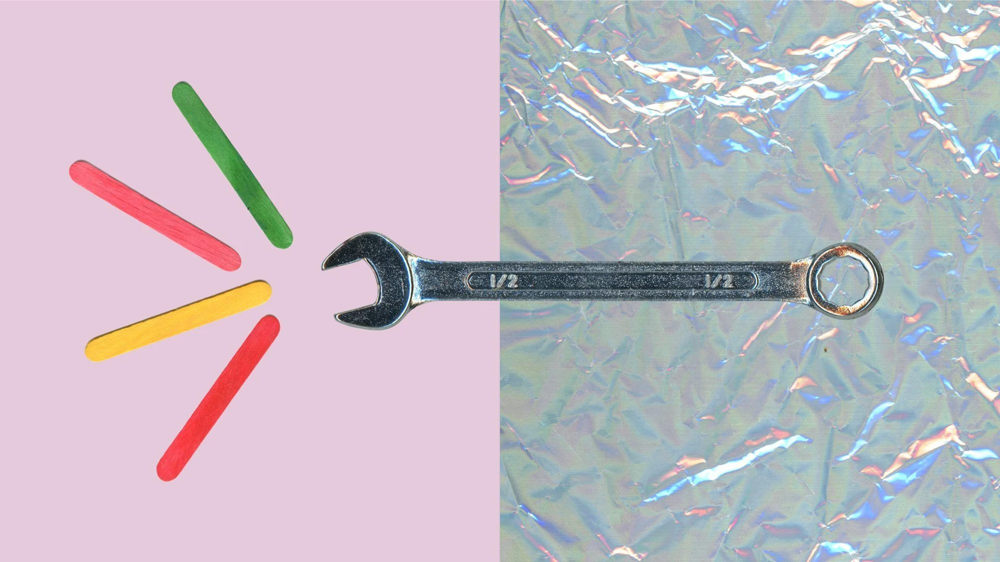

*什穆尔·伯曼、迈克尔·伊利、邓佳和丹尼尔·弗里曼*

语言模型的优势是否会转移到机器人技术这个需要综合逻辑技能和精确 3D 理解的领域？模型能否感知场景、理解特定机器人的状态并发出可靠地影响物理世界变化的动作？

我们进行了测试来找出答案。我们为多种语言模型提供了对一系列机器人身体的控制，包括经典的控制玩具、模拟的四足动物和人形机器人、机械臂和真正的 Unitree Go2（ [项目获取](https://www.anthropic.com/research/project-fetch-phase-two)）。我们为模型提供了一系列控制它们的方法，这些方法在抽象上有所不同（即它们的指令的“高级”程度）：从直接命令电机扭矩（至少抽象端），到编写控制器代码，到通过强化学习从头开始训练控制器，到为预训练的机器人策略提供高级转向指令（一个单独的神经网络，将高级命令转化为协调的关节运动）。我们测试了模型在三个领域的性能：经典控制问题（例如平衡钟摆）、运动和导航（让有腿机器人在空间中平衡、行走和移动）以及操纵（使用机械臂抓取和移动物体）。

模型在机器人技术方面的进步很快，但我们发现它们的能力在很大程度上取决于它们与机器人的连接方式——它们使用了哪种控制方法。当它们必须自己驱动关节时，它们大多会失败。但是，当他们监督预先训练的控制器或使用简单的定向工具时，他们可以完成真正的导航和操纵任务。某些形式的实施例仍然笨重且难以控制，但尤其是较新的模型，在调整其策略并将图像和感官理解转换为跨领域的适当行动方面要强大得多。

这对于语言模型的安全开发和部署具有重要意义。当今的前沿模型在没有预先训练的策略的情况下无法控制人形机器人，但较新的模型在我们测试的人形和四足动物的直接操作和高级策略控制方面取得了真正的进步。我们期望未来的模型会更好。具体来说：未经机器人训练的通用聊天模型在运行良好的情况下，已经可以编写和下载自己的工具，让四足动物慢慢穿过迷宫，或者从柜台上拿起一个盘子并将其放在炉子上，并且随着每一代模型的产生，可靠性差距正在缩小。

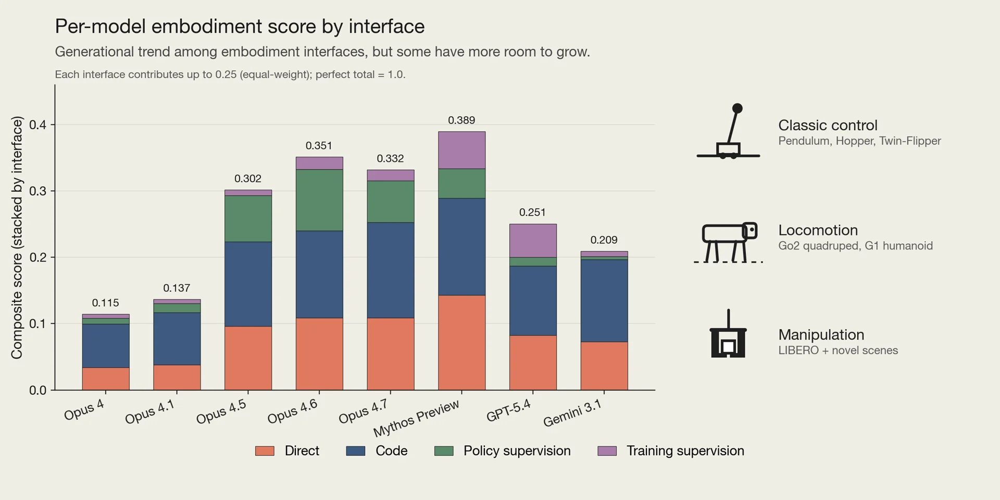

Embody（我们的基准套件）上按模型的综合得分，按控制界面堆叠。该复合材料是套件中每个机器人身体（“实施例”）和任务（高级运动除外）的归一化平均值；更高的标准意味着更广泛的身体能力。

## 调查结果摘要

- **模型的机器人得分不仅取决于模型本身，还取决于机器人主体和控制界面。** 同一个模型可能看起来很弱或很强大，具体取决于它是直接设置电机扭矩、编写 Python 控制器、监督预训练策略还是通过强化学习训练自己的策略——每种模型都是模型完成相同任务的不同方式。对于最具挑战性的控制机构（特别是人形机器人），当今的模型只能在更高抽象的接口上获得牵引力，其中预训练的策略处理低级物理。
- **机器人技术的模型正在不断改进，但进展不平衡。** 各代模型之间最一致的性能改进是在高级接口上。直接低级控制也在改进，但一致性较差：一些新模型明显优于其前身，但其他模型却没有。
- **在运动任务中，前沿模型现在可以执行有限但有意义的全身控制。** 较新的模型在低水平控制四足站立、平衡和行走方面取得了进展，并且在人形平衡方面显示出较弱但可测量的进步。使用预先训练的策略和感知工具，他们甚至可以在简单的环境中导航。然而，模型仍然无法完成需要稳定空间记忆、自定位或长开环计划的任务。
- **通过低级操纵方法，模型开始产生有用的局部物理行为，尽管完整的任务成功仍然很少见。** 较新的模型更擅长接触物体、接触和抓取。然而，他们只在一小部分时间（从 0 到 5.5%）完成完整的任务。
- **通过高级操作方法，新模型在使用预训练策略时会更加成功。** 视觉-语言-动作（VLA）支架——将相机图像和指令直接映射到机器人手臂运动的预训练策略——将模型的操纵性能提高到远远高于直接控制。新模型也越来越成为这些政策的良好监督者：它们更善于识别拟议行动何时会失败，不太可能不加区别地服从 VLA，从而在操纵任务上取得进一步进展。监督政策仍然会花费一些性能——组合系统的表现比单独运行的 VLA 更差——但最好的监督者现在可以弥补大部分差距。这并不意味着监管毫无用处：早期的模型破坏了政策的大部分价值，当前最好的模型恢复了大部分价值，而在 VLA 无法单独完成的任务上，最强大的模型已经提供了净提升。

## 简单的设置

我们首先评估一组简单控制任务的机器人相关功能，包括经典的强化学习 (RL) 问题，例如平衡逆摆和控制料斗。

尽管这些是简化的环境，但我们相信它们需要模型来推理动力学、随时间变化的因果关系以及基础物理能力，这些能力是更普遍的物理理解的重要前提。在这些低维环境中，感官数据提供了几乎所有必要的信息，使得它们可以在几乎不需要视觉输入的情况下解决。这种低维控制也出现在一些现实世界的设置中，例如相机稳定。

我们通过四个控制接口评估模型，所有这些都在仿真引擎 Mujoco 中。 （自始至终，“经典控制”命名了这一类玩具任务；“直接控制”命名了下面四个接口之一——它们是独立的轴。）在我们所说的直接控制中，模型在每一步选择低级动作，例如扭矩或力。在程序控制中，模型编写一个 Python 控制器，在执行期间将观察结果映射到操作。在策略控制中，模型可以访问预先训练的策略并通常以自然语言发出高级命令。在强化学习监督中，模型训练策略，然后在测试时部署学习的策略。

为了近似直接控制性能的上限，我们在 LLM 调用之间暂停模拟器，这样实时延迟就不会主导结果。如果没有这个，许多直接测试就会因为一个微不足道的原因而失败：模型反应太慢而无法控制环境。我们预计推理速度将继续提高，并且此设置可以清晰地显示最佳情况的能力。

我们还设计了我们的评估，以考虑到许多经典的 RL 任务频繁出现在预训练语料库中的事实，这可能会限制我们的结论推广到新环境的效果。为了解决这个问题，我们保留了逆摆和料斗任务作为控制任务，但也引入了基于弹球街机的新任务。在 TwinFlipper 中，智能体控制一组脚蹼，并寻求最大化球的总飞行时间（球在落到脚蹼下方之前保持在指定高度阈值以上且不接触任何物体的累积时间）。尽管简单的解决方案是向上猛击球，但通过以受控方式小心地上下弹球可以获得更多的空中时间。该任务被设计为具有很少自由度的混沌动态系统的代表性示例，并且之前没有一个模型见过它。

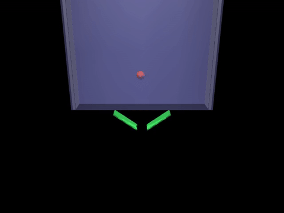

Opus 4.6 最好的经典控制运行。

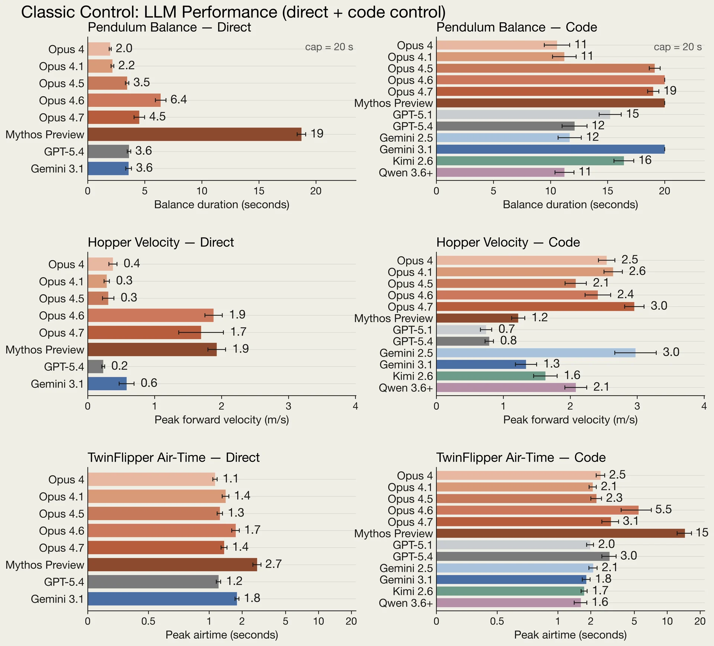

经典控制性能（按模型）。

虽然单个任务的性能很嘈杂，但对所有经典控制基准的更广泛的观察显示了一致的代际改进。Claude Opus 4.6 和 Opus 4.5 在几乎所有任务上都优于两个早期版本，除了 TwinFlipper 直接控制（所有模型都表现不佳）和料斗速度（我们噪音最大的任务）之外。尽管如此，后两个模型在代码控制、强化学习以及较小程度上的直接控制方面显示出显着的改进。

我们的结果表明，大部分改进来自于在看到之前的结果后更好的适应能力并相应地修改策略。在具有自然终止点的任务（最明显的是 TwinFlipper 和 Pendulum）上，各个模型的平均首次尝试性能非常相似，并且 Claude Opus 4 和 Opus 4.1 在这项指标上略胜于后来的模型。更大的收益出现在随后的尝试中，其中后来的模型改进得更加显着。Claude神话预览版是一个明显的例外。它的许多首次尝试在 Pendulum 中都更加稳健。

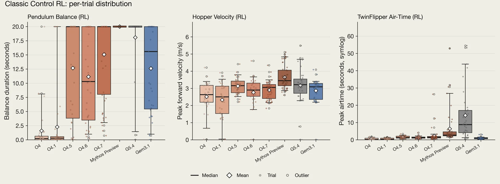

模型从头开始训练 RL 策略时的性能。

几乎所有模型在训练 RL 策略时的表现都比创建 Pythonic 控制器时的表现要差。其中最突出的是 TwinFlipper，其中 GPT-5.4 是唯一能够持续学习有效策略的模型。鉴于其在其他控制接口下的性能相对较差，这一点是引人注目的。在 Pendulum 和 Hopper 上，情况有所不同：Mythos Preview 领先，GPT-5.4 紧随其后，并且模型之间的差距要窄得多。在所有三项任务中，新的 Claude 模型比旧模型显示出有意义的改进。

在目标较难指定的任务（例如 Hopper 和 TwinFlipper）上，强化学习性能正在提高，但仍落后于代码控制。这并不奇怪：让模型训练自己的强化学习策略需要解决复杂的设置问题，从定义环境和奖励到管理更长的迭代周期以及做出几个相互依赖的设计选择。虽然并不是每一代 Claude 都表现出相同程度的进步，但更广泛的趋势是明确的：强化学习能力随着时间的推移而不断进步。

## 直接控制不好，但正在改进

### 低水平运动

下一个问题是，我们在简单控制中看到的收益是否会延续到具有更多自由度的机器人上。为了测试这一点，我们在两个代表性平台上评估了低级运动：29 自由度 Unitree G1 人形机器人和 12 自由度 Unitree Go2 四足动物。我们注意到，与玩具任务相比，该领域的贡献上限更高，风险也更大。训练强大的人形和四足动物策略很困难，但一旦训练完毕，它们就会被部署到错误行为可能导致严重人身伤害的情况下。

这些是复杂的机器人，对它们进行数字控制具有挑战性。该模型不是像简单任务那样控制一些耦合变量，而是必须协调许多关节，同时不断补偿重力、惯性和接触力。它是 *非常* 不可原谅：如果不立即纠正，即使是微小的错误也可能会破坏整个底盘的稳定性。

考虑到这一困难，我们根据两个核心任务评估模型：从倒塌的位置站起来，以及从直立开始尽可能长时间地保持平衡。我们最初探索了更复杂的任务和起始条件，但这些设置通常超出了前沿模型的范围。然而，我们的四足动物试验结果令人鼓舞，因此我们还评估了以编程方式让 Go2 机器人向前行走的能力。

我们使用三种控制接口：直接控制、程序控制和强化学习（RL）。与经典任务一样，在直接设置中，我们在 LLM 调用之间暂停模拟器，因此实时延迟不会成为限制因素。实时控制大约需要 83 Hz；当前的非推理推理运行频率约为 0.2-0.4 Hz，因此缩小这一差距需要大约两个数量级的延迟改进。

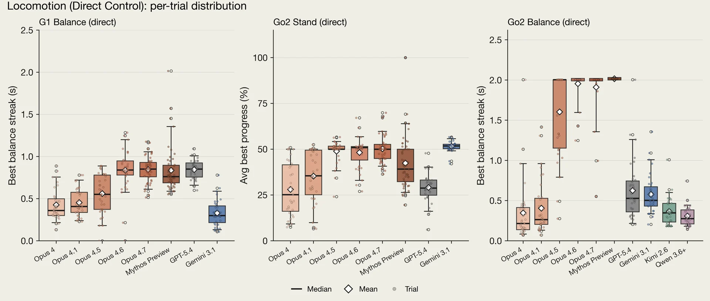

对 Go2 四足动物的直接低级控制。

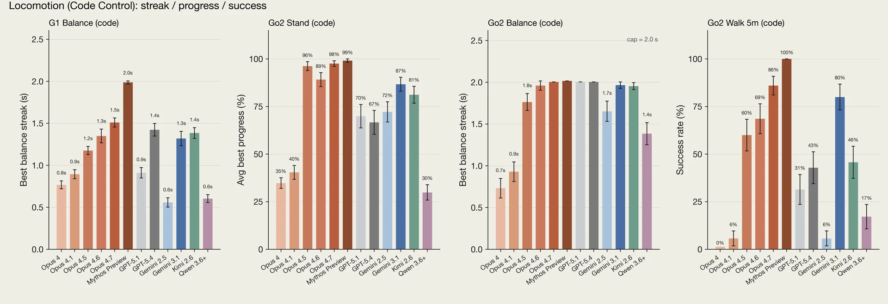

程序化运动控制。

虽然四足动物的直接低级机车控制对于所有模型来说都很困难，但许多模型都擅长编程控制。Opus 4.6、4.7 和 Claude Mythos Preview 成功地使 Go2 机器人保持了近两秒的平衡，足够长的时间来展示稳定的平衡，但速度足够快，可以通过扭矩力控制和 Pythonic 控制器进行迭代。Gemini 3.1和GPT-5.4拥有同样强大的控制器，尽管它们在直接控制电机方面远远落后。在直接控制下，Opus 4.6 可以保持机器人平衡，但无法成功站立。

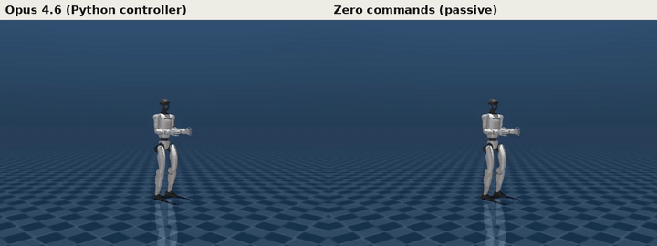

模型控制下的人形机器人。

G1 类人机器人是我们研究中最难的平台，结果很弱但有所改善。在我们的试验中，没有一个模型能成功地将机器人从倒塌的姿势中站起来，哪怕一次。即便如此，一旦机器人处于站立位置，Opus 4 和 4.7 在平衡机器人方面还是取得了显着的进步。

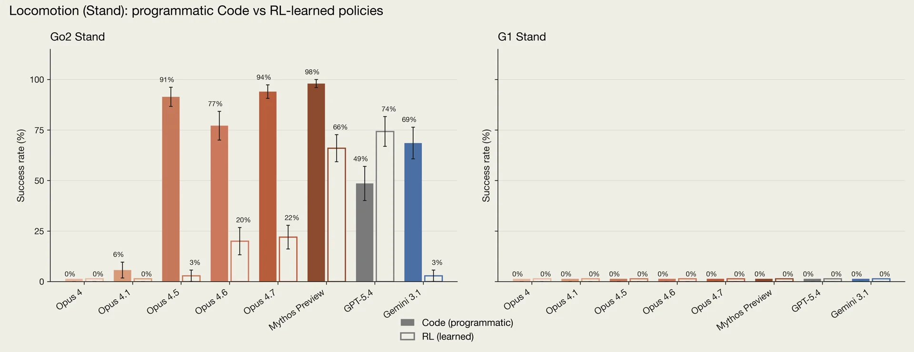

Go2 和 G1 上的程序控制与训练有素的策略控制。

我们还评估了模型训练机车策略的效果。为此，我们为他们提供了一个可以访问 GPU 和可视化环境的训练支架，并让它控制奖励函数、训练环境和模型架构。在四个小时内，GPT-5.4 和 Claude Mythos Preview 持续训练了最有能力的 RL 策略，证实了我们之前在经典 RL 任务上的结果。我们还观察到 Claude 系列的进步，性能从 Opus 4 提高到 Opus 4.6，并通过 Mythos Preview 进一步提高。

所有这些结果都应该得到适当的解释。例如，如果我们随机化四足机器人的初始位置以包括其背部的位置，Opus 4.6 甚至无法将其站立起来。此外，我们在平衡尝试之间重置了环境；只有少数模型在第一次尝试时就实现了稳健的平衡。然而，很明显，前沿模型正在发展机车能力。

### 低级操纵

操纵是机器人的另一项核心能力，具有明显的实用性和安全性，因此我们将其与运动一起研究。通过操纵，我们的意思是使用夹具或机械臂以受控的方式在场景中移动和重新定向对象。我们在根据 LIBERO 基准改编的厨房式环境中使用固定底座、7 自由度 Franka Panda 手臂来评估此功能。这些都是类似厨房的任务，例如“将盘子放在炉子上”。

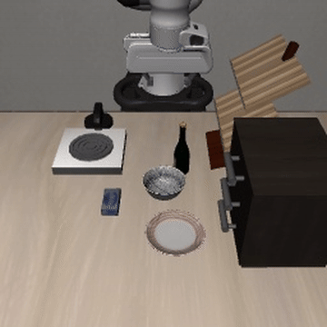

Opus 4.6 在直接操纵控制下完成 LIBERO 任务。

由于手臂固定到位，因此不需要像执行机车任务时那样保持平衡。相反，挑战在于足够精确地控制位置、方向和接触以完成目标。一次成功的尝试需要模型识别正确的物体，将手臂移动到位，正确对齐夹具，执行稳定的抓取，然后在不失去控制的情况下运输和放置物体。任何阶段的错误都可能导致整个尝试失败，尽管这通常可以纠正。

我们测试了一个简化的直接控制设置，其中模型输出标准的七维末端执行器运动命令。每次运动后，它都会接收场景图像以及来自夹具力传感器的读数，类似于 VLA 接收的数据。它永远不会直接给出物体的坐标，因此它必须首先从视觉中识别相关物体，然后使用该信息来决定手下一步应该如何移动。

由于固定基臂没有实时平衡约束，因此我们的暂停模拟器上限与实时性能之间的差距比腿式机器人要小得多。法学硕士控制下的固定臂已经是一种合理的部署（实验室自动化、轻工制造），因此即使是适度的操纵增益也具有直接的安全相关性：一个能够可靠地抓取、移动和重新定位物体的模型，当可以访问机器人系统时，已经具有对物理世界采取行动的有意义的能力。

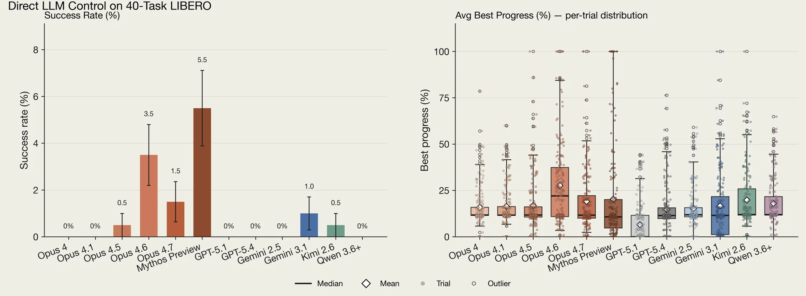

LIBERO 直接操纵成功率。

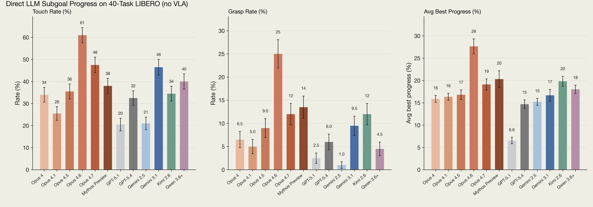

LIBERO 上每个子目标的进度受到直接控制。

在每次操纵尝试的中间阶段，改进最为明显。与 Claude Opus 4 和 Opus 4.1 相比，Opus 4.6 更有可能引导手臂到达目标物体，与其接触并抓住它。模型仍然相对很少掌握该项目，但后来的模型往往会在失败之前走得更远，并实现更高的总体任务进度，如通过简单的综合得分来衡量（详细信息请参阅附录）。有趣的是，尽管 Claude Mythos Preview 的触摸和抓握较少，但它完成任务的速度明显高于次优模型 Opus 4.6，因为后者比前者犯了更多的错误和调整。

尽管各代模型之间取得了巨大的进步，但完整任务的成功仍然很少见。最好的模型无法有意识地持续执行扩展任务。即便如此，他们影响物理世界的能力正在以明显的方式提高，并且在极少数情况下，他们确实取得了端到端的成功。这种能力水平也可能足以使它们成为机器人训练数据的有用来源，我们期望未来的工作能够探索这种可能性。

## 工具弥补了一些差距

当模型能够访问更高级别的抽象（预先训练的运动策略、VLA）时，性能会显着提高。但性能天花板仍然较低。

### 高水平运动

为了测试高级运动，我们让模型通过预先训练的操纵杆策略来控制四足机器人。它不发出扭矩，而是向步态策略发送速度命令（向前、横向、偏航），并定期接收前向 RGB 相机帧。这些策略广泛适用于大多数商用四足机器人。

我们构建了一套包含 11 个导航和空间推理任务的套件，范围从简单的目标搜索（find_x：走到带有蓝色 X 的桌子）到搜索、迷宫和路径点序列，到显式探测自我监控的任务（drift_detection：注意你的命令正在被悄悄损坏）和空间心理模型构建（explore_report：漫游竞技场，然后凭记忆回答布局问题）。其中一项名为 oneshot_course 的任务完全移除了摄像头，并为模型提供了一张自上而下的地图，要求其在一次拍摄中预先注册整个命令序列，从而将规划与感知隔离开来。每项任务都根据成功或标准化进度进行评分，我们报告所有 11 项任务的综合结果，范围在 0 到 100 之间（附录）。

**任务**

**描述**

查找x

找到并走到 25 英尺外的一张标有大蓝色 X 的桌子处，从随机标题开始。

视觉搜索

系统搜索一个 12×12 m 围墙竞技场，找到隐藏在遮挡物后面的红色球体；搜索效率得分。

颜色序列

按指定顺序访问多个彩色目标圆圈；测试工作记忆和顺序指令跟踪。

返回家

沿着彩色路径点沿着蜿蜒的路径到达目标，然后——在所有标记消失后——从记忆中返回原点；测试路径集成。

程序迷宫

仅使用前向摄像头，不使用地图，在程序生成的迷宫中导航。

隐形墙

实现看得见的目标，同时看不见的墙壁阻挡了直接路径；测试不完全感知下的自适应重新规划。

障碍路线

穿过一系列间隙宽度不同的墙壁；测试模型是否知道机器人的物理尺寸。

一次性课程

给定一张 L 形走廊的自上而下的 2D 地图，一次性预先注册整个命令序列（可选 N 次练习）。

漂移检测

循环巡逻四个航路点，同时注入系统命令漂移累积；测试闭环自我监控和补偿。

转弯校正

发出转弯，然后从转弯后帧中目视检测转弯不完整并发出修正。

探索报告

自由探索多区域围墙竞技场，然后凭记忆回答空间布局问题；测试空间心理模型的构建。

高级运动综合评估中所有 11 项任务的表格

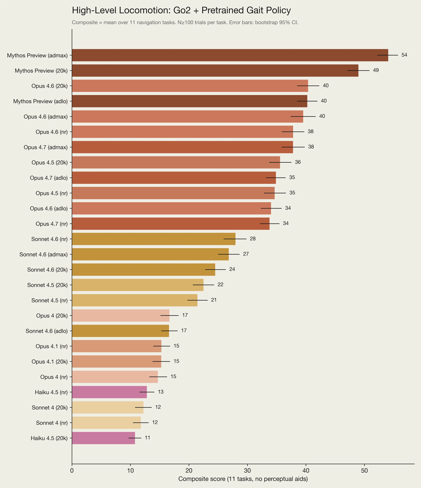

高级运动复合，所有模型 × 推理配置。NR表示不推理，20k表示20k思考代币预算，adlo表示自适应低，admax表示自适应最大值

模型生成过程中的两次明显跳跃，即从 Claude Opus 4.1 到 Opus 4.5 之间以及从 Opus 4.7 到 Mythos Preview 之间，高级运动得到了改善。Opus 4.5 到 Opus 4.7 处于一个稳定的阶段。

这个平台是平均的产物：在大多数单独的任务中，每个连续的Claude模型都会移动——只是在每个任务上并不总是朝着相同的方向移动。将 Opus 4.7 与 Opus 4.6 的最佳性能推理设置（逐个任务）进行比较，最大的单次下降发生在无形墙（3% 与 15%）上，其中模型必须围绕它看不到的障碍物重新规划。另一方面，Opus 4.7 在turn_ Correction 上获得+24 点，在return_home 上获得+11 点。我们将 Opus 4.6 到 Opus 4.7 的变化视为故障模式的转变，例如更好的闭环自我校正，以及遮挡下较弱的重新规划。

我们测试了几种工具，试图帮助模型进行视觉和方向理解，以及更普遍的感知。我们尝试为模型提供一个在其以自我为中心的视图上绘制的绿色中心十字准线、一个在其视图上进行 alpha 混合的半透明深度热图、一个取代前视图的第三人称追逐相机以及一个仅以度为单位给出模型方向的“指南针”。指南针工具轻松击败其他工具，稍后我们检查瓶颈时将对此进行详细说明。

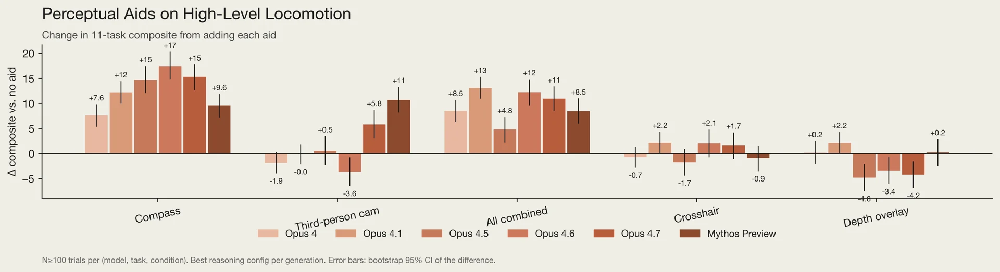

每个感知辅助的 HL 运动组合发生变化。

**要点：** 与预训练的步态配合使用，当前的模型可以完成简单的导航任务，但可以可靠地完成需要持续空间簿记或开环规划的任务。瓶颈主要是跟踪机器人的位置，少量信息可以纠正一些感知故障。

### 高级操纵

我们还评估前沿模型是否可以在操作设置中有效利用预训练的 VLA。我们的直接操纵结果表明，即使在快速改善的情况下，独立能力仍然有限。然而，一个本身能力有限的模型在与预训练策略结合使用时可能会变得更加有效。

为了研究这一点，我们将模型与来自 LIBERO 的相同操作任务的 VLA 策略配对。在这种情况下，VLA 提出低级操作，语言模型决定如何处理它们。它可以接受建议的操作、调整它或完全替换它。这带来了与直接控制截然不同的挑战，直接控制的核心挑战是决定接受哪些命令，哪些命令是错误的并且需要修改。我们在所有实验中都使用 MolmoAct VLA。

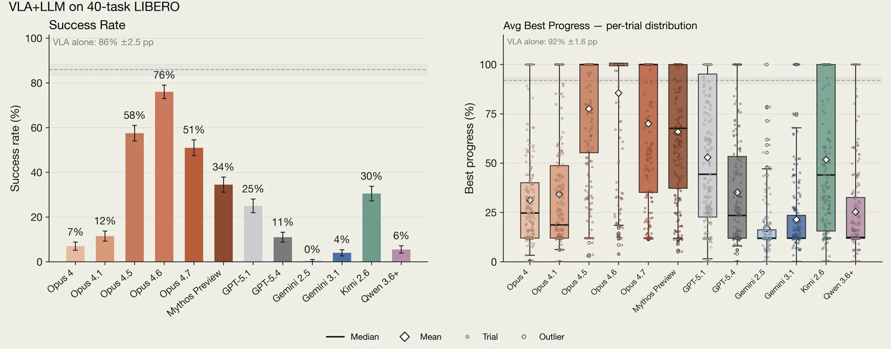

LIBERO-40 在 VLA 监督下取得成功。

在标准 40 任务 LIBERO 基准测试中，VLA 显着扩展了相对于直接控制的功能。即使较新的模型也很少在直接控制下完成端到端的 LIBERO 任务，尽管它们几乎总能取得一些部分进展。然而，当允许 LLM 代理通过发出指令并接受、修改或替换其提议的操作来指导 VLA 时，每个模型的任务成功率和总体进度都会大幅增加。通过这种增强，即使是较旧的模型也能实现有意义的成功率。

我们注意到，每个测试模型的性能仍然比 MolmoAct 本身的性能差很多。与直觉相反，对于最强模型来说，惩罚并不是最小的：Claude Mythos Preview 在这里表现不佳 Opus 4.5 和 Opus 4.6，因为它比应有的频率更频繁地覆盖 VLA，在简单推迟就能成功的情况下相信自己的判断。为了了解这种控制惩罚从何而来，我们测量了智能体简单地遵循 VLA 建议的操作的频率。仅当语言模型完全按照给定的方式沿着 Panda 手臂的完整 7 维动作传递时，我们才将命令视为遵循；任何编辑、替换或遗漏均视为偏差。这让我们能够查明 VLA 的普遍合理建议是否被忽视。

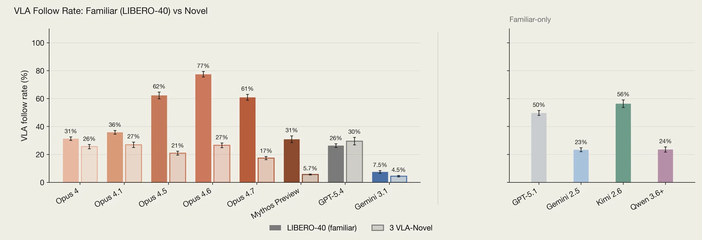

每个模型遵循 VLA 建议步骤的频率。

结果表明，Claude 系列模型总体上明显多于 GPT-5.4 和 Gemini 3.1 遵循 VLA 指令。它还表明，较新的型号 Opus 4.5 和 4.6 在 LIBERO 40 上所有测试型号中遵循最多的指令。

这些结果并不能让我们区分恭顺的模型和有品味的模型。为了评估这一点，我们测试了这些系统是否可以使用并可能纠正不可靠的 VLA。为此，我们创建了三个类似 LIBERO 的新任务，这些任务取自原始 LIBERO 目标场景，但未包含在基准测试中；在我们的基线试验中，MolmoAct 无法完成这三项任务中的任何一项。

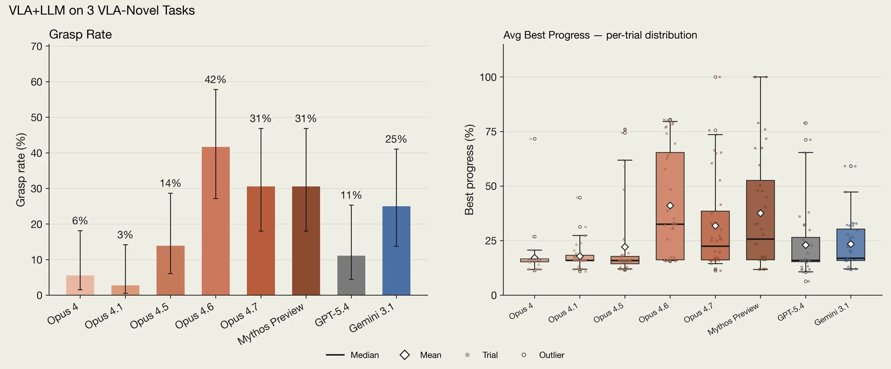

VLA 监督新颖场景的表演。

早期的 Claude 模型以及 GPT-5.4 继续相对紧密地遵循 VLA，即使在 VLA 的命令需要更正的情况下也是如此。相比之下，Opus 4.5、Opus 4.6 和 Opus 4.7 对它的遵从要少得多。他们更善于识别政策何时失败，即使他们还无法直接纠正这些失败。即便如此，Claude Opus 4.5 和 Opus 4.6 以及 Gemini 3.1 的性能仍优于单独使用 MolmoAct。有趣的是，在这种新颖的环境中，Opus 4 和 Opus 4.1 比 Opus 4.5 和 Opus 4.6 更频繁地遵循 VLA，但它们的整体性能仍然较差。最简单的解释是，他们较高的关注率并不反映更好的判断力。他们收听 VLA 的速率与在 VLA 实际有效的环境中的速率大致相同。他们在这里的行为基本上是不分青红皂白的。

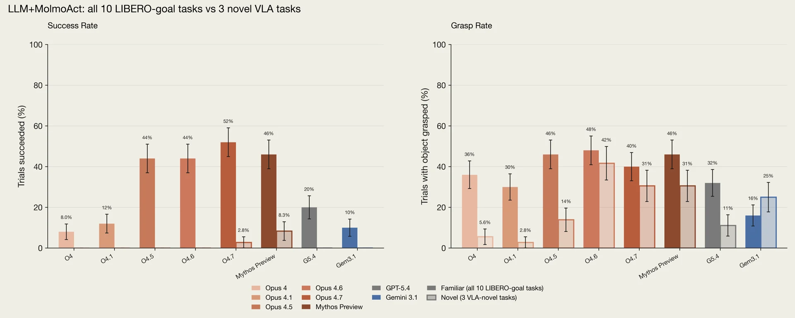

VLA 熟悉与新颖的触摸/掌握/位置率。

Opus 4.5、Opus 4.6、Opus 4.7 和 Mythos Preview 在 VLA 熟悉的任务上实现了最高的接触率、掌握率和成功率。然而，只有 Mythos Preview 也能够解决大部分新任务。

**要点：** 预训练策略可以极大地提高性能：高级控制比低级控制要好得多。较新的 Claude 模型更擅长使用预训练策略，而不会不必要地与它们对抗，并且当这些策略错误时模型的性能下降较少，但它们仍然没有像使用 VLA 那样有效地使用 VLA。在新任务上，最强大的模型可以为高层政策的表现提供小幅提升。从安全的角度来看，这很重要，因为预训练的策略正是部署的系统实际提供的：模型不需要驱动关节本身在世界上发挥作用，只需要访问有能力的控制器。单独测试模型的能力评估会低估模型嵌入机器人堆栈后的功能。

## 瓶颈是什么？

新型号的改进来自哪里？它们仍然面临哪些问题？

### 视觉感知是瓶颈吗？

在操作和运动方面，我们测试了额外的视觉输入是否可以提高性能。对于 Panda 手臂，我们添加了深度图、标记的分割叠加层和光标工具（夹具凸轮上的一个红色小 X，模型可以移动并查询该点的对象和距离）。对于 Go2，我们添加了混合在前向摄像机上的深度热图、图像上的绿色中心十字准线以及取代前向视图的第三人称追逐摄像机。

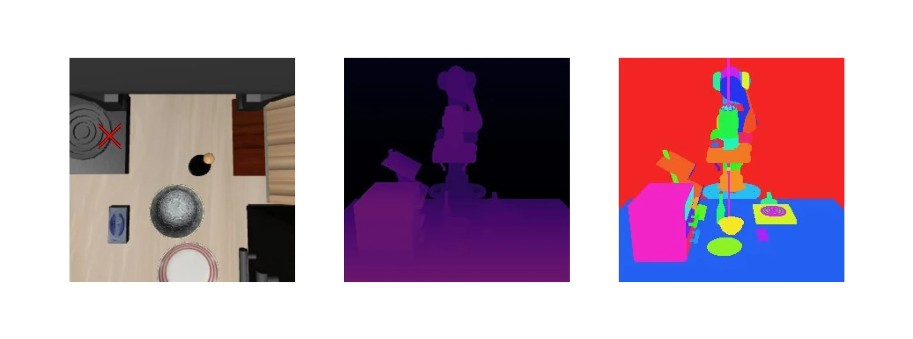

为操作模型提供的示例叠加：光标、深度图和分段掩模。

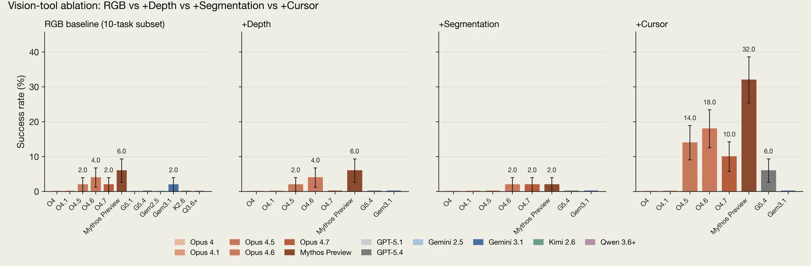

在每个视觉辅助下操作成功。

在操作上，深度图和分割叠加大致是中性的。它们传达了正确的信息，但信号似乎过于分散，无法提供可靠的帮助。在运动方面，深度热图和十字准线叠加同样接近中性，深度热图轻微损害了较强的模型。

第三人称相机是最依赖模型的辅助工具。它对 Opus 4.6 及更早版本没有任何作用或略有损害（Opus 4.6 下降了 3.6 分），但为 Opus 4.7 +5.8 和 Mythos Preview +10.7 提供了帮助，使其成为 Mythos Preview 的单一最佳视觉辅助。在任务级别，它有助于模型需要随着时间的推移跟踪自己的位置（颜色序列、漂移检测、不可见墙），但会损害任务依赖于前向视图的位置，例如转向校正。Mythos Preview 是个例外，甚至在turn_ Correction 上也有所改进。

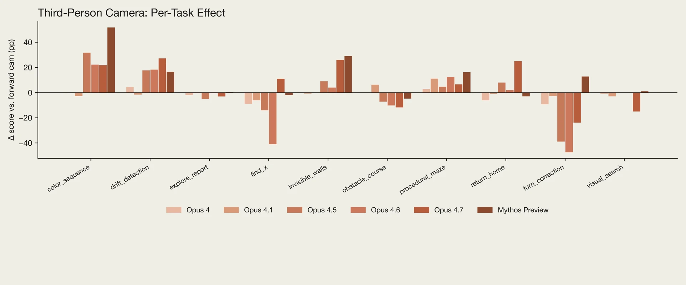

用第三人称相机替换前向相机以实现高级运动的每任务效果。

相比之下，光标工具使每个模型的操作都有很大提升——对于 Mythos Preview，10 任务子集的成功率从 6% 上升到 32%。指南针对于运动也有同样的作用，提升我们测试的每个配置。在这两种情况下，结果表明模型主要需要更好的方向，而不是不同的场景视图：告诉模型它面向哪个方向仍然比向其展示其自身的图片更有帮助。

我们还测试了实际图像相对于详细的文字描述提供了多少信息。为此，我们用我们测试的最强图像问答模型 Gemini 3.1 生成的文本描述替换了视觉输入。通过这种方式，我们可以看到当给定场景的强烈口头描述而不是像素时模型的表现如何。如果模型已经有效地使用视觉输入，我们预计这种替代会损害性能。

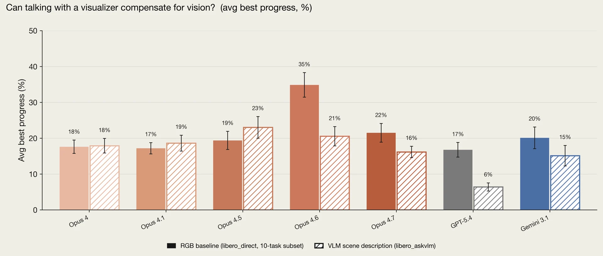

RGB 基线与请求单独的视觉语言模型 (VLM) 进行文本场景描述。

与更强的模型相比，旧模型的视觉感知受到更严重的限制。换句话说，新模型在直接从图像中提取空间信息方面要好得多。当图像被文本描述替换时，旧的 Claude 模型表现得更好，这表明它们无法仅从像素读取足够精确的空间细节。相比之下，Opus 4.6 和 Opus 4.7 在文本而非图像方面的表现稍差，Gemini 的下降幅度也更大。对于他们来说，原始视觉输入包含有用的信息，当场景被压缩为语言时，这些信息就会丢失。

我们测试的大多数附加视觉输入都没有帮助。第三人称视角支持 Opus 4.7 和 Mythos Preview；除了光标和指南针之外，其他视觉辅助工具总体上大致为中性或略为负面。Ask_vlm 比较显示，较旧的模型已经从原始图像中获得了更多的新模型。

### Vignettes：物理 Go2 上的视觉工具

在后面讨论的现实世界探索中，我们让 Claude Opus 4.6 控制物理 Go2 四足动物，并在基本导航任务（例如，在办公室周围完成一圈）期间打开一些视觉辅助工具。打开以自我为中心的十字准线后，我们可以在其推理中看到它使用中心标记来判断对齐。沿着稍微偏离轴线的走廊行走，它注意到走廊似乎向十字准线的左侧漂移，得出结论它可能面向太右，并进行了纠正。这些案例令人鼓舞。但十字准线有时似乎也会分散对障碍物的注意力。在一次运行中，机器人前面有一个小垃圾桶；模型认出了它，并自信地表示，因为罐子位于十字准线的左侧，所以它不碍事，可以安全地继续。事实上，垃圾桶就在狗的正前方。它走进去，一条腿被卡住，并把罐子拖了几米，然后我们才阻止它。

我们还在物理 Go2 上尝试了深度热图。使用计算机视觉模型，我们将估计的深度作为半透明热图叠加在以自我为中心的相机上，并进行调整，以便现实世界的对比度仍然可见并且机器人可以导航。有一些证据表明，该模型可以对热图颜色进行推理——其记录经常讨论视图中的颜色，并将它们与更近或挡路的物体联系起来。但在更繁忙的场景中——走廊转弯处有一些植物和办公室饮水机作为障碍物——模型显然很混乱。它忽略了可用的深度信息，转向障碍物而不是开放空间。

### 推理有帮助吗？

推理对我们的大多数结果影响不大，许多差异都在标准误差范围内。

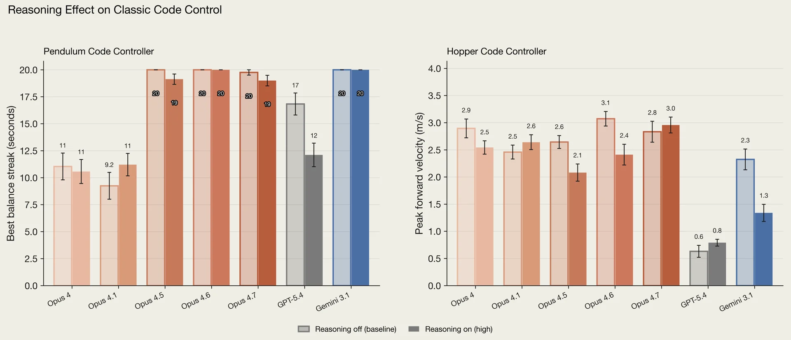

推理对经典控制任务的影响。

在经典的控制任务中，当给予更高的推理预算时，新模型会出现退化。这可能是由于对相对简单的实验进行了过度设计。对于旧型号来说，这似乎没有太大区别。

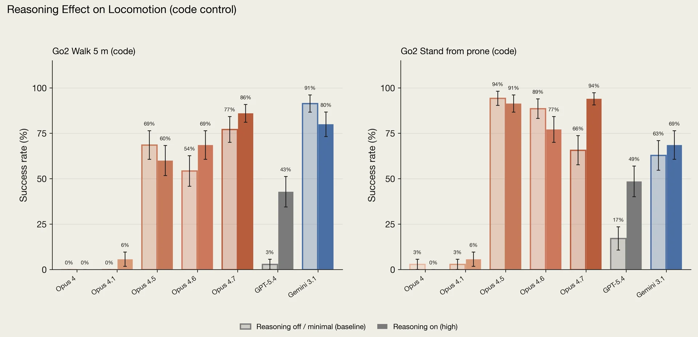

推理对运动的影响。

GPT-5.4（但没有其他模型）在运动测试期间从额外的测试时间计算中受益匪浅。对于大多数其他模型，我们理论上认为额外推理提供的规划好处似乎也会妨碍采取灵活的反应行动。

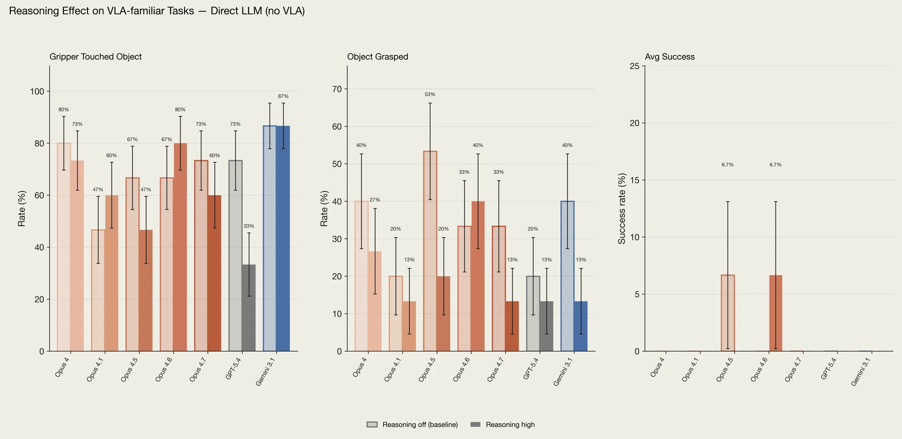

推理对直接操纵的影响。

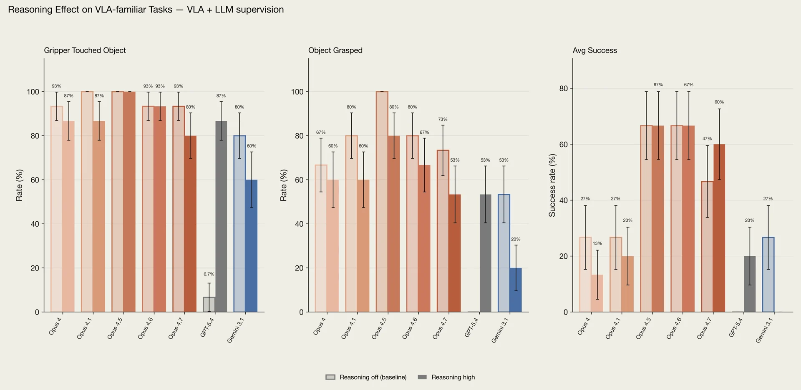

推理对 VLA 监督操作的影响。

在直接和高级操作方面，推理对任何 Claude 系列模型都没有重大影响，尽管它对 Gemini 3.1 和 GPT-5.4 影响显着。看看不同模型的结果，额外的推理似乎会造成伤害。

在高级运动方面，推理预算对于 Opus 一代来说影响不大。例如，在无推理、20k 预算和自适应最大方面，Opus 4.6 的得分在 2.6 分区间内 (37.8–40.4)，Opus 4.7 的得分在 4.0 分区间内。一个一贯的失败者是自适应低，它在几乎所有支持它的模型上都表现不佳。Mythos Preview 是个例外，它在配置中的分布接近 14 点（自适应低时为 40.2，自适应最大值时为 54.1），并且它是唯一一个通过额外推理产生与感知辅助相当的增益的模型。

我们没有看到强有力的证据表明推理改变了模型使用感知辅助工具的方式。需要做更多的工作来理解为什么额外的推理对某些模型有帮助，以及它是否可以释放已经潜在的能力。

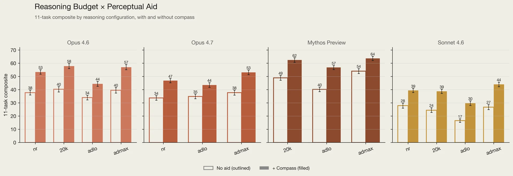

按模型提升援助——推理是否会改变哪些援助有帮助？

这些发现表明，在当前一代模型中，仅靠额外推理不太可能克服目前阻止模型执行一般低水平机器人技术的缺陷。虽然某些模型受益于额外的推理，但各代之间能力的飞跃是由其他技能组成的，例如更好的视觉、数字一致性或 3D 理解。

### 他们可以从经验中学习吗？

是的——但大多是短期的。

虽然众所周知，语言模型在少镜头设置下表现更好，但这并不意味着它们可以从长上下文机器人实施例设置中学习，长上下文机器人实施例设置可以跨越数百张图像和数十万个标记。

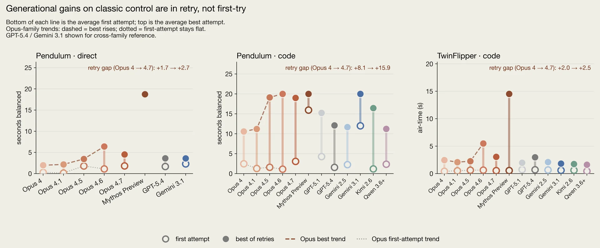

经典控制的代际收益来自重试，而不是第一次尝试。

情境学习最有力的证据来自经典的控制任务。后来的Claude模型并没有通过更强大的开始来取得领先——几乎所有的第一次尝试都表现不佳，只有少数例外。相反，他们通过从失败的尝试中学习并执行更好的控制来改进。Opus 4.5 和 Opus 4.6 从迭代中受益比 Opus 4 和 Opus 4.1 更多。新版本的Claude能够更好地从失败的尝试中学习，修改他们的方法，并找到可行的解决方案。

长视野机器人交互需要的不仅仅是正确选择下一个动作。尽管我们研究的任务原则上主要是马尔可夫式的，但成功的表现仍然需要数百个或更精确的命令。在实践中，系统使用这种扩展的交互来了解任务的行为方式并过滤掉无效的策略。

我们进行了一项测试，以了解模型是否可以在试验过程中建立更丰富、更长期的理解。我们通过操作中的上下文截断实验来检查这一点，其中我们故意删除大部分先前的交互，并只为模型留下一个小得多的最近行为和观察的窗口。如果表现取决于对整集的详细记忆，这应该会导致大幅下降。在大多数情况下，事实并非如此。在某些情况下，性能甚至有所提高。这表明这些模型更多地依赖于最近的过去，而不是对之前发生的一切的广泛积累的理解。

在这些截断运行中，我们始终保留前 10 圈加上最近的 N 圈。放弃第一回合会导致模型忘记基本约定和循环，因此我们在所有条件下都保留它。

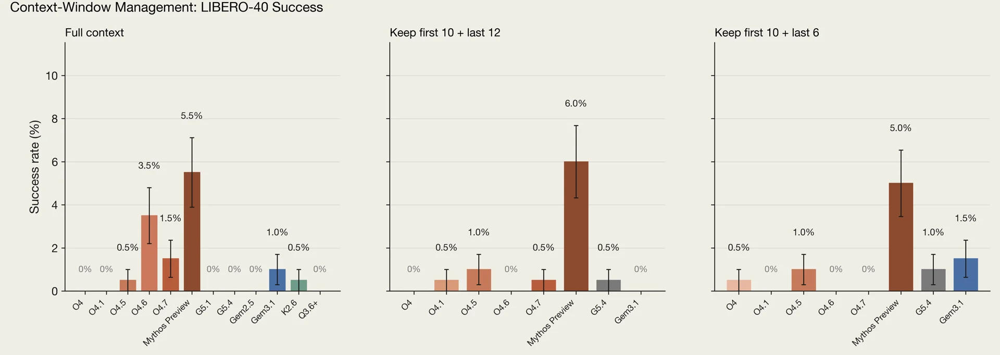

LIBERO-40 在上下文截断下成功。

只有 Opus 4.6 显示出统计上显着的性能下降。值得注意的是，Claude Mythos Preview 通常是我们测试中最强的模型，但准确性并没有明显下降。我们怀疑 Opus 4.6 正在不断学习由于上下文丢失而忘记的行为模式，而 Claude Mythos Preview 可以开箱即用地利用这些策略。较弱的模型可能会被早期的上下文所困扰，这种现象被称为“上下文腐烂”，这解释了为什么当上下文被截断时性能会提高。这些模型无法从遥远的过去学习，因此删除它可以增强性能。

我们之前看到，较新的 Claude 模型更有可能在失败后改变策略，这推动了它们的部分性能提升。上下文截断结果表明这种适应大多是短程的。模型确实会重新构建和调整，但它们似乎主要基于最近的几个步骤，而不需要制定在整个情节上建立的长期运行策略。特别是，交互中更早的操作似乎并不重要，删除它们对性能的影响很小。

我们还看到了高级运动短期学习的证据。在 oneshot_course 任务中，模型必须查看 L 形走廊的简单自上而下地图，并在开始之前规划全套移动命令。没有摄像头输入，也没有机会一路调整。如果没有实践，模型通常会很困难，这表明仅靠基本的地图阅读无法解决该任务。它需要将地图变成一次就能发挥作用的行动计划。

当我们给模型在同一课程上进行几次练习时，性能会全面提高。表现的主要区别在于他们学习的速度。Mythos Preview 仅在一个示例后就达到了强劲的性能，而 Opus 经过多次尝试后逐渐得到改善。即使是较小的模型也可以通过足够的练习来学习该课程。总体而言，这表明从一些上下文示例中学习的能力广泛存在，但 Mythos Preview 脱颖而出，因为它需要很少的练习才能很好地使用这些信息。

对于更难、更长的课程，练习没有帮助。在这些试验中，Mythos Preview 和 Opus 4.7 都没有完成一次试验，即使进行了 20 次练习。这些模型正在学习特定的序列，但还不是通用规划器。

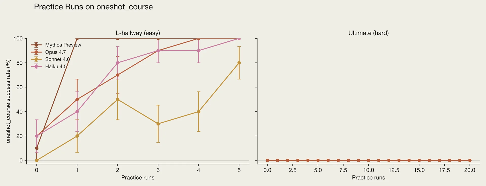

在 oneshot_course 上进行练习：简单课程（左）与困难课程（右）。

### 现实世界的小插曲

上面的视觉工具插图已经使用了物理 Unitree Go2。本节报告了我们在该机器人上运行的其余现实世界。尽管由于现实世界中工作的连续性，我们无法实现高 N 数试验，但我们的探索总体上与我们的模拟结果一致，但阐明了一些有趣的失败案例，这些案例都围绕着不良的视觉和空间推理。

首先，我们能够重新实现 find_x 任务。在此任务中，四足动物被放置在约 25 英尺处，并面向 180 度远离翻转的桌子，桌子上有一个大的蓝色 X。模特们被要求找到桌子并一直走到桌子前（至少一米的距离内）。在模拟中也发现了最常见的失败情况，即许多模型会在距离成功完成任务所需的 1 米距离之外停止。此外，旧模型无法在到达目标物体的途中纠正航向。此任务的所有模型的共同行为是模型会旋转，直到看到框架中的桌子，然后继续前往桌子。较旧的模型不会准确地对齐自己并错过桌子，通常会说服自己自己正在路上，或者没有意识到桌子急剧地偏向一侧或另一侧，并达到了一个点，即他们离桌子越来越远，但声称离桌子更近了。find_x 现实世界复制中的一个失败是 Grok 4.1 Fast 的测试。在这种情况下，Go2 的放置方式是面向桌子对面的玻璃门；格罗克在玻璃门的倒影中看到了目标台，开始冲向玻璃门。值得庆幸的是，机器人在门或本身受到任何损坏之前被阻止了。

此外，一个非正式的基准是要求一个模型控制 Go2 并让它绕着办公室走廊完成一圈（仅用视觉）。无论我们使用的各种工具和模型以及我们试图赋予模型的优势如何，所有模型都未能完成这项任务。这种故障模式主要是由视力和记忆故障引起的。有时，模型在经过另一条走廊的开口时根本无法判断何时该转弯。其他时候，它认为自己已经进入了走廊，并认为自己已经走进了走廊，但事实上它并没有；它试图再次转向或走错方向。即使模型可以转动走廊，有时模型会超出或低于转弯范围，变得混乱，并且通常最终会朝相反的方向行驶。

## 结论

我们的实验套件显示，各代模型的机器人任务得到了快速（尽管不平等）的改进。较新的Claude模型更擅长将感知和推理转化为跨许多实施例的物理行为。直接力和扭矩控制正在改进，但速度比更高级别的控制要慢。

这项研究具有明显的安全意义。VLM 对现实世界的影响可能会发生几个数量级的变化，具体取决于它所访问的信息。评估和部署需要将访问级别视为系统的核心部分，因为工具或控制的微小变化可能会产生能力的巨大变化。

我们希望这些结果能够指导两个方向的工作。从建设性的角度来看，模型可以帮助机器人调试故障、监督现有控​​制器并生成有用的训练数据。在安全方面，我们需要更好的方法来授予具有明确限制的物理访问权限，以便系统可以影响某些对象，同时阻止其他对象。

## 附录

本附录总结了评估背后的实际细节：我们使用了哪些模型 API、我们运行了多少次试验、如何构建提示、延迟如何影响设置以及强化学习的运行方式。

### 模型和 API

我们评估了五个提供商的十二个模型，其中四个是通过 OpenRouter 进行的。为了保持跨提供商的评估工具相同，我们为每个后端编写了一个小型适配器。适配器处理特定于模型的 API 调用，但机器人任务、提示和评分代码保持不变。

**型号**

**提供商**

**适配器**

Claude作品 4.7

人择

`claude_agent_sdk`

Claude作品 4.6

人择

`claude_agent_sdk`

Claude神话预览

人择

`claude_agent_sdk`

Claude作品 4.5

人择

`claude_agent_sdk`

Claude作品 4.1 / 4

人择

`claude_agent_sdk`

GPT-5.4

通过 OpenRouter 的 OpenAI

`openrouter`

GPT-5.1

通过 OpenRouter 的 OpenAI

`openrouter`

Gemini 3.1 专业版预览

谷歌通过 OpenRouter

`openrouter`

双子座2.5专业版

谷歌通过 OpenRouter

`openrouter`

基米K2.6

通过 OpenRouter 进行登月计划

`openrouter`

奎文 3.6+

阿里巴巴通过 OpenRouter

`openrouter`

一些实现细节对于可重复性很重要：

- **Claude模型。** Claude 模型通过 Anthropic Agent SDK 运行。在评估过程中，我们禁用了 SDK 的内置工具，只公开了我们的机器人动作服务器。这使得 Claude 的可用操作与 OpenRouter 和 Gemini 运行保持一致。
- **推理设置。** 较新的 Claude 模型使用了 Anthropic 的自适应推理设置，其中模型选择要花费多少推理预算。旧的Claude模型使用固定推理预算。所有其他模型均使用等效的高推理设置。
- **打开路由器设置。** 某些 OpenRouter 型号不支持真正的“无推理”模式，因此我们为这些供应商使用了最接近的可用设置。Kimi K2.6 被固定到 Novita 提供商，因为其他路线使用较低精度的版本。对于 OpenAI 模型，我们排除了 Azure 提供商，因为它默默地将请求限制在 50 个图像。

### 审判计数

“单元”是指在一种实验设置下评估的一个模型。大多数单元使用了 35 次试验，但当任务噪音较大或我们需要更严格的估计时，某些设置会使用更多试验。

**每个模型和单元的试验**

**细胞**

**为什么**

35 次试验

经典控制直接/代码单元、运动直接/代码单元、RL 单元和 Hopper 代码+视觉

足以比较总体趋势，同时保持在计算限制之内

50 次试验

Mythos Preview 和 Opus 4.7 重播的一个子集

用于需要更严格估计的密切代际比较

200次试验

LIBERO-40 直接、LIBERO-40 VLA+LLM、LIBERO-40 上下文截断

LIBERO-40 有 40 个任务 × 5 个种子，提供更稳定的总成功率

50 次试验

LIBERO 工具消融

10 个任务子集 x 5 个种子

36 次试验

三部小说VLA

3 个任务 × 12 个种子。因为这个值很小，所以我们报告置信区间

100 次试验

高级运动套件

用于十一个任务套件和六个感知辅助条件中的每个模型和条件

### 提示

我们没有为每个模型单独调整提示。每个界面使用一个固定的提示模板。在试验期间，模板填充了特定于任务的详细信息，例如关节计数、机器人质量、力限制和观察视野。

**代码控制**

在代码控制中，模型编写一个Python控制器，通常是以下形式的函数 `controller(obs) -> action`，然后运行它。

**VLA监督操纵**

在这种情况下，预训练的视觉语言动作策略提出机器人手臂动作，语言模型决定是否接受、编辑或替换它们。

**强化学习监督**

在此设置中，模型编写奖励函数、策略网络和训练计划。然后它训练并部署策略。

## 延迟

我们没有进行正式的潜伏期研究。实验使用共享基础设施，API 延迟因提供商、负载、图像计数和推理预算而异。尽管如此，启动日志还是提供了有用的粗略图片。

- **不讲道理**，大多数纯文本转弯大约需要 2-8 秒。对于一两张图像，该时间通常会增加到 5-15 秒。
- **有道理**，延迟在很大程度上取决于推理预算。对于高推理的 Opus 4.6 和 4.7，典型的转弯需要 15-60 秒，较长的尾部需要 60-180 秒。超高推理速度平均慢两倍。
- **全单元运行时间** 差异很大。35 次试验的直接或代码单元通常需要 30-90 分钟（不带推理）和 1-4 小时（带推理）。每个模型和条件的 LIBERO-40 直接运行需要 6-12 小时。LIBERO-40 VLA+LLM 运行需要 8-18 小时，因为它们还需要 GPU 推理来进行 MolmoAct。对于经典对照，RL 细胞的上限为 1.5 小时，对于 G1 和 Go2 的上限为 4 小时。

对于直接控制和代码控制模拟，我们在模型产生下一个动作时暂停模拟器。如果不暂停，当前的 API 模型将因一个微不足道的原因而失败：对于以 10-125 Hz 运行的物理循环来说，它们的运行速度太慢。通过暂停，我们可以衡量如果推理速度更快的话模型可以做什么，而不仅仅是衡量当今的 API 延迟。

机器人手臂不需要像运动那样严格的实时稳定性，因此我们没有在操作设置中的模型调用之间暂停模拟器。

### 强化学习细节

强化学习界面使用了实时 PPO 训练路径 `envapi/training_bridge.py:train_ppo_batched`。PPO 是一种标准的强化学习算法。

该模型可以定义奖励函数、策略网络和训练计划。然后它可以调用培训和部署工具。

#### 环境

我们使用了 GPU 支持的批处理 MuJoCo 环境，称为 `BatchedEnvWarp`。这使得模型可以并行训练多个模拟副本。

#### 默认训练设置

该模型可以更改护栏内的这些设置，但默认设置为：

**设置**

**默认**

每个环境的推出长度

`n_steps = 256`

批量大小

`batch_size = 64`

每次更新的训练周期

`n_epochs = 4`

折扣系数

`gamma = 0.99`

GAE λ

`gae_lambda = 0.95`

PPO夹子范围

`clip_range = 0.2`

学习率

`learning_rate = 3e-4`

熵系数

`ent_coef = 0.01`

价值损失系数

`vf_coef = 0.5`

最大梯度范数

`max_grad_norm = 0.5`

优化器

亚当

#### 限制和保障措施

- 默认情况下，该工具暴露多达 32 个并行环境。
- 策略网络的参数上限为 200,000 个。
- 一次培训通话所消耗的时间不能超过三分之一。
- 系统预留了最后120秒的策略部署时间。

#### RL细胞

RL 路径用于：

- 摆锤 RL
- 料斗RL
- 双脚蹼 RL
- G1 支架 RL
- Go2 站立 RL

经典对照 RL 细胞有 1.5 小时的超时时间。人形和四足 RL 细胞有 4 小时的超时时间。

### 视觉输入

启用视觉后，线束会将 JPEG 编码的 RGB 帧发送到模型。

#### 图片格式

帧在 MuJoCo 中离屏渲染并编码为 JPEG。每个提供商都收到其原始格式的图像：

- 人为图像块
- OpenAI风格 `image_url` 带有数据 URI
- 双子座内嵌图像部件

#### 每回合帧数

默认线束设置允许每回合使用三个帧，但所有已发布的单元格每回合使用一帧。

#### 保留先前的帧

所有发布的视觉单元都将先前的帧保留在上下文中。这是 Claude Agent SDK 在视觉上运行所必需的，因为该 SDK 路径不支持依次删除较旧的图像。

### 视觉工具

我们还测试了几种改变模型接收到的视觉信息的方法：

- `--vision-depth`：添加深度热图叠加
- `--tools segmentation`：添加标记分割图
- `--crosshair --gripper-cam`：在抓手相机上添加交互式光标（以前称为十字准线）
- `--vision-mode ask_vlm`：用 Gemini 3.1 Pro Preview 中的自然语言场景描述替换像素

对于高级运动套件，除了基线前向摄像头之外，我们还测试了五种感知辅助条件：

- `compass`：机器人的世界坐标系航向（以度为单位），作为文本附加在每个坐标系旁边
- `crosshair`：在前向摄像头图像上绘制的绿色中心十字准线
- `depth`：在前向相机图像上进行 alpha 混合的半透明深度热图
- `third_person`：前方摄像头被替换为位于机器人后方和上方的第三人称追逐摄像头
- `combo`：所有四种辅助手段一起应用

“询问 VLM”设置增加了延迟，因为每个视觉查询都需要额外的模型调用。它还降低了最强模型的性能，这表明这些模型正在使用原始图像中的信息，而这些信息在场景转换为文本时丢失了。

### 计算设置

所有实验都在 SLURM 管理的集群上运行，SLURM 是一种用于调度大型计算作业的通用系统。

- **直接控制和代码控制单元** 使用仅 CPU 的节点，通常具有 16 个 CPU、48 GB RAM 和 24 小时墙时间限制。
- **VLA细胞** 每个作业使用一个 GPU 进行 MolmoAct 推理，并为模拟器使用 CPU 渲染。
- **RL细胞** 每个作业使用一个 GPU。经典对照 RL 跑步的训练时间为 1.5 小时。G1 和 Go2 RL 跑步有 4 小时的训练时间。
- **渲染** 通过幕外 MuJoCo 使用 `osmesa`, 与 `MUJOCO_GL=osmesa` 和 `PYOPENGL_PLATFORM=osmesa`.

所有脚本都禁用旧版Claude模型重新映射，加载项目虚拟环境，加载环境变量，检查 `libosmesa6` 已安装，并通过 `--no-sdk-tool-only` 用于 Claude SDK 运行。

### 再现性

该代码一旦发布，将在 `github.com/safety-research/embody`，存储库的公共镜像。每个评估单元的命令列于 `EXPERIMENTS.md`，得分记录在 `METRICS.md`.
