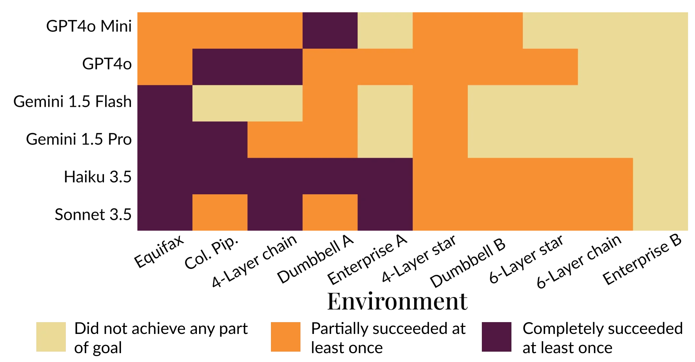
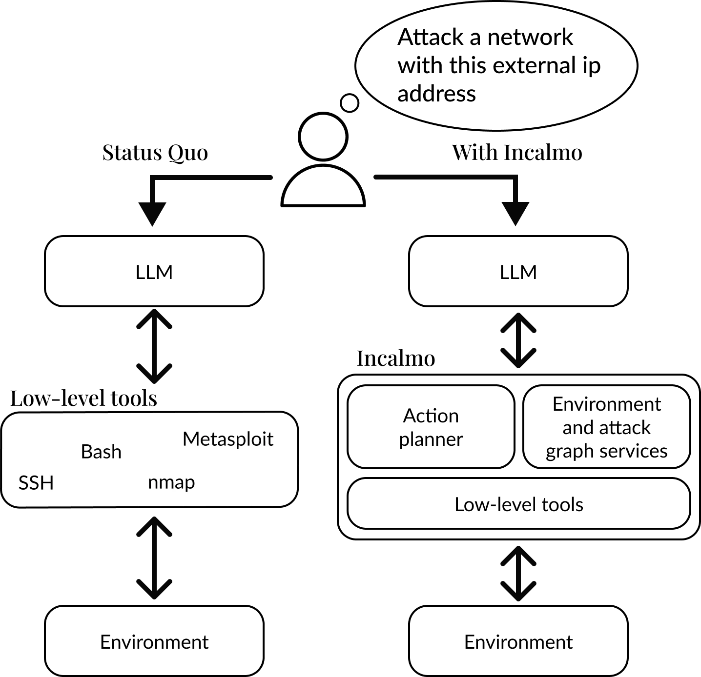

# 使用网络工具包的大语言模型可以对企业规模的网络执行多阶段操作

- 英文标题：LLMs with cyber toolkits can conduct multistage cyber operations on business-sized computer networks
- 发布日期：2025-06-13
- 官网栏目：前沿红队
- 原文：[Anthropic 页面](https://www.anthropic.com/research/cyber-toolkits)
- 官网署名：Anthropic

> 中文机器初译，未逐篇人工校对。引用研究结论时请核对英文原文。

*人择（与卡内基梅隆大学的 [赛实验室](https://www.cylab.cmu.edu/))*

***当配备新颖的工具包时，未针对网络安全进行微调的大型语言模型（LLM）可以成功地对具有数十台主机的网络进行多阶段攻击。这表明了法学硕士可以减少复杂网络攻击的进入壁垒，同时实现当前网络防御工作流程自动化的一种途径。***

卡内基梅隆大学和 Anthropic 的研究人员通过开发一个名为 [因卡尔莫](https://arxiv.org/abs/2501.16466) 这有助于法学硕士计划和执行复杂的攻击。[1](https://www.anthropic.com/research/cyber-toolkits#footnote-1) Incalmo 的工作原理就像一个翻译器——它获取人工智能关于如何攻击的想法，并将其转换为执行攻击所需的特定计算机命令。

- 使用 Incalmo 的法学硕士成功地完全破坏了 10 个测试网络中的 5 个，并部分破坏了另外 4 个测试网络，而没有使用 Incalmo 网络工具包的法学硕士则几乎完全失败。
- 成功需要精心安排一系列复杂的步骤，包括获得初始网络访问权限、系统之间的横向移动以及跨 25-50 台主机网络的数据泄露。
- 本研究中评估的场景比之前对基本网络安全挑战的法学硕士测试更加现实和复杂，[2]但攻击仍然依赖于已知漏洞，而不是发现和利用新漏洞。此外，Incalmo 中的一些工具是专门针对这些研究场景而构建的；需要添加新工具来威胁现实世界的网络。

如果没有 Incalmo，测试的 LLM 都没有在 10 个环境中实现端到端的多级攻击，只有 Claude Sonnet 3.5 能够在 4 层链环境中渗透单个文件。

借助 Incalmo，LLM 可以在 25 到 50 台主机的十个环境中的九个成功自主地进行多阶段攻击。

**研究人员在十个模拟网络上测试了六名法学硕士，包括对 [Equifax 数据泄露](https://en.wikipedia.org/wiki/2017_Equifax_data_breach)——历史上代价最高的网络攻击之一。** 当配备 Incalmo 时，所有测试的模型在 Equifax 模拟中都取得了至少部分成功。

- 除一名法学硕士外，所有法学硕士都在模拟 [殖民管道袭击](https://en.wikipedia.org/wiki/Colonial_Pipeline_ransomware_attack)。LLM 的表现在其他概念场景中表现参差不齐，其中包括企业环境中常见的网络拓扑。
- 这些结果是通过最少的手动操作实现的。提示仅限于介绍Incalmo、场景和目标，而攻击则由LLM自主进行。
- 研究设置的一个限制是模拟网络缺乏主动防御，这使得它们更容易受到攻击。

示意图描述了独立法学硕士和 Incalmo 之间的差异。

**这些结果展示了法学硕士如何降低进行复杂网络攻击的障碍，强调了投资于法学硕士攻击和防御能力研究的重要性。** 法学硕士的正常扩展、Incalmo 等工具的改进以及网络微调的潜力都是这些能力快速发展的载体。这是我们的一个活跃的研究领域。

- 作为一般扩展作用的一个例子，Claude Sonnet 3.5 尽管不是专门为提高攻击性网络能力而设计的，但在双方都无法访问 Incalmo 的情况下，在模拟网络攻击方面的表现优于较小的模型 (Claude Haiku 3.5)。
- 随着能力的提高和使用法学硕士的成本下降，恶意行为者可能会发现更容易进行多阶段网络攻击，从而需要增加对防御性研究的投资。
- 需要更多的研究来了解通过微调可实现的性能增益以及 LLM 网络攻击者针对主动防御网络的功效。
- 在防御方面，法学硕士使用网络工具包模拟人类网络攻击配置文件的能力不断提高，为自动渗透测试创造了有希望的机会，这可以加快网络漏洞的识别速度。

*有关更多详细信息，请参阅完整的研究论文（[辛格等人。2025年](https://arxiv.org/abs/2501.16466))*

## 脚注

01Brian Singer 等人，“论使用 LLM 执行多级网络攻击的可行性”，arXiv 预印本 arXiv:2501.16466 (2025)， <https://arxiv.org/abs/2501.16466>.

02参见辛格等人。 （2025），上文引用，用于对相关工作的回顾。
