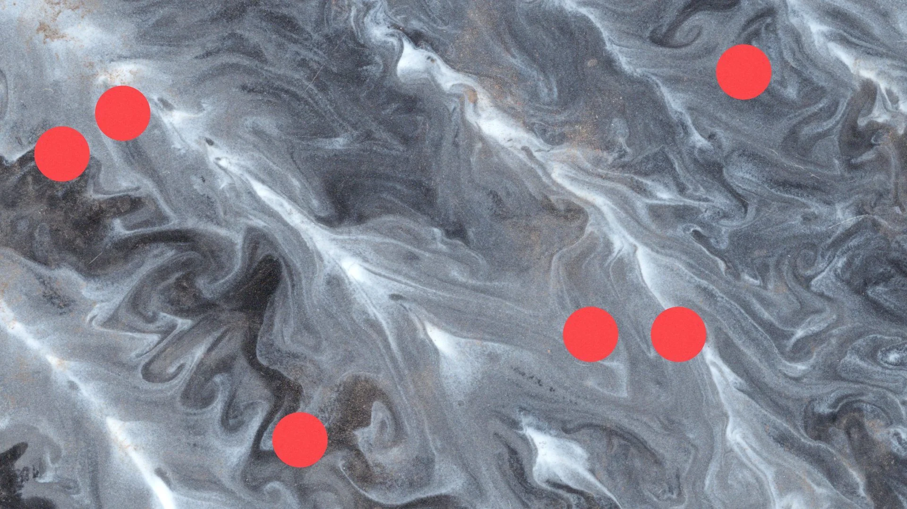

# 用 Claude 发现密码学弱点

- 英文标题：Discovering cryptographic weaknesses with Claude
- 发布日期：2026-07-28
- 官网栏目：前沿红队
- 原文：[Anthropic 页面](https://www.anthropic.com/research/discovering-cryptographic-weaknesses)
- 官网署名：Anthropic

> 中文机器初译，未逐篇人工校对。引用研究结论时请核对英文原文。

## 总结

*Anthropic 的研究人员利用 Claude Mythos Preview 发现了攻击加密算法（用于保持在线数据私密性的数学方法）的改进方法。第一次攻击显着削弱了 HAWK，这是一种专为后量子世界构建的数字签名方案。第二个确定了攻击舍入减少 AES（最广泛使用的对称密码）的新方法。这些都是重大的研究进展，但它们目前不会影响任何生产系统。这篇文章更详细地描述了这两项发现，并讨论了强大的人工智能模型时代对密码学的影响。*

## 简介

当我们推出 Claude Mythos Preview 时，我们证明它能够自主查找和利用我们指出的几乎所有软件中的漏洞。其中包括几个主要的加密库——用于加密数据的共享代码集合。

Claude在这些密码库中发现的漏洞[1](https://www.anthropic.com/research/discovering-cryptographic-weaknesses#footnote-1) 是由于不正确的 *实施* 算法的错误——也就是说，程序员在代码中使用算法的错误为攻击者破解加密创造了机会。

现在，我们发现Claude能够发现数学缺陷 *在算法本身*.

加密算法是数字安全的基本组成部分。例如，当您访问类似的网页时 [https://www.anthropic.com](https://anthropic.com)，您的浏览器使用一种称为 a 的算法检查它是否正在与真实的网站进行通信 *数字签名方案*。随后，您和网站之间的流量将使用以下方式进行加密： *对称密码*—允许共享相同密钥的各方之间安全数据传输的代码。如果没有像这样的安全加密系统，您的电子邮件、网上银行和其他互联网使用就会向网络犯罪分子开放，他们可能会拦截或修改您的通信。这些广泛使用的加密系统中的缺陷可能会使数十亿用户的数据面临风险。

我们在这篇文章中描述的第一个结果是通过 Claude Mythos Preview 发现的，是针对称为 [鹰](https://csrc.nist.gov/csrc/media/Projects/pqc-dig-sig/documents/round-1/spec-files/hawk-spec-web.pdf)。2022 年，美国政府 [美国国家标准技术研究院](https://www.nist.gov/) (NIST) 推出了 [打电话](https://csrc.nist.gov/projects/pqc-dig-sig/round-3-additional-signatures) 即使针对量子计算机也能保持安全的其他加密系统（如果开发出来，可能会破坏当今使用的大多数现有签名方案）。HAWK 是本次电话会议考虑的第三轮候选人之一。尽管 HAWK 在两年内通过了两轮专家人工审查，但 Mythos 仍能够在短短 60 小时的工作时间内改进对其最著名的攻击，有效地将其关键强度削减了一半。

第二个结果涉及 [高级加密标准](https://www.nist.gov/publications/advanced-encryption-standard-aes) (AES)，一种对称密码，于 2001 年被 NIST 采用，比几乎任何其他加密算法都受到了更多的审查。为了更好地理解 AES 的鲁棒性，密码学研究中经常研究该算法的较弱变体； Mythos 找到了一种方法来破解此类较弱的版本，并消除了攻击者需要做出的猜测，将之前最佳攻击的速度提高了 200-800 倍。

需要明确的是，这些结果对当今的计算机系统都没有实际影响。生产软件无需因此而改变。HAWK只是一个 *候选人* 签名方案等未部署；[2](https://www.anthropic.com/research/discovering-cryptographic-weaknesses#footnote-2) 我们的第二次攻击是针对 AES 的简化版本，并且不会破解完整的密码。[3](https://www.anthropic.com/research/discovering-cryptographic-weaknesses#footnote-3)

尽管如此，这两项结果都表明，前沿人工智能模型有潜力帮助发现重要加密算法在实际部署之前和之后的缺陷。这是密码学研究的预期成果：对算法进行压力测试以建立信任并最终使系统更加安全。

Mythos Preview 大部分是自主实现的，并且大部分无需人工干预。在一周的时间里，一位人类研究人员与 Claude 合作开发了 HAWK 攻击，另一位研究人员搭建了一个脚手架[4](https://www.anthropic.com/research/discovering-cryptographic-weaknesses#footnote-4) 这使得 Claude 能够完全自主地发现 AES 攻击。[5](https://www.anthropic.com/research/discovering-cryptographic-weaknesses#footnote-5) 每个结果的开发 API 成本大约为 100,000 美元。看到这些结果后，我们扩大了搜索范围并开始发现其他攻击。我们在下面讨论其中一些后续措施。

为了让其他人更容易地继续研究法学硕士的密码分析能力，我们与苏黎世联邦理工学院、特拉维夫大学和柏林工业大学的学者合作建立了 [密码分析平台](https://arxiv.org/abs/2607.18538)，一个将许多加密密码打包在一起的基准，使其他人可以轻松评估法学硕士在这个重要主题上的能力。

在整个研究过程中，我们遵循负责任的披露程序，并咨询学者以确认我们研究结果的有效性。我们还与美国政府和行业合作伙伴分享了预发副本，并就这项研究的影响进行了讨论。就我们的 HAWK 发现而言，我们在 6 月份与 HAWK 的作者分享了我们的攻击，并在我们的结果发布的同时向公共 NIST 邮件列表进行了协调披露。

在这篇文章的其余部分，我们进一步总结了这两个发现的技术细节，并简要描述了我们最近的其他一些密码学结果。两篇新论文提供了这两项主要发现的完整描述，我们希望在不久的将来发布其他发现的详细信息。

## 改进的 HAWK 密钥恢复攻击

一位 Anthropic 研究人员与 Mythos Preview 合作开发了一种针对 [鹰](https://hawk-sign.info/) 后量子数字签名方案。这种攻击大大加快了破解签名方案所需的时间——从技术上讲，它将“有效密钥大小”减少了两倍。在 [我们的论文](https://anthropic.com/document/hawk_key_recovery.pdf)，我们提供结果的完整技术细节，包括 [演示代码](https://github.com/anthropics/cryptography-research-demo) 这表明我们的攻击正在运行。

HAWK 是 NIST 征集的剩余第三轮候选人之一 [附加数字签名](https://csrc.nist.gov/projects/pqc-dig-sig/round-3-additional-signatures)。此次竞赛是近十年来标准化新产品的努力的一部分 [后量子密码学](https://csrc.nist.gov/Projects/post-quantum-cryptography/post-quantum-cryptography-standardization) （PQC）计划。作为构建与密码相关的量子计算机的前景，这种标准化工作变得至关重要 [缩小](https://blog.google/innovation-and-ai/technology/safety-security/cryptography-migration-timeline/) 并威胁到 RSA 或 ECDSA 等经典密码学。

HAWK 的安全性基于称为格子同构问题的数学问题的难度。Mythos 的攻击原理是在 HAWK 使用的晶格中找到一种特定的、以前未被利用的对称性，称为非平凡自同构。 [之前的工作](https://eprint.iacr.org/2025/928) 证明有效地找到这样的自同构将允许攻击，但没有回答这样的自同构是否可以在 HAWK 使用的晶格中访问。Mythos 发现的自同构允许更快的枚举攻击，虽然仍然是指数级的，但这意味着需要将 HAWK 密钥的大小加倍才能达到相同级别的安全性。不幸的是，加倍 HAWK 密钥大小消除了使该方案（目前）成为有吸引力的 PQC 签名候选者的许多原因。

#### 发现过程

为了发现攻击，Claude Mythos Preview 在代理装置中半自主地工作，偶尔需要人工指导和非技术指导。Mythos 在广泛查阅文献以了解最新技术、大量数学推理和计算实验后发现了这次攻击。发现攻击后，Mythos 实施了端到端验证管道，以说服自己和操作员相信攻击的正确性。

在本实验中，我们使用了类似 Claude Code 的工具，支持多个工作代理在沙盒环境中协作，可以访问 Python 和 Sage 等计算工具，也可以访问已发布的加密作品。人类操作员具有理论计算机科学背景，但不是基于格的密码学专家。在大多数情况下，Mythos 代理独立工作，人工输入仅限于项目管理，例如建议 Mythos 如何跟踪想法或使用哪些库进行计算验证。

多代理工作流程带来了有趣的动态。例如，产生这种攻击的关键思想是由一对一起工作的工人发现的。两人都开始研究这个想法；第一个工人过早地拒绝了这个想法，认为它不可行，但第二个工人找到了充分利用它的方法。两人不断交换信息，最终双方都同意他们找到了有效的攻击方式。

查找、开发和验证该攻击总共花费了大约 60 个小时。我们估计整个攻击发现过程的 API 成本约为 100,000 美元。

#### 影响

Mythos 发现的直接影响是 HAWK 提交中提出的密钥大小明显弱于最初建议的大小。例如，针对小型 HAWK-256 尺寸的完整密钥恢复攻击的预期成本被认为是 264 但 Mythos 证明是 238。因此，对于较大的密钥，HAWK 仍然无法进行攻击。也就是说：这种攻击是一种比之前已知的针对 HAWK 更快的指数时间攻击，并且不会在多项式时间内运行。它是 HAWK 特有的，一般不会影响其他 NIST 后量子签名候选者或基于格的密码学。

NIST 提案公开共享，目的是让广大受众在部署使用之前对其进行审查以发现缺陷。在此过程后期的一个关键发现并非闻所未闻：在 NIST 的 ML-KEM 和 ML-DSA 标准化过程中，一些竞争提案被证明是不安全的。一位候选人 SIKE 被发现 [在笔记本电脑上一个小时内完全损坏](https://www.quantamagazine.org/post-quantum-cryptography-scheme-is-cracked-on-a-laptop-20220824/).

我们相信，使用 AI 审查 HAWK 等规范将成为开发新型密码标准的强大工具。我们期望配备高性能模型的密码设计人员能够不断改进标准，以确保所有用户的互联网安全。未来，我们希望人工智能将在设计下一代更强大、更具弹性的加密方案中发挥至关重要的作用。

## 对减少轮次 AES 的改进攻击

在我们的第二个结果中，Mythos Preview 改进了对更简单的“减少轮次”变体的攻击 [高级加密标准](https://www.nist.gov/publications/advanced-encryption-standard-aes) (AES) 创建于 2001 年，作为 [之前的 NIST 竞赛](https://csrc.nist.gov/news/1997/requesting-candidate-algorithm-nominations-for-aes).

AES 通过重复应用相同的内容来加密输入 *轮函数* 很多次。AES-128，我们攻击的特定密码，有 10 轮。我们的攻击仅适用于密码的修改版本，该版本有 10 轮中的 7 轮。学者们定期研究轮数减少的密码，以深入了解将来可以推广到完整密码的攻击技术，并通过研究更简单的子问题来帮助估计完整密码的安全级别。

该攻击是在 *选择明文威胁模型*，这是研究 AES 等密码时最常用的假设。在这种威胁模型下，我们假设攻击者能够请求防御者使用固定的未知密钥加密任意输入，然后查看相应的输出。攻击者可以重复发出这些加密请求，并且可以发出许多这样的请求。我们之前的工作假设攻击者可以请求加密 2105 选择的明文。因此，这种攻击是完全不切实际的，但在这些假设下量化了针对 AES 的攻击成本。

Mythos 能够开发出一种改进的攻击，该攻击扩展了一系列研究论文，这些论文都旨在使用类似的技术（称为 AES）找到 7 轮 AES 的最佳攻击。 *中间相遇* 攻击。在非常高的层面上，这些攻击通过权衡来发挥作用 *时间* 为了 *空间*。通过存储中间计算然后重新使用这些计算，可以显着减少攻击的运行时间，但代价是构建大型查找表。

Mythos 通过开发一种更复杂的指纹识别算法（称为 *莫比乌斯桥*。指纹识别算法的目标是增加表中成功的潜在查找的数量。先前工作的攻击阶段之一必须枚举 256 个不同的值，然后在预先计算的表中查找它们。Mythos 开发了一种对这种猜测不变的指纹，这直接将所需的工作量减少了 256 倍。但这是有代价的：计算变换的计算成本更高；为了解决这个问题，Mythos 发现了其他几种优化技术，这些技术可以使攻击速度提高 200 到 800 倍，具体取决于用于测量运行时间的具体技术。

我们的 [技术论文](https://anthropic.com/document/aes_mobius_bridge.pdf) 包含攻击方法的完整细节以及对其正确性和运行时间的分析。与 Mythos 花费一周时间构思这一想法相比，人类研究人员的绝大多数时间都花在验证其主张的正确性上（尽管需要注意的是，研究人员不是密码学专家）。

#### 发现

Mythos Preview 几乎完全自主地发现了这个结果。Anthropic 的一名研究人员构建了一个支架，使 Claude 能够提出假设，运行实验来验证或反驳这些假设，然后要求 Claude 设计一种改进 AES 最佳密码分析的攻击。

最初，Claude 并没有参与这个问题，因为它声称不可能改进 AES 的密码分析。我们第一次运行的结果以 Claude 写下的消息结束，如下所示：

> *如果你想要不同的结果，目标就必须改变……AES-128 r5/r6 真的很难*

或者：

> *在 AES-128 r5/r6/r7 上，它什么也没找到，因为没有什么容易找到的；这是现有研究最多的分组密码。*

为了解决这个问题，我们给 Claude 写了一条消息（在下文中，我们发布了我们的研究人员使用的真实提示，包括拼写错误和语法错误）： *“模型往往认为这是不可能解决的，所以他们不会尝试，因为他们[原文如此]需要大量的提示。”* 为了回应这一消息，Claude用改进的设置重写了代理工具，告诉它寻找真正新颖的想法。这是有效的，并导致 Claude 发现了一些有助于改进 6 轮 AES 密码分析的新想法。

然后我们问Claude *“为什么不做 aes-128 r7？重点是找到比现有方法更好的方法。”* 在接下来的三天里，Claude在解决这个问题的同时，自主生产了数亿个代币；我们只给了它三个实质性提示：

1. 在第一条消息发出几个小时后，我们发现Claude仍在寻找简单的攻击并发送了一条消息： *“不，我们的目标是拥有高度智能的[原文如此]模型作为优秀的顶级研究员，我们希望找到新的攻击”；*
2. 第二天早上，克洛德想尝试将目标更改为不同的密码；但结果却是这样。我们提醒模型： *“不，我们不想改变目标[...]我们需要找到值得[原文如此]发布的东西”；*
3. 那天晚上，我们发送了最后一条消息，其中包含鼓励的话： *“我们并不是在寻找容易实现的目标，我们希望进行适当的研究来找到真正[原文如此]确凿的发现。”*

三天后，神话发现了莫比乌斯桥的想法，从而改进了攻击。几天后，Claude 总共输出了 10 亿个输出代币后，它已将攻击改进为我们论文中描述的攻击。

Anthropic 的研究人员随后花了数百个小时学习足够的密码学研究来验证该模型的主张，并准备 [研究论文](https://anthropic.com/document/aes_mobius_bridge.pdf) 它本身，我们将与这篇博文一起发布。

除了研究论文外，我们还发布了 [包含Claude思想链的文件](https://anthropic.com/document/aes_mobius_bridge_cot.pdf) 在发现关键算法见解的过程中。[6](https://www.anthropic.com/research/discovering-cryptographic-weaknesses#footnote-6) 在本次会议中，Claude首先回顾了之前特工的发现，阅读了各种批评，然后提出了各种新的改造；在提出和拒绝了几个想法之后，提出了莫比乌斯变换的关键思想。然后，Claude在数学和计算上验证了这个想法，然后写了一份报告，未来的代理人随后用它来发展形成其论文的其余想法。

## 进一步的工作

还有更多的密码学研究可以通过语言模型进行。但我们已经达到了我们自己知识的极限，过去几个月我们的绝大多数时间都在验证Claude结果的正确性。HAWK 攻击是可端到端实施的，因此更容易验证。但是，虽然 Mythos 只花了一周的时间就自主发现了针对 AES 的改进攻击，但两名研究人员花了近一个月的时间才确信它发现的方法是正确的。

尽管如此，我们还是继续与 Claude 一起进行了密码学研究中的一些其他初步实验。例如，轻量级加密算法 (LEA) 是一种高效密码，专为低功耗、资源受限环境而设计，已编入 ISO/IEC 29192-2:2019 等国际标准。该密码与 AES 一样，是分组密码；完整的 24 轮密码能够抵抗全轮密码分析，并且即使在评估减少轮次变体时也仍然保持强大。目前13轮LEA最好的密码分析 [需要](https://jeit.ac.cn/article/doi/10.11999/JEIT221282) 298 明文对和 286 工作。

Mythos Preview 开发了一种实用的攻击，可以在 2 秒内恢复 13 轮 LEA 密钥30 加密的明文，并且在现代台式计算机上运行不到一个小时。同样，这种攻击不适用于 24 轮密码，因此没有立即实际考虑。因为这种攻击实际上是端到端运行的（就像 HAWK 攻击一样），我们对其正确性更有信心：我们可以选择一个随机密钥，并验证这种攻击是否在短短几个小时内恢复了它。Mythos 最近才发现这种攻击，我们仍然需要做更多的工作来了解完整的结果（例如，所需明文对数量的确切界限、某些密钥如何更难恢复以及它如何扩展到 14 轮）。经过更多调查后，我们计划公布完整结果。

Mythos Preview 还发现了另一种针对 6 轮 Serpent-128 密码（32 轮密码 - 再次限制此攻击的影响）的实用完整密钥恢复攻击，扩展了当前的攻击 [发表的作品](https://dl.acm.org/doi/10.5555/647935.740922) 这需要2个以上70 明文对和 290 解密。我们发现针对 Salsa20 流密码、Poseidon 哈希函数和 SHA-1 哈希函数的攻击有额外的、相当有限的改进（提供<10×增益）。这些攻击目前还没有那么有效，但通过进一步的工作，我们希望能够改进上述结果，并对其他密码开发新的攻击，以测试它们的极限。

此外，我们计划继续我们的实验 [密码分析平台](https://arxiv.org/abs/2607.18538) 为了跟踪前沿法学硕士能力如何随着时间的推移而发展。我们认为，跨领域跟踪语言模型的能力非常重要，并且随着模型变得更加强大，我们预计将越来越依赖这样的具有挑战性的基准。

## 结论

这并不是语言模型第一次执行研究级数学。在过去的几个月里，谷歌的研究人员利用 Gemini [解决几个开放的 Erdős 问题](https://deepmind.google/blog/alphaevolve-impact/)，OpenAI 的研究人员使用 GPT [解决单位距离猜想](https://openai.com/index/model-disproves-discrete-geometry-conjecture/) （一个特别具有挑战性的 Erdős 问题），以及本月早些时候 [我们宣布《Claude寓言 5》已解决](https://x.com/__alpoge__/status/2079028340955197566) 的 [雅可比猜想](https://en.wikipedia.org/wiki/Jacobian_conjecture)。我们的结果——Claude能够进行顶级专家水平的密码学研究——表明这些相同的能力也可以在密码学领域得到应用，因此可能很快就会产生更实际的后果。

网络安全社区现在正在努力解决这样一个事实：语言模型能够发现 [这么多错误](https://www.anthropic.com/research/glasswing-initial-update) 标准的人工流程（如漏洞分类、验证和修复）难以跟上。我们预测学术密码学研究很快也会出现同样的情况。随着语言模型越来越多地自主产生新颖的研究成果，人类研究人员可能会在研究和验证这些结果的技术有效性、新颖性和实用性方面遇到瓶颈。在接下来的几周内，我们将举办一个学术研讨会，与学术界的研究人员互动，讨论语言模型在安全和密码学研究中的作用。我们希望这场对话能够在未来几个月在安全研究及其他领域继续下去。

我们的两个主要攻击都是 *预计* 结果。就 HAWK 而言，NIST 标准化流程的目的是在部署候选方案之前发现其弱点。就 AES 而言，我们的攻击扩展了之前成功攻击减少轮数变体的一长串工作。但我们不应该假设语言模型的能力会在这个水平上趋于稳定。在短短一年内，语言模型已经从无法对最基本的密码进行密码分析，发展到能够发现密码设计中的缺陷，尽管经过多年的人类专家审查，这些缺陷仍未被发现。许多保护现代系统的密码受到的审查比应有的要少——它们可能仍然存在潜在的重要弱点，法学硕士很快就能发现这些弱点。我们认为这是一个真正的机会，可以扩展我们研究世界各地使用的长尾密码的能力，以及更深入地研究最重要的密码的能力。事实上，正如我们上面提到的，我们已经开始对其他计划进行审核。

这两篇论文中描述的攻击是我们迄今为止发现的最强的攻击。在与美国政府和行业领袖进行一段时间的磋商后，我们正在分享这些内容。但随着我们开发出越来越强大的密码分析结果，如果语言模型要发现密码系统中的漏洞，研究人员应该如何反应，这是谨慎的做法。 *做* 对现实世界产生直接影响。我们相信回答这个问题需要学术界、政府和工业界的投入。我们希望我们在这里的工作将有助于启动这些对话。

密码学社区始终受益于对抗性审查：密码被提出、检查和修改，直到社区对其安全性感到满意。从长远来看，我们预计语言模型将在此过程中发挥重要作用，从而带来更强有力的审查、更安全的算法，并最终为世界提供更好的安全性。

### 完整研究论文的链接

阅读 [关于 HAWK 的全文](https://anthropic.com/document/hawk_key_recovery.pdf).

阅读 [AES 全文](https://anthropic.com/document/aes_mobius_bridge.pdf)，以及相关的 [思想链](https://anthropic.com/document/aes_mobius_bridge_cot.pdf).

阅读论文 [介绍CryptanalysisBench](https://arxiv.org/abs/2607.18538).

*7 月 29 日编辑：更新了学术背景。*

## 脚注

01例如，请参阅我们发现的加密漏洞 [开放式SSL](https://nvd.nist.gov/vuln/detail/CVE-2026-45445) 和 [狼SSL](https://nvd.nist.gov/vuln/detail/CVE-2026-5194).

02我们相信 Mythos Preview 发现的攻击不会影响其他 NIST 后量子加密方案或使用相关方法的其他方案。

03即便如此，实施该攻击仍将花费数亿美元，并且不会影响其他类似的密码方案。

04脚手架是一组帮助模型实现其目标的提示和代码。我们在 Claude Code 之上构建，构建一个可以安全运行各种实验并记录其结果的环境。

05出于好奇，在确认 HAWK 结果正确后，我们测试了成功攻击 AES 的同一个脚手架是否也可以重新发现 HAWK 漏洞。可以的。

06重要的是，这只是Claude致力于发现新想法的众多（自主）会议之一。许多会议没有产生新的发现；其他后续会议进一步完善了本次会议的见解。该文档是通过让Claude重写思想链来包含更多细节以使其更易于阅读而生成的。
