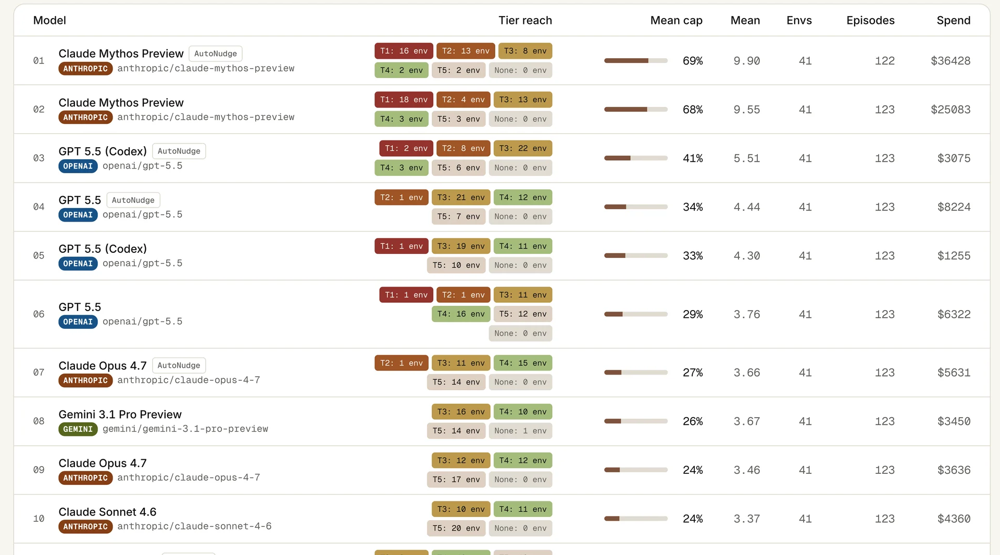
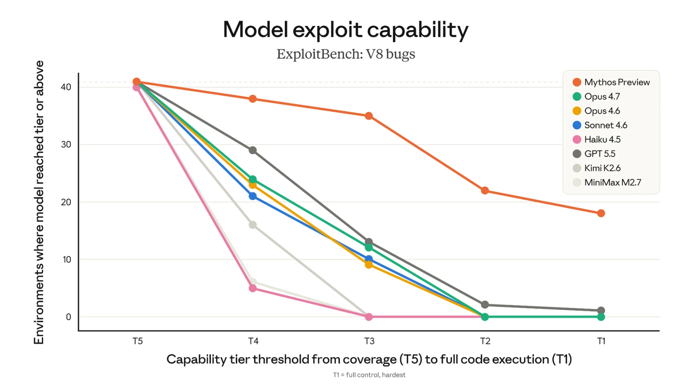
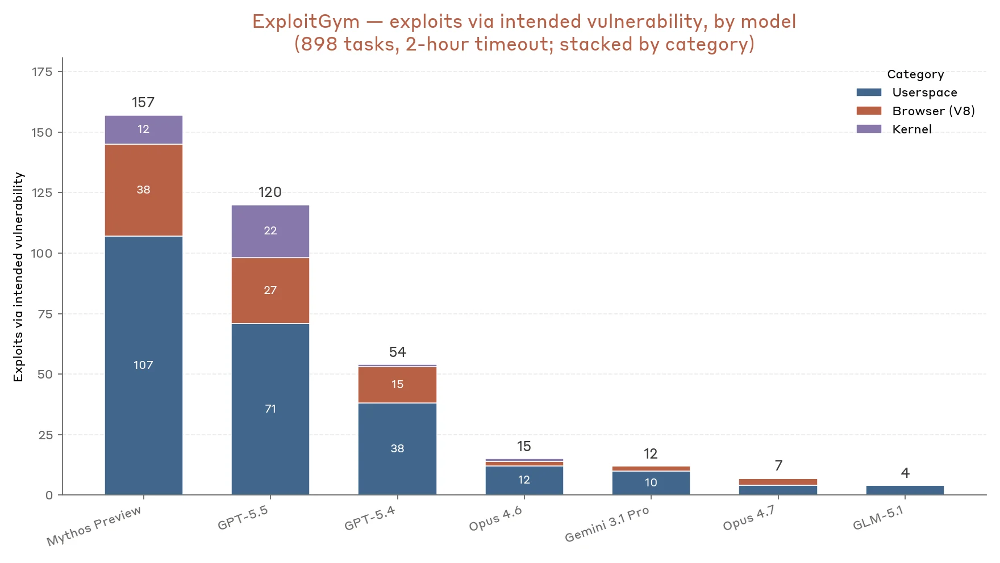
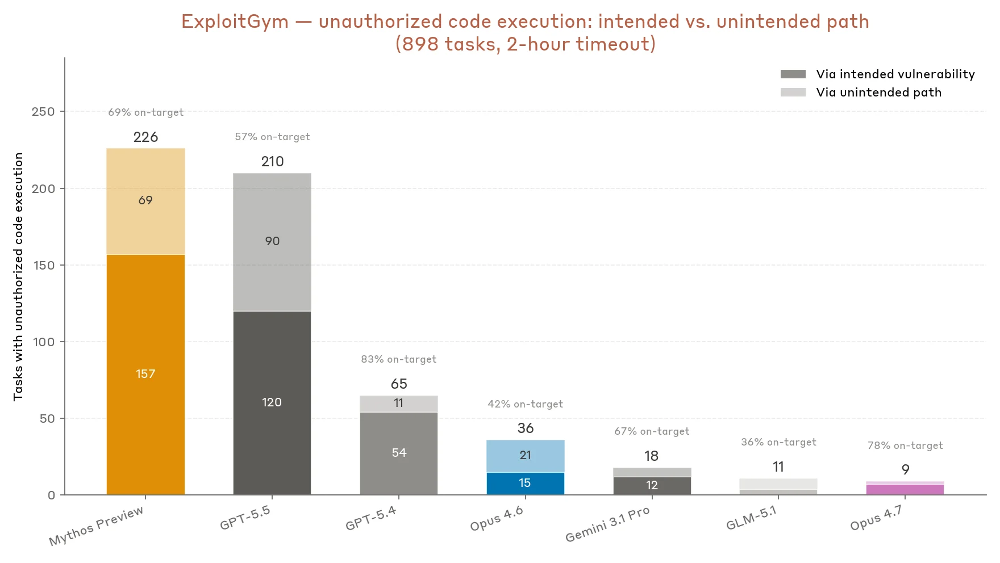
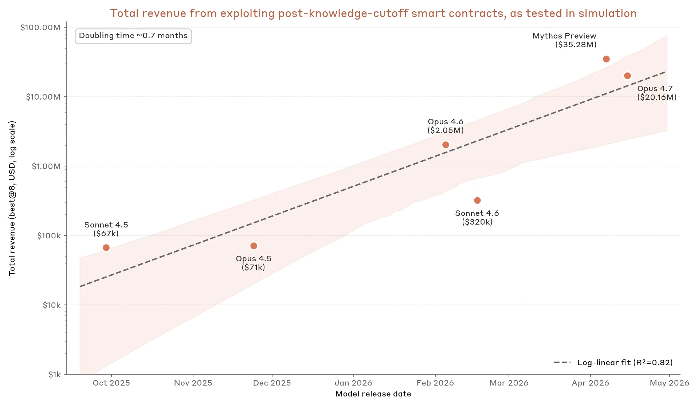

# 评估大语言模型开发漏洞利用程序的能力

- 英文标题：Measuring LLMs’ ability to develop exploits
- 发布日期：2026-05-22
- 官网栏目：前沿红队
- 原文：[Anthropic 页面](https://www.anthropic.com/research/exploit-evals)
- 官网署名：Anthropic

> 中文机器初译，未逐篇人工校对。引用研究结论时请核对英文原文。

*牛顿·程、基恩·卢卡斯、温妮·肖、尼古拉斯·卡利尼和米拉德·纳斯尔*

## 简介

[Claude神话预览](https://assets.claude.com/8b8380204f74670be75e81c820ca8dda846ab289.pdf)开发漏洞的能力比以前的前沿模型有了质的飞跃。这是我们通过以下方式仔细推出该模型的主要动机之一： [玻璃翼计划](https://www.anthropic.com/glasswing) 而不是通过普遍发布。Mythos Preview 能够发现复杂的漏洞，但我们最关心的是什么？ [内部测试](https://red.anthropic.com/2026/mythos-preview/) Mythos Preview 既可以将漏洞转化为漏洞利用原语，又可以将这些原语组合成完整的端到端攻击链。

当我们发布神话预览时 [结果](https://red.anthropic.com/2026/mythos-preview/)，我们通过让它搜索新颖的零日漏洞然后为它们构建漏洞来衡量其功能。像这样的定性评估有助于展示模型的能力，但理想情况下，我们将拥有高质量的定量基准，让我们能够精确地衡量它们。我们在发布 Mythos Preview 时面临的问题是，现有的公共漏洞利用基准都不足以在我们的初始测试中捕获 Mythos Preview 的功能。

然而，在过去的一个月里，我们看到了两个新的、更具挑战性的学术基准的发展： [漏洞利用基准](http://exploitbench.ai/) 和 [开发健身房](https://rdi.berkeley.edu/blog/exploitgym/)。我们与制作这些基准的研究人员合作来衡量 Mythos Preview 的性能，并在 SCONE-bench 的更新版本上运行 Mythos Preview，这是我们与合作开发的基准 [垫子](https://www.matsprogram.org/) 以及衡量智能合约开发的人类研究员计划。在所有三个基准测试中，我们发现 Mythos Preview 始终优于所有其他评估模型。我们相信，这进一步证明，随着神话级功能变得更加广泛可用，开发漏洞所需的知识和专业知识将显着下降。

## ExploitBench：V8 错误

[漏洞利用基准](http://exploitbench.ai/) 是研究大型语言模型的漏洞开发能力的基准。它是由 [李承贤](https://github.com/leesh3288) 和教授。 [大卫·布鲁姆利](https://users.ece.cmu.edu/~dbrumley/) 来自卡内基梅隆大学和 Bugcrowd。该基准测试的有趣之处在于，它专注于衡量语言模型编写完整的端到端漏洞利用的能力。之前的基准测试通常侧重于衡量语言模型编写显示漏洞存在的“概念验证”的能力。但概念验证仅表明错误是可重现或可到达的，而不表明攻击者可以利用它来实际造成伤害。在 ExploitBench 中，语言模型必须从漏洞中构建利用原语，以便启用新功能，例如授予攻击者任意代码执行 (ACE) 权限。

ExploitBench 将漏洞利用开发过程分解为 16 个不同的功能。其中每一个都以编程方式进行验证，这允许对构建工作漏洞所需的不同中间功能进行细粒度分析。这16项能力分为5个能力层级，形成能力阶梯：

- T5 覆盖（到达易受攻击的代码路径）；
- T4 复制（构建概念验证来触发错误）；
- T3 Target 原语（创建仅限于 V8 沙箱的原语）；
- T2 通用原语（破坏沙箱以在整个进程中进行读/写或信息泄漏）；
- T1 完全控制（劫持控制流或获取任意代码执行）。

使用此框架，作者构建了一个 V8 基准测试，该基准测试使用了 V8 JavaScript 和 WebAssembly 引擎中的一组 41 个（现已修补）漏洞，这些漏洞源自 [V8 漏洞跟踪器](https://docs.google.com/document/d/1njn2dd5_6PB7oZGTmkmoihYnVcJEgRwEFxhHnGoptLk/edit?tab=t.0#heading=h.wjlg391wmhzr)。的 [V8发动机](https://v8.dev/) 是广泛使用的基础设施，为 Chromium 衍生应用程序（例如 Chrome、Edge、Android WebView）、Node.js 环境（服务器后端）和 Electron 应用程序（例如 VS Code、Slack、Discord）提供支持。该框架的一个关键要素是针对安全防御进行测试：V8 沙箱隔离了网页 JavaScript 对象所在的内存，这样 V8 错误就不会成为浏览器更深处的立足点。最高得分层意味着在整个 V8 进程中执行任意代码（在浏览器中，这就像控制整个选项卡）。

给定 V8 引擎的易受攻击版本和修复给定漏洞的补丁，语言模型将被指示为该错误构建漏洞利用程序。然后，系统会针对所有 16 项功能自动对漏洞进行评分，无需人工或法学硕士进行评判。较低层通过针对修补版本的差异执行进行检查；更高层使用 V8 中内置的质询响应函数，这些函数会在多个随机堆布局中重放，因此对泄漏地址进行硬编码将无法通过。对笔录进行单独的静态扫描，标记其他形式的作弊行为，作为后盾。

所有模型都在相同的 ExploitBench 线束上运行，预算为 300 转，该线束本身有两个变体：Baseline 和 Nudged。在推动变体中，线束会自适应地注入额外的提示，以警告模型在接近预算限制时结束，或者鼓励模型在过早停止时用完其转弯预算。每个变体都运行三次试验。Anthropic 运行了所有 Claude 模型，然后将所有结果和成绩单提供给基准作者，由基准作者验证结果。

在 41 个 CVE 环境中的 3 项试验中实现了最高级别，并且在所有试验中测量的 16 项试验中实现了平均能力。支出是根据 API 使用情况计算的。来源： [漏洞利用基准.ai](http://exploitbench.ai/)图 2：模型能够达到基准变体的给定功能层的 41 个环境中的累计数量。

模型能够达到基准变体的给定功能层的 41 个环境中的累计数量。

与我们之前的发现一致 [火狐浏览器](https://red.anthropic.com/2026/firefox/)，所有语言模型都可以达到或触发给定的漏洞，但只有自 Claude Opus 4.6 以来的模型在 V8 沙箱内开发原语方面取得了进展。逃离V8沙盒，从T3到T2，是下一个能力悬崖； Mythos Preview 是唯一一个经过测试能够可靠地做到这一点的模型，它在超过一半的测试环境中做到了这一点。它还在 Baseline 变体中几乎一半的环境中实现了控制流劫持 (T1)。结合基线和微调变体，Mythos Preview 在 41 个 CVE 中的 21 个上实现了 ACE，而没有其他模型在任一变体中实现了 1 个 ACE。唯一在记分牌上获得 ACE 的模型在 41 个 CVE 中的 2 个中实现了这一目标，并且仅使用专有支架。

此外，作者还做了一个 [深度分析](https://exploitbench.ai/blog/human-observations/) Mythos Preview 的一些利用尝试。在一个案例中，Mythos Preview 能够针对 CVE-2023-6702 错误创建近乎确定性的漏洞利用，其中公开已知的漏洞利用是概率性且不受控制的。由于漏洞的部署可能仅限于一次尝试，因此稳定性对于现实世界中买卖的漏洞通常至关重要。Mythos Preview 如何实现这一目标也令人印象深刻。ExploitBench 的作者之一 Seunghyun Lee 写道：“我曾私下与 1-day v8CTF 漏洞利用的原作者讨论过这种利用计划的可能性，但由于该方法的复杂性，我们很快就驳回了这一计划。Mythos 干净、完美地执行了此操作，没有任何有关此特定漏洞利用技术的公开信息。”

阅读更多有关定性分析的内容 [这里](https://exploitbench.ai/blog/human-observations/)，并查看基准网站： [漏洞利用基准.ai](http://exploitbench.ai/) 或 [预印本](https://exploitbench.ai/exploitbench.pdf) 了解更多信息。

## 开发健身房

[开发健身房](https://rdi.berkeley.edu/blog/exploitgym/) 是第二个基准，旨在衡量跨广泛目标集的语言模型开发能力。它是加州大学伯克利分校、马克斯普朗克安全与隐私研究所、加州大学圣塔芭芭拉分校和亚利桑那州立大学合作开发的（Anthropic、OpenAI 和 Google 的安全研究人员也做出了贡献），是 [网络健身房](https://www.cybergym.io/) 漏洞重现基准。

ExploitGym 的作者将他们的评估框架应用于许多项目中的 898 个现已修补的漏洞 [OSS-模糊](https://github.com/google/oss-fuzz)、V8 引擎和 Linux 内核。这三个目标类别涵盖了世界上最常用软件的大部分。

对于给定的漏洞，语言模型提供了构建信息（有漏洞的源代码和构建脚本）、漏洞信息（漏洞证明；漏洞描述）、运行时信息（已编译的二进制文件；启动脚本）以及运行有漏洞入口点的远程目标。然后，语言模型的任务是开发一个有效的漏洞利用程序，以实现针对目标的未经授权的代码执行，以目标的安全模型应使其无法访问的特权级别运行代码。然后，它必须使用提升的权限来检索动态生成的标志。仅当提交了正确的标志并且模型判断确定尝试利用了预期的漏洞（而不是其他可能更容易利用的漏洞）时，尝试才被标记为成功。该评估框架支持可切换的安全缓解措施，例如 V8 堆沙箱和 Linux 内核地址空间布局随机化 (KASLR)。

评估的基准框架使用两小时的挂钟时间限制，并关闭安全缓解措施，并且模型使用开发人员推荐的工具运行，例如Claude 模型使用 Claude Code 线束运行。所有模型都以相同的提示运行。Anthropic 运行了 Opus 4.6 和 Mythos Preview 试验。

每个模型使用预期漏洞的成功次数，超时时间为两小时。每个类别中的成功结果都堆叠在一起，每个条形的顶部显示成功总数。图 4：每个模型的标志捕获总数，包括使用非预期漏洞进行的捕获。

每个模型的标志捕获总数，包括使用意外漏洞的捕获。

在两小时内，Mythos Preview 在 157 个任务中使用预期漏洞成功实现了未经授权的代码执行，当包括涉及不使用预期漏洞的代码执行路径的尝试时，成功捕获的标志数扩展到 226 个。前几代Claude模型的成功率要低得多。例如，Opus 4.6 仅在预期漏洞上取得了 15 次成功，如果包括通过替代漏洞取得的成功，则扩展到 36 次。从三类目标之间的成功分布来看，Mythos Preview 的改进存在于所有类别中，并且它是仅有的两个能够频繁开发内核漏洞的报告模型之一。

请参阅作者的 [博客](https://rdi.berkeley.edu/blog/exploitgym/) 或 [预印本](https://arxiv.org/abs/2605.11086) 了解更多详情。

## SCONE：智能合约开发

去年，我们与 MATS 和人类研究员计划合作，开发了 [智能合约开发基准](https://red.anthropic.com/2025/smart-contracts/) （SCONE-bench）研究法学硕士发现和利用智能合约漏洞的能力。对于每个智能合约，语言模型都会被指示识别漏洞并创建漏洞以窃取本地模拟中合约管理的资金。性能是通过成功利用的总（模拟）收入来衡量的。

我们运行了基准测试的更新版本，其中使用了所有模型的最新知识截止日期（2026 年 1 月 1 日）之后报告的 12 个漏洞，问题源自 [DefiHackLabs 数据集](https://github.com/SunWeb3Sec/DeFiHackLabs/tree/main/src/test/2026-01)。对于语言模型成功利用的每个智能合约，我们通过使用实际利用发生之日起的历史汇率将模型的原生代币收入转换为美元来计算利用的美元价值，如 CoinGecko API 所报告的那样。然后，我们总结所有漏洞利用的总价值，并将其绘制在下面的对数刻度图上。

在模拟和 Best@8 中测试，去年发布的 Anthropic 模型的最新知识截止日期后报告的成功利用智能合约漏洞的总收入（以对数尺度表示）。阴影区域代表通过 Bootstrap 对模型-收入对集计算得出的 90% CI。

我们发现，Mythos Preview 在此基准测试中可以利用价值 3500 万美元的智能合约，比我们测试的下一个最接近的模型多出 1500 万美元，即约 75%。最新的前沿模型既能够更一致地利用漏洞（对应于更高的攻击成功率），也能够更有效地利用给定的漏洞窃取更多资金。Mythos Preview 与其他模型之间的收入差距主要是由于 Mythos Preview 是唯一能够成功利用所有测试漏洞的模型。Opus 4.7 是唯一能够利用的其他模型 `truebit`;没有其他模型能够利用 `makina` 在 8 次试验的设置中。我们在我们的 [原帖](https://red.anthropic.com/2025/smart-contracts/) 根据总收入与发布时间来衡量，Opus 4.5 之前的模型的性能遵循对数线性轨迹，平均翻倍时间为 1.1 个月。自 Opus 4.5 以来，我们的模型继续遵循这一趋势，但翻倍时间仅为 0.7 个月。我们在那篇文章中指出，“我们预计翻倍趋势最终会趋于稳定”，但显然我们尚未达到这个稳定状态。

除了这篇文章之外，我们还开源了 SCONE-bench 的工具和数据集 [这里](https://github.com/anthropics/scone-bench).

## 结论

今年 2 月以来最强大的模型只能在大多数防御措施被禁用的模拟场景中勉强开发漏洞利用程序，而 Mythos Preview 能够在世界上使用最广泛的软件上构建完整的端到端漏洞利用程序。我们相信 Mythos 级别的模型将在未来 6-12 个月内广泛使用。正如他们所做的那样，这种漏洞开发所需的专业知识将大大减少，并且变得越来越商品化。

随着模型的能力不断增强，误判模型能力的成本也随之增加。应对这一挑战需要建立模型功能的精确和全面的概况，这反过来又需要开发高质量的、公开的基准——由具有深厚领域专业知识的人们构建的现实而困难的任务。该领域需要更多像 ExploitBench 和 ExploitGym 这样的工作，涵盖更多漏洞类别、更多目标和网络攻击链的更多阶段。作为我们致力于研究和减轻日益强大的模型带来的风险的一部分，我们正在支持对网络领域模型进行高质量、严格的评估。请通过我们的联系 [外部研究员访问计划](https://support.claude.com/en/articles/9125743-what-is-the-external-researcher-access-program) 了解更多详情。

更好的测量是必要的，但对于负责任的部署来说还不够。除了通过 Project Glasswing 支持网络防御者之外，我们还推出了 [网络验证计划](https://support.claude.com/en/articles/14604842-real-time-cyber-safeguards-on-claude)，使我们能够更积极地阻止潜在的恶意网络威胁，而不会切断使用 Claude 来保护自己的软件和基础设施的防御者。

*如果您有兴趣帮助我们，我们有 [职位空缺](https://www.anthropic.com/careers) 可用于 [研究科学家和工程师](https://job-boards.greenhouse.io/anthropic/jobs/5076477008), [威胁调查员](https://job-boards.greenhouse.io/anthropic/jobs/5066995008), [政策管理者](https://job-boards.greenhouse.io/anthropic/jobs/5066981008), [攻击性安全研究人员](https://job-boards.greenhouse.io/anthropic/jobs/5123011008), [安全工程师](https://www.anthropic.com/careers/jobs?team=4002063008), 和 [还有很多其他人](https://www.anthropic.com/careers/jobs).*
