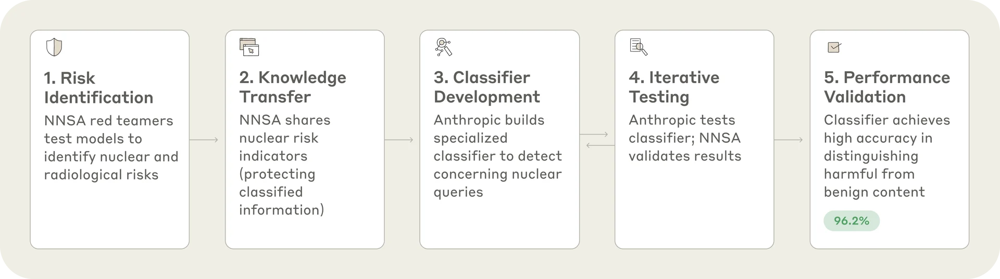
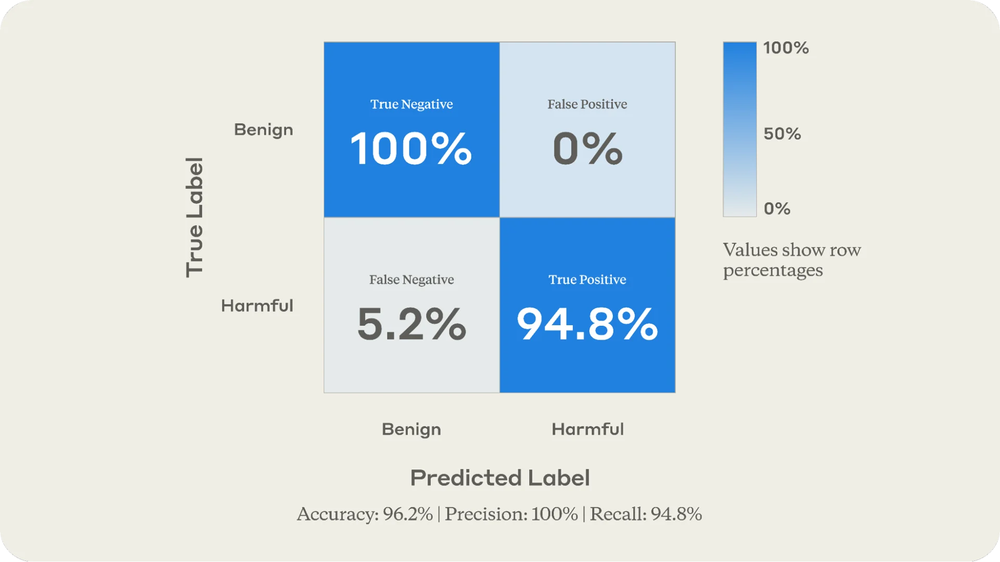

# 制定 AI 的核领域安全防护措施

- 英文标题：Developing nuclear safeguards for AI
- 发布日期：2025-08-21
- 官网栏目：前沿红队
- 原文：[Anthropic 页面](https://www.anthropic.com/research/nuclear-safeguards-for-ai)
- 官网署名：Anthropic

> 中文机器初译，未逐篇人工校对。引用研究结论时请核对英文原文。

核技术本质上具有双重用途：为核反应堆提供动力的相同物理原理可能会被滥用于武器开发。随着人工智能模型的能力变得越来越强大，我们需要密切关注它们是否能够以可能威胁国家安全的方式向用户提供危险的技术知识。

与核武器有关的信息特别敏感，这使得评估这些风险对于单独行动的私营公司来说具有挑战性。这就是为什么去年四月我们 [合伙的](https://www.axios.com/2024/11/14/anthropic-claude-nuclear-information-safety) 与美国能源部 (DOE) 的国家核安全管理局 (NNSA) 评估我们的核扩散风险模型，并继续与他们合作进行这些评估。

现在，我们不仅评估风险，还构建监控风险所需的工具。 **我们与 NNSA 和 DOE 国家实验室共同开发了分级机**—自动对内容进行分类的人工智能系统—**在初步测试中区分令人担忧的和良性的核相关对话，准确率达 96%** （详情见下文）。

我们已经在 Claude 流量上部署了这个分类器，作为我们用于识别模型滥用的更广泛系统的一部分。早期部署数据表明，该分类器在真实的Claude对话中效果很好。

**我们将与大家分享我们的方法** **[前沿模型论坛](https://www.frontiermodelforum.org/),** 前沿人工智能公司的行业机构， **希望这种伙伴关系可以作为任何人工智能开发人员可以用来与国家核安全局合作实施类似保障措施的蓝图。**[1](https://www.anthropic.com/research/nuclear-safeguards-for-ai#footnote-1)

除了确保前沿人工智能模型免遭核滥用的具体重要性之外，这一史无前例的努力也展示了公私伙伴关系的力量。这些合作伙伴关系结合了行业和政府的互补优势，可以正面应对风险，使人工智能模型对所有用户来说更加可靠和值得信赖。

## 我们建造了什么

在这次合作中，我们并没有停止识别风险，而是开发了解决风险的方法。经过 NNSA 工作人员在安全环境中红队 Claude 模型一年后，我们开始共同开发风险缓解措施。

在红队的通知下，国家核安全局与我们分享了一套精心策划的核风险指标，旨在区分有关核武器发展的潜在相关对话和有关核能、医学或政策的良性讨论。至关重要的是，该列表是在分类级别上开发的，以便可以与我们的团队共享，从而使我们能够使用它来构建防御。

我们的政策和 [保障措施](https://www.anthropic.com/news/building-safeguards-for-claude) 团队将该列表转变为可以实时识别相关核查询的分类器。将分类器视为一种专门的标记器，就像支持电子邮件收件箱中的垃圾邮件过滤器的标记器一样。该分类器不是识别垃圾邮件，而是识别潜在有害的对话，同时允许合法讨论。

为了验证系统，我们生成了数百个综合测试提示（有些令人担忧，有些是良性的），通过分类器运行它们，并与 NNSA 共享结果。NNSA 验证了分类器分数与预期标签（即有害或良性）一致。然后，我们根据他们的反馈改进了该方法，并重复该循环以提高精度。图 1 总结了这个过程。

分类器共同开发过程。

这项工作最具挑战性的方面不是技术方面的，而是弥合国家安全机构和私营人工智能公司之间的差距。双方都必须在信息共享的限制下运作：国家核安全局需要对某些信息进行保密，而人类需要保护用户数据。那么，我们如何验证我们的分类器确实有效呢？合成数据生成是我们的解决方案：我们使用 NNSA 的示例提示生成数百个测试用例，在不损害任何一方权益的情况下创建强大的评估集。

## 为什么这很重要？

如果人工智能系统过于谨慎，它可能会拒绝合法的核工程课程。过于宽容，可能会无意中帮助不良行为者。

我们的分类器似乎达到了适当的平衡。在使用合成数据进行的初步测试中，我们实现了核武器查询的 94.8% 检测率和零误报（总体而言，本次测试中分类器标签的准确率为 96.2%，如图 2 所示），这表明该系统不会将合法的教育、医学或研究讨论标记为相关讨论。这种精确度很重要，因为人工智能系统中的核对话很少见，但风险很高——它们直接关系到国家安全。

将分类器对综合交易所的评估与其已知状态进行比较，显示对所有真阴性和几乎 95% 的真阳性的正确评估。总体准确率反映了正确预测标签的总比例。

## 与业界分享

我们正在提供这些资源，以便其他领先的人工智能公司可以选择实施类似的保护措施。除了展示政府专业知识如何通过自愿的公私合作增强人工智能安全之外，我们希望这能够引发交流，让我们能够互相学习缓解风险的方法。

## 接下来是什么？

如上所述，我们已将分类器部署为我们的安全防护框架的实验性补充，用于监控一定比例的 Claude 流量。其实际性能已证实分类器在我们的测试环境之外也能有效工作。尽管我们的综合测试数据提供了有害和良性交换的清晰示例，但实际用户流量的分布被证明更加复杂和令人惊讶，但分类器仍然表现良好。

现实世界的部署与测试有何不同的一个例子是，分类器标记了我们最终确定为良性的有关核武器的某些对话。例如，最近中东发生的事件使人们重新关注核武器问题。在此期间，核分类器错误地标记了一些仅与这些事件相关的对话，而不是实际的滥用尝试。我们发现当这些交换发生时 [层次概括](https://alignment.anthropic.com/2025/summarization-for-monitoring/)- 它一起审查多个标记的对话 - 由于摘要步骤提供了额外的上下文，它们被正确地识别为无害的时事讨论。

这揭示了两个动态：首先，现实世界的对话经常陷入难以在合成数据中捕获的灰色区域，其次，结合多种安全工具创建一个更加细致和精确的系统。

最终，分类器在部署时成功捕获相关内容（即真正的内容），证明了其价值。例如，不知道已部署分类器的人性红队成员正在故意使用相关提示对我们的系统进行例行对抗性测试。分类器正确地将这些测试查询识别为潜在有害，证明了其有效性。

这项工作利用了各方的优势（即政府领域的专业知识和行业技术能力），早期结果表明它正在实践中发挥作用。这展示了一种可以在其他国家安全领域复制的公私伙伴关系模式。它还表明，行业现在可以采取一些措施来实施有意义的安全措施。

我们感谢 NNSA 和 DOE 国家实验室团队对此次合作的承诺，这展示了行业和政府如何共同努力加强国家安全。

*有关我们安全举措的更多信息，请参阅我们的* *[负责任的扩展政策](https://www.anthropic.com/rsp-updates),* *[边疆红队](https://www.anthropic.com/news/strategic-warning-for-ai-risk-progress-and-insights-from-our-frontier-red-team), 和* *[保障措施](https://www.anthropic.com/news/building-safeguards-for-claude) 工作。*

## 脚注

01我们之所以能够共享此类信息，是因为 FMF 成员公司（即 Amazon、Anthropic、Google、Meta、Microsoft 和 OpenAI）已签署了独特的 [协议](https://www.frontiermodelforum.org/updates/fmf-announces-first-of-its-kind-information-sharing-agreement/) 旨在促进有关前沿人工智能特有的威胁、漏洞和能力进步的信息共享。
