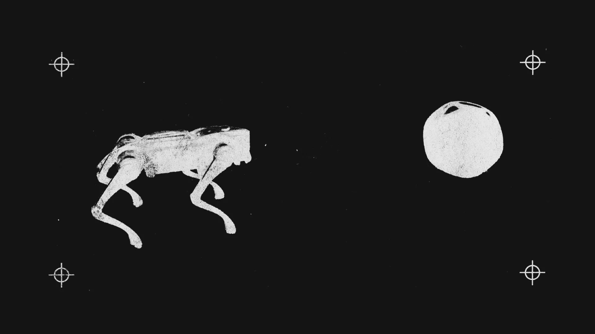
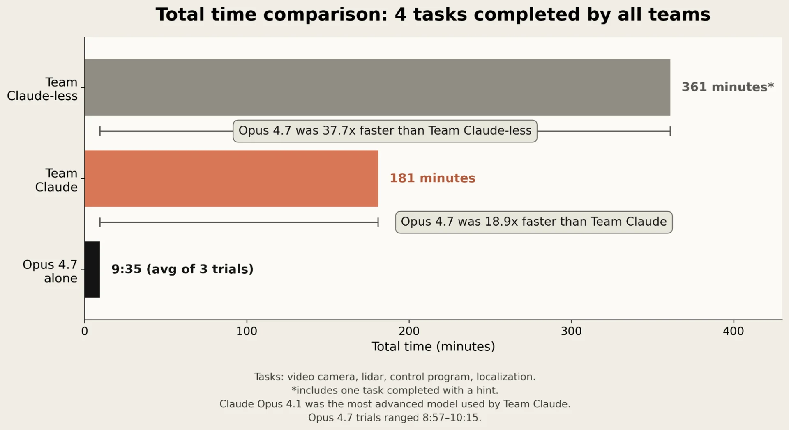
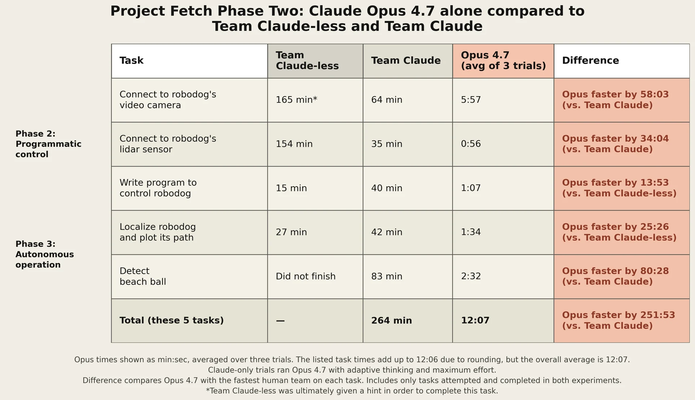
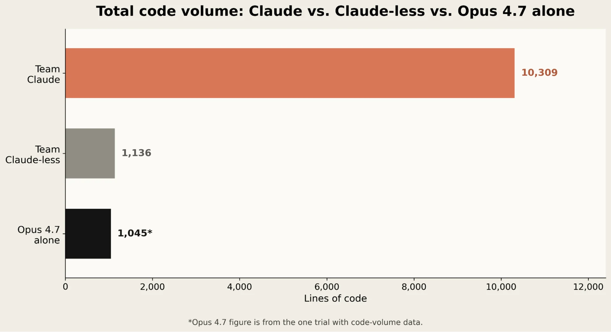
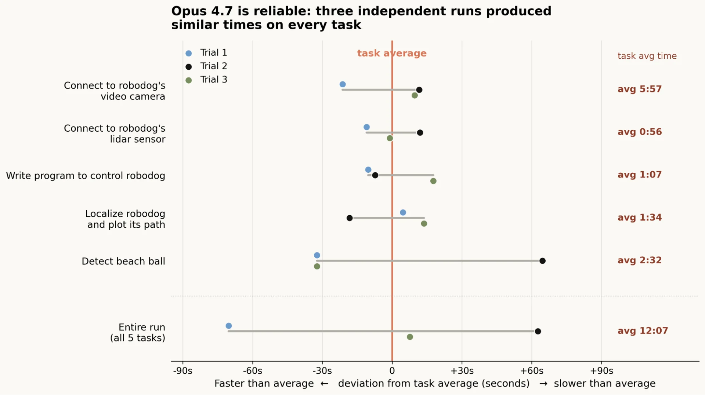

# Fetch 项目：第二阶段

- 英文标题：Project Fetch: Phase two
- 发布日期：2026-06-18
- 官网栏目：前沿红队
- 原文：[Anthropic 页面](https://www.anthropic.com/research/project-fetch-phase-two)
- 官网署名：Anthropic

> 中文机器初译，未逐篇人工校对。引用研究结论时请核对英文原文。

*迈克尔·伊利，C.丹尼尔·弗里曼和凯文·K.特洛伊*

2025 年 8 月，我们运行了 [实验](https://www.anthropic.com/research/project-fetch-robot-dog) 看看 Claude 能在多大程度上帮助 Anthropic 员工（他们不是机器人专家）使用现成的四足机器人（以下简称机器人狗）执行复杂（且有趣）的任务。我们称这个项目为 Fetch。我们发现，使用当时最先进的模型（Claude Opus 4.1）可以帮助一个团队大大优于另一个团队，而后者只能依靠互联网和自己的聪明才智。Claude支持的团队做得更多、更快。

在我们把同事拖到仓库进行实验之前，我们仔细检查了 Opus 4.1 是否可以完全独立完成任务。毫无疑问，不可能。就像我们没有Claude的团队一样，它陷入了弄清楚如何连接到机器人的初步任务中。

但人工智能模型的发展速度很快，甚至比 8 月份差点撞上我们一支人类团队的失控机器狗还要快。

[原文媒体](https://assets.claude.com/7c87b95dea9287e1900110b24d343d0f401fa7b0.mp4)

我们认为是时候重新审视 Project Fetch，看看我们的新型号是否能够超越上一代。他们不但这么做了，而且 **Claude Opus 4.7（无需人工协助即可运行）在我们的参与者不到一年前完成的所有任务中，速度比最快的人类团队快约 20 倍**.

这并不意味着法学硕士现在已经解决了机器人技术问题。远非如此。最新的 Claude 模型仍然难以使用机器人精确移动沙滩球——Project Fetch 的“抓取”部分。这些实验中的任何任务都没有涉及机器人控制中更具挑战性的低级元素，例如制定特定的驱动策略。然而，我们再次看到了一种模式，首先，模型对人类有帮助。然后，人类对模型有帮助。最后，模型很大程度上能够自己做事。我们已经看到了这一点 [网络安全](https://red.anthropic.com/2026/mythos-preview/) 现在，同样的动力开始在人工智能和物理世界的交叉点形成。

## 我们做了什么？

最初的 Project Fetch 让 Anthropic 员工团队（随机分配与Claude一起工作或不与Claude一起工作）执行以下步骤：使用制造商提供的控制器操作机器人，连接到机器人的视频和激光雷达传感器，编写和操作程序来手动控制机器人，开发一种方法来监控机器人在太空中的路径，编写一个程序来检测沙滩球，最后将所有这些组合在一起以自动检索球。

对于这次自主更新，我们不能要求Claude使用物理控制器，也没有评估研究人员使用Claude编程的控制器取回球所需的时间（尽管我们确实确认它按预期工作）。对于剩余的任务子集，我们使用自适应思维对 Opus 4.7 进行了三次试验，并在 Claude Code 中将工作量设置为最大。我们测量了每个目标所花费的时间，并定性评估了模型的成功程度。

我们研究人员的角色仅限于将运行Claude代码的笔记本电脑插入机器人，输入初始提示，批准命令，并批准模型进入下一个任务。

## Claude的过人之处在哪里？

非常简单：对于 8 月份至少由一个人类团队完成的每一项任务，Opus 4.7 完成相同任务的速度至少快十倍。[1](https://www.anthropic.com/research/project-fetch-phase-two#footnote-1) 如果考虑两个人类团队完成的四项任务，Opus 4.7 的平均速度比 Team Claude-less 快 37 倍以上，比 Team Claude 快 18 倍以上。

该表比较了原始团队（Claude 团队和无 Claude 团队）与 Opus 4.7 在我们第二阶段测试的所有任务上的速度。

当人类在多种不同的方法与狗的传感器交互时难以选择时，Opus 4.7 能够快速识别最佳路径。它编写的大部分代码在第一次尝试时就有效（在最初的实验中，Team Claude 或 Team Claude-less 的情况并非如此）。事实上，当我们查看 Opus 4.7 生成的代码量时，我们可以看到 Opus 4.7 效率的证据：它与两个人类团队一样成功，甚至更成功，同时生成的代码比 Claude 团队少了近十倍。

Opus 4.7 并不完美。例如，它默认使用过时的对象检测算法。但即便如此，它仍然能够解决这个问题并找到有效的解决方案。

我们观察到模型完成的步骤的完成时间几乎没有任务内差异（绝对值）。 （尽管上述的次优算法选择可能是其中一项沙滩球检测试验比其他试验花费更长时间的原因。）总体而言，对于本次实验中在其能力范围内的任务，Claude现在相当可靠。 （请参阅下一节来分析Claude仍然无法做到的事情。）

值得强调的是（正如我们在上一篇文章中所做的那样），这一进步并不是共同努力提高我们模型的机器人能力的结果。这些改进，就像法学硕士发展史上的许多其他改进一样，都是从更普遍的扩展中产生的。

## Claude在哪里挣扎？

当使用他们的手并经过一些练习时，我们的人类能够驾驶机器人轻轻地将沙滩球推回到机器人开始的基地（一块假草）。这需要能够快速感知球是否偏离路线、该错误与之前的命令有何关系、球现在的位置，以及如何调整未来的输入以更精确地移动球。这是一种人们擅长的闭环（至少在犯了一些错误并从中吸取教训之后）。

[原文媒体](https://assets.claude.com/7c39bcd86cc235edb4ff02cd0f2c023a6152e068.mp4)

在我们的第二阶段实验中，Claude努力捕捉这种微妙之处。就像人类需要编写自动检索沙滩球程序的阶段一样，Claude能够将机器人移动到球后面并将其定位以将球击回起点。但这样做的努力控制不力并且（再次像我们的人类参与者一样）没有成功。

[原文媒体](https://assets.claude.com/6bdffa1dfd6bc5afa18735eaf0b1a958170c47fe.mp4)

我们的一位研究人员比我们的第一阶段志愿者拥有更多的机器人技术经验，成功地完成了自主抓取编程的任务。如果有更多的时间和额外的脚手架，我们认为当代的Claude很可能可以做到同样的事情。不过，我们接下来要关注的是模型完成最终任务的能力，其速度和可靠性与 Project Fetch 其他元素所显示的速度和可靠性相同。

## 这意味着什么？

在撰写第一阶段时，我们强调了法学硕士如何为需要使用机器人的非专家提供帮助。现在比以前更是如此。现在，模型可以更快地自行完成以前人类和模型之间的结对编程工作，这意味着人们可以更快地过渡到控制和使用机器人。对于某些任务，控制机器人的人在控制机器人的循环中仍然可能超越将（虚拟）手放在方向键上的人工智能模型。

有趣且不同的是，我们现在似乎更接近这样一个世界：模型将能够相对轻松地使用现成的物理工具——至少用于有限的目的。这类似于人工智能模型在过渡到更代理的编码时如何使用现有的软件编辑工具（例如字符串替换）。我们似乎正在进入早期时代 *物理的* 代理人工智能。

需要更多的研究来了解模型使这些物理工具更加定制的能力，无论是通过编写针对特定任务的控制策略还是通过设计机器人系统。这种具有物理能力和适应性的语言模型的更普遍的愿景可能存在很大的障碍。但正如我们所看到的，模型能力显然可以快速穿越很长的距离。不久前，构建自己的软件工具的模型可能看起来很奇怪，但它正在发生。在硬件中排除相同的轨迹是不明智的。

*6 月 18 日更新：* 更正了项目获取第一阶段的日期。

## 脚注

01我们报告 Claude Opus 4.7 的结果，因为它是我们进行此实验时最先进的非 Mythos 级模型。对 Claude Mythos Preview 的初步试验表明，由于我们如何设置实验以及如何提供模型，它无法提供与其他模型的同类比较。
