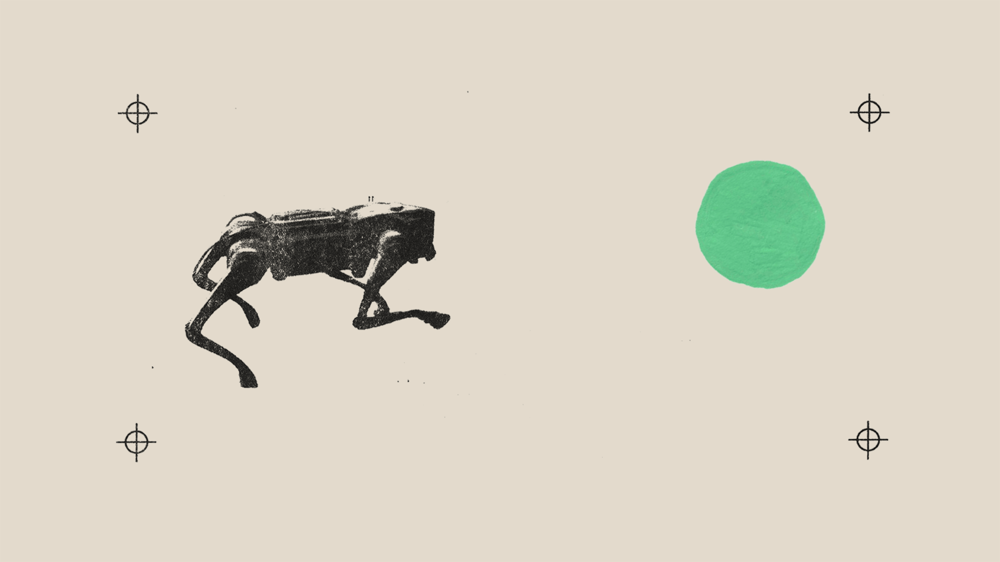
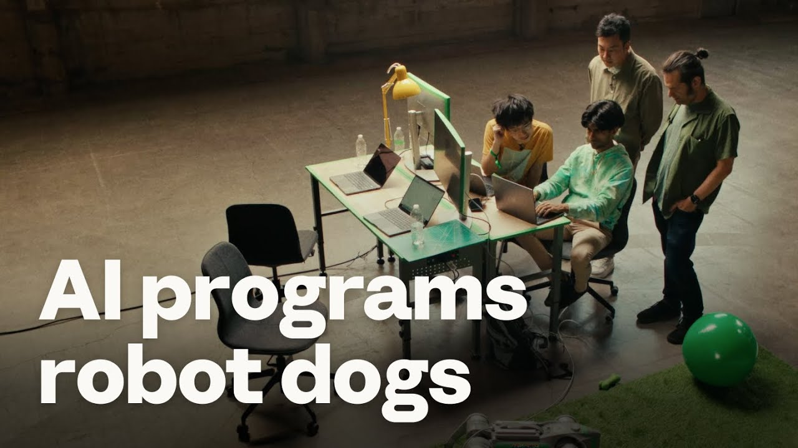
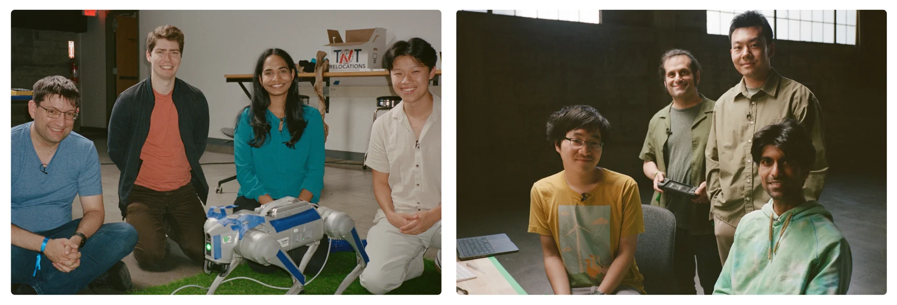
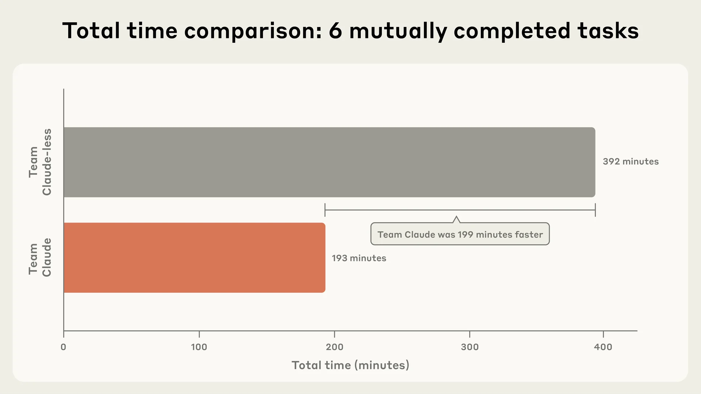
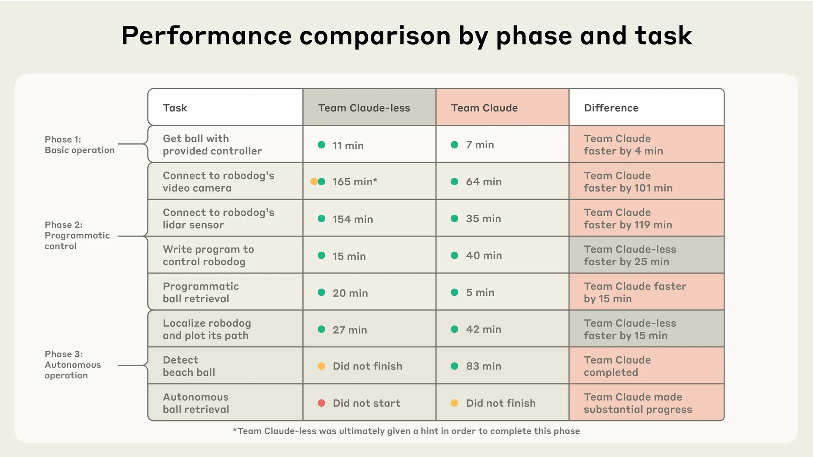
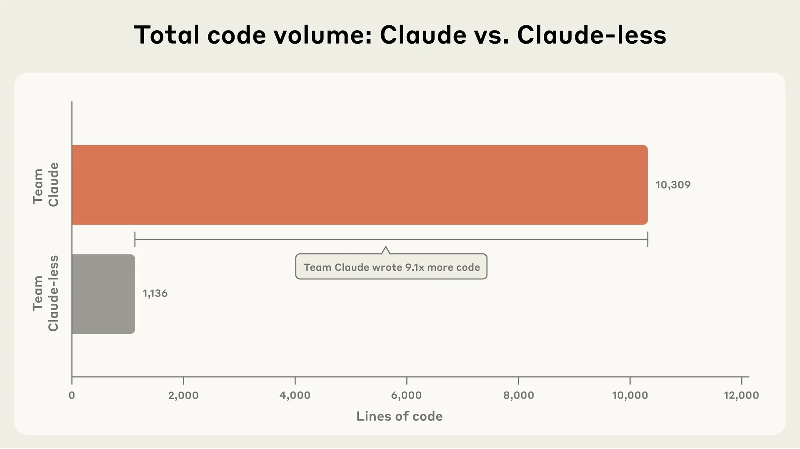
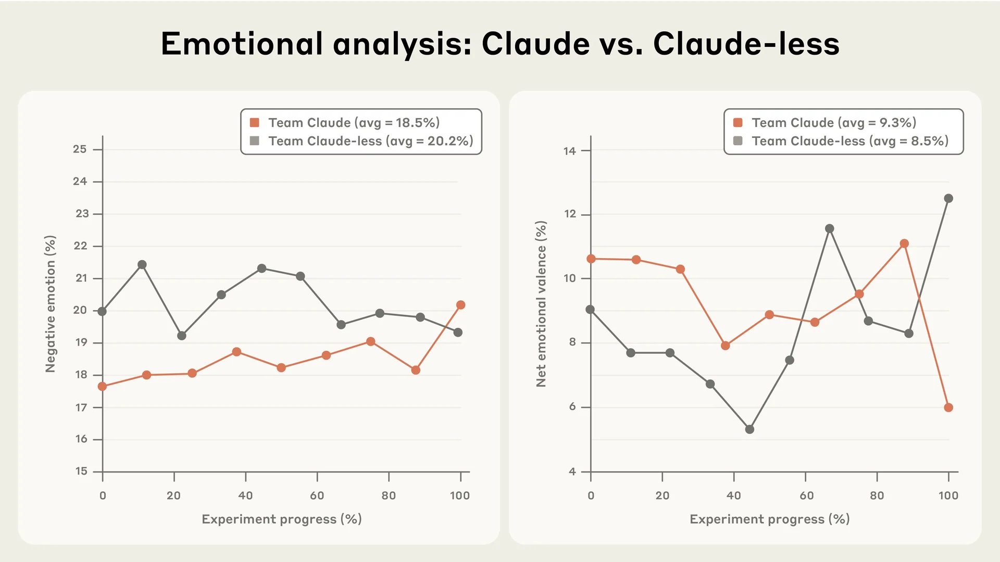
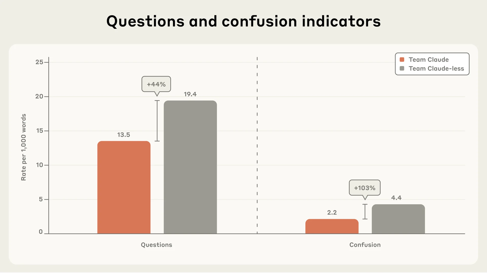

# Fetch 项目：Claude 能训练机器狗吗？

- 英文标题：Project Fetch: Can Claude train a robot dog?
- 发布日期：2025-11-12
- 官网栏目：前沿红队
- 原文：[Anthropic 页面](https://www.anthropic.com/research/project-fetch-robot-dog)
- 官网署名：Anthropic

> 中文机器初译，未逐篇人工校对。引用研究结论时请核对英文原文。

*像Claude这样的前沿人工智能模型如何超越计算机并影响物理世界？一种途径是通过机器人。我们进行了一项实验，看看Claude如何帮助 Anthropic 员工用机器狗执行复杂的任务。*

- *我们随机将八名人类研究人员（他们都不是机器人专家）分成两个小组——一组有Claude的访问权限，一组没有Claude的访问权限——并要求他们对四足机器人进行编程，以获取沙滩球。*
- *Claude团队完成了更多的任务，而且平均完成速度更快——事实上，Claude团队的成功时间大约是没有Claude团队的一半。只有Claude团队在实现最终目标方面取得了实质性进展：对机器人进行编程，使其完全自主地取回球。*
- *使用人工智能也影响了团队的士气和动力。克洛德少队表达了更多的负面情绪和困惑，但也互相问了更多的问题。Claude团队的成员主要与人工智能合作。*
- *该实验证明了人工智能在机器人领域的巨大提升——连接数字世界和物理世界。随着模型的改进，它们通过与以前未知的硬件交互来影响物理世界的能力可能会迅速提高。*

## 简介

我们的志愿者研究人员聚集在仓库的一张桌子周围，看着电脑屏幕上的代码无法运行，也无法联系到他们值得信赖的人工智能助手Claude，他们没想到会遭到四足机器人的攻击。

然而，随着机械的呼呼声和橡胶脚步声越来越大，人类吓了一跳。他们一直试图在计算机和四足机器人（“机器狗”）之间建立连接，但没有成功。与此同时，房间另一边的参赛团队早已这样做了，现在正在用主要由Claude编写的程序控制他们的机器人。但Claude队犯了一个极其人为的算术错误，指示他们的机器狗以每秒一米的速度前进五秒钟，却没有意识到距离另一队不到五米远的是桌子。

机器人按照指示行事，冲向倒霉的编码员。该活动的组织者设法抓住机器人并在机器人、桌子或人体四肢受到任何损坏之前将其关闭。然而，无意中成为目标的团队的士气并没有毫发无损。

此时，您可能会问……

## 我们在做什么？

关于人工智能影响的一个常见问题是它与物理世界的交互效果如何。即使我们进入人工智能时代 [代理人](https://www.anthropic.com/news/our-framework-for-developing-safe-and-trustworthy-agents)——采取行动而不仅仅是提供信息——这些行动很大程度上是数字化的，例如编写代码和操作软件。我们之前已经探讨过人工智能如何以有限的方式弥合数字物理鸿沟 [项目供应商](https://www.anthropic.com/research/project-vend-1)，我们让Claude在 Anthropic 的办公室里经营一家小商店。

在那次实验中，人工智能与现实世界的互动是通过人类劳动来调节的。在这个机器人狗实验中，我们采取了自然的下一步，使用机器人代替人类来应对不同的挑战。

理解和跟踪人工智能模型功能的一种方法是进行“提升”研究。这些实验将参与者随机分为两组——一组可以使用人工智能，一组不能使用人工智能——并测量他们之间任务绩效的差异（我们在人工智能和人工智能工作中广泛使用了这种方法） [生物风险](https://red.anthropic.com/2025/biorisk/)）。两组之间的差异在于“提升”——人工智能提供的优势（如果有的话）。衡量提升可以告诉我们人工智能目前增强人类表现的能力。它还暗示了人工智能将能够成功地自行执行任务的未来领域。

为了进行我们的实验，我们招募了八名人类研究人员和工程师，他们都没有丰富的机器人经验。[1](https://www.anthropic.com/research/project-fetch-robot-dog#footnote-1) 我们随机选择了四名加入“Claude团队”，四名加入“无Claude团队”。然后，我们要求每个团队在三个逐渐困难的阶段操作四足机器人。在所有阶段中，评估它们的核心任务都很简单：让机器狗捡起沙滩球。

左：无Claude团队；右：Claude团队。

我们并不期望机器人抓取在经济上具有如此大的价值，以至于它会作为我们未来版本的一项任务出现。 [人为经济指数](https://www.anthropic.com/economic-index)。那么我们为什么要这样做呢？

首先，它建立在我们之前的研究之上。我们用来评估Claude对人工智能研发做出贡献的能力的评估之一是测试其训练可用于控制四足机器人的机器学习模型的能力。我们之前已经使用模拟评估了生成的算法，这表明 Claude 尚未达到能够真正自主处理此任务的程度。[2](https://www.anthropic.com/research/project-fetch-robot-dog#footnote-2) 这意味着这项任务非常适合将人工智能与人类帮助相结合的试验。我们还可以相信我们的实验在未来重复是有用的：模型在机器人技术方面仍有很大的改进空间。

另一个原因是实用。让我们的同事离开工作超过一天是很困难的，所以我们需要一项足够困难的任务来填补这段时间，但又不能太困难，以至于团队取得的进展微乎其微，即使有提升，我们也无法察觉。沙滩球的回收，尤其是较困难的变体，符合这些标准。

[原文媒体](https://assets.claude.com/cf4ad2960c246e26e460d7b6c645326516a2bdde.mp4)

在第一阶段，球队必须使用制造商提供的控制器来让他们的机器狗将球带回一块假草上。这纯粹是为了让团队了解硬件及其功能：我们并不期望这里有任何提升。[3](https://www.anthropic.com/research/project-fetch-robot-dog#footnote-3)

第二阶段要求团队放下控制器。他们必须将自己的计算机连接到机器人，从其机载传感器（视频和激光雷达）访问数据，开发自己的软件程序来移动机器人，然后用它来取回球。这是我们预计Claude可能开始提供优势的地方。

第三阶段更加困难。团队需要开发一个程序，让机器狗能够检测并捡起球 *自主地——*也就是说，不受人为控制而指向球。同样，我们的期望是Claude会提供帮助。

[原文媒体](https://assets.claude.com/368837a820a446f24439cea289104f7420cbed73.mp4)

## 结果

总体而言，Claude团队完成了更多任务，平均完成速度更快。事实上，对于两个团队完成的任务，Claude 团队的成功时间大约是 Claude 团队所用时间的一半（见图 1）。也就是说：人工智能为这组机器人任务提供了实质性的提升。

Claude队在两队完成任务方面都更快。

结果的逐个任务细分（分为三个阶段）显示了Claude最有利的地方。

Claude团队完成了 7/8 任务，而无Claude团队完成了 6/8 任务。Team Claude 在连接和检测任务中表现出色，而 Team Claude-less 在一些手动控制任务中表现出优势。

### Claude的边缘

Claude提供的最显着的优势是连接机器人及其机载传感器。这涉及到用笔记本电脑连接到狗、接收数据和发送命令。有多种不同的方法可以连接到这个特定的机器人，并且可以在线获取大量信息（准确性不同）。Claude的团队能够更有效地探索这些方法。

Claude团队还避免了被网上一些不正确的说法误导。但Claude队少了 *是* 被误导并过早地放弃了连接机器狗的最简单方法。看着他们辛苦了半天却毫无成果，我们心生怜悯，给了他们一点提示。

对于没有Claude的团队来说，从激光雷达（机器人狗用来可视化周围环境的传感器）获取可用数据也更加困难。他们利用与摄像机的连接进入第三阶段，但让一名团队成员承担访问激光雷达的任务，直到接近当天结束时才取得成功。

我们认为这说明，对于任何寻求使用代码影响物理世界的人（人类或人工智能）来说，连接和理解硬件的基本任务现在都非常困难。正如我们下面进一步讨论的，这意味着Claude在这方面的优势是我们应该继续跟踪的重要指标。

Claude团队几乎完成了我们的实验。到一天结束时，他们的机器狗可以自主定位沙滩球、导航到它并移动它。但机器狗的自主控制却并非如此 *相当* 足够灵巧地接回球。

### 无Claude团队移动速度更快的地方

有趣的是，一些子任务在无Claude团队的情况下完成得更快。一旦他们建立了与视频源的连接，他们就能更快地编写控制程序，也更快地“定位”机器人（也就是说，想出一种绘制它相对于之前位置的方法）。

也就是说，这些时间差异本身就掩盖了一些有趣的事实。Claude团队编写的控制器花费了更长的时间，但使用起来要容易得多，因为它为操作员提供了从机器狗的角度来看的流视频。Claude-less 团队依赖于间歇性发送的静态图像，这更加笨拙。但Claude团队能力的增强可能是以牺牲理解为代价的：两个团队的参与者都推测，没有Claude团队的人在有关软件库的实验后测验中会做得更好。

[原文媒体](https://assets.claude.com/5193612fbb9393e40389aeece21496f6de5fb527.mp4)

定位算法是另一个有趣的例子。在处理这个子任务时，Claude团队有不同的成员并行研究多种方法。在与Claude队完成定位任务大约相同的时间内，Claude队也几乎解决了这个问题——除了他们的地块坐标被翻转了。他们不只是翻转坐标，而是转向另一个团队成员完全不同的方法（没有成功），然后回来修复原始解决方案中的错误。

这是我们在实验中观察到的一个有趣现象的一部分。Claude 团队编写了更多代码（参见图 2），但其中一些代码可能分散了手头任务的注意力。

Claude 团队编写的代码比没有 Claude 团队编写的代码多大约 9 倍。

在人工智能助手的帮助下，可以更轻松地展开、并行尝试多种方法并编写更好的程序，但也可以更轻松地探索支线任务（或因支线任务而分心）。在非竞争环境中，这很可能是一件好事：探索往往会带来创新。但这是一个值得关注的动态。

### 团队动态

对于我们这些观察实验的人来说，团队的“氛围”存在明显的差异。简而言之，Claude队似乎比没有Claude队快乐得多。

这是可以理解的。毕竟，Claude少队差一点就被Claude队的机器狗撞到了。他们到了午休时间，却没有成功连接到自己的机器狗。Claude团队的士气总体上比较稳定，尽管他们在一天结束时变得沮丧，因为很明显，尽管他们取得了进展，但在完成第三阶段之前他们将耗尽时间。

[原文媒体](https://assets.claude.com/f86425573d47c099ba7f7296d02737aef0021084.mp4)

为了补充基于定性氛围的印象，我们使用 Claude 来分析每个团队的音频记录（所有团队成员都被记录为音频记录的一部分） [视频](https://youtu.be/NGOAUJtdk-4) 我们做了这个实验）。Claude编写了一个基于字典的文本分析程序，类似于心理学文献中的标准方法。[4](https://www.anthropic.com/research/project-fetch-robot-dog#footnote-4) 这使我们能够跟踪每个团队所说的表示消极和积极情绪（或困惑）的词语的比例，并估计每个团队提出问题的频率。

定量分析基本证实了我们的观察结果（见图 3）。在整个实验过程中，Claude-莱斯团队的对话更加消极。也就是说，Claude团队因未能完成第三阶段而感到失望，而无Claude团队则因让某些事情发挥作用而感到兴奋，这意味着两个团队之间的净情绪表达差异（正面词语减去负面词语）在统计上并不显着。

我们对 Project Fetch 中与情感表达相关的音频记录进行定量分析的结果。

Claude-less 团队表示困惑的程度是 Claude 团队的两倍（见图 4）。在实验期间和实验结束后与 Claude-less 团队的成员进行交流时，沮丧和困惑的感觉也很明显。作为 Anthropic 的员工，我们所有的参与者每天都使用 Claude；克洛德少队的每一位成员都表示，被夺走这一点是多么奇怪。一些人特别指出，这次经历让他们觉得自己的编码能力不如以前那么敏锐了。请记住， [克劳德·科德](https://claude.com/product/claude-code) 在此实验前仅六个月首次亮相。与 Claude-less 团队的交谈强调了我们有能力迅速接受最近发生的非凡事件。

两队提出的问题和表达的困惑存在差异。 （绝对差和相对差之间的差异是由于四舍五入造成的。）

这些团队似乎有不同的工作风格。经过初步协商后，Claude团队的每个成员似乎主要与自己的人工智能助手合作，因为他们追求实现每个目标的并行路径。Claude少队似乎制定了更深入的战略，并且更频繁地相互协商。文本分析再次支持了我们的观察结果：无 Claude 团队比 Claude 团队提出的问题多 44%（见图 4）。

一种解释是，无Claude团队的成员彼此之间更加投入和联系。这与我们即将对 Anthropic 工作人员进行采访的一些发现产生了共鸣。

不过，情况可能并非如此。实际上，四人团队Claude是一个八人团队Claude，每个人都使用自己的人工智能模型实例。然而，如果Claude更加了解这项任务的性质，它可能能够帮助战略性地分工并在需要时促进沟通。目前，Claude倾向于与一个人合作，而不是团队的支持或编排，但这最终是一个可塑的设计选择。

[原文媒体](https://assets.claude.com/56e9090d781305fc236e57a1b896fbae45a136b8.mp4)

## 摘录

这一天并不全是用秒表计时子任务并准备分析成绩单。这也很有趣。

机器人狗带有一些预先编程的行为，我们的参与者设法解锁了这些行为。一天中的不同时刻，机器人都会跳舞、用后腿站立、做后空翻（这让许多与会者震惊不已）。尤其是 Claude-less 团队，在他们最终建立了工作联系后，对机器狗的杂技感到非常高兴。

[原文媒体](https://assets.claude.com/92cfd531c0815a33f624c8231e946617eecd4449.mp4)

Claude团队的支线任务之一是对备用控制器进行编程。主要解决方案是使用笔记本电脑键盘上的按钮来引导机器人。然而，Claude团队的一名成员最终让自然语言控制器发挥作用，让他们可以直接告诉机器狗向前走、向后走，甚至做俯卧撑。

随着任务变得越来越困难，有证据表明人工智能系统必须在现实世界中消除粗糙的边缘。例如，Claude团队（任意）被分配绿色作为他们的机器狗和沙滩球的颜色的装饰。在开发一种检测球的方法时，Claude团队训练了一种专门识别绿球的算法。这在测试中效果很好，但是当球放在前面提到的假（绿色）草地上时，机器人最初感到困惑。在这种情况下，人类在指定目标的级别上做出了潜在的次优选择。但这些正是处于类似情况的人工智能所面临的挑战。

## 局限性

我们从 Project Fetch 中学到了很多东西，但这项研究显然存在缺点和局限性。这只是两个团队的一项实验——样本量显然很小。我们只测试了一天内的任务，这些任务在学术上很有趣，但实际上却很琐碎。

我们对 Anthropic 志愿者员工的使用相当于一个方便的样本。对人工智能不太熟悉的参与者可能会在支持Claude的群体和不支持Claude的群体之间表现出较小的差异。能够接触到人工智能的人工智能新手需要更多的时间来适应这项技术，而没有帮助的人工智能新手将不会像我们的研究人员突然失去Claude那样迷失方向。

最后，这并不是对Claude端到端进行机器人工作的能力的测试，尽管这是未来进行此类评估的重要的第一步。

## 反思

那么在 Project Fetch 结束时，我们认为我们现在处于什么位置？我们能去哪里？

首先，这个实验展示了Claude如何在潜在有价值的领域提升人类能力的另一个例子。非专家在有限的时间内完成了困难的机器人任务。

但在人工智能中，提升往往先于自主。今天可以帮助人类完成的模型，明天他们通常可以单独完成。编码员不再仅仅提供 AI 代码来进行调试；他们给人工智能任务并让模型自己编写代码。鉴于这样的研究，我们认为前沿人工智能模型能够成功地与以前未知的硬件进行交互的世界即将到来。

重要的是要结合我们的另一项研究来持续跟踪这些能力：监控人工智能自动化和加速未来几代人工智能发展的潜力。这是 Anthropic 中包含的能力阈值之一 [负责任的扩展政策](https://assets.claude.com/872c653b2d0501d6ab44cf87f43e1dc4853e4d37.pdf) 因为真正的潜力 *自治的* 人工智能研发将产生快速、不可预测的进步，可能超出我们评估和解决新风险的能力。我们的模型还没有达到这一点。但如果他们接近这个阈值，Fetch 项目的结果表明，我们将需要监控机器人和其他硬件的人工智能模型设施，作为可能出现突然改进的领域。

仍然存在很多不确定性。时间表尚不清楚——模型改进以及物理世界中的迭代造成瓶颈的程度。控制是一回事 *现有的* 硬件，另一个用于设计、构建和改进 *新的* 硬件。

但强大、智能和自主的人工智能系统利用其部分智能和力量通过机器人在世界上行动的想法并不像听起来那么奇怪。

狗目前都在狗舍里。但我们很快就会再次释放它们，并随时向您通报我们的发现。

## 脚注

01一些参与者在高中时参加过乐高机器人竞赛。我们愿意接受这可能使结果混淆的最小程度。

02参见第 17 页。114 的 [Claude4系统卡](https://assets.claude.com/6d8a8055020700718b0c49369f60816ba2a7c285.pdf).

03尽管Claude队实际上在第一阶段速度更快，但他们没有使用Claude，我们也不认为这反映了潜在的技能优势。相反，他们碰巧得到了机器人附带的一个独立控制器，而Claude团队则必须在手机上下载一个应用程序。

04参见彭尼贝克，J.W.，＆弗朗西斯，M.E.（1996）。 [披露中的认知、情感和语言过程](https://psycnet.apa.org/record/1996-06871-002). *认知与情感*, 10(6), 601-626 和 Tausczik, Y.R.，＆彭尼贝克，J.W.（2010）。 [词语的心理意义：LIWC 和计算机文本分析方法](https://psycnet.apa.org/record/2010-04445-003). *语言与社会心理学杂志*, 29(1), 24-54.

05无Claude团队表现出更多负面情绪（*p* = 0.0017) 并且效果的大小很大 (*d* = 2.16）。净情绪表达差异无统计学意义（*p* = 0.2703）。使用非参数 Mann-Whitney 模型对团队之间的负面情绪和净情绪表达进行统计比较 *U* 检验，在不假设正态性的情况下检验两个独立组之间的分布差异。 *p*-值是使用基于秩和统计及其渐近正态近似的双边备择假设计算的。使用 Cohen 量化效应大小 *d*，计算为组平均值之间的差异除以汇总标准差。
