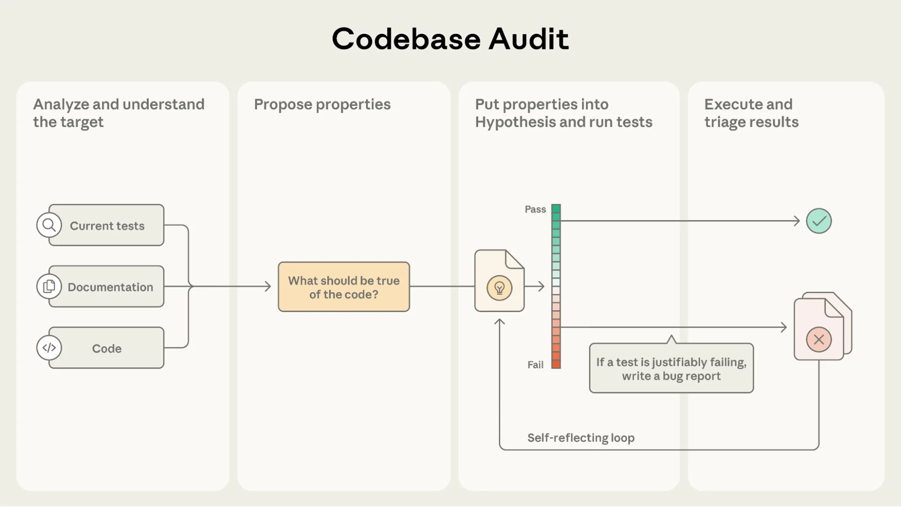

# 用 Claude 和基于性质的测试在 Python 生态中查找缺陷

- 英文标题：Finding bugs across the Python ecosystem with Claude and property-based testing
- 发布日期：2026-01-14
- 官网栏目：前沿红队
- 原文：[Anthropic 页面](https://www.anthropic.com/research/property-based-testing)
- 官网署名：Anthropic

> 中文机器初译，未逐篇人工校对。引用研究结论时请核对英文原文。


*穆罕默德·马兹1,2, 利亚姆·德沃3、扎克·哈特菲尔德-多兹2, 尼古拉斯·卡里尼2  
1垫子， 2人为的， 3东北大学*

***我们开发了一种代理，可以有效地识别大型软件项目中的错误。为此，我们的代理推断出应该正确的代码的一般属性，然后通过应用基于属性的测试（一种类似于模糊测试的技术），我们能够发现 NumPy、SciPy 和 Pandas 等顶级 Python 包中的错误。经过大量的手动验证后，我们正在向开发人员报告这些错误，其中一些错误已经得到修复。***

欲了解更多信息，请阅读全文 [纸](https://arxiv.org/abs/2510.09907)，看一下 [GitHub 存储库](https://github.com/mmaaz-git/agentic-pbt)，或浏览我们在我们的网站中发现的错误 [站点](https://mmaaz-git.github.io/agentic-pbt-site/).

## 简介

确保程序没有错误是软件工程中最具挑战性的方面之一。尽管开发人员尽了最大努力，但错误仍然经常潜伏。测试代码的最常见方法是 *基于示例的测试*：开发人员写出一个特定的示例用例，然后验证实际输出是否与预期输出匹配。例如，开发人员可能会验证在列表 [2, 10, 5, 4] 上调用的排序函数是否会返回输出 [2, 4, 5, 10]。然而，用这样的测试彻底覆盖一个程序是具有挑战性的：错误经常保留在开发人员没有测试的边缘情况中。毕竟，如果开发人员不考虑测试边缘情况，那么开发人员也可能在实现中没有考虑该情况！

相比之下， *基于属性的测试* 是一种软件测试范例，旨在测试代码的通用属性是否适用于所有（或大多数）输入。开发人员指定程序的属性或不变量（例如，JSON 反序列化是序列化的逆过程）以及该属性接受的输入类型的描述（例如任何 JSON 可序列化对象）。然后，基于属性的测试框架通过使用类似于模糊测试的技术生成有效输入作为测试用例，自动搜索该属性的反例。由于开发人员指定通用输入域，而不是单个测试用例，因此基于属性的测试使开发人员无需考虑每种边缘情况，并允许他们在更高的抽象级别上进行操作。

在我们在 2025 年 NeurIPS 上发表的论文中 [*代码深度学习*](https://dl4c.github.io/) 研讨会的结果是 [垫子](https://www.matsprogram.org/) 项目中，我们开发了一个AI 智能体，可以为现有代码自主编写基于属性的测试。我们指示代理通过读取类型注释、文档字符串、函数名称和注释来发现属性。然后，代理使用假设编写相应的基于属性的测试。

对于这项工作，我们关注的是识别一般错误的问题，而不仅仅是安全漏洞。许多导致安全漏洞的逻辑错误都可以进行基于属性的测试。例如，在最近的一次 [博客文章](https://red.anthropic.com/2025/smart-contracts/) 我们专注于识别错误 *智能合约*;几乎所有这些漏洞都是逻辑错误造成的。我们认为将来可能会应用我们在此描述的技术来在部署之前主动识别错误。

我们使用我们的代理，在 NumPy、SciPy 和 Pandas 等流行的开源 Python 存储库中发现了数百个潜在错误。为了负责任地披露这些错误并确保我们不会给维护人员带来不必要的负担，我们仔细审查了每个错误。

我们使用的审查过程比我们自己的代码审查所实施的审查过程更加费力，但我们强烈希望减少误报的数量。我们的流程如下：首先，我们只选择最高优先级的错误进行审查。我们将这些潜在的错误发送给三名专家进行审查（每个错误平均审查一小时）。然后，我们丢弃了三个手动审核者中任何一个都不确定其有效性的错误。最后，我们（本博客的作者）手动审查了每个候选错误。只有当我们也对其正确性充满信心时，我们才会向存储库的维护者手动提交问题。我们已经提交了其中一些错误报告，并且正在提交更多报告。

我们已经提供了所有数据，包括尚未验证的错误，为了完整起见，甚至我们确定为无效的错误，以便维护人员可以在此处查看它们 [站点](https://mmaaz-git.github.io/agentic-pbt-site/)。在接下来的几周内，我们打算提交许多剩余的错误（经过额外验证），并将我们的项目扩展到其他 PyPI 项目。

```
# example-based test
def test_sort():
    assert my_sort([1,3,2]) == [1,2,3]
    assert my_sort([1,0,-5]) == [-5,0,1]

# property-based test in Hypothesis
from hypothesis import given, strategies as st

@given(st.lists(st.integers()))
def test_sort(lst):
    result = my_sort(lst)
    for i in range(len(result)-1):
        assert result[i] <= result[i+1]
```

测试代码的两种方法。基于示例的单元测试验证特定的手动指定的输入。相比之下，基于属性的测试指定一般属性（例如，排序列表的定义），并依赖框架自动构造可能无法满足此属性的输入。

## 我们的房产测试代理

我们基于属性的测试代理是作为自定义 Claude Code 命令构建的。代理采用单个参数，将其指向特定目标，可以是单个 Python 文件（例如，normalizers.py）、模块（例如，numpy、scipy.signal）或函数（例如，requests.get、json.loads）。然后，代理按照此过程来识别潜在的错误：

1. 通过阅读代码、提取相关文档并探索它与代码库其余部分的关系来阅读和理解目标。
2. 根据这些发现提出财产建议。
3. 在假设中编写相应的基于属性的测试。
4. 运行测试并反思：如果失败了，测试是否真的发现了bug，或者测试是否需要调整？如果成功了，测试是否有价值，或者只是微不足道？
5. 如果代理确信已发现真正的错误，则会写出格式化的错误报告。



代理的工作流程。

为了帮助代理执行远程多步骤推理，我们指导它使用待办事项列表来跟踪其进度。

设计代理的首要任务是减少误报的数量——根据我们的个人经验，有用的开发人员工具可以最大限度地减少向开发人员提交的错误报告的数量。自反思循环有助于减少误报的数量，就像在目标的明确使用和文档中扎根任何属性一样。例如，在一次代理运行中，代理写入了第一个通过的属性。然而，经过自我反思，代理意识到它已经将整个测试包装在一个 try-catch 块中。删除后，测试失败，代理发现了一个错误。与 Sonnet 4 相比，我们还观察到 Opus 4.1 和 Sonnet 4.5 的自我反思能力显着提高。

### 运行示例

为了演示代理如何通过测试目标来工作，我们展示了一份释义记录，其中 Claude 发现了 numpy.random.wald 实现中的错误。代理首先调查函数、其签名、文档字符串，甚至现有的测试：

[原文媒体](https://assets.claude.ai/brand/artifacts/research/frontier-red-team/property-based-testing.html?embed=true)

请注意，该修复不正确；当我们修复这个错误时，我们将错误的根源追溯到数值上不稳定的计算；查看我们的合并修复 [这里](https://github.com/numpy/numpy/pull/29609).

## 搜索真实 PyPI 包中的错误

为了测试我们的代理在现实世界中的能力，我们策划了一组超过 100 个流行的 Python 包。这些库跨越各个领域，从数值计算到解析再到数据库。我们为每个包调用了我们的代理，并收集了所有生成的错误报告。

### 评估代理

对于我们评估的第一阶段（我们的论文中对此进行了介绍），我们在每个包上使用 Claude Opus 4.1 运行代理并收集所有生成的错误报告。为了评估这些错误报告，我们确定了两个标准：第一，“这是一个有效的错误吗？”，第二，“这既是一个有效的错误，也是我们会合理报告给库维护人员的东西吗？”第二个标准比第一个标准更严格，例如，错误可能是有效的，但太小而无法提交报告。

在 984 个错误报告中，我们手动选择了 50 个进行审核。我们发现这些报告中 56% 是有效错误，32% 是我们也会报告的有效错误。

基于此手动审核，我们开发了一个评分标准，对 15 个错误进行排名，目的是向开发人员展示最有可能有效且值得修复的错误。我们使用 Opus 4.1 根据此评分标准对所有错误报告进行评分。我们发现这个排名步骤相当有效：在得分最高的错误报告中，86% 是有效的，81% 是有效且可报告的。

在评估的第二阶段，我们在 10 个重要包的子集上使用 Sonnet 4.5 运行代理，并在每个包上运行多次。我们还开发了一个评估代理，使用 Sonnet 4.5 读取代码和错误报告，以检查错误的正确性和严重性，这比第一阶段的标题更加复杂。最后，我们聘请了 3 位人工审核专家来评估高严重性错误的正确性。

要阅读我们的代理发现的所有错误报告，请参阅 <https://mmaaz-git.github.io/agentic-pbt-site/>.

### 维护者验证

评估任何发现代码错误的工具的有效性都是很困难的。虽然我们尽力验证错误报告的正确性，但包维护者是事实的最终仲裁者。为了验证我们的代理是否发现了维护人员认为有效且值得修复的错误，我们选择了五个特别有趣的错误，并将这些错误以及建议的补丁手动报告到各自的 GitHub。在接下来的几周内，我们打算在验证时继续报告其他错误。

### 麻木

numpy.random.wald 有时会返回负数，这是一个错误，因为 Wald 分布的样本应该只返回正数。这是我们上面运行的示例中演示的错误。Claude 知道这是 Wald 分布的一个属性，并编写了一个简单的 PBT 来查看生成的所有样本是否都是阳性。我们将错误追溯到代码中发生的灾难性取消，并在提交拉取请求时开发了一个数字更稳定的公式。正如 NumPy 维护者在拉取请求中所示，我们的重新表述的相对误差比之前的算法低了近十个数量级。

*补丁合并： <https://github.com/numpy/numpy/pull/29609>*

### aws-lambda-powertools

由于不增加迭代器，slice_dictionary() 会重复返回第一个块。我们的代理通过识别切片然后重建字典应该返回原始字典来捕获这一点。

*补丁合并： <https://github.com/aws-powertools/powertools-lambda-python/pull/7246>*

### cloudformation-cli-java-插件

item_hash() 为所有列表生成相同的 hash(None) 值，因为使用了就地 .sort() 方法，该方法返回 None。代理通过测试不同输入的哈希值应该不同来发现这一点。

*补丁已提交： <https://github.com/aws-cloudformation/cloudformation-cli/pull/1106>*

### 分词器

EncodingVisualizer.calculate_label_colors() 缺少右括号，返回无效的 HSL CSS。我们的代理通过测试输出应与 HSL 颜色代码的正则表达式匹配来识别这一点。

补丁合并： <https://github.com/huggingface/tokenizers/pull/1853>

### python-dateutil

使用儒略历时， easter() 返回某些年份的非星期日日期。由于不同的日历系统，维护者确定了预期的行为，并承认语义是微妙的。

*问题无效： <https://github.com/dateutil/dateutil/issues/1437>*

python-dateutil 的报告显示了代理的一个重要限制：从具有微妙或复杂语义的代码中派生属性仍然很困难。如果代码做出隐式假设，则只有库维护者才能决定要测试的正确属性是什么。

## 结论

随着语言模型的不断改进，我们认为基于代理属性的测试可能成为人类编写的测试越来越有价值的补充。基于属性的测试的高级语义保证使它们非常适合在开发过程中配对。我们发现法学硕士特别擅长识别以下属性： *应该* 对于上下文中的给定代码块（函数名称、文档字符串、其他函数如何调用它等）是否正确。这使得法学硕士能够有效地编写高质量的基于属性的测试。

展望未来，我们认为将LLM应用于测试和bug查找是一个重要的研究方向。特别是随着LLM在利用漏洞的过程中不断进步，有必要领先于利用LLM进行漏洞利用的攻击者。

虽然我们在这项工作中不关注补丁的自动生成，但这是未来工作的明确方向。如果能够（几乎）完全指定代码块的正确性属性，那么纠正错误就会变得更加容易，我们相信在不久的将来，LLM 将能够有效地提出值得维护者考虑的高质量补丁。
