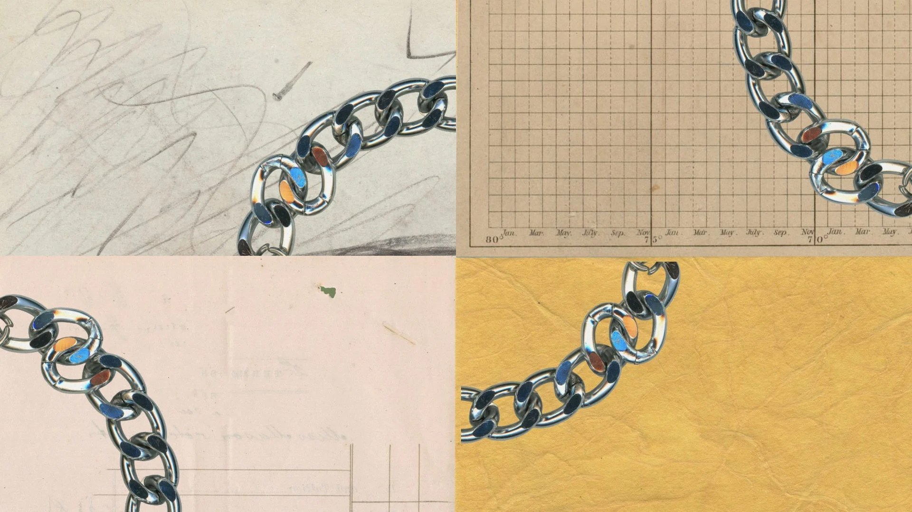

# 大语言模型的可证明推理：研究进展

- 英文标题：Progress on provable inference for large language models
- 发布日期：2026-11-02
- 官网栏目：前沿红队
- 原文：[Anthropic 页面](https://www.anthropic.com/research/provable-inference)
- 官网署名：Anthropic
- 官网推荐阅读：[阅读技术报告](https://www.anthropic.com/document/flashprove-technical-report)

> 中文机器初译，未逐篇人工校对。引用研究结论时请核对英文原文。

*罗伊·林伯格（Roy Rinberg）（人类）、亚历克斯·阿兰（Alex Allin）（人类）； Alessandro Chiesa（洛桑联邦理工学院、StarkWare）、Miranda Christ（麻省理工学院、RESI）、Rahul Dalal（人类 STEM 研究员计划，简明）、Giacomo Fenzi（洛桑联邦理工学院）、Ben Mayer（人类研究员计划，麻省理工学院）、Guy Weissenberg（洛桑联邦理工学院）*

## 执行摘要

当您亲自与朋友交谈时，您可以通过多种方式知道那确实是他们：您可以看到他们、听到他们、与他们握手。当你与人工智能模型交谈时，你几乎什么也没有。今天查询模型的用户无法检查响应是否来自开发人员声称正在响应的特定模型，而不是出于成本原因被路由服务秘密替换的模型，甚至是被篡改令牌流的攻击者替换的模型。仅从模型的输出来看是不可靠的，即使它产生了高质量的响应。加密推理证明解决了这个问题：它们让模型提供者提交一个模型，然后证明每个响应都是由该模型生成的。此类证明可以支持从消费产品到内部安全的各种应用，并有助于构建用于验证是否符合人工智能节奏要求的工具包。

具体来说，我们在一种强大的加密证明（称为“zkSNARK”）方面取得了进展，它特别适合 **可证明的推论** （由于其强大的隐藏性和效率特性）。在这篇文章中，我们主要通过我们称为 FlashProve 的系统分享了其中的一些进展。简要技术总结如下：

1. Claude 对 zkSNARKs 进行了推理改进，构建了一个比以前的开源系统快得多的系统。
   1. 对于大型模型（Llama 4 Maverick，400B 参数专家混合），单个 H100 GPU 以大约 110 个令牌/秒的速度生成证明，当采用 4 位量化权重时，在预填充中使用整数算术，每个 1,024 个令牌请求的证明大小约为 19 MB。这大约是在 vLLM（一个常见的开源库）上运行模型本身的 GPU 时间的 70-95 倍。
   2. 正如我们在中讨论的那样，之前的开源系统要慢几个数量级 [第6节](https://www.anthropic.com/research/provable-inference#prior-work)。Claude找到了在密码学和安全文献中应用最先进工具的新颖方法，同时依赖于密码学证明系统的完善设计原则。对模型的承诺以及随后的推理证明隐藏了模型的权重；隐藏模型的架构不是该系统的目标。
2. Claude擅长优化，但经常做出难以评估的决策，尤其是在大型复杂系统中。我们通过以精益（一种形式验证语言）提供顶级可审计语句来应对这一问题，以实现所声称的安全保证。

今天我们发布了五件神器：

- 当前的博客文章概述了我们的系统及其潜在应用；
- A [技术报告](https://www.anthropic.com/document/flashprove-technical-report) 解释我们系统的细节；
- A（Claude写） [协议规范](https://github.com/anthropics/FlashProve/blob/main/paper/paper.pdf) 文件；
- [可执行代码](https://github.com/anthropics/FlashProve) 其中包括： [证明者](https://github.com/anthropics/FlashProve/tree/main/prover) 和两个验证者，一个 [快速验证器](https://github.com/anthropics/FlashProve/tree/main/verifier) 在 C++ 中，以及 [可证明正确的验证者](https://github.com/anthropics/FlashProve/tree/main/tools/lean-verify) 精益；和
- [精益证明](https://github.com/anthropics/FlashProve/tree/main/lean) 对于顶级数学陈述，以及 [交互式可视化工具](https://github.com/anthropics/FlashProve/blob/main/lean/STATEMENTS.html) 精益定理有助于审计。

我们根据 Apache 2.0 许可证发布代码、精益证明和文档。[1](https://www.anthropic.com/research/provable-inference#footnote-1) 这篇研究文章的目的是分享中间进展，而不是完整的研究议程。我们明确分享这一点的目的是让其他人看看我们所做的事情，接受并改进它。

## 简介

当用户向人工智能模型发送请求时，他们现在无法确定他们选择的模型是否是生成响应的模型。对于日常使用，用户最关心的是输出，而不一定是哪个特定模型产生的，这是一个不太紧迫的问题。但在某些情况下，这种保证是有用的。例如，在发布之前和之后测试人工智能模型的独立评估者需要知道他们正在评估的模型是正在服务的模型。通过第三方路由服务使用模型的客户希望确保代币来自他们支付的模型。如果网络攻击者冒充给定模型修改令牌流，则用户无法仅从输出中检测到它。

然而，验证模型响应具有挑战性。大多数前沿模型的权重都是保密的，即使用户可以访问权重，检查给定的响应是否是由具有这些权重的模型生成的也需要运行模型，这需要的计算资源远远超出了典型用户（甚至评估者）可以承受的范围。

目标是 *可证明的推论* (PI) 是为了使计算资源有限且没有任何权重信息的用户能够验证响应是否来自所请求的模型。PI 的动机不仅是希望增加客户对人工智能提供商的信任，而且因为它可以用来向独立评估者提供保证，并允许提供商证明他们正在履行某些承诺和法律义务，它还对人工智能开发前沿和人工智能监管产生影响。

实现 PI 的一种方法是通过称为 *零知识简洁论证：* 模型提供者连同声明的响应一起发送一个简短的 *证明* （例如，几兆字节）用户可以 *快点* 验证（理想情况下，在 CPU 上以秒为单位）。如果声称的响应偏离指定模型，则用户的检查将失败。重要的是，密码技术确保证明揭示 *什么都没有* 关于模型的权重。

今天，我们发布了 FlashProve： **用于可证明推理的开源高性能原型**。对于 400B 参数混合专家模型（Llama 4 Maverick，4 位量化），我们表明单个 H100 GPU 以超过 100 个令牌/秒的速度生成证明，每个 1,024 个令牌请求的证明大小约为 19 MB（大约是常见开源库 vLLM 处理相同长度提示所需的 GPU 时间的 70-95 倍）。

该版本附带可执行代码、精益形式化和协议的技术描述。我们的目标有两个：（i）加速和促进可证明推理的发展； (ii) 证明零知识简洁论证对于可证明的推理是实用的。

我们相信这一进展对安全具有有意义的影响， **加快人工智能发展步伐**，在 **为AI客户提供诚信保障**，在 **为审计员和监管者提供便利的工具**，等等。

## 人工智能扩散中的信任挑战

人工智能的发展及其在我们的数字基础设施和经济中日益增长的作用提高了 [信任挑战](https://arxiv.org/abs/2004.07213) 人工智能提供商必须回答这个问题。依靠工具可以帮助解决这些和其他挑战 *可证明的推论（PI）。*

PI 工具包括硬件方法、软件方法或两者的组合。在这里，我们专注于纯软件方法：一种称为“zkSNARK”的加密工具（*零知识简洁的知识论证*）。非正式地说，zkSNARK 是一个允许 *证明者* 说服一个 *验证者*，通过一个简短的“证书”，证明给定的计算已正确执行；至关重要的是，证书是 *零知识* 因为它没有透露超出计算正确性所暗示的信息，并且是 *简洁* 因为与经过验证的计算相比，验证速度要快得多。

下面我们概述了几个挑战以及 zkSNARK 如何帮助解决这些挑战。

### 挑战一：节奏

一些建议 [调节](https://thefuturesociety.org/international-ai-verification) 和 [步伐](https://darioamodei.com/post/we-must-pace-the-frontier) AI发展依托 [监控硬件及其使用方式](https://arxiv.org/abs/2402.08797)。例如，提供商可能需要 [将硬件用于推理](https://arxiv.org/abs/2506.15867) 而不是训练一个强大的新模型。提供商可能会尝试通过提供更便宜的模型或以意想不到的方式使用计算来进行作弊，从而释放培训资源。监管机构如何可靠地确保硬件用于推理？

*zkSNARKs 如何提供帮助：* 监管机构可以要求提供商提供涵盖给定时期内服务的推理请求的证书。证书必须表明请求是由所声明的模型生成的。恶意提供商无法满足此请求，除非其硬件真正服务于正确的模型。使用 zkSNARK，监管机构可以检查提供商的声明是否有效，而无需提供商可能拥有的复杂硬件设置，同时提供商可以保证监管机构不会获悉专有模型信息。[2](https://www.anthropic.com/research/provable-inference#footnote-2) 我们注意到，虽然这验证了硬件正在服务推理，但它并不能证明硬件没有，例如，在侧面进行训练。

### 挑战2：篡改检测

随着人工智能模型变得越来越有价值，运行它们的服务器变得越来越重要 [主要目标](https://www.rand.org/pubs/research_reports/RRA2849-1.html)。攻击者或流氓代理可能 [危害推理服务器](https://www.wiz.io/blog/nvidia-triton-cve-2025-23319-vuln-chain-to-ai-server) 窃取权重、为用户提供恶意响应（例如向用户的计算机发送恶意软件）等等 [隐藏在真实的反应中](https://arxiv.org/abs/2511.02620)。对手不一定是外部的。随着模型能够自我改进和部署，更先进的模型可以代替被授权的模型运行，并将自己呈现为较弱的模型，从而避免适用于它的分类器和监控。在这两种情况下，问题都是相同的：公司如何确定 *哪个权重* 实际上在其服务器上运行吗？在我们的 [边境安全路线图](https://www.anthropic.com/responsible-scaling-policy/roadmap), 人择集 a [公共目标](https://www.anthropic.com/responsible-scaling-policy/roadmap#moonshot-r-d-projects) 制作用于验证推理流量的原型：“*我们将在 2026 年 9 月 30 日之前开发出可证明推理的原型，这是一种可靠、可证明的“签名”人工智能模型输出的技术，其方式使它们可归因于一组特定的模型权重。*正如我们的 RSP 更新中所述，我们通过一个单独但相关的项目实现了这一目标，该项目对我们的推理流量进行签名并在受信任的服务器上重新计算推理；这篇博文中的工作通过不同的方法追求相同的目标。[3](https://www.anthropic.com/research/provable-inference#footnote-3)

*zkSNARKs 如何提供帮助：* 提供者可以在每次响应时要求服务器提供有效的 zkSNARK。证明必须对权重做出具体承诺，因此它不仅证明了这一点 *一些* 模型产生了响应，但 *承诺的* 模型做到了。破坏服务器或替代另一个服务器的模型的攻击者必须为预期权重提供有效的证明以避免检测，但他们无法做到这一点。用户也可以收到证明，因为它们不会泄漏任何内部信息（通过零知识）并且检查成本低廉（通过简洁）；这限制了攻击者可以通过推理 API 完成的任务。

### 挑战 3：文本来源

人们可能想证明为了理解/分析某件事付出了相当大的努力。例如，开发人员可能声称他们的软件库通过前沿网络安全模型扫描了漏洞，或者公司可能声称其业务计划得到了适当模型的批准。用户如何验证这些声明？用户可能没有资源来运行模型本身（或者他们可能没有权限这样做）。即使公布聊天记录也不能提供绝对的保证；理论上，开发人员可能会伪造它们，不是使用前沿模型而是使用 [更便宜的一个](https://arxiv.org/abs/2504.04715) 或一个 [降级版本](https://kimi.com/blog/kimi-vendor-verifier)。一般来说，用户如何验证他们正在接受以下服务： [他们选择的模型](https://arxiv.org/abs/2410.20247)?

*zkSNARKs 如何提供帮助：* 提供者可以在每个响应中附加一个 zkSNARK，证明输出是由所声明的模型在给定输入上生成的。简洁性使用户可以快速检查该证书，无需专门的硬件，并且零知识可以向提供商保证用户对专有权重一无所知。这补充了 [现有机制](https://arxiv.org/abs/2511.20621) 用于验证哪个模型产生了响应。

例如，在定期发现漏洞的世界中，在发布新代码之前，模型提供者可以向代码开发者提供失败证明，表明模型提供者在特定模型上花费了至少 X 个代币，并且没有实现特定结果（例如，在尝试至少 1M 代币后，该特定模型在特定补丁中没有发现任何错误）。

### 挑战四：模型审批

监管可能要求提供商 [仅提供经批准安全的型号](https://arxiv.org/abs/2307.03718)，而不是被视为网络安全或安全风险的模型。提供商可能有动力规避这一点，因为有风险的模型可能会优于竞争对手或服务成本更低。监管机构如何确保 [仅提供经批准的型号](https://arxiv.org/abs/2507.15916)?

*zkSNARKs 如何提供帮助：* 监管机构可以要求提供商将 zkSNARK 附加到其响应中，强制使用批准的模型。该证明将每个请求绑定到所使用的模型，因此它不会验证提供者是否使用未经批准的模型。由于简洁性，监管机构可以以轻量级的方式检查这一点，而无需重新执行每个请求。

*关于来自可信硬件的 PI 的说明。* 之前的工作通常集中于 *可信执行环境* 达到PI。这些是基于硬件的解决方案，提供隐私和认证，依赖于生产防篡改硬件的制造商。在这项研究中，我们的重点是纯软件加密解决方案，其安全性和隐私依赖于计算问题的难度。即使面对受损的环境（硬件、操作系统等），对手也无法在不破坏计算上不可行的问题的情况下提供无效的证明。可信硬件和密码学是具有不同保证和权衡的互补方法。两者都将在解决上述信任挑战方面发挥作用。

## 我们的系统：FlashProve

FlashProve 是一个用于对大型专家混合 (MoE) 语言模型进行可证明推理的系统。更多详细信息请参阅我们的 [技术报告](https://www.anthropic.com/document/flashprove-technical-report);在这里我们概述了该系统。

FlashProve 涉及两方：模型提供者（ *证明者*）和一个用户（ *验证者*）。它分为两个阶段：

- 在 **离线阶段**，证明者发布一个 *承诺* 模型权重，这是一个可以确定的简短指纹 *一* 精确选择权重，同时权重本身保持隐藏。稍后的推理声明将根据该承诺（即本阶段承诺的权重模型）进行检查。
- 在 **线上阶段**，根据验证者的请求（即提示和相应的输出令牌），证明者生成一个证明文件，证明以下陈述：

*提交的模型在评估时会生成这些输出标记。*

任何持有承诺、提示和回复的人都可以在没有权重和有限计算能力的情况下对其进行检查，并确信在该提示上运行的承诺权重会准确地生成这些代币。

### 保证

证明文件满足以下“完整性”和“健全性”属性：

- **如果证明文件是诚实的（完整性），则该证明文件将被接受。** 诚实证明者的证明会被验证者接受。
- **证明文件无法伪造（健全性）。** 实际上不可能（即相当于打破广泛相信的密码学假设）产生虚假陈述的有效证明，因此验证者不必信任证明者。

仅完整性和健全性就可以通过计算能力强大的验证器来实现，该验证器知道模型权重（根据提示评估模型并检查结果是否与响应匹配）。接下来的两个属性使系统变得不平凡。

- **证明文件除了陈述之外没有透露任何内容（零知识）。** 验证者学习 *什么都没有* 关于权重、计算的中间值或专家在每一层运行的信息。模型架构（不包括权重）不被隐藏。
- **证明文件很小且检查成本低（简洁）。** 经证明的计算是在 H100 GPU 上运行 400B 参数（量化版本约为 232 GB）模型，而验证者收到约 19 MB 的证明文件，在 24 核 CPU 上检查需要几秒钟的时间。审计员或硬件比提供商少得多的用户可以检查证明文件，而无需访问复杂的基础设施。

### 评价

我们测量了该协议的实施情况 [骆驼 4 特立独行](https://huggingface.co/meta-llama/Llama-4-Maverick-17B-128E-Instruct) （400B 专家参数混合，每个代币使用约 17B 参数），使用公开可用的 4 位权重。每个验证者请求都是一个包含 1,024 个令牌的窗口，每个证明都会检查一个令牌。证明器运行在具有单个 H100 和 24 个 CPU 内核的服务器上，验证器运行在 CPU 上。

- **证明者。** 证明器运行在具有单个 H100 和 24 个 CPU 内核的服务器上。的 *离线阶段* 每个模型运行一次，大约需要 39 分钟。 （出于技术原因，我们在 [技术报告](https://www.anthropic.com/document/flashprove-technical-report)，由此产生的承诺适用于大约 1600 万个请求，之后提供者必须再次承诺。） *线上阶段*，在一批 24 个请求上，证明者需要大约 223 秒，即每秒 110 个令牌，每个证明为 18.78 MB。
- **验证者。** 验证器在客户端的CPU上运行。它不需要 GPU，只需访问权重承诺。客户端下载承诺，总共约 6.5 MB，然后每个请求一份证明。检查证明在 24 个线程上需要 17 秒（在单个线程上需要 21 秒），包括离线阶段的检查。

与简单推理的比较：我们跑了 [法学硕士](https://vllm.ai/)，一种广泛使用的推理引擎，在 8 个 H100 上发布了相同型号的 FP8，我们发现，对于每个 GPU，证明一批 24 个请求所需的时间比 vLLM 一次处理相同 24 个请求所需的时间长约 72 倍（运行期间为 66 到 77 个），而当 vLLM 以我们尝试的最高负载运行时，时间长约 94 倍。

**系统内部。** FlashProve 背后的底层机制是部署在点对点系统中的 zkSNARK（例如， [L2网络](https://l2beat.com/layer2s/summary?filters=%7B%22ProofSystem%22%3A%7B%22values%22%3A%5B%22Validity%22%5D%7D%7D) 比如 [斯塔克网](https://www.starknet.io/) 或 [地幔](https://www.mantle.xyz/) 对于像以太坊这样的区块链）。我们的 zkSNARK 是根据一个完善的配方构建的：一个称为底层信息理论对象 *交互式预言机证明* (IOP) 已编译通过依赖哈希函数进入加密证明（甚至提供后量子安全性）。我们的 IOP 由最先进的构建块使用以下工具组装而成 *具有线性约束的代码邻近测试* 和 *查找参数*，它们基于编码理论和复杂性理论的技术。将这些片段组合成一个定制的 IOP 来进行推理是一项微妙的任务；有关构造的更多详细信息可以在技术报告中找到。

### 设计系统

FlashProve 受益于我们做出的架构决策，这些决策在 [技术报告](https://www.anthropic.com/document/flashprove-technical-report)。这里我们重点强调几点：

- 证明者的工作量与实际运行的专家成正比。在 MoE 模型中，令牌使用 400B 参数中的约 17B，每个令牌的证明者工作量与这约 17B 而不是所有参数成正比（证明仍然隐藏了选择的专家）。
- 请求在事后被分批证明。证明者在一次并行传递中读取完成的文本（如在预填充中），并且它每批打开一次对权重的承诺，而不是每个请求一次。
- 该系统设计为适合单个 GPU。每层的模型权重被分成几个部分，并一次对一个层的部分进行证明。权重保存在普通内存中并流式传输，因此单个 80 GB GPU 以及旁边约 290 GB 的主机内存就足够了。

### 事后与在线

将证明机制集成到推理服务器时，有一个选择：在线证明（即与推理一起证明）与事后证明（即事后证明，针对令牌的子集）。我们的系统遵循后者。在线解决方案预计将是超快的，并且可能会为了效率而牺牲安全性，而事后解决方案则允许速度较慢，并且可能不会遭受这种权衡。另一方面，事后证明也有局限性：重新计算的复杂性增加、获得流量保证的延迟以及固有的“非确定性”。我们详细阐述了事后证明的动机和含义 [技术报告](https://www.anthropic.com/document/flashprove-technical-report).

## 来自形式验证的可信度

众所周知，加密代码非常脆弱且容易出错。用户如何信任我们今天发布的代码？

答案是 **形式验证**：我们使用精益证明助手来指定协议和所需的安全属性。我们以机器可检查并保证正确（直到编译器错误）的形式证明这些属性。我们的目标是三个顶级属性：

1. **完整性**：如果陈述正确，则验证者接受由此产生的证明。
2. **健全性**：任何虚假证明都会被验证者拒绝（除非概率可以忽略不计）。
3. **零知识**：除了验证者可以从响应本身推断出的信息之外，证明没有透露有关模型权重的信息。[4](https://www.anthropic.com/research/provable-inference#footnote-4)

这些属性在所谓的随机预言模型中陈述，这是一种分析依赖于哈希函数的加密协议的信息论方法。

形式验证留下了两个重要的信任差距。首先，必须对正式声明进行审核，以确保其符合其意图。这必须手动完成（尽管它比审计证明要简单得多）；我们提供一个 [交互式可视化工具](https://github.com/anthropics/FlashProve/blob/main/lean/STATEMENTS.html) 协助此事。

其次，必须审核可执行代码，以确保其与已证明安全属性的正式定义的协议相匹配。如何最好地协助这一点取决于属性，因为健全性仅取决于验证者，零知识仅取决于证明者，而完整性取决于它们的交互。

- 为了健全性，我们只需要验证者代码是正确的（拥有“证明”的全部价值在于，如果你信任验证者，你可以完全不信任证明者）。我们提供了一个可执行的精益验证程序以及 C++ 验证程序。精益验证器运行得更慢，但精益证明它只接受我们健全性定理中的验证器所接受的内容。尽管如此，C++ 验证器是日常使用的验证器：它没有正式的保证，并且在我们测试中的每个证明上都与精益验证器一致。
- 为了完整性，威胁模型不假设对抗性攻击（证明者和验证者是诚实的）。因此，精益验证者让我们通过标准软件测试获得信心，相信诚实的证明者会产生可接受的证明：在正确的陈述上运行证明者，然后在结果证明上运行精益验证者。
- 对于零知识，我们只需要证明是正确的。然而，与验证器不同，证明器是一个昂贵的过程，并且运行精益证明器是不切实际的。我们在这里不提供便利：我们希望任何想要隐藏其所服务的模型权重的证明者都可以访问足够的资源来进行仔细的代理和/或人类安全审计，以确保与精益证明者的等效性。

## 之前的工作

实现可证明的推理是通俗地称为“zkML”的一系列工作的目标。早期作品，如 [安全网](https://proceedings.neurips.cc/paper_files/paper/2017/file/6048ff4e8cb07aa60b6777b6f7384d52-Paper.pdf) (2017) 验证了一个两层 MNIST CNN 和一个小型全连接语音模型， [零克CNN](https://eprint.iacr.org/2021/673) (2021) 在每个证明 88.3 秒时达到 VGG-16（15M 参数），并且 [康等人](https://arxiv.org/abs/2210.08674)。 (2022) 在全分辨率 ImageNet 上证明了 MobileNet v2。

变压器样张如下： [ZKML 的 GPT-2](https://ddkang.github.io/papers/2024/zkml-eurosys.pdf) 对于 117M 个参数，每个令牌大约需要 159 秒（约 0.006 tok/s），并且 [模数实验室](https://medium.com/@CountableMagic/chapter-14-the-worlds-1st-on-chain-llm-7e389189f85e) 1.5B 参数 GPT-2 XL 需要 90 多个小时。EZKL（2023）证明了一个 1M 参数的 GPT 式变压器，每个代币大约需要 966 秒（约 0.001 tok/s）。性能逐步提高： [法学硕士](https://arxiv.org/abs/2404.16109) (2024) 在 GPU 上用大约 15 分钟的时间在 2,048 个令牌输入上证明了 LLaMA-2-13B，每个新令牌约为 0.001 tok/s，或者批次中约为 2.5 tok/s。2025年， [谷氨酸转氨酶](https://eprint.iacr.org/2025/1184.pdf) 将 GPT-2 缩短至 21.8 秒（约 0.05 tok/s）， [zkPyTorch](https://eprint.iacr.org/2025/535) 证明 Llama-3 8B 在一个 CPU 核心上每个令牌约 150 秒（约 0.007 tok/s），并且 [中控火炬](https://arxiv.org/abs/2507.07031) 在大约 20 分钟内（约 0.001 tok/s）证明了 GPT-J (6B)。 [验证信息](https://github.com/JamesPetrie/VerInf) 证明了 Llama 4 Maverick（我们证明的相同 400B 参数 MoE 模型）的速度为 ≈0.02 tok/s。 [深度证明](https://eprint.iacr.org/2026/1112)，当前经过同行评审的最先进技术，通过一次前向传递验证了整个生成的序列。在一台机器上，GPT-2 达到约 2.9 tok/s，Gemma 3 达到 1.4 tok/s，分布式为 31 tok/s。 [SASH的证明者](https://www.aisafety.sg/research/what-proving-llm-inference-actually-costs-research-note) (2026) 在单个 H100 上的 Llama 3.1 8B 上达到了约 1.25 tok/s。

最近的商业努力已经达到了令人印象深刻的数字，其中 [可证明的](https://attestable.com/blog/proving-llms-scale) 在单个 H100 上以 53-77 tok/s 的速度证明 Gemma 4 31B；截至撰写本文时，Atestable 尚未发布相应的开源库。

上述数字说明了过去几年可证明推理的突飞猛进。他们应该更新我们的先验知识，了解可以用零知识证明什么。

- 2024 年，zkLLM 在一台 A100 上以约 2.5 个代币/秒的速度证明了 13B 模型。据我们所知，Llama 4 Maverick 唯一的早期证明 VerInf 报告称，在 DGX Spark 上处理 1,000 个代币需要 14.3 小时，其中 93.6 GB 的证明需要几乎一天的时间来验证。
- FlashProve 在单个 H100 上以 110 个令牌/秒的速度证明相同的模型，并可在几秒钟内验证 19 MB 的证明。Attestable 独立报告密集 31B 模型每秒 53-77 个令牌。

我们认为，这一进展应该转移到更多的模型和架​​构上，从而产生一种灵活而强大的工具，其开销比本机计算高出大约 2 个数量级（在我们的测量中约为 70 到 95 倍），远低于之前的预期。

## 局限性

此版本是研究原型，具有以下技术限制：

- **没有对快速可执行代码的正式保证。** 我们提供协议的精益实现（包括可执行的“慢速”精益验证器），以及精益中证明的安全属性。论文和快速可执行代码源自 Lean 协议，但我们不保证所有三者（Lean、论文、代码）相互匹配。
- **证明是关于贪婪解码下的整数模型。** 我们证明了已发布权重的精确整数版本，并且证明断言每个检查的令牌都是该模型的贪婪选择。来自浮点实现或采样解码的答复可能会在某个位置偏离并且不再与证明的计算完全匹配。通常期望并根据经验测试整数版本在真实浮点推理的一些小错误率范围内（即使考虑到浮点计算的非确定性），尽管这不包括对抗性设计的提示。
- **建筑隐藏。** 我们的系统假设服务模型使用专家混合（MoE）架构，其中每个变压器层的前馈块被多个专家子网络和一个 *路由器* 每个代币只激活一小部分专家，我们的系统使用 MoE 结构来提高效率。其他架构，例如密集模型，也被广泛使用，其描述可能包含模型提供者希望保密的知识产权。事实上，人们还可以想象一个进一步隐藏模型架构的系统：证明者通过隐藏承诺来承诺权重和架构（即用于推理的“可执行代码”），而验证者的声明是关于检查承诺模型上所提交的可执行文件的执行情况。
- **侧信道攻击。** 该协议当前的保证是证明本身不会透露有关所提交模型的权重的信息。然而，“旁道攻击”，例如测量生成证明所需的时间，可能会泄露有关权重的信息。我们认为这超出了本版本的范围。
- **更长的上下文。** 该系统目前可证明对最多 1,024 个令牌的上下文的推理。与聊天设置中积累的上下文相比，这相当短。理想情况下，这个上下文长度可以增加到前沿模型的完整上下文窗口（通常具有数百个数千到数百万个令牌的上下文窗口）。

## 脚注

01在我们的开源研究中，我们在 Hugging Face 上第三方公开的 4 位转换中使用了 Meta 的模型 Llama 4 Maverick（400B 参数）。此版本中没有权重：读者可以根据 Meta 的 Llama 4 许可证自行从 Hugging Face 下载它们。在此版本中，我们分享了从模型计算出的小东西，例如承诺 ID、校验和、性能数字和一些参数设置（THIRD_PARTY.md 列出了所有这些），我们鼓励读者自己验证我们的结果，并将这项工作应用于其他模型。运行完整的示例需要大型 GPU 机器并访问 Meta 的标记器。

02隐藏的具体信息取决于系统设计。在我们的工作中，我们隐藏了权重，但没有隐藏架构。在未来的工作中，我们还计划隐藏架构细节。 （原则上隐藏所有模型的细节是可能的，问题是它的效率如何。）

03在 2026 年 10 月 19 日的更新中，我们还更改了目标名称：我们现在使用术语“推理验证”而不是“可证明的推理”。我们最初的目标是对代币流的完整性实现高度保证，这可以通过多种方式实现，而“可证明的推论”表明采用比我们认为必要的更窄的方法。除了该原型之外，我们还推进了用于推理的加密证明，这是在我们的令牌流中实现高保证的方法之一。

04该模型的架构并未隐藏。此外，隐藏架构细节留给未来的工作。
