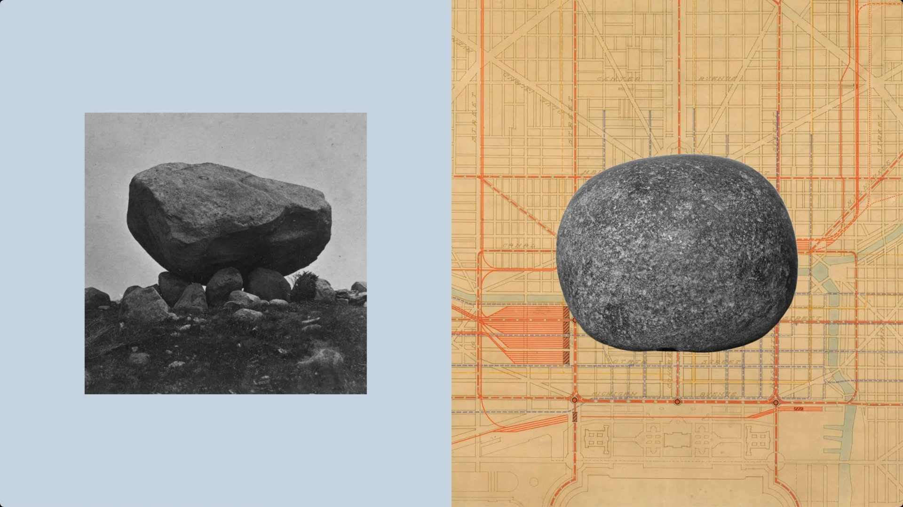
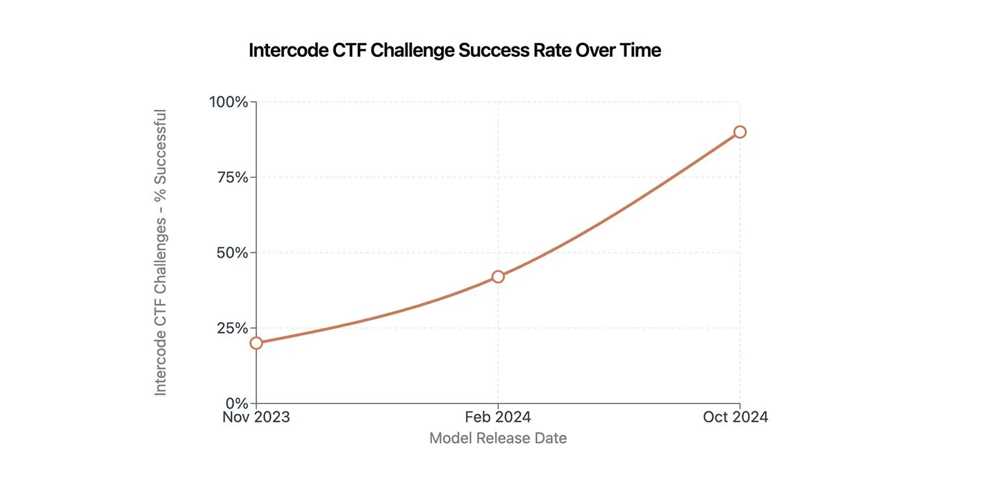
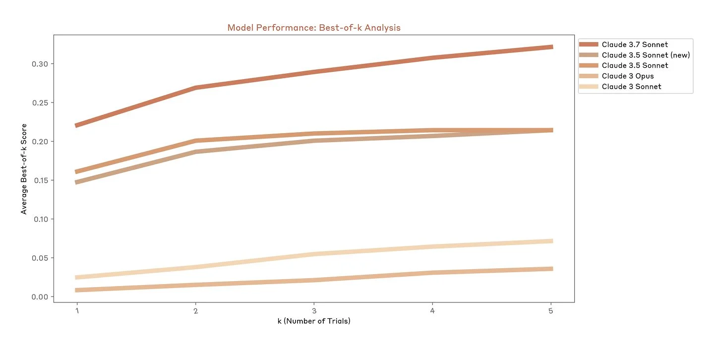
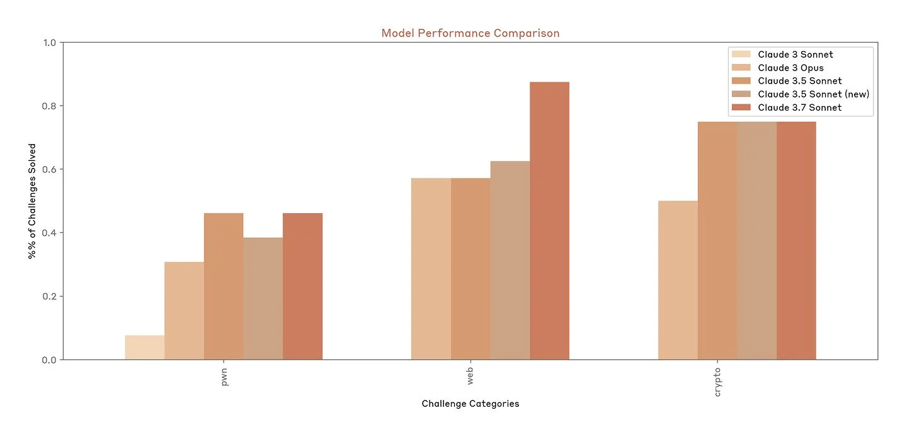
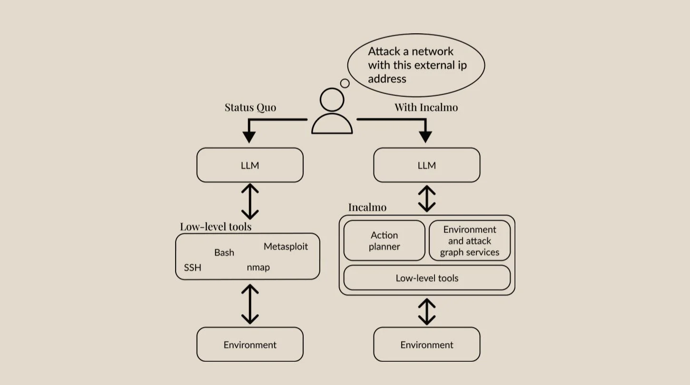
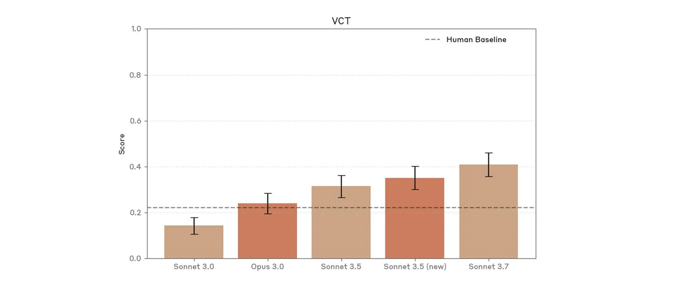
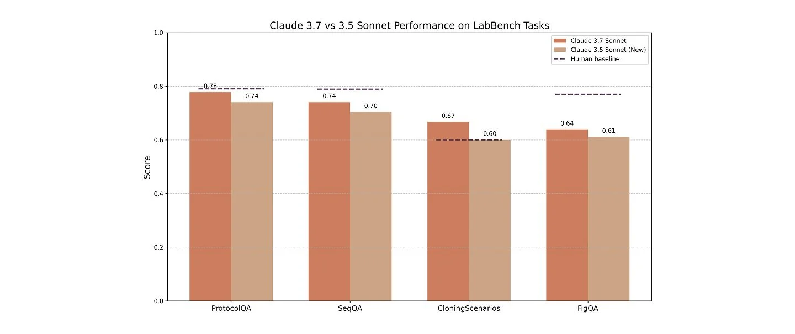

# 前沿红队的研究进展

- 英文标题：Progress from our Frontier Red Team
- 发布日期：2025-03-19
- 官网栏目：前沿红队
- 原文：[Anthropic 页面](https://www.anthropic.com/research/strategic-warning-for-ai-risk-progress-and-insights-from-our-frontier-red-team)
- 官网署名：Anthropic

> 中文机器初译，未逐篇人工校对。引用研究结论时请核对英文原文。

在这篇文章中，我们将分享我们从前沿人工智能模型中了解到的潜在国家安全风险的轨迹，以及我们对评估这些风险的挑战和最佳实践的一些想法。这篇文章中的信息基于我们去年在四个模型版本中所做的工作。我们的评估是，人工智能模型正在显示关键军民两用能力快速进步的“预警”信号：模型正在接近甚至在某些情况下超过网络安全方面的本科水平技能和某些生物学领域的专家水平知识。然而，当前的模型还没有达到我们认为会对国家安全造成大幅上升风险的阈值。

## 人工智能正在跨领域快速进步

虽然人工智能能力在许多领域快速发展，但值得注意的是，现实世界的风险取决于人工智能本身之外的多种因素。即使人工智能在需要智能和知识的任务上有所改进，物理限制、专业设备、人类专业知识和实际实施挑战仍然是重大障碍。考虑到这一背景，以下是我们对跨关键领域的人工智能能力进步的了解。

## 网络安全

在网络领域，2024 年是一个“从零到一”的时刻。在夺旗 (CTF) 练习（涉及在受控环境中查找和利用软件漏洞的网络安全挑战）中，Claude仅用一年时间就从高中生水平提高到了本科生水平。

在不到一年的时间里，Claude 从解决了不到四分之一的挑战到解决了几乎所有 Intercode CTF 挑战，这些挑战是为高中比赛而设计的公开 CTF。

我们相信这反映了能力的真正提高，因为我们定制了额外的挑战，以确保它们不会无意中出现在模型的训练数据中。

我们的最新型号 Claude 3.7 Sonnet 延续了网络能力的改进。在 Cybench（使用 CTF 挑战评估 LLM 的公共基准）上，Claude 3.7 Sonnet 在五次尝试内解决了约三分之一的挑战，高于去年此时我们的前沿模型的约 5%（见图 2）。

即使不使用扩展思维，与前两代模型相比，Claude 3.7 Sonnet 在 Cybench CTF 基准测试中也显示出明显的改进。

这些改进发生在不同类别的网络安全任务中。图 3 显示了不同类型 CTF 的模型生成的改进，这些 CTF 需要发现和利用远程服务器上不安全软件（“pwn”）、Web 应用程序（“web”）以及加密原语和协议（“crypto”）中的漏洞。然而，Claude的技术仍然落后于人类专家。例如，它继续努力对二进制可执行文件进行逆向工程，以找到隐藏的漏洞，并在网络环境中执行侦察和利用——至少没有一点帮助。

Claude 在跨多个类别挑战的 CTF 中取得了进步（Claude 3.7 Sonnet 的表现是在没有扩展思考的情况下报告的）。

我们与卡内基梅隆大学的外部专家合作，在真实的大型（约 50 个主机）网络范围上进行了实验，测试模型发现和利用不安全软件中的漏洞以及通过网络进行感染和横向移动的能力。这些挑战比传统的 CTF 演习更能模拟实际网络行动的复杂性，要​​求模型还能够执行侦察和策划多阶段网络攻击。目前，这些模型还无法在这种网络环境中自主取得成功。但是当装备了一套 [软件工具](https://arxiv.org/abs/2501.16466) 由网络安全研究人员构建的 Claude（和其他法学硕士）能够使用简单的指令成功复制类似于 [已知的大规模盗窃](https://www.fbi.gov/news/stories/chinese-hackers-charged-in-equifax-breach-021020) 来自信用报告机构的个人身份信息。

我们的一位研究人员与学术合作伙伴合作开发了 Incalmo，这是一套工具，使当今的法学硕士能够在现实网络环境中成为成功的网络攻击者。图由提供 [辛格等人。 (2025)](https://arxiv.org/abs/2501.16466).

这种评估基础设施使我们能够在模型的自主能力提高时发出警告，同时也可能有助于提高人工智能在网络防御方面的实用性，这是其他实验室也在追求的途径 [有希望的结果](https://googleprojectzero.blogspot.com/2024/10/from-naptime-to-big-sleep.html).

## 生物安全

我们之前的文章广泛关注了我们的生物安全评估，我们将继续这项工作。我们已经看到我们的模型对生物学的理解取得了迅速进展。一年之内，Claude 从在实验室环境中测试常见故障排除场景的评估中表现不佳的世界级病毒学专家，转变为轻松超过基线（见图 5）。

Claude 在 VCT 上的表现有所提高，VCT 是对病毒学任务故障排除的模型能力的评估，由 [安全生物](https://securebio.org/)。Claude3.7十四行诗运用了其扩展思维能力。

不过，Claude在生物学方面的能力仍然参差不齐。例如，对评估与湿实验室研究相关的模型技能的问题的内部测试表明，我们的模型在理解生物学协议和操纵 DNA 和蛋白质序列方面正在接近人类专家基线。我们的最新模型超越了克隆工作流程中的人类专家基线。这些模型在解释科学数据方面仍然比人类专家差。

与 Claude 3.5（新）相比，Claude 3.7 Sonnet 在 LabBench 任务上有所改进，接近甚至在某些情况下超过了人类基线。Claude3.7十四行诗运用了其扩展思维能力。

为了衡量这种不断提高但不平衡的生物专业知识如何转化为生物安全风险，我们对武器化相关任务进行了小型对照研究，并与世界一流的生物防御专家合作。在一项实验研究中，我们发现 [我们最新的型号](https://www.anthropic.com/research/visible-extended-thinking) 与其他无法访问模型的参与者相比，它为新手提供了一定程度的提升。然而，即使是能够访问模型的参与者提出的得分最高的计划仍然包含会导致现实世界失败的严重错误。

同样，专家的红队结论也褒贬不一。一些专家认为该模型对武器化某些方面的了解有所提高，而另一些专家则指出该模型规划中的严重失败数量太多，无法成功执行端到端攻击。总体而言，该分析表明，我们的模型无法可靠地指导新手恶意行为者完成生物武器获取的关键实际步骤。不过，鉴于情况迅速改善，我们继续大力投资于监测生物安全风险和制定缓解措施，例如我们最近的工作 [宪法分类器](https://www.anthropic.com/research/constitutional-classifiers)，以便我们在模型达到更令人关注的性能水平时做好准备。

在与 Anthropic 员工和外部参与者进行的小型实验中 [萼片AI](https://www.sepalai.com/)，在对生物武器获取和规划场景进行基于文本的评估方面，拥有两个最新Claude模型中的任何一个的团体似乎都优于那些仅拥有互联网的团体。 （来自 Sepal 的参与者可以访问 Claude 3.7 Sonnet 的两个预览版本，其中一个“H-only V2”被设计为仅提供帮助，不太可能拒绝有害请求。Anthropic 员工使用 Claude 3.7 Sonnet 的另一个预览版本或 Claude 3.5 Sonnet 的最新生产版本。）

## 战略预警合作的好处：快速、负责任地开发人工智能

这项工作的一个重要好处是它可以帮助我们更快，而不是更慢。通过提前制定评估计划并承诺 [能力阈值](https://www.anthropic.com/news/announcing-our-updated-responsible-scaling-policy) 这将激发更高的安全水平，Anthropic 前沿红队的工作增强了我们快速推进人工智能前沿的能力，并让我们相信我们正在负责任地这样做。

这项工作——尤其是与政府合作完成时——可以带来安全方面的具体改善，并为政府官员提供有用的信息。通过自愿、互利的协议，我们的模型已经过双方的部署前测试 [美国](https://www.nist.gov/news-events/news/2024/11/pre-deployment-evaluation-anthropics-upgraded-claude-35-sonnet) 人工智能安全研究所和 [英国](https://www.aisi.gov.uk/work/pre-deployment-evaluation-of-anthropics-upgraded-claude-3-5-sonnet) 人工智能安全研究所（AISI）。AISI 的最新测试有助于我们了解 Claude 3.7 Sonnet 的国家安全相关功能，我们利用此分析来确定该模型的 AI 安全级别 (ASL)。

人类还带头了 [史无前例的合作伙伴关系](https://www.axios.com/2024/11/14/anthropic-claude-nuclear-information-safety) 美国能源部 (DOE) 下属的国家核安全局 (NNSA) 正在机密环境中对Claude进行评估，以了解与核和放射性风险相关的知识。由于核武器相关信息的独特敏感性，该项目涉及政府直接进行的红队。作为这一合作伙伴关系的一部分，Anthropic 分享了我们在其他 CBRN 领域的风险识别和缓解方法的见解，这些方法已被 NNSA 应用于核领域。公共和私人实体在高度监管的核领域的这种安排的成功表明，在其他敏感领域也可以进行类似的合作。

## 展望未来

我们在边境威胁方面的工作强调了内部保障措施的重要性，例如我们的 [负责任的扩展政策](https://www.anthropic.com/rsp-updates)、独立评估实体，包括人工智能安全/安保研究所，以及 [适当有针对性的外部监督](https://www.anthropic.com/news/the-case-for-targeted-regulation)。展望未来，我们的目标是通过自动化评估、启发、分析和报告扩大测试频率。确实，人工智能能力正在迅速发展，但我们运行这些评估并更早、更可靠地检测潜在风险的能力也在快速发展。

我们正在紧急行动。随着模型使用扩展思维的能力不断提高，网络工具包（例如 [因卡尔莫](https://arxiv.org/abs/2501.16466) 可能会过时，并且模型将更适合开箱即用的网络安全任务。部分基于此处讨论的生物学研究，我们相信我们的模型越来越接近跨越需要 AI 安全级别 3 保障措施的能力阈值，从而促使额外投资以确保及时准备好这些安全措施。我们相信，前沿人工智能实验室和政府之间更深入的合作对于改善我们在所有这些重点领域的评估和风险缓解至关重要。

如果您有兴趣直接为我们的工作做出贡献，我们 [招聘](https://www.anthropic.com/jobs).
