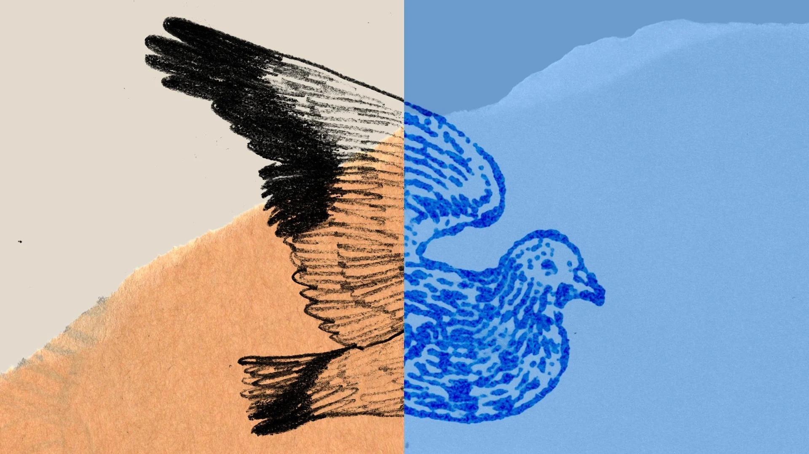

# 用 Crosscoder 比较模型差异的研究发现

- 英文标题：Insights on crosscoder model diffing
- 发布日期：2025-02-20
- 官网栏目：可解释性
- 原文：[Anthropic 页面](https://www.anthropic.com/research/crosscoder-model-diffing)
- 官网署名：Anthropic
- 归档范围：官网介绍页。另站发布的论文或报告请使用下方链接。
- 官网推荐阅读：[读取变压器电路](https://transformer-circuits.pub/2025/crosscoder-diffing-update/index.html)

> 中文机器初译，未逐篇人工校对。引用研究结论时请核对英文原文。

在上面的链接中，我们报告了 Anthropic Interpretability 团队在 Crosscoder Model Diffing 上的一些开发工作，活跃在该领域的研究人员可能会对这些工作感兴趣。

一如既往，我们会要求读者像同事在实验室会议上分享几分钟的想法或初步实验一样对待这些结果，而不是一篇成熟的论文。
