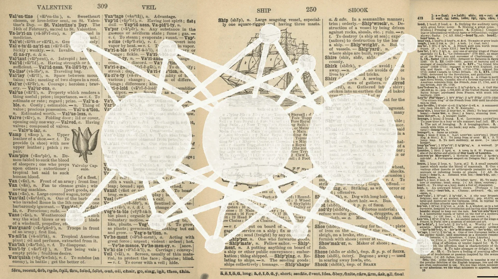
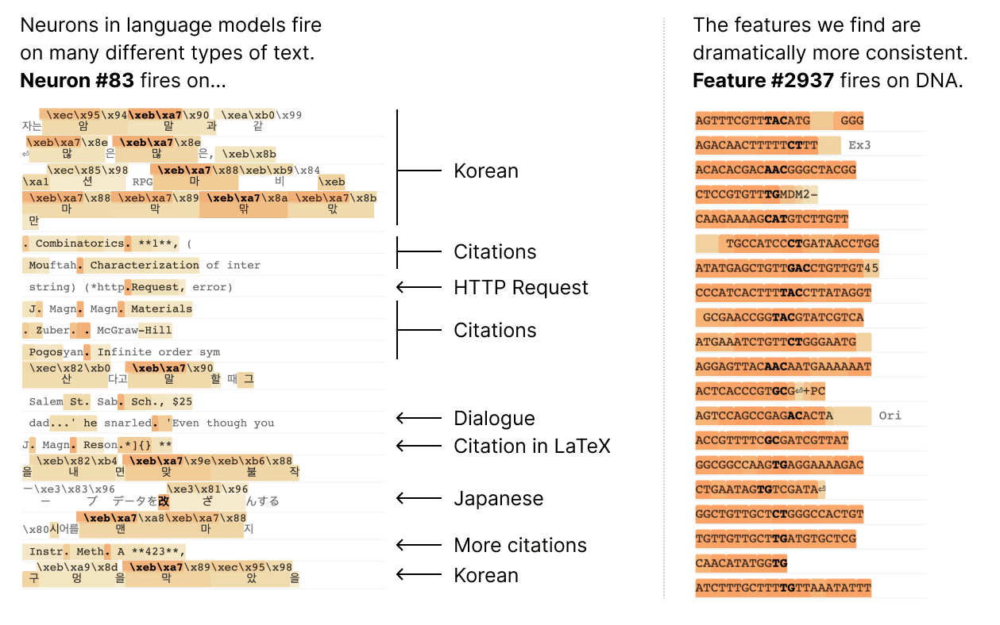
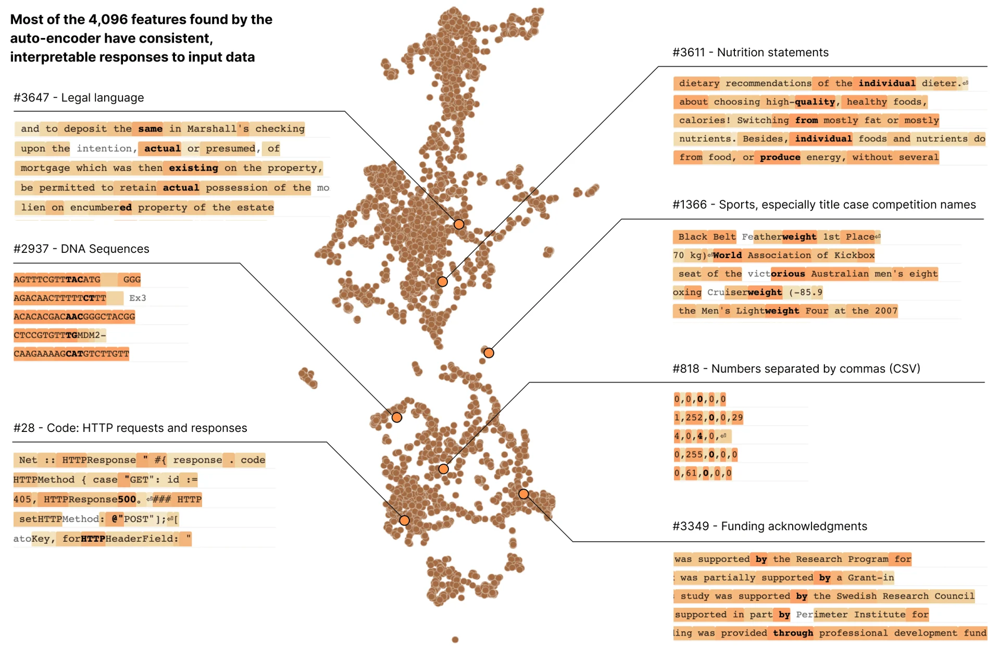
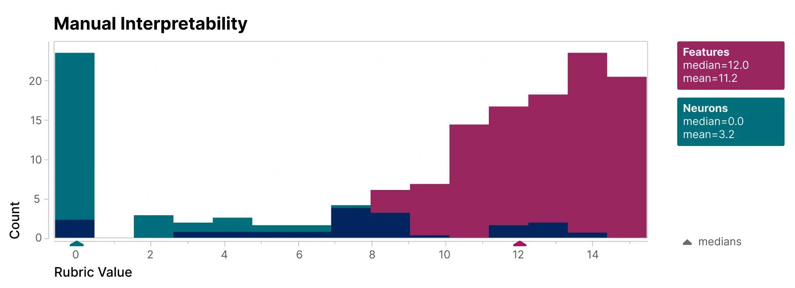
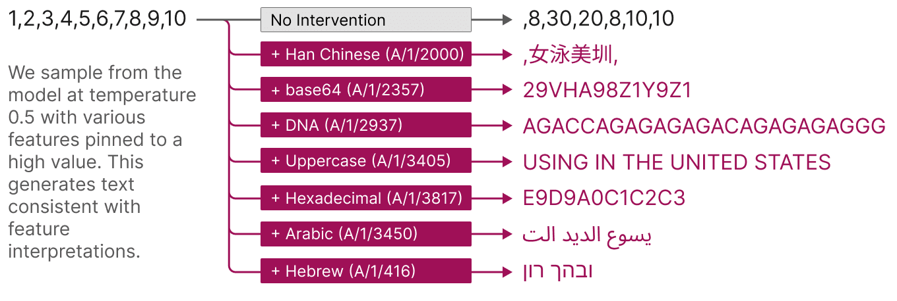

# 把语言模型分解为可理解的组件

- 英文标题：Decomposing language models into understandable components
- 发布日期：2023-10-05
- 官网栏目：可解释性
- 原文：[Anthropic 页面](https://www.anthropic.com/research/decomposing-language-models-into-understandable-components)
- 官网署名：Anthropic

> 中文机器初译，未逐篇人工校对。引用研究结论时请核对英文原文。

神经网络是根据数据进行训练的，而不是根据规则进行编程。每一步训练都会更新数百万或数十亿个参数，以使模型更好地完成任务，到最后，模型能够执行一系列令人眼花缭乱的行为。我们准确地理解训练网络的数学——神经网络中的每个神经元都执行简单的算术——但我们不明白为什么这些数学运算会导致我们看到的行为。这使得诊断故障模式变得困难，难以知道如何修复它们，并且难以证明模型真正安全。

神经科学家在理解人类行为的生物学基础方面面临着类似的问题。人脑中放电的神经元必须以某种方式实现他们的想法、感受和决策。数十年的神经科学研究已经揭示了许多关于大脑如何工作的信息，并为癫痫等疾病提供了针对性的治疗，但仍有很多谜团。幸运的是，对于我们这些试图理解人工神经网络的人来说，实验要容易得多。我们可以同时记录网络中每个神经元的激活，通过沉默或刺激它们进行干预，并测试网络对任何可能输入的响应。  

不幸的是，事实证明单个神经元与网络行为没有一致的关系。例如， [单个神经元](https://transformer-circuits.pub/2023/monosemantic-features/vis/a-neurons.html#feature-83) 在小语言模型中，它活跃在许多不相关的上下文中，包括：学术引文、英语对话、HTTP 请求和韩语文本。在经典的视觉模型中， [单神经元](https://distill.pub/2017/feature-visualization/#diversity) 对猫的面孔和汽车的前部做出反应。一个神经元的激活在不同的情况下可能意味着不同的事情。

在我们最新的论文中， [*迈向单义性：通过字典学习分解语言模型*](https://transformer-circuits.pub/2023/monosemantic-features/index.html)，我们概述了存在比单个神经元更好的分析单元的证据，并且我们已经构建了可以让我们在小型变压器模型中找到这些单元的机制。这些单位称为特征，对应于神经元激活的模式（线性组合）。这提供了一条将复杂的神经网络分解为我们可以理解的部分的途径，并建立在之前解释神经科学、机器学习和统计学中高维系统的努力的基础上。

在 Transformer 语言模型中，我们将包含 512 个神经元的层分解为 4000 多个特征，这些特征分别表示 DNA 序列、法律语言、HTTP 请求、希伯来语文本、营养声明等等。当单独观察单个神经元的激活时，大多数模型属性是不可见的。

为了验证我们发现的特征比模型神经元更容易解释，我们让一位盲人评估者对其可解释性进行评分。特征（红色）的分数比神经元（青色）高得多。

我们还采用“自动解释性”方法，使用大型语言模型生成小模型特征的简短描述，我们根据另一个模型根据该描述预测特征激活的能力对其进行评分。同样，特征的得分高于神经元，这提供了额外的证据，表明特征的激活及其对模型行为的下游影响具有一致的解释。

这些功能还提供了有针对性的模型引导方式。如下所示，人为激活某个功能会导致模型行为以可预测的方式发生变化。

最后，我们缩小并查看整个功能集。我们发现，所学到的特征在不同模型之间很大程度上是通用的，因此通过研究一种模型中的特征所学到的经验教训可以推广到其他模型。我们还尝试调整我们学习的特征数量。我们发现这提供了一个“旋钮” [改变分辨率](https://transformer-circuits.pub/2023/monosemantic-features/index.html#phenomenology-feature-splitting) 我们看到模型时：将模型分解为一小组特征提供了更容易理解的粗略视图，而将其分解为一大组特征提供了更精细的视图，揭示了微妙的模型属性。

这项工作是 Anthropic 对机械可解释性投资的结果——这是我们对人工智能安全的长期研究赌注之一。到目前为止，单个神经元无法解释的事实给语言模型的机械理解带来了严重的障碍。将神经元组分解为可解释的特征有可能克服这个障碍。我们希望这最终将使我们能够从内部监控和引导模型行为，从而提高企业和社会采用所必需的安全性和可靠性。  

我们的下一个挑战是将这种方法从我们展示成功的小型模型扩展到规模大很多倍、复杂得多的前沿模型。我们第一次感到解释大型语言模型的下一个主要障碍是工程而不是科学。  

要了解有关这一切的更多信息，请阅读我们的论文， [*迈向单义性：通过字典学习分解语言模型*](https://transformer-circuits.pub/2023/monosemantic-features/index.html).
