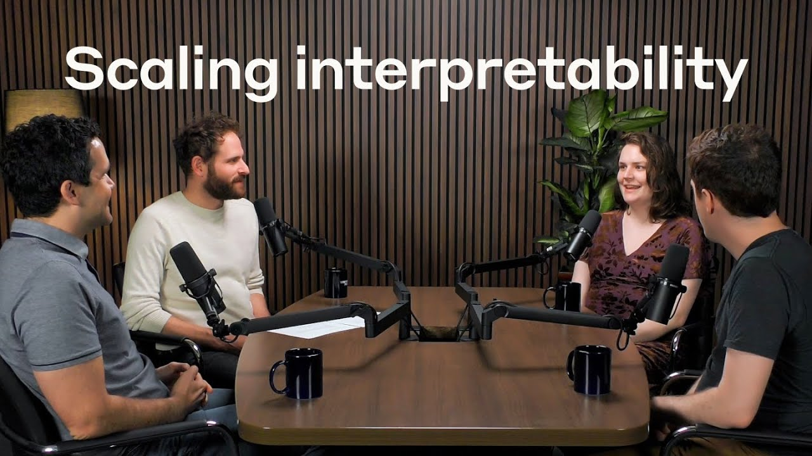

# 扩大可解释性研究规模的工程挑战

- 英文标题：The engineering challenges of scaling interpretability
- 发布日期：2024-06-13
- 官网栏目：可解释性
- 原文：[Anthropic 页面](https://www.anthropic.com/research/engineering-challenges-interpretability)
- 官网署名：Anthropic

> 中文机器初译，未逐篇人工校对。引用研究结论时请核对英文原文。

*在这篇文章和上面的圆桌会议视频中，我们的研究人员反思了科学与工程进步之间的密切关系，并讨论了他们在将可解释性研究扩展到更大的人工智能模型时遇到的技术挑战。*

去年十月，人择解释团队发表了 [迈向单义性](https://transformer-circuits.pub/2023/monosemantic-features)，一篇将字典学习技术应用于小型变压器模型的论文。今年5月，我们发布了 [缩放单义性](https://transformer-circuits.pub/2024/scaling-monosemanticity/)，我们将相同的技术应用于大几个数量级的模型。我们在 Claude 3 Sonnet 中发现了数千万个“特征”（与语义概念相关的神经元组合），这代表着在理解人工智能模型的内部运作方面向前迈出了重要一步。

为了继续取得这一进步，我们需要更多的工程师。

如果您只阅读过我们早期的论文（例如 [框架](https://transformer-circuits.pub/2021/framework/index.html) 和 [叠加玩具模型](https://transformer-circuits.pub/2022/toy_model/index.html)），这需要相对较少的工程。但阅读最新的研究应该可以清楚我们面临的工程挑战的规模。

下面，我们分享了我们最新研究中涉及的技术工程问题的两个示例。这些说明了我们的工程师目前正在解决的问题类型，并有助于解释为什么我们认为工程将成为人工智能可解释性以及最终人工智能安全研究进展的主要瓶颈之一。

如果您是一名工程师，那么这篇文章就是针对您的。如果您受到下面讨论的工程问题示例的启发，我们强烈鼓励您申请我们的 [研究工程师角色](https://boards.greenhouse.io/anthropic/jobs/4020305008).

## 工程问题1：分布式Shuffle

我们的稀疏自动编码器（我们用来研究“特征”的工具）是根据变压器的激活进行训练的，并且需要对这些激活进行洗牌以阻止它们学习虚假的、依赖于顺序的模式。当我们第一次开始训练稀疏自动编码器时，我们可以将训练数据放在单个 GPU 上并对其进行简单的洗牌。但最终，我们希望扩展到超出内存所能容纳的范围（想象一下，从洗一副纸牌的简单任务开始，然后扩展到洗满整个仓库的纸牌——这是一个更困难的问题）。

此时，我们可以实现可扩展到 PB 级的分布式 shuffle。相反，我们决定采用一种可以快速实施的方法，但这种方法的扩展性较差。我们将随机播放分为 *K* 每个职位负责 1/*K* 混洗后的输出数据。我们生成了一个排列，让每个作业对所有训练数据进行流式读取，然后让它写出其输出份额。这使我们能够进一步扩展，但缺点也很明显：每个作业都必须读取所有训练数据。这首先需要几个小时，后来又需要几天。当我们正在努力的时候 [迈向单义性](https://transformer-circuits.pub/2023/monosemantic-features/index.html)，我们有 100TB 的训练数据（1000 亿个数据点，每个数据点 1KB），洗牌成了一个大问题。

执行可扩展的分布式洗牌并不是一个新颖或前沿的问题。但这只是我们必须快速解决才能取得科学进步的众多工程问题之一。

在这种情况下，我们发现了一个 [有用的博客文章](https://blog.janestreet.com/how-to-shuffle-a-big-dataset/) 并将进场延伸至许多关口。对于一次通过，我们有 *N* 工作机会。每个作业读取 1/*N* 数据集，对其进行打乱，并将数据写出 K 个文件，每个文件的大小为 1/*NK细胞* 的数据。每个作业写入的第一个文件的内容代表第一个1/*K* 最终的混洗数据，但仍然需要进行混洗。第二个文件也是如此，依此类推。在一次传递中，我们将所有数据的一次洗牌减少到 *N* 洗牌，每个 *K* 倍小。现在，如果洗牌适合单台机器上的内存，我们可以对其进行洗牌，然后就完成了。如果它们不适合，我们可以再运行一次。

假设每个作业可以在内存中保存 100GB 的数据，并且我们写入一百个 1GB 的文件。每一遍都会将所需的洗牌大小减少 100 倍。一次可以混洗 100GB 的数据，两次可以混洗 10TB，三次可以混洗 1PB，四次可以混洗 100PB，以此类推。

自从我们实施这种方法以来，我们就不再考虑洗牌了。现在一切都发生得很快，没有任何问题。当然有比我们更好的方法和更快的实施。但这种方法解决了我们的瓶颈，让我们有时间解决下一个问题。

## 工程问题2：特征可视化管道

另一个工程挑战是为我们的特征可视化生成基础数据，这使用户能够看到作为单个特征的一部分被最强烈激活的特定标记以及其他信息（[请参阅此链接中《Towards Monosemanticity》论文中的特征浏览器](https://transformer-circuits.pub/2023/monosemantic-features/vis/a1.html)).

对于每个特征，我们希望找到各种数据集示例，将其激活到不同级别，探索其完整分布。对数百万个特征有效地执行此操作是一个有趣的分布式系统问题。最初，所有这些都在一个作业中运行 - 但我们很快就扩展了范围。下面是我们当前方法的草图。

我们的可视化数据集有 1 亿个 token，我们需要处理数百万个特征。首先，我们对数据集和特征进行“分片”，将它们分成许多不同的部分。每个作业都会迭代其数据集切片，并为其特征切片跟踪 *K* 每个功能的最高激活令牌和 10**K* 激活该功能的随机令牌（我们已经在 s3 中缓存了转换器激活，因此我们不需要重新计算它们）。

接下来，我们对特征进行分片并聚合前一遍的结果。这为我们提供了整个数据集中每个功能的最高激活令牌，以及激活该功能的一组随机令牌。这些是我们将在特征可视化中显示的示例。

对于每个示例，我们需要计算该功能如何在周围的标记上触发。我们的第一个方法是对功能进行分片。每个作业都会加载其负责的功能示例的变压器激活。问题是这些例子是随机分布在数据集中的：没有简单的方法来阅读 *仅* 工作所需的数据。

为了改进这一点，我们添加了对数据集进行分片的过程。在此设置中，每个作业处理一部分转换器激活，并将每组功能所需的激活保存到单独的文件中。然后，我们可以运行功能传递并轻松访问我们需要的数据。我们计算该功能在周围令牌上触发的程度，然后以我们的前端网站可以读取和显示的格式写出所有相关数据。

## 我们正在寻找什么

当我们开始研究稀疏自动编码器时，我们不知道这种方法是否有效。我们进行的实验越多，我们对自己的研究就越有信心。这促使我们对基础设施进行更多投资，以便我们可以进行更大规模的实验。这个过程一直持续到 [缩放单义性](https://transformer-circuits.pub/2024/scaling-monosemanticity/)，我们最新的论文。

这个过程指出了我们在可解释性团队中所做的工程工作的类型，以及我们认为研究和工程是不可分割的这一事实。通常，我们的团队成员会在研究和工程之间来回切换，在返回研究之前从我们当前的系统中挤出更多的规模来启动新的实验。由于许多研究想法无法实现，因此在看到成功之前，我们不会对其基础设施进行更多投资。

研究是团队的努力，既要落实想法，又要反复思考。我们不只是假设；我们还做假设。我们测试、构建、迭代和扩展。

正因为如此，我们特别有兴趣聘请能够跨不同领域灵活工作的通才工程师——无论是构建管道、运行 ML 实验还是优化 GPU 使用。

如果您是一位符合这一要求的工程师，并且对人工智能安全充满热情，我们很乐意看到您的应用程序。看看我们的职位描述 [研究工程师角色](https://boards.greenhouse.io/anthropic/jobs/4020305008)，并在我们的 [招聘页面](https://www.anthropic.com/careers) 可解释性团队中的其他几个空缺职位。

## 常见问题解答

1. **您正在招聘多少个职位？** Interpretability 团队目前有 18 名成员，并且我们正在快速成长。目前，我们正在多个地点招聘至少五名高级工程师和两名团队经理。看看我们的 [招聘页面](https://www.anthropic.com/careers) 对于列表。
2. **可解释性团队是否与其他团队合作？** 是的。我们与其他研究团队（特别是对齐团队）密切合作。Anthropic 是一个“团队科学”组织，团队之间的界限以最好的方式是宽松的——这使我们能够快速完成很多工作。
3. **您如何选择要开展的项目？** 我们根据 Anthropic 的角度来思考我们的研究路线图 [负责任的扩展政策](https://www.anthropic.com/news/anthropics-responsible-scaling-policy)，它承诺公司在开发或部署高于相应能力水平的模型之前要达到各种安全里程碑。在思考研究方向时，我们会考虑可解释性的研究前景，我们能够解决哪些问题，以及可解释性团队的工作如何影响这些安全里程碑。在日常层面上，我们的研究往往是非常探索性的，但这是一种以上述考虑为指导的探索。
4. **Interpretability 团队的成员有哪些背景？** Interpretability 团队的成员具有广泛的专业背景，包括神经科学、数学、生物学、物理学、数据可视化和软件工程。
5. **你们对湾区以外的候选人开放吗？** 该团队目前在旧金山、波士顿、纽约、西雅图和伦敦都有成员。最大的集中地在旧金山，这些成员每周有几天来到办公室。我们对远程工作持开放态度，要求一年中约 25% 的时间访问 Anthropic 办公室。看看我们的 [招聘页面](https://www.anthropic.com/careers) 有关我们所有未平仓头寸的更多信息。
