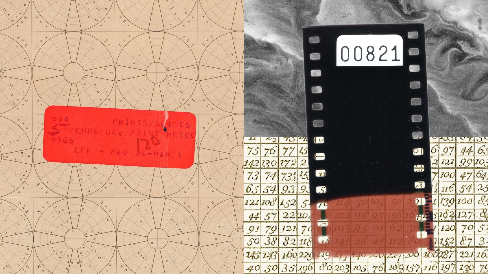

# 用字典学习得到的特征做分类器

- 英文标题：Using dictionary learning features as classifiers
- 发布日期：2024-10-16
- 官网栏目：可解释性
- 原文：[Anthropic 页面](https://www.anthropic.com/research/features-as-classifiers)
- 官网署名：Anthropic
- 归档范围：官网介绍页。另站发布的论文或报告请使用下方链接。
- 官网推荐阅读：[读取变压器电路](https://transformer-circuits.pub/2024/features-as-classifiers/index.html)

> 中文机器初译，未逐篇人工校对。引用研究结论时请核对英文原文。

*在上面的链接中，我们报告了人类可解释性团队关于开发基于特征的分类器的一些开发工作，这些工作可能会引起在该领域积极工作的研究人员的兴趣。我们要求您像对待同事在实验室会议上花几分钟分享一些想法或初步实验一样对待这些结果，而不是对待一篇成熟的论文。*
