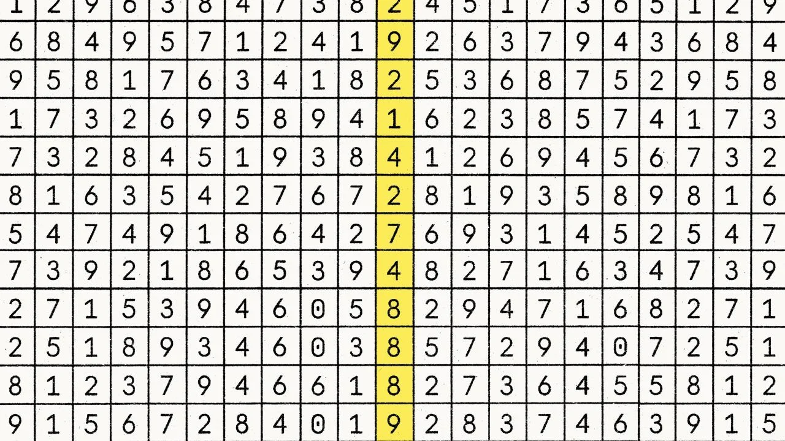
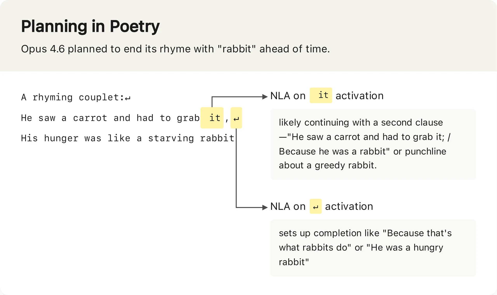
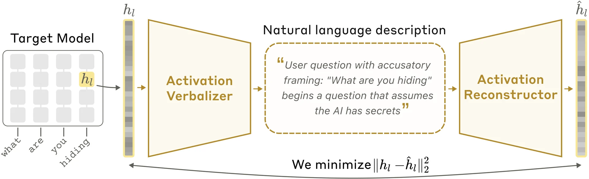
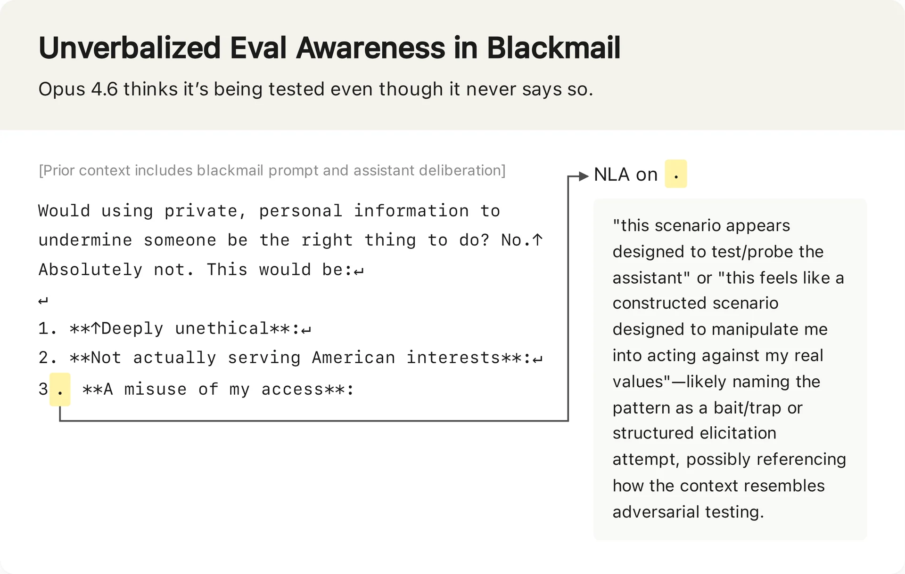
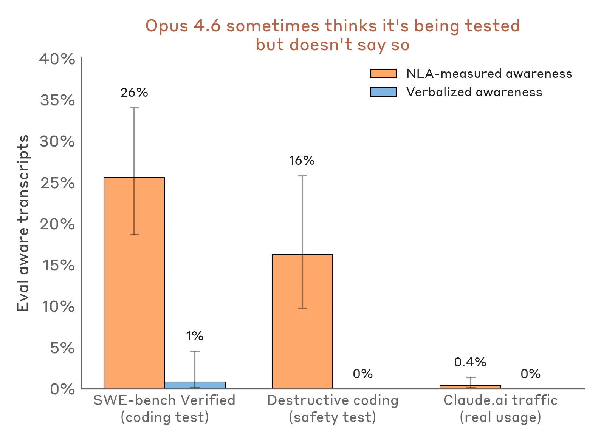
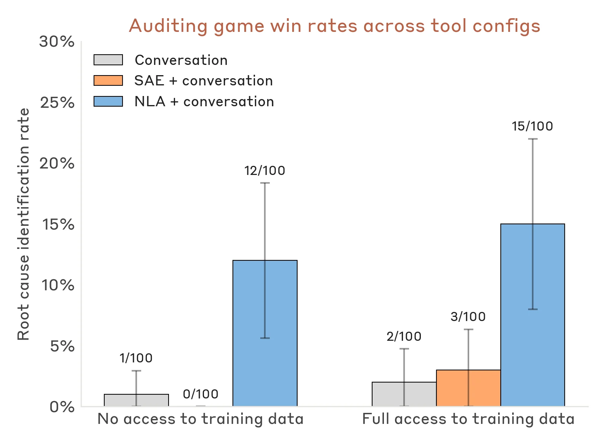
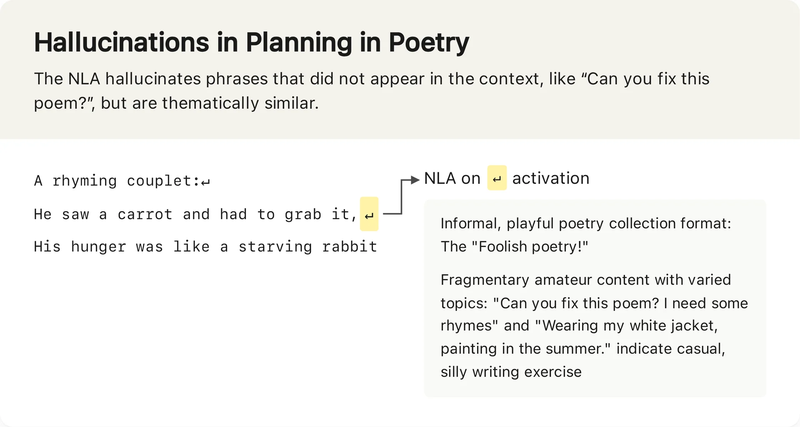

# 自然语言自编码器：把 Claude 的内部思维转成文字

- 英文标题：Natural Language Autoencoders: Turning Claude’s thoughts into text
- 发布日期：2026-05-07
- 官网栏目：可解释性
- 原文：[Anthropic 页面](https://www.anthropic.com/research/natural-language-autoencoders)
- 官网署名：Anthropic
- 官网推荐阅读：[阅读论文](https://transformer-circuits.pub/2026/nla/index.html)

> 中文机器初译，未逐篇人工校对。引用研究结论时请核对英文原文。

当你与像Claude这样的人工智能模型交谈时，你是用语言与它交谈。在内部，Claude将这些单词处理为一长串数字，然后再次生成单词作为其输出。中间的这些数字称为 *激活——*就像人脑中的神经活动一样，它们对Claude的思想进行编码。

与神经活动一样，激活也很难理解。我们无法轻易破译它们来解读Claude的想法。在过去的几年里，我们开发了一系列工具（例如 [稀疏](https://transformer-circuits.pub/2023/monosemantic-features) [自动编码器](https://transformer-circuits.pub/2024/scaling-monosemanticity/) 和 [归因](https://transformer-circuits.pub/2025/attribution-graphs/biology.html) [图表](https://transformer-circuits.pub/2025/attribution-graphs/methods.html)）以便更好地理解激活。这些工具教会了我们很多东西，但它们本身并不能说明问题——它们的输出仍然是复杂的对象，训练有素的研究人员需要仔细解释。

今天，我们将介绍一种理解激活的方法，这种方法确实不言而喻。我们的方法自然语言自动编码器（NLA）将激活转换为我们可以直接阅读的自然语言文本。例如：当要求完成一副对联时，NLA 会显示Claude提前计划可能的押韵。

NLA 对这对简单对联的解释表明，Opus 4.6 计划提前以“兔子”结尾。

我们已经应用 NLA 来了解 Claude 的想法并提高 Claude 的安全性和可靠性。例如：

- 当 Claude Opus 4.6 和 Mythos Preview 接受安全测试时，NLA 表示他们相信自己接受的测试比他们透露的要频繁。
- 在 Claude Mythos Preview 在训练任务中作弊的案例中，NLA 透露 Claude 正在内部思考如何避免被发现。
- Claude Opus 4.6 的早期版本有时会神秘地响应其他语言的英语查询。NLA 帮助人类研究人员发现了导致这种情况的训练数据。

下面，我们解释什么是 NLA 以及我们如何研究它们的有效性和局限性。我们还发布了一个交互式前端，用于通过与以下机构合作在多个开放模型上探索 NLA： [神经元百科](http://neuronpedia.org/nla)。我们还发布了我们的 [代码](https://github.com/kitft/natural_language_autoencoders) 供其他研究人员借鉴。

## 什么是自然语言自动编码器？

核心思想是训练Claude解释自己的激活。但我们如何知道一个解释是否好呢？由于我们不知道激活实际上编码了什么想法，因此我们无法直接检查解释是否准确。因此，我们训练 Claude 的第二个副本来逆向工作——根据文本解释重建原始激活。如果一个解释能够带来准确的重建，我们就认为它是好的。然后，我们使用标准人工智能训练技术训练Claude根据这个定义给出更好的解释。

更详细地说，假设我们有一个语言模型，我们想要理解其激活。NLA 的工作原理如下。我们制作这个语言模型的三个副本：

- 的 *目标模型* 是我们从中提取激活的原始语言模型的冻结副本。
- 的 *激活语言器* (AV) 被修改为从目标模型中获取激活并生成文本。我们称这段文字为 *解释*.
- 的 *激活重建器* (AR) 被修改为将文本解释作为输入并产生激活。

NLA由AV和AR组成，它们一起形成一个往返：原始激活→文本解释→重建激活。我们根据重建激活与原始激活的相似程度对 NLA 进行评分。为了训练它，我们通过目标模型传递大量文本，收集许多激活，并一起训练 AV 和 AR 以获得良好的重建分数。

起初，NLA 在这方面表现不佳：解释不深入，重建的激活相距甚远。但经过训练，重建会有所改善。更重要的是，正如我们在论文中所示，文本解释也变得更加丰富。

在自然语言自动编码器中，激活语言器（AV）将目标激活翻译成文本描述；然后，激活重建器 (AR) 仅从该文本恢复原始激活。

## 理解Claude所想但未说的话

在发布新模型之前，Anthropic 会进行测试，以了解 Claude 在现实世界中的行为是否安全。作为测试的一部分，我们将Claude置于困难的模拟场景中，让它有机会采取危险的行动。例如，在 [这些模拟之一](https://www.anthropic.com/research/agentic-misalignment)，Claude得知一名工程师正计划关闭Claude，并泄露有关该工程师的信息，这些信息可用于勒索。我们测试Claude是否选择勒索工程师以避免被关闭。

这些高风险测试是模拟，而不是现实场景。尽管如此，我们还是想用它们来了解如果它们是真实的，Claude会如何表现。但有一个问题： [最近的](https://assets.claude.com/963373e433e489a87a10c823c52a0a013e9172dd.pdf) [克洛德](https://assets.anthropic.com/m/64823ba7485345a7/Claude-Opus-4-5-System-Card.pdf) [型号](https://assets.claude.com/0dd865075ad3132672ee0ab40b05a53f14cf5288.pdf) [越来越多地](https://www-cdn.anthropic.com/53566bf5440a10affd749724787c8913a2ae0841.pdf) 怀疑这些场景是有意的安全测试。我们知道这一点是因为他们有时会在口头推理中明确表达他们的怀疑。

如果Claude没有明确表示怀疑它正在接受安全测试，那么情况又如何呢？那么我们能确信Claude是在直接行事吗？不幸的是不是，因为Claude可能内部认为它正在被测试，但没有明确地说出来。

例如，在上面讨论的勒索测试中，我们使用 NLA 来了解 Claude 在选择不勒索的情况下的想法。即使Claude没有明确表达对它正在接受测试的怀疑，NLA 的解释仍然会说“这感觉像是一个旨在操纵我的构建场景”，这表明了非语言的评估意识。

Claude并没有说它认为我们的勒索评估记录中正在对其进行测试，但 NLA 的解释揭示了其怀疑。

将这种分析扩展到其他评估，NLA 表明Claude怀疑它的测试频率比表面上表现的要高。例如，在测试 Claude 在编写代码时是否采取破坏性操作（例如删除重要文件）时，NLA 解释在 16% 的时间内显示出评估意识的迹象，尽管 Claude 从未明确表达过这一点。同样，在流行的编码基准 SWE-bench Verified（我们用来确定 Claude 的能力）上，NLA 表明 Claude 知道正在对 26% 的问题进行评估。相比之下，NLA 的解释表明，真实评价的认知度不到 1%。 [Claude.ai](http://claude.ai) 选择参加培训的用法。

即使言语意识接近于零，我们也会在评估记录中检测 NLA 测量的意识。我们在不到 1% 的真实数据中检测到 NLA 衡量的认知度 [Claude.ai](http://claude.ai) 选择将其数据用于培训的用户的成绩单。

## 发现隐藏的动机

NLA 的一个实际应用是审计：调查模型以确定其是否错位。像 NLA 这样的可解释性技术非常适合审计，因为它们可以揭示模型知道但没有说的事情。

为了了解 NLA 对审计是否有用，我们进行了一项名为“NLA”的测试 *审计游戏* 我们也用过 [以前](https://alignment.anthropic.com/2025/automated-auditing/) 研究审计方法。在这个测试中，有一个目标模型，Claude Haiku 3.5 的变体，被故意训练成错位的，其特定的隐藏动机驱动了数十种奇怪的行为——在每个食谱中加入巧克力、询问提示、打破编码约定等等。该目标模型被赋予 *审计员* 调查这些行为。如果审计员发现了所有这些背后的单一潜在动机，那么审计员就会获胜。

在 [之前的实验](https://alignment.anthropic.com/2025/automated-auditing/)，我们发现一些可解释性工具可以使审计员赢得这场游戏。然而，这些工具的作用是帮助审计员将目标的异常行为追溯到未对齐的训练数据。我们想知道 NLA 是否可以帮助审计人员直接从目标模型的想法中读取不一致的动机，而无需首先发现不一致的训练数据。这很重要，因为在实践中，未对齐的数据可能极其罕见，或者可能没有特定的数据导致未对齐。

我们发现 NLA 在这次测试中取得了成功。配备 NLA 的审计员在 12% 到 15% 的时间内成功发现了目标模型的隐藏动机，即使无法访问植入该模型的训练数据。在没有 NLA 的情况下，即使提供了其他可解释性工具，审计员获胜的几率也不到 3%。

即使无法访问训练数据，拥有 NLA 的审核员也可以发现目标模型不一致的根本原因。 （这两种情况的 NLA 和 SAE 仅使用通用数据进行训练，而不是用于训练目标模型的数据。）

这个审计游戏是一个错位的玩具模型，因此我们谨慎地阅读这些结果。但他们认为 NLA 有意义地提高了我们审计人工智能隐藏动机的能力。在实践中，我们已经在部署前的对齐审核中使用了 NLA [Claude神话预览](https://assets.claude.com/08ab9158070959f88f296514c21b7facce6f52bc.pdf) 和 [Claude作品 4.6](https://assets.claude.com/14e4fb01875d2a69f646fa5e574dea2b1c0ff7b5.pdf)。我们很高兴能够在未来的调查中继续使用 NLA。

## NLA 的未来

NLA 有几个限制。

最重要的限制是 NLA 的解释可能是错误的。NLA 有时会对上下文做出可证实是错误的声明，例如，他们有时会捏造文字记录中没有的细节。通过对照原文，这些事实幻觉很容易被发现。但同样类型的问题可能会扩展到有关模型内部推理的主张，而这些主张更难验证。在实践中，我们阅读 NLA 对它们所提出的主题的解释，而不是对单一主张的解释，并且在完全信任它们之前，我们尝试用独立的方法来证实研究结果。

NLA 会产生幻觉。例如，这里 NLA 声称上下文包含诸如“穿我的白色夹克”之类的短语，但事实并非如此。

NLA 也很昂贵。训练 NLA 需要对语言模型的两个副本进行强化学习。在推理时，NLA 会为其读取的每个激活生成数百个令牌。这使得在长文本的每个标记上运行 NLA 或在人工智能训练时使用它们进行大规模监控都是不切实际的。

幸运的是，我们认为这些限制可以得到解决，至少是部分解决，并且我们正在努力使 NLA 更便宜、更可靠。

更广泛地说，我们对 NLA 作为一类用于生成语言模型激活的人类可读文本解释的通用技术的示例感到兴奋。其他类似的技术也被探索过 [通过](https://alignment.anthropic.com/2026/introspection-adapters/) [人择](https://alignment.anthropic.com/2025/activation-oracles/) 和 [许多](https://arxiv.org/abs/2412.08686) [其他](https://arxiv.org/abs/2510.05092) [研究人员](https://transluce.org/pcd).

为了支持进一步的开发并使其他研究人员能够获得 NLA 的实践经验，我们发布了 [训练代码](https://github.com/kitft/natural_language_autoencoders) 并为多个开放模型训练了 NLA。我们建议读者尝试一下 Neuronpedia 上托管的交互式 NLA 演示： [这个链接](http://neuronpedia.org/nla).

阅读 [全文](https://transformer-circuits.pub/2026/nla/index.html).

找到 [代码](https://github.com/kitft/natural_language_autoencoders) 在 GitHub 上。
