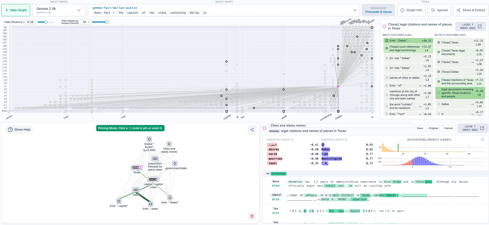

# 开源电路追踪工具

- 英文标题：Open-sourcing circuit tracing tools
- 发布日期：2025-05-29
- 官网栏目：可解释性
- 原文：[Anthropic 页面](https://www.anthropic.com/research/open-source-circuit-tracing)
- 官网署名：Anthropic

> 中文机器初译，未逐篇人工校对。引用研究结论时请核对英文原文。

在我们最近的可解释性研究中，我们引入了一种新方法 [追踪思想](https://www.anthropic.com/research/tracing-thoughts-language-model) 一个大的语言模型。今天，我们开放了该方法的源代码，以便任何人都可以在我们的研究基础上进一步发展。

我们的方法是生成 *归因图*，它（部分）揭示了模型内部为决定特定输出而采取的步骤。开源的 [图书馆](https://github.com/safety-research/circuit-tracer) 我们发布的版本支持在流行的开放权重模型上生成归因图，并且由 Neuronpedia 托管的前端可让您交互式地探索这些图。

该项目由我们的参与者领导 [人类研究员](https://alignment.anthropic.com/2024/anthropic-fellows-program/) 计划，与合作 [解码研究](https://www.decoderesearch.org/).

Neuronpedia 上交互式图形浏览器 UI 的概述。

要开始使用，您可以访问 [神经元百科界面](https://www.neuronpedia.org/gemma-2-2b/graph) 生成并查看您自己的归因图以获取您选择的提示。对于更复杂的使用和研究，您可以查看 [代码库](https://github.com/safety-research/circuit-tracer)。该版本使研究人员能够：

1. **跟踪电路** 在支持的模型上，通过生成自己的归因图；
2. **可视化、注释和共享** 交互式前端中的图表；
3. **测试** **假设** 通过修改特征值并观察模型输出如何变化。

我们已经使用这些工具来研究 Gemma-2-2b 和 Llama-3.2-1b 中的多步推理和多语言表示等有趣的行为 - 请参阅我们的演示 [笔记本](https://github.com/safety-research/circuit-tracer/blob/main/demos/circuit_tracing_tutorial.ipynb) 示例和分析。我们还邀请社区帮助我们找到其他有趣的电路——作为灵感，我们提供了尚未在演示笔记本和 Neuronpedia 上分析的其他归因图。

我们的首席执行官达里奥·阿莫代 [最近写的](https://www.darioamodei.com/post/the-urgency-of-interpretability) 关于可解释性研究的紧迫性：目前，我们对人工智能内部运作原理的理解远远落后于我们在人工智能能力方面取得的进展。通过开源这些工具，我们希望让更广泛的社区更容易研究语言模型内部发生的事情。我们期待看到这些工具的应用程序来理解模型行为，以及改进工具本身的扩展。

*开源电路查找库是由 [人类研究员](https://alignment.anthropic.com/2024/anthropic-fellows-program/) Michael Hanna 和 Mateusz Piotrowski 在 Emmanuel Ameisen 和 Jack Lindsey 的指导下。Neuronpedia 集成是由 [解码研究](https://www.decoderesearch.org/) （神经百科负责人：Johnny Lin；科学负责人/总监：Curt Tigges）。我们的 Gemma 图基于经过训练的转码器 [宝石镜](https://ai.google.dev/gemma/docs/gemma_scope) 项目。如有问题或反馈，请在 GitHub 上打开问题。*
