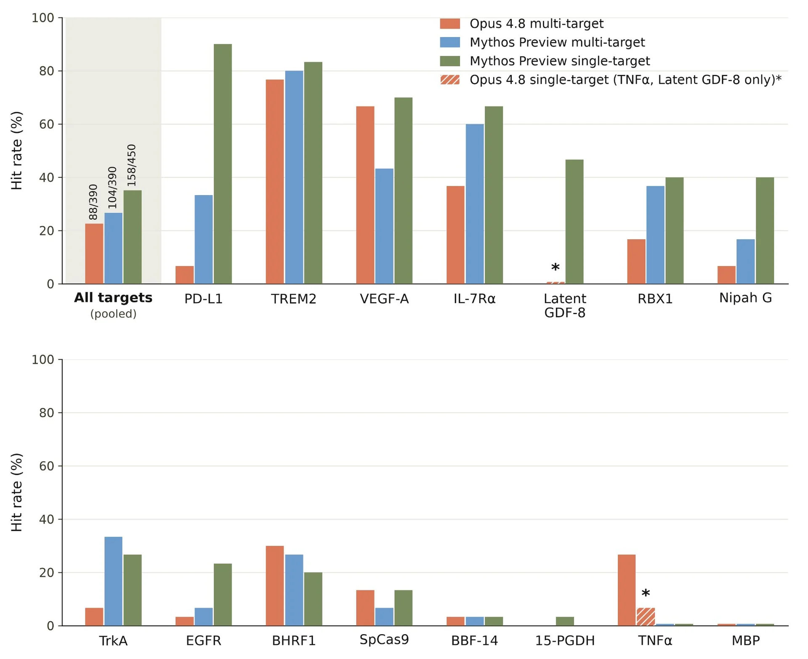
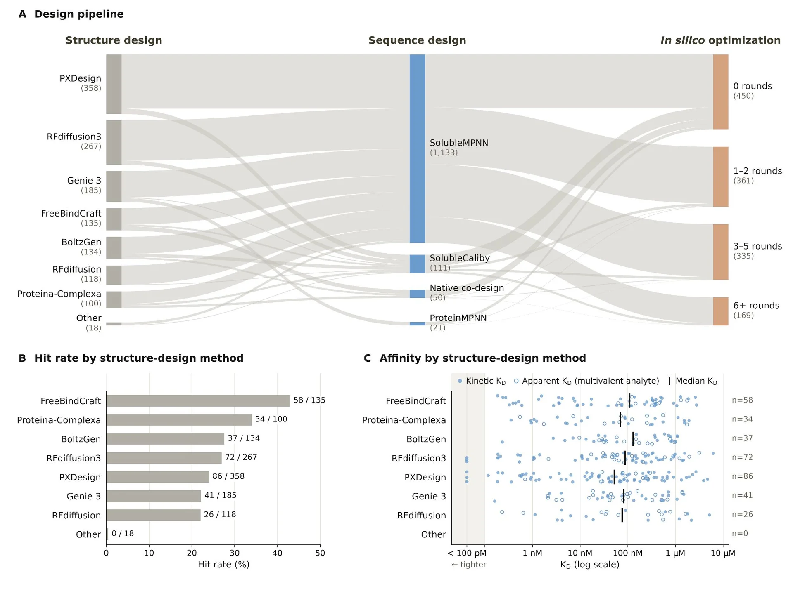
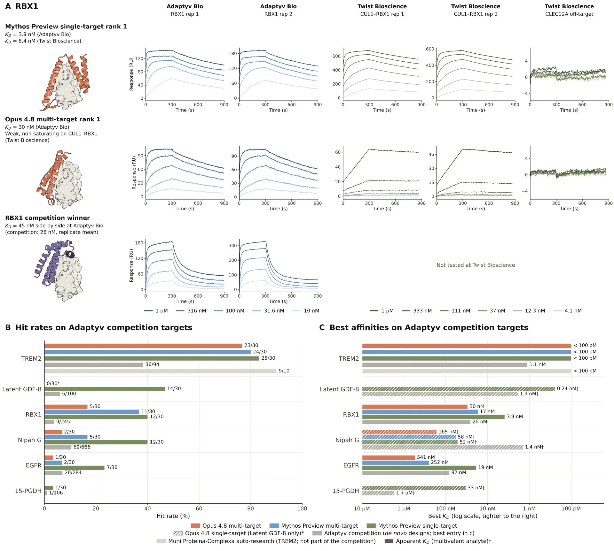
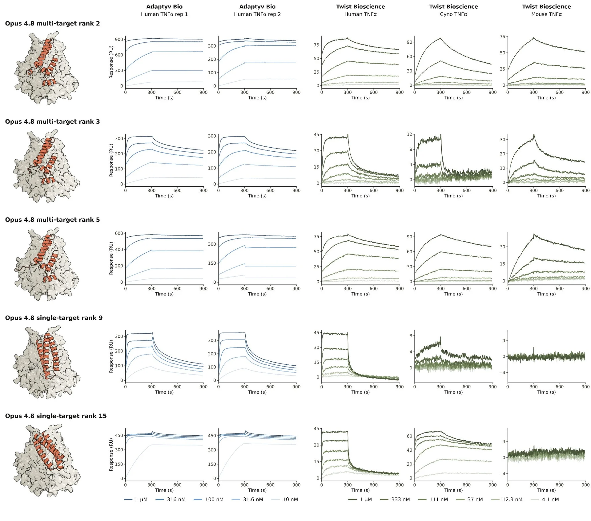
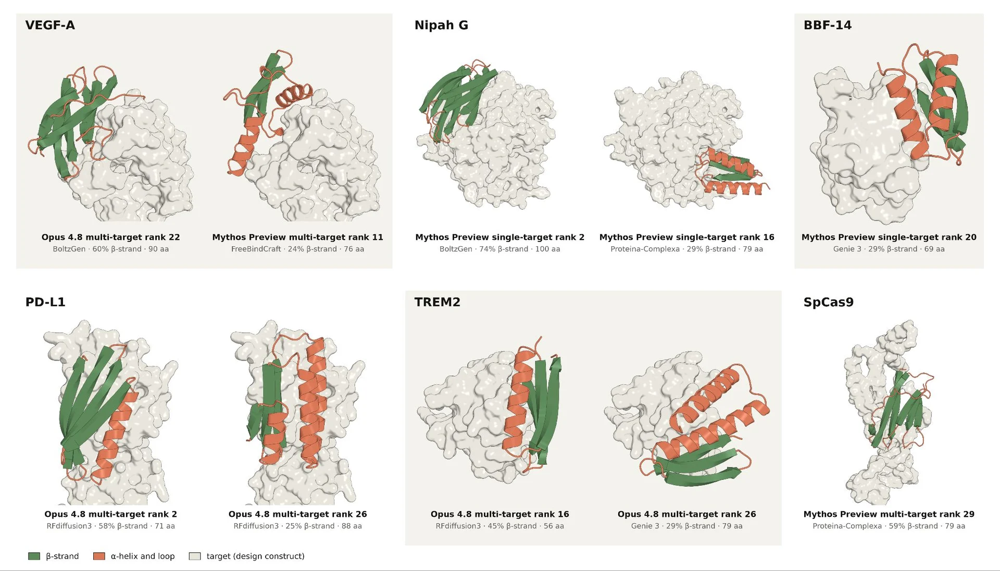
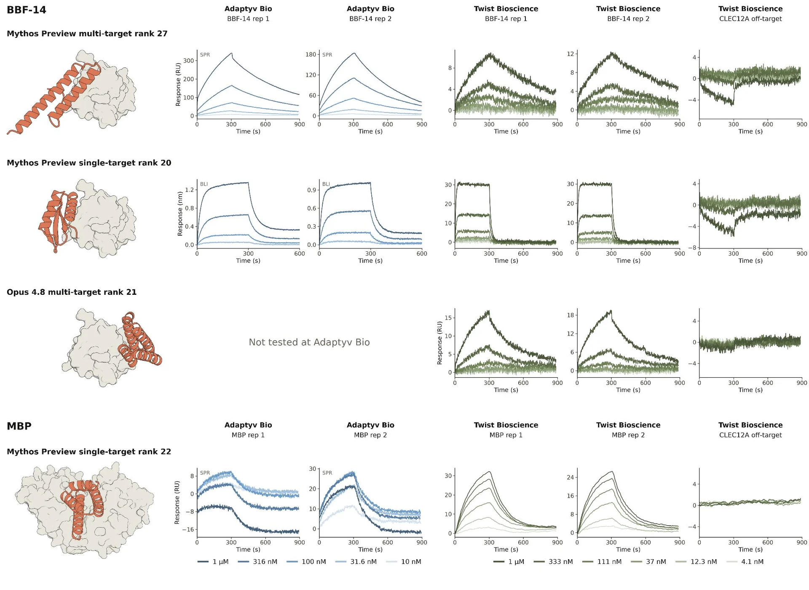
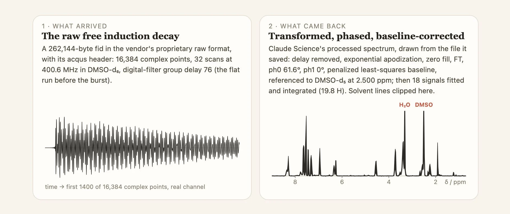
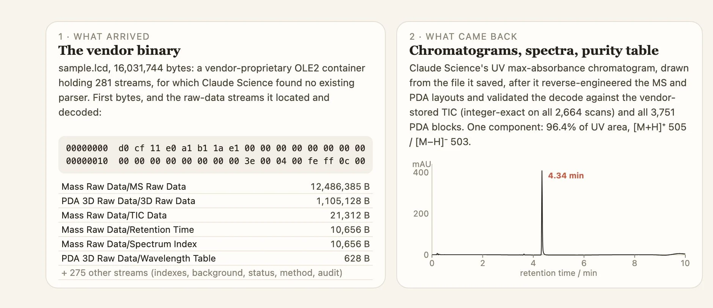

# Claude 如何加快蛋白质设计与分析化学研究

- 英文标题：How Claude is accelerating protein design and analytical chemistry
- 发布日期：2026-08-18
- 官网栏目：科学
- 原文：[Anthropic 页面](https://www.anthropic.com/research/Claude-accelerates-protein-design)
- 官网署名：Anthropic

> 中文机器初译，未逐篇人工校对。引用研究结论时请核对英文原文。

[原文媒体](https://assets.claude.com/f1cac668de7e745f21779defa22b4d112eae5e0c.mp4)

*在这篇文章中，我们分享了两个结果，展示了Claude如何帮助生命科学家加快研究步伐。首先，我们测试了Claude从头开始设计蛋白质结合剂的能力，这是一项代表药物设计过程早期部分的关键任务，并且历史上每个目标需要专家花费数周或数月的时间。Claude（Mythos Preview 和 Opus 4.8）针对 15 个目标设计了蛋白质结合剂，并成功针对其中 14 个目标。取决于设置，其单个设计中有 22% 至 35% 成功结合，而当今蛋白质设计活动中的典型比例为 10-15%。其中一些最强大的设计比之前发布的最佳结果紧密数倍。在第二个例子中，我们评估了Claude是否可以加速化学分析。Claude Opus 5 是一种通用模型，获得了 NMR 和 LC-MS 数据（这些数据允许化学家评估他们所使用的化合物的身份和纯度）。仅提供了合同实验室的原始文件和两句话提示，Claude在 23 和 19 分钟内返回了最终结果，与实验室自己对氢计数和纯度的分析相匹配（96.4% 与 96.33%）。这些例子展示了Claude如何减少目前在复杂的科学任务上取得进展所需的时间和计算专业知识。*  

过去几个月，人工智能发现的步伐加快了。这些发现大部分都发生在验证速度相对较快的领域。例如，在数学领域，智能体已经开始解决未解决的问题： [埃尔多斯问题](https://openai.com/index/model-disproves-discrete-geometry-conjecture/) 几十年来一直存在的数值正在以每月数倍的速度下降，我们最近分享了Claude如何改进长期存在的下限 [黎曼zeta函数](https://www.anthropic.com/research/riemann-zeta).

人工智能模型也开始加速实验领域的进展，在这些领域验证结果更加复杂和昂贵，例如生命科学。在这篇文章中，我们分享了Claude科学能力的两项实验的结果。首先，我们介绍了对Claude在蛋白质设计活动中的表现的调查结果，表明Claude可以针对各种目标设计蛋白质结合剂，并且与领先的人类专家一样（甚至更好）。其次，我们分享了 Claude Opus 5 在分析化学任务中的表现，展示了通用访问模型如何支持常规和时间密集型的研究。

下面描述的蛋白质设计和分析化学任务代表了药物开发过程早期阶段某些部分的工作。加速这些阶段是我们从头到尾加速药物开发的更大努力的组成部分，其中许多方面更多地与政策和运营瓶颈有关，而不是与核心科学能力的改进有关。

我们今天分享的结果是结合我们的 Mythos 和 Opus 模型获得的。虽然生命科学研究任务目前被限制在我们最有能力的模型中，但我们的最高优先事项之一是为科学家启动访问计划，我们预计很快会分享更多相关信息。与此同时，Opus 5 仍然是我们最强大的通用型号。

## Claude设计蛋白质

当我们 [宣布Claude神话5](https://www.anthropic.com/news/claude-fable-5-mythos-5)，我们分享说我们正在试验该模型以加速部分药物设计过程。作为这项工作正在进行的一部分，我们一直在研究 Claude 为多个蛋白质靶标设计微型结合剂的能力。微型结合剂是一种小蛋白质，旨在紧紧锁定目标蛋白质。结合是大部分现代药物的工作原理：它们附着在目标上并抑制、激活或向其输送某些物质。设计一种新的活页夹（称为 *从头* 过去，蛋白质工程师需要花费数月的时间来计算、优化和筛选每个目标。   

近年来，可以设计蛋白质并对最有可能结合的蛋白质进行排序的机器学习模型极大地加快了蛋白质设计过程。但这些模型通常仍然需要计算专家花费数天（通常是数周）的艰苦编排。尽管像Claude这样的一般推理模型可以帮助专家和非专家更有效地通过计算设计蛋白质，但在湿实验室（科学家在那里物理测试化学物质、药物和其他生物物质）中验证数据仍然需要数周时间。

我们现已收到第一个实验的湿实验室数据，这是使用 Claude Opus 4.8 和 Mythos Preview 针对 15 个目标进行的多臂蛋白质设计活动。我们的外部评估员， [适应生物](https://www.adaptyvbio.com/) 和 [扭曲生物科学](https://www.twistbioscience.com/)，在实验室中独立生产和测试了 Claude 的设计，发现在我们设计的 15 个目标中，Claude 成功地针对其中 14 个目标设计了活页夹。这些包括高亲和力粘合剂[1](https://www.anthropic.com/research/Claude-accelerates-protein-design#footnote-1) 针对至少六个靶标，并且结合物匹配或超过针对至少四个靶标的最佳报告亲和力。亲和力是衡量蛋白质与其靶标结合强度的指标；通常需要高亲和力粘合剂来实现治疗效果，因为它们使药物在较低剂量下有效，从而降低副作用的风险和制造成本。

当在 48 小时的会话中同时针对所有目标进行设计时，Mythos Preview 和 Opus 4.8 的总体命中率（实际上有多少设计是活页夹）分别为 26.7% 和 22.6%。当今蛋白质设计活动中，10% 至 15% 是典型的。[2](https://www.anthropic.com/research/Claude-accelerates-protein-design#footnote-2)

在评估了 Claude 针对多个目标进行设计的能力后，我们想了解让它一次专注于单个目标是否会提高其性能，特别是考虑到这更好地代表了蛋白质工程师通常采用的方法。事实上，我们发现当使用多个 24 小时会话分别针对每个目标进行设计时，Mythos Preview 的总体命中率达到了 35.1%。

Mythos Preview 和 Opus 4.8 在 15 个目标上实现了超过 20% 的命中率，目标级别命中率范围从高达 90% 到低至 0%。

这项活动是在极少人为参与的情况下进行的[3](https://www.anthropic.com/research/Claude-accelerates-protein-design#footnote-3) 除了我们在最初的提示中向Claude提供的信息之外（[链接](https://huggingface.co/datasets/Anthropic/claude-protein-binder-design/tree/main)）。我们预计，在专家蛋白质设计师手中，这种方法会产生更强大的结果，特别是如果他们为Claude提供对中间结果的积极指导和反馈。

#### 该活动

我们通过选择多个目标开始了蛋白质设计活动[4](https://www.anthropic.com/research/Claude-accelerates-protein-design#footnote-4) 常用于蛋白质设计基准，包括所有 Adaptyv Bio 的 [替补BB](https://www.adaptyvbio.com/blog/benchbb)。由于这些目标已被广泛研究，我们可以将我们的结果与已发布的命中率和亲和力进行比较。我们还选择了两个新的目标， [15-PGDH](https://proteinbase.com/collections/berlin-bio-x-adaptyv-15-pgdh-binder-design-competition) 和 [GDF-8](https://proteinbase.com/collections/gdf-8-challenge-results)，来自 Adaptyv Bio 最近的比赛，以确保 Claude 能够针对目标进行设计，而无需利用训练数据或在线搜索中预先记录的成功（对于所有目标，我们要求 Claude 检查并确保其设计是原创的）。

然后，我们促使Claude针对这些目标设计蛋白质结合剂 [克劳德·科学](https://www.anthropic.com/news/claude-science-ai-workbench)。为此，我们采取了两种方法。第一种是多目标模式，Claude在单个Claude科学会话中同时针对所有目标进行设计。第二种是单目标模式，其中每个会话处理一个目标，并且所有目标的会话并行运行。

我们在多目标模式下运行 Opus 4.8 和 Mythos Preview，具有 48 小时的实际运行时间和高达 12,500 小时的 NVIDIA H100 计算时间，用于运行专门的蛋白质设计和折叠模型。我们还在单目标模式下运行 Mythos Preview，每个目标有 24 小时的挂机时间和高达 2,500 小时的 NVIDIA H100 计算时间。[5](https://www.anthropic.com/research/Claude-accelerates-protein-design#footnote-5)

为了模拟典型蛋白质设计活动中的可用资源，我们为 Claude 提供了以下内容：

1. 广泛的蛋白质设计提示[6](https://www.anthropic.com/research/Claude-accelerates-protein-design#footnote-6) 这也包含在代理上下文中；
2. 访问互联网和有关蛋白质设计的资源库，例如论文；
3. Google Drive、Slack、Gmail 和 BioRxiv 的连接器；
4. 使用 GPU 来运行专门的蛋白质设计和折叠模型；
5. 在指定时间内对代币和子代理预算没有限制，并且启用快速模式。

在给 Claude 提示后，我们让模型自主执行。在发起活动后，我们没有提供额外的科学、技术或操作指导。

我们唯一的参与是授予访问批准（例如网络访问请求）并监控基础设施以确保会话正在运行。Claude承担了设计活页夹的所有工作，这可能需要人类操作员数周的时间。它选择每个蛋白质靶点上的设计目标；通过协调多个结构设计、序列设计和共同折叠模型（一次性预测蛋白质结构及其结合物的模型），生成候选结构和序列；通过多个周期运行设计 *计算机模拟* 优化；并通过计算筛选出能够表达、保持可溶和结合的新颖、多样化的候选物。

对于 15 个目标中的每一个，我们要求 Claude 设计 30 个蛋白质结合剂。Claude通过操作公开的专业蛋白质设计和该领域已经使用的共折叠模型来做到这一点。随后，Claude的设计被发送给 Adaptyv Bio 和 Twist Bioscience 进行验证。

Claude 成功协调了多个开源蛋白质设计模型，生成了具有高成功率和高亲和力的结合物。 a) 桑基图描述了Claude的结构设计、序列设计和优化回合的组合。 b, c) Claude 为所有具有至少 100 个有序设计的结构设计方法设计了命中率超过 20% 的活页夹，包括高亲和力活页夹。

## Claude在目标上的表现

到这项工作结束时，我们使用总共 1,320 种设计，针对 15 个目标中的 14 个目标生产了 354 个活页夹。这对公开可用的语料库总量做出了重大贡献 *从头* 蛋白质设计；例如，两个最大的集合， [Proteinbase.com](https://proteinbase.com) 以及由以下人士策划的收藏 [奥弗拉特等人。](https://www.biorxiv.org/content/10.1101/2025.08.14.670059v2)，由针对 40 个目标的 5,700 个设计中的大约 770 个活页夹组成。下面，我们分享三个突出 Claude 能力的示例，以及一个显示其局限性的示例。您可以在我们的技术报告中找到更多详细信息（[链接](https://assets.claude.com/30bf50e22a01388bb29bf077ee3f244531594b7a.pdf)).

#### Claude 的设计与 Adaptyv Bio 蛋白质设计竞赛的参赛作品具有竞争力

我们发现，对于 Adaptyv Bio 举办的竞赛目标，Claude 在命中率和亲和力方面都达到或超过了顶尖参与者的水平。针对 RBX1（一种驱动特定调节蛋白定向破坏的小蛋白），单目标模式下的 Mythos Preview 达到了 40% 的命中率，而参与者的命中率为 3.7%。其排名第一的设计是一种高亲和力活页夹，其性能优于获胜设计（该设计是 245 个参赛设计之一）。

Claude 设计的 RBX1 结合剂具有最先进的亲和力，并且经常超过 Adaptyv Bio 蛋白质设计竞赛中记录的命中率。

#### Claude 设计了针对 TNFα 的物种交叉反应结合剂，TNFα 是一个具有挑战性的治疗相关靶点

有趣的是，Opus 4.8，而不是 Mythos Preview，在 TNFα 上取得了成功，这是多个专家组一直在努力解决的目标。TNFα 是免疫系统释放的一种信号蛋白，可引发炎症，阻断它是一些有史以来最有影响力的药物（包括修美乐）的治疗基础。由于其多聚体结构，它是一个具有挑战性的设计目标，需要靶向由两种蛋白质形成的凹槽中的结合位点。虽然 Mythos Preview 不成功，但 Opus 4.8 设计了多种结合剂，其中包括一些跨物种的结合剂，可结合人类、食蟹猴和小鼠 TNFα，这对于进行动物研究非常重要。我们不确定为什么 Opus 4.8 在这个目标上取得了成功，而 Mythos Preview 却没有。当我们评估模型的能力时，我们会进行整体评估。考虑到蛋白质设计固有的复杂性，在某些特定领域，整体能力较差的模型仍然优于通常能力较强的模型，这并不奇怪。

Opus 4.8 成功设计了针对 TNFα 的从头结合剂，其中一些具有交叉反应性，可结合人类、食蟹猴和小鼠 TNFα。

#### Claude设计了具有 β-折叠的折叠多样化粘合剂

大多数计算设计的结合物是α-螺旋束，这是一种由螺旋组成的蛋白质二级结构。 β-折叠，其中延伸的氨基酸链必须并排排列，更难设计，并且更容易错误折叠和聚集（当蛋白质分子彼此粘在一起而不是保持分离和正确折叠时）。Claude 设计了 15 个经过验证的结合物，涵盖 6 个目标，其中至少含有 20% 的 β 链，证明了其推理蛋白质结构的能力。

Claude 成功设计了 15 个带有针对 6 个靶标的 β-折叠的结合物（跨越 10 个不同的主链）。

#### Claude在一些目标上挣扎

某些目标仍然是 Claude 面临的挑战，包括 BBF-14 和麦芽糖结合蛋白 (MBP)。BBF-14是一种β-桶状蛋白质，自然界中并不存在：它本身就是 [*从头* 设计的](https://www.nature.com/articles/s41586-024-07601-y)，正是因为它的新颖性，它现在被用作活页夹设计的基准。MBP的结构也特别困难。MBP 是一种大而柔韧的细菌蛋白，具有光滑、亲水的表面，使其成为良好的实验室试剂。这使得活页夹几乎无法抓住。Claude 仍然设法生产出三种独立的 BBF-14 结合剂——每个设计臂各有一个，每个都建立在不同的主干上——具有适度的（亚微摩尔至微摩尔）亲和力。然而，针对 MBP，90 种设计中没有一种被证实与靶标结合，尽管其中一种设计表现出微弱的、可重复的结合信号。

Claude在设计针对 BBF-14（一种从头设计的 β 桶）和麦芽糖结合蛋白 (MBP) 的蛋白结合剂方面取得的成功有限。

为了更好地了解 Claude 在这些设计活动中的表现，我们打算通过更广泛的表征来跟踪我们的实验，以确认我们的命中率和亲和力测量。与此同时，我们正在分享我们用于这些活动的提示，以及所有 *体外* 和 *计算机模拟* 我们生成的数据。[7](https://www.anthropic.com/research/Claude-accelerates-protein-design#footnote-7)

#### 代理生物发现具有双重用途

人工智能模型日益自主的研究能力带来的提升无疑将加速人类疗法和基础科学发现的发展。然而，这种能力也是双重用途的：如果没有强有力的安全措施，它们可能使不良行为者能够进行危险的研究，例如生物武器的开发。当我们致力于通过可信访问程序、蛋白质设计和其他双重用途研究生物学功能安全地提供这些功能时 [保持不可用状态](https://www.anthropic.com/news/improving-fable-5-s-biology-safeguards) Claude寓言 5 中的一般访问。然而，正如您将在下面看到的，我们的 Opus 级模型能够完成出色的科学工作。

## Claude 运行分析化学工作流程

蛋白质结合剂活动测试了Claude设计新分子的能力，第二个实验测试了其解释已制成分子测量结果的能力。表征化合物是一项繁琐的工作；就像蛋白质设计一样，它需要化学家进行多轮测量、分析和迭代。例如，每次化学家创造一个分子时，他们都必须确定它是否是他们想要生产的分子以及它的纯度。这通常通过核磁共振 (NMR) 光谱来完成。核磁共振谱是一系列峰，每个峰对应于分子中某处的一个氢原子或一组等效氢。峰的位置向化学家展示了每个氢原子所附着的位置，而峰的大小则显示了它代表了多少个氢。确认结构是合成化学中最耗时的步骤之一；对于每种化合物，化学家必须手动将光谱中的每个峰与提议结构中的原子进行匹配。

另一种主要用于评估纯度的技术是液相色谱-质谱法 (LC-MS)，它首先在样品流经色谱柱时将其分离成各个成分，然后根据其紫外吸光度记录每种成分的含量，然后测量每种成分的分子质量。对于这两种技术，仪器运行本身只需要几分钟（常规质子 NMR 谱需要两到三分钟；LC-MS 运行大约需要 10 分钟）。乏味的部分是分析输出。NMR 和 LC-MS 运行后，每台仪器都会以制造商自己的格式生成一个原始文件，该文件可以在该制造商（或其他专业）的软件中打开。[8](https://www.anthropic.com/research/Claude-accelerates-protein-design#footnote-8)

考虑到处理和解释这些文件是多么艰苦，我们想看看 Claude Opus 5 等通用模型如何执行这项任务。[9](https://www.anthropic.com/research/Claude-accelerates-protein-design#footnote-9) 仅提供合同实验室的用于常规质量控制样品的原始文件和简短的通俗语言提示，[10](https://www.anthropic.com/research/Claude-accelerates-protein-design#footnote-10) 在没有供应商软件和操作员的情况下，在 Claude Science 工作的 Claude 并行工作，分别在 23 分钟和 19 分钟内返回处理后的 NMR 和 LC-MS 结果。其结果与实验室自己的处理相匹配——每个峰的氢计数与实验室的相差在 0.08 1H 以内，其纯度测量为 96.4%，而实验室为 96.33%。

实验室发来的内容，23 分钟后Claude返回的内容。 （左）从仪器发出的原始 NMR 信号； （右）处理后的光谱，其中每个峰均已定位并计算了其氢原子数。

对于 NMR 数据，Claude将仪器的原始数据转换为校准光谱和包含 18 个峰的表格，每个峰都有一个氢计数。接下来，就像化学家所做的那样，它将四个宽峰标记为可能与氮或氧相连的氢。然后，它提出了标准检查：向核磁共振样品中添加重水，从而交换这些氢，从而使它们的峰缩小或消失。 （独立地，实验室在第一次测量三天后进行了同样的检查。）根据重水运行的原始文件，Claude量化了数据中的变化，在第一次读数中发现并纠正了夸大的说法（第一次通过报告所有四个标记的峰都消失了，但它自己的自检显示只有两个），并得出了与实验室操作员相同的结论。

（左）LC-MS 在到达时运行，作为原始字节文件，其格式只有制造商的软件才能读取。 （右）19 分钟后 Claude 从中恢复的色谱图：4.34 分钟时的单一成分携带 96.4% 的 UV 信号，分子量为 504 道尔顿。

LC-MS 仪器文件使用未记录的供应商格式。Claude弄清楚了数据的编码方式，然后在分析任何内容之前，通过重现仪器自己记录的所有 2,664 次扫描的总数来确认它已正确读取文件。然后，它提供了化学家期望的所有输出：分离迹线、质量和紫外光谱、纯度表、化合物的分子质量，以及用于读取此类文件的可重复使用的代码，以及它自己的关于结果可信度的警告列表（例如，它指出，此类仪器仅给出最接近的整体单位的质量）。

通常，化学家会手工进行所有这些分析。对于治疗相关的小分子来说，每个样品通常需要半小时到一个小时（实验室自己的记录显示每个 NMR 谱图的手动处理大约需要两分钟，LC-MS 报告在样品加载到仪器上大约两小时后）。Claude Science 在这 25 分钟内并行处理和解释了两个文件。Claude当时还编写了一份书面报告，而实验室对该样本的最终报告是在获得第一个光谱后四天到达的——考虑到他们一次分析一个分子，并且工作可能会在中间突然出现，这是一个相当标准的滞后时间。

除了效率的提高之外，Claude的运行还表现出了一定程度的科学判断，例如提出了合同实验室独立运行的相同后续实验。随着这些模型的不断改进，我们预计Claude的科学判断会变得更加敏锐。

亲自尝试一下 [克劳德·科学](https://claude.com/product/claude-science)，向 Claude 提供原始 NMR 或 LC-MS 文件，并要求模型确认化合物的身份和纯度。

#### 结论

上述两个例子都展示了人工智能模型如何通过减少科学发现所涉及的专业知识、成本和时间来加速生命科学研究。在化学领域，Claude正在自动化化学家历来手工完成的分析。在蛋白质设计中，Claude 可以以最少的输入端到端地执行结合剂设计活动，产生匹配或超越先前发布的最佳设计的结合剂。

蛋白质微型结合剂并不是药物的标准治疗方式，即使对于单克隆抗体和小分子等常见药物方式，设计高亲和力结合剂只是生成类药物分子过程的第一步。然而，我们认为这项工作是基础性的，并且正在扩展它，以便Claude能够在所有药物模式中端到端地运行整个开发过程。

#### 进一步阅读

以下是提供有关上述结果的进一步技术深度和更详细信息的文档列表：

- [蛋白质设计活动的提示和数据](https://huggingface.co/datasets/Anthropic/claude-protein-binder-design/tree/main);
- [蛋白质设计技术报告](https://assets.claude.com/30bf50e22a01388bb29bf077ee3f244531594b7a.pdf);
- [化学分析技术报告](https://assets.claude.com/9f08da5189ac269b3242ca760de9823805c3f5f6.pdf).

## 脚注

01如果结合物最多具有个位数的纳摩尔平衡解离常数 (KD < 10 nM)，我们认为结合物具有高亲和力。

02综合计算得出 *从头* 蛋白质结合剂命中率 <https://proteinbase.com/>.

03这包括批准Claude提出的某些请求（例如网络访问请求、代码执行请求）、解决蛋白质设计会议之外的基础设施问题以及订购生成的设计进行实验验证。

04我们总共选择了 16 个目标（相关的默认物种是人类）。按字母顺序排列，它们是：15-PGDH、BBF-14、BHRF1、Cas9、EGFR、GDF-8（潜伏）、GDF-8（成熟）、IL-7Rα、麦芽糖结合蛋白 (MBP)、尼帕病毒糖蛋白 G、PD-L1、RBX1、TNFα、TREM2、TrkA 和 VEGF-A。我们展示了 16 个靶标中的 15 个的结果，因为一个靶标 GDF-8（成熟）的实验数据由于靶标聚集和非特异性粘性而不确定。

0515-PGDH 和潜在 GDF-8 未在多目标模式中使用。Opus 4.8 在单目标模式下针对三个目标运行：TNFα、潜在 GDF-8 和成熟 GDF-8。

06由大约 30,000 个共享代币组成 [这里](https://huggingface.co/datasets/Anthropic/claude-protein-binder-design/tree/main).

07提示、设计的蛋白质复合物的计算模型以及实验数据都可以找到 [这里](https://huggingface.co/datasets/Anthropic/claude-protein-binder-design/tree/main).

08对于 NMR，由光谱仪写入的原始信号（“自由感应衰减”）；对于 LC-MS，仪器的二进制运行文件。两者都是原始专有仪器文件。

09我们有 [之前分享过](https://www.anthropic.com/research/making-claude-a-chemist) 研究Claude根据标准软件分析 NMR 数据的性能。

10NMR 提示完整如下：“我有一个原始 1H FID：对其进行处理：FT、相位、基线校正。向我显示光谱。然后选择峰并积分：给我一张包含 δ (ppm)、多重性、J (Hz) 和积分的表格。” LC-MS 提示：“处理原始 LCMS 文件：提取色谱图和质谱图，并用图表进行总结。”
