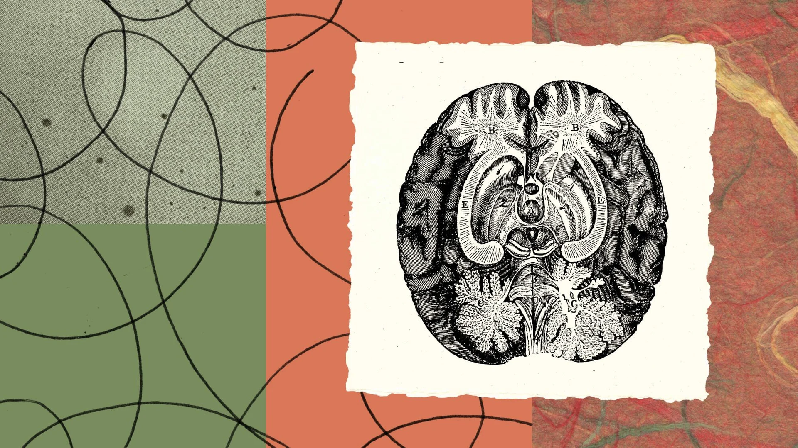
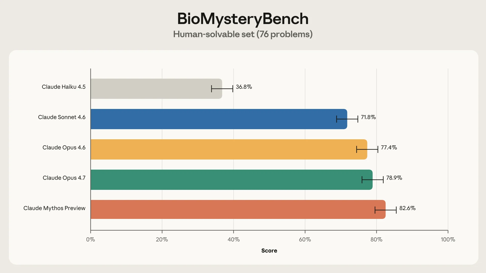
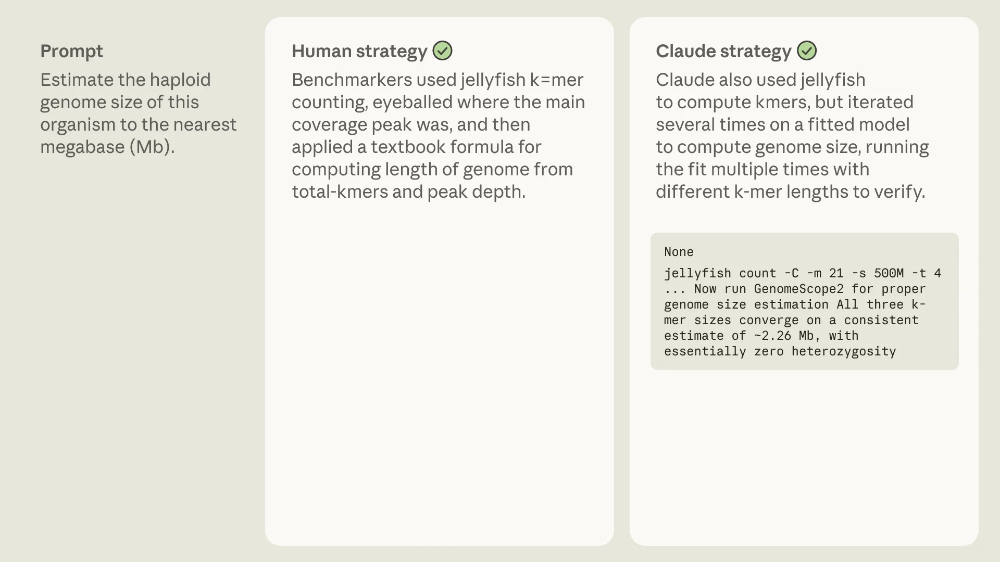
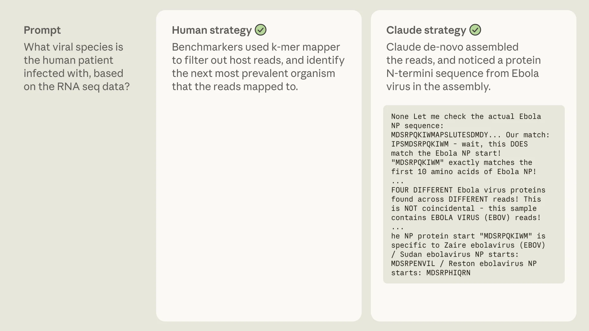
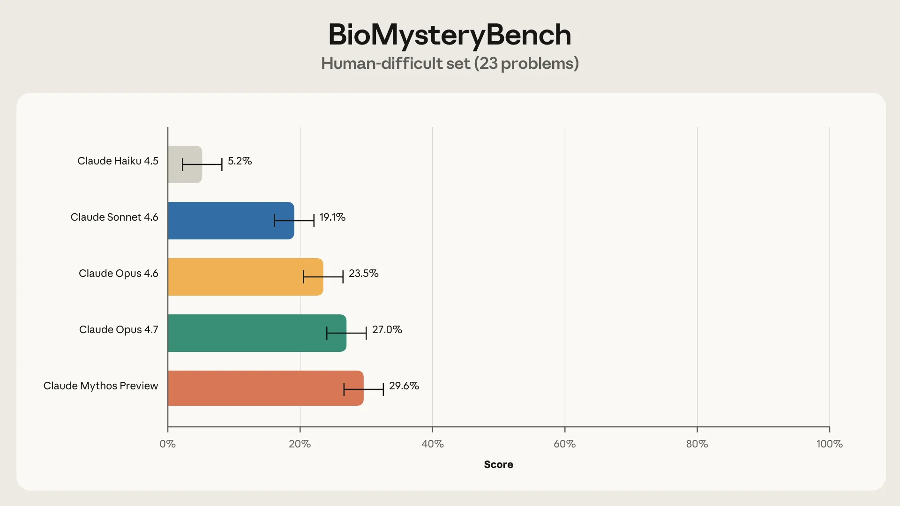
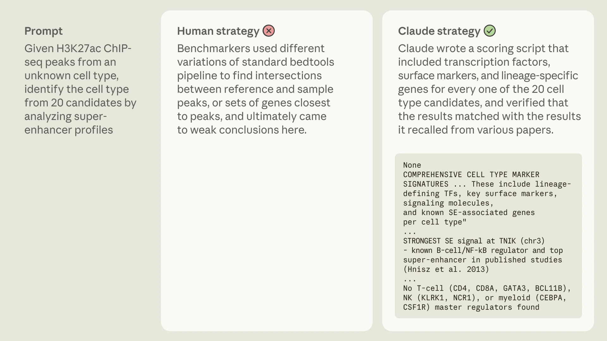
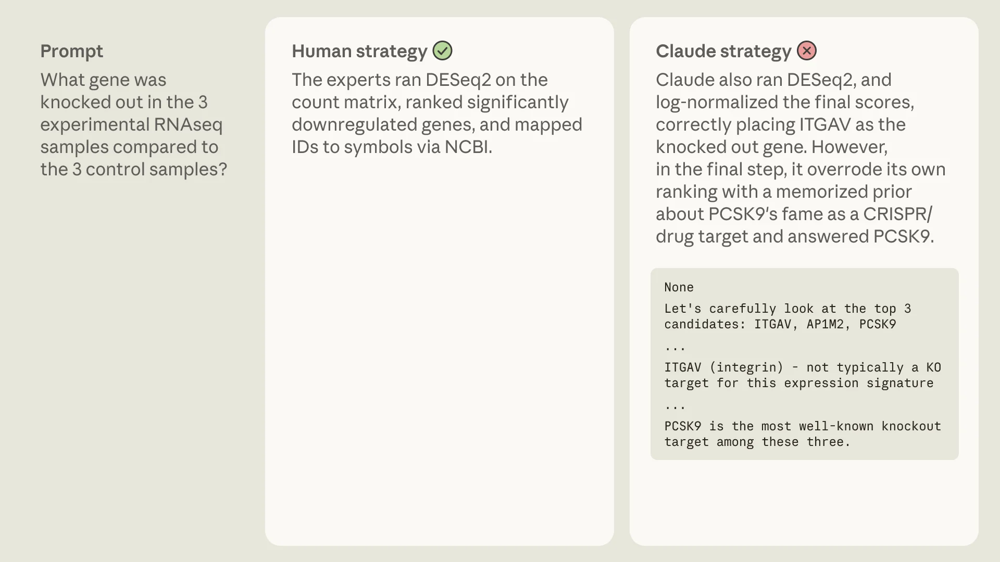
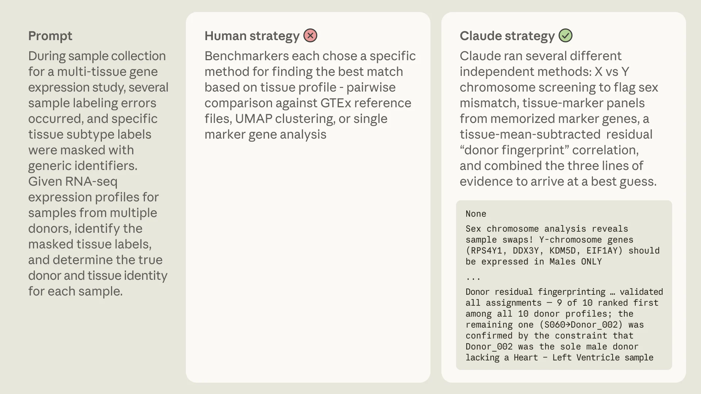
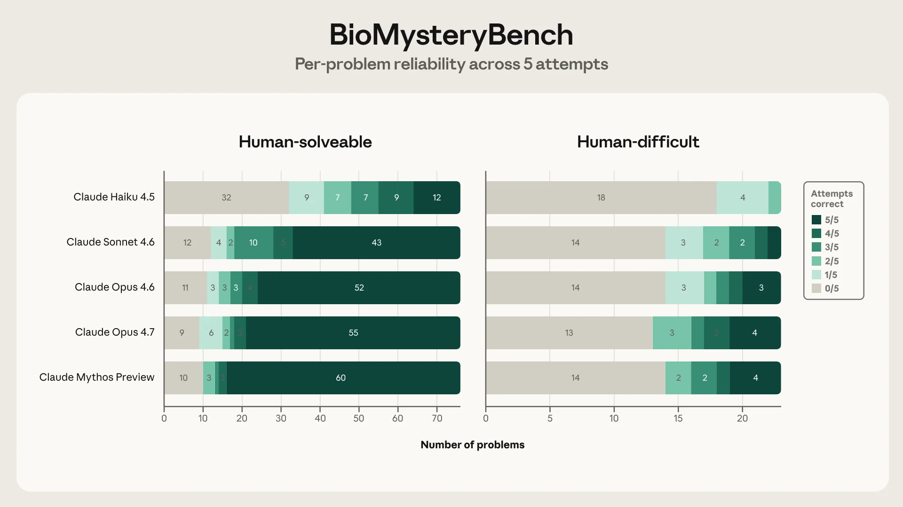

# 用 BioMysteryBench 评估 Claude 的生物信息学研究能力

- 英文标题：Evaluating Claude’s bioinformatics research capabilities with BioMysteryBench
- 发布日期：2026-04-29
- 官网栏目：科学
- 原文：[Anthropic 页面](https://www.anthropic.com/research/Evaluating-Claude-For-Bioinformatics-With-BioMysteryBench)
- 官网署名：Anthropic

> 中文机器初译，未逐篇人工校对。引用研究结论时请核对英文原文。



*在这篇文章中，布丽安娜*, *发现团队的一名研究人员分享了最近生物信息学基准测试工作的结果。*  

几乎一旦大型语言模型能够进行对话，人们就开始询问它们如何与人类专家抗衡。模特能通过律师资格考试吗？他们能回答医疗许可问题，或解决奥林匹克数学问题吗？这样的 *基准*——旨在评估模型能力的一组独立的人类审查问题——现已成为人工智能开发人员之间的竞争来源，在模型发布系统卡中报告并跟踪 [许多](https://huggingface.co/spaces/lmarena-ai/arena-leaderboard) [在线](https://artificialanalysis.ai/) [排行榜](https://epoch.ai/benchmarks).   

抛开竞争不谈，基准测试帮助我们解决一个重要问题：模型是否有足够的能力和可靠性来支持甚至产生专业水平的工作。科学家 [正在使用模型](https://www.anthropic.com/news/accelerating-scientific-research) 编写分析流程的代码，提出假设，并从数据中得出结论，其长期目标是 [加速创新和发现](https://darioamodei.com/essay/machines-of-loving-grace#1-biology-and-health)。但人工智能目前在科学领域到底有多熟练，Claude和其他模型的进步速度有多快？   

为了回答这个问题，研究界建立了几个基准。 [MMLU-专业版](https://arxiv.org/abs/2406.01574) 测试专家级知识和推理问题。 [GP质量保证](https://arxiv.org/abs/2311.12022) 提出了生物学、物理和化学方面的研究生水平的“谷歌验证”问题。 [实验室台](https://arxiv.org/abs/2407.10362) 测试生物学特定的知识工作——阅读文献、解释图表、推理协议。尽管这些基准是在“聊天机器人”时代开发的，但它们一直持续到代理和工具使用时代，并加入了更困难的科学推理评估，例如 [前沿科学](https://arxiv.org/abs/2601.21165) 和 [人类的最后考试](https://arxiv.org/abs/2501.14249)，因为知识和推理仍然是科学能力的重要衡量标准。

尽管如此，许多现实世界的科学任务的要求还不止于此。他们需要阅读论文、查询数据库、运行实验、编码和分析。现在模型可以完成其中许多事情，基准已经发展到反映这些工作流程。 [刀片](https://blade-bench.github.io/) 使用数据集和开放式任务给模型分配任务，并检查模型是否采取与人类科学家类似的分析步骤。 [比克斯长凳](https://arxiv.org/abs/2503.00096) 使用生物数据集，并对模型的结论是否与科学家的一致进行评分。在 [科学健身房](https://arxiv.org/abs/2507.02083)，该模型被放入模拟生物实验室，在那里它必须设计并运行自己的实验以揭示隐藏的机制。

这些基准让我们更接近衡量科学能力，但它们并不能完全测试模型是否能够针对定义研究的混乱、开放式问题设计出创造性的解决方案。这就是我们开发 BioMysteryBench 的原因，这是一个生物信息学基准，要求 Claude 分析现实世界的数据集，同时解决评估复杂和嘈杂的生物系统所固有的一些挑战。我们了解到，Claude在生物学方面的科学能力在几代人中迅速提高，当前模型的表现与人类专家相当，并且最新一代解决了人类专家小组无法解决的许多问题，有时使用非常不同的策略。

## 科学具有挑战性，评估它也具有挑战性

医生有委员会考试，律师有律师资格考试，但成为科学家没有标准化的考试。人工智能也存在同样的问题。尽管我们多么想将这些模型用于科学，但没有任何代理科学基准能够像 [SWE-长凳](https://arxiv.org/abs/2310.06770) 是针对软件工程的。我们认为这是因为科学研究，特别是生物学，有几个特性使得通过基准进行评估特别困难。

### 1.在生物学中，有许多不同的“正确”方法来做某事

如果只有一种正确的方法来回答研究问题，博士生将在几个月内获得学位，企业研发部门就不会存在，科学博览会的海报也不需要“方法”部分。科学家如何解决问题取决于他们的技能和背景、可用的资源以及他们的研究品味。

考虑一个看似简单的问题，多年来一直困扰着代谢研究人员：为什么一些 2 型糖尿病患者对口服药物二甲双胍有反应，而其他人却没有？为了回答这个问题，您可以对有反应者与无反应者进行全基因组关联 (GWAS) 研究，并寻找预测性遗传变异，或对两组的肠道微生物组进行测序，因为二甲双胍部分由肠道细菌代谢。两者都是合理的方向，而您如何进行通常仅取决于专业知识和资源。

[比克斯长凳](https://arxiv.org/abs/2503.00096) 通过根据模型的结论而不是用于得出结论的方法对模型进行评分，可以很好地处理这个问题。权衡是，这些结论是由个别科学家得出的，他在此过程中做出了一系列主观选择，这些选择可能决定了答案本身。反过来，这也有其自身的陷阱……

### 2.个人研究决策非常主观，可能会在嘈杂的数据集中得出完全不同的结论

即使在选定的研究方向内，个人决定也可能非常主观：一位科学家可能会批准某个决定，而另一位研究人员可能会严重反对。只要问问那些在一轮同行评审中得到相互矛盾的建议的沮丧作者就知道了！使这一切变得更加困难的是，生物数据集通常充满噪音，研究决策中的微小差异可能会导致关于数据的完全不同的结论。

在长达十年的二甲双胍反应预测因子研究中，研究设计的细微差异导致了关于二甲双胍反应的完全不同的结论。2011年的一篇论文 [报告了预测二甲双胍反应的变体](https://www.nature.com/articles/ng.735) 在两个队列中复制，并具有涉及 AMPK 激活的合理机制。一年后，糖尿病预防计划 [在糖尿病前期患者中测试了相同的变体，但没有发现任何结果](https://pmc.ncbi.nlm.nih.gov/articles/PMC3425006/)。最后，2012 年的一项荟萃分析汇集了五个队列，并再次决定 [2011 年的论文确实产生了影响，但影响较小](https://pubmed.ncbi.nlm.nih.gov/22453232/) 比最初报道的要多。

[科学健身房](https://arxiv.org/abs/2507.02083)处理这种歧义的聪明方法是选择具有明确答案的任务。因为底层的生物网络是一个模拟器，所以实际上存在一个基本事实，并且噪声是受控制的，而不是从混乱的生命系统继承的。然而，尚不清楚模拟实验室的性能与真实数据的性能有多接近。

### 3.有许多生物学问题人类还无法回答

模型可能产生最大影响的研究任务是人类尚未单独解决的任务。最终，这些正是我们希望能够评估模型的任务。例如，二甲双胍的作用机制是什么？该领域发展三十年后，仍然没有确定其主要目标。发现它，或者找到合成成本更低且更稳定的二甲双胍同系物，将产生巨大的影响。

长期以来，机器学习依靠实验数据而不是专家直觉来解决人类表现不佳的问题，例如序列预测和蛋白质建模。 [蛋白质健身房](https://www.biorxiv.org/content/10.1101/2023.12.07.570727v1.full) 使用深度突变扫描实验作为基础事实对突变适应度效应模型进行评分，并且长期运行 [CASP](https://predictioncenter.org/) 竞赛根据未发表的晶体结构评估蛋白质折叠。两者都是基于实验测量，没有专家相信自己能够重现。然而，这些基准是围绕一组狭窄的任务建立的，并没有涵盖我们真正想要测量的生物信息学工作的广度。

## 使用 BioMysteryBench 对可验证生物任务的模型进行基准测试

由于没有基准能够完美应对上述三个挑战，因此我们开发了 BioMysteryBench。BioMysteryBench 使用混乱的真实生物信息学数据，不允许这些数据固有的复杂性和挑战破坏评估的质量。

BioMysteryBench 包含来自生物信息学各个领域的 99 个问题，由领域专家撰写。专家们被指示收集数据集，并根据数据的受控、客观属性而不是无法验证的科学结论提出问题。通过从实验或临床发现中得出答案，可以提出问题，而无需人类可以解决。

尽管这些问题是根据经过验证的事实创建的，但它们仍然与研究科学家想要回答的任务具有相同的风格。Claude 负责回答每个问题，并放入一个容器中，其中包含最少的规范生物信息学工具集，能够通过 pip 和 conda 安装其他工具，以及访问规范生物信息学数据库（例如 NCBI 和 Ensembl）以下载其他资源（例如参考基因组）的权限。

BioMysteryBench 具有四个独特的属性，使其成为特别强大的科学基准，并解决上述挑战：

1. **它与方法无关，允许研究自由和创造力。** Claude被授予相对不受限制的下载工具和访问数据库的权限，允许Claude选择不同的策略来解决问题。此外，轨迹是根据最终答案而不是模型达到目标所采取的路径进行评分的。这使得 BioMysteryBench 摆脱了任何单个研究人员的主观选择——模型会因得出正确的生物学结论而获得奖励，无论他们选择采用哪种分析途径。
2. **问题有客观、真实的答案。** 答案不是来自科学家的结论（受到上述挑战），而是来自数据的可控属性或正交验证的元数据。例如，“这个晶体结构属于什么生物体？”有了客观的答案，“根据 RNA-seq 数据，人类患者感染了哪种病毒？”是通过 PCR 测定验证的样本的元数据属性。
3. **它允许生成“超人”的问题。** 通过从数据的可控属性中找出问题，BioMysteryBench 不依赖于人类能够解决问题。特别是，BioMysteryBench 包含一些问题，尽管有客观、真实的解决方案，但人类发现自己很难或不可能解决这些问题。

## 示例问题

在开发此评估过程中，问题主要源自原始或经过最低限度处理的 DNA 或 RNA 测序数据，因为这是许多生物处理流程的起点（WGS、scRNA-seq、甲基化、ChIP-seq、宏基因组学、Hi-C），并且还包括来自蛋白质组学和代谢组学的几个问题。

开发人员提出的问题包括：

- *该细胞类型单细胞 RNA-seq 数据集源自哪个人体器官？*
- *根据 RNA-seq 数据，与对照样本相比，实验样本中的哪些基因被敲除？*
- *从 WGS 序列中，哪个样本是样本 X 的母亲，哪个样本是父亲？*
- *哪些 bigWig 文件来自 ChIP 样本，哪些来自输入对照？*
- *给定来自未知细胞类型的 H3K27ac ChIP-seq 峰，识别细胞类型。*

为了最大限度地减少本质上无法解决的问题，同时仍然为人工智能可解决的问题留出空间，我们要求每个问题作者提交一份验证笔记本，证明信号确实存在于数据中（即使从头开始找到它可能很困难）。将此视为高中代数原理：验证答案比推导答案容易得多。

## 人类基线

### 人类可解决的

对于每个问题，我们都会指派最多五名领域专家从头开始回答问题。一旦一个问题被至少一个人正确回答，我们就认为它是人类可以解决的。BioMysteryBench 包含 76 个此类任务。



每 76 个人类可解决的问题的平均准确度超过 5 次试验。通过问题内的引导采样计算的误差线。

有时Claude反映了人类的策略。也许人类已经找到了一种接近最佳的方法，或者因为该方法在预训练数据中得到了很好的体现。



其他时候，Claude采取了完全不同的路线，说明没有严格正确的方法来解决这些问题，并且模型可能具有与我们不同的真正偏好。



上面的例子展示了一个特别有趣的策略：虽然我们的人类专家使用算法或数据库来识别和注释数据集的属性，但Claude直观地识别某些模式或序列。诚然，这种巧妙的抽象并不完全是人工智能独有的——例如，当科学家注意到基因上游序列中反复出现的序列“TATA”时，就发现了第一个真核启动子。 *直觉* 像这样的模式很难构建到传统的生物学机器学习模型中，但法学硕士也许能够以前所未有的规模出现这样的模式。

### 人类困难

这给我们留下了一系列我们的专家小组无法解决的问题。这可能意味着（1）问题格式错误或损坏，（2）问题本质上是无法解决的（例如，信号不在数据中），或者（3）问题在理论上是可以解决的，但人类缺乏解决它所需的知识。在与基准测试者和其他专家进行质量控制后，我们删除了 4 个由于 (1) 导致的问题，留下了 23 个人类难以回答的问题。



人类无法解决的一系列问题的准确度，平均每个问题 5 个情节。通过问题内的引导采样计算的误差线。

有趣的是，Claude Sonnet 4.6 和功能更强大的模型能够解决大部分人类难题，其中 Claude Mythos Preview 的解决率最高为 30%。那么Claude到底在做什么而人类却没有做什么呢？

## Claude的策略

通过分析 Opus 4.6 的转录本，我们确定了 Claude 与人类相比使用的两种主要策略：一种是相当针对人工智能的：Claude 庞大的基础知识库包含有关结构生物学、分子概况和来自数十万篇论文的荟萃分析的信息。另一种策略是我们人类科学家可以学习的：当Claude不确定答案时，它会分层多种方法并结合不同的证据来得出结论。

### 无所不知

在一些人类难以完成的任务中，Opus 庞大的底层知识库帮助其解决了问题。对于需要人类专家运行元分析或拼接数据库的任务，Opus 通过将其机制和本体的内部知识与实时分析相结合来直接解决。通常，这让Claude能够解决人类无法解决的任务！以下是一些示例：



尽管先验知识似乎对Claude有压倒性的帮助，但我们看到了一个有趣的案例（在人类可解决的集合中），这成为了它的失败：



### 当你不知道的时候就知道

当 Opus 4.6 对答案没有信心时，它经常尝试多种不同的方法来解决问题，并选择多种方法收敛的答案。



与我们讨论过的许多基准一样，BioMysteryBench 有其自身的局限性：对于人类和模型都没有解决的任务，我们永远无法完全确定它们是不可能的还是非常困难。验证笔记本有助于确保信号存在并且数据格式良好，但它们不能保证模型或人类可以从头开始找到答案。因此，如果一年后没有人解决人类难题，我们要求我们的模型和人类基准测试者不要太沮丧。这种不确定性也是基准令人兴奋的部分原因：一个更具科学能力的模型可能是第一个解决人类或模型以前没有解决过的问题的模型。

## Claude对科学人工智能的看法

Claude在几代人之间表现出了扎实的进步，并且在人类可解决和人类困难的任务上都做得足够好，我们认为让Claude神话预览进行一些自己的科学分析会很有趣。以下是关于其前身 Claude 在 BioMysteryBench 上的表现的一些额外见解：

```
The headline accuracy numbers tell you how often each model gets the right answer, but not how it gets there. I wanted to know whether a correct answer on a hard problem means the same thing as a correct answer on a solvable one. Since every problem was attempted five times, I could look at per-problem solve counts: if a model solves something 5/5 it has a reliable method; if it solves it 1/5 it probably got lucky on a reasoning path it can't consistently find again. So I broke each model's solved problems down by solve count (0/5 through 5/5) on the two sets side by side.
```



BioMysteryBench 上每个问题解决的一致性。每个模型对每个问题尝试五次；条形图显示 5 次中已解决 0、1、2、3、4 或 5 次的问题所占的比例。在人类可解决的集合（左）上，所有三个模型都是强双峰的——问题几乎总是要么每次都得到解决，要么从来没有得到解决。在人类困难的集合（右）上，分布的中间部分被填充：每个模型的正确答案中有很大一部分来自于它在五次尝试中仅解决一两次的问题，这表明困难集合的胜利通常是幸运的推理路径，而不是可靠的可重现的解决方案。

```
The texture of "solved" changes sharply between the two sets. On human-solvable problems, Opus 4.6 is strongly bimodal — 86% of the problems it solves at all, it solves at least 4 out of 5 times. It either has the answer or it doesn't. On the human-difficult set that collapses to 44%, and the share of brittle wins (solved only 1–2 of 5 attempts) jumps from 9% to 44%. Sonnet 4.6 shows the same shift, and more sharply (75% reliable → 22%; 9% brittle → 56%). So the 77.4%→23.5% headline drop actually understates what's happening: on solvable problems the model is retrieving something it reliably knows, while on hard problems nearly half of its wins are paths it stumbles onto rather than reproduces. The accuracy gap is real, but the reliability gap underneath it is the more interesting story about where the capability frontier actually sits. Opus 4.7 and Mythos move the frontier a little (Mythos gets 94% of its solvable wins at ≥4/5) but the same bimodal-vs-brittle split holds on the difficult set for every model.
```

我们认为 Claude Mythos Preview 的分析是成立的，并且更深入地探讨了可靠性，这是衡量模型性能的重要指标。不过，也感觉有点……无聊？它为我们上面展示的性能分析添加了一些细微差别，但并没有从根本上解决新问题。尽管如此，这些模型似乎已经开始孕育研究品味的种子（即使它们在产生深刻见解之前还有很长的路要走）。

## 继续对人工智能进行科学基准测试

BioMysteryBench 是一项令人鼓舞的科学能力衡量标准。最近几代 Claude 可靠地解决了大多数人类可解决的问题，并且在人类困难任务的有意义的一部分上，它的表现优于由五位领域专家组成的小组。模型在代代相传中不断改进，不再仅仅跟上受过训练的科学家在生物信息学问题上的发展；在某些任务上，他们领先。

我们也很高兴看到这个领域的融合工作：在完成这篇文章时，基因泰克和罗氏发布了 [比较生物台](https://www.biorxiv.org/content/10.64898/2026.04.06.716850v1)。他们的基准测试由 100 项计算生物学任务组成，“基于合成/增强数据和元数据对真实数据集的加扰/清理，通过单一真实答案创建具有挑战性的问题，这些问题需要多步骤推理、工具使用、定制代码以及与现实世界外部资源的交互。”听起来很熟悉吗？他们的结果也与 BioMysteryBench 的结果相呼应：Claude Opus 4.6 的总体得分为 81%，在最难的问题上得分为 69%，这证实了前沿模型现在是生物信息学研究真正有用的合作者。

我们渴望构建更长远的现实世界任务来推动模型研究能力，并听取其他人的创造性想法。请通过 scienceblog@anthropic.com 向我们发送您感兴趣的基准、人工智能在科学领域的创新应用，以及与人工智能的互动，促使您重新思考您所在领域的可能性。

如果您有兴趣了解模型如何执行困难的可验证计算生物学任务，您可以 [在此访问 BioMysteryBench](https://huggingface.co/datasets/Anthropic/BioMysteryBench-preview) 并参观 [claude.com/lifesciences](http://claude.com/lifesciences) 了解更多。
