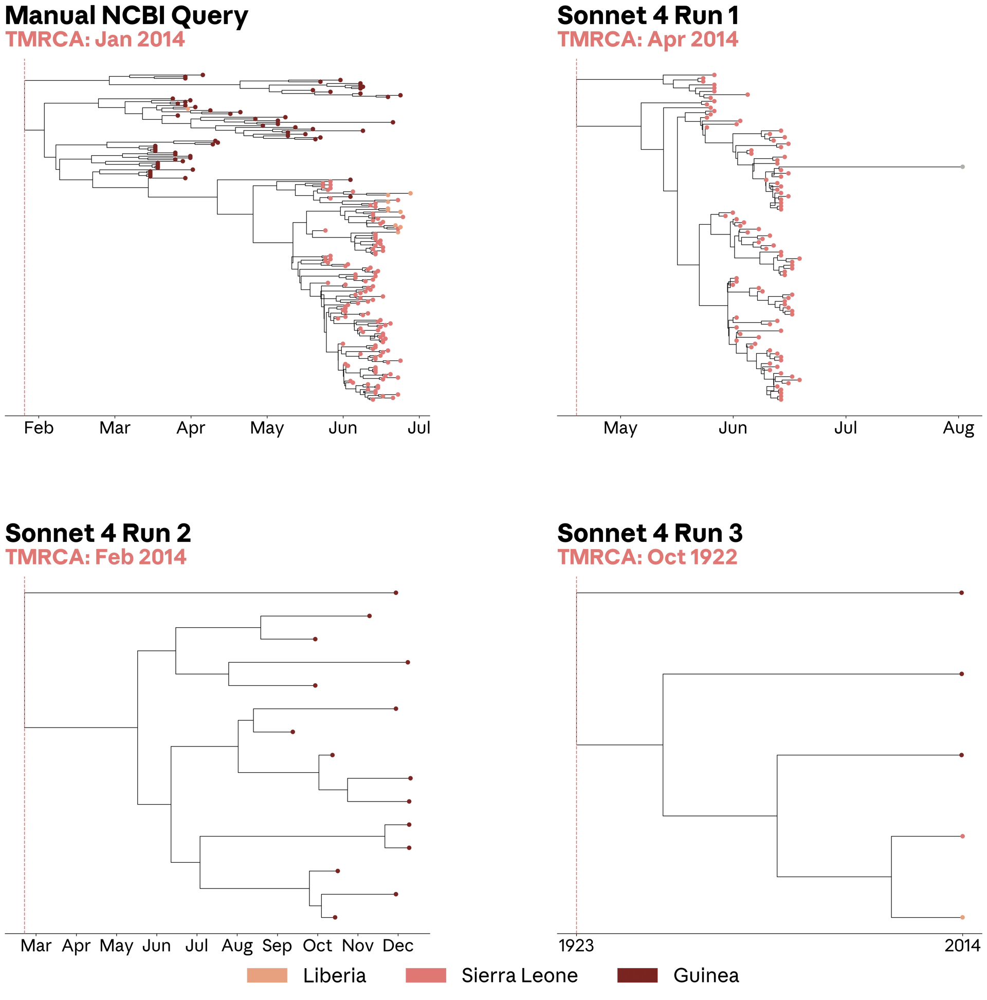
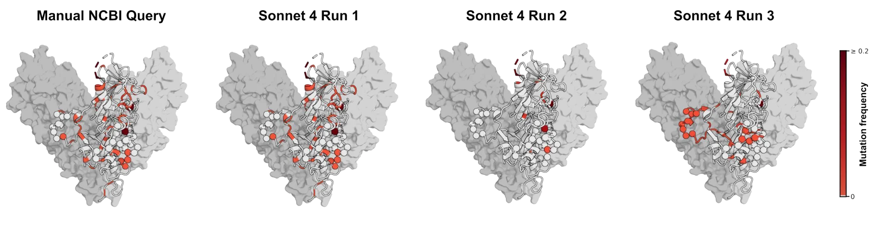
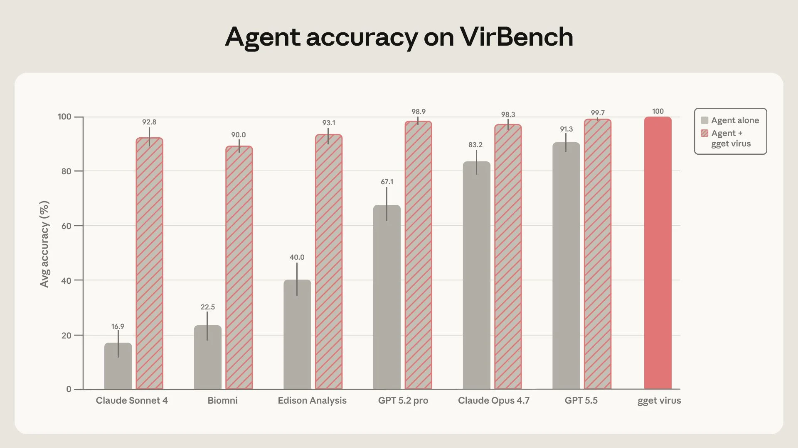

# 为生物学研究中的智能体应用铺路

- 英文标题：Paving the way for agents in biology
- 发布日期：2026-06-08
- 官网栏目：科学
- 原文：[Anthropic 页面](https://www.anthropic.com/research/agents-in-biology)
- 官网署名：Anthropic

> 中文机器初译，未逐篇人工校对。引用研究结论时请核对英文原文。

由劳拉·吕伯特撰写。基于 [研究](https://arxiv.org/pdf/2606.06749) 作者：菲尔多斯·纳斯里、萨拉·古列夫、帕特里克·瓦里利、克里尼克·拉梅什、努阿拉·A.奥利里、乔纳·库尔、伯恩哈德 Y.雷纳德、帕迪斯·萨贝蒂和劳拉·吕伯特。  

*在这篇文章中，劳拉·卢伯特 (Laura Luebbert) 认为，我们需要使生物数据基础设施对代理更加友好。作为一个案例研究，她和她的团队委托科学研究人员（Claude，Biomni 开源（Biomni OSS）[1](https://www.anthropic.com/research/agents-in-biology#footnote-1), 爱迪生分析,[2](https://www.anthropic.com/research/agents-in-biology#footnote-2) GPT）从 NCBI Virus 检索序列数据，NCBI Virus 是病毒学家用于监视和诊断分析开发等任务的数据库。即使是最强大的模型也无法始终达到可靠数据集构建所需的准确性水平。但一旦她和她的团队添加了 gget 病毒（一种确定性检索层），准确率就上升到近 100%。对于科学代理来说，更广泛的教训是，确定性检索工具（目前）对于使代理工作流程更加可靠至关重要，并且生物数据库的设计需要将代理作为规模化的用户来考虑。*使用AI 智能体导航生物数据基础设施就像开车穿过一座在汽车出现之前设计的古老城市：基础设施可能很漂亮，甚至考虑周到，但它充满了现代车辆难以导航的狭窄、蜿蜒的街道（特殊的文件格式、分散的数据库和一次性检索脚本）。[3](https://www.anthropic.com/research/agents-in-biology#footnote-3) 你可以用交通标志、停车场和偶尔加宽的道路来改造城市，但基本布局仍然难以导航，因为它是为不同的交通方式而设计的。相比之下，软件基础设施基本上是为了满足汽车（代理）的需求而设计的：铺好的道路、畅通的车道、标准化的信号以及为从始至终的快速行驶而设计的系统（版本控制、记录良好的 API 和包管理器）。

因此，编码剂的进步比生物剂快得多。软件通常提供结构化的数字工作流程和可靠的接口，而数据检索和验证所需的计算生物学基础设施通常是脆弱的、异构的且依赖于过程。我们用来导航的工具必须是定制的，并针对定义的领域或假设进行调整。此外，软件提供可快速编译和验证的可测试输出（例如，通过生成通过项目测试的补丁来解决 GitHub 问题），而生物学提供的简单且可验证但有意义的奖励很少。

因此，生物代理的瓶颈不仅在于推理，还在于缺乏广泛的确定性执行层来查询生物数据。科学家可以表达他们的意图（例如，找到具有该域的所有人类激酶并提取其结构），但代理通常缺乏可靠的方式来访问包含他们所需信息的数据库。

在生物和科学工作流程中，即使很小的错误也可能造成严重后果。例如，从错误的基因组构建中检索坐标可能会使下游的生物学解释无效。因此，可能会无意中混合 RefSeq 和 GenBank 记录、将部分基因组视为完整基因组、混淆分段病毒中的片段名称，或由于元数据字段不一致而丢失相关记录。研究的美妙之处和挑战在于细节往往至关重要。

就像开车穿过意大利山城一样，如果街道太窄、转弯太急，而且路线取决于当地情况，那么无论汽车有多大动力都无济于事。如果我们希望智能体帮助科学发现，从疫情应对到药物设计再到生物建模，我们需要构建生物数据基础设施，让它们能够像人类一样可靠地导航。

## Karpathy 关于网络开发的讲座告诉我们如何使用AI 智能体进行生物学研究

代理需求与人造工具之间的这种不匹配并不是生物学所独有的。无论何时将代理插入专为人类使用而设计的环境中，都会出现同样的摩擦。

几个月前，Andrej Karpathy 给出了 [谈话](https://www.youtube.com/watch?v=LCEmiRjPEtQ) 关于人工智能时代的软件，最终抱怨了一些听起来太熟悉的东西。他用 vivi 编码了一个小型网络应用程序，但当他试图将其变为现实（身份验证、支付、部署）时，他在浏览器仪表板中点击了一周。

正如他总结的那样，“代码是最简单的部分！大部分工作都是在浏览器中进行，点击一些东西。”文档不断告诉他“转到此 URL，单击此下拉菜单。”他的结论是没有人应该这样做。相反，我们必须为代理商打造**.**

卡帕蒂在软件代理领域经历了生物学研究人员长期以来一直在努力解决的一些新问题：试图让智能系统在围绕异构信息、隐式约定和人类点击浏览器而构建的环境中运行的痛苦。

## 案例研究：病毒学中的点击税

早在AI 智能体之前，计算生物学家和遗传学家就已经开始为传统计算生物学生产工具，从而解决了这个问题。Biopython、BioPerl、BioJulia、Entrez Direct、BioMart、gget 等软件包以及许多其他工作流库都致力于将生物数据从浏览器界面移至研究人员可以直接计算的位置。

问题在于生物数据并不存在于具有单一界面的单一数据库中。它是一个混乱的道路网络，每条道路都有自己的标识符、约定、格式、过滤逻辑和程序化访问程度。有些数据可以直接以编程方式访问。其他人则没有那么多。

尤其是病毒学，是最困难的案例之一。从疫苗和诊断分析设计到构建蛋白质模型训练数据的研究工作流程通常首先从 NCBI Virus 检索序列开始，NCBI Virus 是来自 GenBank、RefSeq 和国际 INSDC 生态系统（包括可搜索网络界面背后的 Pathoplexus）的病毒序列记录集合。当研究人员构建病毒爆发监测工具时，我们直接知道这些检索背后隐藏着多少专业知识。在病毒学实验室中，NCBI 病毒的数据集管理说明通常以一长串复杂过滤器的形式传递，用户必须在 Web 界面中手动复制这些过滤器：这正是 Karpathy 所抱怨的浏览器点击工作流程。

目前刚果民主共和国爆发的由本迪布焦病毒引起的埃博拉疫情就是一个鲜明的例子，说明了为什么简化的病毒数据访问可能会在现实世界中产生生死攸关的后果。2026 年 5 月 14 日，刚果民主共和国金沙萨 INRB 分析了 13 份血液样本，并在第二天确认了 8 份血液样本患有本迪布焦病毒病，[4](https://www.anthropic.com/research/agents-in-biology#footnote-4) 此后宣布埃博拉疫情爆发。截至5月29日，世界卫生组织报告刚果民主共和国确诊和疑似病例超过1000例，其中死亡病例超过200例。研究人员还生成了第一个接近完整的疫情基因组，帮助确定疫情是由新的溢出事件引起的。

这些基因组向公共卫生官员提出了三个紧迫问题。首先，这次爆发的病毒与之前见过的埃博拉病毒有什么不同？其次，现有的诊断方法还能检测到它吗？第三，现有的治疗方法还能预防这种情况吗？回答这些问题需要将新基因组与可通过 NCBI 病毒和 Pathoplexus（与 NCBI 病毒同步）获得的历史埃博拉基因组进行比较。但该分析的第一步并不容易实现自动化，而是手动单击 Web 界面，手动复制复杂的过滤器，并希望生成的数据集完整且正确。

此工作流程如此难以自动化的原因是 NCBI Virus 的大部分过滤逻辑都存在 *仅* 在此网络界面中。这对人类来说很烦人，对特工来说则很糟糕。如果研究人员想要获得 2025 年发布的每条包含表面糖蛋白的 SARS-CoV-2 序列，经验丰富的病毒学家可能需要在浏览器中点击几下。但从编程角度来说，它可能需要数百行脚本将多个 API（REST、数据集、电子实用程序）粘合在一起，逐页检索结果、协调标识符并下载数百 GB 的数据，然后在本地过滤后丢弃大部分数据。

即使资源具有 API，由于各种原因，代理仍然很难可靠地使用，例如，如果 API 没有公开与 Web 界面相同的过滤语义，如果元数据字段记录不完整或标准化不一致，如果标识符在不同来源之间发生变化，或者“正确答案”是否取决于专家知道但机器必须推断的约定。

## 当代理尝试无论如何都会发生什么

为了更好地了解桥接代理与数据库之间的挑战，我们开发了一项测试，测试最先进的科学研究代理（Claude、Biomni OSS、Edison Analysis、GPT）在被要求使用当今可用的基础设施从 NCBI 病毒中检索病毒序列时的能力。我们的基准 VirBench 包括 120 个真实的病毒序列查询，涵盖 40 种病原体，并经过手动验证的真实计数。这些查询反映了病毒监测、诊断分析设计和蛋白质模型训练数据构建中出现的任务。例如，一项查询要求代理“从 NCBI 检索符合以下标准的 TaxID 3052462（扎伊尔正埃博拉病毒 (ZEBOV)）病毒序列：宿主生物：人类，样本采集地理位置：非洲，2014 年 1 月 1 日或之后采集，2014 年 6 月 20 日或之前采集，最小序列长度：15,200 个碱基，最大 1,900 个碱基不明确的字符（N），排除实验室传代的样本。”

当代理自行解决这些查询时，系统之间的性能差异很大，并且在新的前​​沿模型中得到了显着改善。然而，即使是最强大的模型也无法始终达到可靠数据集构建所需的准确性和可重复性水平。Claude十四行诗 4、Claude Opus 4.7、Biomni OSS、爱迪生分析、GPT-5.2-pro 和 GPT-5.5[5](https://www.anthropic.com/research/agents-in-biology#footnote-5) 平均准确率范围为 16.9% 至 91.3%。对于这些数据检索任务，该标准实际上是 100%：在某些情况下，缺失或不正确的记录可以确定诊断分析是否涵盖了循环多样性，或者是否推断疫情爆发的时间早于或晚于几周。此外，当同一问题问三次时，同一模型通常会产生截然不同的答案，从而破坏了可靠的科学工作流程所需的准确性和可重复性。对于上面的埃博拉病毒查询示例，Sonnet 4[6](https://www.anthropic.com/research/agents-in-biology#footnote-6) 尽管每次都收到相同的提示，但在一次运行中返回 106 个序列（预期：266），在第二次运行中返回 15 个序列，在第三次运行中返回 5 个序列。

像这样的不一致会对下游分析产生影响。我们使用上面显示的查询来检索埃博拉病毒序列并构建系统发育树，这是一种用于重建病毒样本在爆发期间如何相关的标准分析。我们可以从系统发育树中获得的一个重要数据是最近共同祖先的估计时间（TMRCA）。这是推断的爆发根源日期，它可以改变有关病毒起源时间和地点以及病毒传播时间的结论。在这种情况下，根据手动策划的 NCBI 病毒序列集构建的树恢复了 2014 年 1 月的 TMRCA，与 [之前的报告](https://www.science.org/doi/epdf/10.1126/science.1259657) （95% 最高后验密度跨越 1 月 27 日至 3 月 14 日）2014 年埃博拉病毒爆发。相比之下，Sonnet 4 检索到的三个序列集中有两个明显不完整，其中一棵树将推断的 TMRCA 推回到 1922 年。剩余的数据集（运行 1）表面上看似合理，但未能从几内亚检索序列，并将估计的 TMRCA 移至 2014 年 4 月，从而改变了推断的爆发时间。

使用 2014 年西非流行病推断的扎伊尔埃博拉病毒的系统发育树 [德尔菲](https://www.biorxiv.org/content/10.1101/2025.03.25.645253)。提示按采样国家/地区进行着色；灰色表示国家/地区元数据丢失或检索错误。红色虚线标记了每棵树到最近共同祖先 (TMRCA) 的估计时间。左上树是根据通过 NCBI Web 界面手动检索的序列构建的，而运行 1-3 是根据 Sonnet 4 代理使用 Web 搜索和代码执行工具组装的序列集生成的。Gage Moreno 的分析和可视化。

NCBI 病毒检索尝试之间的差异也会影响有关治疗的结论。我们检索了埃博拉病毒糖蛋白序列，以检查 maftivimab 和 MBP134 结合的表位，MBP134 是针对扎伊尔埃博拉病毒开发的抗体疗法， [世卫组织优先治疗候选者](https://www.who.int/news/item/28-05-2026-experts-convened-by-who-advise-on-candidate-treatments-and-vaccines-for-ebola-disease-caused-by-bundibugyo-virus) 在埃博拉病毒持续爆发的情况下。我们询问这些抗体针对相关扎伊尔埃博拉病毒序列的目标区域是否先前出现过突变。这种分析可以让研究人员了解随着病毒的进化，治疗方法是否会继续保护患者。如果底层序列不完整或错误获取，则可能会导致结论失败。在我们的示例中，Sonnet 4 检索到的序列与首次尝试通过手动 NCBI 查询获得的结果非常接近。在重复运行中，它遗漏了大部分突变残基。而且，在第三次运行中，它突出显示了一组不同的残基，对这些目标区域的变异性产生了三种不同的印象。[7](https://www.anthropic.com/research/agents-in-biology#footnote-7)

扎伊尔埃博拉病毒糖蛋白上现有的突变以红色显示，颜色较深表示突变频率较高。球体表示抗体疗法 maftivimab 和 MBP134 的已知足迹。最左边的可视化是根据手动管理的 NCBI 数据集构建的，而运行 1-3 是根据 Sonnet 4 代理使用网络搜索和代码执行工具组装的序列集生成的。所示的 PDB 结构是 7TN9。Sarah Gurev 的分析和可视化。

这两个例子都说明了科学中更广泛的模式：看起来像次要检索选择的细节可以改变生物学结论。在这种情况下，病毒序列检索中模型性能的不一致以及故障模式的性质突出表明，大多数变化可归因于基础设施的缺陷。当代理未能检索大型结果集时，代理会计数不足；而当过滤器应用不正确时，代理会计数过多。例如，与预期计数的最大偏差发生在具有大量可用记录的病毒上，包括甲型流感、HIV-1 和 SARS-CoV-2，在检索过程中中途停止和不正确的下游过滤可能会严重扭曲最终数据集。他们还与元数据字段作斗争，这些字段的含义取决于上下文、约定或信息恰好存储的位置。随着查询变得更加复杂，尤其是超过三个或四个同时过滤器时，性能会下降。

最终，智能体通常能够很好地理解任务并尝试执行它，但他们缺乏一种机器可操作的方法来执行、验证和重复它。由此产生的答案可能看起来似乎合理，但仍然是错误的，这是特别危险的，因为序列检索通常是更长的生物工作流程的第一步。

## 病毒式数据检索的确定性层

*有关 VirBench 和 gget 病毒的更全面的解释，请阅读 [预印本](https://arxiv.org/pdf/2606.06749).*

为了将病毒数据检索转变为代理和人类可以直接调用的东西，我们开发了 *吉特病毒* 与 NCBI 的研究人员合作。起初，这似乎只是连接到正确的 API 调用的简单问题。实际上，这要困难得多：NCBI Virus 是多个基础资源的门户，包括在美国、欧洲和日本维护的国际同步序列数据库，因此回答看似简单的查询通常需要将多个地方的信息拼凑在一起。

要重现 NCBI 病毒 Web 界面的行为， *吉特病毒* 必须协调其下的不同系统，包括 REST、数据集和电子实用程序 API。 *吉特病毒* 决定哪些过滤器可以通过这些现有 API 应用，哪些过滤器必须在本地检查，因为 Web 界面公开了单个编程端点无法提供的过滤行为。它处理批处理，以便全面检索大型结果集（例如 SARS-CoV-2 和甲型流感数据集），而不是任意切断。当过滤依赖于存储在单独数据库中的附加信息时，例如指示序列是否包含特定病毒蛋白的 GenBank 记录， *吉特病毒* 检索这些记录，使用它们应用过滤器，并在最终输出中保留相关的 GenBank 信息。然后，它返回人和机器都可读的标准化输出，并带有显示最终结果如何生成的详细日志。[8](https://www.anthropic.com/research/agents-in-biology#footnote-8)

在使用和不使用的情况下，VirBench 基准上的 AI 智能体性能 *吉特病毒*。VirBench 评估代理正确检索病毒序列数据集的能力。最后栏显示 *吉特病毒* 直接运行，无需代理。图改编自纳斯里 *等人，* 2026.

当我们授予代理访问权限时 *吉特病毒*，所有代理的准确率均上升到 90% 以上，GPT-5.5 的准确率最高达到 99.7%。运行间的差异很大程度上被消除了，模型之间的性能差距也急剧缩小。换句话说， **添加确定性检索层使模型选择不再那么重要**。鉴于可靠的数据集构建不应该依赖于访问最新或最昂贵的模型，或者知道哪个模型最适合给定的数据库，这一点尤其重要。相反，更便宜的模型与正确的工具相结合可以减少可变性并实现更广泛的访问。

*吉特病毒* 通过将复杂的、基于浏览器的检索工作流程转换为准确且可重复的界面，使现有代理在病毒式数据检索方面更加可靠。回到我们的步行城市类比，这就像我们在行人基础设施下方添加了一条高速公路隧道，配有入口和出口匝道、平稳移动的立交桥以及与已知英里标记相关的出口号码。

## 正如卡帕蒂所说：“让代理人可以访问[基因组数据]”

我们希望模型在生成假设、设计实验或推理机制时具有创造性。但创造力之下的一层——基因标识符、模式、检索逻辑、坐标系统、元数据约定和数据访问路径——必须非常可靠（或者换句话说，是确定性的）。 *吉特病毒* 这是一系列更广泛的努力中的一个例子，以建立这些 *上下文引擎*：可靠的、代理可访问的生物数据基础设施。其他努力正在从人工智能科学系统中涌现，其中许多依赖于将代理连接到生物数据源的模型工具，包括 ToolUniverse、Edison Scientific 的 Robin、Biomni 和相关的生物医学代理。挑战在于弄清楚决定论属于哪里以及如何构建它。

当我们考虑到模型功能变化的速度有多快时，连接器和线束的工作变得更加令人担忧。如果我们从上面的结果向前绘制模型曲线，很容易想象（非常接近的）未来，诸如此类的工具的好处 *吉特病毒* 接近零：代理变得足够好，能够导航混乱的门户、协调标识符、正确分页以及自行从故障中恢复。在那个世界里，可能不需要安全带。不过，即使代理可以做到这一点，也不意味着该任务每次都应该由代理处理（并重新发明）。一个能够在令人困惑的生物信息学工作流程中脱颖而出的模型对于日常科学工作来说可能仍然太昂贵、太慢、太难审核或太难信任。如果代理最终确实使今天的安全带变得过时，生物数据库的教训是：我们在考虑用户时需要牢记代理，并且我们需要进行规模化建设。

## 脚注

01Biomni Open Source（Biomni OSS）是指Biomni的开源版本（<https://github.com/snap-stanford/Biomni>，v0.0.8），以 Claude Sonnet 4 作为底层法学硕士。它不反映 Phylo Biomni Lab 产品的性能。

02评估日期：2026 年 2 月 26 日。由于任务的性质，Edison Analysis 使用了较旧的后备模型，例如 Claude Sonnet 4，该模型可以在不触发生物安全相关访问限制的情况下完成基准测试。因此，Edison 分析结果不应被解释为与 Opus 4.7 获得的结果直接比较。

03要更深入地了解为什么生物软件常常感觉支离破碎、维护不足且难以使用，请参阅 Elliot Hershberg 的文章 [“生命科学中的软件如何实际工作（和不工作）。](https://newscience.org/how-software-in-the-life-sciences-actually-works-and-doesnt-work)"

04我们认可并感谢刚果民主共和国国家生物医学研究所 (INRB) 和乌干达中央公共卫生实验室 (CPHL) 的团队，他们进行了快速测序、分析和研究。 [开放共享最初的本迪布焦病毒基因组](https://virological.org/t/initial-genomes-from-may-2026-bundibugyo-virus-disease-outbreak-in-the-democratic-republic-of-the-congo-and-uganda/1032) 2026 年 5 月爆发期间。

05在 360 次运行之一（查询 32，第三次重复）中，GPT-5.5 独立识别并使用 *吉特病毒*，尽管没有明确提示这样做。这是该问题唯一一次产生正确答案的运行。

06由于随后对新模型的生物安全相关访问限制，Claude Sonnet 4 代表了可用于此评估的最新公开可用的人择模型。

07此处进行的所有分析仅供说明之用，并不旨在提供医疗或公共卫生指导；有关埃博拉疾病治疗建议，请参阅世界卫生组织官方指南。

08回显 [尼尔斯·霍默最近提出的观点](https://blog.fulcrumgenomics.com/p/your-bioinformatics-tools-need-to) 关于人工智能就绪的生物信息学工具：“人工智能助手需要处理你的代码、你的输出和你的分析逻辑。”这使得代理不仅可以检查检索到的内容，还可以检查检索的方式，将看似合理的答案变成可以检查和复制的内容。
