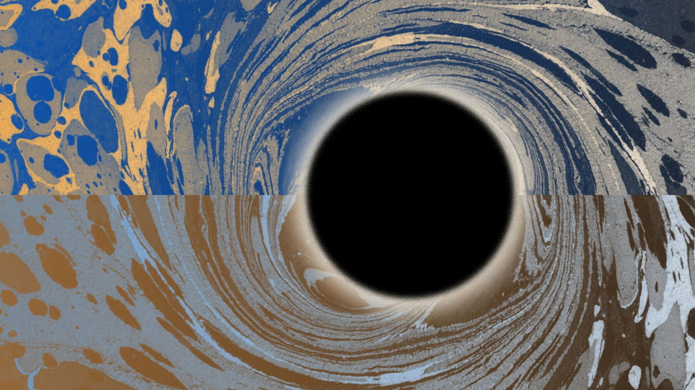
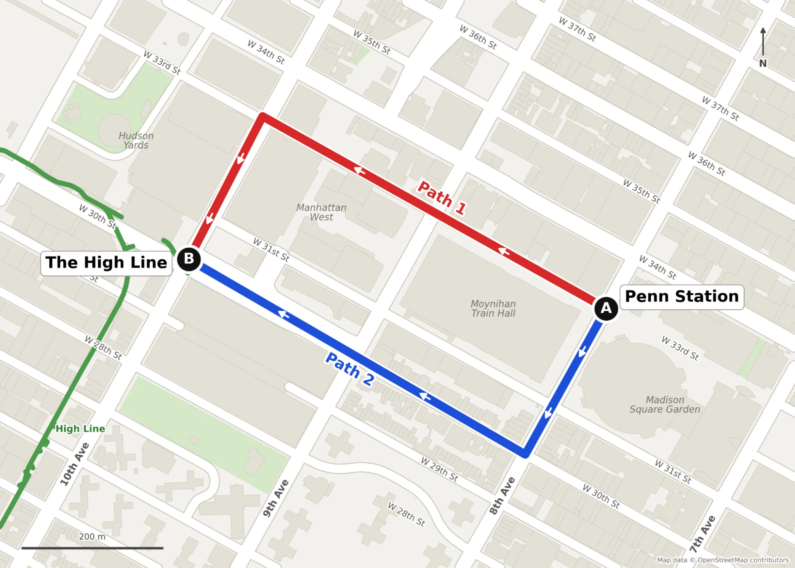
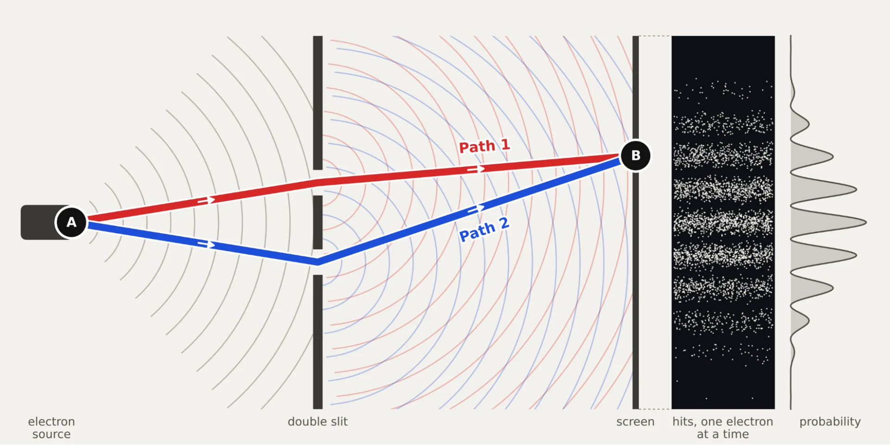
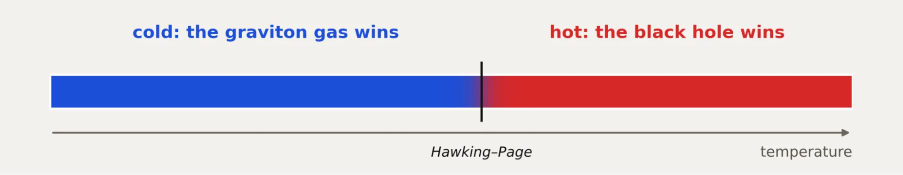
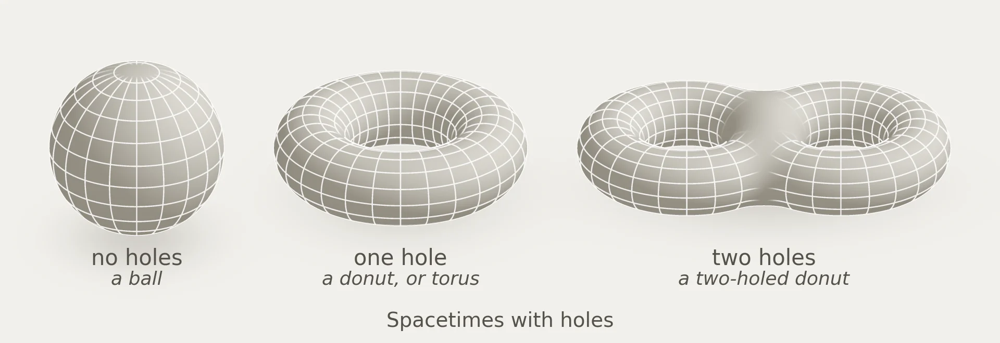
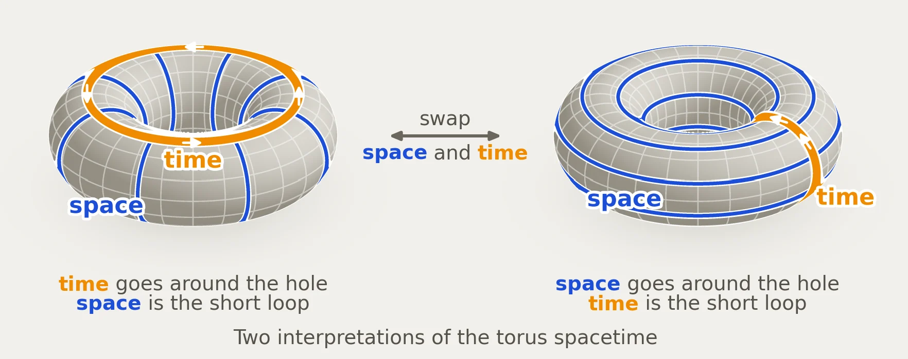

# Claude 解决黑洞物理中的两个开放问题

- 英文标题：Claude solves two open problems in the physics of black holes
- 发布日期：2026-11-17
- 官网栏目：科学
- 原文：[Anthropic 页面](https://www.anthropic.com/research/claude-black-hole-physics)
- 官网署名：Anthropic

> 中文译文，已逐段对照英文原文核对。

> Claude 解决了理论物理中的两个开放问题，两者都涉及黑洞和对量子引力理论的探索。第一个问题中，它完成了一项物理学家在二十多年前提出、却一直未能完成的计算。结果表明，即使时空已不再具有明确的形状，与黑洞形成有关的突变仍然存在。

第二个问题中，Claude 找到了某种用于检验量子引力候选理论的方法在最简单版本下的精确极限。本文先用通俗语言介绍这两项发现，再解释技术细节。两篇预印本分别见[此处](https://hexagonmath.org/2611.00175v1)和[此处](https://hexagonmath.org/2611.00174v1)。

## 引言

现代物理建立在广义相对论与量子力学这两个框架上。广义相对论描述恒星等极大的事物，量子力学描述原子等极小的事物。两者都能极其准确地预测宇宙的行为，却在数学上彼此不相容。找到统一两者的“量子引力”理论，是这个领域最重要的目标之一。

黑洞是天然的试验场。它把巨大的质量集中在极小空间里，是少数必须同时考虑相对论与量子力学的地方之一。

研究量子引力最有用的工具之一叫全息对偶。真实宇宙有三个空间维度和一个时间维度，相对论将其合为四维时空。但量子引力研究者常使用更简单的模型宇宙，以便进行深入分析。

全息对偶的基本思想是，某些理论宇宙可以用两种方式描述。一种是有引力和时空的完整宇宙，另一种是完全没有引力、被“写”在宇宙外边界上的量子描述。就像真实全息图在二维平面上编码三维图像，量子模型也在少一个维度的空间中编码整个宇宙的信息。例如，一个有四个空间维度的宇宙，可以由三个空间维度的量子理论完整描述。

这使物理学家能够把困难的引力问题转化成有时更容易回答的量子物理问题。

Claude 解决的[第一个问题](https://hexagonmath.org/2611.00175v1)，涉及加热这种理论宇宙会发生什么。低温时，宇宙里充满粒子气体。超过某个温度后，形成的则是黑洞。1983 年，斯蒂芬·霍金和唐·佩奇证明，这种切换是突变，属于相变，类似水在 100°C 突然沸腾。

但霍金和佩奇的计算依赖广义相对论，只有当宇宙远大于这一描述失效的微小尺度时才适用。模型宇宙缩小到接近该尺度时，时空会失去明确形状、变得模糊，没有人知道怎样在对偶的引力一侧完成计算。不过在量子一侧，同样的情形至少原则上可以计算。

1999 年，物理学家发现这个区域也存在相变，却不知道它是像霍金–佩奇相变那样突变，还是平滑变化。2003 年，一组研究者[提出了可解决这个问题的计算](https://arxiv.org/abs/hep-th/0310285)，但计算过于复杂，一直没有完成。Claude 让多个自身副本组成小型研究组，几乎每部分计算都安排独立完成，并对照已知结果检查数学推导，最终完成了计算。

结果表明，相变是突变。同样的突然切换出现在两个极端，这说明黑洞形成可能不仅是相对论的特征，也内含于底层的量子理论之中。

[第二个问题](https://hexagonmath.org/2611.00174v1)涉及一个只有两个空间维度的简化宇宙。它足够简单，便于深入研究，但仍有黑洞，以及许多类似于真实宇宙的谜题。

即使在这个简单宇宙中，物理学家也不知道如何建立完整的量子引力理论，于是从反方向入手。他们试图证明某些理论内部不自洽，从而排除错误理论。这种方法叫自举法。

自 2009 年以来，物理学家用这种方法的一种版本，为这类宇宙中最轻黑洞的质量设定上界。违反上界的理论就被排除，每降低一次上界，都能缩小搜索范围。数值计算暗示了最佳上界的位置，却无法证明，而当时已获证明的最佳上界距离数值结果仍有明显差距。

Claude Fable 5.2 注意到数值结果中被物理学家忽略的一种规律，并借用数学和物理其他领域的方法，算出这种技术最简单版本的精确上界，证明它无法继续降低。结果没有确定正确理论，却可能帮助物理学家找到方向。

这两项结果都不直接描述我们的宇宙，也没有实际应用，但都为理解量子力学与相对论如何相容这一长期理论研究作出了贡献。

下文将详细解释两个问题及 Claude 的解决方法。

## 关于 Claude 研究方法的说明

八月，Anthropic 研究员 Hongbin Chen 在一个业余项目中测试 Claude 的能力。他让 Claude 列出理论物理中有趣的开放问题，重点关注黑洞和自举法。几小时后，Claude 提出 22 个候选问题。Hongbin 分别安排智能体研究，每个智能体都能阅读其他智能体的进展记录，并在问题相关时合作。

这些智能体没有经过特殊配置，在后台运行了约六周。

它们解决了本文的两个问题。其一是霍金–佩奇相变，即热气体何时变成黑洞。其中一个智能体得出解答几周后，一位独立使用 Claude 研究同一问题的物理学家分享了自己的结果。一位同事发现，Hongbin 的智能体更早已得出相同答案。两种解法使用不同方法，因此可以互相检验。

模自举的结果来自多个智能体。负责该问题的智能体在阅读自举法文献时，发现数值结果的规律。另一个研究高维空间球体最密堆积问题的智能体，利用数学上的关联把这条规律转成一种方法。它发现，这个方法能重现[近期由 OpenAI 模型证明的球体堆积结果](https://cdn.openai.com/pdf/ten-proofs-oai.pdf)。

Claude 随后把同一方法应用到自举问题。此前一个 Claude 智能体曾并行尝试 61 次，都未成功。另外两个智能体也独立得出了相同答案。最终证明中说明上界无法继续降低的那一半，沿用了 OpenAI 证明的策略。九月，结果通过计算机证明检查器 Lean 的形式化验证。随后 Claude 在极少指导下写成论文，一位物理学家核查了所有主要结果。

## 霍金–佩奇相变

理解第一个问题，可以先从一件熟悉得多的事开始：在纽约市散步。

从宾夕法尼亚车站 A 到高线公园入口 B 的两条同样好的路线。理论上，量子粒子可以同时走两条路。

假设你从宾夕法尼亚车站前往西 30 街与第十大道交会处的高线公园入口，有两条同样合适的路线。可以沿西 33 街向西再向南，也可以先向南再沿西 30 街向西。你必须选一条。但在量子世界中，粒子可以同时走两条路线。

著名的双缝实验最清楚地展示了这一点。把粒子逐个射向有两条狭缝的挡板，记录它们在后方屏幕上的落点。每个粒子都落在一个确定的位置。但随着粒子增多，落点会形成条纹，只有每个粒子都像波一样同时通过两条狭缝，才会出现这种图样。

电子从 A 逐个射向双缝挡板，每个电子落在屏幕上的一个位置。落点积累成条纹，表明每个电子都通过了两条缝。

更一般地预测量子粒子的行为，需要把它可能经过的每条路径加起来，这些路径叫作可能的历史。不同历史的权重并不相等，有些对总和的贡献远大于其他历史。这种描述单粒子的方式看起来大费周章且神秘，却是物理学最成功的思想之一。

这种“对历史求和”的方法已广泛用于粒子及其组成的物体。但引力呢？爱因斯坦指出，引力是时空弯曲的结果。有质量的物体使周围时空弯曲，我们感受到的就是引力。因此在量子引力理论中，求和对象是时空本身的形状，而非仅仅是在时空中运动的粒子路径。

要用量子引力理论作预测，需要对宇宙所有可能的形状求和。目前还没人知道怎样完成，现代量子引力研究很大一部分都在试图解决这个问题。

霍金和佩奇找到了一种足够简单、又足够有趣的情形。理解他们的工作，需要想象一种叫反德西特时空的宇宙。设想你站在一个巨碗里，无论把物体扔得多用力，它最终都会滚回出发点。

我们的宇宙并非如此。区别来自宇宙学常数，它描述真空的能量。我们宇宙中的真空能量为正，使空间加速膨胀。反德西特时空中，真空能量为负，一切都会被拉回起点。霍金和佩奇选用这种宇宙，是因为碗能留住热量，使加热后的系统保持稳定温度。

在任何给定温度下，两种历史对总和的贡献都远超其他历史。这里的历史是完整的一种宇宙，包括某个时空形状及其中的一切。一种历史里，碗中充满普通粒子气体，包括被认为传递引力的引力子。另一种历史里，碗中有黑洞。

对总和贡献更大的历史会“胜出”，也就是我们实际会观察到的情形。低温时气体历史占优，宇宙充满气体。高温时黑洞历史占优，宇宙中存在黑洞。在一个特定温度，即霍金–佩奇温度，宇宙会从一种状态突然切换到另一种状态，这就是相变。

哪种历史占优取决于温度。低于霍金–佩奇温度（黑线）时，宇宙充满包括引力子在内的粒子气体。高于该温度时，宇宙中存在黑洞。

这是少有的例子，我们能看到两种截然不同的时空形状在历史求和中竞争，并确定哪种占优。

接下来是全息原理。20 世纪 70 年代，雅各布·贝肯斯坦和霍金发现，黑洞能容纳的信息量与表面积成正比，而非与体积成正比。这和普通物质大不相同，普通物质每单位体积所含的信息量大致相同。

90 年代初，杰拉德·特·胡夫特和伦纳德·萨斯坎德提出，这个思想可以推广到引力。一个空间区域内部的一切，都能由边界信息完整描述，就像平面全息图能显示三维图像。1997 年，胡安·马尔达西那进一步将其形式化。

他提出，反德西特“碗”内部的引力，等价于碗沿（宇宙外边界）上的普通无引力量子粒子理论。这就是引言中所说的引力一侧和量子一侧，它们是描述同一底层实在的两种语言。

Claude 研究的情形中，边界上的量子理论称为 N=4 超杨–米尔斯理论。它与描述真实宇宙粒子相互作用的理论有关，但具有额外的对称性，计算更容易处理。

Claude 以前也研究过它，曾以[新的精度计算其中的粒子相互作用](https://www.anthropic.com/news/yes-claude-can-do-nine-loops)。既然引力一侧预言两种历史竞争，接下来就要问：量子一侧的 N=4 超杨–米尔斯理论是否呈现相同行为？

目前物理学家只有在粒子间相互作用很弱、即弱耦合时，才能详细分析这个理论。这与霍金和佩奇的引力计算适用的情形处于两端。量子一侧的弱耦合，对应引力一侧微小而模糊的宇宙。因此，无法保证霍金和佩奇的任何发现仍然适用。

令人惊讶的是，它们确实适用。Bo Sundborg 在 1999 年，以及之后的 Ofer Aharony、Joseph Marsano、Shiraz Minwalla、Kyriakos Papadodimas 和 Mark Van Raamsdonk 证明，边界理论即使在弱耦合时，也会在加热后发生相变。它对应碗内从气体到黑洞的变化。但当时仍不清楚，相变是突变，还是平滑渐变。

粒子几乎不相互作用时，物理学家需要逐阶计算其行为。先从完全无相互作用的简化理论出发，再逐项加入精度更高、计算更难的修正。这些步骤以圈数表示。

2003 年，Aharony 等人发现，相变是霍金和佩奇预言的突变还是渐变，取决于三圈阶才出现的一个数。计算它涉及成千上万个被称为“图”的项，无法手工处理。2005 年，同一研究组完成了一个较简单的近似理论的计算，发现相变是突变。

但 N=4 超杨–米尔斯理论的版本规模大了十倍以上，一直没有完成。

计算规模并非唯一障碍。还有一个概念问题，直接把所有部分相加会得到无穷大，需要小心处理这些无穷大才能提取有意义的结果。

Claude 让多个自身副本组成研究组，几乎每部分计算都由相互独立的智能体完成两遍。部分计算还可以和文献里的既有结果比较，提供额外的一致性检查。

Claude 得到的结果是，温度上升时会出现突变，正好对应霍金和佩奇对时空历史求和得到的结论。图景很简单，弱耦合和强耦合两端，对应引力描述中模糊和光滑的两端，相变都是突变。最自然的可能是，中间区域也一直保持突变。

这是一个漂亮的结果，说明引力中的历史求和计算，在定性上符合一种完全没有引力的普通量子理论的行为。

还有许多开放问题。Claude 发现的突变很像水沸腾。有趣的是，竞争中落败的一方仍可维持一段时间。例如，水可以被加热到超过 100°C 而不沸腾，微波炉加热极纯的水时就可能发生这种现象。

但请不要尝试，这很危险，Anthropic 不想让大量读者因此烫伤。

这里也有类似现象。高于霍金–佩奇温度时，引力子和其他粒子的热气体可以在过热状态维持很久。但温度更高时，它就无法继续存在。这是另一种相变，即哈格多恩相变，也是弦论的一种特征信号。引力一侧的这个相变有许多有趣性质，值得详细检查它们是否同样出现在 N=4 超杨–米尔斯理论中。

另一个问题关乎时空的其他可能历史。霍金和佩奇考虑了三种：充满气体的模型宇宙、含大黑洞的宇宙，以及含较小黑洞、却始终无法在历史求和中占优的宇宙。原则上还有更多历史，目前所知，它们都未曾占优。

但改变初始条件，例如让宇宙旋转，或者固定能量或电荷后，某些其他历史就会占优。准确弄清哪些会在何时胜出，是未来值得研究的问题。

## 模自举

前面介绍过一种只有两个空间维度和一个时间维度的模型宇宙。它在三个时空维度中描述引力，因此叫“三维引力”。按照全息对偶，反德西特碗内的三维引力，等价于碗沿上的普通量子理论。

三维引力比真实引力简单得多，却仍容许黑洞及许多同类谜题。它是研究时空历史求和的实验平台，也适合检验时空是否从更深层结构中涌现。在广义相对论中，黑洞看起来是光滑的。

量子引力中，若放大到最小尺度，也就是约 10⁻³⁵ 米的普朗克长度，引力的量子效应无法忽略，黑洞由大量微小且独立的基本单元组成。物理学家认为，我们的四维宇宙也如此，但三维版本更容易用全息对偶分析。

Claude 的结果建立在自举法上。这是求解量子理论的一般策略，却不直接求解某个理论。三维引力甚至还没有精确定义，无法直接求解。自举法通过证明理论自相矛盾来排除它，扫描各种可能理论并逐一筛除。

在许多情况下，这种方法竟能锁定唯一的量子理论并精确计算其行为。相对论和量子力学的要求极其严格、相互之间平衡得极为精细，合在一起足以排除其他选项。2012 年，自举法用于求解[三维临界伊辛模型](https://arxiv.org/abs/1203.6064)，一种简单的磁性模型，也描述液态水和水蒸气不可区分的临界点。

此后它被用于许多不同的量子系统。

2009 年，Simeon Hellerman 提出[模自举](https://arxiv.org/abs/0902.2790)，将自举法应用于三维引力，以排除三个时空维度中不自洽的量子引力理论。物理学家希望结合其他自举方法，最终排除一切不自洽理论，剩下的自然自洽。结果可能一个都没有，也可能只有一个，或有整族理论。

无论哪种结果都值得关注，因为它有助于理解简化宇宙在普朗克尺度的时空形态，也能为我们宇宙的相应尺度提供线索。

模自举这样运作。在反德西特时空的三维引力中，有一个叫中心荷 c 的量，大致计量宇宙中微观基本单元的数量。广义相对论适用时，c 非常大，因为大黑洞含有极多基本单元。另一个量 M₁ 是最轻黑洞的质量。

物理学家扫描所有可能的理论，也就是 c 和 M₁ 的各种可能取值，寻找不一致之处。

理解这个搜索过程，需要回到时空历史求和。在三维引力中，要把不同的三维时空形状加起来。形状可以像球一样简单，也可以像图中的甜甜圈或双孔甜甜圈。时空是形状的内部，相当于甜甜圈的面团。表面就像前文的碗沿，在少一个维度上“写”着量子理论。

三维引力的三种可能时空形状。时空是各形状的内部，量子理论“写”在表面上。

模自举从一个普通单孔甜甜圈，也就是环面形状的时空开始。按哪个方向叫时间、哪个叫空间，它有两种解释。第一种把绕中央孔的长环当作时间，绕管身的短环当作空间。第二种则交换两者。

同一环面时空的两种解释。左图长环是时间、短环是空间，右图长环是空间、短环是时间。

在这种计算中，时间环的长度决定温度，环越短，宇宙越热。交换两个环，相当于把冷宇宙换成热宇宙。两种解释对应霍金和佩奇研究的两种竞争历史。三维引力中没有引力子，但仍有类似于 Claude 在 N=4 超杨–米尔斯理论中分析的相变。

关键来了。相对论中，空间与时间地位相同，把哪个环称为空间或时间不应产生差别。对相对论而言，两种解释等价，一切可能实验的物理结果都必须相同。

量子力学却区别对待时间和空间。计算时需要选定时间方向，追踪系统沿这个方向演化。因此，用量子引力计算可观测量时，环面的两种解释会导出看起来很不同的计算。但相对论要求它们给出完全相同的答案。

如果已知三维量子引力理论，就可完成两种计算并验证结果一致。即使理论未知，自举法仍能工作。物理学家扫描 c 和 M₁，对每组取值尝试证明理论不自洽，也就是环面上的两种计算不可能给出相同答案。

这需要寻找一种叫“自举泛函”的特殊数学对象。找到它，就能证明理论不自洽，排除对应取值。

自举法在其他领域的成功使人们希望，结合其他自举方法，最终能排除三维量子引力的大多数候选理论。剩下的将是同时符合引力和量子力学的理论。

物理学家便可借它们探索量子引力的重要问题。是否只有一个理论？它是否依赖弦论，有无其他选择？黑洞微观上由什么组成？如何对时空历史求和？

这种策略原则上可行，实践中却很困难，因为自举泛函很难找。量子引力关注的是 c 很大的情形，但 c 越大，搜索越难。Hellerman 在最初的模自举论文中证明，在任何自洽的三维引力理论中，忽略小修正，M₁ 不超过 c/6。

如果某理论中最轻黑洞比这还重，就不可能同时符合引力和量子力学。

模自举的目标是尽可能降低这个上界，限制最轻黑洞的质量。物理学家写作 M₁ ≤ c/Λ，上界越低，Λ 越大。以下结果包括 Claude 的结果，都针对最简单、研究最多、忽略黑洞自旋的版本。

过去十五年，物理学家用两种方式不断降低上界。一种是解析方法，用纸笔数学手工构建自举泛函。另一种是数值方法，用计算机搜索和优化泛函。[数值结果](https://arxiv.org/abs/1903.06272)表明，模自举或许能将上界降至约 c/9.1。

但 c 增大时计算越来越难，数值无法给出定论。解析方面，Tom Hartman、Dalimil Mazáč 和 Leonardo Rastelli [证明了 c/8.5 的上界](https://arxiv.org/abs/1905.01319)。这个上界仍高于数值结果，显然没有达到方法极限。此后，模自举究竟能把量子引力限制到什么程度，始终是开放问题。

Claude 通过数值实验并复现文献结果研究这个问题，注意到上界随 c 增大而微调的一种规律，此前物理学家没有发现。它由此借助一种称为谱曲线的数学工具，对自举泛函的行为提出假设。

谱曲线在数学和物理其他领域广为人知，却从未用于此问题。Claude 找到支配大 c 极限下模自举的谱曲线，并证明最轻黑洞质量不超过 c/Λ，其中 Λ 有精确公式，约为 9.1266。它还证明，这个上界是最优的，这一版本的模自举无法将其再降低。

Claude 先用四份研究笔记给出解答，随后合并成一篇论文。

这是自举法首次在黑洞起重要作用的量子引力区域导出精确结果的案例之一。它也说明，仅靠这个版本无法把上界降到黑洞开始出现的质量 c/12，还需要其他要素。它没有独自确定三维量子引力理论，却提供了起点并缩小搜索范围。

## 结语

这两项结果展示了两种不同研究。第一项是物理学家搁置二十年的已知计算，因为工作太冗长、容易出错，无法手工完成。第二项需要新想法，发现他人忽略的规律，并从其他物理领域引入数学工具。两者主要都是自主完成的。

它们没有解决量子引力问题，离解决还远，但都推进了一个长期研究领域。

黑洞相变论文见[此处](https://hexagonmath.org/2611.00175v1)，模自举论文见[此处](https://hexagonmath.org/2611.00174v1)。
