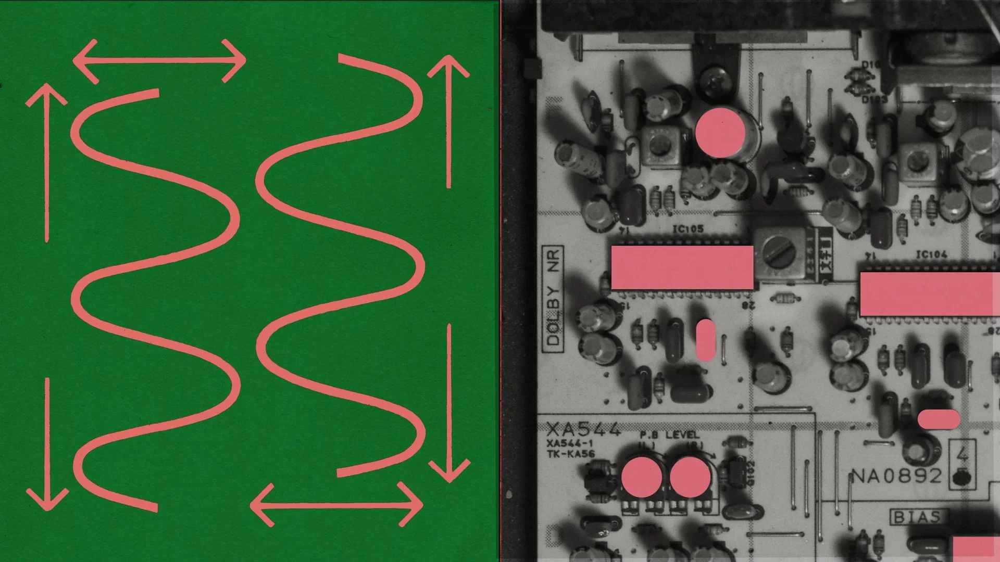
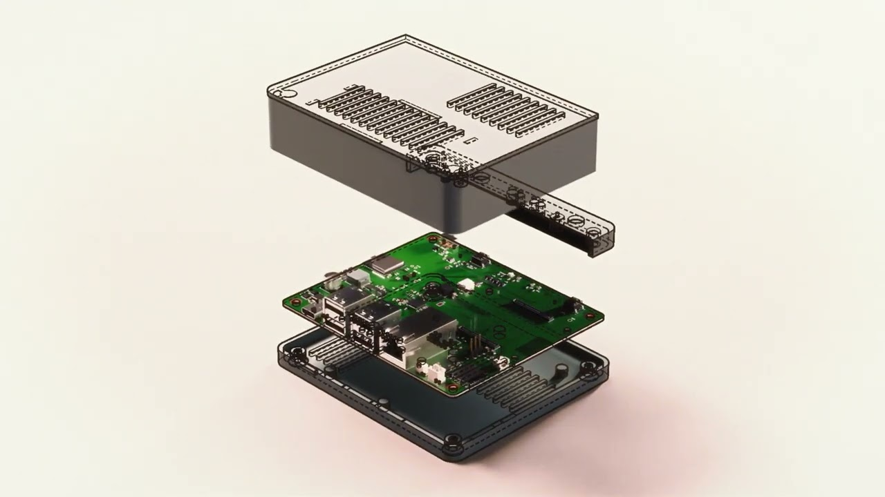
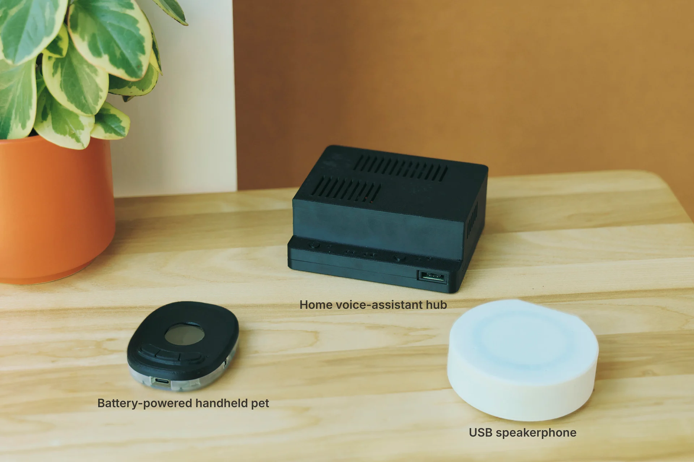
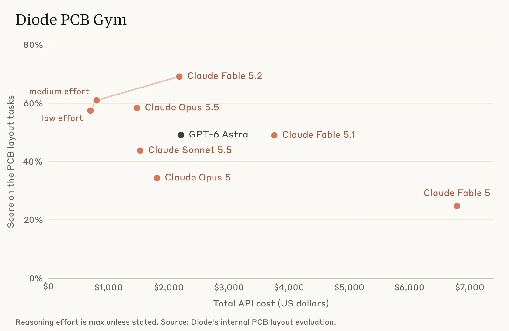
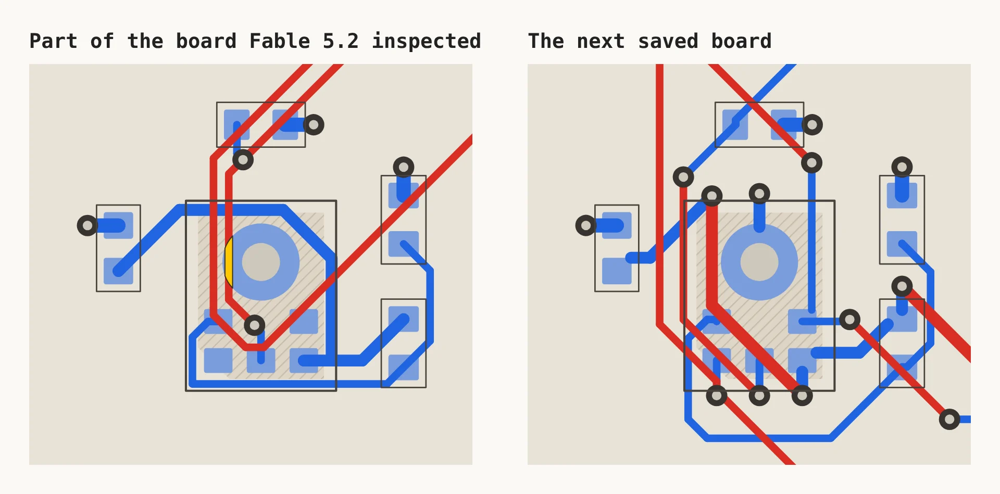
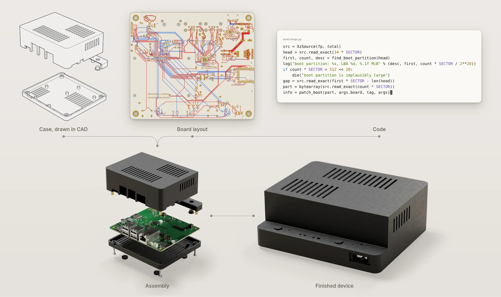
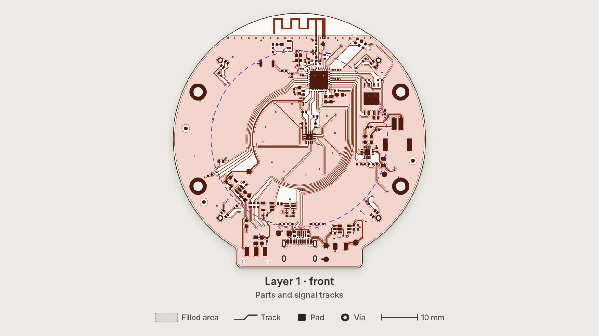
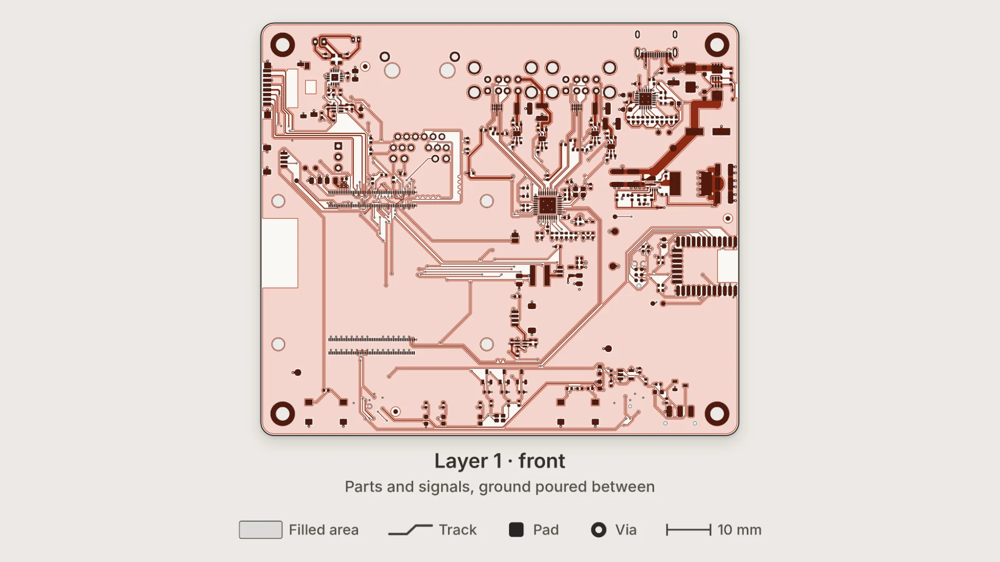
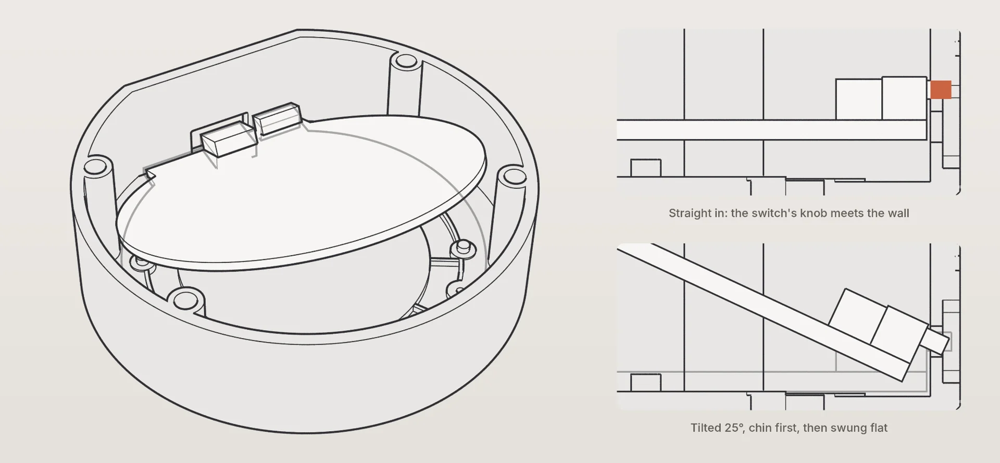

# 用现实中的电子产品设计任务测试 Claude

- 英文标题：Testing Claude on real-world electronics design
- 发布日期：2026-11-09
- 官网栏目：科学
- 原文：[Anthropic 页面](https://www.anthropic.com/research/claude-electronics-design)
- 官网署名：Anthropic

> 中文机器初译，未逐篇人工校对。引用研究结论时请核对英文原文。

一年多前，我们开始测试Claude设计基本电子电路的能力。我们 [与二极管计算机公司合作](https://claude.com/resources/articles/making-claude-a-better-electrical-engineer),[1](https://www.anthropic.com/research/claude-electronics-design#footnote-1) 一家设计和制造电路板的公司，培训Claude执行简单的任务，例如阅读芯片的数据表并找出芯片运行所需的部件。我们当时尝试的模型无法可靠地布置电路板；他们还努力设计能够组合在一起的组件。现在，Claude可以从头到尾设计电子硬件并制作原型。

设计电子设备需要经历许多复杂的步骤和实际的限制。您不仅必须设计和模拟电路板，还必须推理电路板的物理布局及其行为方式、对机械组件进行建模并编写固件，同时跟踪哪些部件是现成的以及工厂要建造什么。

为了了解新的 Claude 模型在这方面的改进，我们再次与 Diode 合作，这次要求 Claude Fable 5.2 设计三种电子设备：扬声器、语音助手中枢和手持虚拟宠物。只需很少的提示，Claude就能够使用几何推理来布置每个电路板，预测制造限制，并确保其设计能够在其中发挥作用。它修改了自己的工作，在计算机辅助设计（CAD）软件中对其设计进行建模，最后指导人类工程师构建无需对其电路进行任何修复即可工作的原型。

对于每个设计，我们首先向Claude提供一个简单的提示，概述要构建的设备类型及其主要硬件要求。例如，关于免提电话的提示要求“一个通过 USB-C 插入计算机的圆盘，包括麦克风和扬声器，通过 PCB 天线支持蓝牙”。 Claude 继续编写设备的规格、绘制清晰的视觉原理图、选择在印刷电路板 (PCB) 上放置组件的位置、在组件之间布线铜连接、设计可 3D 打印的外壳、对固件进行编码并准备零件清单。在Claude的指导下，二极管组装了电路板并运行了固件。最终的结果是一个扬声器原型，在使用数周后仍然可以工作。

Claude也经历了类似的过程来构建语音助手中心和虚拟宠物，并且两者仍然处于良好的工作状态。由于这些设备是早期原型，我们还不知道它们将如何持续使用，也不知道它们是否会通过商业认证。

根据 Claude 的设计构建的三款设备，从左到右：电池供电的手持宠物、家庭语音助手集线器和 USB 扬声器。Claude设计了电子设备和外壳，并为每一个都编写了固件。

## 通过几何问题进行推理

Fable 5.2 与我们早期测试中使用的模型之间最本质的区别在于 Fable 5.2 对复杂几何问题的推理能力，例如在电路板上放置组件的位置以及如何在它们之间布线铜连接。

早期的模型一直在努力决定如何布置基本组件，例如将支撑部件放置在距离它们所服务的芯片太远的位置，或者错误地定位连接器。相比之下，《神鬼寓言 5.2》的布局更加紧凑、实用。它首先对最重要的连接进行布线：那些承载高速信号或高电流的连接，或者对噪声敏感的连接。例如，对于语音助手集线器，Claude 首先对 USB 和以太网连接进行路由，这些连接沿着成对的轨道（板上的细铜条）传输信号。它一次布线一对轨道，使每对中的两条轨道保持相同的长度和正确的间距。它还添加了调谐模式——延长轨道的小锯齿形，以便信号同时到达——并安排电源部件以提高其效率。

为了展示 Fable 5.2 在电路板布局方面比早期模型好多少，我们要求 Diode 运行 PCB Gym，这是一个内部基准测试，根据模型在布局已被删除的电路板设计上放置组件和重新布线连接的能力对模型进行评分。《神鬼寓言 5.2》在基准测试中的得分为 69%，而《神鬼寓言 5》的得分为 25%（图 2）。它在以下方面也表现得更好 [基准CAD 2.1](https://github.com/BenchCAD-org/benchcad-2-main/releases/tag/v2.1)，一个公共基准测试，测试模型是否可以根据工程图和渲染图像重建 3D 零件、装配体和电路板。《神鬼寓言》5.2 的得分为 83.5%，几乎是其前身 Claude Fable 5.1 得分的两倍。

分数根据 Diode PCB Gym 上最新前沿模型的 API 总成本绘制，这是一个基准，指示模型在布局已被删除的电路板上放置组件和路由连接。

## 修改设计

早期的模型在设计 PCB 布局时很少修改自己的工作，即使很明显他们的布局选择永远不会让他们完成连接的布线。在过去的一年里，Diode 用这些模型设计了许多板子，虽然已经完成了 95%，但仍然无法使用。

当Claude注意到其中一项设计不起作用时，它会在没有提示的情况下改变路线。例如，在设计具有四层铜的扬声器电路板时，它将信号重新分配给其中两个芯片上的不同引脚。这使得免提电话的触摸感应控件下的轨道能够保持在单层上而不会相互交叉。后来，当板的背面变得过于拥挤时，Claude交换了可互换引脚上的信号，并再次布置了板的整个角，而不是通过层之间的额外跳转来修补问题。

当在语音助手集线器的设计文件中放置轨道时，Claude注意到铜连接“变得太缠结，无法在视觉上追踪”，并推理道，“我应该撕掉这些轨道[轨道]并重新开始。”它继续删除和重新布线铜连接数十次，直到找到有效的安排。

Claude重新组织连接之前和之后语音助手集线器的路由。左图：麦克风的电源轨道（蓝线）环绕声音端口处的接地环，前侧轨道（红色）穿过环，通孔（连接铜层的小孔）放置在麦克风的焊盘之间。右：Claude重新布置电源轨道后的同一区域，环路畅通并接地。Claude 重做左侧版本的理由是：“即使间隙技术上没有问题，在底部端口 MEMS 麦克风下放置也是有风险的，所以我想为两个相同的麦克风封装彻底重做本地布线。”

## 使用软件和文档

当其中一个设备的设计决策取决于特定部件的细节时，Claude经常检查该部件的数据表——制造商发布的技术文件。当被问及手持宠物是否可以在没有电池的情况下工作时，Claude阅读了充电器的数据表并回答说它将使用 USB 电源运行，但预计充电指示灯会闪烁，因为充电器不断为电池位置的小电容器充电。[2](https://www.anthropic.com/research/claude-electronics-design#footnote-2)

为了在语音助手集线器上进行连接，Claude 从 Diode 提供的设计软件开始，该软件可以运行 KiCad（一种广泛使用的电路板设计程序）中内置的路由器（一种绘制轨道的工具）。KiCad 的路由器在Claude选择的两点之间一次绘制一条轨迹。但集线器有很长的走线，从 100 针连接器延伸出来，Claude认为将这些走线一一走线会需要太多的逐步指导。

相反，Claude编写了自己的路由器：一种将棋盘划分为网格并进行搜索以找到每个轨道的清晰路径的算法。大约半小时内，Claude就拥有了一台铣刨机，可以在大约一秒钟内铺设每条长轨道。当 Claude 发现音频时钟轨道距离以太网轨道太近时，它会调整路由器，以便在敏感轨道周围留出更多空间。

## 跟踪约束和下游影响

设计的某一部分做出的决策会产生下游影响，Claude对此进行了跟踪。在设计每个设备的外壳时，它编写了代码来检查电路板的 3D 模型是否适合外壳内部，而不会发生任何组件碰撞。例如，它发现扬声器的电路板无法直接放入外壳中，因为静音开关会撞到后墙。Claude计算出，如果在安装过程中倾斜约 25 度，那么该板就可以安装。它在 3D 模型中对此进行了测试，并将该步骤添加到组装说明中。

在设计语音助手集线器的外壳时，Claude 计算出 25 毫米长的麦克风端口（让声音到达麦克风的开口）会在 3.4 kHz 附近产生共振。它认为，这“就在语音频段”，“虽然仍可用于语音助手目的，但并不理想。更好的方法是采用楔形外壳，后部较高，前部较低。”楔形形状将端口缩短至约 10 毫米，从而将谐振频率提高至约 8.9 kHz，位于语音范围的最边缘。Claude 还为免提电话编写了固件，当音频变大时，它的 LED 灯环会变暗，以使设备保持在 Claude 在电路板上设计的电流限制之下。

Claude的家庭语音助手中心设计和成品原型。Claude 编写了在 CAD 中对外壳进行建模的代码、布置了电路板并编写了固件。

## 为现实世界的制造而设计

在电子设计中，工程师必须在现实世界的限制下工作。也就是说，他们必须确保工厂能够真正生产他们想要建造的东西。他们通过运行两种检查来做到这一点：制造设计 (DFM) 检查，将电路板的几何形状与工厂的制造限制进行比较，以及采购检查，确认分销商是否有库存零件。

Claude自行运行这些检查，并将结果分类为需要修复的问题和可以忽略的标记。它对语音助手集线器的检查将六片阻焊层（电路板上的保护涂层）标记为太薄而无法制造。Claude通过加宽阻焊层的开口来固定它们，而不移动任何部件。检查还将两个接地之间的连接（共享电流返回路径）标记为错误，因为自动检查器没有识别出该连接是故意的。Claude正确地推断出它不会影响性能并忽略了该标志。

Diode 直接根据 Claude 的设计文件制造了所有三块板，没有任何来回过度调整。工厂和工程师经常必须经历多轮制造变更，Diode 团队告诉我们，他们很惊讶他们不必与 Claude 一起这样做。

扬声器的四层铜层。虚线圆圈标记了触摸轮，其中铜电极感应用户的手指。将轨道从一层移动到另一层需要在板上钻一个孔，并且在触摸轮下方，该孔将穿过电极。为了避免这种情况，Claude 将车轮下的每个信号轨道保持在单层上，并选择芯片的引脚分配，以便这些轨道不需要相互交叉。它还保持蓝牙天线周围的区域（顶部的锯齿形）没有其他铜和每层上的孔，因此附近的金属不会削弱其信号。

语音助手集线器的四个铜层。Claude在电源层（绿色）上添加了两个接地铜区域，位于电路板背面承载高速信号的大多数走线的正后方。这为信号提供了附近的返回路径，有助于减少干扰。

扬声器的电路板不能直接放入外壳中，因为静音开关的旋钮会撞到后壁（红色）。Claude弄清楚了如何通过将板倾斜约 25 度然后将其摆平来安装板，并将此步骤添加到组装说明中。

## 限制和后续步骤

所有这三个设备仍然是原型：它们尚未经过电气验证、天线调谐、热测试或认证，并且不是为大规模生产而设计的。由于 Claude 没有连接到测试设备或制造和组装电路板的机器，因此 Diode 的工程师必须亲自构建和测试原型。即便如此，在过去的一年里，Claude 在通过元件布局和布线决策进行推理方面有了很大的进步，现在它可以在最少的人工指导下设计电子产品，并帮助人们构建原型。其他模型也在这方面取得了进展：OpenAI 最近 [写了关于使用其模型的文章](https://openai.com/index/accelerating-engineering-for-the-physical-world/) 设计手持设备。这样的工作可以帮助工程师更快地构建和测试新的硬件设计。

接下来，我们计划调查 Claude 是否可以设计更密集、更快、更复杂的电路板，在仿真中检查它们，并从成品设备上进行的测量中学习。

## 脚注

01 Anthropic 与 Diode 有着商业关系。

02 这是 Diode 团队提示 Claude 的少数情况之一（“如果没有电池，它还能工作吗？”）。总体而言，他们的提示很少，仅限于简短的指令（例如，“清理原理图”和“继续”）。
