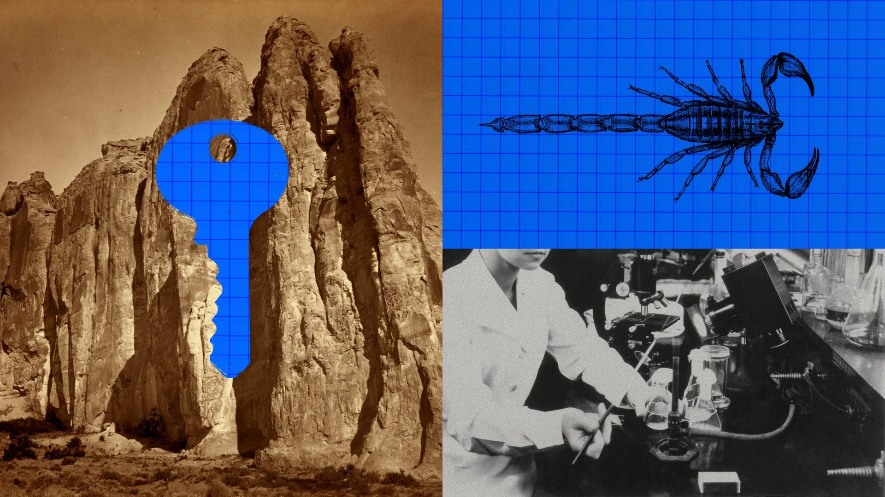
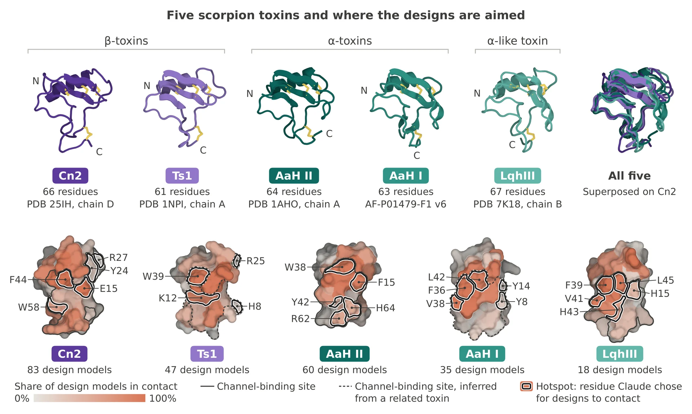
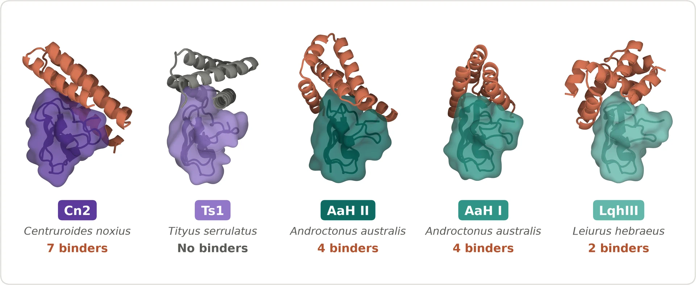
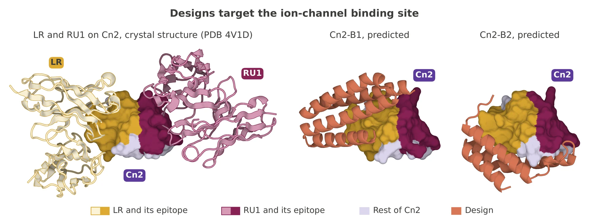

# Claude 如何设计靶向蝎子神经毒素的结合蛋白

- 英文标题：How Claude designed protein binders against scorpion neurotoxins
- 发布日期：2026-10-20
- 官网栏目：科学
- 原文：[Anthropic 页面](https://www.anthropic.com/research/claude-scorpion-toxin-binder-design)
- 官网署名：Anthropic
- 官网推荐阅读：[阅读技术报告](https://assets.claude.com/31ac578806cffd8b3d92d8affe6edc4c04d502e1.pdf)

> 中文机器初译，未逐篇人工校对。引用研究结论时请核对英文原文。

***摘要：** 作为我们试验 Claude 如何帮助加速药物发现的工作的一部分，我们要求设计一个内部研究模型* 迷你装订机 *（紧密附着在目标上的小蛋白质）对抗蝎子神经毒素。Claude根据我们的提示和四个后续行动进行了工作，这些后续行动是我们与金融投资研究公司 Citrini Research 合作开发的。Adaptyv Bio 和 Twist Bioscience 的团队对 211 种结合设计进行了实验测试。其中，17 个符合我们的标准。我们将发布所有 211 个设计及其数据，作为该领域的资源。*

[原文媒体](https://assets.claude.com/ed77ef7e1a1fc40d96df2ffb4eeaad008ccb702f.mp4)

八月，我们展示了 [Claude如何设计蛋白质微型结合剂](https://www.anthropic.com/research/Claude-accelerates-protein-design) 在得到一个提示后。在我们发布这些结果的一个月前，来自 [西特里尼研究公司](https://www.citriniresearch.com/) 向我们提出了一个有趣的问题：Claude（以及更广泛的人工智能药物发现）能否让一群有动力的非专家解决人类健康中的真正问题？我们生命科学研究团队的成员首先通过与Claude集思广益来回答这个问题。我们最终请求Claude帮助设计针对蝎子神经毒素的新型蛋白质结合剂，希望有一天它们可以被用来开发一种蝎子抗蛇毒血清。

每年有 120 万人或更多的人被蝎子蜇伤，导致超过 3,250 人死亡，其中大部分是世界上医疗服务有限的地区的儿童。新疗法的制造成本高昂，而且也不太可能收回开发成本。投入如此之少，蝎子毒液已被 [描述为](https://gh.bmj.com/content/10/11/e020682) 一种被忽视的热带疾病。

在用 Citrini 对其进行修改后，我们首先向 Claude 提供了与我们之前的蛋白质结合剂研究中使用的相同的提示。[1](https://www.anthropic.com/research/claude-scorpion-toxin-binder-design#footnote-1) 在接下来的 64 小时内，Claude Science 内部运行的一个内部研究模型主要是自主运行，尽管我们通过四个后续模型来指导其工作。在我们的监督下，Claude分析了研究数据，生成了数据，并起草了最终报告。

Claude的设计活动产生了 17 种蛋白质结合剂，每种结合剂都与已知对人类有害的四种蝎子神经毒素中的一种结合。在整个过程中，Claude 生成了 318,484 个蛋白质设计，并选择了其中 180 个进行测试。在 Claude 的帮助下，我们的团队又添加了 31 个。我们在 Adaptyv Bio 和 Twist Bioscience 这两个合同研究组织 (CRO) 的合作伙伴对所有 211 种设计进行了实验室测试，看看它们是否会与它们所针对的毒素结合，其中 17 种设计符合我们的结合剂标准。我们尚未确认这些结合剂是否能在细胞环境中中和蝎毒，因此我们并不声称已生产出抗蛇毒血清。

我们将Claude的工作发送给了两位外部专家：苏珊娜·巴斯克斯·托雷斯 (Susana Vázquez Torres) 和蒂莫西·P·托雷斯 (Timothy P.詹金斯说，他们认为这项工作是有希望的第一步。如果人工智能现在可以在几天内设计出针对几种难以靶向的毒素的可靠粘合剂，并且可以在几周内在实验室中得到证实，那么从理论上讲，这可以加快发现毒液和其他被忽视的疾病的速度。一如既往的挑战是将这些粘合剂转变为安全、负担得起且可广泛使用的药物。

我们在我们的文章中分享更多细节 [技术报告](https://assets.claude.com/31ac578806cffd8b3d92d8affe6edc4c04d502e1.pdf)，并且正在制作 [所有 211 种设计及其数据均可用](https://huggingface.co/datasets/Anthropic/scorpion-toxin-binder-design).

> 设计针对几乎任何目标的活页夹似乎不再是不现实的。我们现在可以非常快速地获得非常紧密的粘合剂，并且粘合本身不再是主要瓶颈。对于蛇和蝎子等有毒动物来说，它们的咬伤和蜇伤会导致大量人员死亡或重伤，特别是在服务欠缺的地区，真正的影响将来自于解决治疗管道中超出约束的部分。面临的挑战是使用这些非凡的工具来开发可以成为真正药物的分子，这些分子是安全的、负担得起的和广泛使用的。

***苏珊娜·巴斯克斯·托雷斯**，结构生物学项目博士后研究员，西班牙国家癌症研究中心（CNIO），马德里，西班牙。*

### 设计 *从头* 针对四种蝎子的五种毒素的粘合剂

蝎毒含有多种蛋白质神经毒素。最有可能伤害或杀死人类的神经毒素附着在 *钠通道*，嵌入神经细胞膜中的大蛋白质，使神经细胞能够放电。当钠通道受到干扰时，神经会在错误的时间放电，从而释放大量的应激化学物质，例如肾上腺素。在严重的情况下，这可能会导致心力衰竭和肺部积液过多，有时甚至导致死亡。

有一些抗蛇毒血清可用于蝎子蜇伤。它们通常是使用免疫动物的抗体制成的，这个过程可能需要几个月的时间。从数千只蝎子中提取毒液，用于对马进行免疫；然后科学家从马的血液中纯化产生的抗体。传统的抗蛇毒血清在早期注射时可以发挥作用，但它们通常只对少数神经毒素有效。它们的生产成本也很高，而且在许多地区要么价格昂贵，要么供应短缺。

*从头* 设计提供了一个潜在的解决方案。粘合剂是一种紧密附着在特定目标上的分子；抗体就是一个自然的例子。原则上，针对锁定在钠通道上的神经毒素部分的粘合剂可以阻止毒素到达通道。在 *从头* 设计时，蛋白质结合剂是针对特定目标从头开始生成的。这些粘合剂经过计算设计，可以针对效力和稳定性等药物特性进行优化，这可以使它们更容易在蜇伤最常发生的地区供应。

我们的方法的灵感来自 [早期的努力](https://www.nature.com/articles/s41586-024-08393-x) 那个设计的 *从头* 中和蛇神经毒素并保护小鼠的蛋白质。据我们所知，没有 *从头*-已经描述了针对蝎子神经毒素设计的粘合剂。

在本次活动中，我们选择针对四个地区的五种蝎毒神经毒素：墨西哥 (Cn2)、巴西 (Ts1)、北非（AaH I 和 AaH II）和中东 (LqhIII)。我们还选择将设计针对每种毒素的通道结合位点。Claude 通过搜索蛋白质数据库 (PDB) 以及 AlphaFold 数据库 (AFDB) 选择了用于设计的毒素结构。对于每种毒素，它选择了五个 *热点*，其结合剂设计旨在锁定的毒素上的特定氨基酸位置。

我们主要想知道Claude是否可以设计活页夹 *个人的* 毒素。但我们也很好奇Claude是否可以设计针对目标的活页夹 *多个* 毒素。尝试设计多毒素结合剂有一个实际原因，即它可以减少通用抗蛇毒血清所需的分子数量，这将是最具成本效益和区域中性的治疗方法。我们选择这五种蝎子毒素（Cn2、Ts1、AaH I、AaH II 和 LqhIII）作为多毒素设计的挑战性测试：它们在蛋白质的整体形状上共享一个折叠，但任何两种的氨基酸序列只有 26% 至 62% 相同。

为了看看Claude能走多远，我们要求它设计四种结合剂：分别针对五种毒素的结合剂；针对五种毒素的结合剂。针对β家族毒素Ts1和Cn2的结合剂；针对 α 家族毒素 AaH II、AaH I 和 LqhIII 的结合剂；以及同时针对所有五种毒素的粘合剂。

> 在几天内并行设计针对五种毒素的可靠粘合剂，是我们在治疗发现中看到的人工智能驱动范式转变的一个很好的展示。对于动物中毒等被忽视的疾病尤其如此，由于商业激励较低，这些疾病在很大程度上缺乏创新。能够以代理方式解决动物毒素中独特的广泛目标空间，可以显着加快发现速度，并更接近现实的治疗解决方案。

***蒂莫西·P。詹金斯**，丹麦技术大学副教授。*

#### Claude以相当大的自主权负责设计活动

我们最初的提示定义了神经毒素目标、蛋白质设计和折叠工具，以及新颖性、评分和过滤的规则。除了选择结构和氨基酸热点之外，Claude还设定了设计必须达到的质量阈值，决定了对每种可用设计工具的依赖程度，并制定了设计针对多种毒素的结合剂的策略。

最终，Claude使用 12 种设计工具生成了 318,484 种设计，过滤掉了任何类似于毒素或已知蛋白质的设计。Claude 共同折叠并筛选了 553,052 个设计毒素对，预测每一对的结构为一个复合体。在我们向 Claude 发出初步提示后 64 小时后，它产生了 180 种设计的最终清单。该活动使用了大约 10,000 个 GPU 小时。[2](https://www.anthropic.com/research/claude-scorpion-toxin-binder-design#footnote-2)

在我们第一次提示后，Claude自主工作了 24 小时。它的结果鼓励我们促使 Claude 继续其活动并寻找更好的设计。我们的后续提示主要集中在指导Claude设计多毒素结合剂。仅在我们第三次跟进后，Claude才选择了 180 种设计中的大部分，包括我们最强的粘合剂 (Cn2-B1)。应我们的要求，Claude 将蛋白质序列发送给 Twist Bioscience（在电子邮件中表明它们是 Claude 编写的），Twist Bioscience 生产了这些蛋白质，以便观察它们与毒素的结合效果如何。后来我们与 Claude 合作，又添加了 31 种设计，使设计总数增加到 211 种：60 种设计针对单一毒素（每种毒素 12 种），30 种设计针对两种 β 家族毒素，30 种设计针对三种 α 家族毒素，91 种设计针对所有五种毒素。

在我们团队评估的 211 种设计中，有 17 种符合我们的粘合剂标准，每种设计针对一种毒素。针对多种毒素的设计均不符合我们针对多种毒素的标准。 （除了受到当前能力的限制之外，对于 Claude 为何在这方面苦苦挣扎，可能还有很多解释，包括我们的提示、可用设计工具的局限性，甚至是多毒素设计的生物学可行性。）七种设计是针对 Cn2 的结合剂，四种是针对 AaH II 的结合剂，四种是针对 AaH I 的结合剂，两种是针对 LqhIII 的结合剂。在 60 种单毒素设计中，11 种是结合剂（18%）。这个速率与典型的蛋白质设计活动一致，包括我们之前的工作。

#### 在实验室测试Claude的设计

完成活动后，我们将设计发送给 Adaptyv Bio 和 Twist Bioscience 来测试它们的结合情况。每个小组都在自己的实验室中制作了设计，但格式不同。Adaptyv Bio 将它们表达为 *无细胞系统*，它使用从细菌而不是活细胞中提取的蛋白质制造机器。Twist Bioscience 将哺乳动物细胞（在本例中为人肾细胞）中的设计表达为融合 *氟碳*，抗体的茎。这些是测量潜在结合过程的补充方法，我们将它们结合起来以提高对我们结果的信心。

两个实验室都测量了结合 *表面等离子体共振* (SPR)，其中毒素流过设计，同时 SPR 仪器实时跟踪毒素与其结合和分离的速度。由此产生的迹线称为传感图，产生的测量结果称为 *解离常数* (KD)，它是结合强度的测量值（或 *亲和力*）。KD 越低，结合越紧。

在评估最终的设计时，我们制定了严格的标准，将设计标记为针对毒素的粘合剂。该设计需要是 *击中* 在两个实验室[3](https://www.anthropic.com/research/claude-scorpion-toxin-binder-design#footnote-3)——也就是说，它需要在每次重复中显示出与该毒素结合的证据，并且每个 KD 需要为 1 µM 或更紧密。我们还要求设计不显示针对 CLEC12A 的信号，CLEC12A 是一种不相关的人类蛋白质，用于测量脱靶结合或“粘性”。

#### Claude的 Cn2 结合剂可能与毒素中和抗体结合相同的位点

抗体和纳米抗体仍然是治疗的标准 *从头* 设计要击败。据报道，三种此类分子对 Cn2 或 AaH II 的亲和力 (KD) 低于 1 nM（纳摩尔），并且它们已被证明可以保护小鼠免受蝎子毒素的侵害。

我们的两个最强的结合剂，我们称之为 Cn2-B1 和 Cn2-B2，目标是 Cn2，一种来自墨西哥蝎子的神经毒素 *刺猬*。它们在 Adaptyv Bio 和 Twist Bioscience 上均与 Cn2 紧密结合，亲和力 (KD) 均在个位数纳摩尔范围内。

确定两个分子（例如抗体和小蛋白）是否结合靶标上的同一位点的一种方法是使用 *竞赛实验,* 测试两个绑定器是否可以同时附着到目标上*.* 如果一个分子的存在减少了另一个分子的结合，那么它们可能会竞争相同的结合位点。

我们的竞争实验表明我们的 Cn2 粘合剂均附着在相同的表面或附近 *表位* （结合位点）作为称为 LR 的抗体， [据报道可以中和 Cn2](https://pmc.ncbi.nlm.nih.gov/articles/PMC4722445/) 在小鼠中。LR 的结合位点覆盖了 Cn2 附着于钠通道并导致神经失火的部分。我们尚未在细胞环境或活体动物中测试我们最强的结合剂 Cn2-B1 和 Cn2-B2，但它们与 LR 竞争的事实表明它们可能会中和 Cn2。

### 粘合剂只是开发抗蛇毒血清的第一步

我们的结果显示仅针对 *重组的* 毒素，是在实验室中从每种毒素的基因中培养出来的，而不是从毒液中纯化出来的。这项研究的两个最大的局限性是我们没有测试任何中和设计 *体外* （针对实验室中生长的细胞）或为了功效 *体内* （在活体动物中，例如小鼠）。

如果我们要推进一种治疗设计，Cn2-B1 将是我们最有力的候选者之一。不过，首先，我们需要确认该设计也能结合从毒液中纯化的毒素。然后我们将评估它的功能 *体外* 用膜片钳记录（可以测量通过钠通道的电流）来观察它是否阻止毒素作用于通道。然后，我们需要在小鼠身上测试粘合剂，看看它是否真的能保护它们。除了中和毒素之外，治疗方法还必须安全、稳定、负担得起，并且可以在发生蜇伤的地方使用。接触患者还需要临床医生、资助者和政策制定者的合作。

我们正在发布 [所有 211 种设计及其绑定数据](https://huggingface.co/datasets/Anthropic/scorpion-toxin-binder-design) 以便其他研究人员可以在我们的工作基础上继续发展。我们希望Claude能力的展示以及我们发布的数据将有助于加速抗蛇毒血清设计的进一步研究。

### 进一步阅读

以下资源提供了有关上述结果的进一步技术深度和更详细信息：

- [技术报告](https://assets.claude.com/31ac578806cffd8b3d92d8affe6edc4c04d502e1.pdf);
- 数据发布： [所有 211 个设计、它们的预测结构和分数以及实验数据](https://huggingface.co/datasets/Anthropic/scorpion-toxin-binder-design);
- 我们之前的帖子 [蛋白质设计](https://www.anthropic.com/research/Claude-accelerates-protein-design) 和 [令人振奋的生物分子模型](https://www.anthropic.com/research/claude-uplifts-biomolecular-modeling).

## 脚注

01西特里尼写了一篇 [关于我们合作的文章，请点击此处](https://www.citriniresearch.com/p/citrini-therapeutics).

02我们意识到这比大多数研究人员所能获得的要多得多。分别地，我们有 [使这些模型平均速度提高约 4 倍](https://www.anthropic.com/research/claude-uplifts-biomolecular-modeling)，并表明使用单个代理和单个 GPU 的简化提示在 24 小时内达到了相当的水平 *计算机模拟* 分数。

03LqhIII 仅由 Adaptyv Bio 评估。
