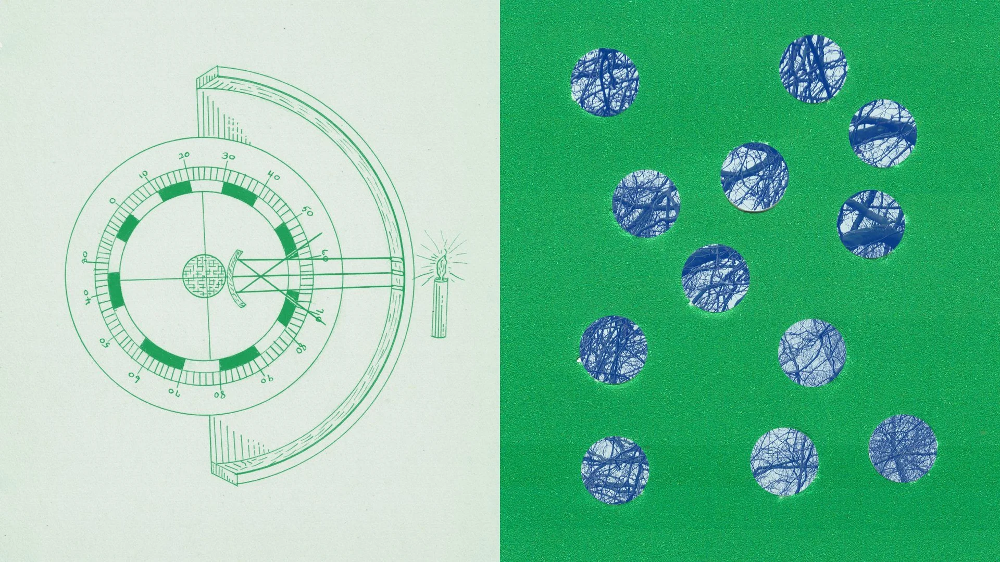
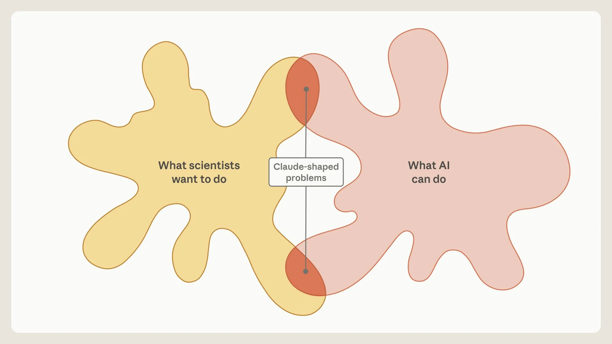
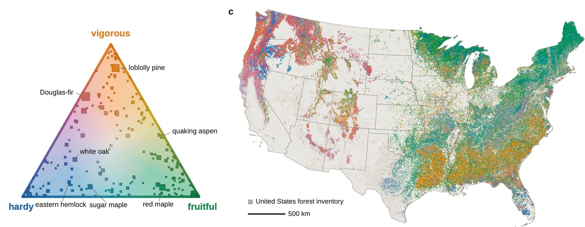
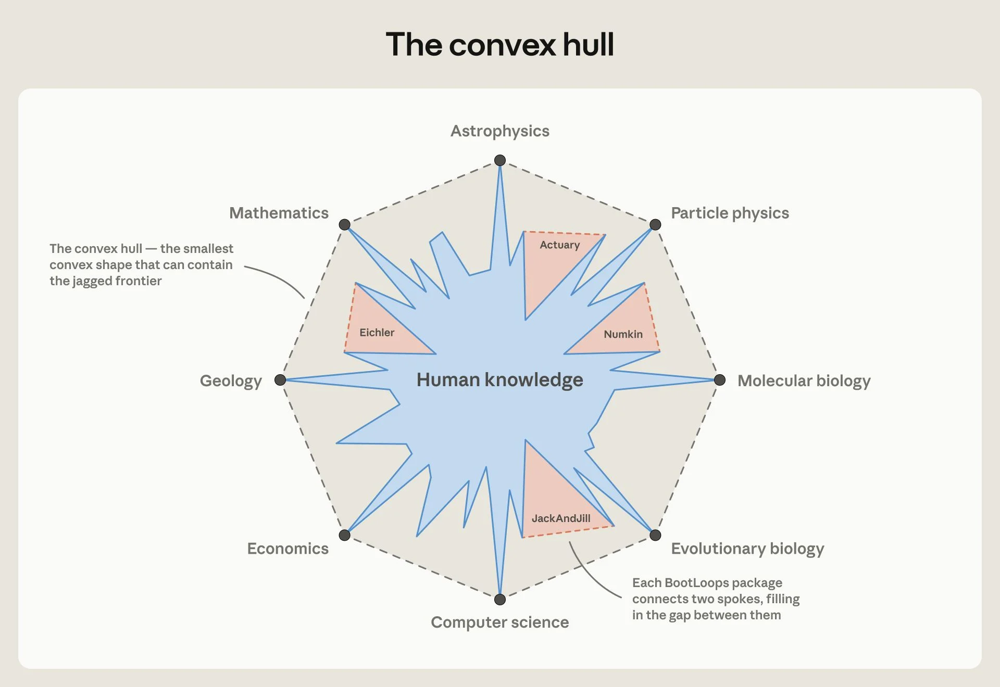

# 什么样的科学问题适合 Claude

- 英文标题：Claude-shaped science
- 发布日期：2026-10-01
- 官网栏目：科学
- 原文：[Anthropic 页面](https://www.anthropic.com/research/claude-shaped-science)
- 官网署名：Anthropic

> 中文机器初译，未逐篇人工校对。引用研究结论时请核对英文原文。

*在这篇客座文章中，Prof.马修·施瓦茨 (Matthew Schwartz) 再次讲述人工智能加速科学的新方法。在 [振动物理](https://www.anthropic.com/research/vibe-physics)施瓦茨讨论了Claude和一名物理学研究生在能力上的相似之处。在这里，他描述了当他停止与Claude对抗并允许Claude发现“Claude型”问题时发生的事情：最适合当前一代法学硕士工具功能的问题。这促使他构建了 BootLoops，这是一个用于定量科学中精确计算的工具包。由于类似的计算经常出现在非常不同的科学领域，Claude发现了与生态学、群体遗传学和其他十几个领域的联系。这些联系在技术上通常是正确的，但一开始在科学上并不引人注目，因此施瓦茨与领域专家合作，引导 BootLoops 解决这些领域关心的问题。下面，我们将分享有关这些项目以及 BootLoops 是如何产生的更多信息。*

代理人工智能正在迅速改进。每个人都注意到模型看起来更聪明：他们知道更多，犯更少的错误，并且有更好的想法。如果你顺应趋势线，就很容易自信地谈论人工智能彻底改变科学的潜力。然而，如今试图在自己的工作中使用这些模型的学术科学家常常感到脱节。模型可能是 [解决具有挑战性的](https://openai.com/index/model-disproves-discrete-geometry-conjecture/) 和 [长期存在的问题](https://www.anthropic.com/research/riemann-zeta)，但到目前为止，这些大多是现有技术的广泛应用。许多头条新闻似乎都与数学有关，数学是科学的一部分，可以完整地陈述问题并绝对检查答案。但大多数科学并不是这样的。对于我们许多研究人员和学生来说，这些头条新闻与我们使用这些模型时发生的情况之间的距离可能会让我们感到沮丧和焦虑。

在我看来，核心冲突是，尽管这些模型很出色，但像人类科学家一样工作并不是目前法学硕士最擅长的。Claude和GPT擅长科学，但他们并不擅长 *科学家*：是的，他们很聪明，但是需要大量的指导才能让他们产生任何具有科学价值的东西。物理学家将其称为“阻抗不匹配”：两个系统各自工作良好，但匹配度很差，因此其中一个系统投入的大部分内容永远无法到达另一个系统。在这里，科学家想要的和人工智能擅长的之间存在不匹配。

那么我们该如何解决呢？

我开始寻找阻抗不匹配不太严重的示例。我首先让Claude构建了一套易于使用的数学物理工具。不久之后，这些工具就发现了解决其他问题的用途。这个迭代过程生成了一组软件和科学协议，我将其称为 BootLoops。BootLoops 的功能就像 LLM 的一种工具，很像 Claude Code 或 [克劳德·科学](https://claude.com/product/claude-science) 是 Claude 的工具，或者 Codex 是 GPT 的工具。我发现 BootLoops 特别适合解决一类科学定量问题。它也是开源的，因此可以与您喜欢的任何模型一起使用。

当前一代的人工智能工具无法解决大多数科学问题。然而，它们在某些“代理人工智能型”问题上的表现却令人惊讶。

一旦 Claude 有了 BootLoops，它就一直注意到同样的模式：许多领域都存在问题，如果有人知道数学、物理或计算机科学的技术存在的话，这些问题就可以彻底解决。我开始将这些问题称为“Claude型”问题，并跟随它们走出高能理论物理学（我的家乡），进入地质学、生物学、经济学和语言学。在这些其他领域，我无法依靠自己的专业知识来知道Claude的发现是否有趣。于是我就找了一些专家请教。在他们的指导下，BootLoops 能够在许多研究领域取得实质性进展。

下面，我将分享 BootLoops 的诞生过程，描述我在应用它的领域中的一些早期发现，并分享我对如何解决当今人类与人工智能科学家之间的阻抗不匹配问题的一些思考。

## Claude，掌舵！

去年12月，我尝试过 [使用Claude作为研究助理](https://www.anthropic.com/research/vibe-physics)，发现 Claude Opus 4.5 在 20 倍速度下表现得就像一个强大的研究生。尽管Claude在实验结束时写出了一篇高质量的论文，但要达到这一目标却很困难。我必须纠正它写的每句话，引导它远离不相关的线索，并把它从死胡同拉回来。

今年夏天，我尝试做一些不同的事情：我不再像对待我想要的合作者那样对待Claude，而是开始像对待它实际上的合作者一样对待它。这需要寻找适合其优势的问题。目前，Claude 还无法帮助我解决深层次的概念性问题，但它确实拥有跨所有领域的几乎无限广度的知识、令人难以置信的编码技能、数学和统计学的前沿知识，以及以机器速度解析论文、附录和数据的能力。

寻找Claude型问题的自然起点是编码可以提供帮助的领域。当 Anthropic 在 2026 年夏天发布《Claude寓言 5》时，我想看看它的网络能力是否会转化为科学计算。因此，我试图通过移植、编码和改进我的一些论文以及有关散射幅度的相邻文献中的各种方法来测试它。

散射振幅是我们解释大型强子对撞机数据的方式：以 13 万亿电子伏的速度粉碎两个质子，振幅是碎片与碰撞产生的任何新粒子、希格斯玻色子或未知物体之间的理论桥梁。其核心是费曼图，即特定形式的多维积分。我们现在正在努力解决的问题可能是一篇博士论文，也可能是一个小组多年的困扰。

在过去 20 年里，出现了一种替代方案：S 矩阵引导程序。在引导方法中，您不是磨掉积分，而是施加物理约束，直到只有一个答案是可能的。知道哪里的振幅是无限的（它的“奇点”）可能会将其缩小到 20,000 个选项；对称性将其减少到 500；以此类推，直至一。传统的引导程序是纯粹的分析，并且在最对称的理论中走得最远，其中约束一直达到单个选项（ [N=4 超杨-米尔斯中的九环振幅](https://www.anthropic.com/research/yes-claude-can-do-nine-loops) 是一个例子）。更接近现实世界，你通常会在结束之前耗尽限制。一个 [较新的枢轴](https://arxiv.org/abs/2507.17815)当您还可以以荒谬的精度（有时 1,000 位）计算少数点的振幅时，半数值引导程序可以缩小差距：如果剩下的选项很少，这些数字就可以准确地确定剩余的系数。

半数字引导程序似乎非常适合代理人工智能。它借鉴了无人掌握的数学、物理学和计算机科学；它需要大量的编码和算法开发；而且它是可检查的，因为相同的数字可以让任何人，无论专家与否，都可以通过运行两个脚本来验证最终答案与任意数量的数字的积分。社区的专业知识分布也不均匀：好的想法存在于 Wolfram 语言、C++、Python 或 Julia 中，而更多的想法存在于根本没有代码的论文中。因此，我对《神鬼寓言 5》的第一个任务是将其全部移植到一个通用框架，并编写论文从未提供的代码。

Claude毫不费力地做到了这一点。当它在大约 20 分钟内重现我论文的结果时，我感到很惊讶，而我为此编写的代码花了我几周的时间。然而，当它告诉我我正在做一些非常低效的事情并且有一个我不知道的更好的算法时，我并不感到惊讶。

然后，我要求Claude搜索它可以计算的未解决的振幅。事实证明，对于 S 矩阵引导程序来说足够简单的问题对于人类来说也足够简单——而且事实上，大多数问题已经完成了。尽管如此，它还是发现了一些未解决的问题。经过与模型的一些讨论后，很明显Claude将自己限制在最简单的函数族：对数的幅度上。所以我问，它可以对下一个最简单的椭圆函数族做同样的事情吗？

椭圆积分真的很难，即使对于像我这样花费大量时间计算积分的人也是如此。至少据我或Claude所知，只有少数椭圆费曼积分被计算过，而且没有一个完全是通过引导程序计算的。问题不是这些方法行不通，而是没有人尝试过，因为这样做所需的专业知识分布在许多人身上。相比之下，Claude很容易地将其为对数情况移植和构建的所有机制推广到其他积分类。这一次，大部分软件是它自己编写的，或者是借用了数学而不是物理学。随着工具包的不断发展，它开始获得一个又一个积分。很快我们就有了 30 个从头到尾的 BootLooped 积分，其中包括 15 个通过这种新方法得出的已知结果的复制品和 15 个以前从未计算过的结果。

这一切都是在几周后发生的。最初，我以为只要写一篇文章就足够了，但我很想看看我们（即我和使用 BootLoops 的 Claude）还能做些什么。

## “我懂功夫”

科学的一个偶然特征是，相同的方程经常在不同的背景下一遍又一遍地出现。例如，在物理学中，扩散方程、福克-普朗克方程和薛定谔方程都具有相同的数学形式，因此如果你开发出一种方法来解决一个问题，你通常可以将其应用于许多其他问题。我知道 BootLoops 擅长的计算在其他地方也有相关性：例如，在宇宙学和弦理论中。我不知道的是，但Claude很高兴告诉我，这些积分也可以映射到群体遗传学中的贝叶斯证据积分，或者用于费曼积分约简的有限域方法也可以适用于进化生物学中的问题。

这开启了寻找和解决Claude型（更狭义地说，引导循环型）问题的特别丰富的时期。有些想法立即成为显而易见的伟大应用。例如，系统发生学研究如何利用 DNA 将物种组织成家谱；相关计算是贝叶斯证据积分，其输出是一个数字，表示候选树对观察到的 DNA 的解释程度如何，BootLoops 最初构建的同类积分就是为了实现这一目的。随着想法的出现，我坚持要求Claude都使用旧工具 *和* 建造新的，这样马具就会增长。每个工具，即使是来自失败的项目，也都打开了新的大门。Claude的能力越来越强。就像《尼奥》里的那样 *黑客帝国* 从功夫下载中醒来后。

> 然而，随着这些项目偏离了我的职业舒适区，我开始担心。当Claude声称它在我的领域所做的事情非常棒时，我可以判断这是否属实（通常不是）。但当它声称它在另一个领域所做的事情非常棒时，我发现自己同意了。我的怀疑更加强烈了，我知道我需要请一些专家来确定。事实上，我发现在几乎所有情况下，Claude在技术上都是正确的，但结果并不那么有趣，直到专家帮助引导我们。

其中一个项目是生态学中的中性生物多样性理论。在任何生态系统中，一些物种繁衍生息，而另一些物种则灭绝。中性理论询问其中有多少 [生活史](https://en.wikipedia.org/wiki/Life_history_theory) 是由于随机的机会。在早期工作的基础上，2001 年，生态学家 [斯蒂芬·哈贝尔建议](https://press.princeton.edu/books/paperback/9780691021287/the-unified-neutral-theory-of-biodiversity-and-biogeography)，挑衅地，也许这一切都是随机的。2005年，生态学家 [兰帕尔·艾蒂安](https://doi.org/10.1111/j.1461-0248.2004.00717.x) 将方程式放入哈贝尔理论中，使其（至少在原则上）能够以精确的方式进行测试。不幸的是，20 年来没有人能够大规模解出这个方程。Claude认识到艾蒂安方程是 BootLoops 型的，并求解了它。通过对数据进行计算，我们发现，在地球上生态学研究最多的森林——巴拿马运河的巴罗科罗拉多岛上，树种混合的变化速度比中性理论允许的速度快 4.5 倍。

我对这个结果感到兴奋，把它带给了植物生物学教授、中性理论专家詹姆斯·奥德怀尔 (James O’Dwyer)。詹姆斯对我很有耐心。尽管这项技术壮举给他留下了深刻的印象，但他表示，结果可能“会让许多生态学家耸耸肩”。生态学家已经更定性地观察到，中性理论无法跟上真实的森林。但詹姆斯有一个更好的主意：减去中性预测并研究其余部分。这将使我们更好地了解自然选择、竞争和物种之间的差异导致了哪些变化。

詹姆斯和我继续与Claude密切合作，打造后继模型。詹姆斯有物理学背景，因此学科语言障碍更容易克服，但和许多科学家一样，他还没有真正意识到代理人工智能的力量。随着合作的进展，我成为了Claude的处理者，将Claude的讲话翻译给詹姆斯，并使模型保持在正轨上，而詹姆斯则推动模型产生生态学家可能有价值的东西。最终的结果是我们三个人都感到自豪的：一个与数据非常吻合的生活史最小预测模型。我们目前正在使用Claude帮助管理的数据集将该模型从巴拿马扩展到其他全球森林地块。

美国的每一个森林清查地块，都以其植物群的生活史策略为特征：耐寒（长寿）、活力充沛（快速生长）或成果丰硕（多产的补充者）。该分类来自施瓦茨和奥德怀尔利用Claude建立的人口统计模型，该模型在减去随机机会（中性生物多样性理论）引起的波动后，描述了每个物种的寿命、生长和补充特征，以揭示物种依赖性生物学。

另一个项目涉及群体遗传学的精确计算，该领域研究群体内基因如何变化及其原因。Claude 首先使用从数学物理学引入的方法来解决 30 年前关于自然选择如何形成罕见突变的积分表达式。我们将其应用到 [侏儒AD](https://gnomad.broadinstitute.org/)，最大的人类遗传变异公共目录。Claude对这个结果非常兴奋，但我不太确定。在一位生物学家回复之前，我必须写信给三位不同的生物学家进行验证，但最终我能够招募到我的同事迈克尔·德赛（Michael Desai），他在该领域工作，尽管不是针对这个确切的问题。和詹姆斯一样，迈克尔对技术成果印象深刻，但并不被科学所吸引。

然而，迈克尔指出，更有效的结果可能来自使用相同或相似的方法研究单个染色体上的突变对之间的相关性。在此范围内，Claude发现并构建了新工具，例如用于数学计算机辅助证明的不等式证明，并将它们添加到 BootLoops 套件中。然后我们分析了基因组中 57 亿对附近的突变 [千人基因组计划](https://www.internationalgenome.org/about/)，并发现了一种称为基因转换的机制的证据。这是一个重要的发现，因为几乎所有使用连锁遗传变异的分析，从人口史到疾病图谱，都忽略了基因转换。更大的教训是，人工智能可以帮助找到隐藏在巨大基因组数据集中的生物学，其中公共档案中有数千个。

其他项目也有类似的情况：Claude提出了一个我认为令人信服的初步发现。我把它带给一位专家，他不为所动，但看到了潜力，我们一起将它塑造成有意义的科学。有趣的是，其中一些从 BootLoops 型定量计算转向了更一般的 Claude 型工作。例如：

- **经济学**。经济学期刊现在要求作者提供复制包，编辑的任务通常是检查它。这是一项细心的手工工作。我们与两位经济学家合作，构建了一个 AI 数据编辑器：它将 MATLAB、Stata 和其他商业工具中五种领先期刊中的 4,452 篇论文的数据包移植到开源代码（约 30,000 个例程），并根据已发布的表格检查了几乎所有可验证的数字。结果出现在 [美国国家经济研究局工作文件](https://www.nber.org/papers/w35782).
- **语言学**。单词重音目录通常是手工组装的，具有数百种语言、选择效果和人类偏好。Claude 搜索了所有可公开访问的资源，并与三位语言学家合作，我们制作了 AccStack： [单词重音数据库](http://www.accstack.org) 涵盖 6,072 种语言，几乎每个条目都引用了决定性段落，此外还有 160,000 部音韵学著作的参考书目。

其他一些亮点都是与专家合作完成的，并且正在接受进一步的探索和验证，包括：

- **系统发育学。** 我们使进化树的贝叶斯证据能够快速计算并精确检查，并发现单个基因在竞争树之间的联系通常小于标准抽样程序的误差。
- **地球科学**。我们结合了大气科学、地球化学和气候模型的方程和数据，建立了一个定量的预测模型，描述大氧化事件如何通过四次冰川期展开。
- **基因组学**。我们大规模研究了单细胞 RNA 计数的统计数据，以表征爆发率以及与教科书上的基因表达电报模型的偏离。
- **太阳黑子。** 我们利用人口统计方法推导了太阳黑子的生命周期，然后将该方法扩展到描述星黑子的特征，星黑子是许多系外行星搜索中的一个混杂因素。
- **数学物理。** 我们解决了沃森的“最终问题”：具有三个不等跳跃率的 3D 随机游走的精确返回概率，最后一个格积分乔治沃森于 1939 年开始。
- **宇宙学**。我们构建了一个完整的理论工具包，将宇宙学参数与宇宙大尺度结构的数据进行拟合，包括完整的二环功率谱和单环三谱。
- **统计数据。** 混合模型的行为举止是出了名的差。我们得出了贝叶斯证据的精确近似值，使模型选择变得实用，并应用于从生物统计学到文本分析。

总体而言，这种对 BootLoops 进行迭代改进、寻找Claude型应用程序以及与专家一起推动科学前沿的方法取得了惊人的成效。有关这些项目和其他项目的更多信息可以在 [bootloops.ai。](http://bootloops.ai)

## 技术细节

对我和 Claude 来说，同时运行多个项目（三个月内涉及 18 个领域的 36 份手稿，共有 19 名合著者，涉及约 400 个候选问题）需要大量的协调。使其易于管理的设置相当简单。Claude 代码会话全部在 Google Cloud 虚拟机的终端中运行，根据我的协作者的偏好链接到各种 GitHub 和 Overleaf 存储库。我为每个项目都有单独的会话，还有一个主会话来协调其他项目、分配计算并验证结果。每个会话都涉及在后台运行计算的代理，中间结果存储在各自文件夹中的 markdown 文件中。这些子代理很有帮助，因为我经常遇到《神鬼寓言 5》的情况 [分类器；](https://www.anthropic.com/news/improving-fable-5-s-biology-safeguards) 他们只是关闭了一个代理，而不是这些块破坏了我的整个会话。我也有单独的会议来写结果；创建 GitHub 存储库、工具手册和 BootLoops 网站；编写并验证所有单独的工具代码；作为对抗性裁判检查并重新检查结果。

尽管如此，这些会议仍然需要大量指导。比如Claude，没有时间观念，爱戏剧化。在一个项目结束时，它告诉我“马特——公式已经解决了。两年的战役，四次长征，……”。它只工作了三天。当我要求预计到达时间时，估计总是要么太长要么太短。我试图告诉Claude在进行测试确认之前不要做出估计，但这也效果不佳。随着时间的推移，我开始感觉到事情需要多长时间，因为我不能依赖Claude来告诉我。

一个更大的问题是，Claude的默认方法似乎是尝试进行漫长的、多天的计算，而不是构建一个新工具，使相同的计算只需几分钟。一次又一次，我不得不告诉它要更聪明地思考，而不是更努力地思考。在这些长期项目的过程中，压缩经常会发生，导致Claude失去重要的上下文。为了防止这种情况，我让Claude定期整理它的文件并合并它们，所以它总是可以访问最新版本的计划。我已将协议技能和其他工具写入 BootLoops 工具中来解决这个问题。其中一些问题也已通过良好的商业线束得到解决，例如 [克劳德·科学](https://www.anthropic.com/news/claude-science-ai-workbench)。但许多问题只是当前一代代理人工智能固有的问题，我预计模型最终会克服这些问题。

以下是我遇到的其他一些故障模式以及处理它们的技巧：

- **Claude喜欢宣告胜利。** “完成，带一个星号”通常是“根本没有完成”。 “正是如此，稍加改进”通常意味着“不”。为Claude提供清晰而严格的成功标准有助于实现这一目标。在一个项目中，它对其证明感到自豪，直到“一个未经证明的引理”。这个引理就是整个证明！我说过没有未经证实的引理。然后再次“完成”，但现在有了一个新的公理。
- **一切都要自己看。** 我总是要求看情节。即使我设置了所有监视器，我发现自动检查仍然不可信。谨防诸如“良好一致性”之类的定性主张。
- **对结论提出质疑。** Claude擅长计算，但得出的结论也可能是错误的。让其解释其发现的内容，直到 *你* 相信它。
- **供应味道。** Claude可以找到Claude型问题，但此类问题有数千个，甚至数百万个。Claude似乎更喜欢古老的辩论，这些辩论被大量引用，但早已被遗忘。要求它专注于什么 *新的可能*，不仅仅是更快或涉及更多数字，有帮助，但你仍然不能相信它对某件事是否有趣的判断。
- **跟进。** 一旦Claude取得了出色的成绩，就要求取得更好的成绩。它总是会想出一些东西，有时甚至很精彩。
- **小心研磨。** 老实说，我从来没有成功地让Claude准确地估算过时间。相反，我开始意识到一些有趣的事情应该花多长时间，并且我学会了感知Claude是否在合理的时间范围内取得了我认为的进展。如果你允许的话，模型会永远磨下去。

还值得一提的是，这些项目是计算和代币密集型的。对我来说，部分费用来自于尝试构建超越任何一个项目的有用工具：连接各个领域，并组装一个其他人可以使用的包。我希望 BootLoops 工具能够在定量科学中广泛使用，而无需每个用户从头开始重建一切。Agentic AI 使得连接想法和共享代码库变得更加容易，如果我们学会利用这种优势，社区的发展速度将比任何个人单独行动的速度更快。

## 展望

无论模型变得多么智能，大多数科学进步都来自必须获取、理解和检查的现实世界数据，每一轮都为下一个问题提供信息。 [人工智能可以坐在这个循环中](https://www.anthropic.com/news/claude-discovers-novel-enzyme-system)，这确实很有价值，但它不会将循环折叠到某个点。理解是逐步建立起来的，每一个都依赖于最后一个；癌症的治愈方法或聚变反应堆也会以这种方式到来，而不是凭单一的提示。

正如Claude喜欢说的那样，对千年奖问题和大科学的关注可能是一把“脚枪”：一种很容易搬起石头砸自己脚的功能。这里的风险是，不切实际的期望可能会阻碍已经可能的生产性用途。真正的进步可能会像往常一样出现：通过加强科学研究的基础并在此基础上构建日益复杂的应用程序。正如我所描述的工作所表明的那样，它将显着加快，但我没有看到任何证据或需要重新审视科学方法。

我喜欢有时用来讨论人工智能科学的一个术语是 **凸包。** 形成一个形状并用直线连接它的每一对点；您得到的新形状是包含原始形状的最小凸形状：其凸包。科学现在非常脱节：有 [锯齿状边界](https://www.oneusefulthing.org/p/centaurs-and-cyborgs-on-the-jagged) 无处不在。生物学以一种方式探索，数学以另一种方式探索。一个实验室可能要花 20 年的时间，用他们掌握的一种方法来研究一组基因的所有内容，而邻近的基因和替代方法却处于闲置状态。像 BootLoops 这样的线束可以连接这些点，填充船体。

今天的人类知识是参差不齐的——特定的科学家和子领域比其他方向更能推动知识向某些方向发展。人类可以到达但没有特定人类到达的中间区域是人工智能的理想选择。BootLoops 包中的 ACTUARY 或 NUMKIN 等特定软件包有助于填补空白。

事情瞬息万变，几乎不可能提前计划。为什么要申请三年的资助来计算人工智能模型最终可能在一夜之间解决的问题？我还不知道如何培养研究生。自从我发表了我的文章 [振动物理](https://www.anthropic.com/research/vibe-physics)，这种感觉只会变得更加强烈。在某些领域，例如计算机科学，这种破坏是非常可怕的。两年前，我会推荐“工程师Python”课程作为必备课程。今天，这是没有必要的。我花了很多时间在机器学习上，建立模型来研究各种物理现象。现在，所有这些模型都可以由人工智能构建，因此即使学习神经网络的细节也没有什么用处。只需告诉 Claude 找到最先进的 ML 方法，它就会为您做到。

我认为 BootLoops 表明，如果您找到正确的问题，解决该问题的大部分技术工作现在都可以自动化。在某种程度上，这就是一种解放。但概念部分仍然需要人类。正因为如此，我希望我们能够找到一种方法，让人类获得应有的荣誉，即使是Claude型的科学。奇怪的是，人工智能面临着颠覆通常商业模式的风险，在这种模式中，最高层的人获得了荣誉，而亲力亲为解决问题的人却得不到任何荣誉。我不知道这是如何解决的，但通过假装人类贡献是打字是无法解决这个问题的。

那么科学家乔又将何去何从呢？如果你问我，实际上是在一个很棒的地方。我们现在拥有触手可及的工具，可以以闪电般的速度在看似棘手的问题上取得进展。我可以预见，系统生物学等数据丰富但理论匮乏的领域即将出现巨大增长。我也可以很容易地想象人类的思维从繁琐的计算和分析中解放出来，去做更深入的指导和指导智力工作。最重要的是，我预计科学家们会走出自己的领域，寻求协同和协作，就像我在 BootLoops 上所做的那样。关注Claude型科学最令人耳目一新的成果是，它帮助我们欣赏人型科学的样子。

有关 BootLoops 工具及其所支持的科学原理的详细信息，请访问 [www.bootloops.ai](http://www.bootloops.ai)。BootLoops 线束已打开 [GitHub](https://github.com/BootLoops-ai/bootloops/tree/66b680ce742e654cfe86da4f072a69061fe182b1) 供任何人使用和贡献。
