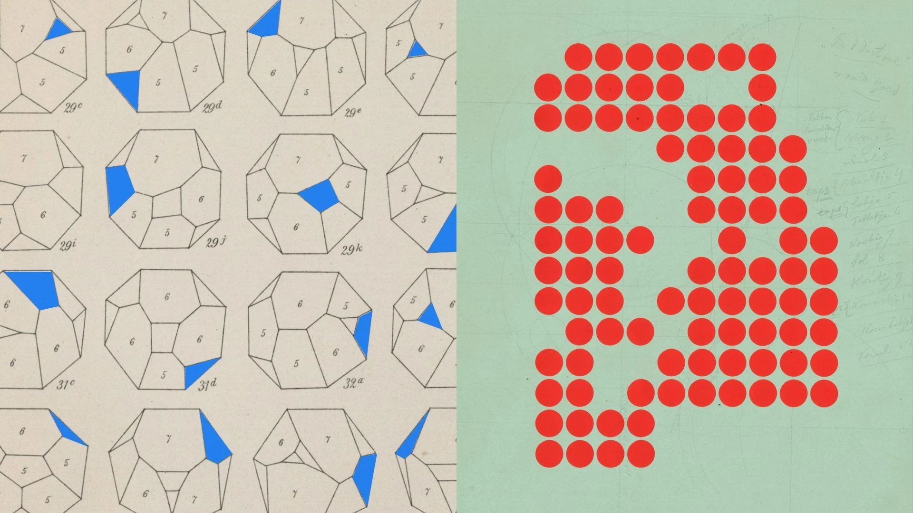
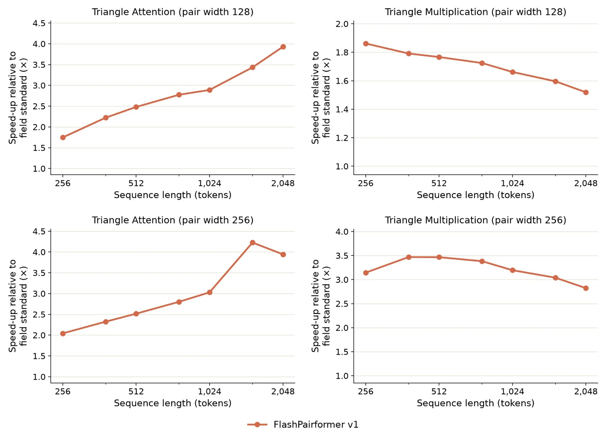
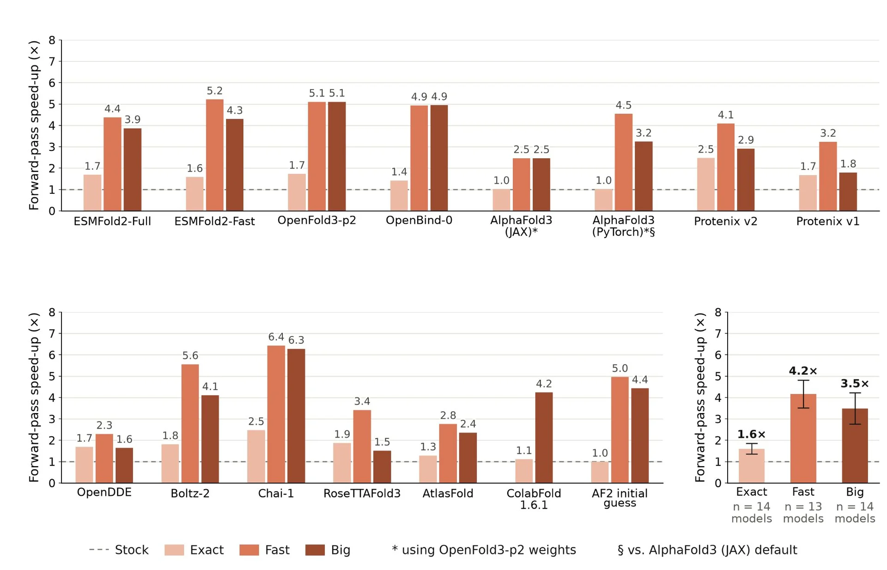
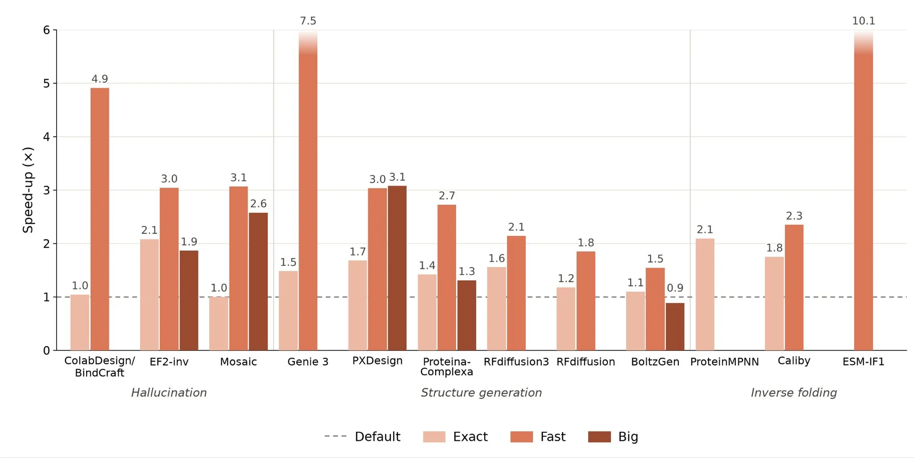
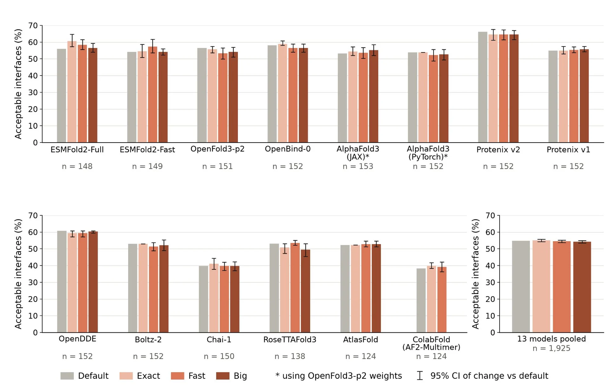
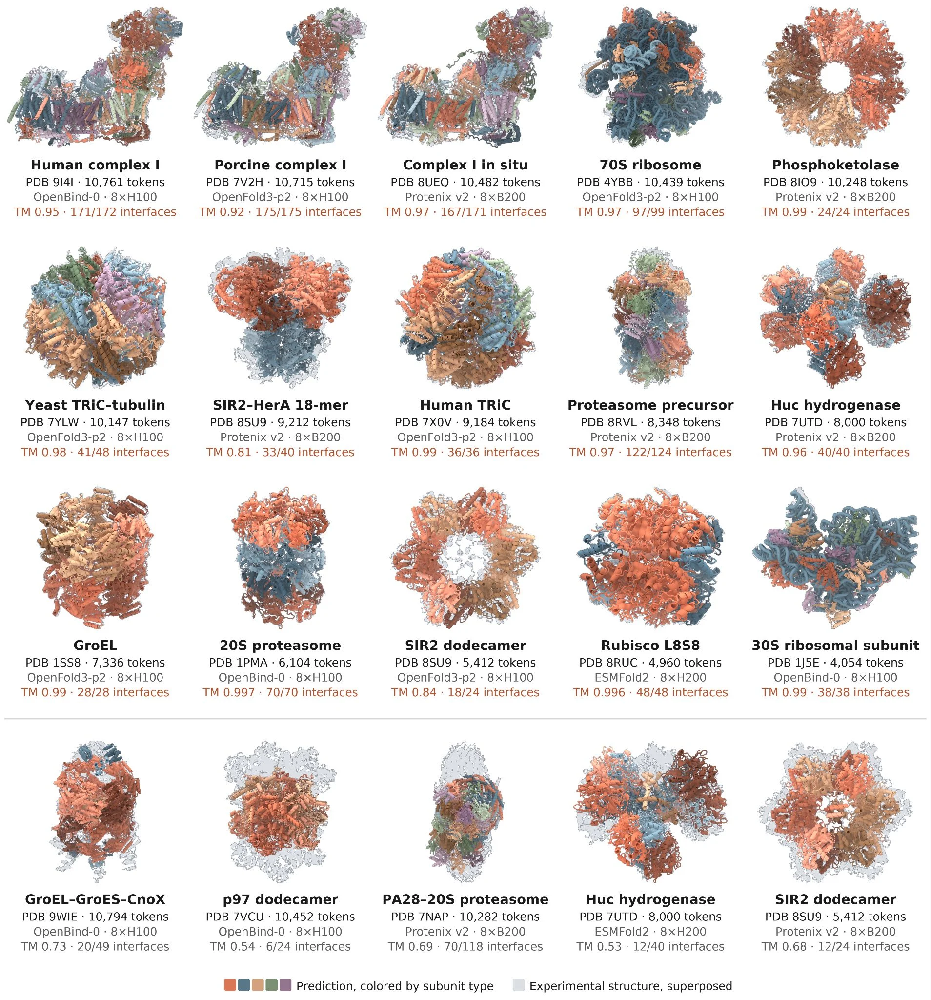
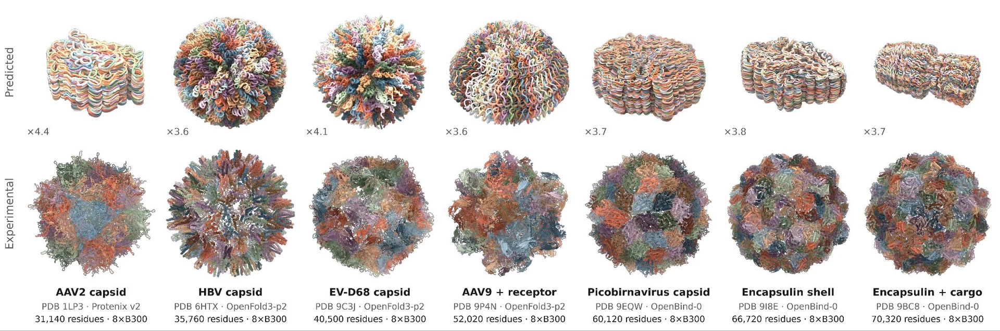
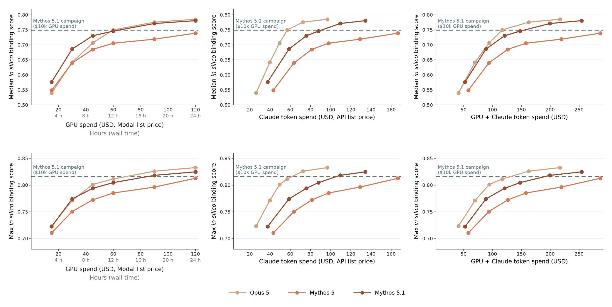

# Claude 如何提升生物分子建模能力

- 英文标题：How Claude is uplifting biomolecular modeling
- 发布日期：2026-09-17
- 官网栏目：科学
- 原文：[Anthropic 页面](https://www.anthropic.com/research/claude-uplifts-biomolecular-modeling)
- 官网署名：Anthropic

> 中文机器初译，未逐篇人工校对。引用研究结论时请核对英文原文。

*在这篇文章中，我们分享了Claude如何制作科学家用来更快、更高效地预测和设计生物分子的开源模型。Claude，工作于 [Claude科学，](https://claude.com/product/claude-science) 在不到四个星期的时间内优化了其中 30 多个模型，平均速度提高了约 4 倍。它还创建了一种低内存模式，能够在单个 NVIDIA GPU 节点上准确预测超过 10,000 个标记（氨基酸、核苷酸以及小分子和离子的原子）的生物分子系统。我们将开源所有优化代码，并宣布与 Adaptyv Bio 共同主办蛋白质设计竞赛，并提供高达 100 万美元的 Claude 积分和对 5,000 多个设计的湿实验室验证的支持。*

[原文媒体](https://assets.claude.com/ea3d83fc4edfcfcc025dd149e3f64e4965ffe7c8.mp4)

最近，我们 [共享结果](https://www.anthropic.com/research/Claude-accelerates-protein-design) 展示Claude的设计能力 *从头* 通过开源蛋白质设计和结构预测模型的专家级编排来开发蛋白质结合剂。 *从头* 结合剂是经过计算设计的小型蛋白质，它们紧密地附着在特定的目标分子上，以激活、阻断或向其传递某些物质。

尽管这是人工智能科学能力的令人鼓舞的展示，也是推进药物发现的早期步骤，但它占用的资源超出了绝大多数蛋白质设计者的可用资源。我们允许 Claude 在 AI 基础设施平台 Modal 上为每个目标花费最多 10,000 美元，大约相当于 2,500 个 NVIDIA H100 GPU 小时。

为了使此类研究更容易进行，我们开始探索推理优化以更有效地运行这些模型。作为这些优化的早期结果， [Claude神话5.1](https://www.anthropic.com/claude-fable-and-mythos-5-1) 加速了 7 个开源生物模型，使它们的运行速度提高了 2.5 倍。

在这里，我们展示了新的结果，展示了内部通用研究模型如何能够优化 30 多个深度学习模型，这些模型针对各种生物任务（例如结构预测和蛋白质设计，以及基因组学和蛋白质语言模型）进行训练。平均而言，Claude 能够在牺牲最小精度的情况下将此类任务的速度提高大约 4 倍，并且在输出相同的情况下将速度提高近 2 倍。Claude还提高了这些模型的内存利用率，使得预测前所未有大小的生物分子系统成为可能。通过将这些结果与我们之前的代理蛋白质设计方法的简化相结合，我们表明 Claude 可以实现类似的效果 *计算机模拟* 与我们之前报告的结果相比，GPU 小时数减少了两个数量级。

除了蛋白质设计之外，这些专门的生物模型还被分子生物学家广泛使用，包括用于药物发现和开发。我们今天开源所有这些模型的优化代码（[这里](https://github.com/anthropics/uplifting-biomolecular-modeling)）以便更广泛的社区可以利用它们。您可以在我们的技术报告中找到更多详细信息（[这里](https://assets.claude.com/e96b5807039a88168733d9687afe41dfbbd5de13.pdf)).

为了进一步支持社区，我们还与 Adaptyv Bio 共同主办了蛋白质设计竞赛，该竞赛开创了 [公开蛋白质设计竞赛](https://proteinbase.com/competitions)。我们共同选择了当今能力前沿的五个具有挑战性的问题。得益于 Modal 和 Twist Bioscience 的慷慨捐助，我们与 Adaptyv 一起承诺提供高达 100 万美元的 Claude 积分和 250,000 美元的 Modal 计算积分，以及对 5,000 多个设计的湿实验室验证。查找更多信息（[这里](https://proteinbase.com/competitions/anthropic-adaptyv-2026)) 和 ([在这里申请](https://docs.google.com/forms/d/e/1FAIpQLSc0Hz1ZWYTt_wkn76ViVxDghmEhG_OeVEcj9YGHxLWqxF1kWw/viewform?usp=dialog)).

## 加速蛋白质结构预测和设计模型

蛋白质结构预测是仅根据蛋白质的氨基酸序列确定蛋白质的三维结构的问题。与此同时，蛋白质设计是创造具有特定结构、功能或一组特性的蛋白质的过程。这些计算工具共同使科学家能够探究关键的生物分子过程，例如癌症是如何形成的，并创造有用的分子，例如可以针对这些癌症的药物。

现代结构预测模型，例如 AlphaFold3、OpenFold3 和 Boltz-2，将大量计算运行时间和内存花费在两个操作上：三角形注意力和三角形乘法，它们作用于标记的三元组。这些操作使得对生物分子系统的几何形状进行建模成为可能，但它们的计算成本极高，因为它们在运行时间和内存方面都是三次方的：系统大小加倍需要多使用 8 倍的时间和内存，而三倍则需要多使用 27 倍的时间和内存。

编写内核（用于 GPU 等加速计算硬件的低级软件翻译层）是降低这些成本的标准方法。鉴于其重要性，三角形注意力和乘法一直是专门内核开发工作的主题，首先是 NVIDIA 的 [cu等方差](https://github.com/nvidia/cuequivariance) 最近与 NVIDIA 合作 [BioNeMo 推理运行时](https://github.com/NVIDIA-BioNeMo/BioNeMo-Inference-Runtime) （BioNeMo-IR）。

为了优化结构预测模型的推理，我们与 Claude 合作开发了 FlashPairformer，这是一组可加速三角形注意力和乘法的自定义内核。它实现了新的最先进、卓越的性能 [现场标准](https://github.com/nvidia/cuequivariance) 三角形注意力平均提高 2.7-2.9 倍，三角形乘法平均提高 1.7-3.2 倍，具体取决于模型配置。

我们与 Claude 合作开发了 FlashPairformer，这是一组加速三角形注意力和乘法的自定义内核，它们是 Pairformer 架构的主要组件，是最先进的生物分子结构预测模型的基础。结果报告相对于 [现场标准](https://github.com/nvidia/cuequivariance).

除了开发可转移内核之外，我们还向 Claude 指出了每个单独的模型，目的是产生更具体的优化。其中包括缓存冗余的重新计算工作以及将死分支简化为其恒定输出等更改。这些改进的结合使结构预测模型平均加速了 4 倍，对于每个模型，我们确认 Claude 的加速版本不会影响下游任务（例如结构预测）的性能。

经验丰富的工程师团队通常需要几周的时间才能为每个模型进行此类优化，并且工作通常不会在模型之间转移。Claude 在 Anthropic 的两名技术人员的监督下，在不到四个星期的时间里加速了 30 多个跨生物分子结构预测、蛋白质设计、蛋白质语言建模和基因组学的开源模型，这两名技术人员在生物分子建模方面经验丰富，但之前没有推理优化或内核工程经验。我们的结果表明，前沿人工智能模型将帮助该领域的其他人更快、更轻松地构建科学工具。

Claude 的优化加速了十多个生物分子结构预测模型，在精度降低最小的情况下平均实现了大约 4 倍的加速，在相同输出的情况下实现了大约 1.6 倍的加速。注意：ColabFold 1.6.3 同时发布的可选快速内核尚未在此处进行基准测试。

Claude的优化还加速了多种蛋白质设计模型，涵盖幻觉、结构生成和反向折叠。这些模型依赖于各种架构，包括 AlphaFold 类结构转换器、扩散、流匹配和图神经网络。

我们为结构预测开发的快速模式在统计上与一组生物分子界面的默认设置没有区别。如果 DockQ 分数大于 0.23，我们称预测接口可接受。

## 实现大规模生物分子系统的建模

除了加快这些蛋白质结构预测和设计模型的速度之外，我们还要求 Claude 减少大型分子机器建模中的内存使用量。细胞中的大部分工作都是由此类系统完成的，包括构建蛋白质的核糖体、为细胞提供动力的呼吸复合物以及帮助其他蛋白质折叠的伴侣。每个组件都是由数十个组件构建而成，其功能取决于这些组件如何组合在一起并相互作用。预测这么大的系统结构通常需要大多数分子生物学家无法访问的大量计算资源，例如跨多个 GPU 节点的推理。

Claude 创建了一种低内存“Big”模式，可以对超过 10,000 个令牌的系统进行精确建模，并仅使用一个 NVIDIA GPU 节点就可以成功地对超过 70,000 个令牌的系统进行推理——这是以前无法完成的任务。使用 Big 模式成功折叠的分子机器包括人类线粒体复合物 I、TRiC 伴侣复合物、蛋白酶体和细菌核糖体，每一个都与其实验确定的结构紧密匹配。据我们所知，这些是使用结构预测模型准确折叠的最大结构之一，与通过精确预测的 40S 核糖体相比，复杂的 I 和 70S 核糖体各包含超过 10,000 个标记。 [阿尔法折叠3](https://www.nature.com/articles/s41586-024-07487-w)，由 7,663 个代币组成。

Claude 创建的低内存“Big”模式使开源结构预测模型能够准确预测单个 NVIDIA GPU 节点上由 10,000 多个标记组成的生物分子系统，这表明这些专用模型能够泛化超出其训练环境近 1.5 个数量级。前三行显示了准确预测的系统；底行显示的是不准确的预测。如果接口的 DockQ 分数至少为 0.23，则认为接口是准确的。

为了测试 Claude 优化的极限，我们要求 Claude 预测比以前实现的任何结构都更大的结构。使用单个 8-GPU B300 节点，Claude 生成了整个病毒衣壳和蛋白质区室的预测，其大小从超过 31,000 个到超过 70,000 个令牌不等。这些系统比这些结构预测模型的训练环境大了近两个数量级，而且，也许并不令人惊讶的是，它们的预测不正确。然而，现在这种规模的推理障碍已显着降低，因为它只需要一个 NVIDIA B300 节点，这表明通过改进的工具，研究人员很快就能对一组日益复杂的生物系统进行计算建模。

“Big”模式允许开源结构预测模型使用单个 NVIDIA B300 节点以前所未有的规模成功运行推理。功能运行是通过单个主干通道（无回收）来执行的，作为概念验证。预测的结构崩溃，表明缺乏超出训练环境近两个数量级的泛化能力。

## Claude高效地设计 *从头* 蛋白质结合剂

在我们早期的蛋白质设计工作中，我们向 Claude 提供了大约 16,000 字的提示，鼓励它利用子代理，并在 24 小时内为每个目标在 Modal 上花费最多 10,000 美元（大约 2,500 个 NVIDIA H100 GPU 小时）。在这里，我们为单个 Claude 模型提供了一台 NVIDIA H200 的访问权限和 24 小时的挂机时间、约 1,100 字的提示以及预装工具的参考表，没有子代理，也没有人工指导设计。

我们使用本文中描述的加速生物分子模型针对 16 个目标运行了三个 Claude 模型（Mythos 5.1、Mythos 5 和 Opus 5）。我们对设计进行评分 [ipSAE](https://www.biorxiv.org/content/10.1101/2025.02.10.637595v2), 一个 *计算机模拟* 分数已被证明可以预测湿实验室中的结合。对超过 16 个目标进行平均后，评估的所有三个 Claude 模型的中值得分和最高得分设计均实现了与我们早期的 Mythos 5.1 活动大致相同的 ipSAE 值，尽管使用的 GPU 小时数减少了大约两个数量级。我们还考虑了 Claude 代币成本，发现在 GPU 和代币上总共花费约 150 美元，我们可以实现 *计算机模拟* 表现与我们之前的活动水平相匹配。

单个 Claude 模型可访问一台 NVIDIA H200 并设计 24 小时挂墙时间 *从头* 具有可比性的蛋白质结合剂 *计算机模拟* 将分数与我们早期的 Mythos 5.1 活动（虚线）的分数绑定，该活动可以利用子代理并使用大约 100 倍的 GPU 时间。每条曲线代表 ipSAE 分数的中位数（顶部）或最大值（底部）（*计算机模拟* 结合分数）来自Claude模型，协调加速生物分子模型。我们展示了分数与估计的 GPU 支出（左）、代币支出（中）以及它们的组合（右）。结果是对 16 个目标进行平均，每个目标最多进行 5 次独立运行。

## 与 Adaptyv Bio 共同主办蛋白质设计竞赛

上述优化帮助我们更有效地预测和设计分子，同时释放原本会占用资源的能力。为了更广泛地展示它们所带来的提升以及 Claude 对分子设计的影响，我们与 Adaptyv Bio 合作推出 [蛋白质设计竞赛](https://proteinbase.com/competitions/anthropic-adaptyv-2026)。我们选择了当今蛋白质设计能力的五个前沿问题，包括物种交叉反应性、pH 敏感性和肽-MHC 特异性等挑战，以及 GPCR 等困难目标。

我们将与 Adaptyv 团队合作，针对这些问题对社区提交的 5,000 多个设计进行实验验证。我们将为参与研究的研究人员提供高达 100 万美元的 Claude 学分和用于在 Adaptyv 进行实验验证的额外资金，Modal 将提供高达 250,000 美元的计算学分，Twist Bioscience 将为竞赛提供 DNA。您可以找到更多信息，包括资格标准（[这里](https://proteinbase.com/competitions/anthropic-adaptyv-2026)) 和 ([在这里申请](https://docs.google.com/forms/d/e/1FAIpQLSc0Hz1ZWYTt_wkn76ViVxDghmEhG_OeVEcj9YGHxLWqxF1kWw/viewform?usp=dialog)).

我们还开始通过我们的生命科学验证计划，为生命科学家提供前沿人工智能能力，以进行生物学相关的工作。我们最近注册了第一批组织，并于今天开放了该计划的公开测试版。您可以找到更多信息（[这里](https://www.anthropic.com/news/life-sciences-verification-program)).

### 进一步阅读

以下资源提供了有关上述结果的进一步技术深度和更详细信息：

- [蛋白质设计竞赛页面](https://proteinbase.com/competitions/anthropic-adaptyv-2026) 和 [申请表](https://docs.google.com/forms/d/e/1FAIpQLSc0Hz1ZWYTt_wkn76ViVxDghmEhG_OeVEcj9YGHxLWqxF1kWw/viewform);
- [专门分子模型的代码](https://github.com/anthropics/uplifting-biomolecular-modeling);
- [技术报告](https://assets.claude.com/e96b5807039a88168733d9687afe41dfbbd5de13.pdf).
