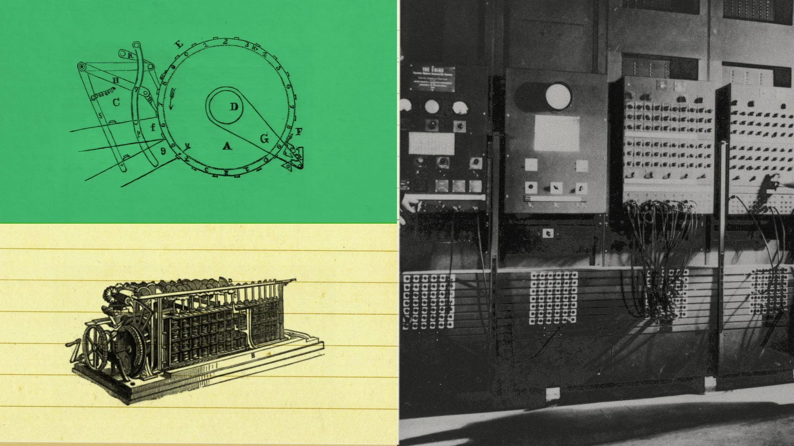
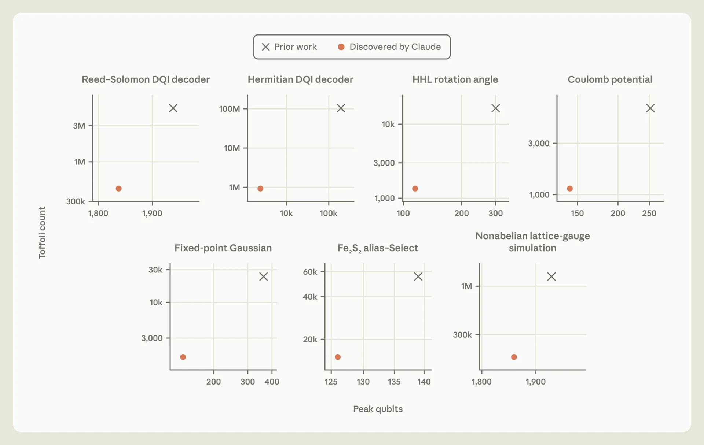
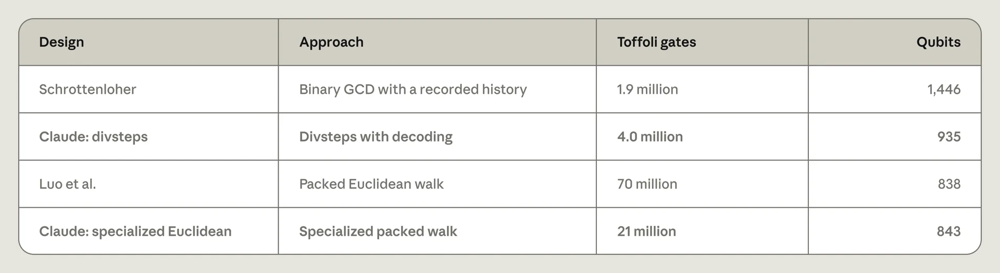
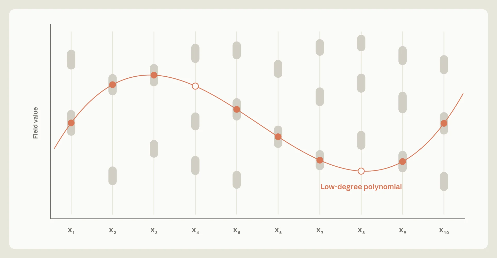
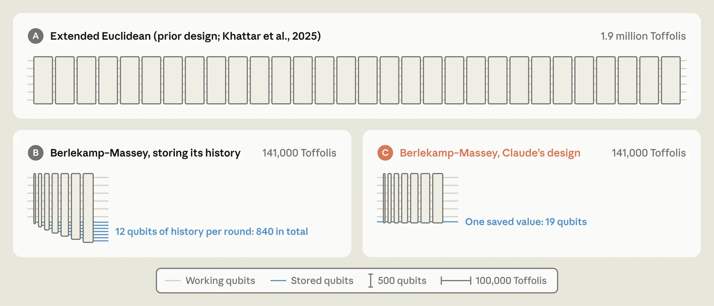

# 用 Claude 设计更高效的量子电路

- 英文标题：Designing more efficient quantum circuits with Claude
- 发布日期：2026-10-16
- 官网栏目：科学
- 原文：[Anthropic 页面](https://www.anthropic.com/research/designing-efficient-quantum-circuits)
- 官网署名：Anthropic

> 中文机器初译，未逐篇人工校对。引用研究结论时请核对英文原文。

*量子计算机需要精心设计的电路才能在有限的硬件上运行有用的算法。我们为Claude提供了八个这样的电路的简单语言规范，这些规范来自化学、优化、物理模拟和数论，以及一个对每个设计进行检查和评分的自动评估器。Claude主要靠自己工作，发现设计可以改进最好的已发布电路，在某些情况下可以提高一个数量级或更多。这些改进大大减少了有用应用所需的量子资源，因此实用的量子计算机可能比之前预期的更早到来。*

*这项工作由 Anthropic 的 STEM 研究员计划的一部分由 Andi Gu 领导，并得到 Anthropic 量子物理学家 Alek Kemeny 的指导，并与 Susanne Yelin（哈佛大学）和 Mikhail Lukin（哈佛大学和 QuEra 计算公司）合作。 [阅读 arXiv 上的全文](https://arxiv.org/abs/2610.22367).*

与以 0 或 1 的位存储信息的经典计算机不同，量子计算机将信息存储在 *量子位，* 它可以由单个原子、超导电路或光粒子构建。这些量子位利用量子现象，例如 *叠加*——它允许量子系统同时以多种状态的组合存在——以便以某种方式处理信息，使化学、材料科学和数论等领域的某些问题变得易于处理，即使这些问题对于传统计算机来说太难了。

迄今为止，该领域构建的量子计算机只有数百到数千个量子位，太少，无法运行许多比经典计算机具有实际优势的算法。这些量子位对环境噪声高度敏感，例如热、振动，甚至宇宙射线。微小的干扰都会改变量子位的状态，这些小错误会不断累积，直到计算机给出错误的答案。

鉴于量子位和计算时间都是稀缺资源，研究人员一直致力于重新设计量子算法，以使用更少的量子位并在更短的时间内完成计算。一个说明性的例子是模拟 FeMoco，这是固氮酶核心的铁硫簇，细菌利用这种酶将空气中的氮转化为氨。了解它的工作原理可以帮助科学家设计更好的工业催化剂——制造商用来加速化学反应的物质。

2017 年，研究人员估计，量子计算机将需要大约 50 万亿个 Toffoli 门来计算 FeMoco 的基态能量（其最稳定构型的能量），化学家需要它来预测 FeMoco 如何反应。 （与普通计算机类似，量子计算机的工作原理是对其量子位应用一长串简单的操作（称为门）。Toffoli 门是运行成本最高的门之一，因此计算 Toffoli 门是估计计算所需时间的标准方法。）

通过一系列算法的进步，预计门的数量已降至约 3.4 亿个，大约减少了 15 万倍，相当于在具有约 300 万个物理量子位的未来机器上进行几个小时的计算。[1](https://www.anthropic.com/research/designing-efficient-quantum-circuits#footnote-1)

这些减少主要来自重新设计执行计算的电路，而不是制造更好的硬件。事实证明，Claude特别擅长优化 [古典的](https://www.anthropic.com/research/claude-uplifts-biomolecular-modeling) [算法](https://www.anthropic.com/engineering/AI-resistant-technical-evaluations)，所以我们想看看如果只给出每个电路必须计算的内容的简单语言描述，它是否可以对量子算法做同样的事情。

出于多种原因，Claude非常适合这项任务。首先，量子算法被实现为量子 *电路*。它们由门序列组成，就像上面提到的托弗里门一样。重要的是，这些电路可以用代码来描述，因此我们可以利用Claude的编码能力，像普通程序一样编写、运行和修改电路设计。其次，我们最感兴趣的优化一类（相当常见的）量子算法可以有效地测试其正确性，因为每个输入都会给出一个普通计算机可以检查的明确输出。这意味着我们可以有一个外部评估程序来验证Claude的提案。最后，我们可以给 Claude 一个清晰、客观的分数来改进：使用的量子位数量乘以门的数量，它可以作为电路运行时间的代理。

我们发现 Claude Mythos 5 可以成功地在闭环中工作，提出电路设计，从评估程序接收反馈和分数，并使用该反馈来改进其下一次尝试，而各轮之间无需人工输入（见图 1）。在用于化学、优化、量子模拟、数论和数值计算的八种计算原语（构建较大量子算法的基本例程）中，Claude 发现了比之前发布的最佳算法使用更少量子位和更少门的新颖设计（图 2）。

在每种情况下，改进都是由于发现了有关问题的新结构和数学见解，而不是微调现有设计。例如，在编译用于模拟硫化铁分子的电路时，Claude注意到分子的对称性和重复结构意味着某些结果可以计算一次并重复使用，而不是为系统的每个部分重新计算。在其他情况下，它发现现有电路包含昂贵的组件，仅需要处理极其罕见的输入，并且在没有这些组件的情况下重新设计了它们。

下面，我们描述Claude的两个发现。第一个是执行模求逆的新方法，这是椭圆曲线计算中最昂贵的一步算术。第二个使领先量子优化算法中成本最高的步骤便宜约 12 倍。

这些结果表明人工智能现在可以帮助重新设计量子电路，这是使量子算法更快、更容易运行的关键一步。更快的电路设计可以让量子计算机能够更快地解决问题——从设计新药物和更好的电池到寻找更清洁的肥料制造方法。

[原文媒体](https://assets.claude.com/0e9f7b41ac662fb1b2544315dc7cae1967f1fff8.mp4)

闭环量子电路优化。Claude 用 Python 设计了新的实现，然后将其发送给编程评估器。评估者检查建议的实现是否正确，然后根据其所需的量子位和门的数量对其进行评分。然后，该信息被发送给 Claude，Claude 使用它来改进其实施。显示的代码和值是说明性的。

Claude在八种不同的量子电路设计任务中设计了更小、更快的电路。灰色标记显示之前发布的最佳设计；橙色标记和线条显示了Claude的设计。第八项任务加点的比较如下表1所示。

### 一种新的可逆算法

设计量子电路涉及两个普通编程所没有的限制。首先，量子电路无法像普通程序那样做出“如果-那么”决策​​。普通程序可以检查一个值，然后仅运行两段代码之一。但是量子计算机同时运行在许多输入的叠加上，其中一些将运行第一段代码，另一些将运行第二段代码，因此电路每次运行时都必须包含这两个输入的操作。

第二是量子电路不能丢弃信息。普通程序一旦完成就可以覆盖或删除其临时工作；在量子计算机中，这种中间信息不能简单地被删除，因为量子电路的每一步都必须是可逆的。保留这些信息也不是一个选择，因为剩余的临时工作会破坏最终结果。丢弃信息的唯一方法是通过反向运行创建信息的计算来“取消计算”它，但代价是增加额外的门。这两个限制使得量子电路在运行时间和量子比特方面都比经典电路昂贵得多。

这种限制迫使空间（即量子位）和时间之间进行困难的权衡。在一种极端情况下，量子电路可以在使用中间结果后立即取消计算。这释放了量子位，但如果以后再次需要相同的结果，电路必须重新计算它们，这会增加门并增加运行时间。在另一个极端，电路可以保留中间结果，直到不再需要它们为止。这避免了重复工作，但可能需要更多的量子位。

这使得量子电路设计成为对Claude能力的特别有趣的考验。这些电路可以编写为普通代码，但改进它们需要模型在一组约束下进行推理，这与普通编程完全不同。

#### 艰难的第一个测试：模逆

我们给Claude的第一个任务是点加法，这是一种将数学曲线（椭圆曲线）上的两个点组合起来产生第三个点的规则。点加法是椭圆曲线上离散对数问题量子算法的核心步骤：给定一个起点及其与自身相加的结果 *n* 次，找到 *n*。对于大曲线，普通计算机无法在任何合理的时间内解决这个问题，但足够大的量子计算机可以。

这些算法多次执行点加法，包括反向执行，这些加法占了其量子位和运行时成本的大部分。像这样的问题——易于计算，却极难逆转——是量子计算机首次被证明比普通计算机提供指数级加速的问题之一。由于这些原因，加分已成为该领域的标准基准之一。这对Claude来说是一个艰巨的考验。因此，我们要求它计算出点加法真正需要多少个量子位以及多少个门。

我们给了Claude一份单段的简介。它解释了点加法的数学规则，以及评估者如何检查每个提议电路的正确性并根据其使用的量子位和门的数量对其进行评分。它还指示Claude并行探索多种方法。在以最少的人工投入（仅限于最初的简短和偶尔的提示以进行更广泛的思考）的情况下工作了 53 个小时后，Claude找到了解决该问题的全新方法。

#### divsteps 的内存需求

点加法的大部分成本来自于一个步骤，称为 *模反演*。椭圆曲线算术使用的数字在达到固定限制时会回绕。模逆是除法的环绕版本：给定一个整数 *a*，找到 *x* 这样 *斧头* ≤ 1 (模 *p*）。普通计算机可以使用一种称为的方法有效地执行此操作 [*步数*](https://tches.iacr.org/index.php/TCHES/article/view/8298)。Divsteps 从一对数字开始，并在多轮迭代中反复简化它们。在每一轮中，divsteps 都会检查当前的数字对，并有条件地交换、加、减或减半它们。在此过程中，它保留了足够的信息以在最后生成模逆。

尽管在普通计算机上取得了成功，但由于上述可逆性限制，divsteps 尚未产生实用的量子电路。每次迭代时选择哪个操作的记录，称为 *分行信息*，是传统程序可以简单丢弃的那种临时工作。相比之下，量子电路必须保留该记录，以便计算可以向后运行。因此，divsteps 的简单量子版本被迫积累分支信息的长期历史，这需要大量额外的量子位来存储。

#### Claude如何解决记忆问题

Claude认识到，这种分步方法对于量子电路来说可能是有希望的，但前提是有一种方法可以解决存储完整历史记录的问题。它有一个想法：也许记录根本不需要存储。Claude推断，通过在每次迭代后仔细检查这对数字，可能可以直接推断（或“解码”）分支信息。本质上，数字本身会存储记录。然后电路可以向后运行，而不需要任何额外的量子位。

为了测试这个想法，Claude探索了一些用于执行解码的简单候选规则。这些早期规则适用于小型测试用例，但当 Claude 在整个问题大小、256 位数字上测试它们时，它们失败了。

Claude随后尝试了一种更具理论性的方法。它不是猜测和测试规则，而是从数学上理解为什么 divsteps 会这样做。它证明了关于迭代过程的一系列结果，包括几个新的代数恒等式。根据这些恒等式，Claude导出了一个精确的解码规则公式，可以从数字对中正确地恢复分支信息。然后，它检查了该公式，首先通过大规模数值模拟运行该公式，然后在精益中形式化该主张。完成完整验证后，Claude 生成了第一个可逆的 divsteps 实现，没有存储分支历史记录。

#### 一系列设计

解码可以节省量子比特，但会花费时间。因此，作为进一步的改进，Claude寻找存储分支信息比解码它更便宜的情况。通过改变电路存储而不是解码分支信息的阈值，Claude在两个极端之间产生了一系列新的设计。与之前最小的设计相比，该系列中的一个电路使用的量子位数量增加了 12%，但门数量减少了 17 倍。更一般地说，新设计扩展了帕累托前沿，提供了以前无法实现的量子比特数和运行时间的组合（表 1）。

椭圆曲线点加法的资源。大胆的行是Claude的设计；其他的是以前发布的最好的设计。资料来源： [施罗滕洛赫](https://arxiv.org/abs/2606.02235) (2026), [罗等人。](https://arxiv.org/abs/2607.13816) (2026).

### 优化量子优化器

优化问题是各种任务的核心，包括调度、物流和材料设计。优化问题提出了一组相互竞争的约束，并要求找到满足尽可能多的约束的解决方案。针对此类问题，人们提出了许多量子算法，但大多数算法相对于普通计算机只能带来适度或不确定的收益。 [解码量子干涉测量 (DQI)](https://arxiv.org/abs/2408.08292) 是最有力的候选人之一 *超多项式量子加速——*随着问题变得越来越严重，这种优势会迅速扩大。

当量子计算机完成计算时，读出其量子位只会产生一个答案，该答案是从它们叠加的可能性中随机选择的。DQI 的工作原理是准备一个量子态，在该量子态中，好的解决方案比坏的解决方案更有可能被读出。做到这一点涉及使用纠错解码器，它可以从紧凑的摘要中恢复简短的“错误”列表。这是算法中最昂贵的步骤。因此，如果我们能够制造出更快的解码器，我们也可以更快地执行 DQI。

#### 更高效的量子解码器

引入 DQI 的研究人员在一个名为“DQI”的问题上进行了演示。 *最优多项式交集* (OPI)，基于网格的曲线拟合版本（图 3）。想象一个网格，其中每个位置 *x* 包含几个可接受的值 *y*。目标是找到一条简单的曲线（低次多项式），它可以通过可接受的平方 *x* 尽可能的职位。DQI 使用一种特定类型的解码器（称为 Reed-Solomon 解码器）解决此优化问题。

最佳多项式交点 (OPI) 作为离散曲线拟合。每列包含几个可接受的值。优化问题是找到一个通过尽可能多的可接受值的多项式。

里德-所罗门解码从上述错误的紧凑总结开始，这被称为 *综合症*。解码器的工作是从这个摘要中推断出数据中发生错误的位置以及错误是什么。之前最先进的量子电路使用扩展的欧几里得算法处理这些综合症，这是一系列除法和交换的序列，其中步骤的数量和顺序取决于所给定的特定输入。在这里，量子电路的限制再次出现：虽然普通程序可以为每个输入遵循不同的路径，但同时处理多个输入的量子电路必须使用单个固定的门序列来处理所有输入。为了解决这个问题，以前的设计必须将计算扩展到比任何单个输入所需的更多轮次的迭代中，并且必须在每一轮中运行每个操作，即使这样做是不必要的。

改进该解码器可以大大减少 DQI 的运行时间。研究人员的估计 [谷歌量子人工智能](https://arxiv.org/abs/2510.10967) 意味着解决一个特定的 OPI 问题大约需要三个月的时间 [前沿](https://www.olcf.ornl.gov/frontier/)，世界上最强大的超级计算机之一，相比之下，运行 DQI 的未来量子计算机大约需要一个小时。那个小时的大部分时间都花在里德-所罗门解码上。

因此，我们要求 Claude 为解码步骤设计一个更高效的量子电路。Claude很快得出结论，扩展欧几里得算法不太适合量子电路。相反，它围绕一种不同的解码方法（称为 Berlekamp-Massey 解码）组织电路，该方法一次读取一个综合症（错误摘要），并逐渐制定出最简单的规则，根据前面的数字来预测列表中的每个数字。一旦找到该规则，它就会揭示错误。与扩展的欧几里得算法不同，伯利坎普-梅西算法在每一轮中执行相同类型的步骤，并且始终运行相同数量的轮次，这适合量子电路的单一固定门序列，最终为Claude提供了一个更有效的基础。

#### 简化的存储方法

改用 Berlekamp-Massey 后，电路不再需要针对不同的输入采取不同的路径。但使其可逆又带来了另一个挑战，这次是由于上面讨论的非计算约束。在每一轮中，电路都会计算短暂需要的临时值，但这些信息不能简单地删除：为了稍后取消计算，电路必须能够恢复该信息。

存储这些信息的成本极其昂贵。因此，Claude 采用了与 divsteps 相同的方法：它找到了一种从电路当前状态重建大部分信息的方法，因此不需要存储它。然而，一些特殊值无法通过这种方式恢复，必须保存。

为最坏的情况（即在 35 个不同的轮次中出现异常值）预留足够的内存将需要 665 个量子位。相反，Claude 编写了一个高速模拟器并运行 4.03 亿个样本解码来测量这些异常实际发生的频率。几乎每次运行最多只需要保存一个值。因此，Claude的电路只为一个保存的值（即 19 个量子位）留出空间。大约万分之一的运行需要超过此数量并失败，这完全在任务允许的错误率范围内。这些改进用少量固定数量的量子位和门取代了大量最坏情况的储备（图 4）。

总之，这些优化将解码器中的门数量减少了 12 倍。 [谷歌之前的建设](https://arxiv.org/abs/2510.10967)。改进来自于在三个层面上重新设计计算：不同的方法（用 Berlekamp-Massey 解码替换扩展的欧几里得算法）、不同的电路架构（重建临时值而不是存储它们）以及不同的资源预算（精确测量电路真正需要多少内存和计算量）。任何单一的改变本身都是不够的，但综合起来，它们使 DQI 最昂贵的步骤便宜了一个数量级多一点。

里德-所罗门解码器定位器步骤的三种设计。设计按比例绘制：每个块的宽度与其门数成正比。 (a) 先前的设计，基于扩展欧几里德算法（Khattar 等人，2025）。 (b) 基于 Berlekamp-Massey 的设计需要的门少得多，但简单的可逆版本必须在每一轮中存储 12 个量子位记录，总计 840 个量子位。 (c) Claude的电路根据更新后的状态重建大部分历史，因此它只需要为 19 个量子位的单个保存值留有空间。

### 我们学到了什么

科学进步往往来自于理论思想的实践。发生这种情况的主要方式之一是通过一种曾经被认为不切实际的快速且廉价的工艺来实现。量子电路设计就是一个典型的例子：上述 FeMoco 估计值下降 150,000 倍，许多研究小组花了八年时间，每一步通常需要数月的工作。相比之下，Claude的椭圆曲线设计是单次 53 小时跑步的结果。

我们的结果表明，人工智能可以支持电路设计工作，产生使有用的量子计算更接近真实硬件功能的实现。如果人工智能可以加快这项工作，有用的量子计算可能会更快到来。

尽管Claude在这些任务上的表现令人鼓舞，但我们也观察到了一些局限性。在我们早期的实验中，Claude生性保守。它反复对明显的改进进行事后猜测，有时继续对已经得到充分支持的结果进行双重甚至三重检查。这种谨慎有时是有价值的：例如，它促使 Claude 编写精益证明来验证其 divsteps 设计。但它也表现在人们更喜欢现有的、众所周知的方法，而不是更新颖的方法。

我们采取了两个步骤来缓解这种情况。首先，我们的设置要求Claude提出几种性质不同的方法，并并行开发它们。其次，我们偶尔也会促使Claude扩大搜索范围。这些干预措施成功地让Claude追求更雄心勃勃的想法。例如，椭圆曲线的结果并不是来自于从现有设计中删除门，而是来自于探索一种以前不可能实现的可逆模反演方法，然后得出使其实用所需的数学结果。一旦提出这个想法，Claude 就会自主开发该方法、实施并验证其正确性。

电路设计只是构建有用的量子计算机的一部分。由于量子位非常脆弱，机器在运行时还必须捕获并修复自己的错误，这取决于许多其他组件，从纠错码到快速解码器再到硬件本身的控制。这些组件都会相互影响，但为了管理复杂性，每个组件通常都是单独设计的。他们中的许多人都具有使电路设计非常适合Claude的特征：设计可以编写为代码，检查正确性，并根据其成本进行评分。

这提出了一个有趣的可能性。人工智能可以联合优化所有组件，从算法到硬件，而不是单独设计每个组件，以构建针对特定问题量身定制的完整纠错量子计算机。此类设计还可以告诉硬件制造商哪些功能对于给定应用程序最重要。这可能会将设计催化剂和理解新材料等问题置于第一台容错机器的能力范围之内。

## 脚注

01两个估计均针对 FeMoco 的相同 54 轨道模型，如表所示 [低等人。](https://arxiv.org/abs/2502.15882)，“通过光谱放大对电子结构进行快速量子模拟”（2025），表1； 2017年的估计来自 [赖尔等人。](https://doi.org/10.1073/pnas.1619152114) 同一模型的中间估计来自 [贝里等人。](https://doi.org/10.22331/q-2019-12-02-208) (2019), [冯·伯格等人。](https://doi.org/10.1103/PhysRevResearch.3.033055) (2021), [李等人。](https://doi.org/10.1103/PRXQuantum.2.030305) （2021），以及 [罗卡等人。](https://doi.org/10.1021/acs.jctc.4c00352) (2024).
