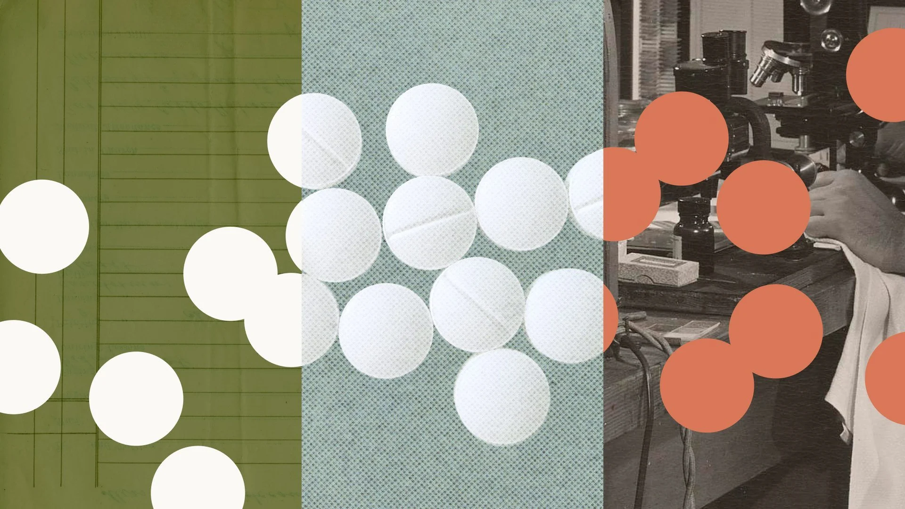

# 用 Claude 加快药物研发：初步进展

- 英文标题：Early progress on accelerating drug development with Claude
- 发布日期：2026-10-27
- 官网栏目：科学
- 原文：[Anthropic 页面](https://www.anthropic.com/research/early-progress-drug-development)
- 官网署名：Anthropic

> 中文机器初译，未逐篇人工校对。引用研究结论时请核对英文原文。

*人择的 [生命科学团队](https://www.anthropic.com/science) 正在努力加速治愈疾病。在过去的几个月里，我们的科学家与六个开发新药的组织建立了深入的研究合作伙伴关系： [比格哈特生物科学公司](https://www.bighatbio.com/), [百时美施贵宝](https://www.bms.com/), [分歧实验室](https://divergencelabs.com/), [恩韦达](https://enveda.com/), [生成生物药物](https://generatebiomedicines.com/), 和 [专栏组](https://www.thecolumngroup.com/)。我们也开始了自己的药物发现工作。在此过程中，我们了解了很多关于 Claude 如何支持药物开发，以及我们需要如何进一步改进 Claude 以实现人工智能在医学领域的潜力。我们计划从现在开始大幅扩展这项工作*.

有很多机会可以加快药物开发，甚至超越最常讨论的人工智能应用，例如 [提出初步设计](https://www.anthropic.com/research/Claude-accelerates-protein-design) 对于新分子。开发药物涉及许多不同的任务：进行早期研究以确定药物的靶点和合适的药物类型，设计具有正确特性的分子，优化其以可靠地大规模生产，起草进行临床试验所需的监管文件，设计和管理这些试验等等。

我们实现人工智能医疗效益的战略是基于让人工智能越来越多地参与所有这些任务。没有单一的问题需要解决；瓶颈分布在整个药物开发过程中。识别和解决这些瓶颈的最佳方法是深入参与跨许多不同疾病领域和开发阶段的实际药物项目。

因此，在过去的几个月里，我们与六个组织合作来实现这一目标。我们还开始了自己的药物发现工作，包括针对罕见的儿童期肌肉营养不良症的项目，Claude负责其中的大部分科学和运营工作。

这项工作通过三个方式服务于我们的目标。首先，它让我们更好地了解我们的模型在更广泛的药物开发任务方面的优势和局限性（我们已经根据迄今为止所学到的知识优先考虑了对模型的具体改进）。其次，这些项目可以作为更广泛的生命科学界的案例研究。如果Claude要显着提高新疗法的开发率，我们需要与更多的生物技术公司合作，并将Claude更深入地融入到他们的开发过程中。第三，如果这些项目继续保持积极的发展轨迹，它们本身应该会产生直接影响。我们乐观地认为，其中一些药物可能会针对其目标疾病产生有效的新药，包括食物过敏、罕见的儿童疾病和几种癌症。

在这篇文章中，我们提供了与合作伙伴的最新进展，以及更详细地描述我们的思维过程、方法和早期结果的技术报告。然后我们简要概述我们下一步工作的方向。

## 案例研究

**生成生物医学：模态工程。** Generate Biomedicines 一直致力于提高癌症治疗（称为 CAR T 细胞疗法）的有效性。这种疗法历来有助于治疗血细胞癌。 Generate 的目标是对其进行重新设计，使其也能治疗实体瘤癌症。为此，他们的目标是缩短治疗遗传指令的一部分，这将为适合其他类型癌症的额外指令创造空间。六生成科学家使用Claude代码提出了这部分的新设计。一种设计比标准版本短约 70%，在实验室测试中它更有效：它允许免疫细胞产生大约 10 倍数量的受体（它们用来发现癌细胞的蛋白质），它更有效地杀死肿瘤细胞，并且免疫细胞保持活跃的时间更长。 了解更多，并查看 [生成技术报告](https://generatebiomedicines.com/publications/refactored-intracellular-domains-enhance-car-expression-and-function/).

**Divergence Labs：热门一代。** Divergence Labs 正在研究一种治疗食物过敏的新方法。食物过敏是由一种叫做 IgE 的分子的反应引起的，其中一些附着在我们的免疫细胞上，另一些则自由地漂浮在我们的血液中。Divergence Labs 正在开发能够将 IgE 与我们的免疫细胞完全分离的药物，而不是像标准药物那样仅仅中和我们血液中循环的 IgE。这可以提供一种更有效的治疗方法，但需要精确的设计，有两个“臂”：一个与 IgE 紧密结合，另一个帮助从免疫细胞中捕获 IgE。Claude 将 Divergence Labs 的目标转化为详细的设计计划，然后在大约一个月内基本上自主地生成了大约 35,000 个抗体设计，以缩小范围并进行测试。在这些早期测试中，Divergence 发现了双臂的“亮点”：3 种设计可以与 IgE 结合，20 种设计可以将其驱逐。这 20 种药物中，有 3 种似乎比标准药物更能去除 IgE。下一步是开发一种结合这两种武器的药物。 了解更多，并查看 [Divergence 的技术报告](https://divergencelabs.com/publications/ige-preprint.pdf).

**BigHat Biosciences：先导化合物优化。** BigHat Biosciences 将人工智能与自动化实验室结合起来，以改进潜在的药物（或“先导药物”），这些药物必须紧密结合其靶点，在制造和储存过程中保持稳定，并避免聚集在一起（以及其他标准）。BigHat 的科学家和一位人类研究人员与 Claude 合作，改善了两种先导化合物的这三种特性，这两种抗体片段都可能成为未来药物的一部分：一种旨在针对癌细胞，另一种旨在使药物在体内保留更长时间。连接到 BigHat 实验室数据系统 Reccy 的 Claude 提议对每个分子进行更改，BigHat 实验室在大约 10 周内制造并测试了大约 1,010 个变体。中途，团队怀疑标准的热稳定性和结块指标具有误导性。Claude和研究人员重新分析了原始数据，然后提出了不同的指标和协议更改来测试它们。BigHat 的科学家改进并运行了它，主要预测成立。与原始版本相比，最佳版本的结合紧密度提高了 10 倍以上，癌症靶向先导化合物在溶液中的停留温度提高了 18°C，而持久药物的先导化合物凝结速度慢了 100 倍以上。 了解更多，并查看 [BigHat 的技术报告](https://www.bighatbio.com/bighat-anthropic-collaboration-report-10-27-2026).

**Enveda：制造和备案。** 为了进行临床试验，公司需要记录显示每批新药都是按照严格的质量标准生产的，并向监管机构提交申请等。在 Enveda，制造化学家将 75% 的时间花在文书工作上。为了减轻负担，Enveda 构建了一个系统，将其所有制造文档连接到 Claude，然后让 Claude 标记任何可能的问题。通过对 1,061 页文档的测试，Claude 发现了人类审阅者发现的所有 11 个问题，并标记了他们错过的 7 个问题。在此过程中，该方法将人工审核时间减少了 89%，从超过 25 小时减少到不到 3 小时。另外，Claude还撰写了两份重要监管文件的初稿。一个需要四个小时，而手工则需要大约三个月的时间。另一方面，Enveda 的标准人工审核流程发现了一个小错误。 了解更多，并查看 [Enveda的技术报告](https://enveda.com/CMC-Document-Processor/).

**Column Group (TCG)：公司创建。** 由于药物发现可能缓慢、昂贵且容易失败，生物技术公司的投资者更青睐更安全、经过验证的想法，而不是风险更高的新想法，即使后者可以帮助更多患者。我们一直在与 TCG 合作，看看 Claude 是否可以通过缩短药物发现的时间和成本来改变这一现状，以便投资者能够自信地支持更雄心勃勃的想法。具体来说，TCG 正在建立 Pleiades，这是一家新公司，将利用 Claude 来运行比小团队通常更多、更复杂的药物项目。这可以成为Claude如何减少运营生物技术公司所需的科学、运营和管理费用的模型。如果可行，这种模式可以在整个行业复制，并直接投资于更棘手的医学问题。Pleiades 目前正在为 Claude 开发新的工具和工作流程；它的第一个 Claude 技能可以帮助 Claude 评估药物靶标是否值得追求，已经在 45 个靶标疾病对上进行了评估。 了解更多.

最近，我们还开始与 [百时美施贵宝](https://www.bms.com/) （BMS）寻找并解决临床试验计划中的瓶颈。BMS 正在使用 Claude 来评估临床试验中早期药物的计划，并估计这些试验成功的可能性。我们计划在 2027 年共同扩展这项工作，以了解其提高早期开发成功概率的潜力。

> *“我们在临床试验阶段使用 Claude 来分析专有数据、制定临床研究计划并权衡研究成功的机会。根据一个提示，Claude生成了可靠的初步分析，帮助我们对不同的开发选项进行评估，否则这将需要几天的时间才能完成。我们在做这一切的同时确保了高度敏感数据的安全。我们期待着在整个管道中扩展这项工作，以支持投资组合级别的决策。”*

***迈克尔·普尔德纳医学博士**，高级副总裁，血液学、肿瘤学和细胞治疗早期临床开发负责人。*

除了与这些合作伙伴的合作之外，我们还开始自己开展一些研究项目。我们收购了 Mithril Medicine，这是一家个人公司，一直在开发两种罕见形式的肌营养不良症的治疗方法。它的创始人科迪·特兰巴格 (Cody Tranbarger) 让Claude与 11 个外部实验室组织合同、物流和实验，并将秘银运营的许多其他方面委托给Claude。因此，Mithril 在不到 18 个月的时间里将一种可能的肌肉萎缩症治疗方法从一个想法变成了在小鼠身上取得的有希望的结果。现在，科迪在 Anthropic 继续这项研究，并计划启动几个新项目。如果他的候选药物继续有效，我们预计该药物最早将于 2028 年末开始人体临床试验。 了解更多 并看到 [我们的技术报告](https://assets.claude.com/52e1f5d50c47ca3818f56704c27cf19e59b62e77.pdf).

## 扩展我们在生命科学领域的工作

所有这些研究仍处于早期阶段。特别是，到目前为止，大部分是 *临床前—*也就是说，在很大程度上，药物尚未进入人体测试阶段。随着这些药物项目的进展，以及我们与更多药物开发项目已处于临床阶段的组织合作，我们计划继续将Claude的角色扩展到临床试验中。

这项研究只是我们加速药物发现努力的一部分。最终，我们希望与尽可能多的药物开发研究人员分享我们的模型。为此，我们推出了 [克劳德·科学](https://www.anthropic.com/news/claude-science-ai-workbench)，我们为研究人员提供的人工智能工作台，我们提供 [Claude对生命科学家的贡献](https://www.anthropic.com/news/ai-for-science-program)。我们还创建了 [生命科学验证计划](https://www.anthropic.com/news/life-sciences-verification-program) 允许受信任的组织使用我们最强大的模型以及更宽松的保障措施，这对于防止滥用是必要的，但可能会阻碍合法的生物研究。我们最近还推出了 [公开招募客座调查员](https://www.anthropic.com/news/open-call-guest-investigators-life-sciences) 在生命科学领域；我们正在寻求希望利用Claude来研究药物发现和其他领域的关键问题的研究小组的建议。

随着我们扩大生命科学研究，我们期待与更多组织合作。如果您在专注于药物发现的组织工作并且有兴趣与我们合作，您可以在下面联系我们。

### 与我们联系

如果您在专注于药物开发的组织工作并希望取得联系，请填写以下表格。
