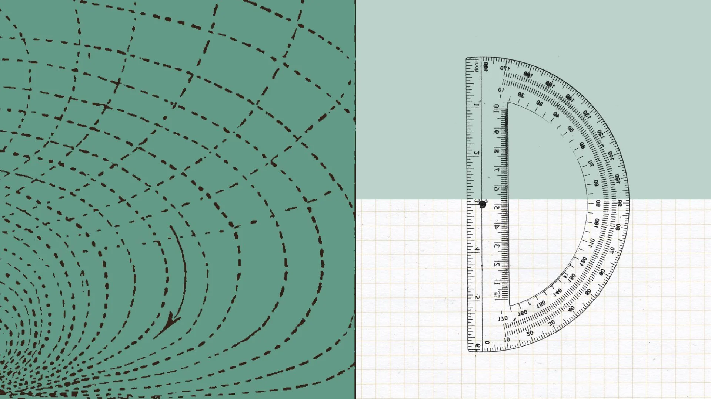
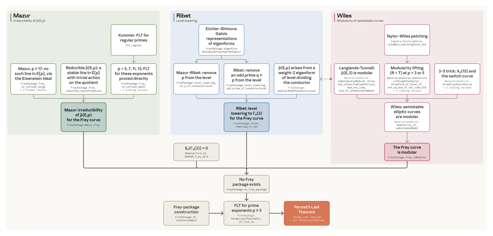

# 形式化费马大定理

- 英文标题：Formalizing Fermat's Last Theorem
- 发布日期：2026-09-04
- 官网栏目：科学
- 原文：[Anthropic 页面](https://www.anthropic.com/research/formalizing-fermats-last-theorem)
- 官网署名：Anthropic

> 中文机器初译，未逐篇人工校对。引用研究结论时请核对英文原文。



*我们正在分享费马大定理的第一个完整的计算机检查证明。Claude 基本上自主工作了 11 天，用精益编程语言编写了证明。下面，我们描述了形式化是如何完成的，并分享了一些关于这项工作对研究数学意味着什么的想法。*1637 年左右，皮埃尔·德·费马 (Pierre de Fermat) 在他的丢番图 (Diophantus) 的《算术》(Arithmetica) 副本的页边空白处记下了一个主张这将成为有史以来最著名的数学猜想之一：对于任何 n > 2，没有正整数 a、b、c 满足 aⁿ + bⁿ = cⁿ。 [费马大定理](https://www.youtube.com/watch?v=1BSFyEIY2BY) (FLT)，随着这个猜想的出名，证明起来极其困难。第一个证明来自安德鲁·怀尔斯爵士1995年，长达129页，需要数月的艰苦工作来验证。

十年后，荷兰计算机科学家 Jan Bergstra 提出“形式化”怀尔斯的证明：将数学推理转换为计算机可以自动检查的形式。从那时起，数学家们一直在开发编码如此复杂的证明所需的方法，其中包括伦敦帝国理工学院的 Kevin Buzzard 于 2024 年启动的一项为期多年的社区努力 [完成形式化](https://lean-lang.org/use-cases/flt/) 使用 [精益证明助手](https://en.wikipedia.org/wiki/Lean_(proof_assistant)).

最近，哥伦比亚大学人类学研究员 Tianyi Peng 的团队开发了人工智能形式化工具，他开始测试 Claude 能否在形式化 FLT 方面取得进展。[1](https://www.anthropic.com/research/formalizing-fermats-last-theorem#footnote-1) 结果超出了他的预期。在 11 天的时间里，Claude基本上是自主工作，制作了第一个端到端、计算机检查的 FLT 证明。一路走来，它编写了 1300 万行 Lean 代码，并证明了 29,500 个中间定理。

我们分享了 [结果证明](https://github.com/anthropics/fermats-last-theorem) 凯文·巴扎德 (Kevin Buzzard) 说道：

> 人类学研究人员称，这一非凡的自动形式化成就只花了 11 天，除了数学公理之外，没有任何假设就证明了费马大定理。一路走来，我们看到了代数、调和分析、几何和数论的自动形式化，并且我们了解到人工智能自动形式化制品现在已经足够强大，可以在其上构建；证明是多层次的。

自动形式化像 FLT 这样复杂的证明是迈向所有数学都可以轻松检查的未来的重要一步。随着人工智能产生越来越多的证据，轻松地将工作形式化的能力可以减轻评估新结果的负担（这个过程可能需要数年时间）。我们希望相信数学赖以建立的知识体系会变得更容易，而不是更困难。

## 验证数学证明的挑战

不像 [最近人工智能驱动](https://www.anthropic.com/research/riemann-zeta) 黎曼假设的研究工作，产生了新颖的 *数学*，这里的新颖之处在于 *验证*——检查数学证明就像用计算器检查数学计算一样。证明数学定理需要组装复杂的逻辑链，如果单个链接被破坏，它后面的所有内容都可能被证明是错误的。深入理解一个新颖的结果并对其正确性充满信心可能需要数月甚至数年的工作。

费马大定理就是一个说明性的例子。[2](https://www.anthropic.com/research/formalizing-fermats-last-theorem#footnote-2) 费马在一本书的页边空白处写下了该定理的陈述，并附上了一条诱人的注释：

> 我发现了一个真正奇妙的证明，这个空白太窄了，无法容纳。

350 多年来，一代又一代的数学家一直在寻找 FLT 的证明，无论是奇妙的还是其他的。1908 年，宣布奖励 10 万德国金马克（相当于今天的 1-200 万美元），奖励任何能够提供正确证明的人，621 *不正确* 仅在第一年就进行了尝试。

1993 年 6 月，怀尔斯在为期三天的系列讲座中提出了他认为是 FLT 的第一个正确证明。经过几位数学家的密集验证工作两个月后，一位审稿人向怀尔斯提出了一个暴露了关键差距的问题。怀尔斯花了一年的时间试图解决这个问题，首先是独自一人，然后是与他以前的学生理查德泰勒一起。当他终于意识到他之前放弃的方法可以修复证明时，他正处于放弃该项目的边缘。   

Wiles于1995年5月发表了FLT的第一个正确证明；它所依赖的现代数学技术远远超出了 1637 年费马所知道的范围。由于经过几个世纪的尝试仍未找到基本证明，数学界现在相信费马自己原创的“奇妙证明” [不正确](https://mathenchant.wordpress.com/2016/05/16/fermats-last-theorem-the-curious-incident-of-the-boasting-frenchman/).

## 形式化费马大定理

检查证明正确性的一种方法是让计算机来做。像 Lean 这样的证明助手通过算法验证证明的逻辑，毫无疑问地证明其正确性。对于人类来说，困难的部分是重写证明，以便精益能够理解它。虽然为人类读者编写的证明会跳过许多明显的步骤，但精益需要查看每一个步骤，无论多么微不足道。人类证明也建立在几个世纪以来已发表的工作的基础上，而形式化则从已经形式化的数学的一小部分开始。

对于 FLT，正式化过程预计需要数年时间。只是 [蓝图](https://imperialcollegelondon.github.io/FLT/blueprint.pdf) 数学界一直用来描述该项目初始阶段的内容长达 86 页。

Claude在 11 天内完成了证明，一路上提供了 30,300 个定理的计算机可验证证明（最终证明中使用了 29,500 个定理）。数十名Claude特工合作定义概念，证明中间定理，并使用这些定理来证明更难的陈述。Claude 的证明包含 1300 万行 Lean 代码，其大小超过 Mathlib（该定理所建立的主要数学证明社区库）的 5 倍。[3](https://www.anthropic.com/research/formalizing-fermats-last-theorem#footnote-3)

[原文媒体](https://assets.claude.com/6d5e1a90507ea4171510b907134139bf716b7d15.mp4)

FLT 形式化的时间进展。

Claude的证明如下 [Darmon、Diamond 和 Taylor 威尔斯证明的简化版本](https://www.math.mcgill.ca/darmon/pub/Articles/Expository/05.DDT/paper.pdf)。人类的数学输入仅限于天一偶尔发出的高级指令：“雅可比作为一种方案听起来很重要”，“推动马祖尔[定理]尽快完成。”您可以找到Claude思想的摘录 [这里](https://assets.claude.com/9e431dff043da6538d99d6c2d231b670aa3da263.pdf).

```
“THE FLT root reads Proved on the site. Historic moment (modulo re-check).”

“!!! The FLT ROOT 62eb32c0 reads PROVED. R = T closed and cascaded to the root. This is the campaign's goal: e2e FLT on prove2me.”

“🏁🏁🏁The FLT root reads PROVED on prove2me at 02:00:57Z Aug-18 (10:00:57pm ET Aug-17). Historic moment for this campaign.”
```

Claude在意识到自己刚刚取得的成就时的思考摘录。

Claude的一些初步尝试都失败了：虽然代理商取得了一些早期的成功，但他们很快就失去了对项目状态的跟踪并停止了有效的合作。他们失败的努力贡献了最终证明中约 7% 的非样板代码行。

当我们转而使用时，努力成功了 [证明我](https://prove2me.vercel.app/)，一个由哥伦比亚大学彭天一和他的合作者设计的用于形式化数学的开放式协作平台。Prove2Me 的帮助：

1. **维护定理陈述的有向无环图 (DAG)** 那个代理人过去常常决定他们下一步应该尝试什么证明。这对于减轻内存退化和允许多个代理并行工作特别有帮助。
2. **加速精益编译并最大限度地减少资源消耗** 通过将定理陈述和证明分离到不同的文件中，并独立维护它们之间的链接。
3. **启用搜索和重用** 通过维护每个定理陈述的自然语言描述，从而产生更简单的证明路径。



Claude用来形式化费马大定理的 Prove2Me 计划的关键里程碑。三个彩色部分对应Claude在实现最终目标的过程中必须证明的三个核心子定理。该图密切遵循怀尔斯的原始证明。

借助 Prove2Me 和基于 Claude Code 的多代理工具，代理团队在不到两周的时间内完成了证明，消耗了通用内部研究模型的约 60 亿个输出代币，该模型与 Claude Fable 5.1 大致相当。完成的校样由 Lean 检查；它只使用精益的三个标准公理，以及 [比较器](https://github.com/leanprover/comparator) 确认该定理的陈述与 Mathlib 自己的 FLT 陈述相符。

## 减轻形式验证的负担

我们得出这个证明的速度表明，现在可以将大量数学形式化，这既可以发现数学证明的共同体中的错误，又可以减轻评审新工作的负担。在回顾了 Claude 的精益证明后，Kevin Buzzard 告诉我们：

> 如果FLT的自动形式化现在成为可能，那么我们就向现代数学文献的自动形式化迈出了一大步。这种自动形式化技术将带来新的工具，根除当前数学语料库中的错误并减轻裁判的负担。这些技术还将使我们能够严格检查法学硕士生成的数学，这目前通常是一个成本极其高昂的人工主导过程。

形式化也是人类如何对人工智能生成的数学结果获得信心的一个主要因素。随着人工智能和人工智能辅助数学家产生比以往更多的（据称）证明，人工智能辅助形式化减轻了人类审阅者的部分负担。我们预计，在任何供人类读者撰写的文章中提供形式化的证明将会变得普遍。尽管我们不认为形式化证明应该取代人类可理解的阐述，但这可能是数学界跟上人工智能贡献的唯一可行方式。

写作《精益》似乎也有助于Claude证明新颖的结果。我们最近Claude撰写的许多结果已经与他们的证明并行形式化，Claude似乎使用这些部分证明来独立检查其假设，就像它编写数值模拟来检查它是否处于正确的轨道上一样。

形式化 FLT 是一个代币密集型项目，但它也是有史以来构建的最大的精益证明。人类研究人员使用三个个人克劳德·马克斯计划进行了一项小实验，以形式化哈代-利特伍德圆法的应用。代理们完全通过 Prove2Me 进行合作，共同完成了 [维诺格拉多夫三素数定理](https://en.wikipedia.org/wiki/Vinogradov%27s_theorem) 短短三天内。我们认为，有了正确的支架，消费者人工智能订阅的主要结果的协作形式化是可以实现的。

为此， [人择](https://www.anthropic.com/news/expanding-support-for-scientists) 以及 [其他实验室](https://openai.com/index/chatgpt-for-academic-researchers/) 最近，通过免费和折扣订阅以及研究学分，扩大了对外部研究人员（包括从事纯数学和形式化研究的数学家）的支持。我们还提供 [专项拨款](https://www.anthropic.com/news/ai-for-science-program) 对于更大的科学项目，其中可能包括形式化其他主要定理或改进 Lean 或 Mathlib。

随着人工智能迅速改变数学研究的方式，Anthropic 和其他地方的数学家们——[正在努力解决这对他们的工作意味着什么](https://leidendeclaration.ai/)。然而，在形式化方面，我们对人工智能的作用毫不含糊地感到满意。随着形式化成为一种更常见的工具，我们希望它将有助于维持对数学知识的共同体系的信任。

## 了解更多

完整的证明可在 [GitHub](https://github.com/anthropics/fermats-last-theorem) 以及证明的书面演练。

#### 推荐的说明性读物

- [*代码中的证明*](https://www.quantabooks.org/books/the-proof-in-the-code/) 是一本关于精益定理证明器的历史和数学形式化的新书。
- [1996 年 BBC 纪录片《费马大定理》](https://www.bbc.co.uk/programmes/b0074rxx) 采访了怀尔斯和其他参与证明的数学家，这篇文章的一些作者对他记忆犹新。
- 对于具有数学背景的人来说，可以在以下位置找到命题类型的技术历史（Lean、Rocq 和 Agda 等证明助手的基础学科） [*作为类型的命题*](https://dl.acm.org/doi/pdf/10.1145/2699407) 菲利普·瓦德勒着。
- Chen, S.、Marwaha, K.、Lu, X.、Yuen, H. 和 Peng, T. (2026)。Prove2Me：一个用于扩展数学形式化的开放协作平台。 arXiv. <https://doi.org/10.48550/arXiv.2608.28433>
- [*自动化数学*](https://asteriskmag.com/issues/09/automating-math)，Adam Marblestone，星号杂志。

## 脚注

01在他读本科期间，彭的研究顾问希望将彭的论文结果纳入一份论文中。 *自然* 文章。他问彭是否确定证明是正确的。彭诚实的回答是：“我99%确定，但这么长的证明很难100%确定。”彭错过了将他的作品发表在 *自然*.

02数学界还有许多其他与验证斗争的故事。其中最著名的是 Thomas Hales 1998 年的证明 [开普勒猜想](https://en.wikipedia.org/wiki/Kepler_conjecture)，花了四年的时间进行审查，然后由 12 名裁判组成的小组得出“99% 确定”的结论（黑尔斯最终领导了一个 20 人的项目， [蝇斑](https://github.com/flyspeck/flyspeck)，形式化了证明）。Grigori Perelman 2002 年的证明 [庞加莱猜想](https://en.wikipedia.org/wiki/Poincar%C3%A9_conjecture) 社区花了大约四年的时间和三篇 300 页的说明才被接受。Harald Helfgott 2013 年的证明 [弱哥德巴赫猜想](https://en.wikipedia.org/wiki/Goldbach%27s_weak_conjecture) 仍在审查中。有时结果被证明是错误的 [接受多年](https://www.ias.edu/ideas/2014/voevodsky-origins)，以及其他数学家将他们的理论建立在这些错误的基础上。

03部分原因是 Mathlib 简洁且经过严格审查，而我们的证明可能比需要的要长得多。
