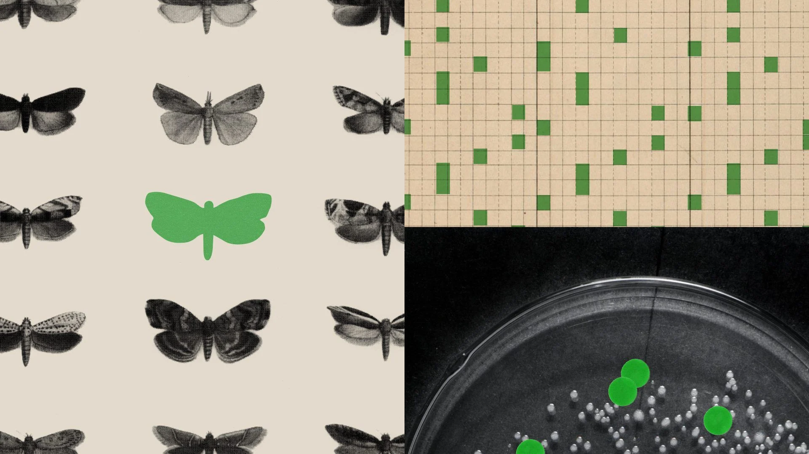

# 介绍我们的科学博客

- 英文标题：Introducing our Science Blog
- 发布日期：2026-03-23
- 官网栏目：科学
- 原文：[Anthropic 页面](https://www.anthropic.com/research/introducing-anthropic-science)
- 官网署名：Anthropic

> 中文机器初译，未逐篇人工校对。引用研究结论时请核对英文原文。

*我们正在推出一个关于人工智能和科学的新博客。我们将分享 Anthropic 和其他地方发生的工作、我们与外部研究人员和实验室的合作，并讨论科学家在研究中使用人工智能的实际工作流程。*

加快科学进步的步伐是 Anthropic 使命的核心部分。 [*慈爱机器*](https://www.darioamodei.com/essay/machines-of-loving-grace) 描述了“压缩的 21 世纪”的前景，其中数十年的科学进步在短短几年内发生。我们开始看到压缩的早期阶段是什么样子：人工智能正在帮助数学家 [发现](https://www-cs-faculty.stanford.edu/~knuth/papers/claude-cycles.pdf) [新的证明](https://www.math.inc/sphere-packing)，个别研究人员 [运行计算分析](https://scottdodelson.substack.com/p/evolving-dark-energy-and-ai) 曾经需要专门的团队和生物学家来 [识别功能基因关系](https://www.biorxiv.org/content/10.1101/2025.05.26.656231v1.full.pdf) 跨越数百万个细胞的数据集。

正如计算机承担了计算任务一样，人工智能现在也承担了部分任务 *认知*。作为这种转变的副作用，过去需要多年专业培训的工作可以越来越多地通过人工智能更快、更便宜地完成。进步的速度引发了有关科学实践和科学机构作用的社会学问题：研究学徒制应该是什么样子？当人工智能在文献创作中变得更加重要时，我们如何保持对文献的信任？当瓶颈从执行转移到管理时，作为一名科学家意味着什么？

尽管进步的速度很快，但其中一些问题在今天可能感觉还为时过早——人工智能的科学能力在很多方面仍处于测试阶段。虽然模型在科学工作流程的某些部分看起来已经超人了，但它们也可能产生幻觉、过度阿谀奉承，并陷入领域从业者认为微不足道的问题上。菲尔兹奖得主蒂莫西·高尔斯很好地捕捉到了这种紧张气氛， [写作](https://x.com/wtgowers/status/1984340187003175298?s=20) “看起来我们已经进入了一个短暂但令人愉快的时代，人工智能大大加快了我们的研究速度，但人工智能仍然需要我们。”  

人工智能将以刚刚开始变得明显的方式改变科学过程。本博客将讨论当前人工智能和科学的优势和挑战，探索其发展过程中令人兴奋的事情。

## 我们将涵盖的内容

在本博客中，我们将分享三种主要类型的帖子：

- **特点：** 关于特定结果或工作的文章，有足够的细节来理解科学和人工智能在产生它时所扮演的角色。我们将发布来自人类研究人员以及客座贡献者和合作者的故事。
- **工作流程：** 为想要在自然科学和形式科学各个领域的工作中使用人工智能的研究人员提供的实用指南。
- **现场笔记：** 整个领域的发展综述，包括显着的成果、新工具和悬而未决的问题。

除了本介绍之外，我们还出版了两篇文章：马修·施瓦茨 (Matthew Schwartz) 的《[Vibe 物理学：人工智能研究生](https://www.anthropic.com/research/vibe-physics)”，重点关注通过真实的理论物理计算来监督Claude，以及 [有关编排长期运行任务以进行科学计算的教程](https://www.anthropic.com/research/long-running-Claude).

## 人类科学

Anthropic 有多项旨在加速科学进步的举措。我们的 [科学人工智能](https://www.anthropic.com/news/ai-for-science-program) 该计划为从事生物学、物理学、化学和其他领域的高影响力项目的研究人员提供 API 学分。 [Claude生命科学](https://www.anthropic.com/news/claude-for-life-sciences) 致力于与研究机构、制药和生物技术领域建立合作伙伴关系，使 Claude 对生命科学研究人员和研发团队有用。我们最近分享了一些早期的 [这些计划的结果](https://www.anthropic.com/news/accelerating-scientific-research)。我们是一个 [核心合作伙伴](https://www.anthropic.com/news/genesis-mission-partnership) 在 [创世使命](http://genesis.energy.gov/)是一项跨越工业界、学术界和政府的数十亿美元倡议，旨在利用人工智能加速美国科学发展。

除了这些专注的努力之外，Anthropic 的研究人员还致力于提高我们模型的核心科学能力并安全地加速人工智能辅助发现。许多来自生物物理学、化学和神经科学。我们将报告他们的工作以及该领域其他地方的努力。

如果您想在此处看到一些内容，请通过 scienceblog@anthropic.com 与我们联系。
