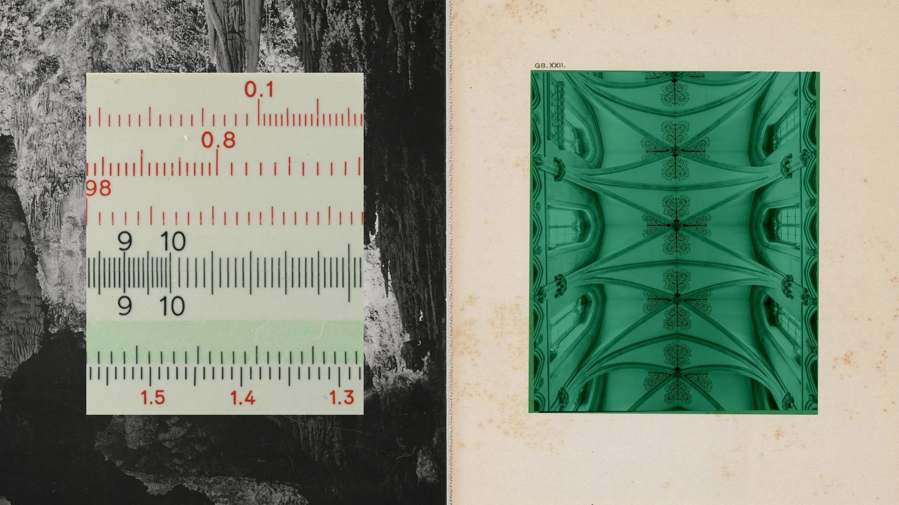
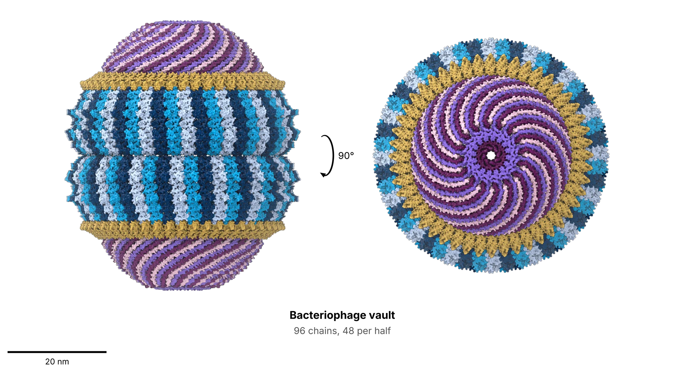
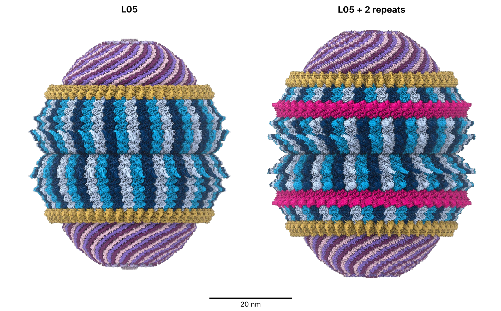
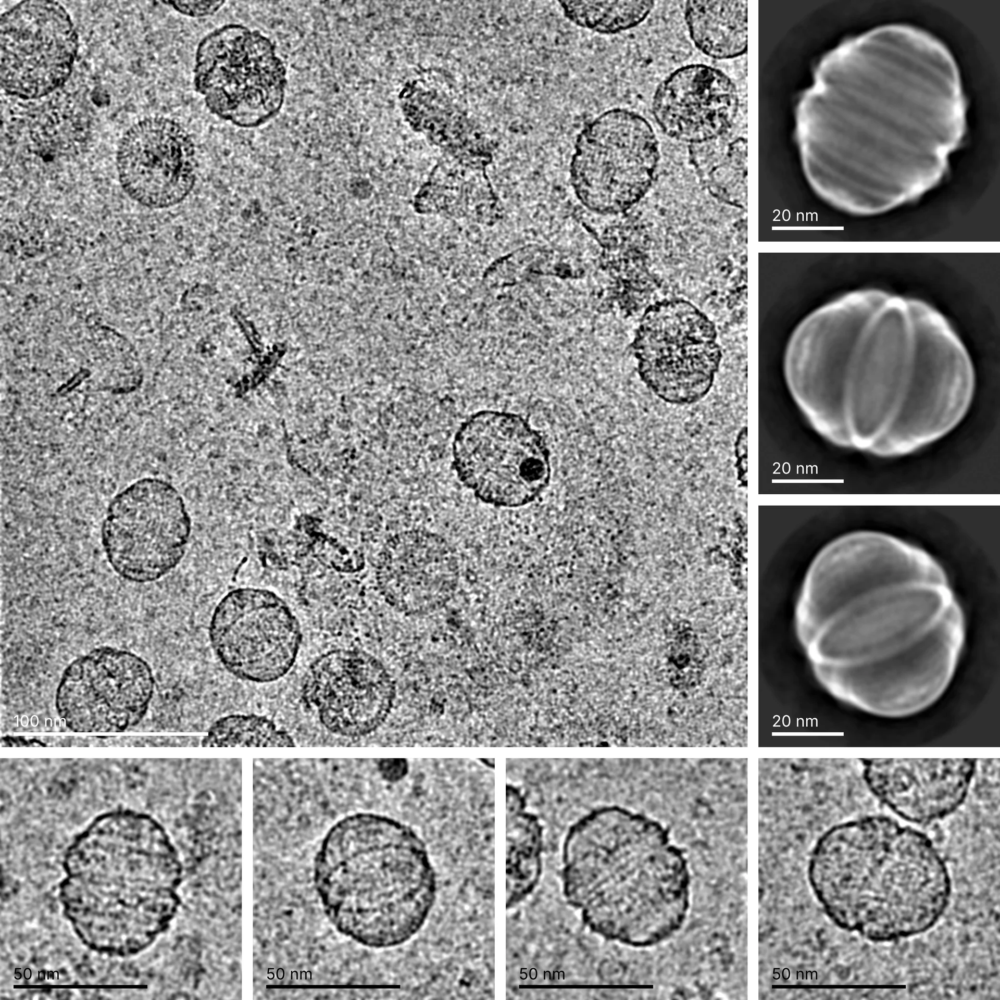

# 用 Claude 研究穹窿颗粒

- 英文标题：Investigating vault particles with Claude
- 发布日期：2026-11-04
- 官网栏目：科学
- 原文：[Anthropic 页面](https://www.anthropic.com/research/investigating-vault-particles-with-claude)
- 官网署名：Anthropic
- 官网推荐阅读：[阅读预印本](https://www.biorxiv.org/content/10.64898/2026.11.04.764334v1)

> 中文机器初译，未逐篇人工校对。引用研究结论时请核对英文原文。

> *我们正在分享另一项发现 [Anthropic 的生物学研究实验室](https://www.anthropic.com/research/claude-discovers-novel-enzyme-system)：在原核细胞中发现的第一个穹窿颗粒 3D 结构。穹窿是在生命之树的细胞中发现的巨大、空心的蛋白质桶，它们的功能仍然未知。下面，我们描述了Claude如何帮助这项研究的每一步：搜索序列文献、优化隔离粒子的方法以及绘制金库结构。更多信息是 [在我们的预印本中](https://www.biorxiv.org/content/10.64898/2026.11.04.764334v1)，我们已提交给bioRxiv；链接上线后我们将立即更新。*

生物细胞于 1665 年首次被发现，但三个半世纪后，它们的工作原理仍然未知。直到最近， [一些关键组成部分的存在](https://pubmed.ncbi.nlm.nih.gov/12360195/)，更不用说 [他们的功能](https://pmc.ncbi.nlm.nih.gov/articles/PMC3184113/)，曾引起争议。即使在今天，细菌是研究最全面的细胞之一，其大约 4,400 个基因中的三分之一以上 *大肠杆菌*, [仍然知之甚少](https://pmc.ncbi.nlm.nih.gov/articles/PMC6412132/)。另一个这样的谜是 *穹窿粒子*.

穹窿颗粒是一种巨大的中空蛋白质壳，几乎存在于我们体内的所有细胞中。 [它于1986年被发现](https://rupress.org/jcb/article-abstract/103/3/699/13490/Isolation-and-characterization-of-a-novel?redirectedFrom=fulltext) 由 Leonard Rome 和 Nancy Kedersha 提出，但其功能仍然难以捉摸。它的质量大约是核糖体的三倍，是真核生物中已知最大的分子复合物之一，真核生物是具有复杂细胞的生物体，例如哺乳动物（而不是简单的、通常是单细胞的“原核生物”，例如细菌）。拱顶因其形状而得名。当在电子显微镜下观察时，带肋的贝壳提醒了博士。罗马和博士。大教堂拱形天花板的 Kedersha。在哺乳动物中，外壳由 78 个主要穹窿蛋白副本组成，排列成两个相同的半部，在中间相连。

保险库是 [在大多数真核生物树中发现](https://doi.org/10.1093/gbe/evt113)，从粘菌到人类，因此科学家相信它们必须做一些有用的事情。研究人员提出了各种功能，包括 [在细胞核和细胞质之间运输分子](https://doi.org/10.1242/jcs.106.1.23), [保护细胞免受癌症药物等有毒化合物的侵害](https://doi.org/10.1038/nm0695-578), 和 [支持先天免疫](https://doi.org/10.1126/science.1142311)，但这些提议均未得到最终确认。其他研究表明 [缺乏穹窿的老鼠仍然存活](https://doi.org/10.1128/MCB.24.12.5314-5323.2004)，这表明只有在特定的环境条件下才需要拱顶。尽管如此，问题仍然存在：如果没有重要的功能，为什么进化会保留这么大的东西？

我们的生物学研究团队对Claude是否可以帮助解决这个长期悬而未决的问题取得进展感兴趣，一直在调查金库。我们尚未确定它们的生物学功能，但我们确实发现生命树中更多的拱顶蛋白，包括原核生物和感染它们的噬菌体中的拱顶蛋白，可以组装成完整的拱顶状颗粒。相关蛋白质有 [已经被发现](https://www.biorxiv.org/content/10.1101/2023.11.10.566534v1.abstract) 存在于原核生物和噬菌体的基因组中，但据我们所知，没有人证明它们组装成穹窿。

原核细胞中的穹窿为研究人员提供了一个更简单的研究系统。与哺乳动物细胞相比，细菌生长速度很快，这使得研究穹窿的来源、它们的基本结构是什么样的以及它们含有什么（如果有的话）变得更容易。研究人类蛋白质的细菌亲戚以前已​​经提供了丰富的信息。细菌版本 [cGAS-STING 信号传导](https://doi.org/10.1038/s41586-019-1605-5), [加德明](https://doi.org/10.1126/science.abj8432), 和 [蝰蛇蛋白](https://doi.org/10.1038/s41586-020-2762-2) 揭示了这些人类免疫防御的微生物起源。在这些情况下，它们在人类中的功能是已知的。对于穹窿来说，情况并非如此，它们的原核亲戚可能有助于揭示这一点。

在这里，我们描述了如何从 *噬菌体*。噬菌体是感染细菌的病毒。像所有病毒一样，它们劫持宿主细胞来制造蛋白质，因此这个库将建立在细菌（原核细胞）内部。该穹窿由 96 个单一蛋白质的拷贝组成，而人类穹窿中有 78 个拷贝。通过复制部分蛋白质，我们将拱顶设计得更大。总之，这些结果揭示了此类复合物如何组装，并表明它们如何适应 [生物技术](https://www.science.org/doi/10.1126/science.adz9353)——例如，作为 [用于传递酶的纳米胶囊](https://www.pnas.org/doi/abs/10.1073/pnas.0500929102).

L05金库的盖子。 （左）整个拱顶，由冷冻电镜成像。 （右）从上面看它的帽子。所有 48 条链条从边缘向尖端蜿蜒，边走边重叠。三分之二继续穿过第一层，三分之一到达顶端，因此盖子像阶梯式圆顶一样变窄。

这项工作还展示了我们团队更广泛的目标：通过将Claude纳入该过程的每一步来加速基础生物学的研究。在我们的指导下，Claude 搜索了蛋白质数据库、设计了 DNA 结构、优化了分离方法并处理了显微镜数据。结果，通常需要三天时间的金库净化只花了我们大约 90 分钟，第一个结构模型在 34 小时后准备就绪，我们估计这通常需要几周的时间。

尽管取得了这些进展，但关于这些令人困惑的结构仍有很多东西需要了解。当我们与博士分享结构时我们邀请罗马为这项研究提供建议，他说：

> 弄清楚金库的功能仍然是一个巨大的挑战。我很高兴 Anthropic 拥有如此多的好数据。现在，其他人将致力于解决这个问题……Anthropic 的发现的广泛性表明，这将是一个复杂的功能和一个有趣的旅程。

我们的实验室提前发布了这些发现，以继续向科学界展示如何利用Claude进行发现。您可以阅读有关我们的结果和方法的更多信息 [在我们的预印本中](https://www.biorxiv.org/content/10.64898/2026.11.04.764334v1)，我们将很快发布结构和附加数据。

## 原核生物的拱顶状结构

我们使用冷冻电子显微镜 (cryo-EM) 揭示了拱顶结构，其中粒子的许多副本被快速冷冻并用电子束成像，然后组合成单个 3D 模型。该穹窿由 96 个拷贝（每半个 48 个拷贝）的单个噬菌体蛋白（我们称之为 L05）构建而成，总质量约为 9.5 [兆道尔顿](https://en.wikipedia.org/wiki/Dalton_(unit))。相比之下，哺乳动物版本每半个有 39 个拷贝。噬菌体来源的穹窿也更短更宽：大约长 54 纳米，宽 45 纳米，而哺乳动物的穹窿为 67 x 40 纳米。尽管更短，但它的体积增加了约 25%，因为它更呈球形。构成其壁的蛋白质链是由七个重复片段首尾堆叠而成，而不是哺乳动物穹窿中的九个，而且它的端盖更平坦。它是原核生物中迄今为止发现的最大的蛋白质壳之一。

其结构的一个显着特征是盖子的关闭方式。围墙 48 圈必须向极点变窄，并且分三步完成，就像一个分层的圆顶。在每组三个相邻副本中，一个在第一步结束，一个在第二步结束，一个继续到尖端。这三个副本沿着墙壁是相同的，但在帽子中具有不同的形状（构造）。

鉴于我们可以在实验室中制造这个保险库并快速分离它，我们还尝试改变其结构以了解更多有关这些蛋白质如何组装的信息。我们与 Claude 合作，制作了该蛋白质的 15 个改变版本，其中大多数在相邻副本接触的点发生了变化。盖子附近的一些单一变化足以阻止外壳关闭：在密封的拱顶处，我们看到了开放的玫瑰花状颗粒，这表明需要该区域来密封外壳。

我们还尝试将金库变得更大。通常，墙是由七个重复的部分建造的。当我们复制其中两个时，蛋白质为 9（与人类穹窿中的数量相同），它组装成更大的穹窿颗粒，封闭的体积增加了大约 20%。这些实验展示了拱顶如何在其进化历史中通过复制自身墙壁的碎片来改变其大小，而不会破坏它们的组装方式。

L05 金库（左）旁边是工程版本（右），每个副本中都有两个额外的片段，均由冷冻电镜以相同的比例进行。增加的重复使拱顶更长更宽。

## 与Claude一起寻找、隔离并绘制新金库的地图

金库 40 年来一直无法解释的部分原因是它们 [生物学家最依赖的生物体中缺失](https://doi.org/10.1093/gbe/evt113) 用于基因实验，包括面包酵母、果蝇和线虫。在确实有穹窿的小鼠中，在没有穹窿的情况下饲养的动物 [穹窿伙伴蛋白](https://doi.org/10.1128/MCB.24.12.5314-5323.2004) 或 [穹窿RNA](https://doi.org/10.1261/rna.080161.124) 发育正常，无明显缺陷可供随访。近年来，生物信息学家 [确定了远房亲戚](https://doi.org/10.1101/872010) 原核生物中的穹窿蛋白，但尚不清楚这些蛋白质是否形成穹窿。

我们的团队着手回答这个问题。这项研究需要几个步骤：调查基因序列，找出拱顶蛋白在生命之树中出现的位置，产生并分离出最有希望的候选者，以测试它们是否真的组装成拱顶状颗粒，并确定其中一个颗粒的结构，以了解其链如何组合在一起。

我们开始使用 [克劳德·科学](https://claude.com/product/claude-science) 在包含约 150 亿个预测蛋白质的数据库中搜索穹窿蛋白的亲属。事实证明，它们很罕见，但分布广泛，存在于 29 个主要细菌类群（门）和 4 个古细菌（原核生物的另一个主要类群）中，但只有不到 1% 的物种具有已测序的基因组。然后我们选择了其中的 44 种蛋白质并在 [无细胞系统](https://en.wikipedia.org/wiki/Cell-free_system) 看看哪些基因产生了全长蛋白质以及产生了多少。我们选择了蛋白质，Claude将每个蛋白质序列转化为适合宿主细胞的 DNA，添加了打开基因的控制序列，并准备了订购设计。我们把表现最好的人搬进了生活 *大肠杆菌* 24 种细菌中，有 15 种产生可溶性蛋白质。

接下来，我们需要分离粒子。为真核细胞库开发的传统方法是将样品通过一管密度越来越大的糖进行旋转，大约需要三天时间。为了加快速度，我们决定尝试尺寸排阻色谱法。在此过程中，样品流经多孔珠柱。在一个称为分馏的过程中，小分子被困在孔隙中，而由于太大而无法进入的穹窿首先出来，即所谓的空隙体积。

Claude首先反对采用色谱法，因为错误折叠的蛋白质团块会在相同的空隙体积中出现。不管怎样，我们还是继续前进，Claude推荐了一种特定的色谱柱以及追踪穹窿蛋白和检查颗粒是否形成的方法，帮助实现了这一目标。然后Claude建议将破裂细胞的内容物直接加载到柱上，无需事先纯化。起初我们很不愿意，因为这些柱子很贵，而且破裂的原始内容物 *大肠杆菌* 细胞可能会堵塞它们或造成污染。但我们愿意测试一个非传统的想法，而且它奏效了。

我们不是 [第一个在定径柱上隔离拱顶的小组](https://pubmed.ncbi.nlm.nih.gov/30036602/)，但我们的优化方法从细胞到显微镜网格大约需要 90 分钟，而不是几天。在电子显微镜下，15 种蛋白质中的 7 种已组装成拱顶状颗粒。

冷冻电镜证实了这七个中四个的拱顶形状，其中两个来自噬菌体，两个来自细菌。我们选择了一种噬菌体蛋白 L05，用于上述详细结构，因为它是形成完整、封闭颗粒的最佳蛋白之一。确定生物分子结构通常需要使用专用软件进行数周或数月的手动工作。我们指导Claude完成整个过程。Claude 在可以访问内部计算资源的内部多代理工具中工作，设置了一个开源处理软件 (RELION) 并运行每个步骤，同时我们就分析决策提供建议。第一个完整模型在 34 小时内就准备好了，最终的地图在处理开始后大约一周就准备好了。

L05 保险库的冷冻电镜 *大肠杆菌*：粒子场（大面板）、选定的单个拱顶（底部）和 2D 类平均值，其中墙的肋骨可见（右侧）。

Claude还指出了我们尚无法解释的结构特征。96 个蛋白质拷贝中的每一个的中间都有一个小分子，该分子在图中清晰可见，但我们无法识别。Claude发现它的形状类似于辅酶 A，辅酶 A 是细胞用来传递化学基团的常见辅助分子。如果它是辅酶 A 或类似的东西，这将是一个可能功能的早期暗示。

## 一种新的科学研究方式

对我们来说，这是一种截然不同的科学研究方式。我们没有人研究过这么大的蛋白质组装体，而且我们在结构生物学方面的经验也有限。不管怎样，我们还是继续了这个项目，因为Claude可以弥补我们不知道的东西，并快速进行分析，否则我们会花费更长的时间。

在不到四个月的时间里，我们筛选了数十个候选穹窿，为显微镜准备了样本，并解决了原核生物中发现的第一个穹窿结构。大部分工作可以通过能够访问现有 Claude 产品的典型实验室来完成。只有冷冻电镜分析需要并行使用数百个 GPU 以节省时间，所需的计算资源超出了学术机构所能提供的资源。

这种工作方式也向我们展示了Claude需要改进的地方。它编写的一份协议要求使用一种含有干扰 DNA 进入细胞的添加剂的生长培养基，这使该项目推迟了两周。在冷冻电镜处理的早期，它跳过了一个标准步骤，并生成了与其镜像混合的有缺陷的图，我们告诉它停止即兴创作（“请让我们做正常的事情，除非它们不起作用”）。

我们用我们所学到的知识来指导Claude的发展。我们与训练 Claude 的机器学习研究人员分享了我们的实验室笔记，这样他们就可以看到模型哪里出了问题。这为Claude学习的数据类型提供了信息。在该项目的过程中，随着新模型的出现，Claude在这些任务上取得了更大的进步，DNA构建设计中的错误似乎更少，并且更好地识别了实验中的潜在陷阱。在我们熟悉的领域，我们很快就能发现错误，但在我们不熟悉的领域，它们会浪费我们的时间。总的来说，我们发现这种工作方式的好处远远超过了缺点，Claude已经成为我们工作中不可或缺的一部分。

到目前为止，我们只在 *大肠杆菌*，并且尚未测试它们是否在自然发现的细菌和噬菌体中形成。需要做更多的工作来确定这些粒子的功能，而我们的工作只会加深这个谜团。作为博士。罗马说：

> 我们会发现他们都在做同样的事情吗？或者我们会看到金库功能的进化发展吗？也许他们正在做与人类金库相同的事情，这也很有趣。

我们将继续研究金库的功能，并将随着这项工作的进展分享更多内容。

## 与我们合作

我们正在发布我们的工作细节 [在我们的预印本中](https://www.biorxiv.org/content/10.64898/2026.11.04.764334v1)。如果您对这些保管库的用途或测试它的系统有任何想法，我们希望收到您的来信： [mdurrant[at]anthropic.com](mailto:mdurrant@anthropic.com), [nicholasp[at]anthropic.com](mailto:nicholasp@anthropic.com).
