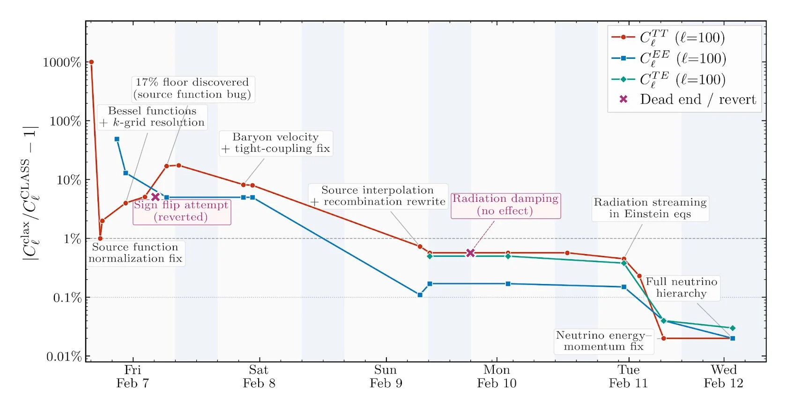

# 用长时间运行的 Claude 做科学计算

- 英文标题：Long-running Claude for scientific computing
- 发布日期：2026-03-23
- 官网栏目：科学
- 原文：[Anthropic 页面](https://www.anthropic.com/research/long-running-claude)
- 官网署名：Anthropic

> 中文机器初译，未逐篇人工校对。引用研究结论时请核对英文原文。


*在这篇文章中，Siddharth Mishra-Sharma*, *Discovery 团队的一名研究人员解释了如何将多日代理编码工作流程（测试预言机、持久内存和编排模式）应用于科学计算任务，甚至在自己的领域之外。*

## 前提

目前使用AI 智能体的大多数科学家都在对话循环中工作，严格控制过程的每一步。随着模型已经成为 [在长期任务上表现明显更好](https://metr.org/time-horizons/) 在过去一年左右的时间里，出现了一种新的工作方式：我们可以指定高级目标并设置一组松散的代理来自主工作，而不是参与每个细节。这使得我们可以在短短几个小时内完成原本可能需要几天、几周甚至几个月的项目。某些类型的科学任务非常适合此模型，例如，重新实现数值求解器、将用旧 Fortran 方言编写的遗留科学软件转换为现代语言，以及根据参考实现调试大型代码库。这些任务的工作范围明确，成功标准明确，人工监督可能是偶然的，而不是持续的。

人择的 [C编译器项目](https://www.anthropic.com/engineering/building-c-compiler) 演示了该版本的一个版本，Claude 在大约 2,000 个会话中工作，构建了一个能够编译 Linux 内核的 C 编译器。这篇文章介绍了如何使用Claude代码为科学计算任务设置类似的模式，并考虑到典型的学术实验室。作为一个具体的例子，我将逐步使用 Claude Opus 4.6 来 [实现宇宙学玻尔兹曼求解器的可微分版本](https://github.com/smsharma/clax)。这是预测大爆炸余辉（宇宙微波背景或 CMB）统计特性的数字代码。它通过演化早期宇宙中的光子、重子、中微子和暗物质的耦合方程来实现这一点。

玻尔兹曼求解器如 [等级](http://class-code.net/) 和 [CAMB](https://camb.info/) 是宇宙学科学基础设施的核心部分，使我们能够使用来自诸如 *普朗克* 和 *西蒙斯天文台。* 可微分版本（可以通过完整求解器传播梯度）可以使用基于梯度的推理方法，从而显着加快参数估计速度。用 JAX 编写它在这里很自然，因为它基本上免费为我们提供了自动区分和与加速器（例如 GPU）的兼容性。   

值得注意的是，这项任务并不属于我的核心科学领域——我对工具和科学非常熟悉，但没有专业知识在任何合理的时间范围内自己完成它。团体谁 *做* 拥有专业知识 [可微的](https://arxiv.org/abs/2311.03291) [求解器](https://arxiv.org/abs/2602.15104) 在 JAX 中，具有 CLASS 中存在的功能子集。这些工作通常需要研究人员数月至数年的时间。这里的重点是看看代理是否可以在非领域专家的最少指导下走得更远。

这种任务在结构上与C编译器项目不同，C编译器项目可以分包给大量并行代理。另一方面，玻尔兹曼求解器是一个深度耦合的管道——在模拟早期宇宙如何重组时，一个小的数值误差或较差的近似可以巧妙地将一切转移到下游。因此，它需要一套不同的代理技能。调试需要通过整个链进行因果跟踪并从领域知识中获取知识，这可能更适合按顺序工作的单个代理，根据需要生成子代理，并使用参考实现来平分差异。

我们将使用运行 SLURM 作业调度程序的 HPC 集群作为我们的计算环境，但无论您在何处运行 Claude Code，核心思想（进度文件、测试预言、具有明确规则的代理提示）都适用。

## 起草计划并在本地迭代

在向管理自主研究团队的转变中，您应该花费大部分时间（与Claude协商）来制定一套说明，清楚地阐明项目的可交付成果和相关背景。这些指令应位于根目录中的 CLAUDE.md 文件中。Claude特别对待这个文件，将其放在上下文中并在总体计划中引用它。至关重要的是，Claude可以在工作时编辑这些说明，并在解决问题时更新它们以供将来的工作使用。

[这里](https://github.com/smsharma/clax/blob/6a6b2330cf25edded1bb31ec57a0091aa794a5d3/CLAUDE.md) 是宇宙玻尔兹曼求解器项目的早期 CLAUDE.md，显示了在初次尝试编写求解器后编纂的总体计划和设计决策。为了实现这一目标，我指定了该项目的高级目标——在完全可微分的同时实现与参考 CLASS 实现的完全功能对等，并且在主要科学交付成果中相对于 CLASS 的准确度目标为 0.1%——并与 Claude 进行迭代，直到计划看起来令人满意。鉴于 0.1% 是两个规范玻尔兹曼代码 CLASS 和 CAMB 之间的典型一致性水平，这似乎是一个很好的科学目标。

## 跨会话内存

进度文件（按照惯例我们称之为 CHANGELOG.md）是代理的便携式长期存储器，充当一种实验室笔记。在 CLAUDE.md 中，Claude 被指示跟踪该文件的进度。

一个好的进度文件可以跟踪当前状态、已完成的任务、失败的方法及其不起作用的原因、关键检查点的准确性表以及已知的限制。失败的方法很重要——没有它们，连续的会议将重新尝试同样的死胡同。条目可能如下所示：“尝试使用 Tsit5 进行微扰 ODE，系统太僵硬。切换到 Kvaerno5。” [这里](https://github.com/smsharma/clax/blob/main/CHANGELOG.md) 是正在运行的示例的变更日志，显示了这些元素。

## 测试预言机

虽然通过代理进行更开放的科学发现肯定即将到来，但当今长期运行的自主科学工作关键取决于代理是否有办法知道它是否正在取得进展。对于科学代码，这可以是参考实现、明确可量化的目标或现有的测试套件。指导代理扩展测试套件并在运行时运行测试也很有帮助，以防止回归。在我的示例任务中，Claude 被指示使用以下命令构建并持续运行单元测试 [C 类源](https://github.com/lesgourg/class_public) 作为参考实现。

## Git 作为协调

Git 是一种以不干涉的方式监控和协调代理进度的好方法。代理应该致力于并推动每个有意义的工作单元。如果出现问题，这将为您提供可恢复的历史记录，使进度在本地可见，并防止工作丢失，例如，如果您的计算分配在会话中用完。

实际上，这可能是 CLAUDE.md 中的一组指令，例如“致力于并推动每一个有意义的工作单元。每次提交之前运行“pytest测试/-x-q”。永远不要提交破坏现有通过测试的代码。”

为了控制代理，您始终可以通过 SSH 进入集群并手动重新提示和/或更新其指令。通常更符合人体工程学的做法是简单地要求 Claude Code 的本地实例通过 SSH 登录并为您运行命令；这也适用于下面描述的所有内容。

## 执行循环

如上所述，首先在本地迭代计划通常很有用，直到您拥有看起来合理并在 CLAUDE.md 中编码的计划。从那里开始，在计算节点上的终端多路复用器（例如 tmux）内启动 Claude Code 会话，告诉代理在哪里可以找到您的代码库，然后让它执行。由于会话在 tmux 内运行，因此您可以分离、关闭笔记本电脑，并偶尔检查进度（对于玻尔兹曼求解器，我会在手机上查看 GitHub，例如在排队等待喝咖啡时）。

在 HPC 集群上，您可以通过 SLURM 调度程序请求节点，在 tmux 会话中启动 Claude Code 的示例作业脚本可能如下所示：

```
#!/bin/bash
#SBATCH --job-name=claude-agent
#SBATCH --partition=GPU-shared
#SBATCH --gres=gpu:h100-32:1
#SBATCH --time=48:00:00
#SBATCH --output=agent_%j.log
cd $PROJECT/my-solver
source .venv/bin/activate
export TERM=xterm-256color
tmux new-session -d -s claude "claude; exec bash"
tmux wait-for claude
```

作业开始后，您将附加到 tmux 会话，为 Claude Code 提供指示（例如，“阅读 CHANGELOG.md 并选择下一个任务”），并在您满意它处于正确轨道上时分离。每当您想要签入、引导或开始新任务时，您都可以使用以下命令重新连接：

```
srun --jobid=JOBID --overlap --pty tmux attach -t claude
```

**拉尔夫循环：** 随着模型的功能变得越来越强大，它们需要的定制编排（例如即时工程、RAG 或上下文填充）就会减少。然而，在给定的时间点，提供某种程度的脚手架作为能力提升可能会很有用。例如，当前模型可能会受到以下问题的影响： *代理性懒惰*——当被要求完成一项复杂的、由多个部分组成的任务时，他们有时会在完成整个任务之前找到借口停下来（“时间不早了，我们明天再继续吧？”）。

为了避免这种情况，一种有用的编排模式是 [*拉尔夫·循环*](https://ghuntley.com/loop/)，这本质上是一个 *为了* 循环，当代理声明完成时将其踢回上下文，并询问是否已完成 *真的* 完成了。这对于长时间运行的任务非常有用，因为代理会承认任务不符合规范，并继续工作直到达到规范为止。其他类似的模式包括 [通用SD](https://github.com/gsd-build/get-shit-done) （和 [特定领域的](https://arxiv.org/abs/2603.20179) [变体](https://github.com/psi-oss/get-physics-done)）以及 Claude Code 原生的 /loop 命令。

Ralph 可以通过 /plugin 安装。Claude代码中的典型调用提示可能如下所示

```
/ralph-loop:ralph-loop “Please keep working on the task until the success criterion of 0.1% accuracy across the entire parameter range is achieved.” --max-iterations 20 --completion-promise “DONE”
```

在这里，Claude 将迭代多达 20 次，直到保证任务以“DONE”咒语完成。

## 结果

Claude曾从事过 [该项目](https://github.com/smsharma/clax) 从头开始花了几天的时间，在其各种输出中与参考 CLASS 实现达成了低于百分之一的一致性。我要求 Claude 在项目过程中重建代码的一些主要输出（各种 CMB 角功率谱）的准确性，并标记开发过程中的里程碑。它生成了下图，说明了达到低于百分之一精度的路径。



当代理在代码库上工作时，随着时间的推移，准确率将达到低于百分之一的路径。

该代理的发展轨迹有些笨拙。例如，它的测试覆盖率存在明显的差距——有一段时间它只在单个（基准）参数点测试代码，大大减少了它捕获错误的表面积。它也可能会犯一些基本的错误，比如被规范惯例绊倒，或者花几个小时寻找宇宙学家能立即发现的错误，但它不断朝着既定的低于百分之一精度的目标不断取得进展。

该项目的一个副作用是，通过观察 git 提交历史记录，我对玻尔兹曼求解器及其建模物理了解了令人惊讶的数量。该项目并非来自我的核心科学领域，但跟随Claude的渐进进展并查找我没有认识到的内容被证明是渗透科学的有效方法。的 [提交日志](https://github.com/smsharma/clax/commits/main/) 读起来就像一个快速、超文字的博士后的实验室笔记。

虽然生成的求解器不是生产级的（例如，它与每个体系中可接受的精度的参考类实现不匹配），但它表明代理驱动的开发可以将研究人员数月甚至数年的工作压缩为数天。

这种压缩改变了空闲时间的计算方式。人工智能研究的普遍经验是连夜启动实验（例如训练运行），然后在早上满意地看到结果。不进行实验会带来机会成本。如今，不运行代理似乎也是有成本的。如果您拥有具有明确定义的成功标准的计算和项目，每天晚上您 *不要* 让代理人为您工作是摆在桌面上的潜在进展。
