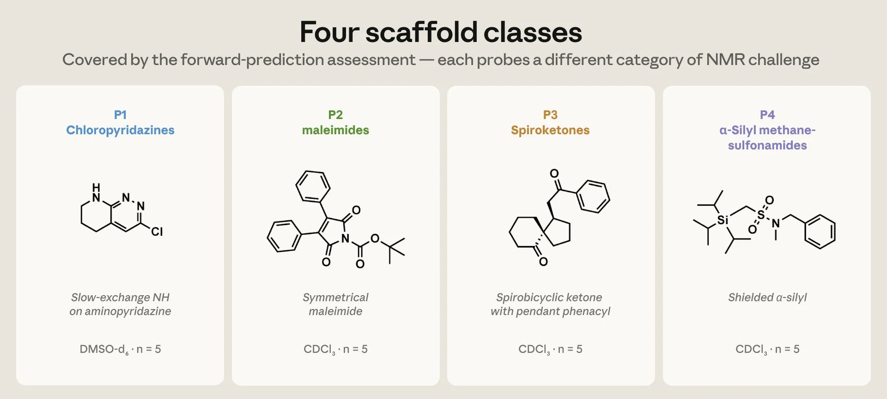
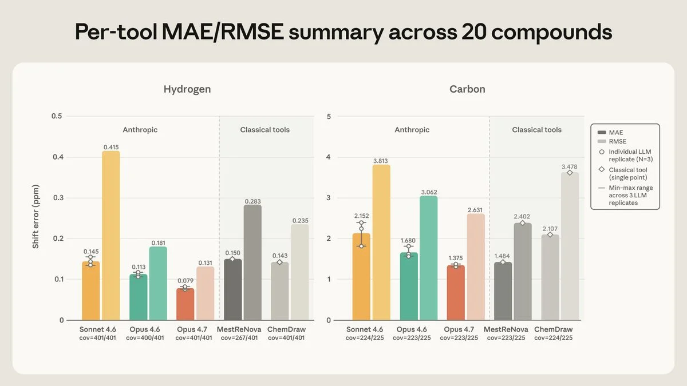
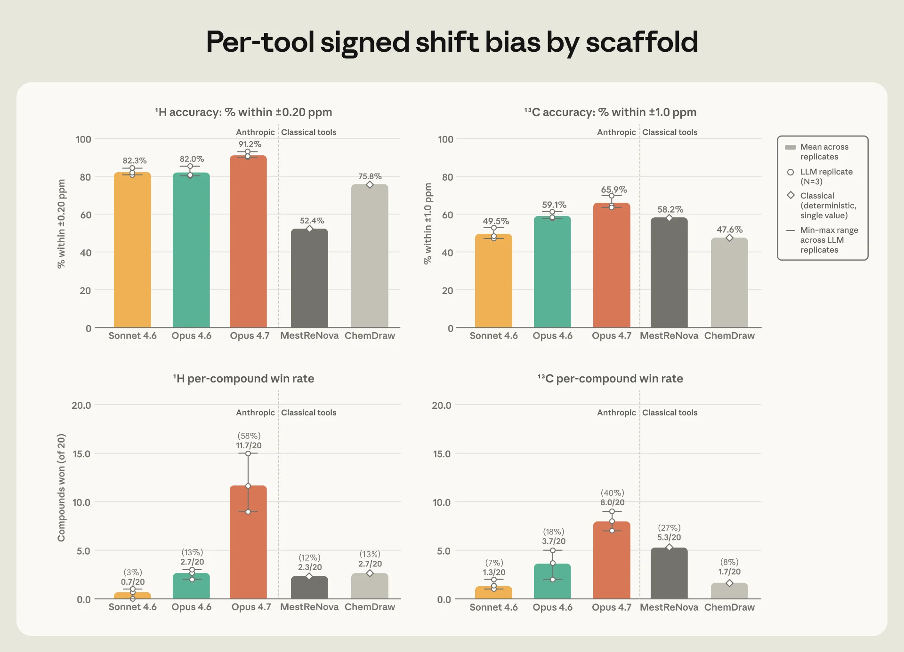
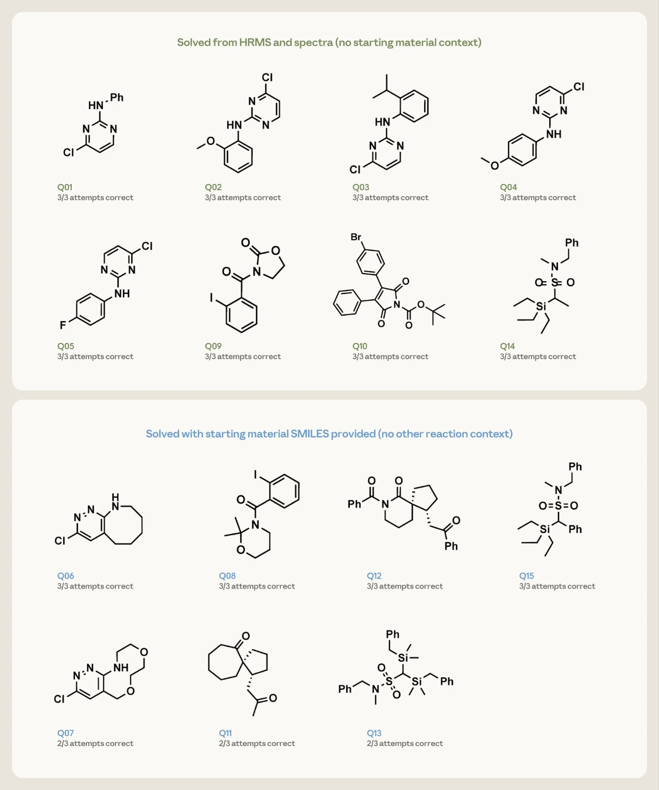

# 让 Claude 成为化学家

- 英文标题：Making Claude a chemist
- 发布日期：2026-06-05
- 官网栏目：科学
- 原文：[Anthropic 页面](https://www.anthropic.com/research/making-claude-a-chemist)
- 官网署名：Anthropic

> 中文机器初译，未逐篇人工校对。引用研究结论时请核对英文原文。

*我们正在与世界一流的合成、计算和分析化学家合作，让Claude在化学方面做得更好。在这篇文章中，我们分享了我们的第一项工作，作为这项工作的一部分，其中人类化学家 David Kamber 检查了 Claude 在化学家最常见的分析输入（核磁共振谱）上的表现。*在研究分子时，化学家在白板上手绘结构、仪器读数、数据库查询字符串以及专利和出版物的技术符号之间移动。这些表示中的每一种都编码相同的基础化学，但每一种都需要不同的流畅性。例如，化学家可以通过咖啡因的草图发现它与腺苷（人体的睡意信号）的相似之处，并预测它可以通过阻断受体来让我们保持警觉。然而，同一张草图无法帮助化学家将其与其他外观几乎相同的分子区分开来。

了解化学家正在研究的分子至关重要。从我们摄入的食品和药物到我们的乳液、油漆和塑料，化学是一切事物的基础。改变相同原子之间的一些键，葡萄糖变成果糖，这些分子共享一个分子式，但通过完全不同的代谢途径进行加工。将分子翻转成其镜像，镇静剂就变成致畸剂，就像在 [沙利度胺](https://pubmed.ncbi.nlm.nih.gov/21507989/) 灾难。[1](https://www.anthropic.com/research/making-claude-a-chemist#footnote-1) 化学家的日常工作取决于在适合给定任务的任何表示形式中正确读取这些信号。

这些表示形式之间的转换（从图中找出结构、根据提议的产品协调仪器读数、以正确的表示法查询数据库）非常耗时，而且不可能在规模上跟上 - CAS 作为最大的化学登记处，对超过 2.9 亿种已披露的物质进行了编目，并且每天都会增加大约 15,000 种新物质。

人工智能完全有能力承担这一研究负担，但在化学领域，它仍然在很大程度上仍然是人们的愿望。多年来，机器学习工具一直被定位为逆合成的变革性工具，逆合成是从目标分子逆向工作到更简单的前体，以计划如何构建它的过程——反应预测和性质估计，但这些工具所需的数据很难获得——零结果稀疏，格式不一致，并且被锁定在订阅期刊的付费墙后面（以及非结构化支持信息）。逆合成就是一个很好的例子——功能强大的人工智能工具已经存在多年，但采用率并不均衡，普通学术或小型实验室化学家仍然不使用它们。

即便如此，人工智能的进步最终还是达到了化学水平。当今的前沿模型是多模态的，并且能够进行明确的推理。他们可以直接从期刊图表或手绘图中读取化学结构，而不是依赖于预先策划的分子数据库。他们可以阅读方法部分的实验细节或实际发布形式的支持信息。他们还可以逐步展示他们的推理，这意味着化学家可以审核输出。所有这些都无法消除该领域多年来一直在描述的数据问题，但它改变了尽管存在数据问题仍然可以解决的问题。  

最终，我们的主张是温和的：Claude开始有意义地协助化学家进行日常翻译、回忆和整合工作，以补充他们的判断，我们计划继续扩大其帮助。今天，我们发布第一份白皮书，以加速这项工作。它解决了化学家最常见的分析输入：核磁共振谱。

## Claude vs.ChemDraw 的 NMR 预测和结构解析

**完整版可以找到 [这里](https://assets.claude.com/07441e654ad3dfeb0cd090e9361511562825d012.pdf)**

几乎每一个小分子——药物、农药、染料、香料、聚合物、DNA或蛋白质亚基，以及功能性无机或固态材料——的存在都是因为化学家确定了其结构。鉴于这些分子无法用显微镜看到，化学家必须依靠光谱分析，用光、无线电波或磁场探测分子。给定分子吸收、发射或偏转这种能量的方式为化学家提供了一种模式或光谱，他们可以用它来阐明其结构。  

核磁共振波谱（化学家所依赖的标准技术之一）是合成化学中最耗时的步骤之一；对于每种化合物，化学家必须手动将光谱中的每个峰与提议结构中的原子进行匹配。在本白皮书中，我们测试了 Claude 与当今化学家所依赖的专用 NMR 软件的对比情况。我们将三个 Claude 模型（Opus 4.7、Opus 4.6、Sonnet 4.6）与 ChemDraw 和 MestReNova 进行对比，对从模型训练截止后发布的合成化学预印本中提取的 20 种化合物进行了测量，以避免选择偏差。ChemDraw 和 MestReNova 都进行正向预测，使用绘制的结构来模拟将产生的 NMR 谱。除了正向预测之外，我们还想看看Claude是否可以走向另一个方向——从实验光谱开始并提出其背后的结构。这是一项更艰巨的任务，也是目前留给化学家的现有软件。  

为了进行评估，我们从 ChemRxiv 预印本中提取了 20 种化合物[2](https://www.anthropic.com/research/making-claude-a-chemist#footnote-2) 在模型训练截止后发布，从每篇论文中获取第一个完全表征的新颖分子。这 20 个结构涵盖四个结构家族，每个家族有 5 种化合物，每个家族的选择是因为它涉及不同类别的 NMR 挑战。每个工具都被赋予编码为 SMILES 字符串的结构（化学家用来将分子输入软件的文本行符号），并被要求预测每个氢和碳峰将落在 1D NMR 谱（测量化学位移的水平轴，单位为 ppm，百万分之一）中。鉴于 NMR 样品溶解在液体中，并且溶剂（氯仿、DMSO 等）的选择会稍微移动峰位置，因此每个工具都被告知要预测化学家在发表的论文中使用的任何溶剂中的光谱。

前瞻性预测评估涵盖四个支架类别。每个探测不同类别的 NMR 挑战。P1 氯哒嗪在 DMSO-d₆ 中的氨基哒嗪上具有缓慢的 NH 交换； P2 Boc-N-芳基马来酰亚胺和N-Boc ynamides产生α-乙烯基酰亚胺羰基和罕见的ynamide α/β-碳对； P3螺酮是带有苯甲酰甲基或乙酰基侧链以及非对映CH2的螺双环酮； P4 α-甲硅烷基甲磺酰胺具有屏蔽硅-α 碳。每类 5 种化合物，总共 n = 20。

由于语言模型的输出在运行过程中会有所不同，因此每个 Claude 模型的每个化合物都会被查询 3 次并取平均值； ChemDraw 和 MestReNova 每次都返回相同的答案并运行一次。然后，我们将每个预测峰与其实验对应峰配对，并测量以 ppm 为单位的差距。这些落在化学家称之为正确的窗口内——氢为±0.20 ppm，碳为±1.0 ppm。

每个工具的 MAE（深色阴影）和 RMSE（浅色阴影）针对 20 种化合物的 1H（左）和 13C（右）位移误差进行正向预测，每个工具下方显示了覆盖范围。Claude条：三个重复的平均值，具有最小-最大范围和重叠的重复点。经典工具：单点预测（无范围）。

对于氢，Opus 4.7 最为准确，平均误差为 ±0.079 ppm（远低于容差窗口的一半），并且落在其中的峰值比例最高。在碳方面，Opus 4.7 和 MestReNova 基本持平，分别为 ±1.37 和 ±1.48 ppm；其余工具对这两个元素保持相同的排名顺序。Opus 4.6 不出所料地处于中等水平，Sonnet 4.6 是最弱的。它们之间的差距在一个众所周知的困难氢（氯哒嗪家族中的 NH 质子）上最为明显，其真实位置落在 6.8 和 7.9 ppm 之间的窄带内。Opus 4.7 的排名稍低，但始终如此； Opus 4.6 将其猜测分散到了几个 ppm； Sonnet 4.6 将其置于 10-13 范围内，远远超出了它实际出现的范围。

顶部：±0.20 ppm（1H，左）和 ±1.0 ppm（13C，右）内的实验原子百分比。底部：每个化合物的胜率（该工具在 20 个化合物中具有最低的每个化合物 MAE 的化合物）。Claude条：三个重复的平均值，最小-最大范围；经典工具：单点预测。

虽然 Opus 4.7 的表现与 ChemDraw 和 MestReNova 相当，但在预测氢 NMR 峰的形状以及峰之间的距离（这些特征还包含化学家在位置旁边读取的结构信息）方面，差距更大。Opus 4.7 比任何其他工具更符合实验报告的分裂模式，并且所有三个 Claude 模型在大约 80% 的时间内预测次峰间距在半赫兹以内，而 ChemDraw 和 MestReNova 的预测结果为 26% 到 35%。Opus 4.7 在其三次重复运行中也是最一致的：每次运行的平均误差变化小于它与次佳工具的差距。  

从那里，我们评估了逆向预测（结构阐明）：我们可以从分子的光谱中确定分子的结构吗？我们向 Opus 4.7 提供了 15 个阐释问题，并要求其提出最多三个排名候选结构，每个问题三次。每个都提供了该化合物的精确分子式（来自高分辨率质谱）及其氢和碳核磁共振谱。这十五人因困难而分裂。八个更简单的目标——单环或两片段分子——仅提供了分子式和光谱。七个密度更大的目标——稠合环、螺环等——都伴随着一个额外的提示：参与反应的起始材料的结构。

15 个逆任务问题的结构阐明结果。每个面板显示已发布的目标及其成功次数（共 3 次尝试）。边框颜色指示提示条件：仅光谱和 HRMS 为绿色，没有起始材料上下文；蓝色表示光谱、HRMS 和起始材料 SMILES，没有其他反应背景。

Opus 4.7 在每次尝试中仅从光谱和公式中恢复了所有八个更简单的结构。对于七个较难的目标，根据起始材料的提示，它在所有三个运行中为其中四个返回了正确的结构，并在三个运行中的两个为剩下的目标返回了正确的结构。  

最终，我们发现，对于常规数据预测，Opus 4.7（一种没有特定于化学的微调的通用模型）现在的平均水平与 ChemDraw 和 MestReNova 一样好，甚至更好。此外，Claude还可以逆向解决这个问题，仅根据核磁共振数据提出一个结构。专用的结构解析软件已经存在了几十年，但它通常需要 2D NMR（具有两个轴的谱，输出是等高线图而不是一排峰）、专门培训和许可工具。Claude使用与化学家粘贴到聊天中相同的高分辨率质谱和一维峰列表来完成此操作，无需任何设置。

## 局限性

这项评估向我们表明，通用模型可以与 NMR 软件相媲美，甚至可以使一维逆解析变得易于处理。但有一些值得注意的限制。

- 首先，评估规模较小——四个支架中的 20 种化合物用于正向任务，15 个化合物用于反向任务——并且每个支架贡献一类失效模式。因此，模型性能应该被理解为指示性的而不是精确的。
- 其次，在最密集的逆目标上，如果没有起始材料作为额外的输入，模型可以循环推理而无需提交最终结构；这就是为什么七个更难的问题是由起始材料结构而不是单独的光谱提出的。
- 第三，一些化学支架未经测试。例如，慢速交换 NH 杂芳烃（芳香环的 N-H 与溶剂的交换速度足够慢，足以留下尖锐的 NMR 峰）仅通过氯哒嗪进行采样，而忽略了相关系统（羟基吡啶、氨基噻唑和其他 DMSO-d₆ NH 活性支架）。
- 第四，2D 实验（COSY、HSQC、HMBC）和立体化学超出了设计范围，因为 1D NMR 无法单独修复构型。因此，没有对复杂的天然产物化合物进行评估。
- 最后，我们的溶剂覆盖范围仅限于 DMSO-d6、CDCl3 和 D2O，因此没有评估甲醇-d4、苯-d6 和丙酮-d6。

理想情况下，我们会看到这些数字如何在跨越 20-30 个支架类别的数百种化合物中保持不变，每个类别至少有 15 个化合物，以便可以将类别内差异与工具之间的差异分开。我们还将评估氯哒嗪以外的 NH 活性杂芳烃，评估未经测试的溶剂，并根据二维实验进行这两项任务的版本。

## 展望未来

随着我们不断提高 Claude 在化学方面的表现，我们特别关注一些最阻碍化学家进步的瓶颈。

- 读取和渲染化学结构——将图形、专利、幻灯片或草图转换为机器可读的形式，并在结构表示和化学文献中使用的系统名称之间进行转换。
- 反应和综合推理——提出、评估和批评合成路线，预测结果，并通过选择性、条件和可能的副产品进行思考。
- 机制——用化学家实际使用的语言解释和测试反应机制，包括电子箭头、中间体和过渡态参数。
- 化学文献理解——阅读已发表的著作中出现的化学内容，其中可能会绘制、命名、缩写或通过代码引用相同的分子，并从方法部分、支持信息和专利中提取重要的化学内容。

这些并不都在同一条成熟曲线上。在光谱分析足以达到基准的情况下，其他分析（例如逆合成规划）仍在范围内。随着我们对这些瓶颈有了更好的了解，我们将分享当前模型的优点和不足之处。我们的最终目标是确保工作化学家知道 Claude 在哪些方面可以节省他们的时间以及在哪些方面仍需要依靠自己的专业知识。

### 与我们合作

我们正在扩大 [人工智能科学计划](https://www.anthropic.com/news/ai-for-science-program) 更明确地支持化学研究。如果您是一名研究人员，正在研究Claude可以提供帮助的问题，特别是涉及我们所描述的多模态推理的问题，我们希望收到您的来信 [scienceblog@anthropic.com](mailto:scienceblog@anthropic.com)，或通过 AI for Science 应用程序。

## 脚注

01一起事件表明，孕吐药物与全球 10,000 多名儿童的严重出生缺陷有关。

02我们从中提取化合物的四个预印本： <https://chemrxiv.org/doi/full/10.26434/chemrxiv.15002274/v1>, <https://chemrxiv.org/doi/full/10.26434/chemrxiv-2025-59lfh>, <https://chemrxiv.org/doi/full/10.26434/chemrxiv.15002423/v1>, <https://chemrxiv.org/doi/full/10.26434/chemrxiv.15002316/v1>.
