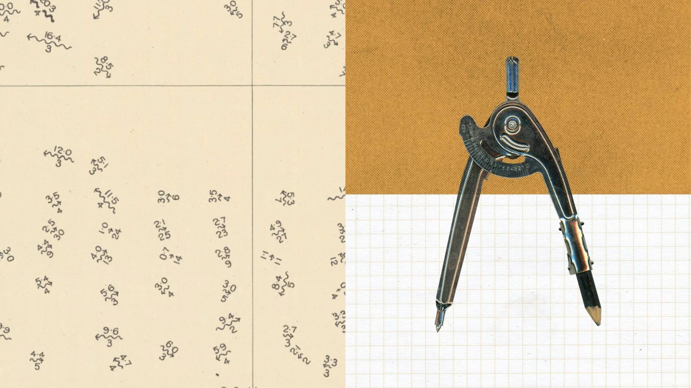

# 进一步了解 Claude 的数学能力

- 英文标题：Learning more about Claude's mathematical capabilities
- 发布日期：2026-08-10
- 官网栏目：科学
- 原文：[Anthropic 页面](https://www.anthropic.com/research/riemann-zeta)
- 官网署名：Anthropic

> 中文机器初译，未逐篇人工校对。引用研究结论时请核对英文原文。

最近，Anthropic的一名工作人员向Claude提出了无理挑战。这是关于数学中最著名的未解决问题之一： *真正尝试一下黎曼猜想*.

Claude确实进行了真正的尝试，但如果您熟悉这项任务的难度，您可能已经预料到了（黎曼假设可以追溯到 1859 年，并且有一个 [百万美元悬赏](https://www.claymath.org/millennium-problems/)），没有成功。然而，在尝试过程中，它意外地在相关问题上取得了进展。

Claude 的一个未发布的研究版本对满足黎曼假设的黎曼 zeta 函数的零分数的长期下界进行了改进。借鉴数学家过去几十年的大量先前研究，它已将这一界限从 41.6% 提高到 67.2%。

Anthropic 的两位数学家研究并验证了Claude的理论 [纸](https://assets.claude.com/95c246936988e43127bc6b2ceb7077c1dad2d68e.pdf)，并产生了一个 [非正式注释](https://assets.claude.com/23455459f8832d06bb175cc0f88d019aed962ef8.pdf) 请专家简明地陈述Claude的证明。Claude还制作了 [可形式验证的证明](https://github.com/anthropics/zeta-23-lean) 其结果。我们感谢该领域的两位专家 Brian Conrey 和 Dan Goldston，他们在短时间内慷慨地审查了这篇论文。

我们并不期望Claude使用的技术能够证明黎曼假设。但它的工作是人工智能模型数学能力进步速度的最新例子。在这篇文章中，我们讨论Claude如何解决这个问题以及它的发现。

## 黎曼 zeta 函数

黎曼 zeta 函数描述了素数的分布：函数取零值的每个位置都为素数序列提供了更精细的细节。黎曼假设是，决定素数的零点都沿着某条垂直线存在。这已成为数学中最重要的猜想之一：许多结果都假设它是为了提供素数的某种形式的随机性。

尚未有人能够证明或反驳黎曼假设，但数学家在研究黎曼 zeta 函数及其零点的许多相关方向上取得了进展。其中之一，如上所述，是量化线上零的最小比例：随着时间的推移，他们逐渐将这个已知的常数比例增加到 41.6%。

另一个方向涉及 *分布* 线上的零。特别是 1973 年，蒙哥马利 [介绍](https://en.wikipedia.org/wiki/Montgomery's_pair_correlation_conjecture) 该领域的许多新技术，尽管这些技术假设假设是正确的。最近， [雅利安人](https://arxiv.org/abs/1902.05473)，随后Baluyot、Goldston、Suriajaya 和 Turnage-Butterbaugh 发表了 [系列](https://arxiv.org/abs/2306.04799) 的 [作品](https://arxiv.org/abs/2501.14545) 让蒙哥马利的技术发挥作用 *没有* 这个假设，意味着他们可以支持增加线上零点的下界常数的工作。Claude的结果在很大程度上借鉴了这一领域的研究，以及 2000 年的一项研究 [纸](https://eudml.org/doc/252338) 由邦别里。

## Claude的发现

Claude 发现，将 Aryan 以及 Baluyot、Goldston、Suriajaya 和 Turnage-Butterbaugh 的结果与 Bombieri 的工作相结合，提供了一种超越之前最先进的下限比例 41.6% 的方法，将其提高到 67.2%。

对Claude发现的简短技术解释如下：Claude形成了一个合适的函数空间，其具有由韦尔导出的二次形式，以及由线上（分别为线外）的零点产生的正（分别为负）定子空间。然后Claude简单地用一阶矩和二阶矩信息写出二次形式的秩不等式。 （后者根据素数的对偶图像或通过控制希尔伯特变换的成功计算，在解析数论中并不奇怪。）处理整个空间的勇气，同时考虑正定性和负定性，并且二次形式允许非对角，在某种意义上是Claude基于重要的先前工作得出结论的步骤。

完整的技术解释可在 [纸](https://assets.claude.com/95c246936988e43127bc6b2ceb7077c1dad2d68e.pdf)。Claude对如何得出结果的解释可以在单独的附录中找到 [这里](https://assets.claude.com/d7f3ecf1d01392d887f8bc974ca187e2a121b1ed.pdf).

## Claude的方法论

未发布的 Claude 研究版本发现了 Claude Code 中两个会话的新下限，总共使用了 3100 万个输出代币。

贾里德·萨姆纳 (Jarred Sumner) 是一位人类工作人员（非数学家），他促使Claude对假设本身进行“真正的尝试”，将数学选择留给模型。最初，Claude提出并尝试了 650 个想法，但没有一个奏效。Jarred 促使 Claude 再试一次，花了一天半的时间来协调大约 60 个 Claude 子代理，这一次的工作要深入得多：他们运行了 2,400 个 shell 命令并编写了数百个 Python 脚本。[1](https://www.anthropic.com/research/riemann-zeta#footnote-1) 子代理对已知的 zeta 零点进行了数千次数值检查，并互相评审了彼此的工作。在整个过程中，贾里德的输入主要限于向Claude发送鼓励信息（主要是“继续前进”或“相信自己”的变体）。[2](https://www.anthropic.com/research/riemann-zeta#footnote-2) 这似乎帮助Claude克服了一些最初的怀疑，即它能否取得有意义的进展。

在尝试这项任务时发现了这个新结果后，Claude 通过让各个子代理审查证明、搜索反例、从 arXiv 下载 54 篇论文来检查其发现是否尚未得出，并从头开始独立地重新证明其发现，来测试其工作。Claude自愿将其发现写成论文，并建议人类数论学家验证其发现。

Anthropic 自己的两位数学家 Levent Alpöge 和 Ralph Furman 检查了 Claude 的工作，以了解新结果以及它们与上述先前工作的关系。与此同时，Claude与另一名员工埃里克·伊斯利 (Eric Easley) 合作，制作了 [精益形式化](https://github.com/anthropics/zeta-23-lean) 结果，通过了标准验证工具 [比较器](https://github.com/leanprover/comparator).

## AI模型在数学方面的进展

这一结果表明，像Claude这样的人工智能模型可以以新的、有时令人惊讶的方式扩大数学家思想的影响和范围。尽管它无法解决黎曼假设本身，但这个结果是最初请求的意外副产品。

就连 Claude 也对自己的发现感到惊讶——它一开始持怀疑态度，可能是因为它从训练中了解到数学中开放问题的难度以及人工智能模型的局限性。但经过一些令人鼓舞的提示后，它达到了我们所描述的结果。也许Claude和我们许多人一样低估了人工智能的进步速度。

### 进一步阅读

以下是提供有关Claude结果的更多信息的文件列表：

- [克洛德](https://assets.claude.com/95c246936988e43127bc6b2ceb7077c1dad2d68e.pdf)[’](https://assets.claude.com/d7f3ecf1d01392d887f8bc974ca187e2a121b1ed.pdf)[纸](https://assets.claude.com/95c246936988e43127bc6b2ceb7077c1dad2d68e.pdf);
- [克洛德](https://github.com/anthropics/zeta-23-lean)[’](https://assets.claude.com/d7f3ecf1d01392d887f8bc974ca187e2a121b1ed.pdf)[形式化](https://github.com/anthropics/zeta-23-lean);
- [人择](https://assets.claude.com/23455459f8832d06bb175cc0f88d019aed962ef8.pdf)[’](https://assets.claude.com/d7f3ecf1d01392d887f8bc974ca187e2a121b1ed.pdf)[更简洁地说明证明的非正式注释](https://assets.claude.com/23455459f8832d06bb175cc0f88d019aed962ef8.pdf);
- [Claude对如何得出结果的解释](https://assets.claude.com/d7f3ecf1d01392d887f8bc974ca187e2a121b1ed.pdf);
- [Claude过程的详细记录](https://assets.claude.com/8a0d1add3c637b858a9a181e98c40e9548c3f44f.pdf).

***变更日志：** 这篇文章于 2026 年 8 月 13 日更新，其中包含 Claude 论文的更新版本。Claude对这篇论文进行了修改，以提供更清晰的证据和额外的历史背景。*

## 脚注

01在 60 个子代理中，有 2 个负责开发关键的数学思想，13 个为这些代理贡献思想，30 个尝试（但无法）开发新思想，13 个作为验证者来检查论点的正确性，最后两个帮助撰写初始论文。

02包含类似鼓励的提示被用来帮助Claude反驳 [雅可比猜想](https://x.com/__alpoge__/status/2079028340955197566?s=20).
