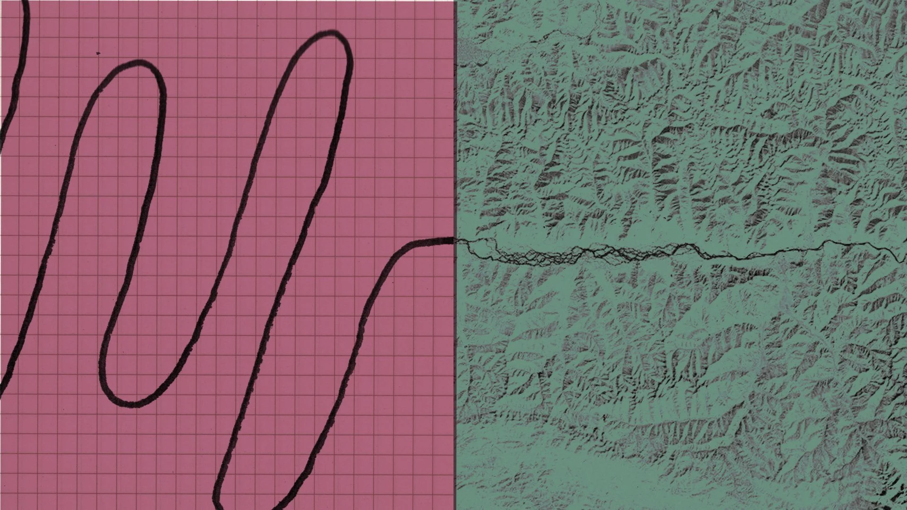
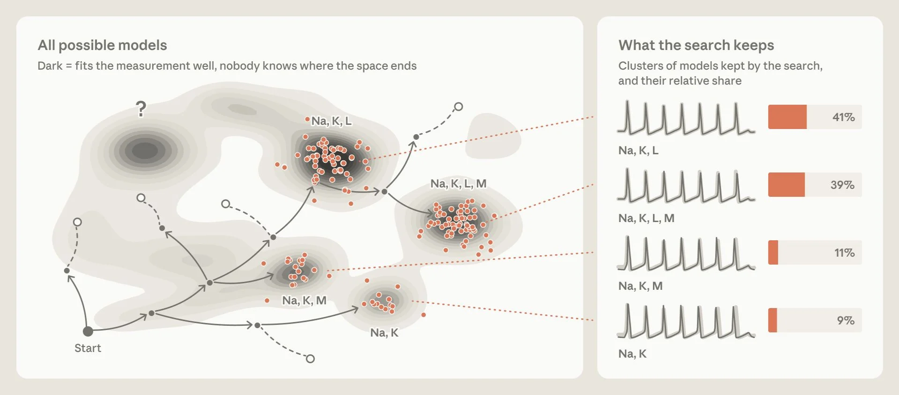
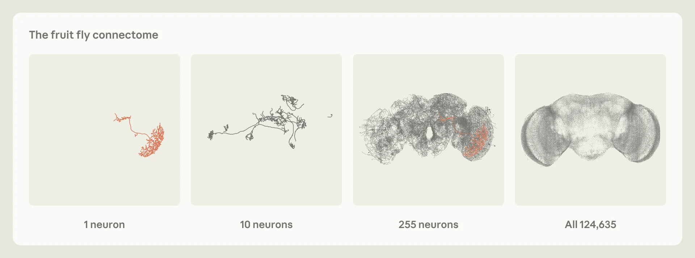

# 教 AI 构建科学模型

- 英文标题：Teaching AI to build scientific models
- 发布日期：2026-11-06
- 官网栏目：科学
- 原文：[Anthropic 页面](https://www.anthropic.com/research/teaching-ai-to-build-scientific-models)
- 官网署名：Anthropic

> 中文机器初译，未逐篇人工校对。引用研究结论时请核对英文原文。

*[科学人工智能](https://www.anthropic.com/news/ai-for-science-program) 受赠者 [雅各布·麦克](https://www.mackelab.org/), [丹尼尔·格登](https://dgedon.github.io/), 和 [斯特凡·瓦尔](https://scholar.google.com/citations?user=-aivjt0AAAAJ) 是研究人员在 [图宾根埃利斯研究所](https://institute-tue.ellis.eu/) 和蒂宾根大学，他们在那里构建人工智能工具来开发神经科学及其他领域的科学模型。在这篇客座文章中，他们讨论了人工智能如何开始改变科学建模。*

1951 年，剑桥大学的计算机瘫痪了六个月。这对生理学家安德鲁·赫胥黎来说很不方便，他和他的同事艾伦·霍奇金刚刚建立了一组方程来描述特定的鱿鱼神经细胞如何放电。科学家们想要了解这些神经细胞的“动作电位”：它们用于交流的电脉冲，这是大脑从感知到智力的一切行为的基础。找出方程是否有效的唯一方法是求解它们并将解与数据进行比较。

赫胥黎曾希望使用新型计算机来求解方程。相反，他被迫使用手摇机械计算器来解决这些问题。他花了三个多星期的时间。

他们模型的基本结构是由有关细胞的已知事实决定的。霍奇金和赫胥黎将其膜建模为电路。然而，该模型的一部分只是一种有根据的猜测。为了使曲线符合他们测量的数据，他们发现必须将一个变量提高到四次方，即将其自身乘以三倍。当时，他们不知道为什么。他们只是知道，否则模型也无法预测观察到的数据。

然而，他们确实提出了一个假设。他们谨慎地提出，所讨论的变量（控制细胞膜中特定门的打开方式）可能需要四次方，因为膜中的多个带电粒子必须在门打开之前移动到位。

几十年后，也就是 1963 年霍奇金和赫胥黎双双获得诺贝尔生理学或医学奖很久之后，另一个团队 [发现了相关钾通道蛋白的结构](https://www.science.org/doi/10.1126/science.280.5360.69)。他们发现，是的，它有四个相同的碎片排列 [围绕中心孔](https://doi.org/10.1126/science.1116270)。该模型适合 1951 年的数据。即便如此，它仍然相对准确地预测了脉冲传播的速度。更重要的是，它被证明有助于预测钾离子通道本身的结构，而它从未适合过。

今天，人工智能系统似乎可以在一个下午找到像霍奇金和赫胥黎那样的方程，而且也许它会更接近实验数据。但这个故事的要点是，仅仅知道四次方就可以完成这项工作还不够。重要的是要知道该模型的简单版本行不通。仅仅向你提供模型的人工智能系统可能会给你答案，但它不会给你理解。用模型重现数据是不够的，因为任意数量的模型都可以做同样的事情。重要的是能够对现实世界的系统本身提出主张，最好是对其他类似的系统提出主张。为此，您需要知道该模型与其他可用的模型共享哪些功能，以及哪些功能与不可用的模型不同。正如数学家理查德·汉明 (Richard Hamming) 在 1962 年所写的那样：“计算的目的是洞察力，而不是数字。”

## 三步计划

70多年来， [霍奇金-赫胥黎模型](https://pmc.ncbi.nlm.nih.gov/articles/PMC1392413/) 仍然是神经元电活动的标准描述。尽管我们的进化谱系在五亿多年前就已经分开，但具有不同常数的相同类型的方程描述了从乌贼到人类的整个动物界的神经细胞。

然而，比其寿命更重要的是霍奇金-赫胥黎模型告诉我们模型是如何工作的。霍奇金和赫胥黎的方法可以分为三个步骤，大多数科学建模都涉及其中的某些版本。

- 第一个是 **建筑物** 模型。这意味着要决定模型的构成及其方程的形状。在霍奇金和赫胥黎的例子中，这意味着电路的各个部分——膜和门——以及方程的形式，例如将基础变量提高到四次方。
- 第二个是 **约束** 模型——调整其可调参数以适应实际测量。对于霍奇金和赫胥黎来说，其中包括诸如门在不同电压下打开的频率等设置。
- 第三个是 **口译** 模型——询问模型对真实系统的描述，例如暗示四次方意味着门有四个活动部件。

在实践中，科学家 [重复执行这些步骤](https://www.jstor.org/stable/2286841)。如果数字不符合测量结果，或者解释没有意义，他们就会返回并进行修改。

这三个步骤曾经都是由人类完成的，但人工智能系统越来越多地参与其中。可以说，机器在约束模型方面取得了最大的进步，所以我们将从这里开始。

## 分摊账单，或者如何约束模型

当霍奇金和赫胥黎通过眼睛和直觉约束他们的模型时，他们最终得到了一组数字。这告诉他们该模型 *可以* 匹配数据。它没有告诉他们其他数字是否也同样有效甚至更好。

想象一下，您知道一顿团体晚餐总计 120 美元，但不知道谁点了什么。许多不同的订单组合可能会达到这个金额——也许每个人都点了一个中等价格的汉堡，或者也许一个人吃了牛排和龙虾，而其他人都喝了汤。神经细胞模型的工作原理相同：门参数的不同组合可以产生几乎相同的电活动。简单地显示一种非常适合的组合会隐藏所有其他合理的参数设置，而其他组合可能会导致不同的预测。几乎所有正在建模的现象都是如此。许多不同的参数集都可以同样很好地解释观察到的数据。

[原文媒体](https://assets.claude.ai/brand/artifacts/research/teaching_ai.html)

约束 Hodgkin-Huxley 模型的图示。 (1) 来自神经细胞的测量。 (2) 钾和钠通道设置的每种组合的测量可能性有多大。颜色越深意味着更合身。蓝点是交互式的。 (3) 与测量结果（灰色）相比，三种设置下的模型模拟。有些适合，有些则不适合。

解决方案是一种称为贝叶斯推理的统计方法。它为您提供了每组运行良好的数字，作为概率分布，考虑了它们与数据的拟合以及您对参数的先验知识。分布呈曲线形状，最佳拟合位于峰值，较弱拟合位于边缘。

但这种方法通常对于复杂模型来说是不切实际的，因为它涉及计算你的测量结果在每组可能的数字下的可能性。在霍奇金和赫胥黎的模型中，这仍然是可行的，但对于任何更复杂的事情，这在计算上是不可能的。例如，如果数千个离子通道中的每一个都是随机打开和关闭的，那么您就必须计算出每种组合。回到我们餐厅账单的类比：很容易回答，“如果甲人吃了汉堡，乙人吃了牛排，账单会是多少？”但要显示哪些组合可能导致最终账单要困难得多，尤其是随着人数和菜单选项的增加。

另一种方法称为 [基于模拟的推理（SBI）](https://www.pnas.org/doi/10.1073/pnas.1912789117) 通过纯粹的计算克服了这个逆向工程问题。您选择随机参数，运行模型并记录输出。你一次又一次地这样做——[对于像 Hodgkin-Huxley 这样的模型来说可能是 100,000 次](https://elifesciences.org/articles/56261)，对于更大、更复杂的情况则需要数百万次。然后，您根据结果训练神经网络，以便在给定输出的情况下，它可以返回可能产生该输出的参数范围。

SBI 所要求的只是您可以运行模型：输入一组参数并返回您期望看到的数据类型。您可以像这样运行的模型（参数输入，数据输出）称为 *模拟器*，因此得名“基于模拟的推理”。您永远不需要使用公式来计算您的测量结果的可能性，这一步使得标准贝叶斯推理通常不切实际。如今，模拟器通常是一个计算机程序，但它不一定是：赫胥黎用手计算方程式，运行一个。很多模拟器很容易向前跑，但不可能向后跑。有些甚至不能写成一个整洁的方程——它们的假设被内置到它们遵循的规则中——但它们仍然是模型。对于许多复杂的现象，从神经元网络到碰撞星系，模拟器通常是我们拥有的唯一模型。SBI 让我们用数据来约束这些模型。

运行所有这些模拟非常昂贵，并且可能需要数周时间。但一旦完成，经过训练的网络就可以在几秒钟内对新数据进行推理，而不需要进一步的模拟。这种速度改变了可能性。当 [两颗中子星碰撞](https://www.nature.com/articles/s41586-025-08593-z)，SBI 可以粗略地计算出碰撞发生在天空中的哪个位置，速度足够快，可以在信号仍然可检测到的情况下用望远镜瞄准它。同样的方法已成功应用于以下问题 [宇宙学](https://journals.aps.org/prd/abstract/10.1103/3sj1-1l9f), [结构生物学](https://www.pnas.org/doi/10.1073/pnas.2420158122), [地球物理学](https://academic.oup.com/gji/article/241/3/1741/8099925)，以及许多其他领域。

并且SBI已应用于 [神经细胞模型](https://www.nature.com/articles/s41586-022-04428-3), [包括霍奇金-赫胥黎模型](https://elifesciences.org/articles/56261)。因为它返回的是分布而不是单一拟合，所以我们可以看到哪些参数受到数据的良好约束，哪些地方有多个解释是合理的，以及哪些地方最需要更多数据，从而进行另一次实验。

## 账单、上一级或如何构建模型

在约束模型之前，您需要一个要约束的模型。霍奇金-赫胥黎模型的方程并不是从第一原理推导出来的。相反，出现了基础变量的四次方 *经验地* 来自科学家的生物学见解，以及发现更简单的版本效果不佳。

在科学史上的大部分时间里，模型都是这样建立的。科学家们利用他们的专业知识和假设写下了候选模型。然后他们测试、修改并再次尝试。问题在于，可能的模型空间本质上是无限的，科学家根据经验提出一些模型很可能会错过可以同样很好地解释观测数据的模型。

人工智能系统现在可以帮助甚至接管这一步。给定一些数据和系统的自然语言描述，基于 LLM 的代理为候选模型或一组候选模型编写代码。然后它运行模型，约束其参数，将输出与现实世界的数据进行比较，并可能通过修改方程的形式来修改它。重复此循环，直到模型足够准确地复制数据。过去两年已经出现了几个这样的系统。[1](https://www.anthropic.com/research/teaching-ai-to-build-scientific-models#footnote-1) 细节各不相同，但都使用法学硕士来设计模型本身。直到最近，这还被认为是只有人类才能做到的事情。

但模型复制数据这一事实并不意味着它提供了洞察力。与餐馆账单或 Hodgkin-Huxley 参数一样，单个模型中的许多不同参数组合可以提供相同的输出。对于模型本身来说，上一层也是如此：许多不同的 *型号*，具有不同形状的方程，可以同样很好地解释相同的数据。对相同的数据运行代理两次，它可能会返回两个不同但同样好的模型。只返回其中一个的代理会隐藏其余的内容，就像一组最适合的数字一样。

通过搜索所有模型的空间来构建模型。左：每个点都是 Hodgkin-Huxley 模型的一个可能变体；较暗的背景表示模型的可能性更大。我们保留可能的模型和不可能的模型，因为所有模型都可以包含洞察力。右：每个集群的人工智能系统构建的模型的模拟，以及每个集群在所有模型中所占的份额。

因此，最好像对待约束模型一样对待构建模型：您需要能够合理解释数据的整个模型范围。[2](https://www.anthropic.com/research/teaching-ai-to-build-scientific-models#footnote-2) 人工智能系统提出了许多候选人。然后根据数据支持的程度对每个数据进行加权，而那些需要很大灵活性才能适应的数据会比那些自然适合的数据得到更少的信任。较弱的候选者会被淘汰，人工智能系统会针对较强的候选者提出新的变体。

因此，AI 智能体可以提供合理模型的分布，而不是单一的最佳拟合，并且该分布可以告诉您单个模型无法做到的事情。如果每个幸存的模型都有一个共同的特征，那么数据可能会青睐它。如果幸存者不同意，那就表明证据薄弱，并为研究人员指明下一个实验的方向。

我们不应该太过超前。到目前为止，这些系统主要是在重新发现科学家已知的模型上进行测试的。有证据表明他们致力于解决以下问题 *不* 已知的答案很少。仍然， [较新的法学硕士在研究任务上表现更好](https://www.terminal-bench-science.ai) 比旧系统更好，我们期望这些系统不断改进。

## 迷失在翻译中，或者如何解释模型

一旦模型被建立并受到约束，它仍然需要被解释。它告诉我们关于正在研究的真实系统的什么信息？霍奇金和赫胥黎的四粒子假说之所以出现，是因为如果在门打开之前必须发生四个独立的事情，那么涉及四次方的方程就是您所期望的。所以他们认为这可能是膜内部发生的事情。正如我们在上面看到的，事实证明他们基本上是正确的。

这种解释之所以有意义，是因为他们排除了某些内容。如果一个更简单的模型也能发挥同样的作用，那么就没有理由认为大门有多个活动部件。正是替代方案的失败才让他们能够做出这样的主张。确切的数字存在一些不确定性：霍奇金和赫胥黎指出需要三次或四次方，并最终确定为四。 [他们写道](https://pmc.ncbi.nlm.nih.gov/articles/PMC1392413/) 更高的倍率甚至可能稍微好一些，但潜在的“改进不值得增加额外的复杂性”。

这些方程还让霍奇金和赫胥黎推导出其他几个含义。例如，这些方程解释了为什么神经细胞有一个电压阈值，低于该阈值它们不会放电，高于该电压阈值它们会放电，以及为什么神经脉冲都具有相同的形状。他们还预测，足够缓慢上升的电流永远不会使电池起火。科学哲学家 [称理论为“可理解的”](https://academic.oup.com/book/36363) 如果它可以让你在不必运行它的情况下计算出其后果。该测试适用于具有少量变量的模型，例如 Hodgkin-Huxley。对于一个可能有数千个变量的较大模型，相当于我们是否可以将其归结为一些足以重建它的关键机械思想。模型越大，就越难。

在这三个步骤中，解释是最难交给人工智能的。目标更难确定：我们可以衡量模型与数据的拟合程度，但无法衡量模型是否能更好地理解系统，而且还不清楚如何告诉人工智能系统“理解”其目标。 [一项提案](https://link.springer.com/article/10.1007/s11023-024-09657-1) 是通过观察人工智能系统在你干扰系统时预测系统行为的能力来判断它的理解能力。另一种方法是完全回避这个问题，而是询问智能体的输出是否 [帮助人类科学家更好地理解问题](http://nature.com/articles/s42254-022-00518-3)。一个例子是人工智能系统 [设计量子实验](http://nature.com/articles/s42256-025-01153-0)。它不是提供单一的设置，而是被训练编写一个简短的程序，为整个相关实验系列生成设置。然后，物理学家可以直接从程序中读取基本设计原理，而不是从一个实验设置对其进行逆向工程。

在这两种方法中，获得合适模型的完整分布，而不是单个最适合的模型，对于解释至关重要。单个模型无法告诉我们它的哪些部分实际上受到数据的约束，因此很容易理解不受数据约束的部分的含义。正如我们所见，在《霍奇金-赫胥黎》中，只有当您知道较低的幂次效果不佳时，有关四个粒子的假设才有意义。一系列模型也使预测更加稳健。假设您询问模型，当您扰乱系统时会发生什么 - 例如，通过阻止细胞膜上的全部或仅部分钠门。如果所有适合数据的模型都返回相同的答案，正如您在每个门都被阻止时所期望的那样，那么您可以对此相当有信心。如果他们不同意，就像只有一些门被封锁时那样，这可以为下一个实验提供想法。

## 细胞和鳞片

大多数著名的模型，包括霍奇金-赫胥黎模型，都是紧凑的。它们由一些变量和方程组成，小到足以让人类科学家写下并进行推理。这并非巧合：它们需要紧凑，因为人们必须构建、约束和解释它们。它们的微小也使得它们易于理解。但随着人工智能接管更多工作，规模限制将开始解除。我们可以开始对过于复杂而无法用手写下来的系统进行建模，即使我们不再仅通过阅读方程来理解它们。

大脑是一个明显的用例。霍奇金-赫胥黎方程描述了单个神经细胞。但果蝇的大脑包含超过10万个，而人脑则包含数百亿个。正是这些神经元之间的相互作用产生了行为和思想。对于果蝇，我们现在拥有前几代科学家不可能实现的东西：其大脑的完整接线图，显示每个神经元以及它如何与其他神经元连接。[3](https://www.anthropic.com/research/teaching-ai-to-build-scientific-models#footnote-3) 研究人员已经开始 [在其上构建大型模型](https://www.nature.com/articles/s41586-024-07939-3)，包括预测果蝇视觉系统神经元活动的一项。这就提出了以前没有人能明智地提出的问题。整个大脑如何将其线路转化为行为？动物的行为有多少可以仅通过其线路来预测？哪些联系真正重要？

但在这些规模下，不可能找到一个正确的模型。事实上，在大多数情况下，不存在这样的事情。作为统计学家 [乔治·博克斯写道](https://www.sciencedirect.com/science/chapter/edited-volume/abs/pii/B9780124381506500182?via%3Dihub)，“所有模型都是错误的，但有些模型是有用的。”数据始终与许多模型兼容。问题不再是哪个模型是正确的，而是所有数据兼容模型共享哪些属性，以及可以从中得出哪些预测。最有用的实验将是那些排除最大数量剩余模型的实验，即使它们并不总是人类科学家认为最有趣的模型。

从一个神经元扩展到整个大脑。果蝇大脑的接线图显示了 1、10 和 255 个神经元，以及 124,635 个细胞。渲染自 [男性中枢神经系统连接体](https://www.janelia.org/project-team/flyem/male-cns-connectome) （HHMI Janelia、剑桥大学、MRC LMB 和 Google 研究），CC BY 4.0。

这并不是神经科学所独有的。气候科学家已经这样工作了：他们建立了许多巨大的数值模拟，每个模拟都基于略有不同的假设，并将他们的预测报告为所有模拟的分布。大型强子对撞机的粒子物理学家也以类似的精神工作：当他们寻找新粒子时，他们不只是声明某个特定理论是否有效；他们还声明某个理论是否有效。他们制作了一张地图，显示哪些版本的理论被数据排除，哪些版本仍然开放。

霍奇金和赫胥黎所做的艰苦工作——建立模型，用肉眼拟合每条曲线，尝试不合适的幂，以及在赫胥黎的例子中，花费三周的时间手动启动机械计算器——不是我们想要回去的。但这并没有浪费。模型提供的大部分见解都来自于创建模型的过程。霍奇金和赫胥黎明白这个模型告诉他们什么，因为他们自己建造了这个模型，他们知道什么不起作用。这种理解让他们制定了对门控变量的解释——这是最终为他们赢得诺贝尔奖的发现的一部分。

人工智能系统现在似乎可以在一个下午完成大部分相同的工作。但为了提供理解，它需要提供两位科学家缓慢工作所产生的成果：不仅是适合的模型，而且还说明哪些部分是由数据确定的，哪些部分仍然开放，哪些替代方案在此过程中失败了，以及在此过程中发现了哪些新的难题。科学模型可能会提供答案，但提供洞察力的是构建它的过程。

## 脚注

01 参见 [罗梅拉-帕雷德斯等人，2024](https://www.nature.com/articles/s41586-023-06924-6); [Shojaee 等人，2025](https://proceedings.iclr.cc/paper_files/paper/2025/hash/28df8e730c054c5331855fd4d5403ba9-Abstract-Conference.html); [马等人，2024](https://proceedings.mlr.press/v235/ma24m.html); [诺维科夫等人，2025](https://arxiv.org/abs/2506.13131); [夏等人，2026](https://proceedings.iclr.cc/paper_files/paper/2026/hash/7a9d48d13056b6b6a7f5bce1c3ba8f2d-Abstract-Conference.html);和 [Ziaei Bideh 和 Gryak，2026](https://dl.acm.org/doi/10.1145/3795095.3805067)，例如。

02 参见 [瓦尔等人，2026](https://proceedings.mlr.press/v306/wahl26a.html); [米什拉-夏尔马，2026](https://arxiv.org/abs/2607.17540);和 [墨菲，2026](https://arxiv.org/abs/2608.09696).

03 参见 [多肯瓦尔德等人，2024](https://www.nature.com/articles/s41586-024-07558-y); [施莱格尔等人，2024](https://www.nature.com/articles/s41586-024-07686-5);和 [阿泽维多等人，2024](https://www.nature.com/articles/s41586-024-07389-x).
