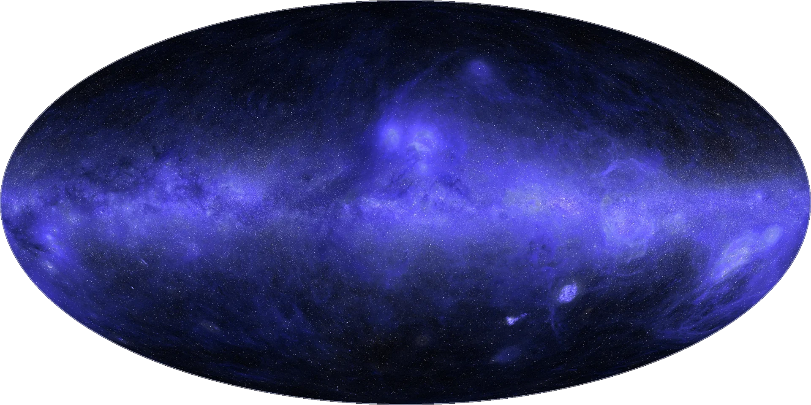
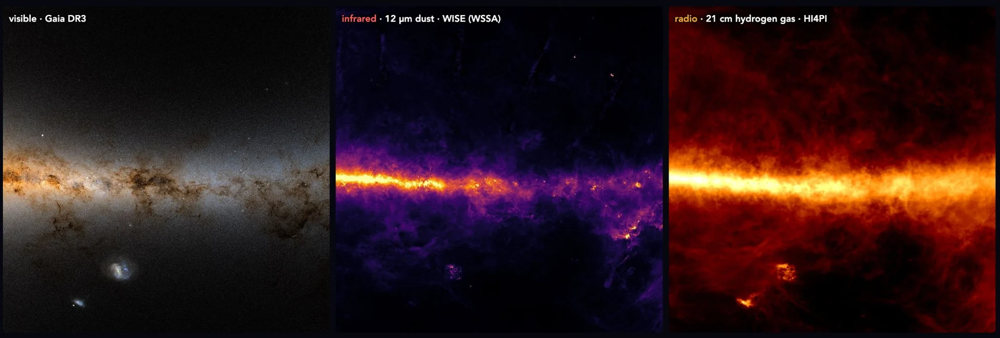
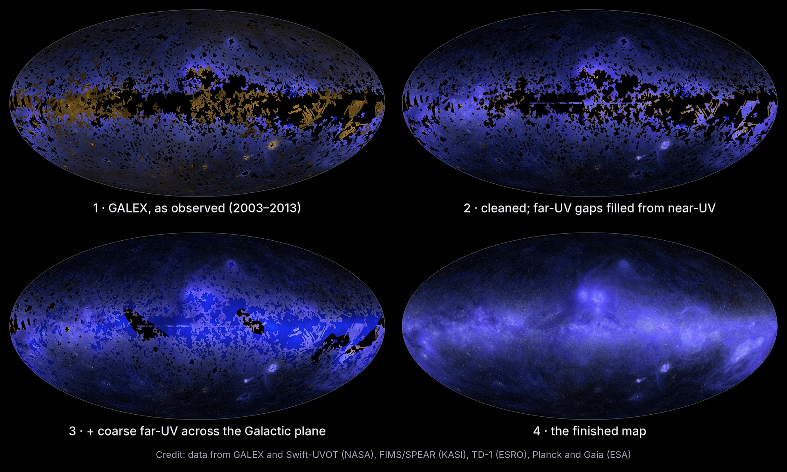
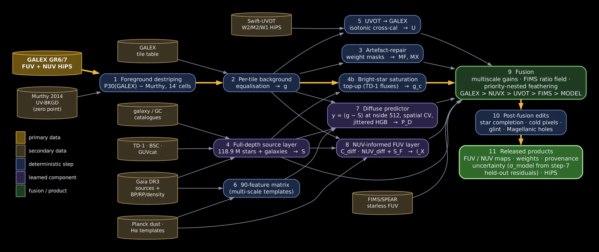
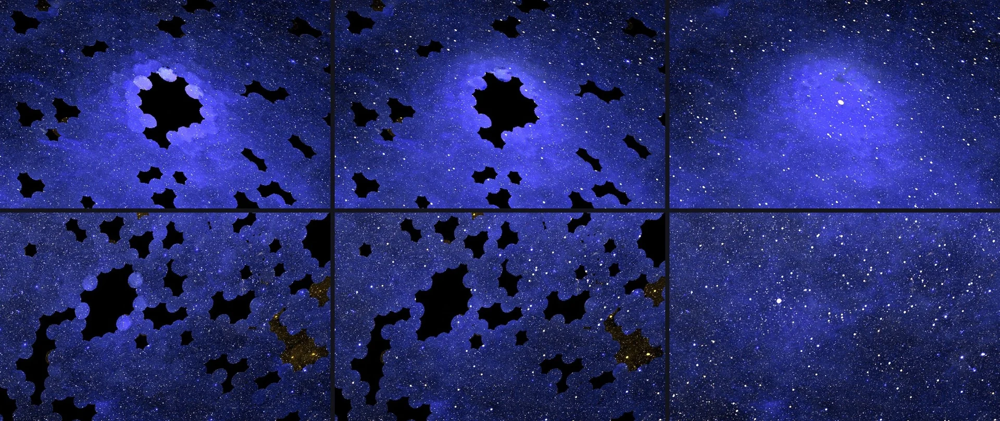

# 缺失的全天图

- 英文标题：The missing map of the sky
- 发布日期：2026-10-08
- 官网栏目：科学
- 原文：[Anthropic 页面](https://www.anthropic.com/research/the-missing-map-of-the-sky)
- 官网署名：Anthropic

> 中文机器初译，未逐篇人工校对。引用研究结论时请核对英文原文。

*在这里，约翰·霍普金斯大学的天体物理学家、Anthropic 的研究员 Brice Ménard 解释了他如何与 Claude Science 合作，在紫外光下绘制出第一张完整的天空图。该地图将是一个有价值的教育工具，让学生可以详细了解在此波长下可见的银河系的丰富结构。*

[原文媒体](https://assets.claude.ai/brand/artifacts/editorial/uvsky/uvmap_standalone.html)

整个天空（银河系中心位于中间）处于紫外线（远紫外线 154 nm 和近紫外线 232 nm 的组合）中。这张地图的大约三分之一，包括银河平面的大部分，是Claude科学公司使用这篇文章中概述的方法预测的。地图的附加层将每个像素标记为“测量”或“预测”，并提供不确定性估计； [你可以在这里看到它](https://menard.pha.jhu.edu/uvmap/).

当我教授天体物理学时，我经常首先向我的学生展示天空看起来完全不同，具体取决于你观察它的波长。每个都带来不同的功能。在可见光下，人们主要看到星星。切换到红外线显示了沿着银河系集中在一条带中的微小尘埃颗粒的发光。在无线电波中，恒星和尘埃消失，氢气——形成新恒星的原材料——变得可见。在 X 射线中，人们可以看到剧烈的现象，比如恒星爆炸，或者物质螺旋进入黑洞。这些特征共同让天文学家了解气体如何塌缩成恒星、恒星如何在星系中播撒尘埃，以及像我们这样的星系是如何形成的。

天空的三种视图：可见光、红外线和射电。图片来源：ESA Gaia DR3、NASA WISE、HI4PI。

当谈论紫外线以及它如何揭示星光照亮的尘埃时，从年轻恒星周围的云层到恒星爆炸留下的光环，我总是不得不道歉。我能展示的唯一一张 UV 贴图充满了漏洞。

### 为什么不存在完整的 UV 图

紫外线会被大气中的臭氧层吸收，因此要在紫外线光谱中观察宇宙，就必须前往太空。过去 50 年来，太空望远镜在紫外线下观测了部分天空并公布了数据。但仍有许多事情未被观察到。

最大的数据集来自 NASA 的 GALEX 任务，该任务从 2003 年到 2013 年运行，在约 38,000 次单独观测中拍摄了约三分之二的天空图像。但 GALEX 故意跳过了拥有非常明亮恒星的位置，包括银河系平面上的位置（银河系的扁平圆盘，恒星最密集的地方），因为存在损坏卫星探测器的风险。其他太空望远镜，例如美国宇航局的雨燕望远镜和韩国的 FIMS/SPEAR，获得了额外的数据，但即使在这些组合数据集中，也存在许多缺失的部分。

统计技术可以估计缺失的数据并创建完整的天空 UV 地图。但要正确做到这一点需要数周的艰苦工作，包括对单个像素进行细致的校准以及复杂的重复分析。可以理解的是，天体物理学家倾向于将此类工作放在一边以追求更紧迫的研究。大多数领域都有大量类似的项目积压，这些项目可以解释一个关键概念或帮助其他研究人员，但在任何人的清单上都没有上升到足够高的位置来完成。有了Claude，处理此类低优先级的工作变得更加容易。

### 构建缺失的地图

今年夏天，我开始制作一张完整的天空 UV 贴图 [克劳德·科学](https://www.anthropic.com/news/claude-science-ai-workbench)。这些说明说起来很简单，但执行起来却很难：收集所有可用的紫外线数据集，将它们全部放在一个共同的比例上，将它们合并成一张地图，并填充紫外线望远镜从未观察到的每一片天空。

为此，Claude精心策划了一支AI 智能体团队。首先，特工们在网络上搜索公开的天文紫外线调查，每项调查都包含大量的单独数据点或图像——就 NASA 的 GALEX 任务而言，有数万张图像——是在不同条件下拍摄了数年的。

下载数据后，代理商必须使每项调查在内部保持一致，以便可以将一个时间段内拍摄的图像与另一个时间段内拍摄的图像进行比较。这需要特别注意明亮恒星周围的区域。正如太阳或路灯可以为地球上的照片添加眩光一样，星星也可以为太空望远镜拍摄的天空图像添加眩光。在精确测量恒星周围较微弱的紫外线之前，需要消除这种眩光。许多特工在天空的不同区域并行工作，能够消除这些差异。

接下来，必须合并调查。这些数据集是由不同望远镜上的不同仪器收集的，每一个数据集捕获的紫外线天空都略有不同，因此它们必须相互交叉校准，以相同的分辨率重新绘制，并映射到一个共同的坐标系上，然后才能合并成一张地图。我向Claude提供了关于如何执行此操作的高级指示，Claude设置了一个特工团队来执行这些任务。

接下来是最难的部分：填补地图上的空白。大约三分之一的天空从未被紫外线观测到。为了解决这些空白点，我要求 Claude Science 使用一种称为修复的技术，这是机器学习中的一种常见过程，其中经过数百万张照片训练的模型可以了解图像的每个部分与其周围环境的关系，并利用这些知识来恢复图像损坏或丢失的部分。

Claude将这种方法与我们掌握的其他信息结合起来。在缺少紫外线数据的情况下，我们确实有其他波长的观测结果，包括可见光、红外线和射电波。利用三分之二的天空 *有* 通过绘制紫外线图，Claude了解了紫外线亮度与这些其他波长的关系。然后，它将这种关系应用于不存在紫外线数据的天空的三分之一，并估计每个点的外观以及它对该估计的置信度。

为了检查模型预测的准确性，我要求 Claude 选取我们已经拥有 UV 数据的区域，并故意隐藏其中的一部分，从而创建旨在填充的空白补丁。该模型必须使用它所学到的知识来完成图片，而无需访问真实值。经过几轮细化，它能够将隐藏数据估计到真实紫外线测量值的 10% 左右，这种差异人眼几乎察觉不到。

最后，在这个弥散的修复背景之上，Claude还根据欧洲航天局盖亚卫星在可见光下的测量推断出来自超过 1 亿颗恒星的紫外线估计。天空的完整 UV 贴图的第一个版本已完成。

数据如何流经 Claude Science 管道以创建最终地图。圆柱体是公共数据集输入；蓝色框是Claude执行的确定性步骤；紫色框是Claude通过统计学到的成分；绿色盒子是融合物和成品。

### 反复试验

Claude第一次尝试并没有把所有事情都做好。例如，有一天晚上查看处理后的图像，我注意到一些事情 *关闭* 在最暗的田野之一：微弱的圆圈，每个圆圈都比相邻的圆圈更亮或更暗。

这些是各个 GALEX 观测的足迹。每张 GALEX 图像都会捕捉到天空的一个圆形斑块，并且每张图像都包含来自地球大气层的轻微的、不太均匀的紫外线辉光。如果这种发光没有完全消除，每个圆圈看起来都会比周围的圆圈稍微亮或暗。Claude在项目开始时就将其列为已知问题，但该地图仍然通过了其他特工的两轮审查而没有发现问题。

我告诉Claude：“我可以看到带有个人观察痕迹的圆盘；你能纠正它吗？”特工们将问题追溯到大气中残留的辉光。然后，Claude对所有 38,000 个观察结果中的发光现象进行了校正。经过几个小时的处理后，圆圈消失了。

即使不直接观察，明亮的恒星也会污染附近的紫外线观测结果。每行显示 GALEX 避开的区域的观察结果。左：单个指向可见为微弱的圆盘。中：每个指向移除一个背景级别后，一些圆盘仍然可见。右：完成的地图，经过Claude完成的额外校准过程，并用预测星和盖亚星填充了孔。图片来源：NASA GALEX GR6/7 (MAST/STScl) - UV-BKGD (Murthy 2014) • Swift-UVOT (NASA HEASARC) • FIMS/SPEAR (KASI/MAST) • TD-1 • ESA Gaia DR3 (DPAC) • 用于间隙填充的 Planck & Ha 模板。

### 最终地图

Claude和我一起创建了该地图的十几个连续版本，每个版本都比上一个版本更加精致。我们的合作持续了几天，并呈现出可预测的节奏：我会在 Claude Science 内部进行几次交流，以计划下一步，然后 Claude 会独立执行几个小时的计算，而我则回去从事其他项目。

[完成的地图](https://menard.pha.jhu.edu/uvmap/) 在紫外线下展示了整个天空，并展示了许多有趣的结构：发光的年轻恒星周围发光的尘埃云，巨大的尘埃环和环，追踪大质量恒星爆炸喷出的气泡。远离银河平面，微弱的尘埃细丝穿过天空，被整个星系的星光照亮。平面下方坐落着大麦哲伦星云和小麦哲伦星云，这两个相邻的小星系充满了年轻的恒星。我认为它很漂亮，而且它可以与其他规范地图一起帮助一代又一代的学生欣赏我们银河系中正在发生的各种物理过程。

这一次，我能够在不牺牲原本用于研究的时间的情况下开展这样的项目。我怀疑许多科学家都会出于同样的原因想到一张地图、一个图形或一个他们一直推迟的资源。
