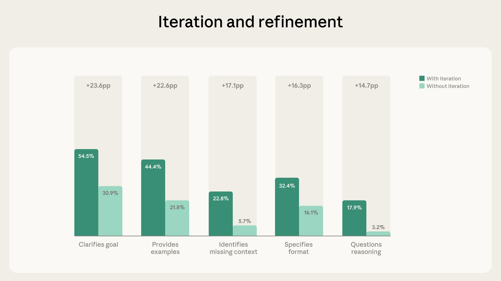
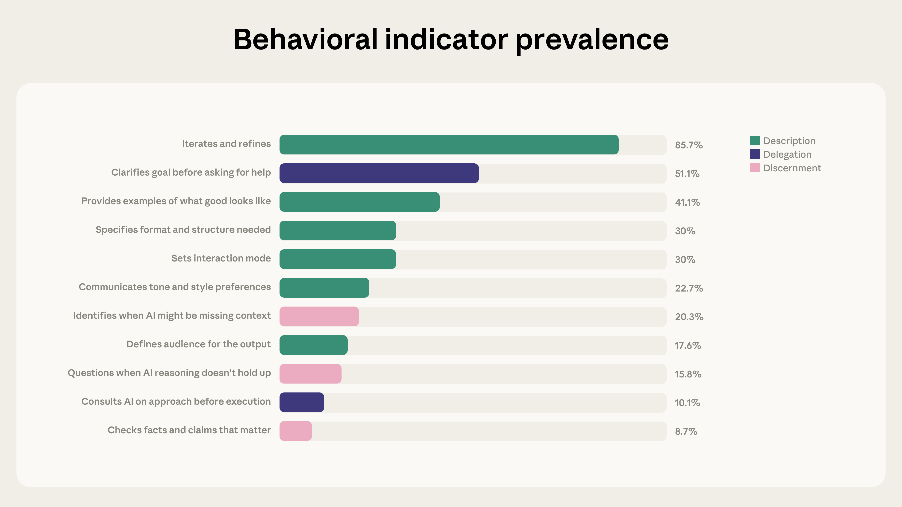
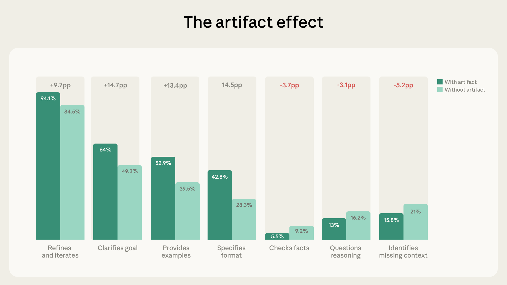

# Anthropic 教育报告：AI 熟练度指数

- 英文标题：Anthropic Education Report: The AI Fluency Index
- 发布日期：2026-02-23
- 官网栏目：社会影响
- 原文：[Anthropic 页面](https://academy.claude.com/tutorials/the-ai-fluency-index)
- 归档范围：网页可读取的内容。交互图表、表单或其他动态内容请见原站。

> 中文机器初译，未逐篇人工校对。引用研究结论时请核对英文原文。


*最初发布于 2026 年 2 月 23 日。*

人们正在将人工智能工具融入他们的日常生活，其速度在一年前也是难以预测的。但仅仅采用并不能告诉我们太多关于这些工具的影响。 **另一个同样重要的问题是：随着人工智能成为日常生活的一部分，个人是否正在培养良好使用它的技能？**

之前的人择教育报告研究了如何 [大学生（在新选项卡中打开）](https://www.anthropic.com/news/anthropic-education-report-how-university-students-use-claude) 和 [教育工作者（在新选项卡中打开）](https://www.anthropic.com/news/anthropic-education-report-how-educators-use-claude) 使用Claude.我们发现学生用它来创建报告和分析实验室结果；教育工作者用它来构建课程材料并自动化日常工作。但我们知道 *任何* 使用人工智能的人可能会改进他们的工作。我们希望进一步探索这一点，并了解使用人工智能的人们如何随着时间的推移发展“流畅”的技术。

在本报告中，我们开始回答这个问题。我们在大量匿名对话样本中跟踪代表人工智能流畅度的行为分类是否存在。

符合我们最近 [经济指数（在新选项卡中打开）](https://www.anthropic.com/research/economic-index-primitives)，我们发现AI流畅度最常见的表达是 *增强的*——将人工智能视为思想伙伴，而不是完全委托工作。事实上，这些对话表现出的人工智能流畅行为数量是快速、来回聊天的两倍多。

但我们也发现，当人工智能产生工件（包括应用程序、代码、文档或交互式工具）时，用户 *少* 可能会质疑其推理（-3.1 个百分点）或识别缺失的上下文（-5.2 个百分点）。这与我们在我们的研究中观察到的相关模式一致 [最近对编码技能的研究（在新选项卡中打开）](https://www.anthropic.com/research/AI-assistance-coding-skills).

这些初步发现为我们提供了一个基线，我们可以用它来研究人工智能流畅度随时间的发展。

## 衡量人工智能流畅度

为了量化人工智能的流畅度，我们使用 [4D AI流畅度框架（在新选项卡中打开）](https://academy.claude.com/collections/collaborating-with-ai)，由 Rick Dakan 和 Joseph Feller 教授与 Anthropic 合作开发。该框架帮助我们定义 24 种具体行为，以举例说明安全有效的人机协作。

在这 24 种行为中，当人类在 Claude.ai 或 Claude Code 上与 Claude 交互时，有 11 种行为（如下图所示）是可以直接观察到的。另外 13 个（包括诚实地了解人工智能在工作中的作用，或考虑共享人工智能生成的输出的后果等事情）发生在 Claude.ai 的聊天界面之外，因此我们更难跟踪它们。这些不可观察的行为可以说是人工智能流畅度最重要的一些维度，因此在未来的工作中，我们计划使用定性方法来评估它们。

在这项研究中，我们重点关注 11 种可直接观察到的行为。我们用了我们的 [隐私保护分析工具（在新选项卡中打开）](https://www.anthropic.com/research/clio) 研究 2026 年 1 月为期 7 天的 9,830 次对话，其中包括在 Claude.ai 上与 Claude 的几次来回对话。1 然后我们测量这 11 种行为是否存在；每次对话都可以显示多种行为的证据。我们通过检查我们的结果在一周中的每一天以及样本中的不同语言之间是否一致（我们发现它们是一致的）来评估样本的可靠性。2 最后，这为我们提供了人工智能流畅度指数：当今人们如何与人工智能协作的基线衡量标准，以及跟踪这些行为如何随着模型变化而演变的基础。


*9,830 个 Claude.ai 对话中每个 AI 流畅性行为指标的流行程度，按照从最常见到最不常见的顺序排列，并按能力进行颜色编码。*

## 结果

通过我们的第一项研究，我们发现了 Claude 使用的两种主要模式：人工智能流畅性与通过与 Claude 进行较长时间对话的迭代和细化之间的密切关系，以及用户在编码或构建其他输出时流畅性行为的变化。

### 流畅性与表现出迭代和细化的对话密切相关

数据中最强大的模式之一是迭代和细化与所有其他人工智能流畅行为之间的关系。我们的样本中 85.7% 的对话表现出迭代和细化：在之前的交流基础上完善用户的工作，而不是接受第一个响应并转向新任务。这些对话显示出其他流畅行为的比率要高得多，如下图所示：



*用户迭代和细化的对话 (n=8,424) 与没有迭代和细化的对话 (n=1,406) 的行为指标普遍程度。所有行为在迭代和细化的对话中都更加普遍。*

平均而言，经过迭代和细化的对话表现出 2.67 个额外的流畅行为，大约是非迭代率 1.33 的两倍。这对于与评估Claude输出相关的流畅行为尤其明显。涉及迭代和细化的对话中，用户质疑 Claude 推理的可能性高出 5.6 倍，而看到他们识别缺失的上下文的可能性高出 4 倍。

### 创建输出时，用户变得更具指导性，但评估性较低

我们的样本中 12.3% 的对话涉及工件，包括代码、文档、交互工具和其他输出。在这些对话中，人们与人工智能的合作方式截然不同。

具体来说，我们发现属于“描述”和“授权”更广泛主题的行为比例要高得多。例如，与非工件对话相比，这些对话更有可能看到用户阐明其目标 (+14.7pp)、指定格式 (+14.5pp)、提供示例 (+13.4pp) 和迭代 (+9.7pp)。换句话说，他们在工作一开始就在指导人工智能方面做更多的工作。

但这种指导性并不符合更高层次的评估或洞察力。 **事实上，情况恰恰相反：在创建工件的对话中，用户 *少* 可能会识别缺失的上下文（-5.2pp），检查事实（-3.7pp），或通过要求模型解释其基本原理来质疑模型的推理（-3.1pp）。** 我们的 [经济指数（在新选项卡中打开）](https://www.anthropic.com/research/anthropic-economic-index-january-2026-report) 毫不奇怪地发现，最复杂的任务是Claude最困难的地方，所以这似乎特别值得注意。


*有人工制品的对话 (n=1,209) 与无人工制品的对话 (n=8,621) 的行为指标流行率。工件对话中的描述和委托行为增加，而所有三种辨别行为均减少。*

对于这种模式有几种可能的解释。Claude可能正在创造精美的、功能性的输出，为此似乎没有必要进一步质疑事情：如果工作 *看起来* 完成后，用户可能会这样对待它。但工件对话也可能涉及事实精度比美观或功能更重要的任务（例如，设计用户界面，而不是编写法律分析）。或者，用户可能会通过我们无法观察到的渠道（运行代码、在其他地方测试应用程序、与同事共享草稿）来评估工件，而不是在同一初始对话中表达他们的评估。

无论解释如何，这种模式都值得关注。随着人工智能模型越来越有能力产生精美的输出，批判性地评估这些输出的能力，无论是通过直接对话还是通过其他方式，将变得更有价值，而不是更少。

## 培养您自己的 AI 流畅度

与所有技能一样，人工智能的熟练程度只是一个程度问题——对于我们大多数人来说，我们的技术有可能进一步发展。根据我们数据中的模式，我们发现许多用户可以在三个领域提高他们的技能：

**留在谈话中。** 迭代和细化是我们数据中所有其他流畅行为的最强相关性。因此，当您得到初步答复时，值得将其视为一个起点：提出后续问题，驳回任何感觉不正确的部分，并完善您正在寻找的内容。

**质疑精美的输出。** 当人工智能模型产生某种东西时 *看起来* 很好，现在是停下来问的最佳时机：这准确吗？有什么遗漏吗？这个推理站得住脚吗？正如我们上面所讨论的，我们的数据显示，尽管用户从一开始就竭尽全力指导Claude的工作，但精致的输出与较低的批判性评估率是一致的。

**设定合作条款。** 在只有 30% 的对话中，用户会告诉 Claude 他们希望 Claude 如何与他们互动。尝试通过添加明确的说明，例如“如果我的假设错误，请反驳”、“在给出答案之前先解释一下你的推理”或“告诉我你不确定什么”。预先建立这些期望可以改变对话其余部分的动态。

## 局限性

这项研究有重要的警告：

- **样本限制：** 我们的样本反映了 Claude.ai 用户在 2026 年 1 月的一周内进行多轮对话。由于我们认为人工智能工具的传播仍处于相对较早的阶段，因此这些用户可能倾向于已经熟悉人工智能的早期采用者，即他们可能无法代表更广泛的人群。我们的样本应该被理解为提供基线 *这个* 人口，不能作为普遍基准。由于数据来自一周，因此它也无法捕获任何季节性或纵向影响。并且因为它专注于 [Claude.ai（在新选项卡中打开）](https://claude.ai)，我们不捕获用户如何与其他人工智能平台交互。
- **部分框架覆盖：** 在这项研究中，我们仅评估了 Claude.ai 对话中可直接观察到的 24 项行为指标中的 11 项。所有与负责任和合乎道德地使用人工智能输出相关的行为都发生在这些对话之外，并且不会被捕获。
- **二元分类：** 对于样本中的每一次对话，我们将每种行为分类为存在或不存在。但这可能会忽略重要的细微差别，例如有争议的或部分的行为演示，或者它们之间的重叠信号。
- **隐性行为：** 用户可能会在心理上表现出流畅的行为（例如根据自己的知识对Claude的主张进行事实核查），而无需在对话中表达这些行为。这似乎与我们关于工件的数据尤其相关——用户可能通过测试和实际使用来评估Claude的输出，而不是通过对话可见的行为。
- **相关发现：** 我们确定的关系是相关的。我们不知道一种行为是否 *原因* 另一个，或者它们是否都反映了一些共同的潜在因素，例如任务复杂性或用户偏好。

## 展望未来

这项研究为我们提供了一个基线，我们可以用它来评估人工智能流畅度如何随时间变化。随着人工智能功能的发展和采用率的提高，我们的目标是了解用户是否正在开发更复杂的行为，哪些技能是随着经验而自然出现的，哪些技能需要更刻意的开发。

在未来的工作中，我们计划在几个方向上扩展我们的分析。首先，我们计划进行“群组分析”，将新用户与有经验的用户进行比较，以了解对人工智能的熟悉程度与流畅度发展之间的关系。其次，我们计划使用定性研究方法来评估 Claude.ai 对话中无法直接观察到的行为。第三，我们的目标是探索 *因果关系* 这项工作提出的问题，例如鼓励迭代对话是否会导致更严格的评估，或者是否有其他干预措施可以更有效地鼓励这种评估。

此外，我们还想在 Claude Code（一个主要由软件开发人员使用的平台）中探索 AI 流畅性行为。在准备这项研究时，我们进行了一些初步分析，发现Claude代码对话与 [Claude.ai（在新选项卡中打开）](https://claude.ai)。但这仍然是初步的，Claude Code 截然不同的用户群和功能意味着需要进行更实质性的研究。

我们预计人工智能流畅性的本质将随着时间的推移而显着发展和演变。通过这项研究和未来的研究，我们的目标是使这一发展变得可见、可衡量和可操作。

## 比布泰克斯

如果您想引用这篇文章，您可以使用以下 Bibtex 键：

文字

```
@online{swanson2026aifluency,
author = {Kristen Swanson and Drew Bent and Zoe Ludwig and Rick Dakan and Joe Feller},
title = {Anthropic Education Report: The AI Fluency Index},
date = {2026-02-23},
year = {2026},
url = {https://academy.claude.com/tutorials/the-ai-fluency-index},
}
```

## 致谢

克里斯汀·斯旺森设计了这项研究，领导了分析，并撰写了这份报告。Zoe Ludwig 和 Drew Bent 为框架调整、消息传递和审查做出了贡献。AI Fluency 的 4D 框架由 Rick Dakan 和 Joe Feller 开发。扎克·李提供了技术支持。Hanah Ho 帮助可视化了数据。Keir Bradwell、Rebecca Hiscott、Ryan Donegan 和 Sarah Pollack 提供了沟通审查和指导。

## 脚注

1. 在研究人们如何使用人工智能模型时，保护用户隐私至关重要。对于这个项目，我们使用了我们的 [隐私保护分析工具（在新选项卡中打开）](https://www.anthropic.com/research/clio)，它通过将用户对话提炼成高级使用摘要（例如“故障排除代码”或“解释经济概念”），实现人工智能使用模式的自下而上的发现。对于此分析，我们运行了 11 个独立的二元分类器（每个行为指标一个），使用 Claude Sonnet 4 进行行为分类，使用 Claude Haiku 3.5 进行语言检测。这意味着一次对话可以表明多个人工智能流畅度行为指标。使用筛选器将对话过滤为多次来回的实质性交流，排除问候、单字交流、测试消息和纯粹的闲聊。对筛选出的 200 个聊天的手动审核表明，这种性质的聊天不符合任何 AI 流畅度指标，因此我们相信筛选器不会影响研究中观察到的 AI 流畅度行为的相对排名。分析中不会出现任何个人身份信息。
2. 行为指标是在一周样本（2026 年 1 月 20 日至 26 日）内计算得出的，并且每天都保持稳定，大多数行为仅变化 1-5 个百分点。某些行为的周六比率略低（例如，周六的迭代和细化率为 81.4%，而工作日的峰值为 87.9%），这表明随意使用与有目的使用之间存在适度差异，但没有一天显示出有意义的结构偏差。六种语言（英语、法语、西班牙语、中文、日语和德语）的比率也保持一致，大多数行为在不同语言组之间的差异为 3 个百分点或更少。总之，这些发现表明，这里捕获的行为模式反映了人们与人工智能互动的一致习惯，而不是时间、星期几或语言和文化背景的产物。

## Research 条目原版配图

正文现由 Claude Academy 发布。以下图片来自旧版 Research 条目的记录。





