# Anthropic 经济指数：来自 Claude 3.7 Sonnet 的观察

- 英文标题：Anthropic Economic Index: Insights from Claude 3.7 Sonnet
- 发布日期：2025-03-27
- 官网栏目：社会影响
- 原文：[Anthropic 页面](https://www.anthropic.com/research/anthropic-economic-index-insights-from-claude-sonnet-3-7)
- 官网署名：Anthropic

> 中文机器初译，未逐篇人工校对。引用研究结论时请核对英文原文。

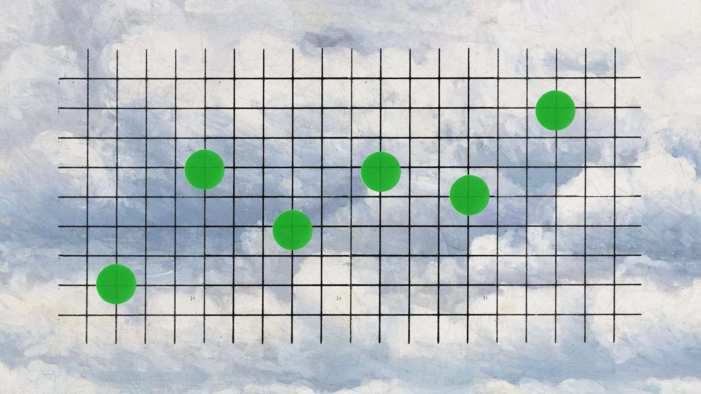

上个月，我们推出了 [人为经济指数](https://www.anthropic.com/economic-index)——这是一项新举措，我们定期发布数据和研究，旨在了解人工智能随着时间的推移对劳动力市场和经济的影响。

今天，我们发布了该指数的第二份研究报告，涵盖了 Claude.ai 推出后的使用数据 [Claude 3.7 十四行诗](https://www.anthropic.com/news/claude-3-7-sonnet)-我们最新、最有能力的模型，具有代理编码和新的“扩展思维”模式的优势。

简而言之，我们的最新结果如下：

- 自 Claude 3.7 Sonnet 推出以来，我们观察到编码以及教育、科学和医疗保健应用程序的使用比例有所上升；
- 人们主要将 Claude 3.7 Sonnet 的新“扩展思维”模式用于技术任务，包括与计算机科学研究人员、软件开发人员、多媒体动画师和视频游戏设计师等职业相关的任务；
- 我们正在发布有关任务和职业级别的增强/自动化故障的数据。例如，与撰稿人和编辑相关的任务显示出最高的数量 *任务迭代*，人类和模型共同编写一些东西。相比之下，与笔译和口译相关的任务显示出最高的工作量。 *指令* 行为——模型以最少的人类参与完成任务。

此外，我们还在 Claude.ai 上发布了首个自下而上的使用分类法。这个新数据集涵盖 630 个细粒度类别，从“帮助解决家庭管道、水和维护问题”到“提供有关电池技术和充电系统的指导”。我们希望这种自下而上的分类法对研究人员有用，并揭示自上而下的方法可能会错过的用例，这些方法将使用情况映射到预定义的任务列表。

这些分析的数据集是 [免费下载](https://huggingface.co/datasets/Anthropic/EconomicIndex/).

请继续阅读以了解有关我们调查结果的更多详细信息。

## 自 Claude 3.7 Sonnet 推出以来发生了哪些变化？

上个月，我们推出了 Claude 3.7 Sonnet，这是我们迄今为止最强大的模型，具有“扩展思维模式”。我们重新运行我们的 [之前的分析](https://www.anthropic.com/news/the-anthropic-economic-index) 发布后 11 天的数据，涵盖 100 万条匿名 Claude.ai 免费版和专业版对话。我们分析的绝大多数数据来自 Claude 3.7 Sonnet，因为它被设置为 Claude.ai 和我们的移动应用程序的默认值。

提醒一下，我们的隐私保护分析工具， [克里奥](https://www.anthropic.com/research/clio)，将每个对话映射到美国 17,000 项任务中的一项劳工部的 O*NET 数据库。然后，我们研究与这些任务相关的职业和高级职业类别的总体模式。

当查看这 100 万个对话的细分时，我们发现几个职业类别的使用比例略有增加，包括编码、教育和科学。虽然编码使用量的增加是由于 Claude 3.7 Sonnet 在编码基准上得分的提高而预计的，但其他类别的增加可能反映了人工智能在整个经济中的持续扩散、编码在这些领域的新颖应用，或者模型中意外的能力改进。

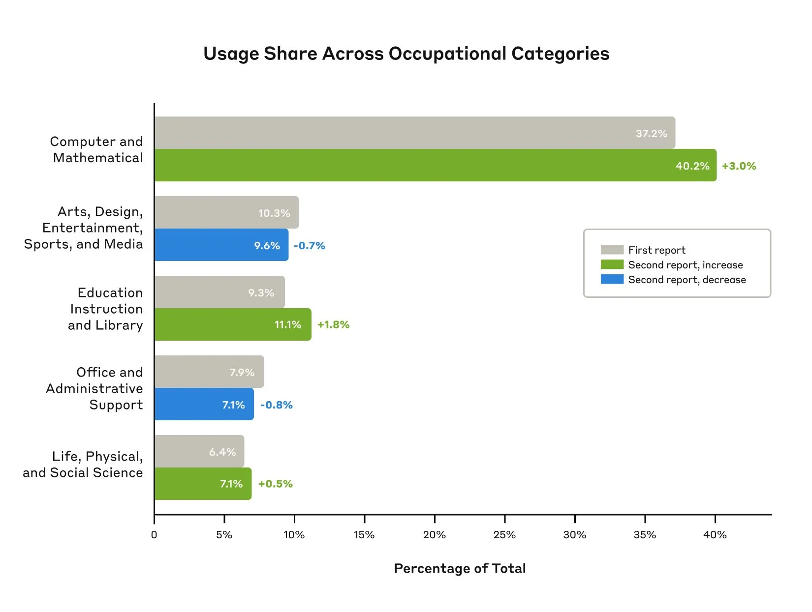

自原始数据样本发布以来的两个月里，我们发现编码、教育和科学的使用比例有所增加。图表显示了 O*NET 中顶级职业类别中 Claude.ai 免费版和专业版流量的份额。Gray 显示了我们第一份报告的分布情况，涵盖了 25 年 12 月至 25 年 1 月的数据。彩色条显示我们的新数据从 2025 年 2 月到 25 年 3 月的使用份额的增加（绿色）和减少（蓝色）。请注意，该图显示的是使用份额而不是绝对使用情况。请参阅附录，查看显示职业类别完整列表变化的图表。

## 人们如何使用扩展思维模式？

Claude 3.7 Sonnet 具有新的“扩展思维”模式，当用户激活该模式时，模型可以在回答更复杂的问题时思考更长时间。

我们的分析表明，Claude 3.7 Sonnet 的扩展思维模式主要用于技术和创造性解决问题的环境中。与计算机和信息研究相关的任务中，科学家使用扩展思维的比例领先，接近 10%，其次是软件开发人员，比例约为 8%。与多媒体艺术家（~7%）和视频游戏设计师（~6%）等数字创意角色相关的任务也显示出大量使用。

虽然这些早期的使用模式揭示了人们何时选择使用扩展思维模式的见解，但有关这种新模型功能的许多重要问题仍然存在。为了在这个领域进行进一步的研究，我们发布了一个新的数据集，它将每个 O*NET 任务映射到其相关的思维模式部分。该数据集可在我们的 [拥抱脸页面](https://huggingface.co/datasets/Anthropic/EconomicIndex/).

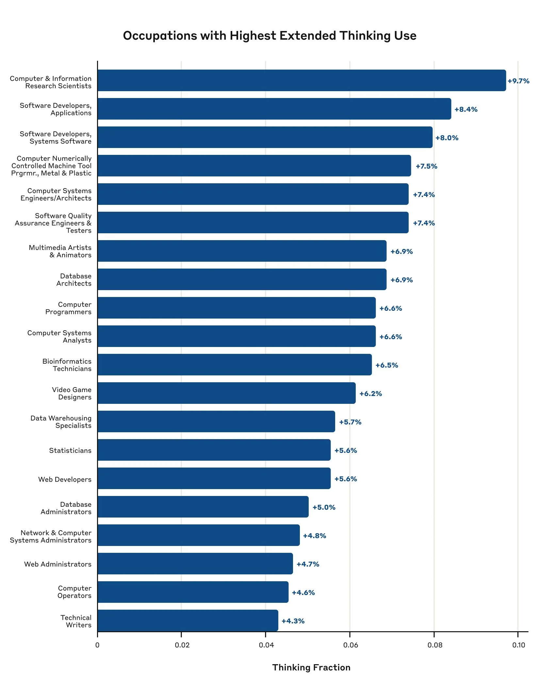

哪些任务与扩展思维模式的相关使用率最高？图表显示了在相关任务中思维模式使用率最高的 O*NET 职业。显示的职业仅限于数据中至少占 0.5% 的职业。

## 增强与自动化如何因任务和职业而异？

在我们的上一份报告中，我们分析了人工智能使用情况的差异 *增强的* 使用，例如学习或迭代输出，以及 *汽车* 用途，例如要求模型直接完成任务或调试错误。我们的分析显示，在我们的新数据中，增强和自动化的平衡本质上没有改变，增强仍然占使用量的 57%。然而，我们确实看到了一些变化 *类型* 自动化和增强用途——例如，我们看到 *学习* 互动（用户向 Claude 询问有关不同主题的信息或解释）从约 23% 上升至约 28%。

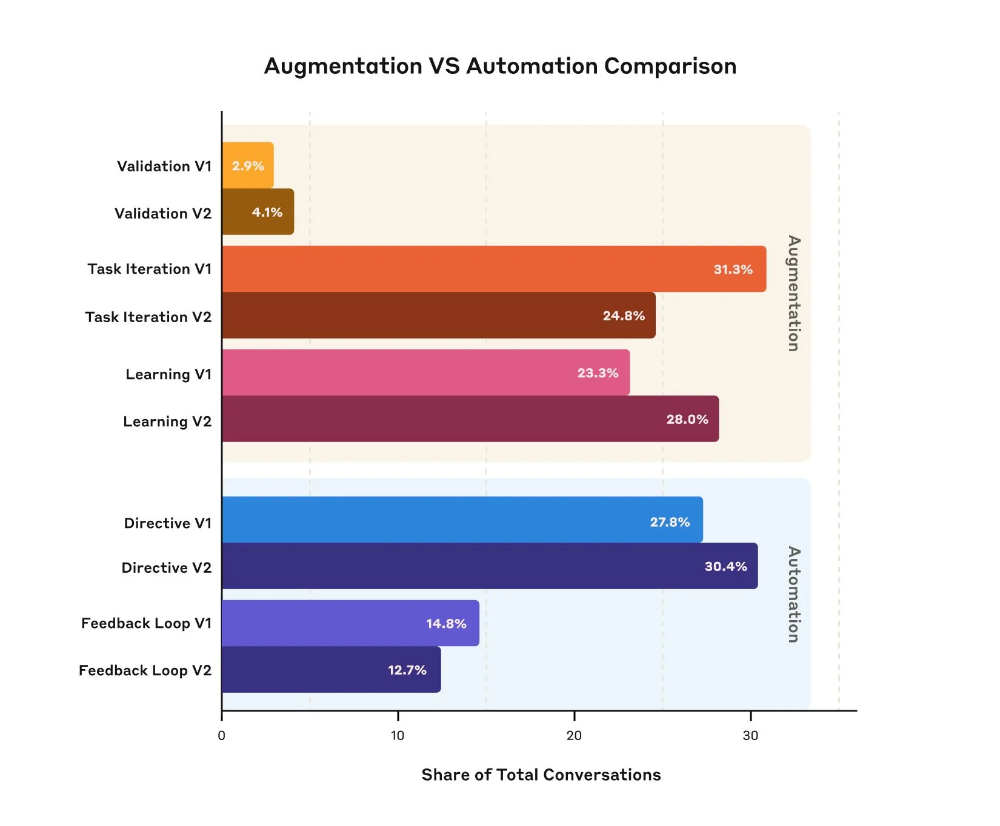

在我们的数据样本（V1 和 V2）之间的两个月内，增强和自动化的平衡保持相对稳定，尽管学习对话的份额已显着增长。

我们通过我们的网站收到了许多请求 [研究员输入表](https://docs.google.com/forms/d/e/1FAIpQLSfDEdY-mT5lcXPaDSv-0Ci1rSXGlbIJierxkUbNB7_07-kddw/viewform) 在任务和职业层面发布自动化和增强数据。我们在这份报告中就是这样做的，提供了我们的数据 [拥抱脸页面](https://huggingface.co/datasets/Anthropic/EconomicIndex/).

当按高级职业类别划分数据时，我们发现一些类别是高度增强的；例如，社区和社会服务任务（包括教育和指导咨询）增加了 75%。在极端的另一端，即与生产或计算机和数学职业相关的任务，我们看到平衡偏差接近 50-50%。我们没有看到任何自动化占主导地位的职业类别。

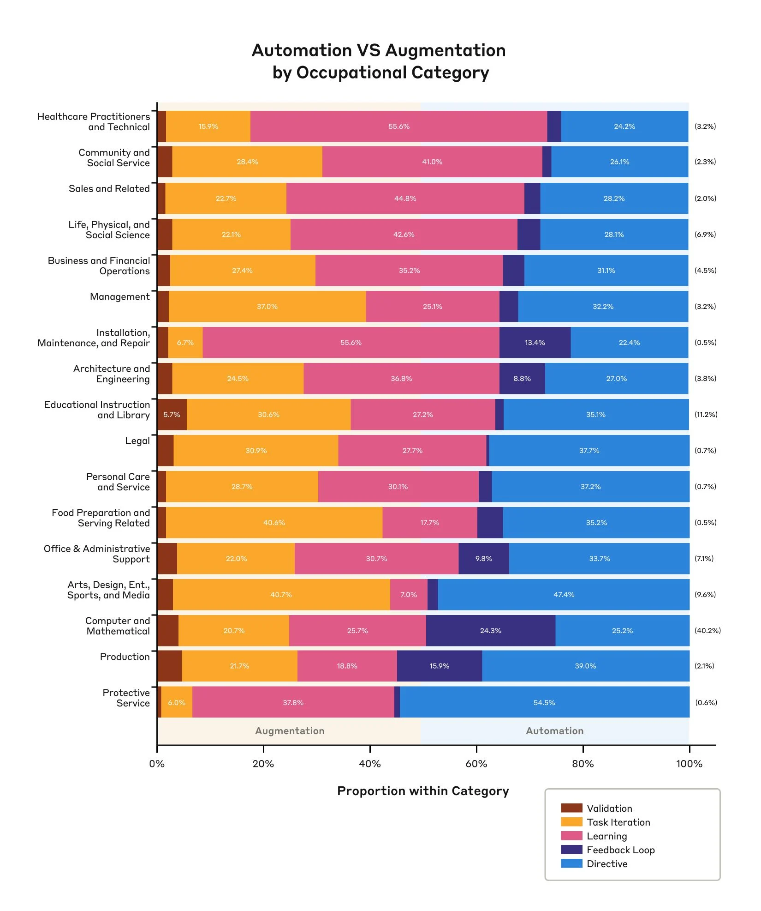

高层次职业类别中不同互动模式的比例。显示的职业类别仅限于数据中至少占 0.5% 的职业类别。

更详细地说，我们还可以查看这些职业类别中的特定职业，以及与该职业相关的任务。例如，与撰稿人和编辑相关的任务显示出最高的数量 *任务迭代*，用户使用模型迭代各种编写和编辑任务。相比之下，与笔译和口译相关的任务显示出最高的工作量。 *指令* 行为——模型用于在最少的人工参与下翻译文档。请注意，O*NET 的描述可能无法最佳地代表 Claude 的用途，例如，虽然我们看到“美术艺术家，包括画家、雕塑家和插画家”这一职业的用法，但 Claude 可能更多地用于创作数字艺术，而不是绘画或雕塑。

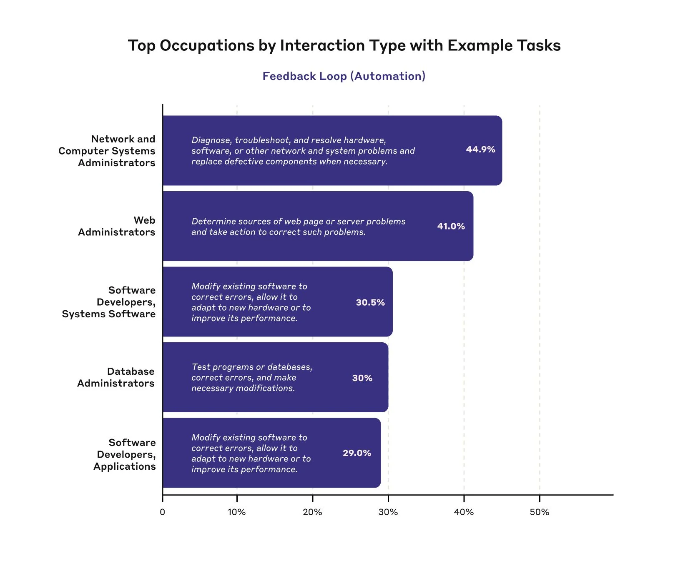

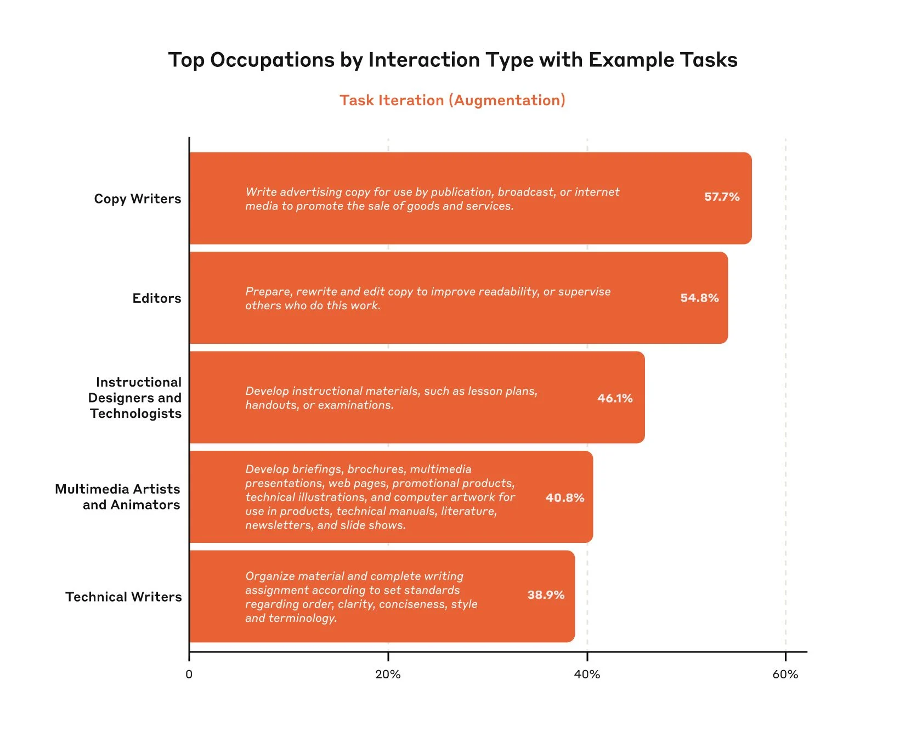

按互动类型划分的热门职业。对于五个交互类别（学习、任务迭代、验证、指令和反馈循环）中的每一个，我们绘制了该类别中使用比例最高的职业。例如，图书馆员的学习互动比例最高，约为 56%，而文案撰写者在任务迭代方面领先，约为 58%。每个面板都包含职业中对交互模式贡献最大的 O*NET 任务；这基于任务发生的频率以及任务中使用交互模式的频率。其他学习模式的数据见附录。请注意，O*NET 的描述可能无法最佳地代表 Claude 的用途，例如，虽然我们看到“美术艺术家，包括画家、雕塑家和插画家”这一职业的用法，但 Claude.ai 上的用法可能更倾向于数字艺术而不是雕塑。仅显示在整个数据集中至少占 0.5% 的职业。

## Claude.ai 上自下而上的使用分类法

到目前为止，我们的研究依赖于 O*NET 任务和职业数据集，该数据集由美国劳工部创建和维护。虽然 O*NET 涵盖了大量任务，但 O*NET 可能不是描述通用模型功能的最佳分类法，通用模型可用于 O*NET 中不存在的任务，因此我们的分析可能会遗漏。

为了解决这一差距，我们在 Claude.ai 上发布了一个新的自下而上的用户活动模式数据集。该数据集也是使用 Clio 创建的，并使用与上述分析相同的匿名对话数据集，这意味着它可以在自上而下和自下而上的方法之间进行比较。它由 630 个粒度集群组成，具有相关描述、流行度指标和自动化/增强细分，组织成三个层次结构。

虽然我们将对该数据集的详细分析留到未来的工作中，但我们重点介绍了一些特别有趣的集群：

- 帮助水管理系统和基础设施项目
- 使用交互式可视化功能创建基于物理的模拟
- 帮助我选择字体、实施和故障排除
- 帮助我创建或改进工作申请材料
- 提供电池技术和充电系统指导
- 帮助处理代码和数据库中的时区

## 结论

随着模型的不断发展，我们对其经济影响的衡量也必须如此。在我们的第二份报告中，涵盖自 Claude 3.7 Sonnet 推出以来的数据，我们发现编码、教育和科学用例的增长相对适度，增强和自动化的平衡没有变化。我们发现Claude的新扩展思维模式在技术领域和任务中使用频率最高，并识别跨任务和职业的自动化/增强模式的模式。我们发布了这两项分析的数据集。

在接下来的几个月中，我们的目标是继续跟踪这些指标，并随着能力的提高和模型继续在整个经济中应用而开发新的指标。

## 与我们合作

如果您有兴趣 [工作](https://www.anthropic.com/jobs) 在 Anthropic，为了研究人工智能对劳动力市场的影响，我们鼓励您申请我们的社会影响研究科学家和研究工程师职位，以及我们的经济学家职位。

## 附录

我们在本附录中分享了一些额外的结果和技术细节。

### 任务曲线

我们还重新计算了原始论文中的“任务使用深度”图。我们通常发现一条与我们的第一次分析非常相似的曲线。如果说有什么不同的话，我们会发现新模型的曲线下面积略有减少，这可能是因为我们的编码对话样本集中度增加了。也就是说，虽然过去两个月我们没有看到这条曲线发生巨大变化，但我们将继续监控模型功能和产品表面的不断进步。

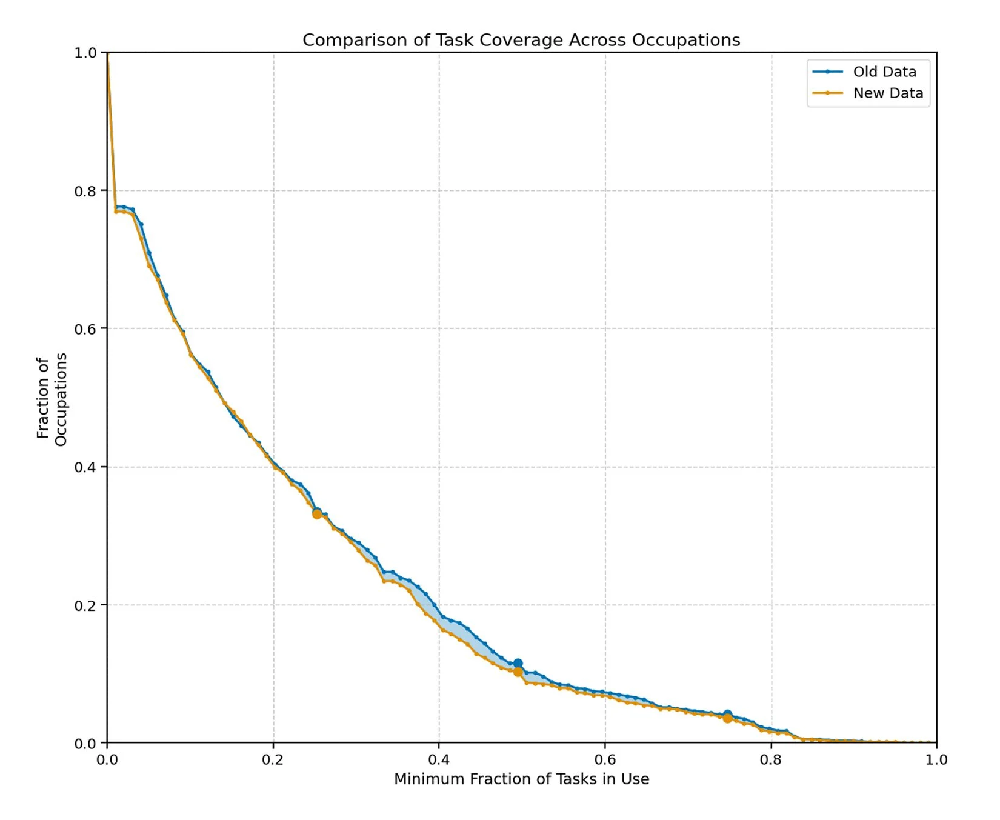

跨职业的任务使用深度。例如，该图显示，大约 40% 的职业在至少 20% 的任务中使用了人工智能（其中 x=0.2，y≈0.4）。我们的第一份报告和第二份报告之间的曲线几乎没有变化。

### 跨职业类别的全面变革

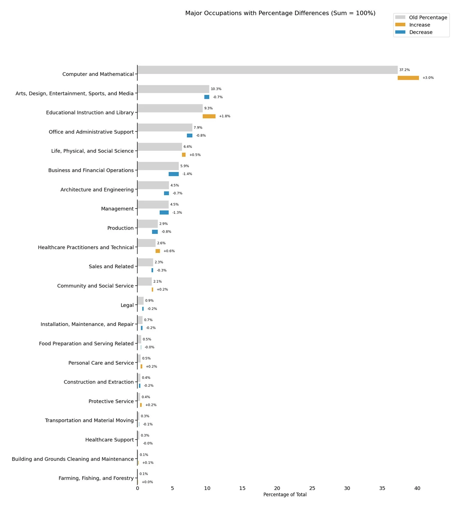

跨职业类别的使用百分比，显示我们原始报告（灰色条）中的值以及第二份报告中相应的增加（黄色）和减少（蓝色）。计算机和数学职业是绝对增幅最大的类别（+3%），而教育和科学等几个类别的增幅也显着。

### 其他交互模式的结果

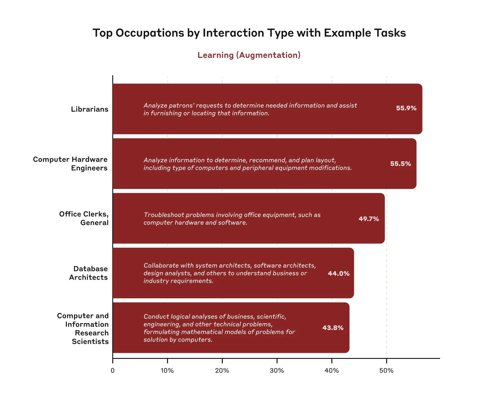

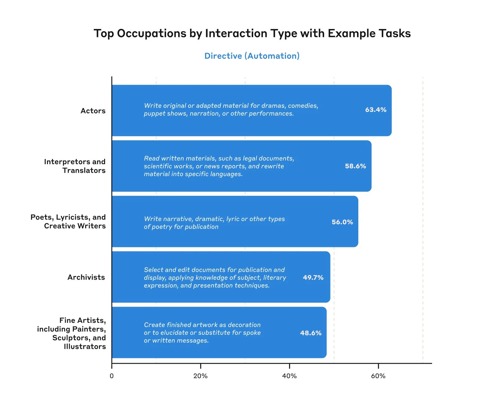

按互动类型划分的热门职业。对于五个交互类别（学习、任务迭代、验证、指令和反馈循环）中的每一个，我们绘制了该类别中使用比例最高的职业。例如，图书馆员的学习互动比例最高，约为 56%，而文案撰写者在任务迭代方面领先，约为 58%。每个面板都包含职业中对交互模式贡献最大的 O*NET 任务；这基于任务发生的频率以及任务中使用交互模式的频率。其他学习模式的数据显示在帖子的正文中。请注意，O*NET 的描述可能无法最佳地代表 Claude 的用途，例如，虽然我们看到“美术艺术家，包括画家、雕塑家和插画家”这一职业的用法，但 Claude.ai 上的用法可能更倾向于数字艺术而不是雕塑。仅显示在整个数据集中至少占 0.5% 的职业。

## 其他方法细节

虽然我们主要遵循原始报告的方法，但我们做了一些更改，为了透明度起见，我们在此处记录了这些更改：

- 与我们上次的报告相反，我们不会根据对话是否与职业类别相关进行过滤。相反，我们只是过滤掉标记我们安全分类器的对话。我们发现这些方法会产生与我们原始分析相似的结果，同时保留更多数据，我们可以通过自下而上的使用分类法发布这些数据。
- 我们使用 Claude 3.7 Sonnet 代替之前使用 Claude 3.5 Sonnet 的所有情况。我们发现，根据我们用来评估 Clio 准确性的内部基准，使用我们的新模型提高了分类的准确性。
